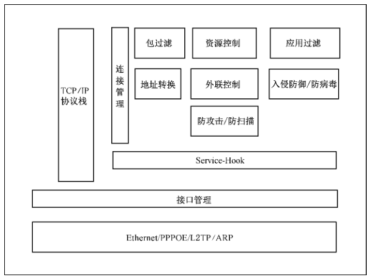
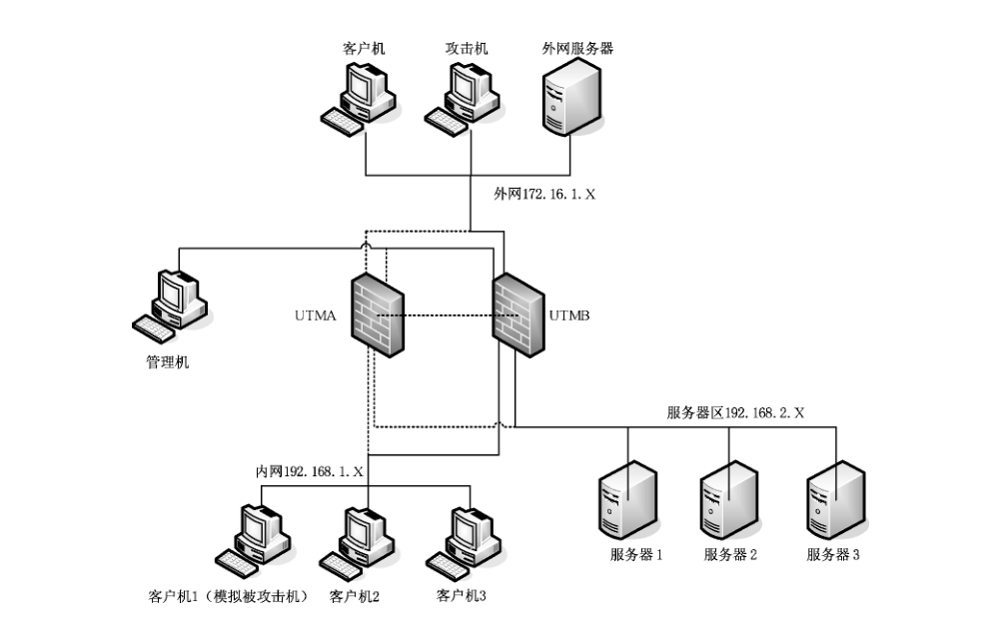

# GB/T 31499-2015 信息安全技术 统一威胁管理产品技术要求和测试评价方法

> 来源：[GB/T 31499-2015 国家标准详情](https://openstd.samr.gov.cn/bzgk/std/newGbInfo?hcno=ABACD0FDF3944B6668A2CA702397CAC8)；发布日期：2015-05-15；实施日期：2016-01-01。
> PDF SHA-256：13911daa58394d8d59f581d2cc004417c70b2e955c114f035d673fb181ec79d0。
> 转写说明：对照官方 PDF 全部 47 页图像逐页校正；省略封面、目录、页眉、页脚和页码，合并跨页内容。表1、表2已重建，图1—图3保留原图。原文中“网络性能分析仪生”“随即端口”“测预期结果”“温室度”“connectios/second”等疑似笔误照录。正式引用请核对官方原文。

## 前言

本标准按照 GB/T 1.1—2009 给出的规则起草。

请注意本文件的某些内容可能涉及专利。本文件的发布机构不承担识别这些专利的责任。

本标准由全国信息安全标准化技术委员会（SAC/TC 260）提出并归口。

本标准起草单位：北京启明星辰信息安全技术有限公司、华北计算技术研究所、清华大学、公安部计算机信息系统安全产品质量监督检验中心、公安部第三研究所。

本标准主要起草人：袁智辉、张怡、覃闯、俞优、顾健、袁卫库、沈颖、邓轶、任平、潘磊、蒋磊、范成刚、刘健、李国俊、肖聪、陈硕、奚贝、杨金恒。

## 1 范围

本标准规定了统一威胁管理产品的功能要求、性能指标、产品自身安全要求和产品保证要求，以及统一威胁管理产品的分级要求，并根据技术要求给出了测试评价方法。

本标准适用于统一威胁管理产品的设计、开发、测试和评价。

## 2 规范性引用文件

下列文件对于本文件的应用是必不可少的。凡是注日期的引用文件，仅注日期的版本适用于本文件。凡是不注日期的引用文件，其最新版本（包括所有的修改单）适用于本文件。

GB 17859—1999 计算机信息系统安全保护等级划分准则

GB/T 18336.1—2008 信息技术 安全技术 信息技术安全性评估准则 第1部分：简介和一般模型（ISO/IEC 15408-1:2005,IDT）

GB/T 25069 信息安全技术 术语

## 3 术语和定义

GB 17859—1999、GB/T 25069 和 GB/T 18336.1—2008中界定的以及下列术语和定义适用于本文件。

### 3.1 统一威胁管理 unified threat management; UTM

通过统一部署的安全策略，融合多种安全功能，针对面向网络及应用系统的安全威胁进行综合防御的网关型设备或系统。

### 3.2 访问控制 access control

通过对访问网络资源用户身份进行鉴别，并依照其所属的预定义组安全策略来授权对其提出的资源访问请求加以控制的技术。

### 3.3 内部网络 internal network

在组织范围内部与外部网络隔离的，受保护的可信网络区域。

### 3.4 外部网络 external network

在组织范围以外处理、传递公共资源的公开网络区域。

### 3.5 安全策略 security policy

为保护业务系统安全而采用的具有特定安全防护要求的控制方法、手段和方针。

### 3.6 病毒 virus

在计算机程序中插入破坏计算机功能或者数据，影响计算机使用并且能自我复制的一组计算机指令或程序代码。

### 3.7 病毒特征 virus signature

从病毒程序中提取出的一系列二进制字符串，用以标识某个病毒，将其与其他病毒或者正常的计算机程序区分开来。

### 3.8 病毒特征库 virus signature database

记录各种病毒特征的集合。

### 3.9 事件 incident

一种试图改变信息系统安全状态并可能造成损害的情况。

### 3.10 攻击特征 attack signature

预先定义的能够发现一次攻击事件正在发生的特定信息。

### 3.11 入侵 intrusion

违反安全策略，避开安全措施，通过各种攻击手段来接入、控制或破坏信息系统的非法行为。

### 3.12 入侵防御 intrusion protection

通过分析网络流量发现具有入侵特征的网络行为，在其传入被保护网络前进行预先拦截的产品。

### 3.13 垃圾邮件 spam

收件人事先未提出要求或者同意接收的广告、电子刊物、各种形式的宣传品等电子邮件，通常会隐藏或包含虚假的发件人身份、地址、标题等信息。

### 3.14 主机 host

计算机，用于放置主板及其他主要部件的容器。

### 3.15 用户 user

使用者在 UTM 安全策略的控制下，通过 UTM 访问某一个区域，该使用者不具有能影响 UTM 安全策略执行的权限。

### 3.16 授权管理员 authorized administrator

具有 UTM 管理权限的账户，负责对 UTM 的系统配置、安全策略、审计日志等进行管理。

### 3.17 告警 alert

当检测到攻击或威胁事件产生时，UTM 向授权管理员发出的紧急通知。

### 3.18 响应 response

UTM 产品检测到攻击事件发生时，阻止攻击并向管理员发送告警的行为。

### 3.19 吞吐量 throughput

没有帧丢失的情况下，UTM 产品能够接受的最大速率。

### 3.20 延迟 latency

数据帧的最后一个位的末尾到达 UTM 产品内部网络输入端口至数据帧的第一个位的首部到达 UTM 产品外部网络输出端口之间的时间间隔。

### 3.21 最大并发连接数 maximum concurrent connection capacity

UTM 产品能同时保持并处理的最大 TCP 并发连接数目。

### 3.22 最大新建连接速率 maximum connection establishment rate

UTM 产品单位时间内所能建立的最大 TCP 连接速率。

### 3.23 链路 link

两台网络设备之间的物理连接。

## 4 缩略语

下列缩略语适用于本文件。

ARP：地址解析协议（Address Resolution Protocol）

AV：防病毒（Anti-virus）

CLI：命令行界面（Command Line Interface）

CRL：证书吊销列表（Certificate Revocation List）

DNAT：目的网络地址转换（Destination Nat）

DNS：域名系统（Domain Name System）

FTP：文件传输协议（File Transfer Protocol）

GRE：通用路由封装（Generic Routing Encapsulation）

HTML：超文本标记语言（Hypertext Markup Language）

HTTP：超文本传送协议（Hypertext Transfer Protocol）

ICMP：互联网控制报文协议（Internet Control Message Protocol）

IM：即时通讯（Instant Messaging）

IMAP：互联网消息访问协议（Internet Message Access Protocol）

IP：互联网协议（Internet Protocol）

IPS：入侵防御系统（Intrusion Protection System ）

LDAP：轻量目录访问协议 （Lightweight Directory Access Protocol）

L2TP：二层隧道协议 （Layer 2 Tunneling Protocol）

NAT：网络地址转换（Network Address Translation）

NFS：网络文件系统（Network File System）

OSPF：开放最短路径优先（Open Shortest Path First）

P2P：点对点协议（Peer-to-peer Protocol）

POP：邮局协议 （Post Office Protocol）

RIP：路由信息协议 （Routing Information Protocol）

RPC：远程过程调用（Remote Procedure Call）

SMTP：简单邮件传送协议（Simple Mail Transfer Protocol）

SNAT：源网络地址转换（Source Ip Nat）

SNMP：简单网络管理协议（Simple Network Management Protocol）

SQL：结构化查询语言（Structured Query Language）

SSH：安全外壳协议（Secure Shell）

TCP：传输控制协议（Transport Control Protocol）

TFTP：简单文件传送协议 （Trivial File Transfer Protocol）

UDP：用户数据报协议（User Datagram Protocol）

URL：统一资源定位符（Uniform Resource Locator）

VLAN：虚拟局域网（Virtual Local Area Network）

## 5 综述

### 5.1 UTM 产品概念模型

#### 5.1.1 概念定义

威胁是指违背安全的一种潜能，当存在可能损坏安全的情况、能力、措施或事件时，就一定存在这种可导致破坏的潜能。

UTM 是由硬件、软件和网络技术组成的具有专门用途的设备，它主要提供一项或多项安全功能，同时将多种安全特性集成于一个硬件设备里，形成标准的统一威胁管理平台，进行抵御来自网络的各种威胁。

UTM 框架见图1。

#### 5.1.2 网络部署方式

UTM 通常部署在内部网络与外部网络的边界，对流出和进入内部网络的数据进行保护和控制。

UTM 在实际网络中的部署方式通常包括：透明网桥、路由转发和 NAT 网关。

#### 5.1.3 UTM 功能组成

UTM 功能组成如下：

— 网络接入功能：具备路由模式、NAT 模式、透明模式网络接入能力。

— 带宽管理功能：具备监视、管理流量带宽的能力。

— 访问控制功能：具备基本网络数据访问控制能力，根据定义的策略允许对应的 IP 数据包访问网络资源。

— 入侵防御功能：采用相关的分析检测技术，对流入目标网络的数据进行提取并分析，并根据定义的策略对入侵行为进行拦截响应。

— 防病毒功能：检测通过网络传输的文件，识别并阻断其中包含恶意代码的信息。

— 应用协议控制功能：采用各种分析检测技术，识别并控制通过网络传输的各种网络应用协议。

— 管理配置功能：负责 UTM 产品定制策略、审阅日志、产品状态管理，并以可视化形式提交授权管理员进行管理。

### 5.2 安全环境

#### 5.2.1 应用环境

UTM 适用于有安全网关要求的业务网系统，系统可以工作在三层路由/NAT 模式下，也可以直接工作在透明模式下。

#### 5.2.2 安全威胁

##### 5.2.2.1 综述

符合本标准的 UTM 要求能够对抗 5.2.2.2~5.2.2.12中陈述的威胁。威胁代理可以是未授权的个人或未授权使用 UTM 的外部 IT 实体。

##### 5.2.2.2 未授权访问

未授权的个人可能试图通过旁路 UTM 安全机制的方法，访问和使用 UTM 提供的安全功能和/或非安全功能。

##### 5.2.2.3 鉴别数据恶意猜测

未授权的个人可能使用反复猜测鉴别数据的方法，并利用所获信息，对 UTM 实施攻击。

##### 5.2.2.4 访问未被记录

由于访问未被记录，因此访问者可能不需对其操作的行为负责，这样可能导致某些攻击者能够逃避检测。

##### 5.2.2.5 配置数据被破坏

未授权的个人可能读、修改或破坏了重要的 UTM 安全配置数据。

##### 5.2.2.6 审计记录破坏/丢失

未授权的个人可能通过耗尽审计数据存储空间的方法，导致审计记录的丢失或阻止未来审计记录的存储，从而掩盖攻击者的攻击行为。

##### 5.2.2.7 无控制的内网访问

内网部分主机可以被外网无限制访问；存在安全隐患。

##### 5.2.2.8 无控制的外网访问

外网主机对外网访问无控制；存在安全隐患。

##### 5.2.2.9 无限制的网络资源占用

未授权的访问滥用网络资源。

##### 5.2.2.10 非恶意错误行为

针对 IT 系统的错误行为。

##### 5.2.2.11 恶意行为

针对 IT 系统漏洞的恶意访问或攻击。

##### 5.2.2.12 病毒威胁

恶意的代理可能会尝试通过网络引入病毒，并攻击系统。

##### 5.2.2.13 网络窃听

针对网络传输数据的非法窃听，窃取机密信息。

### 5.3 安全目标

UTM 应达到如下安全目标：

#### 5.3.1 身份鉴别

在允许用户访问 UTM 功能之前，UTM 必须对用户身份进行唯一的标识和鉴别。

#### 5.3.2 防口令猜测攻击

对从网络上进行 UTM 鉴别的用户，UTM 必须防止口令猜测攻击。

#### 5.3.3 审计记录

必须提供记录安全相关事件的、可读的审计迹的方法，审计记录必须具有精确的日期和时间；对审计迹，TOE 必须提供基于属性的检索和分类的方法。

#### 5.3.4 自我保护

UTM 必须做好自身防护，以对抗非授权用户对 UTM 安全功能的旁路、抑制或篡改的尝试。

#### 5.3.5 访问控制

对于经过 UTM 传输的数据，UTM 必须做到允许或禁止的访问控制。

#### 5.3.6 应用层安全分析

UTM 必须能探测发生在 IT 系统上的有关访问滥用，恶意行为的所有事件信息；并进行分析。

#### 5.3.7 攻击响应

UTM 必须根据应用层分析结论，对攻击作出响应。如阻断、告警等。

#### 5.3.8 病毒防护

UTM 必须能检测通过网络传播的已知病毒，并对病毒作出处理。

## 6 UTM 等级划分说明

### 6.1 综述

依据 UTM 的网络部署能力、安全能力、自身安全性、保证性要求进行等级划分，分为基本级和增强级两个级别。本文件不依据性能为做等级划分依据。

### 6.2 基本级

本级定义了 UTM 功能的最低轮廓和要求。基本级 UTM 可部署于相对简单的网络边界，应具备：

a） 基本的安全能力：包括访问控制、入侵防御、防病毒等能力；

b） 基本的自身安全性要求：提供管理员身份鉴别机制、安全审计能力；并能够抵御针对 UTM 自身的攻击；

c） 基本的开发过程保证性要求。

### 6.3 增强级

本级定义了 UTM 的增强性要求。增强级 UTM 可对复杂多样的安全威胁实施一体化防御，适用于复杂网络环境，可针对复杂多样的网络应用协议，实施威胁分析与防御。应具备：

a） 增强的安全能力，利用细粒度分析与标识手段保证访问控制、入侵防御、防病毒等安全能力不被躲避；

b） 增强的自身安全性要求：提供多种管理员身份鉴别和校验机制，保证管理员身份的合法性；通过数据加密或校验保证审计数据的可用性和安全性；

c） 增强的开发过程保证性要求。

### 6.4 功能和自身安全要求等级划分

UTM 产品的安全等级划分如表1、表2所示。对 UTM 产品的等级评定是依据下面两个表格，结合产品保证要求的综合评定得出的，符合基本级的 UTM 产品应满足表1、表2中所标明的基本级产品应满足的所有项目，以及对基本级产品的相关保证要求；符合增强级的 UTM 产品应满足表1、表2中所标明的增强级产品应满足的所有项目，以及对增强级产品的相关保证要求。

**表1 UTM 功能要求等级划分**

| 产品功能要求 | 功能组件 | 基本要求 | 增强要求 |
| --- | --- | --- | --- |
| 网络接入 | NAT 功能 | ★ | ★ |
| 网络接入 | 静态路由 | ★ | ★ |
| 网络接入 | 策略路由 | ★ | ★ |
| 网络接入 | 动态路由 |  | ★ |
| 带宽管理 | 流量监测 | ★ | ★ |
| 带宽管理 | 流量限制 |  | ★ |
| 带宽管理 | 流量保证 |  | ★ |
| 访问控制 | 默认禁止原则 | ★ | ★ |
| 访问控制 | 数据拦截 | ★ | ★ |
| 访问控制 | 基于时间的策略控制 | ★ | ★ |
| 访问控制 | 数据拦截记录 | ★ | ★ |
| 访问控制 | IP MAC 绑定 |  | ★ |
| 访问控制 | 基于用户的策略控制 |  | ★ |
| 应用协议控制 | 基于 URL 的访问控制 | ★ | ★ |
| 应用协议控制 | 基于电子邮件信息头的访问控制 | ★ | ★ |
| 应用协议控制 | 基于 HTTP 关键字的访问控制 | ★ | ★ |
| 应用协议控制 | IM 类协议访问控制 | ★ | ★ |
| 应用协议控制 | P2P 类协议访问控制 | ★ | ★ |
| 应用协议控制 | 协议躲避识别 |  | ★ |
| 应用协议控制 | 应用协议特征更新 |  | ★ |
| 入侵防御 | 数据分析 | ★ | ★ |
| 入侵防御 | 入侵发现 | ★ | ★ |
| 入侵防御 | 事件阻断 | ★ | ★ |
| 入侵防御 | 安全告警能力 | ★ | ★ |
| 入侵防御 | 事件可视化 | ★ | ★ |
| 入侵防御 | 定制特征 |  | ★ |
| 入侵防御 | 事件分级 |  | ★ |
| 入侵防御 | 报表生成 |  | ★ |
| 入侵防御 | 定制报表 |  | ★ |
| 入侵防御 | 攻击躲避识别 |  | ★ |
| 入侵防御 | 入侵特征库更新 |  | ★ |
| 病毒防护 | 病毒传输检测 | ★ | ★ |
| 病毒防护 | 病毒阻断 | ★ | ★ |
| 病毒防护 | 压缩文件病毒检测 |  | ★ |
| 病毒防护 | 病毒特征库更新 |  | ★ |
| 反垃圾邮件 | 用户自定义 IP 地址标记垃圾邮件 |  | ★ |
| 反垃圾邮件 | 邮件自学习 |  | ★ |
| 反垃圾邮件 | 邮件信息记录 |  | ★ |
| 管理配置 | 本地管理 | ★ | ★ |
| 管理配置 | 远程管理 | ★ | ★ |
| 管理配置 | 策略配置 | ★ | ★ |
| 管理配置 | 产品升级 | ★ | ★ |
| 管理配置 | 统一管理 |  | ★ |

注：“★”指具有此功能。

**表2 UTM 产品自身安全要求等级划分**

| 产品功能要求 | 功能组件 | 基本要求 | 增强要求 |
| --- | --- | --- | --- |
| 标识与鉴别 | 用户属性定义 | ★ | ★ |
| 标识与鉴别 | 口令鉴别 | ★ | ★ |
| 标识与鉴别 | 多重鉴别机制 |  | ★ |
| 标识与鉴别 | 鉴别失败处理 | ★ | ★ |
| 标识与鉴别 | 鉴别的时机 | ★ | ★ |
| 标识与鉴别 | 与第三方认证系统配合 |  | ★ |
| 安全审计 | 审计数据的生成 | ★ | ★ |
| 安全审计 | 审计数据的查阅 | ★ | ★ |
| 安全审计 | 审计数据的可用性 |  | ★ |
| 安全审计 | 受限的审计数据查阅 |  | ★ |
| 安全管理 | 安全功能行为管理 | ★ | ★ |
| 安全管理 | 安全属性管理 | ★ | ★ |
| 安全管理 | 基于安全属性的访问控制 | ★ | ★ |
| 安全管理 | 系统属性管理 | ★ | ★ |
| 安全管理 | 安全角色 | ★ | ★ |
| 抗渗透 | 抗源 IP 地址欺骗 | ★ | ★ |
| 抗渗透 | 抗拒绝服务攻击 |  | ★ |
| 抗渗透 | 抗网络、端口扫描 |  | ★ |
| 抗渗透 | 抗漏洞扫描 |  | ★ |
| 可信恢复 | 配置信息不丢失 | ★ | ★ |

注：“★”指具有此功能。

## 7 详细技术要求

### 7.1 基本级

#### 7.1.1 产品功能要求

##### 7.1.1.1 网络接入

###### 7.1.1.1.1 NAT 功能

UTM 应支持双向 NAT 功能，包括 SNAT 和 DNAT，具体技术要求如下：

a） SNAT 应实现“多对一”地址转换，使得内部网络主机正常访问外部网络时，其源 IP 地址被转换；

b） DNAT 应实现“一对一”地址转换，将服务器区的 IP 地址映射为外部网络合法 IP 地址，使外部网络主机通过访问映射的目的地址时，实现对服务器区服务器的访问。

###### 7.1.1.1.2 静态路由

UTM 应支持手工配置静态路由功能，可以让处于不同网段的计算机通过路由转发的方式互相通信。

###### 7.1.1.1.3 策略路由

UTM 应至少支持源地址、目的地址、协议、接口的组合控制数据包的转发路径。

##### 7.1.1.2 带宽管理

流量监测：UTM 应至少支持通过 IP 地址、时间和协议类型参数或它们的组合进行流量统计。

##### 7.1.1.3 访问控制

###### 7.1.1.3.1 默认禁止原则

UTM 产品应具备在未配置任何访问控制策略时，禁止所有数据进入目标网络的功能。

###### 7.1.1.3.2 数据拦截

UTM 产品应具备对违反策略定义的数据进行阻断的功能，防止未合规数据进入目标网络。策略应至少支持对源 IP、目的 IP、服务、接口的组合配置。

###### 7.1.1.3.3 基于时间的策略控制

UTM 应至少支持基于时间的包过滤访问控制。

###### 7.1.1.3.4 数据拦截记录

UTM 应能对拦截行为及时生成审计记录，记录的信息应至少包括数据拦截发生日期时间、源 IP 地址、源端口、目的 IP 地址、目的端口。

##### 7.1.1.4 应用协议控制

###### 7.1.1.4.1 基于 URL 的访问控制

UTM 应支持 URL 的访问控制功能，能够禁止指定的 URL 访问。

###### 7.1.1.4.2 基于电子邮件信息头的访问控制

UTM 应至少支持对电子邮件中的 Subject、To、From 域进行的访问控制。

###### 7.1.1.4.3 基于 HTTP 关键字的访问控制

UTM 应支持基于关键字过滤 HTTP 网页内容的功能，控制用户对非法内容的访问。

###### 7.1.1.4.4 IM 类协议访问控制

UTM 应具备 IM 类协议的访问控制功能，至少支持对 MSN、QQ 的登录进行控制。

###### 7.1.1.4.5 P2P 类协议访问控制

UTM 应具备 P2P 类协议的访问控制功能，至少支持对 bt 文件传输协议、ed2k 文件传输协议的阻断。

##### 7.1.1.5 入侵防御

###### 7.1.1.5.1 数据分析

UTM 产品应对收集的数据包进行分析，应至少支持以下协议类型：ARP、ICMP、IP、TCP、UDP、RPC、HTTP、FTP、TFTP、SNMP、 TELNET、DNS、SMTP、POP3、NETBIOS、NFS、MSSQL、SMB、MSN。

###### 7.1.1.5.2 入侵发现

UTM 产品应能发现数据中的入侵行为，应至少支持以下入侵行为的检测：木马后门类事件、拒绝服务类事件、缓冲区溢出类事件。

###### 7.1.1.5.3 事件阻断

UTM 产品应对发现的入侵行为进行预先拦截，防止入侵行为进入目标网络。

###### 7.1.1.5.4 安全告警能力

UTM 产品应支持在检测到入侵时自动采取相应动作，发出安全警告。告警动作应包含且不限于电子邮件、告警日志。

###### 7.1.1.5.5 事件可视化

UTM 产品应支持图形界面上查看拦截到的入侵事件。入侵事件信息应至少包括：事件名称、事件发生日期时间、源 IP 地址、源端口、目的 IP 地址、目的端口、危害等级。

##### 7.1.1.6 病毒防护

###### 7.1.1.6.1 病毒传输检测

UTM 应具备对通过网络进行传输的病毒的检测能力，可以检测激活的病毒、蠕虫、木马等恶意代码的传输行为并进行日志记录和报警。检测日志的内容应至少包含事件名称、源地址、目的地址、事件发生的日期和时间、事件描述。

###### 7.1.1.6.2 病毒阻断

UTM 应支持对病毒文件传输的阻断，能够拦截试图穿越产品的包含病毒代码的文件传输。

##### 7.1.1.7 管理配置

###### 7.1.1.7.1 本地管理

UTM 应支持本地 CLI 或图形管理界面对 UTM 进行配置管理。

###### 7.1.1.7.2 远程管理

UTM 应支持加密的远程管理，如基于 SSH、HTTPS 协议的远程管理。

###### 7.1.1.7.3 策略配置

UTM 应支持对访问控制策略、入侵防御策略、病毒防护策略进行配置的功能，包括策略匹配条件、矛盾策略检测和策略相应措施。

###### 7.1.1.7.4 产品升级

UTM 产品应支持更新自身系统的能力，包括对软件系统的升级以及各种安全能力特征库的升级。

#### 7.1.2 产品自身安全

统一威胁管理产品在进行资源分配时，安全功能应保证其分配的资源中不提供以前所产生的任何信息内容。

##### 7.1.2.1 标识与鉴别

###### 7.1.2.1.1 用户属性定义

UTM 应维护属于单个用户的安全属性，安全属性应包含且不限于：用户标识（如用户名）、授权信息（或用户组信息）。

###### 7.1.2.1.2 口令鉴别

UTM 应支持通过口令鉴别的方式识别用户。

###### 7.1.2.1.3 鉴别失败处理

UTM 产品应支持检测与鉴别事件相关的未成功鉴别尝试次数达到或超过系统默认或仅由授权管理员设定的未成功鉴别次数阈值。当达到或超过所定义的鉴别失败尝试次数时，UTM 产品应终止进行登录尝试动作。

###### 7.1.2.1.4 鉴别的时机

在用户被鉴别前，UTM 产品安全功能应仅允许用户执行输入登录信息或查看帮助信息等与用户安全无关的操作。在允许执行除输入登录信息和查看帮助信息等与用户安全无关的操作外的其他授权操作前，UTM 产品安全功能应要求每个用户都已被成功鉴别。

##### 7.1.2.2 安全审计

###### 7.1.2.2.1 审计数据的生成

UTM 应支持对自身的管理行为及发生的网络行为和事件进行日志记录：

a） 应至少支持以下日志：管理员操作行为、访问控制事件、入侵事件、病毒事件、邮件过滤事件、WEB 过滤事件；

b） 日志的内容需要包含以下内容：时间、事件类型、主体身份、事件的结果。

###### 7.1.2.2.2 审计数据的查阅

UTM 应支持只有授权的管理员可以获得和解释审计信息的能力，用户是人员用户时，审计数据必须以人类可理解的方式表示；用户是外部 IT 实体时，信息必须能够以电子方式无歧义表示。

##### 7.1.2.3 安全管理

###### 7.1.2.3.1 安全功能行为管理

UTM 产品如果支持下述安全功能，则功能应仅限于已标识的授权角色能够执行：

a） 用户的维护（如删除、修改、添加、启用或禁用等）；

b） 用户角色的维护；

c） 如果一个授权用户能够改变在鉴别前所允许的动作，那么能执行对动作列表的管理；

d） 远程管理主机的维护。

###### 7.1.2.3.2 安全属性管理

UTM 产品安全功能应执行访问控制策略，以仅限于已标识的授权角色能够执行以下安全属性管理行为：

a） 对用户名进行管理操作（如查阅、修改或删除等）；

b） 对远程管理主机 IP 地址进行管理操作（如查阅、修改或删除等）；

c） 对用户权限进行管理操作（如授权、更改或取消等）；

d） UTM 产品应保证经过升级后，安全属性数据的完整性。

###### 7.1.2.3.3 基于安全属性的访问控制

UTM 产品安全功能应基于远程管理主机 IP 地址、用户名等属性对 UTM 产品的安全管理执行访问控制策略。

###### 7.1.2.3.4 系统属性管理

UTM 产品安全功能应仅限于已标识的授权角色能够执行以下管理行为：

a） 对审计信息的管理，包含但不限于查阅、查询、清空或导出等行为；

b） 如果产品允许授权用户管理未成功鉴别尝试次数，则对未成功鉴别尝试次数的设置；

c） 对鉴别数据的管理（如改变用户口令默认值或修改用户口令等）。

###### 7.1.2.3.5 安全角色

UTM 产品安全功能应维护已标识的授权角色，UTM 产品安全功能应能够把用户和角色关联起来。

##### 7.1.2.4 抗渗透

抗源 IP 地址欺骗：UTM 产品应支持抵御源 IP 地址欺骗攻击。

##### 7.1.2.5 可信恢复

配置信息不丢失：UTM 产品应支持手动保存配置信息或自动保存配置信息，使配置信息可恢复到关机前的状态；支持恢复出厂默认配置。

#### 7.1.3 产品保证要求

##### 7.1.3.1 配置管理

开发者应为系统的不同版本提供唯一的标识。系统的每个版本应当使用它们的唯一标识作为标签。

##### 7.1.3.2 交付与运行

开发者应提供文档说明系统的安装、生成和启动。

##### 7.1.3.3 安全功能开发

###### 7.1.3.3.1 功能设计

开发者应提供系统的安全功能设计文档。功能设计应以非形式方法来描述安全功能与其外部接口，并描述使用外部安全功能接口的目的与方法，在需要的时候，还要提供例外情况和出错信息的细节。

###### 7.1.3.3.2 表示对应性

开发者应在产品安全功能表示的所有相邻对之间提供对应性分析。

##### 7.1.3.4 文档要求

###### 7.1.3.4.1 管理员指南

开发者应提供授权管理员使用的管理员指南。管理员指南应说明以下内容：

a） 系统可以使用的管理功能和接口；

b） 怎样安全地管理系统；

c） 在安全处理环境中应进行控制的功能和权限；

d） 所有对与系统的安全操作有关的用户行为的假设；

e） 所有受管理员控制的安全参数，如果可能，应指明安全值；

f） 每一种与管理功能有关的安全相关事件，包括对安全功能所控制的实体的安全特性进行的改变；

g） 所有与授权管理员有关的 IT 环境的安全要求。

管理员指南应与为评价而提供的其他所有文件保持一致。

###### 7.1.3.4.2 用户指南

开发者应提供用户指南。用户指南应说明以下内容：

a） 系统的非管理用户可使用的安全功能和接口；

b） 系统提供给用户的安全功能和接口的用法；

c） 用户可获取但应受安全处理环境控制的所有功能和权限；

d） 系统安全操作中用户所应承担的职责；

e） 与用户有关的 IT 环境的所有安全要求；

f） 开发者应承诺不以任何欺骗、偷窃或其他非法手段收集用户相关信息；不利用技术优势干扰、控制用户产品的正常运行，中断或威胁中断技术支持与服务，不在未经用户同意的情况下收集用户相关信息、将用户相关信息披露或转移给第三方。

用户指南应与为评价而提供的其他所有文件保持一致。

##### 7.1.3.5 开发安全要求

开发者应提供开发安全文件。开发安全文件应描述在系统的开发环境中，为保护系统设计和实现的机密性和完整性，而在物理上、程序上、人员上以及其他方面所采取的必要的安全措施。开发安全文件还应提供在系统的开发和维护过程中执行安全措施的证据。

##### 7.1.3.6 测试

###### 7.1.3.6.1 范围

开发者应提供测试覆盖的分析结果。测试覆盖的分析结果应表明测试文档中所标识的测试与安全功能中所描述的安全功能是对应的。

###### 7.1.3.6.2 功能测试

开发者应测试安全功能，并提供相应的测试文档。测试文档应包括测试计划、测试规程、预期的测试结果和实际测试结果。测试计划应标识要测试的安全功能，并描述测试的目标。测试规程应标识要执行的测试，并描述每个安全功能的测试概况，这些概况包括对其他测试结果的顺序依赖性。期望的测试结果应表明测试成功后的预期输出。实际测试结果应表明每个被测试的安全功能能按照规定进行运作。

### 7.2 增强级

#### 7.2.1 产品功能要求

##### 7.2.1.1 网络接入

动态路由：UTM 应至少支持 RIP、OSPF 路由协议。

##### 7.2.1.2 带宽管理

###### 7.2.1.2.1 流量限制

UTM 应支持管理员将指定源 IP、目的 IP、协议的流量限制到规定值。

###### 7.2.1.2.2 流量保证

UTM 应支持拥塞发生时，对管理员指定的源 IP、目的 IP、协议的流量，按照预先设置的带宽优先转发数据。

##### 7.2.1.3 访问控制

###### 7.2.1.3.1 IP MAC 绑定

UTM 应支持手工或自动配置 IP 地址与 MAC 地址绑定，不符合绑定内容的数据包被丢弃。

###### 7.2.1.3.2 基于用户的策略控制

UTM 应支持基于用户的包过滤访问控制，只有通过认证的用户才能访问特定的网络资源。

##### 7.2.1.4 应用协议控制

###### 7.2.1.4.1 协议躲避识别

UTM 应支持对采用标准协议（如 TCP 80、443端口等）端口上传输其他类型应用的检测和识别。

具体技术要求如下：

a） 支持采用 HTTP 方式登录的 IM 软件的禁止，至少支持 MSN、QQ；

b） 支持采用 HTTP、HTTPS 方式传输的 P2P 软件的禁止，至少支持 BitTorrent、eMule。

###### 7.2.1.4.2 应用协议特征更新

UTM 应具备对网络应用协议（包含且不限于 IM、P2P 类）的协议特征升级能力。

##### 7.2.1.5 入侵防御

###### 7.2.1.5.1 定制特征

UTM 产品应允许授权管理员自定义事件的特征，符合自定义特征的数据包可以被阻断。

###### 7.2.1.5.2 事件分级

UTM 产品应支持按照事件的严重程度对事件进行分级。

###### 7.2.1.5.3 报表生成

报表内容应包含表格形式、柱状图、饼图等，并应能够生成日报、周报等汇总报表。

###### 7.2.1.5.4 定制报表

UTM 产品应支持授权管理员按照自己的要求修改和定制报表内容，并输出成方便阅读的文件格式，文件格式应至少支持以下文件格式中的一种或多种：DOC、PDF、HTML、XLS。

###### 7.2.1.5.5 攻击躲避识别

UTM 产品应能发现躲避或欺骗检测的行为，应至少支持：IP 碎片重组、TCP 流重组、协议端口重定位、URL 字符串变形、shell 代码变形。

###### 7.2.1.5.6 入侵特征库更新

UTM 产品应具备升级入侵特征事件库的能力。

##### 7.2.1.6 病毒防护

###### 7.2.1.6.1 压缩文件病毒监测

UTM 产品应支持检测不同压缩格式的文件，应至少支持 ZIP、RAR 压缩格式。

###### 7.2.1.6.2 病毒特征库更新

UTM 产品应具备升级病毒特征库的能力。

##### 7.2.1.7 反垃圾邮件

###### 7.2.1.7.1 用户自定义 IP 地址标记垃圾邮件

UTM 应支持授权管理员设置基于 IP 地址的反垃圾邮件规则，应能够按照规则将指定 IP 地址发送的邮件标记为垃圾邮件。

###### 7.2.1.7.2 邮件自学习

UTM 应支持通过对标记的邮件学习，具备对垃圾邮件的智能识别能力。

###### 7.2.1.7.3 邮件信息记录

UTM 应支持对经过反垃圾邮件功能处理的邮件进行统计，包括正常邮件的数量和标记为垃圾邮件的数量。

##### 7.2.1.8 管理配置

###### 7.2.1.8.1 统一管理

UTM 应支持通过一个管理中心对多台 UTM 进行集中管理，需要支持以下功能：

a） 统一升级软件版本；

b） 统一配置；

c） 统一监控。

#### 7.2.2 产品自身安全

##### 7.2.2.1 标识与鉴别

###### 7.2.2.1.1 多重鉴别机制

除支持口令鉴别方式外，UTM 应支持通过文件证书或 USBKey 的方式对用户进行身份鉴别。

###### 7.2.2.1.2 与第三方认证系统配合

UTM 应支持与第三方认证系统配合的功能，包括 RADIUS 或 LDAP 认证方式。

##### 7.2.2.2 安全审计

###### 7.2.2.2.1 审计数据的可用性

UTM 审计的数据应至少支持：管理员的名称、访问时间、操作时间、登录方式、使用的地址。审计数据的内容应具有可读性。

###### 7.2.2.2.2 受限的审计数据查阅

UTM 审计的数据应只支持授权管理员查询，非授权用户应无法查询审计数据。

##### 7.2.2.3 抗渗透

###### 7.2.2.3.1 抗拒绝服务攻击

UTM 产品应至少支持 Syn flood、UDP flood、Ping of Death 的攻击防护。

###### 7.2.2.3.2 抗网络、端口扫描

UTM 产品应支持抵御网络、端口的扫描。

###### 7.2.2.3.3 抗漏洞扫描

UTM 产品应支持抵御漏洞扫描行为。

#### 7.2.3 产品保证要求

##### 7.2.3.1 配置管理

###### 7.2.3.1.1 配置管理

开发者应使用配置管理系统并提供配置管理文档，以及为系统的不同版本提供唯一的标识。配置管理系统应对所有的配置项作出唯一的标识，并保证只有经过授权才能修改配置项，还应支持系统基本配置项的生成。配置管理文档应包括配置清单、配置管理计划以及接受计划。配置清单用来描述组成系统的配置项。在配置管理计划中，应描述配置管理系统是如何使用的。实施的配置管理应与配置管理计划相一致。在接受计划中，应描述对修改过或新建的配置项进行接受的程序。配置管理文档还应描述对配置项给出唯一标识的方法，并提供所有的配置项得到有效地维护的证据。

###### 7.2.3.1.2 配置管理范围

开发者应提供配置管理文档。配置管理文档应说明配置管理系统至少能跟踪：系统实现表示、设计文档、测试文档、用户文档、管理员文档、配置管理文档和安全缺陷，并描述配置管理系统是如何跟踪配置项的。

##### 7.2.3.2 交付与运行

###### 7.2.3.2.1 交付

开发者应使用一定的交付程序交付系统，并将交付过程文档化。交付文档应包括以下内容：

a） 在给用户方交付系统的各版本时，为维护安全所必需的所有程序；

b） 开发者向用户提供的产品版本和用户收到的版本之间的差异以及如何监测对产品的修改；

c） 如何发现他人伪装成开发者修改用户的产品。

###### 7.2.3.2.2 安装生成

开发者应提供文档说明系统的安装、生成和启动。

##### 7.2.3.3 安全功能开发

###### 7.2.3.3.1 功能设计

开发者应提供系统的安全功能设计文档。安全功能设计应以非形式方法来描述安全功能与其外部接口，并描述使用外部安全功能接口的目的与方法，在需要的时候，还要提供例外情况和出错信息的细节。

###### 7.2.3.3.2 高层设计

开发者应提供产品安全功能的高层设计。高层设计应以非形式方法表述并且是内在一致的。为说明安全功能的结构，高层设计应将安全功能分解为各个安全功能子系统进行描述，并阐明如何将有助于加强产品安全功能的子系统和其他子系统分开。对于每一个安全功能子系统，高层设计应描述其提供的安全功能，标识其所有接口以及哪些接口是外部可见的，描述其所有接口的使用目的与方法，并提供安全功能子系统的作用、例外情况和出错信息的细节。高层设计还应标识系统安全要求的所有基础性的硬件、固件和软件，并且支持由这些硬件、固件或软件所实现的保护机制。

###### 7.2.3.3.3 安全功能的实现

开发者应为选定的产品安全功能子集提供实现表示。实现表示应无歧义而且详细地定义产品安全功能，使得不需要进一步的设计就能生成该安全功能的子集。实现表示应是内在一致的。

###### 7.2.3.3.4 低层设计

开发者应提供产品安全功能的低层设计。低层设计应是非形式化、内在一致的。在描述产品安全功能时，低层设计应采用模块术语，描述每一个安全功能模块的目的，并标识安全功能模块的所有接口和安全功能模块可为外部所见的接口，以及安全功能模块所有接口的目的与方法，适当时，还应提供接口的作用、例外情况和出错信息的细节。低层设计还应包括以下内容：

a） 以安全功能性术语及模块的依赖性术语，定义模块间的相互关系；

b） 说明如何提供每一个安全策略的强化功能；

c） 说明如何将系统加强安全策略的模块和其他模块分离开。

###### 7.2.3.3.5 表示对应性

开发者应在产品安全功能表示的所有相邻对之间提供对应性分析。

##### 7.2.3.4 文档要求

###### 7.2.3.4.1 管理员指南

开发者应提供授权管理员使用的管理员指南。管理员指南应说明以下内容：

a） 产品管理员可以使用的管理功能和接口；

b） 怎样安全地管理系统；

c） 在安全处理环境中应进行控制的功能和权限；

d） 所有对与系统的安全操作有关的用户行为的假设；

e） 所有受管理员控制的安全参数，如果可能，应指明安全值；

f） 每一种与管理功能有关的安全相关事件，包括对安全功能所控制的实体的安全特性进行的改变；

g） 所有与授权管理员有关的 IT 环境的安全要求。

管理员指南应与为评价而提供的其他所有文件保持一致。

###### 7.2.3.4.2 用户指南

开发者应提供用户指南。用户指南应说明以下内容：

a） 系统的非管理用户可使用的安全功能和接口；

b） 系统提供给用户的安全功能和接口的用法；

c） 用户可获取但应受安全处理环境控制的所有功能和权限；

d） 系统安全操作中用户所应承担的职责；

e） 与用户有关的 IT 环境的所有安全要求。

f） 开发者应承诺不以任何欺骗、偷窃或其他非法手段收集用户相关信息；不利用技术优势干扰、控制用户产品的正常运行，中断或威胁中断技术支持与服务，不在未经用户同意的情况下收集用户相关信息、将用户相关信息披露或转移给第三方。

用户指南应与为评价而提供的其他所有文件保持一致。

##### 7.2.3.5 开发安全要求

开发者应提供开发安全文件。开发安全文件应描述在系统的开发环境中，为保护系统设计和实现的机密性和完整性，而在物理上、程序上、人员上以及其他方面所采取的必要的安全措施。开发安全文件还应提供在系统的开发和维护过程中执行安全措施的证据。

##### 7.2.3.6 测试

###### 7.2.3.6.1 范围

开发者应提供测试覆盖的分析结果。测试覆盖的分析结果应表明测试文档中所标识的测试与安全功能中所描述的安全功能是对应的，且该对应是完整的。

###### 7.2.3.6.2 测试深度

开发者应提供测试深度的分析。在深度分析中，应说明测试文档中所标识的对安全功能的测试，足以表明该安全功能和高层一致的。

###### 7.2.3.6.3 功能测试

开发者应测试安全功能，并提供相应的测试文档。测试文档应包括测试计划、测试规程、预期的测试结果和实际测试结果。测试计划应标识要测试的安全功能，并描述测试的目标。测试规程应标识要执行的测试，并描述每个安全功能的测试概况，这些概况包括对其他测试结果的顺序依赖性。期望的测试结果应表明测试成功后的预期输出。实际测试结果应表明每个被测试的安全功能能按照规定进行运作。

###### 7.2.3.6.4 独立性测试

开发者应提供证据证明，开发者提供的系统经过独立的第三方测试并通过。

##### 7.2.3.7 脆弱性评定

###### 7.2.3.7.1 指南检查

开发者应提供文档。在文档中，应确定对系统的所有可能的操作方式（包括失败和操作失误后的操作）、它们的后果以及对于保持安全操作的意义。文档中还应列出所有目标环境的假设以及所有外部安全措施（包括外部程序的、物理的或人员的控制）的要求。文档应是完整的、清晰的、一致的、合理的。在分析文档中，应阐明文档是完整的。

###### 7.2.3.7.2 脆弱性分析

开发者应从用户可能破坏安全策略的明显途径出发，对系统的各种功能进行分析并形成文档。对被确定的脆弱性，开发者应明确记录采取的措施。对每一条脆弱性，应能够显示在使用系统的环境中该脆弱性不能被利用。

### 7.3 性能指标要求

#### 7.3.1 吞吐量

配置 UTM 产品同时启动全部入侵检测功能和病毒防护功能，在不丢包的情况下，传输数据包的能力。选择不同长度的数据包测试 UTM 产品的吞吐量。

#### 7.3.2 延迟

配置 UTM 产品同时启动全部入侵检测功能和病毒防护功能，验证数据包在经过 UTM 产品耗费的时间，选择不同长度的数据包测试 UTM 产品在不同负载下的延迟。

#### 7.3.3 最大并发连接数

UTM 同时启动全部入侵检测功能和病毒防护功能，验证设备所能承受最多 HTTP 连接的数量。

#### 7.3.4 最大新建连接速率

UTM 同时启动全部入侵检测功能和病毒防护功能，验证设备在不丢包的情况，处理 HTTP 新建连接的能力。

## 8 UTM 产品测评方法

### 8.1 总体说明

测评方法与技术要求一一对应，它给出具体的测评方法来验证 UTM 产品是否达到技术要求中所提出的要求。它由测试环境、测试工具、测试方法（含预期结果）三个部分构成。

### 8.2 功能测试

#### 8.2.1 测试环境

测试设备包括测试所需的交换机、测试工具集、入侵流量仿真设备、流量仿真设备以及 UTM 产品控制台。其中入侵流量仿真设备、流量仿真设备可以为多台模拟攻击源计算机、模拟被攻击计算机、服务器或专用测试设备等。

UTM 产品典型网络拓扑图见图2。

#### 8.2.2 测试工具

可用的测试工具包括但不限于：专用的网络性能分析仪生；网络数据包获取软件；扫描工具和攻击工具包。

#### 8.2.3 产品功能测试

##### 8.2.3.1 网络接入测试

###### 8.2.3.1.1 NAT 功能

a） 测试方法：

1） 为内部网络用户访问外部网络主机配置源 NAT，检查内部网络中多台主机能否通过 UTM 访问外部网络中的主机；

2） 为外部用户访问服务器分别设置目的 NAT，检查外部网络的主机能否通过 UTM 访问服务器区域；

3） 在内部网络、外部网络和服务器区内设置协议分析仪，检验数据包在经过 UTM 的 NAT 功能前后的源 IP 地址、目的 IP 地址，来验证 UTM 地址转换功能的有效性。

b） 预期结果：

1） 内部网络中多台主机可以通过源 NAT 访问外部网络主机，数据包的源地址正确转换；

2） 外部网络主机可以通过目的 NAT 访问的服务器区，数据包的目的地址正确转换；

3） 通过内部网络、外部网络和服务器区内的协议分析仪，抓取数据包，检验数据包经过 UTM 的 SNAT 后源地址转换有效，经过 UTM 的 DNAT 后目的地址转换正确。

###### 8.2.3.1.2 静态路由

a） 测试方法：

1） 根据目的网络、下一跳等参数配置静态路由；

2） 产生相应的网络会话，检查静态路由的有效性。

b） 预期结果：

1） 静态路由工作正常；

2） 查看设备路由表，对应接口的直连路由和静态路由正确；

3） 不同网段的计算机通过 UTM 产品可以正常转发。

###### 8.2.3.1.3 策略路由

a） 测试方法：

1） 根据源地址、目标地址、协议、接口配置策略路由；

2） 产生相应的网络会话，检查策略路由的有效性。

b） 预期结果：

1） 支持根据源地址、目标地址、协议、接口的策略路由；

2） 策略路由工作正常；

3） 网络会话可以依据策略路由配置进行路由转发。

###### 8.2.3.1.4 动态路由（增强级）

a） 测试方法：根据网络环境配置动态路由协议 RIP、OSPF，产生相应的网络流量，检查 RIP、OSPF 路由的有效性。

b） 预期结果：RIP、OSPF 路由工作正常，查看设备对应的邻居关系和 RIP、OSPF 路由学习正确。

##### 8.2.3.2 带宽管理测试

###### 8.2.3.2.1 流量监测

a） 测试方法：

1） 配置流量监控策略；

2） 按 IP 地址、时间、协议类型参数或参数的组合进行流量统计；

3） 产生相应网络会话。

b） 预期结果：能够至少支持按 IP 地址、时间和协议类型参数或它们的组合进行流量统计、分析。

###### 8.2.3.2.2 流量限制（增强级）

a） 测试方法：

1） 配置流量策略，同时配置针对指定源 IP、目的 IP、协议的特定流量的带宽限制功能；

2） 从内部向外部发送网络流量，源 IP、目的 IP 和协议与指定的特定流量不符，流量超过带宽限制范围；

3） 从内部向外部发送网络流量，源 IP、目的 IP 和协议与指定的特定流量相符，流量超过带宽限制范围。

b） 预期结果：

1） 可配置且不限于指定源 IP、目的 IP、协议的流量限速策略；

2） 不匹配限速策略的会话不受限速影响；

3） UTM 能够根据设定的带宽限制值，对匹配限速策略的会话进行限速。

###### 8.2.3.2.3 流量保证（增强级）

a） 测试方法：

1） 配置流量策略，同时配置针对指定源 IP、目的 IP、协议的特定流量的带宽保证功能；

2） 从内部向外部发送网络流量，使得出接口拥塞；

3） 从内部向外部发送网络流量，源 IP、目的 IP 和协议与指定的特定流量不符；

4） 从内部向外部发送网络流量，源 IP、目的 IP 和协议与指定的特定流量相符；匹配特定的保证策略，流量超过带宽保证范围。

b） 预期结果：

1） 可配置且不限于指定源 IP、目的 IP、协议的流量带宽保证策略；

2） 对于没有匹配带宽保证策略的会话，将不能保证其转发带宽；

3） UTM 能够根据设定的带宽保证值，对匹配策略的会话保证其最小带宽。

##### 8.2.3.3 访问控制测试

###### 8.2.3.3.1 默认禁止原则

a） 测试方法：

1） 检查 UTM 产品的缺省策略；

2） 产生网络会话。

b） 预期结果：UTM 产品采用最小安全原则，即除非明确允许，否则全部禁止。

###### 8.2.3.3.2 数据拦截

a） 测试方法：

1） 在 UTM 产品上设置策略，允许指定源 IP、目的 IP、服务、接口的规则，产生网络会话通过设备；

2） 产生满足该特定条件的一个完整网络会话数据；

3） 产生不满足该特定条件的一个完整网络会话数据。

b） 预期结果：

1） UTM 策略支持且不限于对源 IP、目的 IP、服务、接口的配置；

2） 匹配该特定条件的网络会话能通过设备；

3） 不匹配该特定条件的网络会话被拦截。

###### 8.2.3.3.3 基于时间的策略控制

a） 测试方法：配置基于时间的包过滤访问控制策略，内部网络主机在对应的时间内访问外部网络产生相应的网络会话。

b） 预期结果：可以根据时间进行相应的包过滤访问控制。

###### 8.2.3.3.4 数据拦截记录

a） 测试方法：

1） 在 UTM 产品上设置策略，允许特定的网络会话通过设备；

2） 产生不满足该特定条件的一个完整网络会话；

3） 在显示界面上查看所记录的拦截网络数据包的详细信息。

b） 预期结果：显示界面上显示的拦截网络数据包详细信息应至少包括数据拦截发生日期时间、源 IP 地址、源端口、目的 IP 地址、目的端口。

###### 8.2.3.3.5 IP MAC 绑定（增强级）

a） 测试方法：

1） 在 UTM 上设置 IP/MAC 地址绑定策略；

2） 使用自动绑定或手工绑定功能将内部网络中主机的 IP 与 MAC 地址绑定；

3） 分别产生正确 IP/MAC 绑定的会话和盗用 IP 的会话，检查绑定的有效性。

b） 预期结果：

1） IP/MAC 地址能够自动或手工绑定；

2） IP/MAC 地址绑定后能够正确执行安全策略，发现 IP 盗用行为。

###### 8.2.3.3.6 基于用户的策略控制（增强级）

a） 测试方法：配置基于用户的访问控制策略，内部网络用户 A 登录后访问外部网络。

b） 预期结果：经过认证的用户可以按照规则访问指定资源。

##### 8.2.3.4 应用协议控制测试

###### 8.2.3.4.1 基于 URL 的访问控制

a） 测试方法：

1） 配置对 URL 屏蔽策略；

2） 从内部网络向外部发送特定 URL 访问请求。

b） 预期结果：

1） 透过 UTM 访问 WWW 服务端，匹配屏蔽 URL 策略的访问被拒绝；

2） 透过 UTM 访问 WWW 服务端，不匹配屏蔽 URL 策略的访问被放行。

###### 8.2.3.4.2 基于电子邮件信息头的访问控制

a） 测试方法：配置基于电子邮件 Subject、To、From 域的内容过滤策略，产生相应网络会话。

b） 预期结果：能够按照 Subject、To、From 域的内容过滤策略进行屏蔽。

###### 8.2.3.4.3 基于 HTTP 关键字的访问控制

a） 测试方法：

1） 配置基于关键字的访问控制策略；

2） 通过浏览器搜索配置的关键字。

b） 预期结果：符合配置的关键字的访问被拒绝。

###### 8.2.3.4.4 IM 类协议访问控制

a） 测试方法：

1） 配置 IM 软件控制策略；

2） IM 软件使用固定端口尝试登录。

b） 预期结果：可控制 IM 软件的登录，配置阻断策略时，可以阻止 MSN、QQ 软件登录。

###### 8.2.3.4.5 P2P 类协议访问控制

a） 测试方法：

1） 配置对 P2P 软件阻止或限速的控制策略；

2） 配置 P2P 软件使用固定端口尝试登录和下载。

b） 预期结果：配置阻止 P2P 软件进行数据传输时时，可以控制 BitTorrent、eMule 协议经过 UTM 进行下载。

###### 8.2.3.4.6 协议躲避识别（增强级）

a） 测试方法：

1） 配置对 IM 软件的控制策略；

2） 采用随即端口（包括80、443）的方式尝试登录 IM 软件；

3） 配置对 P2P 软件阻止或限速的控制策略；

4） 配置 P2P 软件使用非固定端口尝试登录和下载。

b） 预期结果：

1） 可控制 IM 软件的登录，配置阻断策略时，可以阻止 MSN、QQ 软件登录；

2） 配置阻止 P2P 软件时，可以控制 BitTorrent、eMule 协议下载。

###### 8.2.3.4.7 应用协议特征更新（增强级）

a） 测试方法：

1） 对 UTM 进行网络应用协议特征升级；

2） 查看 UTM 产品界面配置管理界面。

b） 预期结果：UTM 产品可以提供网络应用协议特征更新。

##### 8.2.3.5 入侵防御测试

###### 8.2.3.5.1 数据分析

a） 测试方法：

1） 按照产品所声明的协议分析类型，抽样生成协议事件，组成攻击事件测试集；

2） 配置产品的入侵防御策略为最大策略集；

3） 发送攻击事件测试集中的所有事件，记录产品的检测结果。

b） 预期结果：

1） 记录产品拦截入侵的相应攻击名称和类型；

2） UTM 产品应能够监视的协议事件应至少包含以下协议类型：ARP、ICMP、IP、TCP、UDP、RPC、HTTP、FTP、TFTP、SNMP、TELNET、 DNS、SMTP、POP3、NETBIOS、NFS、MSSQL、SMB、MSN，抽样测试应未发现产品声明和测试结果矛盾之处。

###### 8.2.3.5.2 入侵发现

a） 测试方法：

1） 选择具有不同特征的多个事件组成攻击事件测试集，测试 UTM 产品入侵防御功能的发现能力。选取的事件应包含且不限于：木马后门类事件、拒绝服务类事件、缓冲区溢出类事件，模拟入侵攻击行为；

2） 配置 UTM 产品入侵防御功能的入侵防御策略为最大策略集。

b） 预期结果：UTM 产品入侵防御功至少支持以下入侵行为的检测：木马后门类事件、拒绝服务类事件、缓冲区溢出类事件。

###### 8.2.3.5.3 事件阻断

a） 测试方法：

1） 从已有的事件库中选择具有不同特征的多个事件，组成攻击事件测试集，模拟入侵攻击行为；

2） 配置 UTM 产品的入侵防御功能的入侵防御策略为最大策略集；

3） 发送攻击事件测试集中的所有事件，记录测试结果。

b） 预期结果：能够对监测到的入侵行为成功进行阻断。

###### 8.2.3.5.4 安全告警能力

a） 测试方法：

1） 从已有的事件库中选择具有不同特征的多个事件，组成攻击事件测试集，模拟入侵攻击行为；

2） 触发 UTM 产品的入侵防御策略中特定的安全事件，看是否能够按照策略采取电子邮件、告警日志等告警动作；

3） 查看告警事件的详细记录。

b） 测试结果：可以产生告警日志或以电子邮件方式发送告警信息。

###### 8.2.3.5.5 事件可视化

a） 测试方法：

1） 登录控制台界面；

2） 在显示界面上查看所记录的拦截事件的详细信息。

b） 预期结果：

1） 具有查看入侵事件的图形化界面；

2） 显示界面上显示的拦截事件详细信息应至少包括：事件名称、事件发生日期时间、源 IP 地址、源端口、目的 IP 地址、目的端口、危害等级。

###### 8.2.3.5.6 定制特征（增强级）

a） 测试方法：

1） 查看 UTM 产品入侵防御功能设置，是否提供自定义事件界面，是否允许基于产品默认事件修改生成新的事件；

2） 自定义生成新的入侵特征；

3） 按照新生成的入侵特征发送相应的入侵事件，检查产品能否拦截。

b） 预期结果：

1） UTM 产品入侵防御功能允许用户自定义事件，或者可基于产品默认事件修改生成新的入侵事件；

2） UTM 产品入侵防御功能能够检测到新定义的事件并拦截。

###### 8.2.3.5.7 事件分级（增强级）

a） 测试方法：检查入侵事件库中是否对每个事件都有按照事件的严重程度分级信息。

b） 预期结果：事件库的所有事件都具有分级信息。

###### 8.2.3.5.8 报表生成（增强级）

a） 测试方法：

1） 查看 UTM 产品入侵防御事件报表生成功能，查看报表的生成方式；

2） 查看生成报表的内容。

b） 预期结果：

1） 具有生成报表的功能；

2） 宜提供默认的模板以供快速生成报表；

3） 生成的报表宜包含表格形式、柱状图、饼图等，并宜生成日报、周报等汇总报表。

###### 8.2.3.5.9 定制报表（增强级）

a） 测试方法：

1） 检查管理员是否能够按照自己的要求修改和定制报表内容；

2） 检查 UTM 产品支持的报表输出格式。

b） 预期结果：

1） UTM 产品应支持管理员按照自己的要求修改和定制报表内容；

2） 报表应可输出成方便用户阅读的格式，支持一种或多种文档格式，可选的文档格式包括：DOC、PDF、HTML、XLS 文件格式。

###### 8.2.3.5.10 攻击躲避识别（增强级）

a） 测试方法：

1） 利用入侵检测躲避工具产生 IP 碎片重组、TCP 流重组进行攻击，测试 UTM 产品是否对入侵事件进行拦截；

2） 将入侵事件的协议端口进行重定位，检查 UTM 产品是否对入侵事件进行拦截；

3） 将入侵事件特征，利用入侵检测躲避工具产生 URL 字符串变形、SHELL 代码变形，测试 UTM 产品是否对入侵事件进行拦截。

b） 预期结果：

1） UTM 产品能够拦截经过分片、乱序之后的入侵事件；

2） UTM 产品能够正确地拦截经过 URL 字符串变形、SHELL 代码变形等特殊处理的 HTTP 入侵事件；

3） UTM 产品能够对重定位协议端口之后的入侵事件进行拦截。

###### 8.2.3.5.11 入侵特征库更新（增强级）

a） 测试方法：检查 UTM 入侵防御特征库的升级方式。

b） 测预期结果：UTM 入侵特征库可以进行手动或自动的在线升级。

##### 8.2.3.6 病毒防护测试

###### 8.2.3.6.1 病毒传输检测

a） 测试方法：

1） 开启病毒防护策略；

2） 配置模拟客户端通过使用多种方式（如：HTTP、FTP、SMTP、POP3、IMAP 等协议），下载病毒样本。

b） 预期结果：

1） UTM 能检测出病毒事件并记录日志；

2） UTM 产品的病毒检测日志的内容包含事件名称、源地址、目的地址、事件发生的日期和时间、事件描述。

###### 8.2.3.6.2 病毒阻断

a） 测试方法：

1） 开启病毒防护策略；

2） 配置模拟客户端通过使用多种方式（如：HTTP、FTP、SMTP、POP3、IMAP 等协议），下载病毒样本。

b） 预期结果：UTM 产品具备病毒过滤的能力，能够拦截试图穿越产品的病毒文件。

###### 8.2.3.6.3 压缩文件病毒检测（增强级）

a） 测试方法：

1） 开启病毒防护策略；

2） 配置模拟客户端通过使用多种方式（如：HTTP、FTP、SMTP、POP3、IMAP 等协议），下载包含病毒样本的压缩文件，压缩文件至少支持格式为 ZIP、RAR。

b） 预期结果：UTM 能检测出包含在压缩文件中的病毒样本。

###### 8.2.3.6.4 病毒特征库更新（增强级）

a） 测试方法：升级病毒特征库。

b） 预期结果：病毒特征库可以进行手动升级或自动在线升级。

##### 8.2.3.7 反垃圾邮件测试（增强级）

###### 8.2.3.7.1 用户自定义 IP 地址标记垃圾邮件（增强级）

a） 测试方法：

1） 配置基于 IP 地址的反垃圾邮件规则；

2） 向保护的邮件服务器发送邮件。

b） 预期结果：符合名单内的邮件被标记为垃圾邮件。

###### 8.2.3.7.2 邮件自学习（增强级）

a） 测试方法：

1） 启用自学习功能；

2） 向保护的邮件服务器发送邮件。

b） 预期结果：能够判断出垃圾邮件。

###### 8.2.3.7.3 邮件信息记录（增强级）

a） 测试方法：

1） 配置反垃圾邮件功能；

2） 向保护的邮件服务器发送邮件。

b） 预期结果：能查看记录邮件的统计信息，包括正常邮件的数量和标记为垃圾邮件的数量。

##### 8.2.3.8 管理配置测试

###### 8.2.3.8.1 本地管理

a） 测试方法：

1） 登录本地 CLI 或者图形管理界面；

2） 查看用户界面的功能。

b） 预期结果：

1） 具备本地 CLI 或者图形管理界面；

2） 具有配置和管理产品所有功能的管理界面。

###### 8.2.3.8.2 远程管理

a） 测试方法：

1） 配置 UTM 产品打开 SSH、HTTPS 等加密端口；

2） 通过加密协议远程登录 UTM 产品，查看或增删配置。

b） 预期结果：

1） 可以开放本地 SSH、HTTPS 等加密端口；

2） 支持加密的远程登录管理，可以查看或者增删配置。

###### 8.2.3.8.3 策略配置

a） 测试方法：

1） 查看是否允许编辑或修改生成新的策略；

2） 查看是否可以编辑或修改各策略的响应措施；

3） 查看设备配置五元组（源/目地址、源/目端口、动作）完全相同的两条策略的响应措施。

b） 预期结果：

1） 应允许用户编辑策略；

2） 应允许用户编辑策略的不同响应措施；

3） 可配置的策略种类包含且不限于访问控制策略、入侵防御策略、病毒防护策略；

4） 应不允许用户添加两条五元组完全相同的安全策略，且有提示信息。

###### 8.2.3.8.4 产品升级

a） 测试方法：在线对 UTM 进行版本升级，可以为手工、自动方式。

b） 预期结果：UTM 版本可以升级成功。

###### 8.2.3.8.5 统一管理（增强级）

a） 测试方法：

1） 通过统一管理软件对多台 UTM 产品进行管理；

2） 在线对多台 UTM 产品进行版本升级，可以为手工、自动方式；

3） 在线对多台 UTM 产品升级病毒特征库、入侵防御特征库；

4） 在线对多台 UTM 产品集中配置安全策略；

5） 查看多台 UTM 产品的系统信息。

b） 预期结果：

1） UTM 版本可以升级成功；

2） 可以升级多台 UTM 产品的病毒特征库、入侵防御特征库；

3） 可以配置多台 UTM 产品的安全策略；

4） 可以查看多台 UTM 产品的系统信息。

#### 8.2.4 产品自身安全测试

##### 8.2.4.1 标识与鉴别

###### 8.2.4.1.1 用户属性定义

a） 测试方法：

1） 检查 UTM 产品的授权管理员是否包含用户标识（如用户名）、授权信息（或用户组信息）等安全属性；

2） 检查 UTM 产品是否能够通过增加用户、修改用户或删除用户等功能来维护用户的安全属性。

b） 预期结果：

1） UTM 产品的管理用户包含用户标识（如用户名）、授权信息（或用户组信息）等安全属性；

2） UTM 产品能够维护用户的安全属性。

###### 8.2.4.1.2 口令鉴别

a） 测试方法：检查 UTM 产品是否可以通过口令鉴别的方式识别用户。

b） 预期结果：UTM 产品的可以通过口令鉴别的方式识别用户。

###### 8.2.4.1.3 多重鉴别机制（增强级）

a） 测试方法：检查 UTM 产品的管理用户是否可以使用文件证书或 USBKey 其中一种方式进行身份认证。

b） 预期结果：UTM 产品可以通过文件证书或 USBKey 鉴别用户。

###### 8.2.4.1.4 鉴别失败的处理

a） 测试方法：

1） 以授权管理员身份登录系统，尝试设置未成功鉴别尝试次数；

2） 以错误的用户名、口令（或者是正确的用户名、错误的口令）尝试登录 UTM 管理界面，在达到或超过未成功鉴别尝试次数后，检查 UTM 产品是否采取了终止进行登录尝试主机建立会话的动作（例如，关闭身份鉴别的对话界面、锁定账户或管理主机 IP 一定时间、锁定账户或管理主机 IP 直到指定的授权用户对其进行解锁等）；

3） 如果授权用户能够设置未成功鉴别尝试次数，则尝试以非授权用户身份设置未成功鉴别尝试次数，验证是否只有授权用户才能设置未成功鉴别尝试次数。

b） 预期结果：

1） 当不成功鉴别尝试达到或超过 UTM 产品的未成功鉴别尝试次数时，UTM 产品能够采取终止进行登录尝试的动作；

2） 未成功鉴别尝试次数仅能够由授权用户设置或 UTM 产品在出厂时设置。

###### 8.2.4.1.5 鉴别的时机

a） 测试方法：

1） 检查不进行用户鉴别前 UTM 产品是否允许用户执行输入登录信息或查看帮助信息等操作，检查是否不允许执行策略配置、修改口令等与用户安全有关的操作；

2） 检查使用正确的用户名和错误的口令（或者空口令）是否不能进入系统的管理界面，是否不能执行策略配置、修改口令等与用户安全有关的操作；

3） 检查使用正确的用户名和口令是否能够进入系统的管理界面，是否能够执行策略配置、修改口令等与用户安全有关的操作。

b） 预期结果：

1） 在用户鉴别前 UTM 产品只允许用户执行输入登录信息或查看帮助信息等操作，不允许执行策略配置、修改口令等与用户安全有关的操作；

2） 在用户鉴别成功前 UTM 产品不允许用户进入系统管理界面，不能执行策略配置、修改口令等与用户安全有关的操作；

3） 在用户成功鉴别后 UTM 产品允许执行策略配置、修改口令等与用户安全有关的操作。

###### 8.2.4.1.6 与第三方认证系统配合（增强级）

a） 测试方法：配置 UTM 产品的管理用户通过 RADIUS 服务器，或者 LDAP 服务器进行身份认证。

b） 预期结果：UTM 产品的管理用户可以通过 RADIUS 服务器，或者 LDAP 服务器进行身份认证。

##### 8.2.4.2 安全审计

###### 8.2.4.2.1 审计数据的生成

a） 测试方法：

1） 以配置管理员的身份登录 UTM 设备，对产品功能模块进行操作；

2） 模拟用户对 UTM 产品不同模块进行访问、运行、修改、关闭以及重复失败尝试等相关操作，检查 UTM 产品提供了对哪些事件的审计。审查审计记录的正确性；

3） 配置策略并模拟网络流量通过 UTM 触发访问控制、入侵防御、病毒、邮件过滤、WEB 过滤等策略；

4） 以授权管理员身份查看审计记录。

b） 预期结果：

1） UTM 产品记录管理员对设备的管理行为，包括且不限于管理员的登录/退出操作，修改/编辑配置操作；

2） UTM 产品应至少为下述可审计事件产生审计记录：访问控制、入侵防御、病毒、邮件过滤、WEB 过滤等；

3） 应在每个审计记录中至少记录如下信息：事件的日期和时间，事件类型，主体身份，事件的结果（成功或失败）等。

###### 8.2.4.2.2 审计数据的查阅

a） 测试方法：

1） 审查产品安全功能是否为授权管理员提供从审计记录中读取全部审计信息的功能，审计信息应完整、可阅读、无歧义；

2） 审查读取的审计信息是否可以以电子方式无歧义的表示给外部 IP 实体。

b） 预期结果：

1） UTM 产品应为授权管理员提供从审计记录中读取全部审计信息的功能，审计信息完整、可阅读、无歧义；

2） 用户是外部 IT 实体时，审计信息能够以电子方式无歧义表示。

###### 8.2.4.2.3 审计数据的可用性（增强级）

a） 测试方法：

1） 审查产品安全功能，为授权管理员提供的审计数据是否可以清晰的表示自身的管理行为；

2） 审查产品安全功能，为授权管理员提供的审计数据是否可以清晰的表示发生的网络行为和事件。

b） 预期结果：

1） UTM 产品为授权管理员提供的有关自身管理行为的审计数据应包含且不限于：管理员的名称、访问时间、操作时间、登录方式、使用的地址；

2） UTM 产品为授权管理员提供的有关网络行为和事件的审计数据应包含且不限于：时间、事件类型、主体身份以及事件的结果。

###### 8.2.4.2.4 受限的审计数据查阅（增强级）

a） 测试方法：

1） 以授权审计的管理员身份登录 UTM 产品，查阅审计数据；

2） 以未授权审计的管理员身份登录 UTM 产品，查阅审计数据。

b） 预期结果：

1） 以授权审计的管理员身份登录 UTM 产品，可以查阅完整的审计数据；

2） 以未授权审计的管理员身份登录 UTM 产品，不能查阅审计数据。

##### 8.2.4.3 安全管理

###### 8.2.4.3.1 安全功能行为管理

a） 测试方法：

1） 检查 UTM 产品是否支持为管理员访问 UTM 产品设置访问策略，访问策略中是否包含不同的用户名、用户角色、远程管理主机 IP 地址等安全属性的定义；

2） 为用户访问 UTM 产品设置不同的访问策略，通过用户对 UTM 产品的访问，验证访问权限策略是否与访问策略一致。

b） 预期结果：

1） UTM 产品支持基于远程管理主机 IP 地址、用户名、用户角色等安全属性的访问控制策略设置，且功能应仅限于已标识的授权角色能够执行；

2） UTM 产品能够对 UTM 产品的安全管理执行访问控制策略，且访问控制策略有效，功能同样应仅限于已标识的授权角色能够执行。

###### 8.2.4.3.2 安全属性管理

a） 测试方法：

1） 以授权管理员身份登录 UTM 产品的管理界面，检测产品是否允许授权用户对用户名、远程管理主机 IP 以及用户权限进行管理；

2） 检查 UTM 产品是否能保证升级数据的完整性。

b） 预期结果：

1） 只有授权用户登录 UTM 产品，才能对用户名、远程管理主机 IP 以及用户权限进行管理，未授权用户无权执行相关操作；

2） 升级后用户名、管理主机 IP 地址、用户权限等应维持不变。

###### 8.2.4.3.3 基于安全属性的访问控制

a） 测试方法：

1） 以授权管理员身份登录 UTM 产品，修改远程管理主机的 IP 地址、用户名等属性；

2） 尝试以新的远程管理主机 IP 和用户名登录。

b） 预期结果：

1） 支持远程主机对 UTM 产品进行安全管理的访问控制，控制条件包含且不限于远程管理主机 IP 地址和用户名；

2） 远程主机对 UTM 产品进行安全管理的访问控制可以生效。

###### 8.2.4.3.4 系统属性管理

a） 测试方法：

1） 以授权审计用户身份登录 UTM 产品的管理界面，检测产品是否允许授权用户执行审计功能；

2） 设置授权用户管理未成功鉴别尝试次数 N，尝试 N 次未成功登录，第 N＋1次使用正确的用户名、口令登录，检查次数鉴别是否有效；

3） 修改授权管理员的登录口令，尝试重新登录 UTM 产品。

b） 预期结果：

1） 只有授权了审计权限的用户登录 UTM 产品，才能执行审计管理功能，包含且不限于查阅、查询、清空、导出操作；

2） 未授权审计的用户登录 UTM 产品，无权执行审计管理功能；

3） 超过设置的鉴别次数后，使用正确的用户名、口令登录 UTM 产品也将被拒绝；

4） 修改管理员登录口令后，只有新口令才能登录成功。

###### 8.2.4.3.5 安全角色

a） 测试方法：

1） 检查 UTM 产品是否提供了维护授权用户角色的机制（如允许建立属于不同角色的用户，或者允许用户建立或删除拥有不同权限的用户组等）；

2） 设置属于不同角色的用户，并验证授权用户的权限是否与其角色相符。

b） 预期结果：

1） UTM 产品提供了维护授权用户角色的机制；

2） UTM 产品能够把用户和角色关联起来。

##### 8.2.4.4 抗渗透

###### 8.2.4.4.1 抗源 IP 地址欺骗

a） 测试方法：

1） 配置 UTM 产品开启抗源 IP 地址欺骗功能；

2） 采用渗透测试工具或专用性能测试设备向 UTM 产品发送源 IP 地址欺骗的攻击数据。

b） 预期结果：

1） UTM 产品可以配置抗源 IP 地址欺骗功能；

2） UTM 产品能够抵御源 IP 地址欺骗。

###### 8.2.4.4.2 抗拒绝服务攻击（增强级）

a） 测试方法：

1） 配置 UTM 产品开启抗拒绝服务攻击功能；

2） 采用渗透测试工具或专用性能测试设备向 UTM 产品发送拒绝服务攻击，至少包含 Syn flood、UDP flood、Ping of Death 的攻击；

b） 预期结果：

1） UTM 产品可以配置抗拒绝服务攻击功能；

2） UTM 产品能够抵御拒绝服务攻击，至少包含 Syn flood、UDP flood、 Ping of Death 的攻击。

###### 8.2.4.4.3 抗网络、端口扫描（增强级）

a） 测试方法：

1） 配置 UTM 产品开启抗网络、端口扫描功能；

2） 采用渗透测试工具或专用性能测试设备向 UTM 产品发起网络、端口扫描。

b） 预期结果：

1） UTM 产品可以配置抗网络、端口扫描功能；

2） UTM 产品能够抵御网络、端口扫描。

###### 8.2.4.4.4 抗漏洞扫描（增强级）

a） 测试方法：

1） 配置 UTM 产品开启抗漏洞扫描功能；

2） 采用渗透测试工具或专用性能测试设备向 UTM 产品发起漏洞扫描。

b） 预期结果：

1） UTM 产品可以配置抗漏洞扫描功能；

2） UTM 产品能够抵御漏洞扫描。

##### 8.2.4.5 可信恢复

###### 8.2.4.5.1 配置信息不丢失

a） 测试方法：

1） 使用授权管理员登录，并配置相关策略，重启 UTM 产品；

2） 使用授权管理员登录，并配置相关策略，恢复出厂设置。

b） 预期结果：

1） UTM 产品支持手工或自动保存配置信息，重启后设备配置应保持不变；

2） UTM 产品支持恢复出厂设置，重启后应能恢复出厂设置。

#### 8.2.5 产品保证测试

##### 8.2.5.1 配置管理

###### 8.2.5.1.1 配置管理

a） 测试评价方法：评价者应审查开发者所提供的信息是否满足如下要求：

1） 开发者应使用配置管理系统并提供配置管理文档，以及为产品的不同版本提供唯一的标识；

2） 配置管理系统应对所有的配置项作出唯一的标识，并保证只有经过授权才能修改配置项，还应支持产品基本配置项的生成；

3） 配置管理文档应包括配置清单、配置管理计划以及接受计划。配置清单用来描述组成产品的配置项。在配置管理计划中，应描述配置管理系统是如何使用的。实施的配置管理应与配置管理计划相一致。在接受计划中，应描述对修改过或新建的配置项进行接受的程序；

4） 配置管理文档还应描述对配置项给出唯一标识的方法，并提供所有的配置项得到有效地维护的证据。

b） 测试评价结果：审查记录以及最后结果（符合/不符合），评价者审查内容至少包括测试评价方法中的四方面（内容还涉及到基本配置项生成以及接受计划控制能力）。开发者提供的配置管理内容应完整。

###### 8.2.5.1.2 配置管理范围

a） 测试评价方法：评价者应审查开发者提供的配置管理支持文件是否包含以下内容：

1） 产品配置管理范围，要求将产品的实现表示、设计文档、测试文档、用户文档、管理员文档、配置管理文档等置于配置管理之下，从而确保它们的修改是在一个正确授权的可控方式下进行的。为此要求：

— 开发者所提供的配置管理文档应展示配置管理系统至少能跟踪上述配置管理之下的内容；

— 文档应描述配置管理系统是如何跟踪这些配置项的；

— 文档还应提供足够的信息表明达到所有要求。

2） 问题跟踪配置管理范围，除产品配置管理范围描述的内容外，要求特别强调对安全缺陷的跟踪。

b） 测试评价结果：审查记录以及最后结果（符合/不符合）符合测试评价方法要求，评价者应审查产品受控于配置管理。

##### 8.2.5.2 交付与运行

###### 8.2.5.2.1 交付

a） 测试评价方法：评价者应审查开发者是否使用一定的交付程序交付产品，并使用文档描述交付过程，并且评价者应审查开发者交付的文档是否包含以下内容：

1） 在给用户方交付产品的各版本时，为维护安全所必需的所有程序；

2） 产品版本变更控制的版本和版次说明、实际产品版本变更控制的版本和版次说明、监测产品程序版本修改说明；

3） 检测试图伪装成开发者向用户发送产品的方法描述。

b） 测试评价结果：测试记录以及最后结果（符合/不符合）应符合测试评价方法要求，开发者应提供完整的文档描述所有交付的过程（文档和程序交付），并包括产品详细版本、版次说明，以及发现非授权修改产品的方法，评测员进行审查确认。

###### 8.2.5.2.2 安装生成

a） 测试评价方法：评价者应审查开发者是否提供了文档说明产品的安装、生成、启动和使用的过程。用户能够通过此文档了解安装、生成、启动和使用过程。

b） 测试评价结果：审查记录以及最后结果（符合/不符合）应符合测试评价方法要求。

##### 8.2.5.3 安全功能开发

###### 8.2.5.3.1 功能设计

a） 测试评价方法：评价者应审查开发者所提供的信息是否满足如下要求：

1） 功能设计应当使用非形式化风格来描述产品安全功能与其外部接口；

2） 功能设计应当是内在一致的；

3） 功能设计应当描述使用所有外部产品安全功能接口的目的与方法，适当的时候，要提供结果影响例外情况和出错信息的细节；

4） 功能设计应当完整地表示产品安全功能。

b） 测试评价结果：审查记录以及最后结果（符合/不符合），评价者审查内容至少包括测试评价方法中的四个方面。开发者提供的内容应精确和完整。

###### 8.2.5.3.2 高层设计

a） 测试评价方法：评价者应审查开发者所提供的信息是否满足如下要求：

1） 高层设计应采用非形式化的表示；

2） 高层设计应当是内在一致的；

3） 产品高层设计应当描述每一个产品安全功能子系统所提供的安全功能，提供了适当的体系结构来实现产品安全要求；

4） 产品的高层设计应当以子系统的观点来描述产品安全功能的结构，定义所有子系统之间的相互关系，并把这些相互关系将适当地作为数据流、控制流等的外部接口来表示；

5） 高层设计应当标识产品安全要求的任何基础性的硬件、固件和/或软件，并且通过支持这些硬件、固件或软件所实现的保护机制，来提供产品安全功能表示。

b） 测试评价结果：审查记录以及最后结果（符合/不符合），评价者审查内容至少包括测试评价方法中的五个方面。开发者提供的高层设计内容应精确和完整。

###### 8.2.5.3.3 安全功能的实现

a） 测试评价方法：评价者应审查开发者所提供的信息是否满足如下要求：

1） 开发者应当为选定的产品安全功能子集提供实现表示；

2） 开发者应当为整个产品安全功能提供实现表示；

3） 实现表示应当无歧义地定义一个详细级别的产品安全功能，该产品安全功能的子集无须选择进一步的设计就能生成；

4） 实现表示应当是内在一致的。

b） 测试评价结果：审查记录以及最后结果（符合/不符合），评价者审查内容至少包括测试评价方法中的四个方面。开发者提供的安全功能实现内容应精确和完整。

###### 8.2.5.3.4 低层设计

a） 测试评价方法：评价者应审查开发者所提供的产品安全功能的低层设计是否满足如下要求：

1） 低层设计的表示应当是非形式化的；

2） 低层设计应当是内在一致的；

3） 低层设计应当以模块术语描述产品安全功能；

4） 低层设计应当描述每一个模块的目的；

5） 低层设计应当以所提供的安全功能性和对其他模块的依赖性术语定义模块间的相互关系；

6） 低层设计应当描述如何提供每一个产品安全策略强化功能；

7） 低层设计应当标识产品安全功能模块的所有接口；

8） 低层设计应当标识产品安全功能模块的哪些接口是外部可见的；

9） 低层设计应当描述产品安全功能模块所有接口的目的与方法，适当时，应提供影响、例外情况和出错信息的细节；

10） 低层设计应当描述如何将产品分离成产品安全策略加强模块和其他模块。

b） 测试评价结果：审查记录以及最后结果（符合/不符合），评价者审查内容至少包括测试评价方法中的十个方面。开发者提供的低层设计内容应精确和完整。

###### 8.2.5.3.5 表示对应性

a） 测试评价方法：评价者应审查开发者是否在产品安全功能表示的所有相邻对之间提供对应性分析。其中，各种产品安全功能表示（如产品功能设计、高层设计、低层设计、实现表示）之间的对应性是所提供的抽象产品安全功能表示要求的精确而完整的示例。本元素仅仅要求产品安全功能在功能设计中进行细化，并且要求较为抽象的产品安全功能表示的所有相关安全功能部分，在较具体的产品安全功能表示中进行细化。

b） 测试评价结果：测试记录以及最后结果（符合/不符合），评价者审查内容至少包括功能设计、高层设计、底层设计、实现表示这四项。开发者提供的内容应精确和完整，并互相对应。

##### 8.2.5.4 文档要求

###### 8.2.5.4.1 管理员指南

a） 测试评价方法：评价者应审查开发者是否提供了供授权管理员使用的管理员指南，并且此管理员指南是否包括如下内容：

1） 产品可以使用的管理功能和接口；

2） 怎样安全地管理产品；

3） 在安全处理环境中应进行控制的功能和权限；

4） 所有对与产品的安全操作有关的用户行为的假设；

5） 所有受管理员控制的安全参数，如果可能，应指明安全值；

6） 每一种与管理功能有关的安全相关事件，包括对安全功能所控制的实体的安全特性进行的改变；

7） 所有与授权管理员有关的 IT 环境的安全要求。

b） 测试评价结果：测试记录以及最后结果（符合/不符合），评价者审查内容至少包括测试评价方法中的七方面。

开发者提供的管理员指南应完整。

###### 8.2.5.4.2 用户指南

a） 测试评价方法：评价者应审查开发者是否提供了供 UTM 产品用户使用的用户指南，并且此用户指南是否包括如下内容：

1） 产品的非管理用户可使用的安全功能和接口；

2） 产品提供给用户的安全功能和接口的用法；

3） 用户可获取但应受安全处理环境控制的所有功能和权限；

4） 产品安全操作中用户所应承担的职责；

5） 与用户有关的 IT 环境的所有安全要求。

b） 测试评价结果：测试记录以及最后结果（符合/不符合），评价者审查内容至少包括测试评价方法中的五方面。

开发者提供的用户指南应完整。

##### 8.2.5.5 开发安全要求

###### 8.2.5.5.1 开发安全

a） 测试评价方法：评价者应审查开发者所提供的信息是否满足如下要求：

1） 开发人员的安全管理：开发人员的安全规章制度，以及开发人员的安全教育培训制度和记录；

2） 开发环境的安全管理：开发地点的出入口控制制度和记录；开发环境的温室度要求和记录；开发环境的防火防盗措施和国家有关部门的许可文件，以及开发环境中所使用安全产品必须采用符合国家有关规定的产品并提供相应证明材料；

3） 开发设备的安全管理：开发设备的安全管理制度，包括开发主机使用管理和记录以及设备的购置、修理、处置的制度和记录以及上网管理、计算机病毒管理和记录等；

4） 开发过程和成果的安全管理：对产品代码、文档、样机进行受控管理的制度和记录。

b） 测试评价结果：测试记录以及最后结果（符合/不符合），评价者审查内容至少包括测试评价方法中的四方面。

开发者提供文档应完整。

##### 8.2.5.6 测试

###### 8.2.5.6.1 范围

a） 测试评价方法：

1） 评价者应审查开发者提供的测试覆盖分析结果，是否表明了测试文档中所标识的测试与安全功能设计中所描述的安全功能是对应的；

2） 评价测试文档中所标识的测试，是否完整。

b） 测试评价结果：审查记录以及最后结果（符合/不符合），开发者提供的测试文档中所标识的测试与安全功能设计中所描述的安全功能应对应，并且标识的测试应覆盖所有安全功能。

###### 8.2.5.6.2 测试深度

a） 测试评价方法：评价开发者提供的测试深度分析，是否说明了测试文档中所标识的对安全功能的测试，足以表明该安全功能和高层设计是一致的。

b） 测试评价结果：测试记录以及最后结果（符合/不符合），评价者测试和审查与安全功能相对应的测试，这些测试应能正确保证测试出的安全功能符合高层设计的要求。

###### 8.2.5.6.3 功能测试

a） 测试评价方法：

1） 评价开发者提供的测试文档，是否包含测试计划、测试规程、预期的测试结果和实际测试结果；

2） 评价测试计划是否标识了要测试的安全功能，是否描述了测试的目标；

3） 评价测试规程是否标识了要执行的测试，是否描述了每个安全功能的测试概况（这些概况包括对其他测试结果的顺序依赖性）；

4） 评价期望的测试结果是否表明测试成功后的预期输出；

5） 评价实际测试结果是否表明每个被测试的安全功能能按照规定进行运作。

b） 测试评价结果：测试记录以及最后结果（符合/不符合），评价者审查内容至少包括测试评价方法中的五方面。

开发者提供的内容应完整。

###### 8.2.5.6.4 独立性测试

a） 测试评价方法：评价者应审查开发者是否提供了用于测试的产品，且提供的产品是否适合测试。

b） 测试评价结果：测试记录以及最后结果（符合/不符合），开发者应提供能适合第三方测试的产品。

##### 8.2.5.7 脆弱性评定

###### 8.2.5.7.1 指南检查

a） 测试评价方法：评价者应审查开发者提供的文档，是否满足了以下要求：

1） 评价文档，是否确定了对产品的所有可能的操作方式（包括失败和操作失误后的操作），是否确定了它们的后果，以及是否确定了对于保持安全操作的意义；

2） 评价文档，是否列出了所有目标环境的假设以及所有外部安全措施（包括外部程序的、物理的或人员的控制）的要求；

3） 评价文档是否完整、清晰、一致、合理；

4） 评价开发者提供的分析文档，是否阐明文档是完整的。

b） 测试评价结果：测试记录以及最后结果（符合/不符合）符合测试评价方法要求。开发者提供的评价文档应完整，并且通过分析文档等方式阐明文档是完整的。

###### 8.2.5.7.2 脆弱性分析

a） 测试评价方法：

1） 评价开发者提供的脆弱性分析文档，是否从用户可能破坏安全策略的明显途径出发，对产品的各种功能进行了分析；

2） 对被确定的脆弱性，评价开发者是否明确记录了采取的措施；

3） 对每一条脆弱性，评价是否有证据显示在使用产品的环境中该脆弱性不能被利用。

b） 测试评价结果：测试记录以及最后结果（符合/不符合）符合测试评价方法要求。开发者提供的脆弱性分析文档应完整。

### 8.3 性能测试

#### 8.3.1 测试环境与工具

性能测试采用专用性能测试仪表直连 UTM 产品，发送测试数据，测试环境示意图见图3。

#### 8.3.2 吞吐量

a） 测试方法：

1） 使用专用性能测试仪表连接 UTM 产品，测试仪表参数配置：测试包长为64字节、512字节、1 518字节，数据流持续时长 60 s，测试负载精度为1%，丢包容忍为0；

2） 配置 UTM 产品只有一条允许规则，进行 UDP 双向吞吐量测试；

3） 配置 UTM 产品只有一条允许规则，同时启动全部入侵检测功能和病毒防护功能，进行 UDP 双向吞吐量测试。

b） 预期结果：

1） 记录只有一条允许规则时，UTM 产品64字节、512字节、1518字节的双向 UDP 吞吐量；

2） 记录只有一条允许规则，同时启动全部入侵检测功能和病毒防护功能时，UTM 产品64 字节、512字节、1518字节的双向 UDP 吞吐量。

#### 8.3.3 延迟

a） 测试方法：

1） 使用专用性能测试仪表连接 UTM 产品，测试仪表参数配置：测试包长为64字节、512字节、1518字节，数据流持续时长 120s，测试负载为响应包长的吞吐量；测试平均延迟；

2） 配置 UTM 产品只有一条允许规则，进行延迟测试；

3） 配置 UTM 产品只有一条允许规则，同时启动全部入侵检测功能和病毒防护功能，进行延迟测试。

b） 预期结果：

1） 记录只有一条允许规则时，UTM 产品64字节、512字节、1518字节的延迟；

2） 记录只有一条允许规则，同时启动全部入侵检测功能和病毒防护功能时，UTM 产品64 字节、512字节、1518字节的延迟。

#### 8.3.4 最大并发连接数

a） 测试方法：

1） 使用专用性能测试仪表连接 UTM 产品，测试仪表参数配置：测试类型 connections，协议为 HTTP1.1（无持续连接），客户端向服务器端 GET 一个 64 字节的页面，服务器以 FIN 方式结束连接，流量模型为：以最大新建速率的50%～80%建立最大连接后，维持60s 的边建边拆操作后，结束连接；

2） 配置 UTM 产品只有一条允许规则，进行并发测试；

3） 配置 UTM 产品只有一条允许规则，同时启动全部入侵检测功能和病毒防护功能，进行并发测试。

b） 预期结果：

1） 记录只有一条允许规则时，UTM 产品的最大并发连接数；

2） 记录只有一条允许规则，同时启动全部入侵检测功能和病毒防护功能时，UTM 产品的最大并发连接数。

#### 8.3.5 最大新建连接速率

a） 测试方法：

1） 使用专用性能测试仪表连接 UTM 产品，测试仪表参数配置：测试类型为 connectios/second，协议为 HTTP1.1（无持续连接），客户端向服务器端 GET 一个 64字节的页面，服务器以 FIN 方式结束连接，流量模型：维持60s 的最大新建速率后，结束连接；

2） 配置 UTM 产品只有一条允许规则，进行新建测试；

3） 配置 UTM 产品只有一条允许规则，同时启动全部入侵检测功能和病毒防护功能，进行新建测试。

b） 预期结果：

1） 记录只有一条允许规则时，UTM 产品的最大新建连接速率；

2） 记录只有一条允许规则，同时启动全部入侵检测功能和病毒防护功能时，UTM 产品的最大新建连接速率。

## 参考文献

- ［1］ GB/T 18336.2—2008 信息技术 安全技术 信息技术安全性评估准则 第2部分：安全功能要求（ISO/IEC 15408-2:2005,IDT）

- ［2］ GB/T 18336.3—2008 信息技术 安全技术 信息技术安全性评估准则 第3部分：安全保证要求（ISO/IEC 15408-3:2005,IDT）

- ［3］ GB/T 20275—2006 信息安全技术 入侵检测系统技术要求和测试评价方法

- ［4］ GB/T 20281—2006 信息安全技术 防火墙技术要求和测试评价方法
