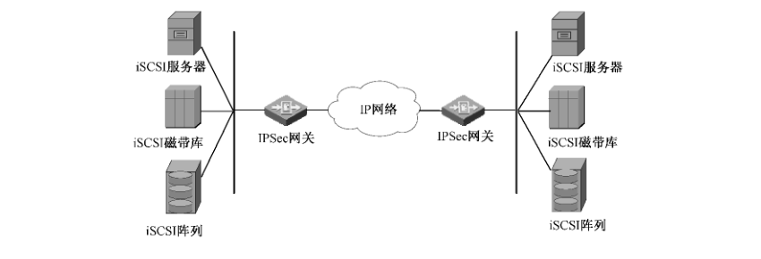
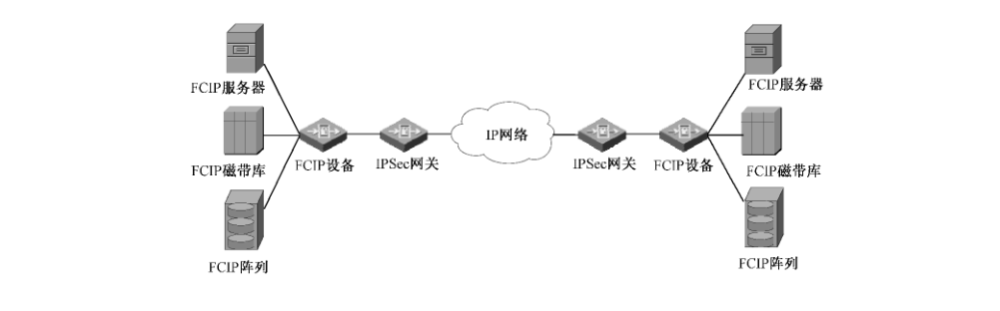
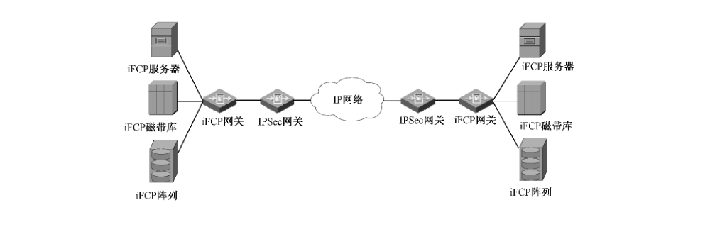
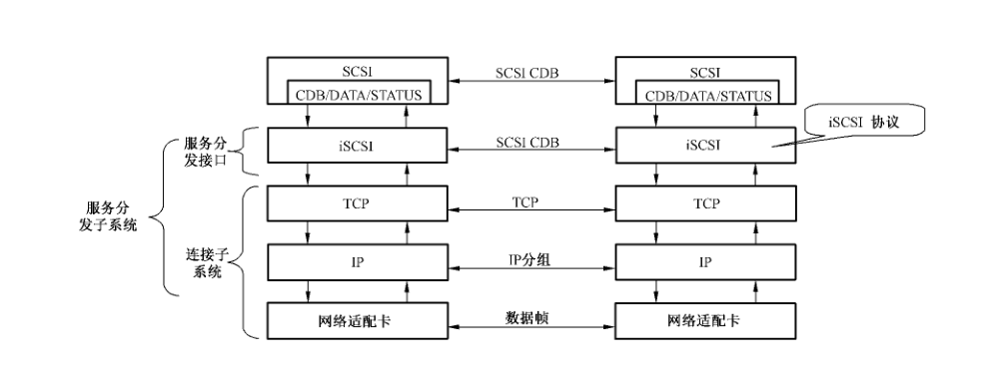
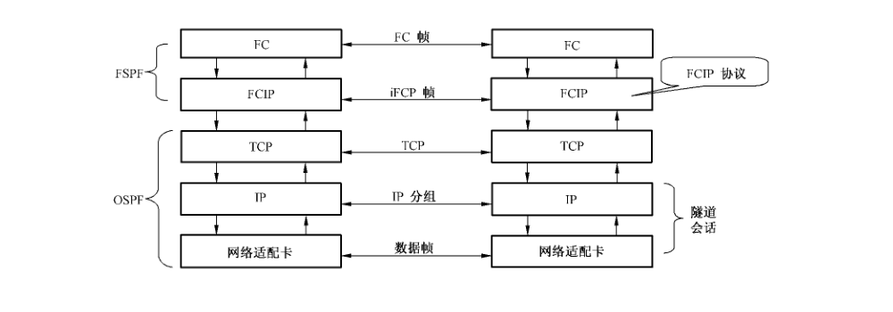
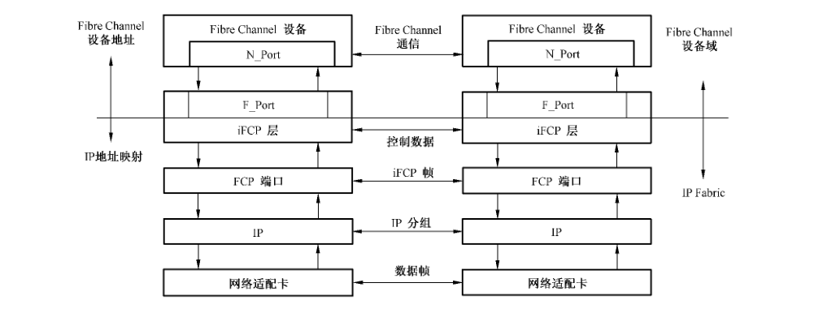
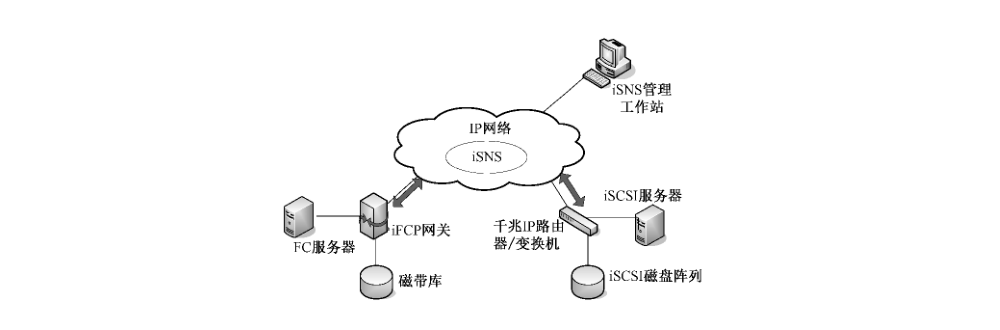

# GB/T 33131-2016 信息安全技术 基于 IPSec 的 IP 存储网络安全技术要求

> 来源：[GB/T 33131-2016 国家标准详情](https://openstd.samr.gov.cn/bzgk/std/newGbInfo?hcno=8192B4EA5D1D7F6CAB67E2A634BBC742)；发布日期：2016-10-13；实施日期：2017-05-01。
> PDF SHA-256：1f550a3c4102bbf743fb07bb2af6d4cbc83478b521608075da4ade62e9ad87ad。
> 转写说明：将官方 PDF 按页渲染为图像，对照全部 14 页图像校正文字与条款；八张图保留原页裁切，其中图 1 从原页补裁。省略封面、目录、页眉、页脚与页码，合并跨页段落。正式引用请核对官方 PDF。

## 前言

本标准按照 GB/T 1.1—2009 给出的规则起草。

请注意本文件的某些内容可能涉及专利。本文件的发布机构不承担识别这些专利的责任。

本标准由全国信息安全标准化技术委员会（SAC/TC 260）提出并归口。

本标准起草单位：北京邮电大学、工业和信息化部电信研究院、华为技术有限公司、北京天地方元科技有限公司。

本标准起草人：刘建毅、王枞、张茹、姚文斌、肖达、伍淳华、杨义先、雷鸣涛。

## 1 范围

本标准规定了利用 IPSec 保护 IP 存储网络安全的技术要求，主要涉及了 iSCSI、iFCP、FCIP 等协议和因特网存储名称服务（iSNS）。

本标准适用于 IP 存储网络安全设备的研制、生产和测试。

## 2 规范性引用文件

下列文件对于本文件的应用是必不可少的。凡是注日期的引用文件，仅注日期的版本适用于本文件。凡是不注日期的引用文件，其最新版本（包括所有的修改单）适用于本文件。

- GM/T 0005 随机性检测规范
- GM/T 0009 SM2 算法使用规范
- GM/T 0022 IPSec VPN 网关技术规范
- IETF RFC3723 基于 IP 的安全块存储协议（Securing block storage protocols over IP）

## 3 术语和定义

下列术语和定义适用于本文件。

### 3.1 存储区域网络 storage area network

一种用在服务器和存储设备之间的、专用的、高性能的网络体系。

### 3.2 IP 存储网络 storage area network over IP

一种在 IP 以太网上架构的存储区域网络。

### 3.3 小型计算机系统接口 small computer system interface

一种用于计算机和外部设备之间的通用接口标准，采用客户-服务器架构。

### 3.4 因特网小型计算机系统接口 internet small computer systems interface

一种在 TCP/IP 上传输数据块的标准，用来建立和管理 IP 存储设备、主机和客户机等之间的相互连接，并创建存储区域网络。

### 3.5 因特网安全协议 internet protocol secruity

保护 IP 协议安全通信的标准，提供了鉴别和加密两种安全机制：鉴别机制使 IP 通信的数据接收方能够确认数据发送方的真实身份以及数据是否遭到篡改；加密机制保证数据的保密性，防止数据在传输过程中遭到截获而失密。

### 3.6 光纤信道协议 fibre channel protocol

一种在光纤信道上的 SCSI 接口协议，用于计算机服务器与存储设备间互连与高速数据传输。

### 3.7 基于 IP 的光纤信道协议 fiber channel over IP

一种在 TCP/IP 上用管道技术实现光纤信道协议的机制，能够通过 IP 网络将各个孤立的光纤信道存储区域网络连接起来，从而形成一个统一的存储区域网络。

### 3.8 因特网光纤信道协议 internet fibre channel protocol

一种网关到网关的协议，为 TCP/IP 网络上的光纤设备提供光纤信道通信服务，可以实现端到端的 IP 连接。

### 3.9 启动器 initiator

IP 存储网络中的服务器或工作站，发起对目标存储设备的事务。

### 3.10 目标器 target

IP 存储网络中的目标存储设备。

### 3.11 因特网存储名称服务 internet storage name service

一种在 IP 网络中智能搜索存储设备的协议和机制，有助于在 TCP/IP 网络上自动发现、管理和配置 iSCSI 设备和光纤通道设备。

## 4 缩略语

下列缩略语适用于本文件。

- CDB：命令描述块（Command Descriptor Block）
- ESP：封装安全载荷（Encapsulating Security Payload）
- FC：光纤信道（Fibre Channel）
- FCIP：基于 IP 的光纤信道协议（Fiber Channel over IP）
- FCP：光纤信道协议（Fibre Channel Protocol）
- iFCP：因特网光纤信道协议（Internet Fibre Channel Protocol）
- IKE：因特网密钥交换（Internet Key Exchange）
- IPSec：因特网安全协议（Internet Protocol Secruity）
- iSCSI：因特网小型计算机系统接口（Internet Small Computer Systems Interface）
- iSNS：因特网存储名称服务（Internet Storage Name Service）
- NAPT：网络端口地址转换（Network Adress Port Translation）
- NAT：网络地址转换（Network Adress Translation）
- PDU：协议数据单元（Protocol Data Units）
- SA：安全关联（Security Association）
- SAN：存储区域网络（Storage Area Network）
- SCSI：小型计算机系统接口（Small Computer System Interface）
- VPN：虚拟专用网络（Virtual Private Network）

## 5 基于 IPSec 的 IP 存储网络安全

### 5.1 总体要求

利用 IPSec 与 IKE 保障 IP 存储网络（包括 iSCSI、iFCP、FCIP、iSNS，参见 A.1）安全，总体安全要求应符合 IETF RFC3723，包括：

a）iSCSI、iFCP、FCIP 设备应支持 IPSec ESP，防止数据在传输过程中的修改、插入、删除操作。

b）iSCSI、iFCP、FCIP 设备应具备抗重放保护机制，对不同安全需求的 IPSec SA 进行分离。

c）iSCSI、iFCP、FCIP 设备应兼容现有的安全机制，如防火墙、NAT、NAPT、VPN 等服务。

d）iSCSI、iFCP、FCIP 设备应具备数据包加密机制，并在密钥更新过程中提供完美前向加密，防止数据的窃取和泄漏。

e）iSCSI、iFCP、FCIP 设备应支持 IKE 端鉴别、密钥管理、SA 协商。

f）iSNS 消息应实现身份鉴别、机密性和数据完整性保护。

g）安全策略应可配置，如身份鉴别、数据源鉴别、加密、完整性鉴别、抗重放保护机制以及 IPSec 协商。

### 5.2 IPSec/IKE 应用要求

#### 5.2.1 IPSec 应用要求

IP 存储网络应支持 IPSec 隧道模式下的 ESP 协议。此外，宜支持传输模式下的 ESP 协议。

IP 存储网络中的所有控制数据和内容数据应通过 IPSec ESP 保护，同时应利用 IPSec 的重放保护机制，具体为：

a）运行 ESP 时，应对每个数据包提供数据来源身份鉴别、完整性验证及重放保护。

b）非对称密码算法应使用 SM2 椭圆曲线密码算法，也可支持 2048 位及以上的 RSA 算法，用于实体验证、数字签名和数字信封等。

c）对称密码算法应使用 SM1 或 SM4 分组密码算法，用于密钥交换数据的加密保护和报文数据的加密保护。算法的工作模式应使用 CBC 模式。

d）密码杂凑算法应使用 SM3 或 SHA-1 密码杂凑算法，用于完整性校验。

e）随机数生成算法生成的随机数应能通过 GM/T 0005 规定的检测。

#### 5.2.2 IKE 应用要求

IKE 应使用 IPSec DOI，实现对等身份鉴别、安全组织协商及密钥管理的支持，具体为：

a）应使用动态密钥和密钥更新，不使用手动密钥。

b）密码算法应满足 GM/T 0022 的要求。

c）应支持预共享密钥鉴别。宜支持数字签名证书的端鉴别。端鉴别不使用公共密钥加密方式。

d）应支持 IKE 主模式。宜支持快速模式。当任意端使用动态 IP 地址时，不使用预共享密钥鉴别的 IKE 主模式。

e）使用数字签名鉴别时，应使用 IKE 主模式或 IKE 快速模式。

f）应保护本地存储的安全信息（预共享密钥、私有密钥、数字签名），避免加密信息泄露导致 IKE/IPSec 安全协议失效。

g）使用数字签名获取鉴别时，IKE 协商应使用 IKE 证书请求载荷指定的且已被本地策略认可的证书机构。

h）在接受 PKI 证书之前，IKE 协商宜首先检查证书撤销列表。

i）在 IKE 第一阶段，IP 存储网络应支持 ID_IPV4_ADDR、ID_IPV6_ADDR 和 ID_FQDN 载荷。iSCSI 应支持 ID_USER_FQDN 载荷，iFCP、FCIP 不能使用 ID_USER_FQDN 载荷。不能使用 IP 子网、IP 地址范围、ID_DER_ASN1_DN、ID_DER_ASN1_GN 等载荷。不能使用 ID_KEY_ID 载荷。

j）在 IKE 第二阶段，IP 存储网络协议应携带身份鉴别载荷（IDci、IDcr），且应明确一个 IP 地址（ID_IPV4_ADDR、ID_IPV6_ADDR），不能使用 IP 子网或 IP 地址范围。

#### 5.2.3 IKE 安全策略配置

IKE 协商时，应满足：

a）交换约束。身份鉴别及密钥交换满足 GM/T 0022 的要求。

b）群组限制。当使用 SM2 算法进行加密和数字签名时，见 GM/T 0009；当使用 RSA 算法进行加密和数字签名时，见 PKCS #1。

c）密钥周期。工作密钥的最大更新周期应不大于 24 h，会话密钥的最大更新周期应不大于 1 h，且应利用寿命标签标识周期终止。

d）IPSec 支持。应依据 IP 块存储端点对 IPSec 的需求，确定最小片段的对等配置需求。

e）完美前向安全支持。IKE 协商的双方应允许完美前向安全支持，避免因第二阶段快速模式中，因不允许发起者向响应者提出完美前向安全而导致失败。

f）隧道模式优先。进行 IKE 协商时应优先选择隧道模式，避免因 IKE 应用传输模式失败导致错误。

g）支持主模式及快速模式。进行 IKE 协商时应同时支持主模式及快速模式，避免在未知模式允许下的失败。

#### 5.2.4 IPSec 安全检查

IP 块存储安全实施应通过 IPSec 进行安全连接检查，具体包括：

a）若在安全需求下，IPSec 保护被从某一连接移除，则应在未保护的 IP 块数据包发送前重建 IPSec；

b）基于 IPSec 保护的 IP 块存储应确保收到的数据包是由可信端发出的；

c）使用 IP 块存储协议时，应由 IKE 第二阶段 SA 保护每一 TCP 连接；

d）单个或多个 TCP 连接可运行于任一 IPSec 第二阶段 SA；

e）安全检查应由 IPSec 完成，并阻止恶意端向不恰当的快速模式 SA 发送命令。

#### 5.2.5 IKE 及应用层鉴别

在 IKE 鉴别及应用层登录鉴别上，应满足：

a）应控制通过套接字的访问。特别地，在多用户操作系统中，由 IP 块存储协议开放使用的套接字应是独占的。

b）应确保应用层登录验证（例如 iSCSI 登录验证）免受未授权访问。

## 6 基于 IPSec 的 iSCSI 安全

### 6.1 iSCSI 实施 IPSec 保护

图 1 描述了使用 IPSec 保护 iSCSI 安全的过程，iSCSI 协议模型参见 A.2。

### 6.2 IKE 与 iSCSI 的关系

iSCSI 会话、TCP 连接与 IKE 阶段的关系应如下：

a）单个 iSCSI 启动器或目标端可有多个 IP 地址，同时多个 iSCSI 启动器或目标端也可为同一个 IP 地址。因此，一个 iSCSI 会话可对应多个 IKE 第一阶段 SA。

b）iSCSI 会话的所有 TCP 连接都应受 IKE 第二阶段 SA 保护。当一个 IKE 第二阶段 SA 保护多个 TCP 链路时，每个 TCP 连接仅能在一个 IKE 第二阶段 SA 保护下传输。

c）在启动器与目标端的 iSCSI 登录消息中应包含 iSCSI/IPSec 绑定的所有信息，包括 IKE 第一阶段 SA 与相应 iSCSI 会话的绑定，以及 TCP 连接与 IKE 第二阶段 SA 的绑定。

### 6.3 运用 IPSec 保护 iSCSI 会话创建

创建 iSCSI 会话时应满足：

a）在创建新的 iSCSI 会话时，如果当前不存在可用的 IKE 第一阶段 SA，需要由 iSCSI 启动器建立 IKE 第一阶段 SA。该会话内此后所有 iSCSI 连接，应被由 IKE 第一阶段 SA 协商生成的 IKE 第二阶段 SA 进行保护。

b）在 iSCSI 启动器向目标器发送 iSCSI 登录命令之前，启动器与目标器需要成功完成 IKE 第一阶段与第二阶段的协商。

c）单个 iSCSI 会话可以关联多个 IKE 第一阶段 SA，一个 IKE 第一阶段 SA 也可以对应多个 iSCSI 会话。一个 iSCSI 连接对应一个 TCP 连接。一个 IKE 第二阶段可以保护多个 TCP 连接。

d）在 IKE 中，每一个密钥更新需要指定一个新的 SA，每隔一定时间，需要终止旧的 SA 并制定新的 SA。

### 6.4 运用 IPSec 保护 iSCSI 会话关闭

iSCSI 会话正常关闭状态时，iSCSI 应在会话的每个 TCP 连接中初始化一个半连接，当其期望关闭一个独立的 TCP 连接并保持父 iSCSI 会话为活动状态时，应使该 TCP 连接为半连接状态，并在 TIME_WAIT 结束时关闭 TCP 连接。

iSCSI 会话非正常关闭时，如果一个 TCP 连接意外断开，相关联的 iSCSI 连接将被强制断开。IKE 第二阶段与第一阶段不必在 iSCSI 连接断开后进行删除。同样，如果 IKE 收到第二阶段删除消息，与第二阶段相关联的 TCP 或 iSCSI 连接也不必关闭。此外，为了更好地保持 iSCSI 连接，需要建立一个新的 IKE 第二阶段 SA 对其进行保护，避免 iSCSI 不断连接/断开。

### 6.5 运用 IPSec 进行 iSCSI 错误处理

iSCSI 错误处理应支持 IPSec 保护机制，如果数据发生了错误，宜丢弃该数据包并启动 TCP 重传机制，避免在应用层对整个 iSCSI PDU 的重传。

## 7 基于 IPSec 的 FCIP 安全

### 7.1 FCIP 实施 IPSec 保护

图 2 描述了使用 IPSec 保护 FCIP 安全的过程，FCIP 协议模型参见 A.3。

### 7.2 运用 IPSec 保护 FCIP 安全

FCIP 利用 IPSec 实现身份鉴别、加密、数据完整性鉴别、安全密钥的生成与管理时，应满足：

a）密码算法应满足 GM/T 0022 的要求。

b）应为每个 FCIP 实体配置 IP 地址及响应 FCIP 实体的 TCP 端口号。

c）为每个 FCIP 端的 IP 地址对建立 IKE 第一阶段，FCIP 端应使用静态 IP 地址。

d）FCIP 链路中每一个 TCP 连接应对应一个 IKE 第二阶段，IKE 第二阶段应支持协商密钥更新，防止重放攻击。

e）FCIP 管理界面宜提供安全保护机制，防止攻击者通过攻击管理界面破解 FCIP 的安全机制。

## 8 基于 IPSec 的 iFCP 安全

### 8.1 iFCP 实施 IPSec 保护

图 3 描述了使用 IPSec 保护 iFCP 安全的过程，iFCP 协议模型参见 A.4。

### 8.2 运用 IPSec 保护 iFCP 安全

iFCP 利用 IPSec 实现身份鉴别、加密、数据完整性鉴别、安全密钥的生成与管理时，应满足：

a）密码算法应满足 GM/T 0022 的要求。

b）iFCP 可使用 IPSec 进行强制执行鉴别和数据加密，两个 iFCP 网关间可建立一个或多个 IKE 第一阶段 SA，每个 IKE 第一阶段 SA 可以建立一个或多个 IKE 第二阶段 SA，每个 IKE 第二阶段 SA 可以保护一个或多个 TCP 连接。

c）IPSec SA 应保护 iFCP 的所有具有安全需求的连接，包括绑定连接和未绑定连接。

d）宜删除休眠的 IKE 第二阶段 SA，以减少活跃 IKE 第二阶段 SA 的数量。

e）对于空闲的 TCP 连接，宜等到该连接有数据传输时才创建新的 SA 对其保护。

## 9 基于 IPSec 的 iSNS 安全

### 9.1 iSNS 实施 IPSec 保护

图 4 描述了使用 IPSec 保护 iSNS 安全的过程，iSNS 参见 A.5。

### 9.2 运用 IPSec 保护 iSNS 安全

使用 IPSec 保护 iSNS 安全，应满足：

a）iSNS 数据库的每个 iSNS 客户端应与 iSNS 服务器至少保持一个 IKE 第一阶段和一个 IKE 第二阶段 SA。客户端与服务器间的所有 iSNS 协议消息应利用 IKE 第二阶段 SA 保护。

b）所有 iSNS 实现的安全机制应支持 IPSec 的重放保护机制。

c）iSNS 服务器应支持 ESP 隧道模式。宜支持 ESP 传输模式。

d）应支持 IKE 鉴别、SA 协商、密钥管理和 IPSec DOI；应使用动态密钥和密钥更新，不使用手动密钥。

e）密码算法应满足 GM/T 0022 的要求。

f）应支持预共享密钥鉴别。宜支持数字签名证书的端鉴别。端鉴别不使用公共密钥加密方式。

g）应支持 IKE 主模式。宜支持快速模式。当任意端使用动态 IP 地址时，不使用预共享密钥鉴别的 IKE 主模式。

h）使用数字签名鉴别时，应使用 IKE 主模式或 IKE 快速模式。应保护本地存储的安全信息（预共享密钥、私有密钥、数字签名），避免加密信息泄露导致 IKE/IPSec 安全协议失效。

i）在接受 PKI 证书之前，IKE 协商宜首先检查证书撤销列表。

## 附录 A（资料性附录）IP 存储网络

### A.1 IP 存储网络协议

IP 存储网络包括 iSCSI、FCIP、iFCP、iSNS 等协议，分别为：

- iSCSI 定义了通过 TCP/IP 网络封装标准的 SCSI 命令，并且规定了如何发送和接收存储应用块数据的规则和处理方法。
- FCIP 为 IP 存储网络提供了一种通过 IP 网络构建 FC 隧道的机制，可以使多个由 FC 组建的 SAN 网络通过 IP 网络进行互联，以创建一个单一的 FC 存储区域。
- iFCP 利用 IP 网络中的交换机、路由器等组件补充、增强或代替由光纤通道组建的 SAN 网络，以实现多个 FC 网络中的最终存储设备之间利用 TCP/IP 网络建立端到端的连接。
- iSNS 为 iSCSI 和 iFCP 系统提供设备发现与管理服务，也可以提供 iSCSI 和 iFCP 存储设备的访问控制或授权策略。

### A.2 iSCSI 协议层次模型

图 A.1 为 iSCSI 的协议层次模型，其中连接子系统是数据的传输介质，服务分发接口是 iSCSI 协议，保证设备之间的请求和响应无差错传输。

### A.3 FCIP 协议层次模型

图 A.2 为 FCIP 协议层次模型，FCIP 设备将整个光纤信道协议帧封装到 TCP/IP 的数据帧内，通过 IP 网络传输，对 IP 网络完全透明。

### A.4 iFCP 协议层次模型

图 A.3 为 iFCP 协议层次模型。iFCP 运行时将光纤信道数据以 IP 包形式封装，并将 IP 地址映射到分离光纤信道设备。由于在 IP 网中每类光纤信道设备都有其独特标识，因而能够与位于 IP 网其他节点的设备单独进行存储数据收发。通过在 iFCP 网关上端接光纤信道信令和在 IP 网络上传送存储数据流。

### A.5 iSNS 设备发现机制

iSNS 协议为 IP SAN 网络提供了设备发现机制。它可以应用于集中式 iSNS 服务器、IP 存储交换机和目标设备。

图 A.4 为 iSNS 与 iSCSI、iFCP 的关系模型，其中 iSNS 服务器可以位于 IP 网络中的任何地方，一个或者多个管理工作站配置并监视 iSNS 服务器。iSNS 服务器为 iFCP 和 iSCSI 实体提供信息数据库，从而使 iFCP 和 iSCSI 客户可以访问资源。

