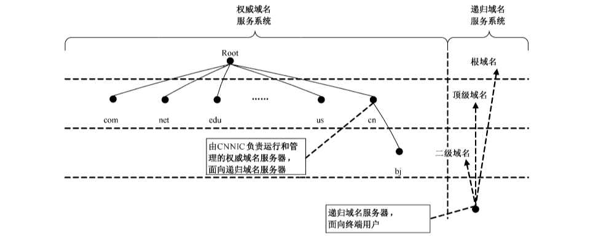

# GB/T 33134-2023 信息安全技术 公共域名服务系统安全要求

> 来源：[GB/T 33134-2023 国家标准详情](https://openstd.samr.gov.cn/bzgk/std/newGbInfo?hcno=3355A71567C80AF7F41E857768F0A433)；封面发布日期：2023-03-17；实施日期：2023-10-01。
> 官方在线预览截图 SHA-256：3a35ab23308f3fdcd5bde36955a3a2d3018b4d9b5a01c4d85cb01b3799c707a9。
> 转写说明：逐页对照官方在线预览的全部 17 张页面图像，校正正文、列表和附录；保留图 1，省略封面、目录、页眉、页脚和页码，合并跨页段落。正式引用请核对官方原页。

## 前言

本文件按照 GB/T 1.1—2020《标准化工作导则 第1部分：标准化文件的结构和起草规则》的规定起草。

本文件代替 GB/T 33134—2016《信息安全技术 公共域名服务系统安全要求》，与GB/T 33134—2016相比，除结构调整和编辑性改动外，主要技术变化如下：

a） 增加了术语“名字空间”和“公共域名服务系统”（见3.1、3.11）；

b）删除了图1的说明内容（见第5章，2016年版的4.1）；

c） 增加了关于重要 DNS 基础设施部署及政府重要网站公共域名服务系统安全要求（见第5章，2016 年版的 4.2）；

d） 更改了协议要求（见 6.1.1、6.2.1,2016 年版的5.1.1、5.2.1）；

e） 增加了权威服务器的系统安全要求和解析安全要求（见 6.1.3）；

f） 增加了递归服务器与客户端连接安全要求（见 6.2.3）；

g） 增加了递归服务器的系统安全要求和解析安全要求（见6.2.4）；

h） 更改了对外服务的访问控制的规定（见7.7.1,2016 年版的 6.7.1）；

i） 增加了重要 DNS 基础设施部署安全要求（见附录 A 中 A.1）；

j） 增加了政府重要网站公共域名服务系统安全要求（见附录 A 中 A.2）。

请注意本文件的某些内容可能涉及专利。本文件的发布机构不承担识别专利的责任。

本文件由全国信息安全标准化技术委员会（SAC/TC 260）提出并归口。

本文件起草单位：中国互联网络信息中心、国家计算机网络应急技术处理协调中心、清华大学、华为技术有限公司、阿里云计算有限公司、广东盈世计算机科技有限公司、中国联合网络通信有限公司、国防科技大学、中国科学院计算机网络信息中心、北京密安网络技术股份有限公司、北京奇虎科技有限公司、启明星辰信息技术集团股份有限公司。

本文件主要起草人：李洪涛、姚健康、周琳琳、曾宇、董科军、延志伟、张曼、舒敏、段海新、陈悦、樊洞阳、宋林健、吴秀诚、孔令飞、蔡志平、吴双力、韩永飞、张屹、邓轶。

本文件及其所代替文件的历次版本发布情况为：

- 2016 年首次发布为 GB/T 33134—2016；
- 本次为第一次修订。

## 1 范围

本文件规定了公共域名服务系统的安全技术要求和安全管理要求。

本文件适用于各级公共域名服务系统的运营和管理。

## 2 规范性引用文件

下列文件中的内容通过文中的规范性引用而构成本文件必不可少的条款。其中，注日期的引用文件，仅该日期对应的版本适用于本文件；不注日期的引用文件，其最新版本（包括所有的修改单）适用于本文件。

- YD/T 2052—2015 域名系统安全防护要求
- YD/T 2137 域名系统递归服务器运行技术要求
- YD/T 2138 域名系统权威服务器运行技术要求
- YD/T 2142 基于国际多语种域名体系的中文域名总体技术要求
- YD/T 2143 基于国际多语种域名体系的中文域名的编码处理技术要求
- YD/T 2438 基于国际多语种域名体系的中文域名注册字表要求
- IETF RFC 1034 域名 概念和基础设施（Domain names—concepts and facilities）
- IETF RFC 1035 域名 实现与详述（Domain names—implementation and specification）
- IETF RFC 4033 DNSSEC 介绍与需求（DNS security introduction and requirements）
- IETF RFC 4034 资源记录支持 DNSSEC（Resource records for the DNS security extensions）
- IETF RFC 4035 支持 DNSSEC 的协议修改（Protocol modifications for the DNS security extensions）
- IETF RFC 7858 基于 TLS 的 DNS 规范（Specification for DNS over transport layer security (TLS)）
- IETF RFC 8310 基于 TLS 的 DNS 和基于 DTLS 的 DNS 的使用情况（Usage profiles for DNS over TLS and DNS over DTLS）
- IETF RFC 8484 基于 HTTPS 的 DNS 查询［DNS queries over HTTPS (DoH)］

## 3 术语和定义

下列术语和定义适用于本文件。

### 3.1 名字空间 name space

以树形结构分层表示的名字命名层次结构。

> 注：名字空间是一个树状结构，每个节点对应于相应的资源集合（这个资源集合可能为空），DNS 不区别树内节点和叶子节点，统称为节点。每个节点有一个标记，这个标记的长度不超过 63 字节。父节点不同的节点可使用相同的标记。只有根节点的标记长度为 0（空标记）。

### 3.2 域名 domain name

域名系统名字空间中，从当前节点到根节点的路径上所有节点标记的点分顺序连接的字符串。

### 3.3 域 domain

域名系统名字空间中的一个子集（即树形结构名字空间中的一棵子树）。

> 注：这个子树根节点的域名就是该域的名字。

### 3.4 顶级域 top level domain

域名系统名字空间中根节点下最顶层的域。

### 3.5 资源记录 resource record

域名系统中存储的与域名相关的属性信息。

> 注：每个域名对应的记录可能为空或者多条。域名的资源记录由名字、类型、种类、生存时间、记录数据长度、记录数据等字段组成。

### 3.6 区文件 zone file

某个区内的域名和资源记录及相关的权威起始信息按照一定的格式进行组合，从而构成存储这些信息的文件。

> 注：权威起始信息包含了区的管理员电子邮件地址、序列号、更新周期、重试周期和过期时间等信息。

### 3.7 域名系统 domain name system

一种将域名映射为某些预定义类型资源记录的分布式互联网服务系统。

> 注：网络中域名服务系统间通过相互协作，实现将域名最终解析到相应的资源记录。

### 3.8 域名服务系统 domain name service system

提供域名解析服务的系统。

> 注：由权威域名服务系统、递归域名服务系统组成。

### 3.9 权威域名服务系统 authoritative domain name service system

对于某个或者多个区具有可信数据功能的域名服务系统。

> 注：权威域名服务系统保存着其所拥有区的原始域名资源记录信息。

### 3.10 递归域名服务系统 recursive domain name service system

负责接收用户（解析器）的解析请求，并通过查询本地缓存或者执行从根域名服务系统到被查询域名所属权威域名服务系统的递归查询过程，获得解析结果并返回给用户的域名服务系统。

### 3.11 公共域名服务系统 public domain name service system

面向互联网用户提供公开服务且量级达到十万级以上的域名服务系统。

### 3.12 解析器 resolver

向名字服务系统发送域名解析请求，并从名字服务系统返回的响应消息中提取所需信息的程序。

> 注：解析器软件通常集成到操作系统内核或者应用软件中。

### 3.13 权威域名服务器 authoritative name server

对于某个或者多个区具有权威的服务器，保存其原始域名资源记录信息。

> 注：简称“权威服务器”。

### 3.14 递归域名服务器 recursive name server

负责接收用户端发送的请求，然后通过向各级权威服务器发出查询请求获得用户需要的查询结果，最后返回给用户端的解析器。

> 注：简称“递归服务器”。

### 3.15 主域名服务系统 master domain name service system

被配置成区数据发布源的权威域名服务系统。

### 3.16 辅域名服务系统 slave domain name service system

通过区传送协议来获取区数据的权威域名服务系统。

## 4 缩略语

下列缩略语适用于本文件。

AS：自治系统（Autonomous System）

BGP：边界网关协议（Border Gateway Protocol）

DNS：域名系统（Domain Name System）

DNSSEC：DNS 安全扩展（Domain Name System Security Extensions）

DoH：基于 HTTPS 的 DNS（DNS over HTTPS）

DoT：基于 TLS 的 DNS（DNS over TLS）

FTP：文件传输协议（File Transfer Protocol）

HTTP：超文本传输协议（Hyper Text Transfer Protocol）

HTTPS：超文本传输安全协议（Hyper Text Transfer Protocol over Secure Socket Layer）

IANA：互联网数字分配机构（Internet Assigned Numbers Authority）

ICANN：互联网名称与数字地址分配机构（The Internet Corporation for Assigned Names and Numbers）

IP：网际协议（Internet Protocol）

NS：名字服务器（Name Server）

NTP：网络时间协议（Network Time Protocol）

Rlogin：远程登录（Remote Login）

TCP：传输控制协议（Transmission Control Protocol）

TLS：传输层安全（Transport Layer Security）

UDP：用户数据报协议（User Datagram Protocol）

## 5 概述

域名服务系统是以树形拓扑结构来定义的，由不同类别的域名服务系统服务机构负责不同级域名的解析服务，其对应关系见图1。

整个域名服务系统从职能上看，包括两大类系统：权威域名服务系统和递归域名服务系统。权威域名服务系统是指拥有某个区的域名信息，并为该区提供域名解析的服务。权威域名服务系统通常面向的不是终端用户。图 1 中，cn 和 bj.cn 的域名服务系统就属于权威域名系统。递归域名服务系统则相反，它不针对某个区提供域名解析服务，而是直接面向终端用户，为终端用户提供递归的域名服务系统。

ICANN 开放的新通用顶级域，同样适用于以上域名服务系统。

公共域名服务系统安全技术要求，包括权威域名服务系统、递归域名服务系统、授权和 DNS数据备份等；公共域名服务系统安全管理要求，包括资产管理、人员管理、运行管理、物理和环境安全、设备安全、通信和操作安全、访问控制、连续性管理以及网络安全事件等；关于重要 DNS基础设施部署及政府重要网站公共域名服务系统安全要求，按附录 A。

## 6 公共域名服务系统安全技术要求

### 6.1 权威域名服务系统技术要求

#### 6.1.1 协议要求

权威域名服务系统的权威域名服务器（简称“权威服务器”）的实现应符合 IETF RFC 1034、IETF RFC 1035、IETF RFC 4033、IETF RFC 4034 和 IETF RFC 4035的规定。

#### 6.1.2 拓扑规划要求

针对某个权威域，提供权威域解析的服务器数量应保证多台备份，提供权威域解析的服务器应部署在多个不同的自治域网络中，且宜在地理上进行合理分布，达到抗自然灾害等灾备目的。具体部署数量和分配要求应符合 YD/T 2138的规定。

#### 6.1.3 权威服务器安全要求

##### 6.1.3.1 系统安全要求

系统安全应满足 YD/T 2052—2015中三级及以上域名系统安全等级保护要求。系统安全要求如下。

a） 权威服务器不应提供递归服务。

b） 权威服务器应仅提供 TCP 和 UDP 53 端口的标准 DNS 解析服务；如果支持 DoH 和 DoT 服务，还应提供 DoH 协议 443 端口和 DoT 协议 853 端口解析服务。

c） 在权威服务器其他 TCP/UDP 端口上提供的服务应限制在该服务系统内部的服务器之间进行。

d）禁止除管理员之外的其他人或其他服务器从域名解析服务器上下载区文件。

e） 权威服务器自身不应提供除了域名服务之外的其他服务，例如：HTTP、Telnet、Rlogin、FTP 等。

f）服务器应通过一种安全机制来进行远程管理和维护。

g） 服务器所在的局域网内不应放置容易被攻破的主机。

h）服务器所在的局域网应有包过滤机制，以阻断来自域名服务端口以外的端口访问。

i） 采用隐藏的主服务器作为一个权威域名服务系统的数据源。

j） 域名数据的更新应在必要的更新错误检测之后进行。一旦更新失败，需要人为干预。当发生严重的网络故障时，每个权威服务器都应有替换办法（备份网络通道或者非网络途径）来更新域名数据。

k）权威服务器应维护和记录全局的统计数据（包括用户查询日志等），以便于进行数据分析，发现安全隐患。

##### 6.1.3.2 解析安全要求

###### 6.1.3.2.1 语法和匹配检查

在权威服务器提供域名解析服务前，应采取下列措施对每一次生成的域名数据进行语法检查和匹配检查。

a） 语法检查，检查区文件格式是否符合域名解析软件的格式要求。语法检查应在区文件生成之后，区数据的传送开始之前完成。

b） 匹配检查，全量/随机检查区文件与数据库注册数据信息的一致性。匹配检查的时间应保证在域名注册生效时间周期内完成。

###### 6.1.3.2.2 域名解析软件安全

应对域名解析软件进行防范缓存中毒、DNS重定向漏洞造成域名劫持或域名更改等事件的安全检验。

###### 6.1.3.2.3 反向解析

为确保解析服务的安全性，域名注册管理机构、域名注册服务机构以及网络互联单位的域名解析服务器，在内部管理政策允许的情况下，应提供专门域名（in-addr.arpa）下的反向域名解析服务。

###### 6.1.3.2.4 时间同步

域名权威辅服务器与主服务器应保持时间上的同步，可采用NTP 或其他技术手段实现时间同步。

### 6.2 递归域名服务系统技术要求

#### 6.2.1 协议要求

递归域名服务系统的递归域名服务器（简称“递归服务器”）应具备安全的查询、缓存等基本功能，应符合 IETF RFC 1034、IETF RFC 1035、IETF RFC 4033、IETF RFC 4034 和 IETF RFC 4035的规定。

#### 6.2.2 拓扑规划要求

针对某个自治域内提供递归域解析的服务器数量应保证多台备份。同一自治域内的不同递归服务器在部署上应进行相应分布，同一用户访问两台服务器的路径上不存在单一故障点。具体部署数量和分配要求应符合 YD/T 2137 的规定。

#### 6.2.3 递归服务器与客户端连接要求

递归服务器与客户端之间可选择建立加密可靠的连接传输数据。递归服务器可通过基于 TLS或者 HTTPS的 DNS与客户端进行连接：

a） 如果选择基于 TLS的DNS，应符合 IETF RFC 7858 和 IETF RFC 8310的规定；

b） 如果选择基于 HTTPS的 DNS，应符合 IETF RFC 8484的规定。

#### 6.2.4 递归服务器安全要求

##### 6.2.4.1 系统安全要求

系统安全应满足 YD/T 2052—2015中三级及以上域名系统安全等级保护要求。系统安全要求如下。

a） 递归服务器应仅提供TCP、UDP 53端口的标准DNS 解析服务。如果支持 DoH 和 DoT 服务，还应提供 DoH 协议443端口和 DoT 协议 853端口解析服务。

b） 对于递归服务器向外的TCP协议和 UDP 协议53端口访问不应进行限制。如果支持DoH 和DoT 服务，DoH 协议443端口和 DoT 协议 853端口也不应进行限制。

c） 递归服务器自身不应同时兼备权威服务器功能，同时不提供除了域名服务之外的其他服务，例如：HTTP、远程服务（Telnet）、Rlogin、FTP 等。

d） 递归服务器应通过一种安全机制来进行远程管理和维护。

e） 递归服务器所在的局域网段不应放置容易被攻破的主机。

f） 递归服务器所在的局域网段应有包过滤机制，以阻断来自域名服务端口以外的端口访问。

g） 具备对递归服务器缓存数据进行清空的技术手段。

h） 递归服务器应维护和记录全局的统计数据（包括用户查询日志等），以便进行数据分析审计，发现安全隐患。

##### 6.2.4.2 解析安全要求

解析安全要求如下：

a） 域名解析软件安全：应对域名解析软件进行防范缓存中毒、DNS 重定向漏洞造成域名劫持或域名更改等事件的安全检验；

b） 根服务器指向：递归服务器应配置由IANA发布的13个根服务器指向地址；

c） 时间同步：域名解析辅服务器与主服务器应保持时间上的同步，可采用 NTP 或其他技术手段实现时间同步。

#### 6.2.5 中文域名支持安全要求

递归服务器应配置对中文域名的支持，例如：“.中国”“.中國”“.网络”“.公司”“.網絡”“.公益”或“.政务”等中文顶级域以及其他顶级域下中文二级域名。

递归服务器的配置应确保通过其进行查询的用户能正确解析相应的域名。

对于中文域名的注册、管理、DNS存储的安全要求，应符合 YD/T 2438、YD/T 2142 和 YD/T 2143中的相关规定。

### 6.3 授权安全要求

授权安全要求如下。

<ol className="standard-subclauses">
<li>a） 作为授权而使用的NS记录应保持一致，即在下级 DNS区中的域名 NS记录在服务器数量、名字上均应与在上级域权威服务器中相应域名的 NS记录保持完全一致。
</li>
<li>b） NS 记录应符合IETF RFC 1035 的规定，其所指向的服务器为合法的主机名。
</li>
<li>c） 权威服务器的IP 地址应使用合法的互联网地址，并确保以任何互联网地址可访问服务器的UDP 和TCP的53端口。如果支持 DoH 和DoT 服务，还应支持访问 DoH 协议443端口和DoT 协议853端口。
</li>
<li>d） 同一DNS区的所有权威服务器在响应对 NS记录的请求时，应返回相同的结果。
</li>
<li>e） 同一DNS区的权威服务器的数量应至少为2台，以确保解析服务的可靠性。
</li>
<li>f） 权威服务器的最大数量应保证在响应对所服务区的 NS 记录的查询时：
<ul>
<li>包含 NS 记录和粘连记录（A 记录和 AAAA 记录）的响应包的大小限制在 512 字节以内，即在不使用 AAAA 记录时，权威服务器数量的上限不应超过 13。</li>
<li>在每个服务器都使用 AAAA 记录时，权威服务器的数量上限不应超过 8。</li>
</ul>
</li>
</ol>

### 6.4 DNS数据备份要求

#### 6.4.1 日志存放形式

域名解析日志应采用冷备份或热备份的方式。

> 注：冷备份是指将日志按日期存放在至少两种以上介质上，包括硬盘、磁带、光盘等。热备份是指将日志存放在正在运行中的服务器存储设备上。

#### 6.4.2 日志存放时间

日志存放要求如下：

a） 冷备份应保留自域名服务起始的全部日志；

b） 热备份的保留时间应满足域名管理者的日志分析需求。

#### 6.4.3 日志分析

应建立解析服务日志的分析制度，以便及时发现服务中的异常情况，并对非法访问采取必要的安全防范措施。

## 7 公共域名服务系统安全管理要求

### 7.1 资产管理要求

#### 7.1.1 资产清单

应清晰地识别公共域名服务所涉及的资产，编制并维护公共域名服务系统的核心资产清单。清单中应包括所有为从灾难中恢复而需要的资产，与公共域名服务系统相关的资产可能包括：信息资产、软件资产、物理资产、服务、人员、无形资产等。

#### 7.1.2 资产责任人

与公共域名服务系统有关的所有信息和资产均应指定部门和人员承担责任，资产责任人应：

a） 确保与公共域名服务系统相关的信息和资产进行了恰当合理的分类；

b） 确定并周期性审查访问限制和分类。

#### 7.1.3 资产的合规使用

与公共域名服务系统相关的信息和资产使用规则应确认并形成文档加以实施。

#### 7.1.4 脆弱性和威胁分析

脆弱性和威胁分析要求如下：

a） 从技术脆弱性和管理脆弱性两个方面，对公共域名服务系统进行脆弱性分析；

b） 从技术威胁、环境威胁、人为威胁三个方面，对公共域名服务系统进行威胁分析。

### 7.2 人员管理要求

在公共域名服务系统的管理人员和第三方人员的整个任职周期内，包括聘任前、聘任中、离职三个阶段，应采取相应的控制措施，降低公共域名服务系统所面临的人为威胁，人员管理要求如下：

a） 确保公共域名服务系统管理人员和第三方人员理解其职责，确保其具备相应的技术能力，以降低公共域名服务系统被破坏或者不当使用的风险；

b） 对公共域名服务系统管理人员和第三方人员进行适当程度的安全意识和安全技术培训，以及公共域名服务相关信息和资产的正确使用方法，并建立一个正式的处理安全违规的纪律处理过程；

c） 应制定流程或规定，规范公共域名服务系统管理人员和第三方人员退出公共域名服务的管理，确保相关人员归还所有设备，并删除其对公共域名服务的所有访问权限。

### 7.3 运行管理要求

运行管理要求如下：

a） 公共域名服务系统应符合 YD/T 2138 和 YD/T 2137 规定的运行管理要求；

b） 公共域名服务系统中所有涉及的服务应对国家主管部门提供数据采集接口，并应按照国家主管部门的规定对相应网络安全事件进行通报工作。

### 7.4 物理和环境管理要求

物理和环境管理要求如下：

a） 设置安全边界（例如：墙、卡控制的入口或有人管理的接待台等屏障）来保护公共域名服务系统信息和资产所在的区域；

b）设置恰当的进出控制措施，确保仅授权人员能进出，同时进出的信息应予以记录和审计；

c） 有适当的措施来防止火灾、洪水、地震、爆炸、社会动荡和其他形式的自然灾难或人为灾难对公共域名服务系统所在区域的破坏；

d） 有足够的支持性设施（例如：电、供水、排污、加热/通风和空调）来支持公共域名服务系统。应定期检查并测试支持性设施以确保它们的功能，减少由于其故障或失效带来的风险。

### 7.5 设备管理要求

#### 7.5.1 设备安置和保护

设备安置和保护要求如下：

a） 公共域名服务系统的设备应进行适当安置，以防止对相关设备的未授权物理访问；

b） 对于可能对公共域名服务系统运行状态产生负面影响的环境条件（例如：温度和湿度）应予以监视；

c） 建筑物应采用避雷保护，所有进入的电源和通信线路都应装配雷电保护过滤器。

#### 7.5.2 布线和设备维护

布线和设备维护要求如下：

a） 保证传输数据或支持信息服务的电源布缆和通信布缆免受窃听或损坏；

b） 使用文件化配线列表减少失误的可能性；

c） 按照供应商推荐的服务时间间隔和规范由已授权人员对设备进行维护，同时保存所有可疑的或实际的故障以及所有预防和纠正维护的记录；

d） 绘制与当前运行情况相符的系统拓扑结构图。

#### 7.5.3 设备的安全检测和监控

设备的安全检测和监控要求如下：

a） 公共域名服务系统的硬件设备应进行安全检测，确保其满足相应的行业标准、技术规范等，并保留检测证据；

b） 操作系统的安装应遵循最小化原则，并及时进行升级和安装补丁；

c） 域名解析软件的安全性应定期跟踪并及时升级更新，防止漏洞带来的威胁；

d） 对业务、应用软件、服务器、网络设备等子系统进行 7×24 h 不间断探测监控，监测的频率应不少于 1 次/10 min，监控日志的保存时间应至少 180 d；

e）对域名资源记录和解析结果进行正确性抽检，抽检频率宜至少1次/h。

### 7.6 操作管理要求

#### 7.6.1 操作程序和职责

操作程序和职责要求如下：

a） 与公共域名服务系统相关的操作应有规范的操作程序，例如：计算机启动和关机程序、备份、设备维护、介质处理、计算机机房、DNS软件的配置维护和物理安全等；

b） 与公共域名服务系统相关的各类责任及职责范围应加以分割，以减少因未授权或无意识修改而不当使用域名服务系统资产的操作。

#### 7.6.2 防范恶意代码

应采取恶意代码监测、修复软件、提高安全意识、适当的系统访问和变更管理控制等措施来防范恶意代码，具体要求如下：

a） 建立禁止使用未授权软件和正确使用授权软件的策略；

b） 应安装和定期更新恶意代码监测和修复软件来扫描域名服务系统，并根据扫描结果升级域名服务系统；

c） 应制定适当的从恶意代码攻击中恢复的业务连续性计划。

#### 7.6.3 设备和线路备份

设备和线路备份要求如下：

a） 系统应为分布式广域部署，节点间服务互备；

b） 系统关键设备、重要线路应采用冗余的保护方式，提供灾难备份和恢复的能力。

#### 7.6.4 数据备份

数据备份要求如下：

a） 应根据风险评估的结果，确定需要备份的数据和文件，应包括系统配置文件、解析日志、区文件等，备份时间至少为180d；

b） 应建立备份拷贝的准确完整的记录和文件化的恢复程序；

c） 定期测试备份介质；

d） 恢复程序应定期检查和测试，并能在操作程序恢复所分配的时间内完成。

#### 7.6.5 网络安全管理

网络安全管理要求如下：

a） 应建立远程设备管理的职责和程序；

b） 主域名服务系统、辅域名服务系统以及备份服务系统的部署应处于不同自治域，防止单一网络失效引起的解析中断；

c） 建立专门的控制，以保护在公网上传递数据的保密性和完整性，并且保护已连接的系统及应用；

d） 必要情况下，应阻断或重定向用户对恶意域名的访问。

#### 7.6.6 审计和分析

审计和分析要求如下：

a） 生成记录用户活动、异常和网络安全事态的审计日志，并应保存至少180天以支持将来的调查和访问控制监视；

b）采取措施保证主域名服务系统、辅域名服务系统、备份域名服务系统内设备之间的时间同步，实现日志时间的精确同步；

c） 审计的内容应包括但不限于：授权访问、特殊权限操作、未授权的访问尝试、系统警报或故障；

d） 记录日志的设施和日志信息应加以保护，以防止篡改和未授权的访问。

### 7.7 访问控制管理要求

#### 7.7.1 对外公开服务的访问控制

公共域名服务系统对外开放服务宜只开放 UDP 和 TCP 53端口，如果支持 DoH和 DoT服务，还应提供 DoH 协议 443端口和 DoT 协议 853端口。

#### 7.7.2 访问控制策略和用户访问管理

访问控制策略和用户访问管理要求如下：

a） 在访问控制策略中清晰地规定每个用户或每组用户的访问控制规则和权利；

b）限制和控制特殊权限的分配及使用，防范未授权访问的多用户系统应通过正式的授权过程使特殊权限的分配受到控制；

c） 定期检查权限的分配，确保用户访问权限的正确分配。

#### 7.7.3 网络访问控制

网络访问控制要求如下：

a） 能为数据流提供明确的允许/拒绝访问的能力，控制粒度为网段级；

b）能根据会话状态信息为数据流提供明确的允许/拒绝访问的能力，控制粒度为端口级；

c） 在网络中实施路由控制，以确保计算机连接和信息流不违反业务应用的访问控制策略。

#### 7.7.4 操作系统访问控制

操作系统访问控制要求如下：

a） 登录到操作系统的程序应设计成使未授权访问的机会减到最小；

b）所有公共域名服务系统的管理员和第三方人员（包括技术支持人员、操作员、网络管理员、系统程序员和数据库管理员等）应有唯一的、专供其个人使用的标识符（例如：用户 ID），应选择一种适当的鉴别技术（例如：口令、令牌或智能卡）证实用户所宣称的身份，静态口令应满足一定的长度要求和复杂性要求并且定期更换；

c） 在一个设定的休止期后，超时登录应清空会话屏幕或设置关闭应用和网络会话；

d） 对多次不成功的登录，应进行限制，以防止未经授权的访问。

#### 7.7.5 信息和敏感系统访问控制

信息和敏感系统访问控制要求如下：

a） 对设备重要信息（数据）资源设置分级分类的敏感标记；

b） 依据安全策略严格控制用户对有敏感标记重要信息（数据）资源的操作；

c） 实现操作系统和数据库系统特权用户的权限分离。

### 7.8 连续性管理要求

#### 7.8.1 连续性管理的制定

连续性管理的制定要求如下：

a） 具备异地冗余备份机制，防止公共域名服务系统的服务失效，保护公共域名服务系统免受重大失误或者灾难的影响，并且在遇到灾难的情况下及时恢复解析服务；

b） 为公共域名服务系统制定一个解析服务连续性管理的过程，识别可能引起解析服务中断的事态以及这种事态发生的概率；

c） 为公共域名服务系统制定一个解析服务连续性计划，来保持域名解析服务的可用性，在解析服务中断的情况下能在要求的时间内恢复系统的服务。

#### 7.8.2 制定连续性计划考虑的方面

制定连续性计划要求如下：

a） 冗余方面：设备处理能力、关键设备及其重要部件、网络接入、系统应广域分布；

b） 数据及业务备份方面：关键数据和重要信息应设置备份和备份频率、业务状态应设置保护和恢复机制、业务系统应完整备份；

c） 应急处置预案方面：应制定应急处置预案，并定期对应急预案进行及时修订，修订期不少于1年；每年应进行不少于1次的应急预案演练。

### 7.9 网络安全事件管理要求

网络安全事件管理要求如下：

a） 建立网络安全领导小组，确定安全领导小组负责人和网络安全管理责任人；

b） 配备与经营规模相适应的计算机信息网络安全专业技术人员，并定期参加信息网络安全专业技术人员教育培训；

c） 保持与主管部门联系渠道畅通，应积极配合主管部门的业务监督检查；

d） 定期进行安全风险评估，风险评估范围应与域名系统安全防护范围一致；

e） 制定网络安全事故应急处置措施和紧急处理预案。

## 附录 A（规范性）重要 DNS 基础设施和政府重要网站公共域名服务系统安全要求

### A.1 重要 DNS 基础设施部署安全要求

重要 DNS 基础设施部署包括权威域名服务系统和递归域名服务系统。权威服务应符合 6.1 中的规定，递归服务应符合 6.2 和第 7 章的安全管理要求。

> 注：DNS 名字服务可划分为 2 个角色：权威服务和递归服务。权威服务器保存 DNS 区文件数据信息，递归服务器接收 DNS 客户端查询并将响应在返回客户端的同时保存在本地缓存中。

重要 DNS 基础设施部署时应满足以下要求：

a） 权威服务：应保证在网络异常情况下仍能提供服务，不应将所有服务器位于同一子网。基于服务对象处于内网还是外网，应分割部署为内部、外部权威服务器。内部权威服务器存储内部区文件，应处于内部网络（防火墙内），仅响应内部主机请求；外部权威服务器应处于隔离区或服务网络，响应外部互联网用户查询。此外，网络管理者还应使用隐藏主服务器。隐藏主服务器不应存在于区数据中，并且无法被外部互联网查询，唯一功能是存储区文件，并与辅服务器进行区文件信息传送。

b） 递归服务：递归服务器应处于内部网络，仅接收内部主机的查询请求。对于大型组织应多于 2 个递归服务器。

### A.2 政府重要网站公共域名服务系统安全要求

政府重要网站公共域名服务系统包括权威域名服务系统和递归域名服务系统。权威服务应符合 6.1 中的规定，递归服务应符合 6.2 中的相关规定且符合第 7 章中相关的安全管理要求。政府重要网站公共域名服务系统应满足以下要求。

a） 提供至少2个基于 IPv4的NS服务地址。不同的NS服务器应处于不同的网段（以C类地址为最小单位）之内。

b） 政府重要网站公共域名服务系统应配置基于IPv6的NS服务地址，支持基于IPv6协议的网络访问。

c） 政府重要网站公共域名服务系统应采用专用的服务器和网络。应在物理和网络上将承担政府重要网站域名解析的服务器和承担非政府类网站域名解析的服务器隔离开，防止由于非政府类域名解析被攻击导致的政府域名解析服务中断。

d） 政府重要网站公共域名服务系统应具备多视图配置功能，可分区域、分线路提供智能解析服务。

e） 政府重要网站公共域名服务系统应支持 DNSSEC 协议。

f） 政府重要网站公共域名服务系统应与其他服务进行安全隔离，做到专机专用，禁止开启递归解析服务。

g） 政府重要网站公共域名服务系统应具备合理的网络架构为域名解析提供安全稳定的保障。解析系统应采用 BGP 方式接入互联网，应具备独自的 AS 号。如果是多点结构，应保证至少一点采用 BGP 方式接入互联网。

h） 政府重要网站公共域名服务系统应具有异地冗余备份机制，应保证至少有 3 个异地服务节点，防止节点失效导致的服务中断。

i） 政府重要网站公共域名服务系统单个解析节点应多于3台服务器，防止服务器失效导致的服务中断。
