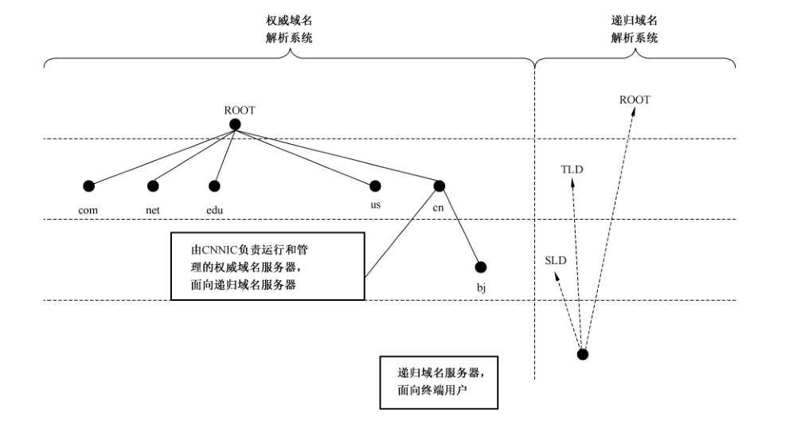

# GB/T 33562-2017 信息安全技术 安全域名系统实施指南

> 来源：[GB/T 33562-2017 国家标准详情](https://openstd.samr.gov.cn/bzgk/std/newGbInfo?hcno=4F1E768159414592D646A8613FE8E2B7)。
> PDF SHA-256：b2c9664890245ce46cd3d9e8f9daabd11f90de4a6d7502eb53392156a90343d2。
> 发布日期：2017-05-12；实施日期：2017-12-01。依据官方 PDF 的 18 页渲染图像逐页核对，保留图 1、表 1 和附录 A 的配置示例。已去除封面、目录、分页和页眉页脚，正式引用请核对官方原文。

## 前言

本标准按照 GB/T 1.1—2009给出的规则起草。

本标准由全国信息安全标准化技术委员会（SAC/TC 260）提出并归口。

本标准起草单位：山东省标准化研究院、中国互联网络信息中心、天津卓朗科技发展有限公司、青岛以太科技股份有限公司、深圳市信息安全测评中心、深圳市坪山新区信息化管理办公室、常州富国信息技术有限公司、辽宁省信息安全与软件测评认证中心、青岛大学、青岛科技大学、互联网域名系统北京市工程研究中心。

本标准主要起草人：王曙光、王庆升、公伟、隗玉凯、姚健康、刘杰、林明贵、王伟、武刚、唐增来、邱建中、黎文辉、陶毅国、陈多思、丁锋、于佳、程相国、刘国柱、马迪。

## 引言

随着网络攻击技术的发展及 DNS漏洞的频繁出现，攻击者已经大大缩短了劫持 DNS查找过程的任一步骤所需的时间，从而可以更快地取得对会话的控制以实施某种恶意操作。若要在长期内消除此漏洞，唯一的解决方案是以端到端的形式部署 DNSSec协议，即从根区到最终域名的查找过程中每一步都部署 DNSSec。

目前，作为 DNSSec 信任链的根服务器都已经部署 DNSSec 服务。与此同时，随着业界对 DNSSec 的努力推动，各顶级域名管理机构陆续开始部署 DNSSec 服务，但在顶级域名之下的二级权威域及递归域名对 DNSSec 支持相对较低。虽然国内重点权威域名服务器和主要递归域名服务器对 DNSSec 支持只有 0.9% 和 2.2%，但它们对 DNSSec 支持相比以前有了较大改善。

本标准可以为域名系统 DNSSec 部署过程提供权威域名系统安全指南、递归域名系统安全指南、DNS 事务安全指南和 DNS 数据安全指南等 DNS 安全技术指南，为 DNSSec 部署到各级域名系统提供技术支撑和实践指导。

## 1 范围

本标准规定了域名系统安全扩展协议（DNSSec）部署过程中权威域名系统安全、递归域名系统安全、DNS 事务安全、DNS 数据安全等DNS 安全技术指南。

本标准适用于运行域名系统的组织内域名系统安全管理人员。

## 2 规范性引用文件

下列文件对于本文件的应用是必不可少的。凡是注日期的引用文件，仅注日期的版本适用于本文件。凡是不注日期的引用文件，其最新版本（包括所有的修改单）适用于本文件。

- GB/T 5271.8—2001 信息技术 词汇 第8部分：安全

- GB/T 5271.9—2001 信息技术 词汇 第9部分：数据通信

- GB/T 25069—2010 信息安全技术 术语

- GB/T 33134—2016 信息安全技术 公共域名服务系统安全要求

- YD/T 2137—2010 域名系统递归服务器运行技术要求

- YD/T 2138—2010 域名系统权威服务器运行技术要求

- YD/T 2140—2010 域名服务安全框架技术要求

- YD/T 2586—2013 域名服务系统安全扩展（DNSSec）协议和实现要求

## 3 术语和定义

GB/T 5271.8—2001、GB/T 5271.9—2001、GB/T 25069—2010 界定的以及下列术语和定义适用于本文件。

### 3.1 域名系统 domain name system

一种将域名映射为某些预定义类型资源记录（resource record）的分布式互联网服务系统，网络中域名服务器间通过相互协作，实现将域名最终解析到相应的资源记录。

### 3.2 名字空间 name space

一种节点与资源集合相对应的树状结构（如图1所示）。



### 3.3 域名 domain name

域名系统名字空间中，从当前节点到根节点的路径上所有节点标记的点分顺序连接的字符串，如图1 对应的域名“www.bj.cn”。

### 3.4 域 domain

域名系统名字空间中的一个子集，也就是树形结构名字空间中的一棵子树。这个子树根节点的域名就是该域的名字。

### 3.5 顶级域 top level domain

域名系统名字空间中根节点下最顶层的域。顶级域分为国家及地区代码顶级域（country code Top Level Domain,ccTLD） 和通用类别顶级域（generic Top Level Domain, gTLD）两种不同类型。如图1中“cn”为中国顶级域，“com”、“net”均为通用类别顶级域。

### 3.6 资源记录 resource record

在域名系统中用于存储与域名相关的属性信息，简称 RR。每个域名对应的记录可能为空或者多条。域名的资源记录由名字（name）、类型（type）、种类（class）、生存时间（ttl）、记录数据长度（rdlength）、记录数据（rdata）等字段组成。

### 3.7 域名服务器 name server

用于存储域名和资源记录及其他相关信息并负责处理用户的查询请求的服务器。

### 3.8 区 zone

域名系统名字空间中面向管理的基本单元。

### 3.9 权威域名服务器 authoritative domain name server

对于某个或者多个区具有可信数据功能的服务器，权威域名服务器保存着其所拥有区的原始域名资源记录信息。

### 3.10 区文件 zone file

某个区内的域名和资源记录及相关的权威起始信息（start of authority, SOA）按照一定的格式进行组合，从而构成存储这些信息的文件。其中，权威起始信息包含了区的管理员电子邮件地址（mail address）、序列号（serial）、更新周期（refresh）、重试周期（retry）和过期时间（expire）等信息。

### 3.11 主域名服务器 master domain name server

被配置成区数据发布源的权威服务器。

### 3.12 辅域名服务器 slave domain name server

通过区传送协议来获取区数据的权威服务器。

### 3.13 DNS 事务 dns transactions

DNS 事务类型包含4部分：DNS查询/响应、区传送、动态更新、DNS通知报文。

### 3.14 DNS 查询/响应 dns query/response

解析器与缓存域名服务器之间进行资源记录的查找与响应的过程。

### 3.15 区传送 zone transfer

将区的资源记录内容从主服务器向辅服务器传送的过程，用于实现主、辅服务期间的数据同步。

### 3.16 动态更新 dynamic updates

实施现有域添加或删除个别的资源记录、为现有域删除一套特定的资源记录、删除现有域、新增一个域的一个操作。

### 3.17 DNS 通知报文 dns notify

当主 DNS服务器的区文件发生变化时，主 DNS服务器通知辅 DNS服务器数据变化的手段。

### 3.18 递归域名服务器 recursive domain name server

负责接受用户（解析器）的解析请求，并通过查询本地缓存或者执行从根域名服务器到被查询域名所属权威服务器的递归查询过程，获得解析结果并返回给用户的域名服务器。

### 3.19 解析器 resolver

向域名服务器发送域名解析请求，并且从域名服务器返回的响应消息中提取所需信息的程序。解析器软件通常集成到操作系统内核或者应用软件中。

### 3.20 区签名密钥 zone signing key

对权威域数据进行 DNSSEC 签名或验证的密钥对。

### 3.21 密钥签名密钥 key signing key

对区签名密钥对中的公钥进行数字签名或验证的密钥对。

### 3.22 DNS公钥（DNSKEY） DNS public key

存储权威域的公钥的资源记录。权威域使用私钥对 DNS资源记录进行数字签名，并且将公钥保存在 DNSKEY 资源记录中，用于稍后对数字签名的验证。

### 3.23 资源记录签名（RRSIG） resource record signature

存储DNS资源记录集的数字签名的资源记录。

### 3.24 授权签名者（DS） delegation signer

存储DNSKEY资源记录散列值的资源记录。DS 资源记录用于建立解析服务器验证 DNS 应答报文时所需的信任链，它可以验证与之对应的 DNSKEY 资源记录。

### 3.25 信任锚 trust anchor

一个预先配置的 DNSKEY 资源记录或者 DNSKEY 资源记录的散列值（DS 资源记录），可以作为信任链的起始点。

### 3.26 信任链 authentication chain

一个由 DNSKEY 和 DS 资源记录交替组成的序列。

## 4 缩略语

下列缩略语适用于本文件。

ACL 访问控制列表（Access Control List）

BIND 伯克利互联网域名软件（Berkeley Internet Name Domain）

DNS 域名系统（Domain Name System）

DNSKEY 域名系统密钥（Domain Name System Key）

DNSSec DNS 安全扩展（Domain Name System Security Extensions）

DS 授权签名者（Delegation Signer）

EDNS0 使用 DNS 的扩展名机制（Extension Mechanisms for DNS）

HMAC 散列消息认证码（Hash-based Message Authentication Code）

KSK 密钥签名密钥（Key Signing key）

NSEC3 下一个安全记录第三版（Next Secure version 3）

NTP 网络时间协议（Network Time Protocol）

RR 资源记录（Resource Record）

RRset 资源记录集（The set of Resource Record）

RRSIG 资源记录签名（Resource Record Signature）

SOA 起始授权（Start Of Authority）

TSIG 事务签名（Transaction Signatures）

TTL 生存时间（Time To Live）

TCP 传输控制协议（Transmission Control Protocol）

ZSK 区签名密钥（Zone Signing Key）

## 5 DNS 安全技术指南

### 5.1 概述

本标准中 DNS安全指南主要是进行 DNSSec 部署过程中权威域名系统安全指南、递归域名系统安全指南、DNS事务安全指南和 DNS数据安全指南。

本标准中权威域名系统包括权威域名的服务器、软件，递归域名服务系统包括递归域名的服务器、软件和客户端。

本标准主要用于使用 BIND¹⁾ DNS 域名软件的环境，部分具体 BIND 配置命令清单参见附录 A。

### 5.2 权威域名系统安全指南

#### 5.2.1 权威域名服务器安全指南

宜对权威域名服务器进行安全检测，并对服务器操作系统进行安全加固。宜保证权威域名服务器：

a） 符合 GB/T 33134—2016中 5.1 的要求；

b） 操作系统遵循最小安装的原则，仅安装需要的组件和应用程序；

c） 操作系统已通过安全方式安装最新的操作系统补丁；

d） 已安装防恶意代码软件，并及时更新防恶意代码软件版本和恶意代码库；

e） 不提供其他服务，仅配置用来响应递归域名服务器 DNS 流量；

f） 配置拒绝递归服务，降低遭受 DOS 攻击的风险；

g） 配置时间服务器，通过 NTP 进行时间同步；

h） 仅提供具有权威信息的区域名解析；

i） 网络和地理位置分散：网络分散确保全部权威域名服务器不在单一路由或交换设备、单一子网或单一租用线路下；地理位置分散确保全部权威域名服务器不在同一地理位置，至少在外部部署一台备份服务器，即保证权威域名服务器有冗余配置。

#### 5.2.2 权威域名系统的软件安全指南

保护权威域名系统的软件安全包含如下：

a） 运行最新版本的权威域名系统软件

对配置参数进行必要的变更，关注并定期检测版本的安全性，避免业已发现的漏洞造成域名劫持或域名更改等安全事件。

配置拒绝版本应答功能，以防止泄漏权威域名系统软件版本信息。

b） 安装补丁

关注软件运行版本的漏洞和补丁，并及时进行补丁安装和安全修复。

c） 限制其他应用程序

保证权威域名系统的软件运行的平台中不包含除了必要的操作系统和网络支持软件以外的程序。

d） 控制安装软件的主机设置

软件运行于指定为权威域名服务器的主机中。

¹⁾ BIND 是使用最广泛的域名服务软件，目前 BIND 有两个版本在同时发展：BIND 8.x 和 BIND 9.x。

### 5.3 递归域名系统安全指南

#### 5.3.1 递归域名服务器安全指南

宜对递归域名服务器进行安全检测，并对服务器操作系统进行安全加固。宜保证递归域名服务器：

a） 符合GB/T 33134—2016中 5.2 的要求；

b） 操作系统遵循最小安装的原则，仅安装需要的组件和应用程序；

c） 操作系统已通过安全方式安装最新的操作系统补丁；

d） 已安装防恶意代码软件，并及时更新防恶意代码软件版本和恶意代码库；

e） 不提供其他服务，仅配置用来响应 DNS流量；

f） 配置时间服务器，通过网络时间协议进行时间同步；

g） 仅为客户端提供域名查询解析服务；

h）增强对大数据包（超过512字节）的支持；

i） 提高端口随机性，降低受到缓存中毒攻击的威胁。

#### 5.3.2 递归域名系统的软件安全指南

保护递归域名系统的软件安全包含如下：

a） 运行最新版本的递归域名系统软件

对配置参数进行必要的变更，关注并定期检测版本的安全性，避免业已发现的漏洞造成域名劫持或域名更改等安全事件。

配置拒绝版本应答功能，以防止泄漏递归域名系统软件版本信息。

b） 安装补丁

关注软件运行版本的漏洞和补丁，并及时进行补丁安装和安全修复。

c） 以受限权限运行递归域名服务器软件

以非特权用户的身份运行递归域名系统的解析软件，限制对目录的访问，防止因文件损坏带来破坏性结果。

d） 在运行环境中限制其他应用程序

保证递归域名系统的软件运行的平台中不包含除了必要的操作系统和网络支持软件以外的程序。

e） 控制安装软件的主机设置

软件运行于指定为递归域名服务器的主机中。

#### 5.3.3 递归域名系统的客户端安全指南

宜对递归域名系统的客户端操作系统进行安全加固。宜保证递归域名系统的客户端：

a） 操作系统已安装最新的操作系统补丁；

b） 运行在安全工具如防火墙防护范围内；

c） 仅用于查询域名信息；

d） 对服务器的访问权限受到控制；

e） 软件是最新版本，且已安装补丁，进行安全修复。

### 5.4 DNS 事务安全指南

#### 5.4.1 概述

DNS事务主要包括 DNS查询/响应、区传送、动态更新和DNS通知报文。DNS 事务安全保护方法如表1所示。

**表1 DNS事务安全保护方法**

| DNS 事务 | 安全目标 | 安全规范 |
| --- | --- | --- |
| DNS 查询/响应 | a）数据源鉴别<br/>b）数据完整性验证 | DNSSec 规范 |
| 区传送 | a）相互验证<br/>b）数据完整性验证 | TSIG 规范 |
| 动态更新 | a）相互验证<br/>b）数据完整性验证<br/>c）时间戳签名 | TSIG 规范 |
| DNS 通知报文 | a）通过增加工作量防止拒绝服务 | 指定可以接收消息的主机<br/>TSIG 规范 |

#### 5.4.2 DNS 事务安全指南

##### 5.4.2.1 概述

本节介绍 DNS 事务保护方法的最佳实践。内容如下：

a） 通过IP 地址限制保护 DNS 事务；

b）通过散列消息认证码保护 DNS事务（即 TSIG 规范）；

c） 通过非对称数字签名保护 DNS事务（即 DNSSec 规范，见第6章）。

##### 5.4.2.2 通过 IP 地址限制保护 DNS事务

###### 5.4.2.2.1 概述

部分 DNS软件提供了访问控制声明，可通过声明中的IP地址或IP 子网掩码（称IP 前缀）指定并识别参与 DNS事务的主机，从而可通过创建可信主机列表保护 DNS事务。

###### 5.4.2.2.2 限制 DNS查询/响应

ACLs 是限制 DNS 事务的关键元素，它可以替代访问控制声明中的 IP 地址列表和 IP 前缀列表，通过定义并创建 ACLs 限制 DNS 查询/响应。

在 DNS查询/响应中，ACLs 中包含的主机类别包括：

a） DMZ 主机；

b） 所有允许发起区传送的辅域名服务器；

c） 允许运行递归查询的内部主机。

###### 5.4.2.2.3 限制区传送

在区传送事务中，权威域名服务器（特别是主域名服务器）对访问控制声明进行配置，指定参与区传送的主机列表。其中，来自主域名服务器的区传送仅限于辅域名服务器，在辅助域名服务器中区传送被完全禁用，访问控制声明的地址匹配列表值由辅域名服务器和隐藏辅域名服务器的IP地址组成。

###### 5.4.2.2.4 限制动态更新

在动态更新事务中，通过如下声明限制动态更新：

允许更新：基于 IP 地址和 TSIG 规范限制动态更新，基于 IP 地址限制动态更新通过创建 IP 地址匹配列表进行，基于 TSIG 限制动态更新见 5.4.2.3.3。

###### 5.4.2.2.5 限制 DNS通知报文

主辅域名服务器间启动区传送后，通过 DNS通知报文告知辅助域名服务器区文件数据的变更。

针对 dns 通知报文事务，在区声明中增加允许接收通知报文子声明，同时在子声明中将接收报文服务器的IP 地址作为参数。其中，辅域名服务器默认仅接收来自主域名服务器的通知报文，当希望接收除主域名服务器之外的服务器发送的通知报文时，应在区声明中增加允许接收通知报文子声明，并在子声明中指定接收的服务的IP地址。

##### 5.4.2.3 通过散列消息认证码保护 DNS事务（TSIG 规范）

###### 5.4.2.3.1 概述

通过散列消息认证码（HMAC）保护 DNS事务即TSIG 规范主要通过验证消息来源和完整性来保护 DNS事务：首先将 DNS消息发送方生成的 HASH 值放置到TSIG 记录中；然后进行验证流程，即接收者通过密钥，生成接收 DNS 消息的 HASH值，并与接收到的 HASH 值进行比较。

通过 HMAC使用共享密钥保护 DNS事务并不是可扩展的解决方案，TSIG 规范仅在区传送事务和动态更新事务中广泛应用。

为保证 TSIG 正常工作，实施 TSIG 规范的域名服务系统必须配置时间服务器，通过 NTP进行时间同步。

DNS 使用TSIG 需如下操作：

a） 生成所需长度的密钥

为每一对主辅域名服务器生成单独的 TSIG 密钥，此密钥被用于确保区传送、动态更新等事务安全。

TSIG 密钥算法、密钥长度、密钥生成相关要求符合 YD/T 2140—2010的要求。

b） 密钥文件访问及传递

每一个 TSIG 密钥有一个独立的密钥文件，对密钥文件访问受到限制；

密钥文件需安全传递到与生成密钥的域名服务器进行通信的域名服务器。

c） 密钥确定及使用

在进行通信的域名服务器的配置文件中确定生成的密钥，用于请求信息和事务信息的签名以保证通信安全。

在确定密钥后，通知域名服务器在全部事务中使用密钥。

###### 5.4.2.3.2 使用 TSIG 保护区传送

区传送事务中通信服务器双方（主域名服务器和辅域名服务器）使用生成的 TSIG 密钥。配置主域名服务器仅接收与区传送请求一起的、来自辅域名服务器的区传送请求。

###### 5.4.2.3.3 使用 TSIG 保护动态更新

设定基于TSIG 动态更新限制，仅对拥有TSIG 密钥的主机允许接收动态更新请求，同时，先使用DNS公钥对动态更新消息进行验证，后再处理动态更新请求。

### 5.5 DNS 数据安全指南

#### 5.5.1 概述

DNS 数据安全指南包括：

a） 权威域名服务器数据安全符合 YD/T 2138—2010的要求；

b） 递归域名服务器数据安全符合 YD/T 2137—2010 的要求；

c） DNS 数据内容备份符合 GB/T 33134—2016中5.4的要求；

d） 借助于工具对区文件内容进行验证，保证部署过程中数据内容安全；

e） 最小化 DNS信息泄漏：针对 DNSSec 仅提供源验证和数据完整性保护，不提供保密性保护，通过 DNS数据内容控制的如下措施保护 DNS 信息泄漏：

1） SOA 资源记录参数值的选择；

2） 避免资源记录类型中信息泄漏；

3） 使用 RRSIG 有效期最小化密钥泄漏。

#### 5.5.2 SOA 资源记录参数值的选择

SOA 资源记录中的数据值可以规范主域名服务器和辅域名服务器之间的通信，应保证 SOA 资源记录中数据值的正确性。设置：

a） 区 SOA 资源记录的刷新值，其小于 RRSIG 有效期；

b） 区 SOA 资源记录的重试值，其小于刷新值；

c） 区过期时间。

#### 5.5.3 避免资源记录类型中的信息泄漏

避免使用对攻击者有利的主机信息记录、响应者记录、位置记录或者其他可能泄漏信息的记录的类型。

在将资源记录添加到区文件前，检查记录中可能出现的信息泄漏。

#### 5.5.4 使用 RRSIG 有效期最小化密钥泄漏

设置 DNSKEY资源记录集的RRSIG 的有效期。对于一个拥有授权的子域，设置涉及DS 资源记录的RRSIG 的有效期以保护公钥信息。根据内容管理为区内容选择一个签名有效期。

根据以上有效期，为整个区选择一个有效签名并设定有效期，以降低密钥泄漏导致的损失。

## 6 DNS 查询/响应安全指南（DNSSec 规范）

### 6.1 DNSSec 机制和操作

DNSSec 机制包括两个主要过程：签名和验证。签名过程主要是支持 DNSSec 的域名服务器利用私钥对资源记录进行数字签名，数字签名及其相关信息保存在一个 RRSIG 中；验证过程是支持DNSSec 的解析服务器利用得到的域名服务器的公钥，验证资源记录的签名。

支持 DNSSec 的解析服务器通过以下两种方式获得域名服务器的公钥：一是通过预先配置在解析服务器中的信任锚，二是通过正常的 DNS解析方式。在第二种方式中，公钥被保存在 DNSKEY中，保证获得公钥的真实性，该公钥还需要由一个经过认证的、预先配置的密钥签名，即密钥签名密钥（KSK）。因此，支持 DNSSec 的解析服务器为了验证签名，需要形成一个从域名服务器公钥到密钥签名密钥的信任链，同时，解析服务器至少需要配置一个信任锚。

如果配置的信任锚是区签名密钥（ZSK），那么解析服务器就可以鉴别域名服务器数据的真实性和完整性；如果配置的信任锚是密钥签名密钥（KSK），那么解析服务器就可以验证域名服务器公钥的真实性和完整性。

DNSSec 协议要求符合 YD/T 2586—2013 的要求。DNSSec 过程包含域名服务器操作和解析器操作。实施 DNSSec 的域名服务器应支持 EDNS0 扩展，并支持 TCP53 端口的查询请求。

域名服务器操作如下：

a） 密钥的生成；

b） 私钥的安全存储；

c） 公钥的发布；

d） 区签名；

e） 密钥轮转（变换密钥）；

f） 区重签名。

解析器操作如下：

a） 配置信任锚；

b） 创建信任链和签名验证。

### 6.2 公私密钥对的生成

DNSSec 采用非对称密钥进行数字签名的生成和验证。

对密钥集（DNSKEY RRSet）签名采用密钥签名密钥（KSK），对资源记录集签名采用区签名密钥（ZSK）。

生成 KSK 和 ZSK 密钥对的参数如下：

a） 密钥算法：符合 YD/T 2140—2010的要求，符合我国密码管理的相关规定。

b） 密钥长度：考虑密钥安全性与执行效率，对 KSK 加强密钥安全性，对ZSK 加强执行效率，同时符合 YD/T 2140—2010 的要求。

c） 有效期：设置密钥更新的周期，符合 YD/T 2140—2010的要求。

### 6.3 私钥的安全存储

当域名服务器不支持动态更新时，ZSK 和 KSK 相对应的私钥离线保存；支持动态更新时，与ZSK相对应的私钥单独保存在域名服务器上，并具有适当的保护措施，此时使用 KSK 作为权威域名服务器的信任锚。

### 6.4 公钥的发布和建立信任锚

域名服务器通过DNS 以外的方式如网站或电子邮件项解析器安全地传输公钥，解析器通过此公钥验证获得资源记录的真实性和完整性。

在得到域名服务器的公钥之后，解析器首先需要验证该公钥的真实性，建立起对公钥的信任。后解析器可将被信任的公钥（或公钥的散列值）作为信任链的起点即信任锚，来构建一个信任链。

我国境内的域名服务器，应配置我国的 DNSSec 信任源为信任锚点，配置并及时更新该信任锚点的公钥（KSK）。

### 6.5 区签名和区重签名

#### 6.5.1 区签名

当签名区文件时，主要采取以下操作：

a） 将区文件按照域名规范的顺序进行排序；

b） 为区中的每个所有者名称生成一个 NSEC3 记录；

c） 使用KSK 以离线方式为 DNSKEY 资源记录集生成签名，然后将 DNSKEY 资源记录集与其RRSIG 资源记录一起，加载到主域名服务器；

d） 使用ZSK 为域区中的所有记录集生成签名。

#### 6.5.2 区重签名

在以下情况下，区文件应重签名：

a） 签名已经到期或即将到期；

b） 区文件的内容已经改变；

c）签名密钥已经泄漏或者计划更换。

区数据重签名有两种策略：

a） 完全重签名。删除所有现有的签名记录，重新排序区文件，重新生成所有的 NSEC3资源记录，最后生成新的签名记录。

b） 增量式重签名。区文件内容的变化自上次生成签名以后变化较小，通常在动态更新后使用增量式重签名。

### 6.6 密钥轮转

#### 6.6.1 常规密钥轮转

密钥在使用一段时间之后易被破解，应定期轮转 ZSK 和 KSK，并设置新旧密钥重叠期。KSK 更新频率应小于 ZSK。

ZSK 轮转采用预发布方法，此时，安全区在密钥轮转之前的至少一个 TTL 时间段内预发布公钥。

KSK 轮转采用双重签名方法，首先生成一个新的 KSK，用新 KSK 和旧 KSK 同时对区密钥集签名，通过验证方式联系新的 KSK，在完成授权更新后，删除旧 KSK，重新用新 KSK 对密钥集签名。

#### 6.6.2 紧急密钥轮转

当区中密钥泄漏或者私钥丢失时，应执行紧急密钥轮转和重签名。

当发生 ZSK 泄漏时，执行紧急 ZSK 轮转，立即轮转到新密钥，同时初始化 KSK轮转。

针对子域子区的紧急 KSK 轮转，父区应有紧急联络方式对子域子区可用，同时父区也应有获取子区新 KSK 的安全方式。

### 6.7 创建信任链和签名验证

创建信任链，以一个或多个开始就被信任的公钥（或公钥的散列值）作为信任链的起点即信任锚，从而信任链中的上一个节点为下一个节点的公钥散列值进行数字签名，保证信任链中的每一个公钥都是真实的。

各域区可通过父域的新人授权来构建信任链，则信任链从父域开始，依此往前，如果根域也是安全的，则信任链可从根域开始；若父域不安全，通过子区的 KSK 授权，则信任链从子区开始。

对 RRSIG 的验证通过获得域名服务器的公钥，验证 RRSIG 的真实性和完整性，对 DNSKEY公钥的验证，从上一级域名服务器查询 DS 资源记录，获得公钥的散列值，从而验证公钥的真实性。

## 附录 A（资料性附录）具体 BIND 配置命令

### A.1 概述

本附录给出了部分具体 BIND 配置命令清单。

### A.2 BIND 配置命令

#### A.2.1 关闭版本查询

可以使用 BIND 配置文件（/etc/named.conf）如下命令，配置 BIND 拒绝此类型查询。

```text
options
{
    version none;
};
```

#### A.2.2 创建 ACL

通过使用 BIND 9.x 中的 ACL 声明创建访问控制列表，语法如下：

```text
acl acl-list-name
{
    address_match_list
};
```

#### A.2.3 替代 IP 地址/IP 前缀列表实例

“internal_hosts”替代参数设置和区声明中的 IP 地址/IP 前缀列表的实例如下：

```text
options
{
    allow-query { internal_hosts; };
};
zone “example.com.”
{
    tpe master;
    file “zonedb.example.com”;
    allow-query { internal_hosts; };
};
```

#### A.2.4 ACL 创建命令实例

三个辅助域名服务器 IP 地址的 ACL 创建命令“valid_secondary_NS”如下：

```text
acl “valid_secondary_NS”
{
    224.10.229.5;
    224.10.235.6;
    239.10.245.25;
};
```

#### A.2.5 创建地址匹配列表

使用允许更新创建地址匹配列表，实例如下：

```text
acl “DU_Allowed_List”
{
    192.249.12.21;
};
```

ACL DU_Allowed_list（包括主机 IP 地址允许发送 example.com 区内容更新的动态更新请求）用于区声明的允许更新子声明中，实例如下：

```text
zone “example.com”
{
    type master;
    file “zonedb.example.com”;
    allow-update { “DU_Allowed_List”; };
};
```

#### A.2.6 安全区传送配置实例

通过区声明中的 allow-transfer 子声明完成配置。实例如下：

```text
zone “example.com”
{
    type master;
    file “zonedb.example.com”;
    allow-transfer { key {ns1-ns2.example.com.;}; };
};
```

#### A.2.7 动态更新实例

一旦输入密钥声明，后续子声明可以追加到区声明中，以使用私密密钥进行动态更新：

```text
zone “example.com”
{
    type master; file “zonedb.example.com”;
    allow-update { key dhcp-server.example.com.; };
};
```

## 参考文献

- ［1］ YD/T 2052—2009 域名系统安全防护技术要求

- ［2］ YD/T 2135—2010 域名系统运行总体技术要求

- ［3］ IETF RFC 1305 网络时间协议 NTP

- ［4］ IETF RFC 2845 TSIG协议

- ［5］ IETF RFC 4033 DNSSec的介绍和需求

- ［6］ IETF RFC 4034 资源记录支持 DNSSec 的扩展

- ［7］ IETF RFC 4035 支持 DNSSec 的协议修改

- ［8］ NIST Special Publication 800-81r1 Secure Domain Name System（DNS）Deployment Guide

- ［9］ 中国域名服务安全状况与态势［EB/OL］.2014.

    http://www.cnnic.com.cn/gywm/xwzx/rdxw/2015/201503/W020150304502213408463.pdf
