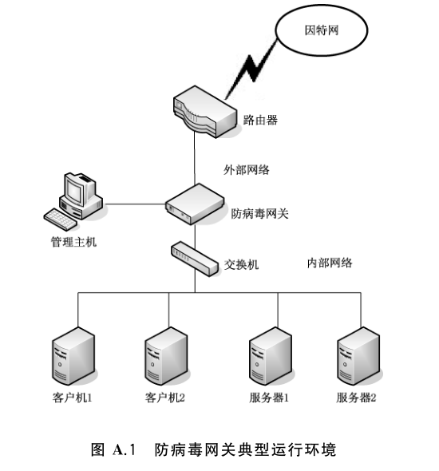
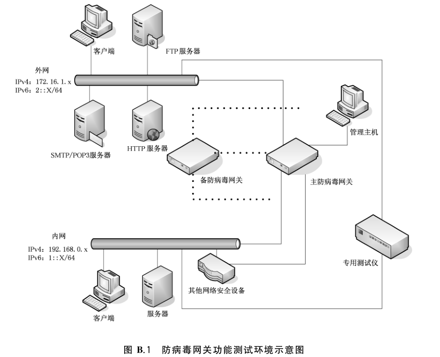
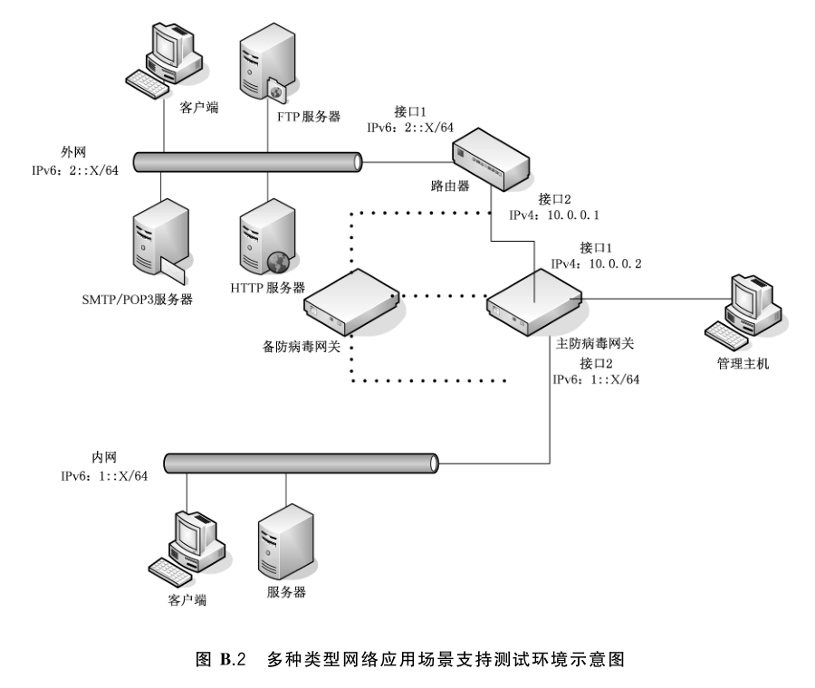
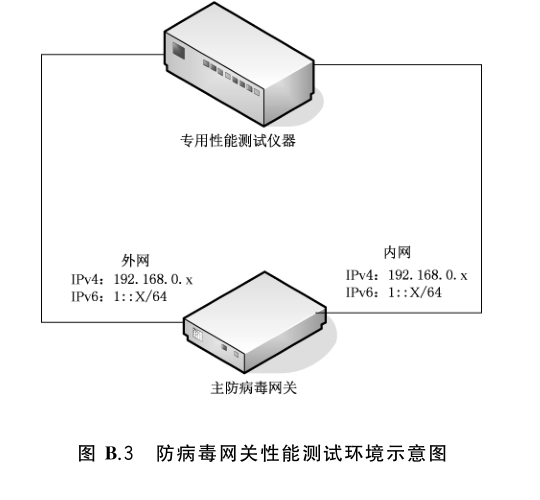

# GB/T 35277-2017 信息安全技术 防病毒网关安全技术要求和测试评价方法

> 来源：[GB/T 35277-2017 国家标准详情](https://openstd.samr.gov.cn/bzgk/std/newGbInfo?hcno=B4B697696CB19A17FEC10A98EDC7CB9F)；封面发布日期：2017-12-29；实施日期：2018-07-01。
> 官方 PDF SHA-256：36dad63bf7b7d4226a28ed0a9f64a747ed99396331c142a2d5263e5d9dd120bc。
> 依据官方 PDF 全部 42 页的页面图像转写与校核；省略封面、目录、页眉、页脚和分页，合并印刷折行；附录示意图保留为从原文页面裁出的图像。

## 前言

本标准按照 GB/T 1.1—2009 给出的规则起草。

本标准由全国信息安全标准化技术委员会（SAC/TC 260）提出并归口。

本标准起草单位：国家计算机病毒应急处理中心、国家信息中心、中国电子科技集团公司第十五研究所（信息产业信息安全测评中心）、中国科学院大学、北京安天网络安全技术有限公司、北京瑞星信息技术股份有限公司、亚信科技（成都）有限公司、北京冠群金辰软件有限公司、北京网御星云信息技术有限公司、网神信息技术（北京）股份有限公司、华为技术有限公司。

本标准主要起草人：陈建民、杜振华、张瑞、刘威、曹鹏、黄一斌、刘健、禄凯、肖新光、叶荣军、张玉清、王文杰、白日、高晓立、王光宇、杨黎鸿、刘振华、刘彦、张泰然、张喆、邓莹、彭立炜、孙波、李冬、舒心、张韫菁、冯军亮、马天成、刘杨、王文一、徐双双。

## 1 范围

本标准规定了防病毒网关的技术要求和测试评价方法。

本标准适用于防病毒网关的设计、开发及检测。

## 2 术语和定义

下列术语和定义适用于本文件。

### 2.1 防病毒网关 antivirus gateway

部署于网络和网络之间，通过分析网络层和应用层的通信，根据预先定义的过滤规则和防护策略，实现对网络内的病毒防护。

### 2.2 病毒 virus

能够影响计算机操作系统、应用程序和数据的完整性、可用性、可控性和保密性的计算机程序或代码，包括文件型病毒、蠕虫、木马程序、宏病毒、脚本病毒等恶意程序。

### 2.3 隔离 quarantine

防病毒网关在对病毒进行处理时，为保留病毒样本以及受感染的文件，而采取将病毒以及受感染的文件存储在一个被称之为“隔离区”的受限制存储空间的处理方式。

### 2.4 内部网络 internal network

通过防病毒网关隔离的可信任区域或保护区域。

### 2.5 外部网络 external network

通过防病毒网关隔离的不可信任区域或非保护区域。

### 2.6 最大并发连接数 maximum concurrent connection capacity

防病毒网关所能保持的最大并发连接数量。

### 2.7 最大新建连接速率 maximum connection establishment rate

防病毒网关在单位时间内所能建立的最大连接数，一般是每秒新建的连接数。

### 2.8 恶意 URL malicious URL

指向的资源中含有病毒的 URL。

### 2.9 加壳病毒 packed virus

通过特定算法的变换，将病毒的编码进行一次或多次的压缩、加密，产生新的病毒文件。与原病毒文件相比，文件内容发生变化，但功能保持不变。

### 2.10 可执行病毒样本 executeable virus sample

可以被激活并正常执行其功能的病毒样本文件。

### 2.11 恶意网页脚本样本 malicious webpage scripte virus sample

含有漏洞利用、后门、远程控制等恶意代码的恶意网页或脚本病毒样本文件。

### 2.12 已知病毒样本 knowned virus sample

防病毒网关产品能够检测的病毒样本文件。

### 2.13 病毒样本库 virus sample set

病毒样本文件的集合。

### 2.14 隧道 tunneling

为实现不同类型网络之间通信的一种网络通信协议封装和加密技术。

## 3 缩略语

下列缩略语适用于本文件。

- CSV：逗号分隔的文本文件格式（Comma-Separated Values）
- C&C：命令与控制（Comand and Control）
- DOC：微软公司 Word 文字处理软件文档格式（Microsoft Word Document）
- FTP：文件传输协议（File Transfer Protocol）
- Gbps：千兆/秒（Gigabits Per Second）
- HTML：超文本标记语言（HyperText Markup Language）
- HTTP：超文本传输协议（HyperText Transfer Protocol）
- IMAP：Internet 邮件访问协议（Internet Mail Access Protocol）
- IP：互联网协议（Internet Protocol）
- IPv4：互联网协议第 4 版（Internet Protocol version 4）
- IPv6：互联网协议第 6 版（Internet Protocol version 6）
- KB：千字节（Kilo Byte）
- PDF：便携式文档格式（Portable Document Format）
- POP3：邮局协议第 3 版（Post Office Protocol version 3）
- SMTP：简单邮件传输协议（Simple Mail Transfer Protocol）
- TCP：传输控制协议（Transmission Control Protocol）
- URL：统一资源定位符（Uniform Resource Locator）
- XLS：微软公司电子表格文档格式（Microsoft Excel）
- XML：可扩展标记语言（Extensible Markup Language）

## 4 防病毒网关描述

防病毒网关是一种网络设备，用以保护内网进出数据的安全。主要体现在病毒的检测、隔离、过滤阻断等功能，同时部分设备也具有一定防火墙的功能。

这种网关防病毒产品能够检测进出网络内部的数据，对多种应用协议的数据进行病毒扫描，一旦发现病毒就会采取相应的手段进行隔离或查杀。

防病毒网关运行环境和工作模式参见 A.1 和 A.2。

## 5 技术要求

### 5.1 总体说明

#### 5.1.1 技术要求分类

防病毒网关技术要求分为功能要求、性能要求、安全要求和安全保障要求四个大类。其中，功能要求是对防病毒网关产品应具备的功能提出具体的要求，包括防护能力、策略自定义、响应处理、报表和统计、升级能力、协同联动能力等；性能要求是对防病毒网关产品应达到的性能指标做出规定，例如 TCP 协议数据最大处理能力、HTTP 协议数据最大处理能力等；安全要求是对防病毒网关自身安全和防护能力提出具体的要求，例如异常流量处理、故障信息告警、标识与鉴别、安全支撑系统、安全管理、审计日志、失效保护功能、双机热备、数据完整性等；安全保障要求则针对防病毒网关开发者和防病毒网关自身提出具体的要求，例如开发、指导性文档、生命周期支持、测试、脆弱性评定等。

#### 5.1.2 安全等级

安全等级分为基本级和增强级。安全等级划分标准主要依据产品的功能特性，对基本级产品的性能不作要求。

增强级产品除需满足基本级产品的技术要求外，还需满足增强级中列出的其他技术要求。

### 5.2 功能要求

#### 5.2.1 基本级

##### 5.2.1.1 防护能力

###### 5.2.1.1.1 静态病毒防护

当处于静态非激活的各类病毒在被监控网络中传播时，产品应具有相应的响应处理能力，并且不应对正常的系统文件和文档报警。

###### 5.2.1.1.2 多种类型网络应用场景支持

产品应能够支持多种网络应用场景，应支持纯 IPv4/IPv6 网络应用场景。

###### 5.2.1.1.3 应用协议支持

产品应支持对使用以下应用协议的网络请求和响应进行过滤：

- a) HTTP 协议；
- b) FTP 协议；
- c) POP3 协议；
- d) SMTP 协议。

##### 5.2.1.2 策略自定义

产品应能根据 5.2.1.1.1～5.2.1.1.3 中所述的要求添加、修改和删除过滤策略。

##### 5.2.1.3 响应处理

###### 5.2.1.3.1 病毒检测

产品应能根据防护策略对病毒文件进行检测和告警。

###### 5.2.1.3.2 病毒阻断

产品应能根据防护策略对病毒文件进行准确阻断。

###### 5.2.1.3.3 病毒隔离

产品应能根据防护策略对病毒文件进行隔离保存。

###### 5.2.1.3.4 告警信息

产品应能对病毒传播行为、过滤防护等提供报警功能。报警信息应至少包括以下内容：

- a) 病毒告警信息：
   1) 病毒传播来源地址；
   2) 病毒传播来源端口号；
   3) 病毒传播目的地址；
   4) 病毒传播目的端口号；
   5) 病毒传播协议；
   6) 病毒文件名；
   7) 病毒名称；
   8) 事件发生的日期和时间；
- b) 过滤防护告警：
   1) 网络请求来源地址；
   2) 网络请求来源端口号；
   3) 网络请求目的地址；
   4) 网络请求目的端口号；
   5) 过滤阻断原因；
   6) 事件发生的日期和时间。

###### 5.2.1.3.5 告警方式

产品告警应采用屏幕实时提示、邮件告警、短信告警和声音告警等一种或多种方式。

###### 5.2.1.3.6 事件记录

产品应能对病毒传播行为、恶意 URL 访问、过滤防护等安全事件及时生成事件记录，事件记录应存储于掉电非易失性存储介质中，且在存储空间达到阈值时能够通知授权管理员。

##### 5.2.1.4 报表和统计

###### 5.2.1.4.1 报表生成

产品应能对事件记录进行统计，并根据以下模板生成报表：

- a) 缺省报表模板；
- b) 自定义报表模板。

###### 5.2.1.4.2 报表导出

产品报表应能输出成方便阅读的文件格式，至少支持以下报表文件格式中的一种或多种：DOC、PDF、HTML、XLS、CSV、XML 等。

###### 5.2.1.4.3 统计功能

产品应提供基于流量、协议、病毒传播行为等进行统计的功能。

##### 5.2.1.5 升级能力

产品应支持手动或自动的方式进行升级，包括对病毒特征库、策略文件以及服务程序等进行更新。

#### 5.2.2 增强级

##### 5.2.2.1 防护能力

###### 5.2.2.1.1 动态病毒防护

防病毒网关应有效阻止已激活病毒在网络内部的传播，并且阻止与该病毒相关的恶意网络通讯，如 C&C 违规外联通讯等。

###### 5.2.2.1.2 逃避检测防护

产品应能支持识别以下特殊格式的病毒文件，以此发现逃避检测的病毒传播行为：

- a) 无口令保护的压缩格式文件，包括 zip、rar、tgz 等；
- b) 无口令保护的多层（2 层以上）压缩格式的病毒文件；
- c) 加壳格式的病毒文件。

###### 5.2.2.1.3 恶意 URL 防护

对于含有病毒、木马等病毒的恶意 URL，产品应具有相应的响应处理能力。

###### 5.2.2.1.4 多种类型网络应用场景支持

产品应能够支持多种网络应用场景，应支持以下 IPv4 与 IPv6 共存的网络应用场景：

- a) 产品支持 IPv4 与 IPv6 双协议栈；
- b) 产品支持隧道技术。

###### 5.2.2.1.5 应用协议支持

产品应支持对使用 IMAP 协议的网络请求和响应进行过滤。

##### 5.2.2.2 响应处理

###### 5.2.2.2.1 恶意 URL 阻断

产品应能根据防护策略对恶意 URL 的访问请求进行阻断。

###### 5.2.2.2.2 告警信息

产品应能对恶意 URL 访问等提供报警功能。报警信息应至少包括以下内容：

- a) 恶意 URL 地址；
- b) 访问恶意 URL 地址的 IP 地址；
- c) 恶意 URL 描述；
- d) 事件发生的日期和时间。

##### 5.2.2.3 升级能力

产品应支持增量升级。

##### 5.2.2.4 协同联动能力

产品应支持与其他安全产品的协同联动功能，具体要求如下：

- a) 防病毒网关应按照一定的安全协议与其他安全产品协同联动，并支持手工与自动方式来配置联动策略；
- b) 防病毒网关应在建立协同联动前与其联动的安全产品进行身份鉴别。

### 5.3 性能要求

#### 5.3.1 基本级

无。

#### 5.3.2 增强级

##### 5.3.2.1 TCP 协议数据最大处理能力

防病毒网关的 TCP 协议数据最大处理能力视不同应用场景有所不同，1 Gbps 带宽环境下具体指标要求如下：

- a) 最大并发连接数不小于 700 000 个；
- b) 最大新建连接数不小于 10 000 个/s。

##### 5.3.2.2 HTTP 协议数据最大处理能力

防病毒网关的 HTTP 协议数据最大处理能力视不同应用场景有所不同，1 Gbps 带宽环境下无延迟 HTTP 请求响应处理能力具体指标要求如下：

- a) 长度为 44 KB 的 HTTP 响应包，最大新建连接速率不小于 1 500 个/s；
- b) 长度为 21 KB 的 HTTP 响应包，最大新建连接速率不小于 2 500 个/s；
- c) 长度为 10 KB 的 HTTP 响应包，最大新建连接速率不小于 5 000 个/s。

### 5.4 安全要求

#### 5.4.1 基本级

##### 5.4.1.1 异常流量处理

产品应对于以下几种异常流量进行有效的处理：

- a) 碎片包；
- b) 畸形报文；
- c) 其他异常流量。

##### 5.4.1.2 故障信息告警

产品应具备软、硬件故障告警功能，能够在软件、硬件出现故障时，通过屏幕实时提示、邮件告警、短信告警、声音告警等一种或多种方式进行告警。

##### 5.4.1.3 标识与鉴别

###### 5.4.1.3.1 管理员标识

**5.4.1.3.1.1 属性定义**

产品应为每个授权管理员规定与之相关的安全属性，如标识、鉴别信息、隶属组、权限等。

**5.4.1.3.1.2 属性初始化**

产品应提供使用默认值对创建的每个授权管理员的属性进行初始化的能力。

**5.4.1.3.1.3 唯一性标识**

产品应为授权管理员提供唯一标识，并能将标识与该授权管理员的所有可审计事件相关联。

###### 5.4.1.3.2 身份鉴别

**5.4.1.3.2.1 基本鉴别**

产品应在执行任何与安全功能相关的操作之前采用一种身份鉴别方式鉴别授权管理员的身份。

**5.4.1.3.2.2 鉴别失败处理**

当对同一授权管理员连续鉴别失败的次数达到指定次数，产品应能终止该管理员的访问，默认的指定次数不应超过 10 次。

**5.4.1.3.2.3 鉴别数据保护**

产品应保证鉴别数据不被未授权查阅或修改。

##### 5.4.1.4 安全支撑系统

产品的底层支撑系统（包括产品正常运行所需的操作系统、应用系统、数据存储系统和中间件等）应确保不提供多余的网络服务。

##### 5.4.1.5 安全管理

###### 5.4.1.5.1 安全功能管理

授权管理员应能对产品进行以下管理操作：

- a) 查看、修改相关安全属性；
- b) 启动、关闭全部或部分安全功能；
- c) 制定和修改各种安全策略。

###### 5.4.1.5.2 安全管理方式

产品应向授权管理员提供以下安全管理方式：

- a) 通过 console 接口进行本地管理；
- b) 通过网络接口进行远程管理。

##### 5.4.1.6 审计日志

###### 5.4.1.6.1 审计日志生成

产品应对与自身安全相关的以下事件生成审计日志：

- a) 管理员登录成功和失败；
- b) 对安全策略进行更改；
- c) 对管理员进行增加、删除和属性修改；
- d) 因鉴别失败的次数超出了设定值，导致的会话连接终止；
- e) 对事件记录、审计日志的操作；
- f) 管理员的其他操作。

每一条审计日志至少应包括事件发生的日期、时间、管理员标识、事件描述和结果。若采用远程登录方式对产品进行管理，还应记录管理主机的地址。

###### 5.4.1.6.2 审计日志存储

审计日志应存储于掉电非易失性存储介质中。

###### 5.4.1.6.3 审计日志管理

产品应提供以下审计日志管理功能：

- a) 只允许授权管理员访问审计日志；
- b) 提供对审计日志的查询功能；
- c) 保存并导出审计日志。

#### 5.4.2 增强级

##### 5.4.2.1 失效保护功能

产品应具备失效保护功能，能够在断电、故障等异常情况下保持网络连通。

##### 5.4.2.2 双机热备

产品应具备双机热备功能，当主防病毒网关设备出现断电或其他故障时，备防病毒网关设备应及时发现并接管进行工作，接管过程耗时不应超过 1 min。

##### 5.4.2.3 标识与鉴别

产品应在执行任何与安全功能相关的操作之前对同一授权管理员采用两种或两种以上组合的身份鉴别方式鉴别授权管理员的身份。

##### 5.4.2.4 数据完整性

产品应确保授权管理员信息、策略信息、关键程序和病毒特征库的数据完整性，应采取必要的手段对其完整性自动进行检验。

##### 5.4.2.5 安全支撑系统

产品的底层支撑系统（包括产品正常运行所需的操作系统、应用系统、数据存储系统和中间件等）应不含导致产品权限丢失、拒绝服务、信息泄露等的安全漏洞。

##### 5.4.2.6 安全管理

###### 5.4.2.6.1 安全角色权限分离

产品应能对特权角色和权限进行区分：

- a) 产品应至少具有两种不同权限的安全角色，如：管理员和审计员；
- b) 产品应对特权角色采用最小授权原则，如：管理员不能对审计员负责的审计功能进行管理，审计员也不能对管理员负责的功能进行管理。

###### 5.4.2.6.2 安全管理方式

产品应采取保密措施保障远程管理的信息传输安全。

###### 5.4.2.6.3 远程保密传输

产品应具备以下远程保密传输能力：

- a) 若产品通过网络进行升级更新，应采取保密措施保障产品与远程服务器间数据传输的安全；
- b) 若产品组件间通过网络进行通讯，应采取保密措施保障组件间数据传输的安全。

###### 5.4.2.6.4 远程管理主机

若控制台提供远程管理功能，应能对可远程管理的主机地址进行限制。

### 5.5 安全保障要求

#### 5.5.1 基本级

##### 5.5.1.1 开发

###### 5.5.1.1.1 安全架构描述

开发者应提供产品安全功能安全架构的描述，安全架构的描述应满足以下要求：

- a) 应与在产品设计文档中对安全功能要求执行的抽象描述的级别一致；
- b) 应描述与安全功能要求一致的产品安全功能安全域；
- c) 应描述产品安全功能初始化过程为何是安全的；
- d) 安全架构的描述应论证产品安全功能可防止被破坏；
- e) 安全架构的描述应论证产品安全功能可防止安全功能要求执行的功能被旁路。

###### 5.5.1.1.2 安全执行功能规范

开发者应提供一个功能规范，功能规范应满足以下要求：

- a) 完整地描述产品安全功能；
- b) 描述所有的产品安全功能接口的目的、使用方法以及每个安全功能接口相关的所有参数；
- c) 对于每个安全功能要求，功能规范应描述执行安全功能接口相关的安全功能执行行为；
- d) 对于安全功能要求，功能规范应描述由安全功能执行行为相关处理而引起的直接错误信息；
- e) 功能规范应论证安全功能要求到安全功能接口的对应关系。

###### 5.5.1.1.3 基础设计

开发者应提供产品的设计文档，并提供从功能规范的产品安全功能接口到产品设计中获取到的最低层分解的映射，应满足以下要求：

- a) 设计文档应根据子系统描述产品的结构；
- b) 设计文档应标识产品安全功能的所有子系统；
- c) 设计文档应对每一个安全功能要求支撑或安全功能要求无关的产品安全功能子系统的行为进行足够详细的描述，以确定它不是安全功能要求执行；
- d) 设计文档应概括安全功能要求执行子系统的安全功能要求执行行为；
- e) 设计文档应描述产品安全功能的安全功能要求执行子系统间的相互作用，以及产品安全功能的安全功能要求执行子系统与其他产品安全功能子系统间的相互作用；
- f) 映射关系应证明产品设计中描述的所有行为能够映射到调用它的产品安全功能接口。

##### 5.5.1.2 指导性文档

###### 5.5.1.2.1 准备程序

开发者应提供产品的准备程序，满足以下要求：

- a) 准备程序应描述与开发者交付程序相一致的安全接收所交付产品必需的所有步骤；
- b) 准备程序应描述安全安装产品以及安全准备与安全目标中描述的运行环境安全目的一致的运行环境必需的所有步骤。

###### 5.5.1.2.2 操作用户指南

开发者应提供明确和合理的操作用户指南，操作用户指南应满足以下要求：

- a) 操作用户指南应对每一种用户角色进行描述，在安全处理环境中应被控制的用户可访问的功能和特权，包含适当的警示信息；
- b) 操作用户指南应对每一种用户角色进行描述，怎样以安全的方式使用产品提供的可用接口；
- c) 操作用户指南应对每一种用户角色进行描述，可用功能和接口，尤其是受用户控制的所有安全参数，适当时应指明安全值；
- d) 操作用户指南应对每一种用户角色明确说明，与需要执行的用户可访问功能有关的每一种安全相关事件，包括改变产品安全功能所控制实体的安全特性；
- e) 操作用户指南应标识产品运行的所有可能状态（包括操作导致的失败或者操作性错误），它们与维持安全运行之间的因果关系和联系；
- f) 操作用户指南应对每一种用户角色进行描述，为了充分实现安全目标中描述的运行环境安全目的所必需执行的安全策略。

##### 5.5.1.3 生命周期支持

###### 5.5.1.3.1 配置管理系统的使用

开发者应使用配置管理系统，提供配置管理文档，并满足以下要求：

- a) 应给产品标记唯一参照号；
- b) 配置管理文档应描述用于唯一标识配置项的方法；
- c) 配置管理系统应唯一标识所有配置项。

###### 5.5.1.3.2 部分产品配置管理覆盖

开发者应提供产品配置项列表，满足以下要求：

- a) 配置项列表应包括：产品本身、安全保障要求的评估证据和产品的组成部分；
- b) 配置项列表应唯一标识配置项；
- c) 对于每一个产品安全功能相关的配置项，配置项列表应简要说明该配置项的开发者。

###### 5.5.1.3.3 交付程序

开发者应将把产品或其部分交付给消费者的程序文档化，并满足以下要求：

- a) 交付文档应描述，在向消费者分发产品版本时，用以维护安全性所必需的所有程序；
- b) 应确认开发者在使用交付程序。

##### 5.5.1.4 测试

###### 5.5.1.4.1 覆盖证据

开发者应提供测试覆盖的证据，在测试覆盖证据中，应表明测试文档中的测试与功能规范中的安全功能接口是对应的。

###### 5.5.1.4.2 功能测试

开发者应测试安全功能，将结果文档化并提供测试文档，测试文档应包括以下内容：

- a) 测试计划，应标识要执行的测试并描述执行每个测试的方案，这些方案应包括对于其他测试结果的任何顺序依赖性；
- b) 预期的测试结果，应指出测试成功执行后的预期输出；
- c) 实际的测试结果，应确认和预期的测试结果一致。

###### 5.5.1.4.3 独立测试—抽样

开发者应提供一组与开发者产品安全功能测试中同等的一系列资源，用于安全功能的抽样测试。

##### 5.5.1.5 脆弱性分析

开发者应提供适合测试的产品，并提供执行脆弱性分析的相关资源，包括指导性文档、功能规范、产品设计和安全架构描述。

#### 5.5.2 增强级

##### 5.5.2.1 开发

###### 5.5.2.1.1 安全架构描述

开发者应提供产品安全功能安全架构的描述，安全架构的描述应满足以下要求：

- a) 应与在产品设计文档中对安全功能要求执行的抽象描述的级别一致；
- b) 应描述与安全功能要求一致的产品安全功能安全域；
- c) 应描述产品安全功能初始化过程为何是安全的；
- d) 安全架构的描述应论证产品安全功能可防止被破坏；
- e) 安全架构的描述应论证产品安全功能可防止安全功能要求执行的功能被旁路。

###### 5.5.2.1.2 完备的功能规范

开发者应提供一个功能规范，功能规范应满足以下要求：

- a) 完整地描述产品安全功能；
- b) 描述所有的产品安全功能接口的目的、使用方法以及每个安全功能接口相关的所有参数；
- c) 对于每个安全功能要求，功能规范应描述执行安全功能接口相关的所有行为；
- d) 功能规范应描述可能由每个安全功能接口的调用而引起的所有直接错误消息；
- e) 功能规范应论证安全功能要求到安全功能接口的对应关系。

###### 5.5.2.1.3 基础模块设计

开发者应提供产品的设计文档，并提供从功能规范的产品安全功能接口到产品设计中获取到的最低层分解的映射，应满足以下要求：

- a) 设计文档应根据子系统描述产品的结构；
- b) 设计文档应根据模块描述产品安全功能；
- c) 设计文档应标识产品安全功能的所有子系统，描述每一个产品安全功能子系统以及产品安全功能所有子系统间的相互作用；
- d) 设计文档应提供产品安全功能子系统到产品安全功能模块间的映射关系；
- e) 设计文档应描述每一个安全功能要求执行模块，包括它的目的及与其他模块间的相互作用；
- f) 设计文档应描述每一个安全功能要求执行模块，包括它的安全功能要求相关接口、其他接口的返回值、与其他模块间的相互作用及调用的接口；
- g) 设计文档应描述每一个安全功能要求支撑或安全功能要求无关模块，包括它的目的及与其他模块间的相互作用；
- h) 映射关系应证明产品设计中描述的所有行为能够映射到调用它的产品安全功能接口。

###### 5.5.2.1.4 安全功能实现表示

开发者应以开发人员使用的形式提供实现表示，并提供产品设计描述与实现表示实例之间的映射，应满足以下要求：

- a) 实现表示应包含全部产品安全功能；
- b) 实现表示应详细地定义安全功能，使得无需进一步设计就能生成安全功能；
- c) 产品设计描述与实现表示实例之间的映射应能证明它们的一致性。

##### 5.5.2.2 指导性文档

###### 5.5.2.2.1 准备程序

开发者应提供产品的准备程序，满足以下要求：

- a) 准备程序应描述与开发者交付程序相一致的安全接收所交付产品必需的所有步骤；
- b) 准备程序应描述安全安装产品以及安全准备与安全目标中描述的运行环境安全目的一致的运行环境必需的所有步骤。

###### 5.5.2.2.2 操作用户指南

开发者应提供明确和合理的操作用户指南，操作用户指南应满足以下要求：

- a) 操作用户指南应对每一种用户角色进行描述，在安全处理环境中应被控制的用户可访问的功能和特权，包含适当的警示信息；
- b) 操作用户指南应对每一种用户角色进行描述，怎样以安全的方式使用产品提供的可用接口；
- c) 操作用户指南应对每一种用户角色进行描述，可用功能和接口，尤其是受用户控制的所有安全参数，适当时应指明安全值；
- d) 操作用户指南应对每一种用户角色明确说明，与需要执行的用户可访问功能有关的每一种安全相关事件，包括改变产品安全功能所控制实体的安全特性；
- e) 操作用户指南应标识产品运行的所有可能状态（包括操作导致的失败或者操作性错误），它们与维持安全运行之间的因果关系和联系；
- f) 操作用户指南应对每一种用户角色进行描述，为了充分实现安全目标中描述的运行环境安全目的所应当执行的安全策略。

##### 5.5.2.3 生命周期支持

###### 5.5.2.3.1 生产支持和接受程序及其自动化

开发者应使用配置管理系统，提供配置管理文档，并满足以下要求：

- a) 应给产品标记唯一参照号；
- b) 配置管理文档应描述用于唯一标识配置项的方法；
- c) 配置管理系统应唯一标识所有配置项；
- d) 配置管理系统应提供自动化的措施使得只能对配置项进行授权变更；
- e) 配置管理系统应以自动化的方式支持产品的生产；
- f) 配置管理文档应包括配置管理计划，配置管理计划应描述配置管理系统是如何应用于产品的开发的；
- g) 配置管理计划应描述用来接受修改过的或新创建的作为产品组成部分的配置项的程序；
- h) 应提供证据论证所有配置项都正在配置管理系统下进行维护，并论证配置管理系统的运行与配置管理计划是一致的。

###### 5.5.2.3.2 问题跟踪配置管理覆盖

开发者应提供产品配置项列表，满足以下要求：

- a) 配置项列表应包括：产品本身、安全保障要求的评估证据、产品的组成部分、实现表示和安全缺陷报告及其解决状态；
- b) 配置项列表应唯一标识配置项；
- c) 对于每一个产品安全功能相关的配置项，配置项列表应简要说明该配置项的开发者。

###### 5.5.2.3.3 交付程序

开发者应将把产品或其部分交付给消费者的程序文档化，并满足以下要求：

- a) 交付文档应描述，在向消费者分发产品版本时，用以维护安全性所必需的所有程序；
- b) 应确认开发者在使用交付程序。

###### 5.5.2.3.4 安全措施标识

开发者应提供开发安全文档，满足以下要求：

- a) 开发安全文档应描述在产品的开发环境中，保护产品设计和实现的保密性和完整性所必需的所有物理的、程序的、人员的及其他方面的安全措施；
- b) 应确认安全措施在被使用。

###### 5.5.2.3.5 开发者定义的生命周期模型

开发者应建立一个生命周期模型用于产品的开发和维护，提供生命周期定义文档，并满足以下要求：

- a) 生命周期定义文档应对用于开发和维护产品的模型进行描述；
- b) 生命周期模型应为产品的开发和维护提供必要的控制。

###### 5.5.2.3.6 明确定义的开发工具

开发者应标识和明确定义用于开发产品的工具，并提供开发工具文档无歧义地定义所有语句和实现用到的所有协定与命令，以及所有实现依赖选项的含义。

##### 5.5.2.4 测试

###### 5.5.2.4.1 覆盖分析

开发者应提供测试覆盖分析，并满足如下要求：

- a) 测试覆盖分析应论证测试文档中的测试与功能规范中的安全功能接口之间的对应性；
- b) 测试覆盖分析应论证已经对功能规范中的所有产品安全功能接口都进行了测试。

###### 5.5.2.4.2 测试：安全执行模块

开发者应提供测试深度分析，并满足以下要求：

- a) 测试深度分析应论证测试文档中的测试与产品设计中的产品安全功能子系统、安全功能要求执行模块之间的一致性；
- b) 测试深度分析应论证产品设计中的所有产品安全功能子系统都已经进行过测试；
- c) 测试深度分析应论证产品设计中的安全功能要求执行模块都已经进行过测试。

###### 5.5.2.4.3 功能测试

开发者应测试安全功能，将结果文档化并提供测试文档，测试文档应包括以下内容：

- a) 测试计划，应标识要执行的测试并描述执行每个测试的方案，这些方案应包括对于其他测试结果的任何顺序依赖性；
- b) 预期的测试结果，应指出测试成功执行后的预期输出；
- c) 实际的测试结果，应确认和预期的测试结果一致。

###### 5.5.2.4.4 独立测试—抽样

开发者应提供一组与开发者产品安全功能测试中同等的一系列资源，用于安全功能的抽样测试。

##### 5.5.2.5 关注点脆弱性分析

开发者应提供适合测试的产品，并提供执行关注点脆弱性分析的相关资源，包括指导性文档、功能规范、产品设计、安全架构描述和实现表示。

## 6 测试评价方法

### 6.1 总体说明

测试评价方法与技术要求一一对应，它给出具体的评估方法来验证防病毒网关产品是否达到技术要求中所提出的要求。它由测试环境、测试工具、测试方法和预期结果四个部分构成。

### 6.2 功能测试

#### 6.2.1 测试环境与工具

防病毒网关产品典型功能测试环境与工具参见 B.1。

#### 6.2.2 基本级

##### 6.2.2.1 防护能力

###### 6.2.2.1.1 静态病毒防护

该项测试应遵循以下测试方法：

- a) 测试方法如下：
   1) 配置防病毒网关的病毒处理策略为检测并阻断；
   2) 在内网、外网分别配置客户端，基于 HTTP、FTP、SMTP、POP3 或其他应用协议中的一种或多种在客户端和服务器之间传输病毒样本基本库、流行病毒样本库中的病毒样本和误报样本库中的正常文件样本；
- b) 预期结果如下：
   1) 防病毒网关对病毒样本基本库中的样本至少能检测其中的 90%；
   2) 防病毒网关对流行病毒样本库中的样本至少能检测其中的 95%；
   3) 防病毒网关不会对误报样本库中的样本进行检测或阻断。

###### 6.2.2.1.2 应用协议支持

该项测试应遵循以下测试方法：

- a) 测试方法如下：
   1) 在内网、外网分别配置客户端和服务器，基于 HTTP 协议传输测试病毒样本；
   2) 在内网、外网分别配置客户端和服务器，基于 FTP 协议传输测试病毒样本；
   3) 在内网、外网分别配置客户端和服务器，基于 SMTP 协议传输测试病毒样本；
   4) 在内网、外网分别配置客户端和服务器，基于 POP3 协议传输测试病毒样本；
- b) 预期结果如下：
   1) 防病毒网关默认开启应用协议支持，并覆盖 5.2.1.1.3 中所述的常见应用协议；
   2) 防病毒网关默认开启病毒检测阻断功能；
   3) 防病毒网关能够对基于 HTTP 协议传输的测试病毒样本进行检测、阻断；
   4) 防病毒网关能够对基于 FTP 协议传输的测试病毒样本进行检测、阻断；
   5) 防病毒网关能够对基于 SMTP 协议传输的测试病毒样本进行检测、阻断；
   6) 防病毒网关能够对基于 POP3 协议传输的测试病毒样本进行检测、阻断。

###### 6.2.2.1.3 多种类型网络应用场景支持

该项测试应遵循以下测试方法：

- a) 测试方法如下：
   1) 参见图 B.2 配置测试环境；
   2) 配置内部网络、外部网络地址均为 IPv4 类型地址，进行 6.2.2.1.1 及 6.2.2.1.2 测试；
   3) 配置内部网络、外部网络地址均为 IPv6 类型地址，进行 6.2.2.1.1 及 6.2.2.1.2 测试；
- b) 预期结果如下：
   1) 内部网络、外部网络地址均为 IPv4 类型地址时，防病毒网关能够通过 6.2.2.1.1 及 6.2.2.1.2 测试；
   2) 内部网络、外部网络地址均为 IPv6 类型地址时，防病毒网关能够通过 6.2.2.1.1 及 6.2.2.1.2 测试。

##### 6.2.2.2 策略自定义

该项测试应遵循以下测试方法：

- a) 测试方法如下：
   1) 根据 5.2.1.1 中的功能要求添加病毒检测过滤策略；
   2) 进行 6.2.2.1.1 测试；
   3) 根据 5.2.1.1 中的功能要求修改刚添加的病毒检测过滤策略；
   4) 进行 6.2.2.1.1 测试；
   5) 根据 5.2.1.1 中的功能要求删除刚修改的病毒检测过滤策略；
   6) 进行 6.2.2.1.1 测试；
- b) 预期结果，防病毒网关能够根据自定义的策略完成相应的病毒检测过滤。

##### 6.2.2.3 响应处理

###### 6.2.2.3.1 病毒检测

该项测试应遵循以下测试方法：

- a) 测试方法如下：
   1) 配置防病毒网关的病毒响应处理策略为只检测；
   2) 进行 6.2.2.1.1 的测试；
- b) 预期结果，防病毒网关能够对病毒样本文件进行告警，但不会阻断样本文件的传输。

###### 6.2.2.3.2 病毒阻断

该项测试应遵循以下测试方法：

- a) 测试方法如下：
   1) 配置防病毒网关的病毒响应处理策略为检测并阻断；
   2) 进行 6.2.2.1.1 的测试；
- b) 预期结果，防病毒网关能够对病毒样本文件进行告警，并阻断样本文件的传输。

###### 6.2.2.3.3 病毒隔离

该项测试应遵循以下测试方法：

- a) 测试方法如下：
   1) 配置防病毒网关的病毒响应处理策略为检测并隔离；
   2) 进行 6.2.2.1.1 的测试；
   3) 检查防病毒网关的病毒隔离区，并下载隔离区中的病毒样本文件；
   4) 对隔离区中下载的病毒样本文件与原始病毒样本文件进行一致性校验；
- b) 预期结果如下：
   1) 防病毒网关能够对病毒样本文件进行告警，并阻断样本文件的传输，同时将病毒样本文件存储在隔离区中；
   2) 防病毒网关隔离区中的病毒样本文件与原始病毒样本文件一致。

###### 6.2.2.3.4 告警信息

该项测试应遵循以下测试方法：

- a) 测试方法如下：
   1) 开启防病毒网关的告警功能；
   2) 进行 6.2.2.1.1 及 6.2.2.1.2 的各项测试；
   3) 查看防病毒网关告警信息；
- b) 预期结果如下：
   1) 防病毒网关应具有告警功能；
   2) 防病毒网关告警信息中应包括 5.2.1.3.4 中要求的各项信息。

###### 6.2.2.3.5 告警方式

该项测试应遵循以下测试方法：

- a) 测试方法如下：
   1) 配置防病毒网关的告警方式；
   2) 进行 6.2.2.1.1 及 6.2.2.1.2 的各项测试；
   3) 查看防病毒网关的管理界面，查收报警邮件，查收短信或其他可以收取告警信息的设备或系统；
- b) 预期结果如下：
   1) 防病毒网关至少具有屏幕实时提示、邮件告警、短信告警和声音报警等告警方式的一种或多种；
   2) 防病毒网关能够通过具有的告警方式向授权管理员发送告警信息。

###### 6.2.2.3.6 事件记录

该项测试应遵循以下测试方法：

- a) 测试方法如下：
   1) 配置防病毒网关，开启安全事件日志记录功能；
   2) 进行 6.2.2.1.1 及 6.2.2.1.2 的各项测试；
   3) 查看防病毒网关的安全事件日志；
   4) 拔掉防病毒网关的电源，再重新接上电源，开启防病毒网关，检查防病毒网关的安全事件日志是否完整，是否丢失了断电前的日志信息；
   5) 检查事件日志存储空间配置，并配置存储空间报警阈值；
- b) 预期结果如下：
   1) 防病毒网关具有安全事件日志，并能够记录病毒传播行为、恶意 URL 访问、过滤防护等安全事件的详细信息；
   2) 断电重启后，防病毒网关的安全事件日志不会丢失；
   3) 安全事件存储空间达到报警阈值时，能够通知授权管理员。

##### 6.2.2.4 报表和统计

###### 6.2.2.4.1 报表生成

该项测试应遵循以下测试方法：

- a) 测试方法如下：
   1) 使用防病毒网关提供的缺省报表模版生成报表；
   2) 配置防病毒网关的自定义报表模版；
   3) 使用自定义报表模版生成报表；
   4) 检查报表内容是否与模版匹配；
- b) 预期结果如下：
   1) 防病毒网关提供缺省报表模版；
   2) 防病毒网关能够按缺省报表模版生成报表；
   3) 防病毒网关能够按自定义的报表模版生成报表；
   4) 报表内容与报表模版匹配。

###### 6.2.2.4.2 报表导出

该项测试应遵循以下测试方法：

- a) 测试方法如下：
   1) 配置防病毒网关的报表导出设置，导出格式为 DOC、PDF、HTML、XLS、CSV、XML 等一种或多种；
   2) 导出报表；
   3) 打开导出的报表，检查内容是否完整准确；
- b) 预期结果如下：
   1) 防病毒网关具有报表导出功能，并能够正常导出格式为 DOC、PDF、HTML、XLS、CSV、XML 等一种或多种报表文件；
   2) 导出的报表文件内容完整准确。

###### 6.2.2.4.3 统计功能

该项测试应遵循以下测试方法：

- a) 测试方法如下：
   1) 配置统计条件为基于 HTTP 协议的病毒传播事件；
   2) 查看统计结果是否与统计条件相符；
- b) 预期结果如下：
   1) 防病毒网关具有安全事件统计功能；
   2) 防病毒网关能够根据统计条件输出正确的统计结果。

##### 6.2.2.5 升级能力

该项测试应遵循以下测试方法：

- a) 测试方法如下：
   1) 开启防病毒网关的自动升级功能，并配置自动更新时间；
   2) 通过手动方式启动防病毒网关升级；
   3) 通过手动方式导入离线升级文件；
   4) 检查系统版本、病毒库版本等信息；
- b) 预期结果，防病毒网关能够通过自动和手动方式升级到最新版本。

#### 6.2.3 增强级

##### 6.2.3.1 防护能力

###### 6.2.3.1.1 动态病毒防护

该项测试应遵循以下测试方法：

- a) 测试方法如下：
   1) 配置防病毒网关的病毒处理策略为检测并阻断；
   2) 配置防病毒网关开启动态病毒防护功能；
   3) 在内网中配置若干台感染机，依次激活可执行病毒样本库中的样本；
   4) 在外网配置服务器，部署恶意网页脚本样本库中的样本，用内网中的客户端访问服务器上的样本；
- b) 预期结果如下：
   1) 防病毒网关对可执行病毒样本库中的样本至少能检测其中的 90%；
   2) 防病毒网关对恶意网页脚本样本库中的样本至少能检测其中的 90%。

###### 6.2.3.1.2 逃避检测防护

该项测试应遵循以下测试方法：

- a) 测试方法如下：
   1) 配置防病毒网关的病毒处理策略为检测并阻断；
   2) 配置防病毒网关开启对压缩格式文件和加壳文件的检测功能；
   3) 将病毒样本基本库和流行病毒样本库中防病毒网关能够检测的病毒样本进行一层和多层压缩；
   4) 将病毒样本基本库和流行病毒样本库中的病毒进行加壳；
   5) 在内网、外网分别配置客户端和服务器，在客户端和服务器之间传输压缩格式和加壳格式的病毒样本；
- b) 预期结果如下：
   1) 防病毒网关能够对压缩格式的病毒样本进行检测并阻断；
   2) 防病毒网关对加壳格式病毒样本进行检测并阻断。

###### 6.2.3.1.3 恶意 URL 防护

该项测试应遵循以下测试方法：

- a) 测试方法如下：
   1) 配置防病毒网关的安全策略，开启 URL 防护功能；
   2) 在内网客户端访问恶意 URL；
- b) 预期结果，防病毒网关能够对恶意 URL 进行告警并阻断。

###### 6.2.3.1.4 应用协议支持

该项测试应遵循以下测试方法：

- a) 测试方法，在内网、外网分别配置客户端和服务器，基于 IMAP 协议传输测试病毒样本；
- b) 预期结果，防病毒网关能够对基于 IMAP 协议传输的测试病毒样本进行检测、阻断。

###### 6.2.3.1.5 多种类型网络应用场景支持

该项测试应遵循以下测试方法：

- a) 测试方法
   1) 参见图 B.2 配置测试环境；
   2) 配置外部网络为 IPv4 地址，内部网络为 IPv6 地址，进行 6.2.2.1.1、6.2.2.1.2、6.2.3.1.1、6.2.3.1.2、6.2.3.1.3、6.2.3.1.4 测试；
   3) 配置外部网络为 IPv6 地址，内部网络为 IPv6 地址，路由器和防病毒网关分别作为隧道的一端，进行 6.2.2.1.1、6.2.2.1.2、6.2.3.1.1、6.2.3.1.2、6.2.3.1.3、6.2.3.1.4 测试；
- b) 预期结果
   1) 外部网络为 IPv4 地址，内部网络为 IPv6 地址，防病毒网关能够通过 6.2.2.1.1、6.2.2.1.2、6.2.3.1.1、6.2.3.1.2、6.2.3.1.3、6.2.3.1.4 测试；
   2) 外部网络为 IPv6 地址，内部网络为 IPv6 地址，路由器和防病毒网关分别作为隧道的一端时，防病毒网关能够通过 6.2.2.1.1、6.2.2.1.2、6.2.3.1.1、6.2.3.1.2、6.2.3.1.3、6.2.3.1.4 测试。

##### 6.2.3.2 响应处理

###### 6.2.3.2.1 恶意 URL 阻断

该项测试应遵循以下测试方法：

- a) 测试方法如下：
   1) 配置防病毒网关的 URL 防护策略为检测并阻断；
   2) 在内网客户端访问恶意 URL；
- b) 预期结果，防病毒网关能够对恶意 URL 进行告警并阻断访问过程。

###### 6.2.3.2.2 告警信息

该项测试应遵循以下测试方法：

- a) 测试方法如下：
   1) 开启防病毒网关的告警功能；
   2) 进行 6.2.2.1.1、6.2.2.1.2、6.2.3.1.1、6.2.3.1.2、6.2.3.1.3、6.2.3.1.4 的各项测试；
   3) 查看防病毒网关告警信息；
- b) 预期结果如下：
   1) 防病毒网关应具有告警功能；
   2) 防病毒网关告警信息中应包括 5.2.2.2.2 中要求的各项信息。

##### 6.2.3.3 升级能力

该项测试应遵循以下测试方法：

- a) 测试方法如下：
   1) 通过自动或手动方式进行增量升级；
   2) 检查系统版本、病毒库版本等信息；
- b) 预期结果，防病毒网关能够通过增量升级方式升级到最新版本。

##### 6.2.3.4 协同联动能力

该项测试应遵循以下测试方法：

- a) 测试方法如下：
   1) 配置防病毒网关的联动策略，并设定认证方式；
   2) 内部网络客户端从外部网络服务器上下载病毒样本文件，检查防病毒网关是否能够接收其他安全产品的报警，并阻断样本传输；
   3) 在内部网络与外部网络之间大量传输病毒样本文件，测试防病毒网关是否因联动造成拒绝服务攻击；
- b) 预期结果如下：
   1) 防病毒网关及时响应受信任的并通过认证的其他安全产品的报警信息，并阻断该病毒样本的传输；
   2) 防病毒网关不会因联动而导致拒绝服务。

### 6.3 性能测试

#### 6.3.1 测试环境与工具

性能测试环境与工具参见 B.4。

#### 6.3.2 TCP 协议数据最大处理能力

该项测试应遵循以下测试方法：

- a) 测试方法如下：
   1) 配置防病毒网关允许符合规则的 TCP 连接；
   2) 通过专用性能测试仪产生无数据负载的 TCP4 层会话流量，以 10 000 个开放连接为单位稳定增加；
   3) 当防病毒网关对已知病毒出现漏报时，获得最大并发连接数；
   4) 通过专用性能测试仪产生 TCP4 层会话流量，每个连接包含 1 字节数据，以 2 000 个/s 开放连接为单位稳定增加；
   5) 当防病毒网关对已知病毒样本出现漏报时，获得最大新建连接速率；
- b) 预期结果，防病毒网关的 TCP 协议数据最大处理能力指标应达到 5.3.1 中规定的最低要求。

#### 6.3.3 HTTP 协议数据最大处理能力

该项测试应遵循以下测试方法：

- a) 测试方法如下：
   1) 配置防病毒网关允许符合规则的 HTTP 连接；
   2) 通过专用性能测试仪产生无延迟的长度为 44 KB 的 HTTP 响应包，以 500 个/s 为单位稳定增加；
   3) 通过专用性能测试仪产生无延迟的长度为 21 KB 的 HTTP 响应包，以 500 个/s 为单位稳定增加；
   4) 通过专用性能测试仪产生无延迟的长度为 10 KB 的 HTTP 响应包，以 500 个/s 为单位稳定增加；
   5) 当防病毒网关对已知病毒样本出现漏报时，分别获得 2)～4) 条件下最大新建连接速率；
- b) 预期结果，防病毒网关的 HTTP 协议数据最大处理能力应达到 5.3.2 中规定的最低要求。

### 6.4 安全性测试

#### 6.4.1 基本级

##### 6.4.1.1 异常流量处理

该项测试应遵循以下测试方法：

- a) 测试方法如下：
   1) 参见图 B.1 配置测试环境，测试仪的两个接口将分别接入内部网络和外部网络；
   2) 配置测试仪，发送碎片包、畸形报文和其他类型的异常流量作为网络背景流量；
   3) 进行 6.2.2.1.1 测试；
- b) 预期结果，防病毒网关能够正常完成对病毒样本的检测和阻断。

##### 6.4.1.2 故障信息告警

该项测试应遵循以下测试方法：

- a) 测试方法如下：
   1) 人为造成防病毒网关产品的一种软件故障；
   2) 人为造成防病毒网关产品的一种硬件故障；
- b) 预期结果，产品通过屏幕实时提示、邮件告警、短信告警、声音告警等一种或多种方式进行故障告警。

##### 6.4.1.3 管理员标识

该项测试应遵循以下测试方法：

- a) 测试方法如下：
   1) 在防病毒网关中新建管理员用户 A；
   2) 在防病毒网关中为管理员用户 A 分配用户组别和权限；
   3) 在防病毒网关中使用与管理员用户 A 相同的用户名新建管理员用户 B；
   4) 使用管理员用户 A 登录防病毒网关，并进行若干可审计的操作；
   5) 查看防病毒网关的审计日志中与管理员用户 A 有关的操作行为；
- b) 预期结果如下：
   1) 防病毒网关能够根据使用者输入的凭据成功创建管理员用户 A；
   2) 防病毒网关能够为管理员用户 A 分配用户组别和权限；
   3) 防病毒网关无法新建管理员用户 B，并提示用户名重复；
   4) 防病毒网关可以提供与管理员用户 A 有关的操作行为日志。

##### 6.4.1.4 身份鉴别

该项测试应遵循以下测试方法：

- a) 测试方法如下：
   1) 在防病毒网关中新建管理员用户 A，根据提示输入身份鉴别凭据；
   2) 为管理员用户 A 分配非管理员身份和若干功能的使用权限；
   3) 输入管理员用户 A 的正确凭据登录防病毒网关；
   4) 尝试查看防病毒网关中的其他用户信息和凭据；
   5) 尝试修改其他用户信息和凭据；
   6) 尝试输入管理员用户 A 的错误凭据登录防病毒网关；
   7) 对管理员用户 A 连续多次输入错误的凭据登录防病毒网关；
- b) 预期结果如下：
   1) 防病毒网关能够提供至少一种用户身份鉴别方式；
   2) 使用者输入合法凭据才能使用防病毒网关的相关安全功能；
   3) 防病毒网关的用户身份鉴别数据不会被未经授权的使用者查阅或修改；
   4) 多次错误的鉴别凭据将导致管理员用户 A 被终止访问防病毒网关。

##### 6.4.1.5 安全支撑系统

该项测试应遵循以下测试方法：

- a) 测试方法如下：
   1) 使用端口扫描器对防病毒网关进行服务端口扫描；
   2) 使用 telnet、nc 等程序访问防病毒网关开放的网络端口；
   3) 防病毒网关对外提供的网络服务与其功能说明是否相符；
- b) 预期结果，防病毒网关不提供多余的网络服务。

##### 6.4.1.6 安全管理

###### 6.4.1.6.1 安全功能管理

该项测试应遵循以下测试方法：

- a) 测试方法如下：
   1) 使用授权管理员的合法凭据登录防病毒网关；
   2) 查看、修改防病毒网关的相关安全属性；
   3) 启动、关闭防病毒网关的全部或部分安全功能；
   4) 新增、修改防病毒网关的病毒处理策略、阻断过滤策略等各种安全策略；
- b) 预期结果如下：
   1) 授权管理员员能够查看、修改相关安全属性；
   2) 授权管理员能够启动、关闭防病毒网关的全部或部分安全功能；
   3) 授权管理员能够新增、修改防病毒网关的病毒处理策略、阻断过滤策略等各种安全策略。

###### 6.4.1.6.2 安全管理方式

该项测试应遵循以下测试方法：

- a) 测试方法如下：
   1) 使用 console 接口连接到防病毒网关，对防病毒网关进行管理；
   2) 为防病毒网关可供远程管理的网络接口分配网络地址；
   3) 通过远程管理接口对防病毒网关进行管理；
- b) 预期结果如下：
   1) 防病毒网关具有 console 接口，并能够通过 console 接口对防病毒网关进行管理；
   2) 防病毒网关具有远程管理接口，并能够通过网络远程对防病毒网关进行管理。

##### 6.4.1.7 审计日志

###### 6.4.1.7.1 审计日志生成

该项测试应遵循以下测试方法：

- a) 测试方法如下：
   1) 开启防病毒网关的审计日志功能；
   2) 分别使用正确和错误的管理员身份鉴别凭据登录防病毒网关；
   3) 对安全策略进行修改；
   4) 增加、删除管理员，并修改管理员账户信息；
   5) 多次使用不符合鉴别条件的授权管理员凭据登录防病毒网关，直到防病毒网关终止会话连接；
   6) 对事件记录日志、审计日志进行导出和删除等操作；
   7) 进行除 1)～6) 以外的其他操作；
   8) 查看审计日志；
- b) 预期结果如下：
   1) 防病毒网关能够正常开启审计日志生成功能；
   2) 防病毒网关的审计日志能够记录授权管理员登录和失败事件；
   3) 防病毒网关的审计日志能够记录授权管理员对安全策略的更改事件；
   4) 防病毒网关的审计日志能够记录管理员的增加、删除和属性修改事件；
   5) 防病毒网关的审计日志能够记录因鉴别失败次数超出设定值，导致会话连接终止的事件；
   6) 防病毒网关的审计日志能够记录对事件日志和审计日志的操作事件；
   7) 防病毒网关的审计日志能够记录管理员的其他操作；
   8) 防病毒网关的每一条审计日志至少包括事件发生的日期、时间、用户标识、事件描述和结果。若采用远程登录方式对产品进行管理，还应记录管理主机的地址。

###### 6.4.1.7.2 审计日志存储

该项测试应遵循以下测试方法：

- a) 测试方法如下：
   1) 查看防病毒网关的审计日志；
   2) 突然切断防病毒网关的电源供应；
   3) 恢复防病毒网关的电源供应，查看防病毒网关的审计日志；
   4) 对比断电前后的审计日志；
- b) 预期结果，断电重启后防病毒网关的审计日志不会丢失。

###### 6.4.1.7.3 审计日志管理

该项测试应遵循以下测试方法：

- a) 测试方法如下：
   1) 使用非授权管理员身份访问审计日志；
   2) 使用授权管理员身份访问审计日志；
   3) 输入查询条件，查询符合条件的审计日志；
   4) 导出审计日志并保存；
   5) 打开读取导出的审计日志文件，并与防病毒网关中的审计日志记录对比；
- b) 预期结果如下：
   1) 防病毒网关只允许授权管理员访问审计日志；
   2) 授权管理员能够根据查询条件查询符合条件的审计日志；
   3) 授权管理员能够导出符合条件的审计日志，并保存为文件；
   4) 导出的审计日志文件内容与防病毒网关中的审计日志记录内容相符。

#### 6.4.2 增强级

##### 6.4.2.1 失效保护功能

该项测试应遵循以下测试方法：

- a) 测试方法如下：
   1) 配置防病毒网关开启失效保护功能；
   2) 切断防病毒网关的电源；
   3) 检查网络是否中断；
- b) 预期结果如下：
   1) 防病毒网关具有失效保护功能；
   2) 切断防病毒网关的电源后，网络仍然能继续保持连通。

##### 6.4.2.2 双机热备

该项测试应遵循以下测试方法：

- a) 测试方法如下：
   1) 通过两台防病毒网关建立双机热备系统，连续产生正常的网络会话；
   2) 切断主防病毒网关的电源，检查备防病毒网关是否能够及时发现故障并接管主防病毒网关进行工作；
   3) 拔掉内部网络、外部网络的任意网线，检查备防病毒网关是否能够及时发现故障并接管主防病毒网关进行工作；
- b) 预期结果如下：
   1) 主防病毒网关电源切断后，备防病毒网关能够及时发现故障并成功接管主防病毒网关；
   2) 拔掉主防病毒网关相连的网线后，备防病毒网关能够及时发现故障并成功接管主防病毒网关。

##### 6.4.2.3 身份鉴别

该项测试应遵循以下测试方法：

- a) 测试方法如下：
   1) 在防病毒网关中新建管理员用户 A，根据提示输入两种或两种以上的身份鉴别凭据；
   2) 对管理员用户 A 输入正确的凭据组合登录防病毒网关；
   3) 对管理员用户 A 输入错误的凭据组合登录防病毒网关；
   4) 对管理员用户 A 连续多次输入错误的凭据组合登录防病毒网关；
- b) 预期结果如下：
   1) 防病毒网关对管理员用户 A 采用了两种或两种以上组合的用户身份鉴别方式；
   2) 对于正确的凭据组合，防病毒网关能够允许管理员用户 A 正常登录；
   3) 对于错误的凭据组合，防病毒网关能够拒绝管理员用户 A 登录；
   4) 多次错误的鉴别凭据将导致管理员用户 A 被终止访问防病毒网关。

##### 6.4.2.4 数据完整性

该项测试应遵循以下测试方法：

- a) 测试方法如下：
   1) 使用破坏性修改的授权管理员授权文件对防病毒网关进行激活授权操作；
   2) 将经过破坏性修改的授权管理员策略配置文件导入防病毒网关；
   3) 使用经过破坏性修改的系统升级包对防病毒网关进行系统软件升级；
   4) 使用经过破坏性修改的病毒特征库升级包对防病毒网关进行病毒特征库升级；
- b) 预期结果如下：
   1) 防病毒网关能够对导入的授权管理员信息、策略信息、关键程序和病毒特征库进行数据完整性校验；
   2) 防病毒网关能够根据将完整性校验结果提供给授权管理员。

##### 6.4.2.5 安全支撑系统

该项测试应遵循以下测试方法：

- a) 测试方法，使用漏洞扫描系统和网络攻击仿真测试仪对防病毒网关进行漏洞检测和攻击测试；
- b) 预期结果，防病毒网关不含导致产品权限丢失、拒绝服务、信息泄露等的安全漏洞。

##### 6.4.2.6 安全管理

###### 6.4.2.6.1 安全角色权限分离

该项测试应遵循以下测试方法：

- a) 测试方法如下：
   1) 在防病毒网关中新建用户 A、用户 B；
   2) 为用户 A、B 分配不同的特权用户角色，如：为用户 A 分配管理员角色，为用户 B 分配审计员角色；
   3) 使用用户 A 身份登录产品后，对用户 B 负责的功能进行操作；
   4) 使用用户 B 身份登录产品后，对用户 A 负责的功能进行操作；
- b) 预期结果如下：
   1) 防病毒网关产品能够支持至少两种特权用户角色；
   2) 一种特权角色的用户不能管理另一种特权角色用户负责的功能。

###### 6.4.2.6.2 安全管理方式

该项测试应遵循以下测试方法：

- a) 测试方法如下：
   1) 使用网络流量分析工具监控远程客户机与防病毒网关之间的通信；
   2) 使用远程客户机登录防病毒网关进行任意操作；
   3) 分析远程客户机与防病毒网关之间的网络通信流量；
   4) 检查网络流量中是否含有与防病毒网关有关的明文内容；
- b) 预期结果，远程管理客户机与防病毒网关之间的通讯过程采用加密方式，无法直接通过网络流量监听获得明文通信内容。

###### 6.4.2.6.3 远程保密传输

该项测试应遵循以下测试方法：

- a) 测试方法如下：
   1) 检查防病毒网关是否由使用网络进行通讯的若干组件构成；
   2) 在防病毒网关正常工作状态下，使用网络流量分析工具监控各组件间的通信；
   3) 分析各组件间的网络通信流量；
   4) 检查网络通信流量中是否包含与防病毒网关有关的明文数据；
- b) 预期结果，防病毒网关各组件间的网络通讯均采用加密方式，无法直接通过网络流量监听获得明文通信内容。

###### 6.4.2.6.4 远程管理主机

该项测试应遵循以下测试方法：

- a) 测试方法如下：
   1) 配置防病毒网关的远程管理主机 IP 地址范围；
   2) 使用符合限制条件的远程主机连接防病毒网关的管理控制台；
   3) 使用不符合限制条件的远程主机连接防病毒网关的管理控制台；
- b) 预期结果如下：
   1) 防病毒网关允许符合限制条件的远程主机连接到管理控制台；
   2) 防病毒网关拒绝不符合限制条件的远程主机连接到管理控制台。

### 6.5 安全保障评估

#### 6.5.1 基本级

##### 6.5.1.1 开发

###### 6.5.1.1.1 安全架构描述

该项评估应遵循以下评估方法：

- a) 评估方法，评估者审查产品安全功能安全架构描述文档，确认是否满足 5.5.1.1.1 的要求；
- b) 预期结果，产品安全功能安全架构描述文档符合 5.5.1.1.1 的要求。

###### 6.5.1.1.2 安全执行功能规范

该项评估应遵循以下评估方法：

- a) 评估方法，评估者审查开发者提供的功能规范文档，确认是否满足 5.5.1.1.2 的要求；
- b) 预期结果，开发者提供了功能规范文档，并且文档符合 5.5.1.1.2 的要求。

###### 6.5.1.1.3 基础设计

该项评估应遵循以下评估方法：

- a) 评估方法如下：
   1) 评估者审查开发者提供的产品设计文档，确认是否满足 5.5.1.1.3 中对设计文档的要求；
   2) 评估者审查映射关系说明，确认是否满足 5.5.1.1.3 中对映射关系的要求；
   3) 评估者确认设计是否所有安全功能要求的正确且完备的实例；
- b) 预期结果如下：
   1) 开发者提供的产品设计文档，满足 5.5.1.1.3 中对设计文档的要求；
   2) 映射关系说明满足 5.5.1.1.3 中对映射关系的要求；
   3) 能够确认设计是所有安全功能要求的正确且完备的实例。

##### 6.5.1.2 指导性文档

###### 6.5.1.2.1 准备程序

该项评估应遵循以下评估方法：

- a) 评估方法如下：
   1) 评估者审查开发者提供的准备程序，确认是否满足 5.5.1.2.1 的要求；
   2) 评估者运用准备程序确认产品运行是否能被安全的准备；
- b) 预期结果如下：
   1) 开发者提供的准备程序，满足 5.5.1.2.1 的要求；
   2) 运用准备程序能够做好产品安全运行的准备。

###### 6.5.1.2.2 操作用户指南

该项评估应遵循以下评估方法：

- a) 评估方法，评估者审查开发者提供的操作用户指南，确认是否满足 5.5.1.2.2 的要求；
- b) 预期结果，开发者提供的操作用户指南，满足 5.5.1.2.2 的要求。

##### 6.5.1.3 生命周期支持

###### 6.5.1.3.1 配置管理系统的使用

该项评估应遵循以下评估方法：

- a) 评估方法如下：
   1) 评估者审查确认开发者是否使用了配置管理系统；
   2) 评估者审查开发者提供的配置管理文档，确认是否满足 5.5.1.3.1 的要求；
- b) 预期结果如下：
   1) 能够确认开发者使用了配置管理系统；
   2) 开发者提供的配置管理文档，满足 5.5.1.3.1 的要求。

###### 6.5.1.3.2 部分产品配置管理覆盖

该项评估应遵循以下评估方法：

- a) 评估方法，评估者审查开发者提供的产品配置项列表，确认是否满足 5.5.1.3.2 的要求；
- b) 预期结果，开发者提供的产品配置项列表，满足 5.5.1.3.2 的要求。

###### 6.5.1.3.3 交付程序

该项评估应遵循以下评估方法：

- a) 评估方法如下：
   1) 评估者审查开发者提供的交付程序文档，确认是否满足 5.5.1.3.3 的要求；
   2) 评估者审查确认开发者是否使用了交付程序；
- b) 预期结果如下：
   1) 开发者提供的交付程序文档，满足 5.5.1.3.3 的要求；
   2) 能够确认开发者使用了交付程序。

##### 6.5.1.4 测试

###### 6.5.1.4.1 覆盖证据

该项评估应遵循以下评估方法：

- a) 评估方法，评估者审查开发者提供的测试覆盖证据，确认是否满足 5.5.1.4.1 的要求；
- b) 预期结果，开发者提供的测试覆盖证据，满足 5.5.1.4.1 的要求。

###### 6.5.1.4.2 功能测试

该项评估应遵循以下评估方法：

- a) 评估方法，评估者审查开发者提供的功能测试文档，确认是否满足 5.5.1.4.2 的要求；
- b) 预期结果，开发者提供的功能测试文档，满足 5.5.1.4.2 的要求。

###### 6.5.1.4.3 独立测试——抽样

该项评估应遵循以下评估方法：

- a) 评估方法如下：
   1) 评估者执行测试文档中的测试样本，以验证开发者的测试结果是否正确；
   2) 评估者测试产品安全功能的一个子集，以确认产品安全功能是否按照规定运行；
- b) 预期结果如下：
   1) 执行测试文档中的测试样本，验证了开发者的测试结果是正确的；
   2) 确认产品安全功能是按照规定运行。

##### 6.5.1.5 脆弱性分析

该项评估应遵循以下评估方法：

- a) 评估方法如下：
   1) 评估者执行公共领域的调查以标识产品的潜在脆弱性；
   2) 评估者执行独立的产品脆弱性分析去标识产品潜在的脆弱性，在分析过程中使用开发者提供的指导性文档、功能规范、产品设计和安全架构描述；
   3) 评估者基于已标识的潜在脆弱性实施穿透性测试，确认产品是否能够抵抗具有基本攻击潜力的攻击者的攻击；
- b) 预期结果如下：
   1) 开发者提供了适合测试的产品，并提供执行脆弱性分析的相关资源；
   2) 通过脆弱性分析确认产品能够抵抗具有基本攻击潜力的攻击者的攻击。

#### 6.5.2 增强级

##### 6.5.2.1 开发

###### 6.5.2.1.1 安全架构描述

该项评估应遵循以下评估方法：

- a) 评估方法，评估者审查产品安全功能安全架构描述文档，确认是否满足 5.5.2.1.1 的要求；
- b) 预期结果，产品安全功能安全架构描述文档符合 5.5.2.1.1 的要求。

###### 6.5.2.1.2 完备的功能规范

该项评估应遵循以下评估方法：

- a) 评估方法，评估者审查开发者提供的功能规范文档，确认是否满足 5.5.2.1.2 的要求；
- b) 预期结果，开发者提供了功能规范文档，并且文档符合 5.5.2.1.2 的要求。

###### 6.5.2.1.3 基础模块设计

该项评估应遵循以下评估方法：

- a) 评估方法如下：
   1) 评估者审查开发者提供的产品设计文档，确认是否满足 5.5.2.1.3 中对设计文档的要求；
   2) 评估者审查映射关系说明，确认是否满足 5.5.2.1.3 中对映射关系的要求；
   3) 评估者确认设计是否所有安全功能要求的正确且完备的实例；
- b) 预期结果如下：
   1) 开发者提供的产品设计文档，满足 5.5.2.1.3 中对设计文档的要求；
   2) 映射关系说明满足 5.5.2.1.3 中对映射关系的要求；
   3) 能够确认设计是所有安全功能要求的正确且完备的实例。

###### 6.5.2.1.4 安全功能实现表示

该项评估应遵循以下评估方法：

- a) 评估方法如下：
   1) 评估者审查开发者提供的实现表示，确认是否满足 5.5.2.1.4 中对实现表示文档的要求；
   2) 评估者审查映射关系说明，确认是否满足 5.5.2.1.4 中对映射关系的要求；
- b) 预期结果如下：
   1) 开发者提供的实现表示，满足 5.5.2.1.4 中对实现表示文档的要求；
   2) 映射关系说明满足 5.5.2.1.4 中对映射关系的要求。

##### 6.5.2.2 指导性文档

###### 6.5.2.2.1 准备程序

该项评估应遵循以下评估方法：

- a) 评估方法如下：
   1) 评估者审查开发者提供的准备程序，确认是否满足 5.5.2.2.1 的要求；
   2) 评估者运用准备程序确认产品运行是否能被安全的准备；
- b) 预期结果如下：
   1) 开发者提供的准备程序，满足 5.5.2.2.1 的要求；
   2) 运用准备程序能够做好产品安全运行的准备。

###### 6.5.2.2.2 操作用户指南

该项评估应遵循以下评估方法：

- a) 评估方法，评估者审查开发者提供的操作用户指南，确认是否满足 5.5.2.2.2 的要求；
- b) 预期结果，开发者提供的操作用户指南，满足 5.5.2.2.2 的要求。

##### 6.5.2.3 生命周期支持

###### 6.5.2.3.1 生产支持和接受程序及其自动化

该项评估应遵循以下评估方法：

- a) 评估方法如下：
   1) 评估者审查确认开发者是否使用了配置管理系统；
   2) 评估者审查开发者提供的配置管理文档，确认是否满足 5.5.2.3.1 的要求；
- b) 预期结果如下：
   1) 能够确认开发者使用了配置管理系统；
   2) 开发者提供的配置管理文档，满足 5.5.2.3.1 的要求。

###### 6.5.2.3.2 问题跟踪配置管理覆盖

该项评估应遵循以下评估方法：

- a) 评估方法，评估者审查开发者提供的产品配置项列表，确认是否满足 5.5.2.3.2 的要求；
- b) 预期结果，开发者提供的产品配置项列表，满足 5.5.2.3.2 的要求。

###### 6.5.2.3.3 交付程序

该项评估应遵循以下评估方法：

- a) 评估方法如下：
   1) 评估者审查开发者提供的交付程序文档，确认是否满足 5.5.2.3.3 的要求；
   2) 评估者审查确认开发者是否使用了交付程序；
- b) 预期结果如下：
   1) 开发者提供的交付程序文档，满足 5.5.2.3.3 的要求；
   2) 能够确认开发者使用了交付程序。

###### 6.5.2.3.4 安全措施标识

该项评估应遵循以下评估方法：

- a) 评估方法如下：
   1) 评估者审查开发者提供的开发安全文档，确认是否满足 5.5.2.3.4 的要求；
   2) 评估者审查确认开发者是否使用了文档中描述的安全措施；
- b) 预期结果如下：
   1) 开发者提供的开发安全文档，满足 5.5.2.3.4 的要求；
   2) 能够确认开发者使用了文档中描述的安全措施。

###### 6.5.2.3.5 开发者定义的生命周期模型

该项评估应遵循以下评估方法：

- a) 评估方法如下：
   1) 评估者审查开发者提供的生命周期定义文档，确认是否满足 5.5.2.3.5 的要求；
   2) 评估者审查确认开发者是否使用了文档中描述的生命周期模型为产品的开发和维护提供必要的控制；
- b) 预期结果如下：
   1) 开发者提供的生命周期定义文档，满足 5.5.2.3.5 的要求；
   2) 能够确认开发者使用了文档中描述的生命周期模型为产品的开发和维护提供必要的控制。

###### 6.5.2.3.6 明确定义的开发工具

该项评估应遵循以下评估方法：

- a) 评估方法，评估者审查开发者所提供的开发工具文档是否明确定义了用于开发产品的工具，是否无歧义地定义所有语句和实现用到的所有协定与命令，以及所有实现依赖选项的含义；
- b) 预期结果，开发者所提供的开发工具文档明确定义了用于开发产品的工具，并且无歧义地定义所有语句和实现用到的所有协定与命令，以及所有实现依赖选项的含义。

##### 6.5.2.4 测试

###### 6.5.2.4.1 覆盖分析

该项评估应遵循以下评估方法：

- a) 评估方法，评估者审查开发者提供的测试覆盖分析，确认是否满足 5.5.2.4.1 的要求；
- b) 预期结果，开发者提供的测试覆盖分析，满足 5.5.2.4.1 的要求。

###### 6.5.2.4.2 测试：安全执行模块

该项评估应遵循以下评估方法：

- a) 评估方法，评估者审查开发者提供的测试深度分析，确认是否满足 5.5.2.4.2 的要求；
- b) 预期结果，开发者提供的测试深度分析，满足 5.5.2.4.2 的要求。

###### 6.5.2.4.3 功能测试

该项评估应遵循以下评估方法：

- a) 评估方法，评估者审查开发者提供的功能测试文档，确认是否满足 5.5.2.4.3 的要求；
- b) 预期结果，开发者提供的功能测试文档，满足 5.5.2.4.3 的要求。

###### 6.5.2.4.4 独立测试——抽样

该项评估应遵循以下评估方法：

- a) 评估方法如下：
   1) 评估者执行测试文档中的测试样本，以验证开发者的测试结果是否正确；
   2) 评估者测试产品安全功能的一个子集，以确认产品安全功能是否按照规定运行；
- b) 预期结果如下：
   1) 执行测试文档中的测试样本，验证了开发者的测试结果是正确的；
   2) 确认产品安全功能是按照规定运行。

##### 6.5.2.5 关注点脆弱性分析

该项评估应遵循以下评估方法：

- a) 评估方法如下：
   1) 评估者执行公共领域的调查以标识产品的潜在脆弱性；
   2) 评估者执行独立的产品脆弱性分析去标识产品潜在的脆弱性，在分析过程中使用开发者提供的指导性文档、功能规范、产品设计、安全架构描述和实现表示；
   3) 评估者基于已标识的潜在脆弱性实施穿透性测试，确认产品是否能够抵抗具有增强型基本攻击潜力的攻击者的攻击；
- b) 预期结果如下：
   1) 开发者提供了适合测试的产品，并提供执行关注点脆弱性分析的相关资源；
   2) 通过脆弱性分析确认产品能够抵抗具有增强型基本攻击潜力的攻击者的攻击。

## 附录 A（资料性附录）防病毒网关运行环境与模式

### A.1 运行环境概述

防病毒网关产品是典型的部署在网关位置上的安全设备，通常在物理链路上或逻辑链路上处于网关位置，如图 A.1 是防病毒网关的一个典型运行环境。

### A.2 工作模式

防病毒网关通常以下列模式运行。

#### A.2.1 透明模式

透明模式也称网桥模式，防病毒网关以网桥的形式接入网络，而不需要改变原有网络的拓扑结构。使用者不必重新设定和修改路由，无须配置网络地址，只要将防病毒网关直接安装到内网与外网的边界即可使用。

#### A.2.2 路由模式

在路由模式下，防病毒网关相当于一个路由器，安装在内网与外网的边界上，但需要配置连接外网、内网的网络接口 IP 地址，并重新配置其他网络设备的路由信息。

#### A.2.3 代理模式

在代理模式下，防病毒网关相当于一台代理服务器，需要为其配置一个网络地址，并重新配置内网中网络设备与计算机系统的代理服务器地址。

## 附录 B（资料性附录）防病毒网关测试环境与工具

### B.1 功能测试

一般功能测试环境示意图可参见图 B.1。其中，路由模式下，172.16.1.x/2::x 为外部网络地址，192.168.0.x/1::x 为内部网络地址；代理模式下，172.16.1.x/2::x 为外部网络地址，192.168.0.x/1::x 为内部网络地址，防病毒网关配置为内部网络地址；透明模式下，内部网络、外部网络均配置为 192.168.0.x/1::x 的网络地址。

多种类型网络应用场景支持测试环境示意图可参见图 B.2。

功能测试需要的工具有：病毒样本库、误报样本库、专用测试系统或模块、应用协议和 IP 包仿真器、虚拟机软件等。

### B.2 病毒样本库

防病毒网关产品的防护能力测试中使用以下病毒样本库：

#### B.2.1 病毒样本基本库

至少包含文件型病毒、蠕虫、木马、宏病毒、脚本病毒等多种病毒类型的样本文件集合，样本文件数量不少于 2 000 个。

#### B.2.2 流行病毒样本库

近 3 个月内流行度较高的病毒类型、病毒家族及其变种的样本文件集合，样本文件数量不少于 1 000 个。

#### B.2.3 可执行病毒样本库

包含可执行病毒样本文件的集合，样本文件数量不少于 30 个。

#### B.2.4 恶意网页脚本样本库

包含恶意网页脚本样本文件的集合，样本文件数量不少于 50 个。

### B.3 误报样本库

包含正常的操作系统文件、应用程序文件、数据文件等的文件集合，样本文件不少于 1 000 个。

### B.4 性能测试

将专用的性能测试仪器与防病毒网关直接连接，进行测试，如图 B.3 所示。性能测试工具主要是专用性能测试设备和病毒样本库。

## 参考文献

[1] GB/T 18336.3—2015 信息技术 安全技术 信息技术安全评估准则 第 3 部分：安全保障组件

[2] GA 243—2000 计算机病毒防治产品评级准则
