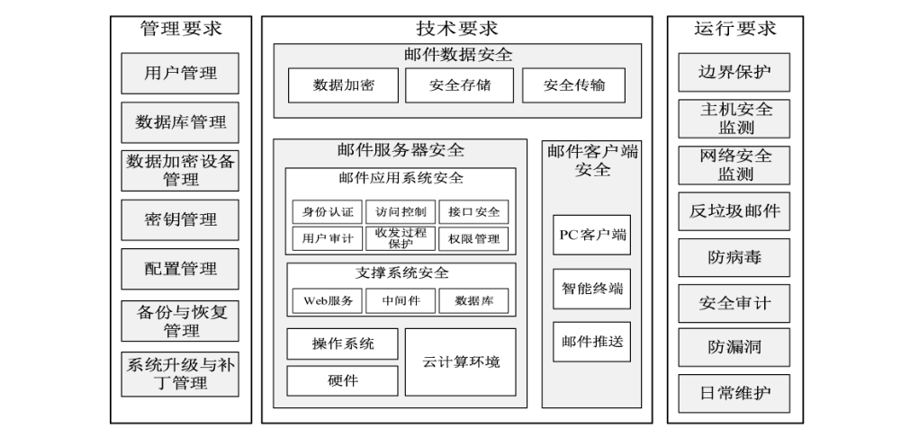
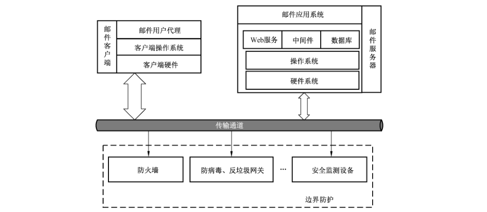
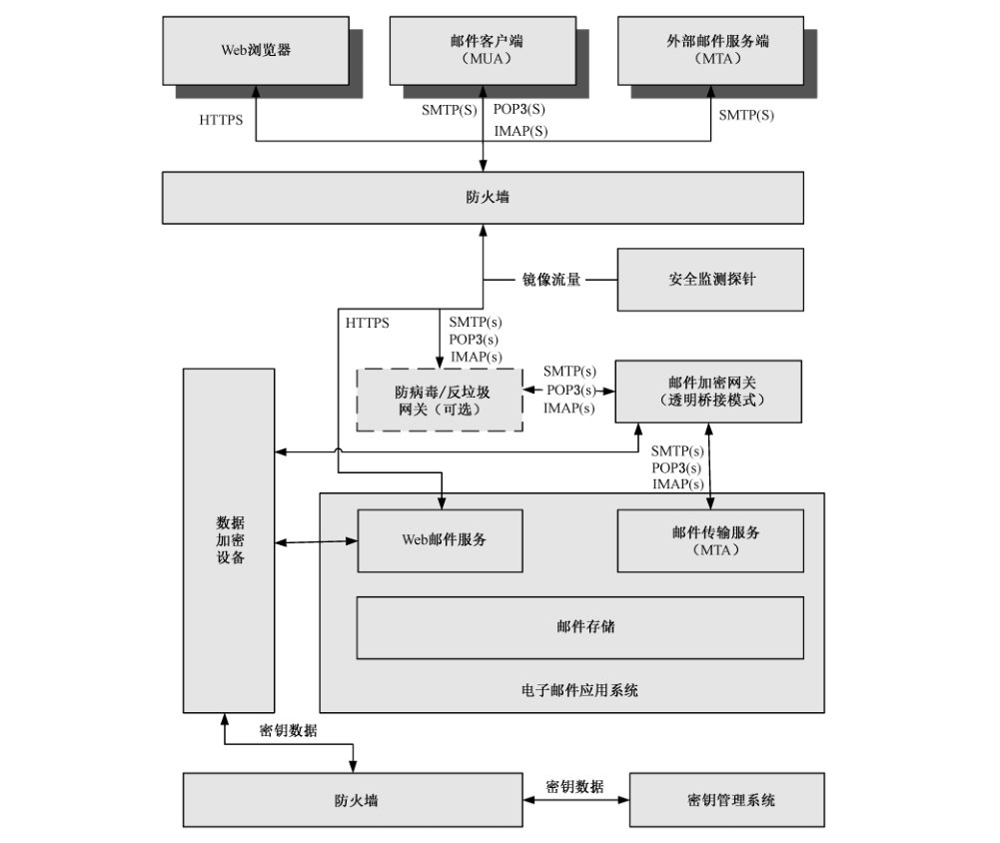
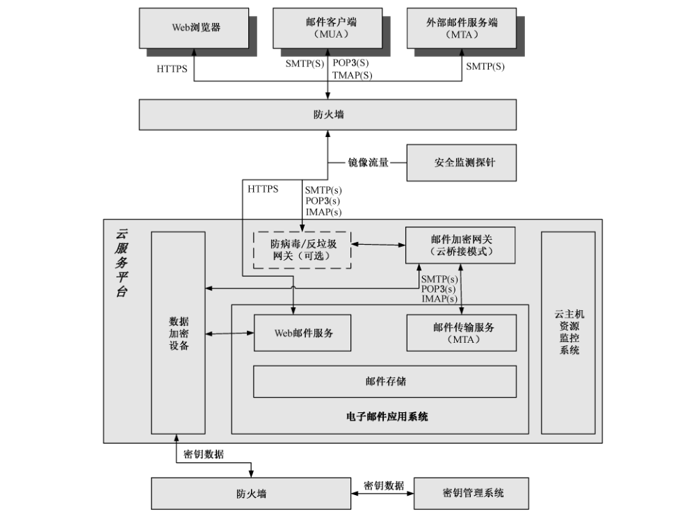

# GB/T 37002-2018 信息安全技术 电子邮件系统安全技术要求

> 来源：[GB/T 37002-2018 国家标准详情](https://openstd.samr.gov.cn/bzgk/std/newGbInfo?hcno=28FFC3F589F62EC188AE62C498CEA835)；封面发布日期：2018-12-28；实施日期：2019-07-01。
> PDF SHA-256：56c23e363bcaa2a6ba09e4f381a45dc25e87aacb5b230663e5aaf866bfc81fcb。
> 转写说明：以官方 PDF 的 22 页渲染图像为依据校核文字，保留 4 幅原图，合并跨页段落，省略封面、目录、页眉和页码。正式引用请核对官方原件。

## 前言

本标准按照 GB/T 1.1—2009给出的规则起草。

请注意本文件的某些内容可能涉及专利。本文件的发布机构不承担识别这些专利的责任。

本标准由全国信息安全标准化技术委员会（SAC/TC 260）提出并归口。

本标准起草单位：国家信息技术安全研究中心、中国电子技术标准化研究院、深圳奥联信息安全技术有限公司、国家信息中心、中国信息安全测评中心。

本标准主要起草人：李京春、高林、梁利、程朝辉、周民、刘彦钊、李冰、刘楠、汤玲丽、杨韬、周德键、姚佳明、蔡先勇、但波、罗海宁、吕品、饶华一。

## 1 范围

本标准规定了电子邮件系统信息安全要求，包括电子邮件系统的技术安全要求、管理安全要求和运行安全要求。

本标准适用于各级政务部门、研究机构、企事业单位等的互联网邮件系统、电子政务外网邮件系统、电子政务内网邮件系统或单位专网邮件系统的设计、建设、使用和测试评估，也适用于相关产品的设计、制造、测试、管理和服务等。

## 2 规范性引用文件

下列文件对于本文件的应用是必不可少的。凡是注日期的引用文件，仅注日期的版本适用于本文件。凡是不注日期的引用文件，其最新版本（包括所有的修改单）适用于本文件。

- GB/T 21028—2007 信息安全技术 服务器安全技术要求

- GB/T 25069—2010 信息安全技术 术语

- GB/T 30282—2013 信息安全技术 反垃圾邮件产品技术要求和测试评价方法

- GB/T 32915—2016 信息安全技术 二元序列随机性检测方法

- GM/T 0012—2012 可信计算 可信密码模块接口规范
- GM/T 0013—2012 可信计算 可信密码模块符合性检测规范
- GM/T 0016—2012 智能密码钥匙密码应用接口规范
- GM/T 0017—2012 智能密码钥匙密码应用接口数据格式规范
- GM/T 0018—2012 密码设备应用接口规范
- GM/T 0021—2012 动态口令密码应用技术规范

## 3 术语和定义

GB/T 25069—2010界定的以及下列术语和定义适用于本文件。

### 3.1 电子邮件系统 electronic mail system

支撑用户使用电子邮件服务的信息系统。

> 注：电子邮件系统由电子邮件客户端、电子邮件服务器两部分组成，并由外围安全防护设备来保障系统的运行环境安全性。电子邮件系统结构示意图参见附录 A。

### 3.2 电子邮件服务器 electronic mail server

为客户端提供邮件应用服务的计算机系统，由服务器硬件、操作系统、支撑系统（WEB服务、中间件和数据库）和邮件应用系统组成。

### 3.3 应用服务安全隔离机制 security isolation mechanism of application server

通过虚拟化或半虚拟化技术，使各应用服务运行在独立的操作系统环境之上，实现各应用服务在逻辑上完全隔离。

### 3.4 机器码 machine code

标识计算机、智能终端等的唯一编号，一般由计算机或智能终端等的硬件序列号计算得出。

### 3.5 用户身份数字凭证 user digital certificates

用户通过身份鉴别后，由鉴别者为用户出具的一种可信的身份电子凭据。

### 3.6 “挑战-应答”认证方式 “challenge-response” authentication method

一类基于零知识证明的身份鉴别协议。在每次认证过程中，由认证方提出不同的挑战问题，被认证方做出应答，认证方通过验证应答的正确性，进而确认被认证方的身份。

### 3.7 邮件传输协议 mail transfer protocol

在网络环境中传输电子邮件的协议标准。

> 注：例如邮件发送协议（SMTP）、邮件收取协议（POP3/IMAP）。

### 3.8 数据加密设备 data encryption device

独立或并行多个应用实体提供密码服务和密钥管理的设备。

### 3.9 内容加密密钥 content encryption key

用于加密数据内容的临时密钥。

### 3.10 中间件 middle ware

连接 web 服务和电子邮件应用系统的计算机软件。

> 注：电子邮件应用系统在中间件的支撑下提供 web 方式的邮件收发和后台管理服务。

### 3.11 网盘 online disk

电子邮件系统提供的网络文件存储功能，一般用于邮件附件的在线存储与分享。

## 4 缩略语

下列缩略语适用于本文件。

B/S：浏览器/服务器（Browser/Server）
CMS：加密消息语法协议（Cryptographic Message Syntax）
C/S：客户端/服务器（Client/Server）
DKIM：域密钥识别邮件（DomainKeys Identified Mail）
DoS/DDoS：拒绝服务攻击/分布式拒绝服务攻击（Denial of Service/Distributed Denial of Service）
IMAP：交互邮件访问协议（Internet Mail Access Protocol）
IMAP4（S）：基于 SSL 的 IMAP（IMAP4 Over SSL）
MAC：介质访问控制（Media Access Control）
MIME：多用途 Internet 邮件扩展（Multipurpose Internet Mail Extensions）
MTA：邮件服务器上收发传输服务（Mail Transfer Agent）
PIN：个人标识码（Personal Identification Number）
POP3：邮局协议的第 3 个版本（Post Office Protocol 3）
POP3（S）：安全的 POP3（POP3 Over SSL）
SM2：SM2 椭圆曲线公钥密码算法（Public Key Cryptographic Algorithm SM2 Based on Elliptic Curves）
SM3：SM3 密码杂凑算法（SM3 Cryptographic Hash Algorithm）
SM4：SM4 分组密码算法（SM4 block cipher algorithm）
SM9：SM9 标识密码算法（Identity-based cryptographic algorithms SM9）
SMTP：简单邮件传输协议（Simple Mail Transfer Protocol）
SMTP（S）：基于 SSL 的 SMTP（SMTP Over SSL）
S/MIME：安全的多用途 Internet 邮件扩展（Secure Multipurpose Internet Mail Extensions）
SNMP：简单网络管理协议（Simple Network Management Protocol）
SPF：发件人策略框架（Sender Policy Framework）
SQL：结构化查询语言（Structured Query Language）
SSL：安全套接层（Secure Sockets Layer）
TCP：传输控制协议（Transmission Control Protocol）
TLS：传输层安全（Transport Layer Security）
URL：统一资源定位符（Uniform Resource Locator）

## 5 概述

### 5.1 安全框架

电子邮件系统安全由技术要求、管理要求、运行要求三部分组成，安全框架如图1所示。技术要求包括邮件服务器、邮件客户端、邮件数据的安全。管理安全包括电子邮件系统管理所涉及的诸如用户管理、密钥管理、配置管理和数据管理等。运行安全包括电子邮件系统运行所涉及的诸如边界保护、网络安全监测、防病毒、反垃圾邮件和安全审计等。

本标准凡涉及密码算法的相关内容，按国家有关法规实施；凡涉及采用密码技术解决保密性、完整性、真实性、不可否认性需求的应遵循密码相关国家标准和行业标准。

### 5.2 安全目标

电子邮件系统重点安全目标如下：

a） 加强电子邮件系统的安全管控，降低电子邮件系统安全的风险；

b） 通过加密技术来实现邮件数据在传输和存储中的保护，降低数据泄密的安全风险；

c） 强化电子邮件系统身份鉴别安全措施，降低数据被窃取的风险；

d） 规范安全管理措施和运行要求，构建完整的防御体系。

### 5.3 安全级别

本标准中，电子邮件系统的安全要求按其保障强度可划分为基本级和增强级两个等级的安全要求。

各单位可根据本单位属性、用户数量和业务重要度选择使用基本级或增强级技术要求。电子邮件系统安全级别选择方法参见附录B。

在本标准的技术要求中，黑体字表示基本级安全要求中未出现或增强级安全要求中加强的内容。

## 6 基本级安全要求

### 6.1 技术要求

#### 6.1.1 邮件服务器

##### 6.1.1.1 硬件

邮件服务器硬件安全要求包括：

a） 应符合 GB/T 21028—2007中有关要求；

b） 宜配置加密模块；

c） 若具有带外管理芯片，应能对其进行管控。

##### 6.1.1.2 操作系统

邮件服务器操作系统安全要求包括：

a） 应根据电子邮件系统的性能、可靠性、安全性等要求选择安全操作系统，或对操作系统进行定制（包括：内核、服务、应用、端口等），或借助第三方机构对操作系统进行安全加固；

b） 应具备强制访问控制功能，保证邮件应用在预定义的资源范围内运行，防止通过主动提权、变更用户等方式，访问超出预定义范围的资源；

c） 应具备防篡改的安全审计功能，可对日志进行审计、分析潜在侵害、检测异常行为，并实时生成报警；

d） 应具备日志记录功能，可对用户登录、接口调用、管理数据修改、用户身份变更、文件访问、其他管理员操作等行为进行记录，记录的日志数据应包括：事件发生的时间、触发事件的用户、事件类型和事件结果等；

e） 宜提供针对邮件应用的安全策略配置功能，并能自动检查安全策略的有效性。

##### 6.1.1.3 云计算环境

部署在云计算环境的邮件应用，云计算环境应满足如下要求：

a） 支持邮件服务器系统的虚拟化应用；

b） 应保证邮件系统各组件间的有效隔离，如邮件 Web 服务、存储的隔离；

c） 如采用第三方云计算环境供应商，应采取签订服务安全合同、保密协议等方式，约束云计算环境提供商，防止其对用户邮件信息进行搜集和分析，挖掘用户隐私信息，恶意泄露或出卖用户隐私信息。

##### 6.1.1.4 支撑系统

###### 6.1.1.4.1 Web 服务

邮件服务器 Web 服务安全要求包括：

a） 不能存在后门、木马、病毒等恶意代码及安全漏洞；

b） 应具备访问控制功能，可有效阻止任何未经授权的访问；

c） 应具备日志记录功能，可记录用户的各类操作行为；

d） 应具备输入有效性的过滤审查功能，可有效地阻止基于非法输入的 Web 漏洞攻击；

e） 应具备身份鉴别机制，可对访问 Web 服务的用户身份进行有效性认证。

###### 6.1.1.4.2 中间件

邮件服务器中间件安全要求包括：

a） 不能存在后门、木马、病毒等恶意代码及安全漏洞；

b） 应具备访问控制功能，可有效阻止任何未经授权的访问；

c） 应具备日志记录功能，可记录用户的各类操作行为。

###### 6.1.1.4.3 数据库

邮件服务器数据库安全要求包括：

a） 应根据电子邮件系统的性能、可靠性、安全性等要求选择安全数据库，或对数据库进行定制（包括：内核、服务、应用、端口等），或借助第三方机构对数据库进行安全加固；

b）同6.2.2中数据库管理的安全功能要求。

##### 6.1.1.5 邮件应用系统

###### 6.1.1.5.1 身份鉴别

邮件应用系统身份鉴别安全要求包括：

a） 应支持安全性增强的账户口令密码认证，满足下列要求：

1） 账户口令密码应为字母、数字、符号的混用组合，且不少于8个字节；

2） 应具备账户口令密码自动审查功能，禁止使用弱口令密码；

3） 账户口令密码的存储不得采用明文方式，若采用数字摘要方式存储，应加入随机性；

4） 账户口令密码应设定有效期，超过有效期时，则不能登录；

5） 应具备口令密码防暴力破解功能，对Web、POP3、SMTP 和IMAP等登录访问方式，当口令密码错误次数超过设定值后，应锁定该账户或禁止对应 IP 再次访问。

b） 应具备身份鉴别异常处理功能，如采取限制登录错误次数等措施。

c） 应具备超时认证的功能，当用户会话超时后，需进行重新认证。

###### 6.1.1.5.2 访问控制

邮件应用系统访问控制安全要求包括：

a） 应具备用户分类功能，如分为管理员和邮件用户；

b） 应能对各类用户赋予不同的权限；

c） 应具备严格的权限验证方法，采用合理的技术手段，充分保证权限凭证数据不可伪造；

d） 应在通过身份鉴别机制认证用户身份后，方可允许用户访问授权的功能；

e） 应具备记录管理员访问过程操作日志的功能。

###### 6.1.1.5.3 用户审计

邮件应用系统用户审计安全要求包括：

a） 应具备管理员行为审计功能，审计内容应包括：操作时间、管理员账户、登录IP地址、地理位置、登录方式、操作内容与结果等信息；

b） 应具备邮件用户登录行为审计功能，审计内容应包括：登录时间、邮件用户账户、登录IP地址、地理位置、登录方式等信息；

c） 应具备邮件用户发送邮件行为审计功能，审计内容应包括：发送时间、收件人、邮件主题、投递状态、是否撤回等信息；

d） 应具备邮件用户接收邮件行为审计功能，审计内容应包括：收取时间、发件人、邮件主题、阅读状态等信息；

e） 应具备邮件用户账户关键配置修改行为审计功能，审计内容应包括：时间、操作账户、修改内容、修改结果等信息；

f） 应留存审计数据不少于6个月。

###### 6.1.1.5.4 接口安全

邮件应用系统接口安全要求包括：

a） 与第三方应用系统接口应采用身份鉴别机制，验证接口调用方身份的合法性；

b） 与第三方应用系统接口的会话应设置生命周期，防止接口被恶意调用；

c） 应对第三方应用系统接口调用的数据进行合法性检测，防止基于注入式，跨站请求伪造、模式验证、输人输出编码等攻击；

d） 应对第三方应用系统接口设定资源使用权限，限定可访问的数据范围；

e） 应具备记录接口调用过程操作日志的功能。

###### 6.1.1.5.5 收发过程保护

邮件应用系统收发过程保护安全要求包括：

a） 应具备邮件过滤功能，能接收或拒收指定域的邮件；

b） 应具备防邮件中继功能，能拒绝转发或仅转发来自指定 IP 地址或子网、目标为指定子网、来自指定域、来自指定邮件地址、来自指定用户名等邮件；

c） 应具备邮件审批功能，能根据发件人、收件人、主题、内容、附件内容、附件格式等邮件特征，创建审批条件，满足审批条件的邮件，经审批员审批后，方能被投递/弹回/拒收（发）/转寄/抄送；

d） 应具备支持 SPF 机制检测邮件数据源的功能。

#### 6.1.2 邮件客户端

##### 6.1.2.1 邮件客户端软件

支持通用邮件客户端软件使用 SSL通道收发邮件。

##### 6.1.2.2 PC 客户端

PC 客户端安全要求包括：

a） C/S模式下应支持邮件加密、数字签名功能；

b）C/S模式下应支持邮件数据在本地加密存储；

c） C/S模式和 B/S模式下均应支持基于 SSL/TLS 的邮件数据传输；

d） C/S模式和 B/S模式运行环境均应有防病毒、木马的保护措施。

##### 6.1.2.3 移动智能终端

移动智能终端安全要求包括：

a） 应满足 6.1.2.2 PC 客户端的基本要求；

b） 输入密码时，终端界面上不应显示明文密码；

c） 宜支持邮件远程管理功能，如：邮件远程删除、密钥远程删除等。

##### 6.1.2.4 邮件推送

邮件推送安全要求包括：

a） 推送邮件正文和附件时，应对邮件内容加密，身份鉴别应符合本标准相关要求；

b）仅推送邮件通知时，若查看邮件内容，应符合本标准身份鉴别和数据加密相关要求。

#### 6.1.3 邮件数据

##### 6.1.3.1 数据加密

电子邮件数据在传输和存储过程中，应加密保护。本项要求包括：

a） 应采用国家商用密码算法对邮件数据进行加密，若使用数据加密设备实现国家商用密码算法，应满足下列要求：

1） 应遵循国家对密码设备安全性的要求，通过国家密码管理局对密码安全性的检测；

2） 应符合密码行业标准 GM/T 0018—2012 第 6 章对设备接口的定义和 GB/T 32915—2016 关于随机性检测要求的规定；

3） 应采用加密机制，保证其与应用系统之间数据通信的安全性；

4） 接口调用应支持 IP/MAC 地址绑定的访问控制机制；

5） 应具备记录密码操作和管理日志的功能，并提供安全的日志审计接口。

b） 加密对象应包含邮件正文和附件。

c） 邮件加密数据应支持S/MIME 格式及加密消息文法 CMS。

d） 邮件加密过程中的非对称算法，应选用SM2算法或SM9算法；对称密码算法，应选用SM4算法；哈希算法，应选用SM3算法；加密使用的随机数的随机性，应符合 GB/T 32915—2016 关于随机性检测的要求。

e） 应能根据邮件地址，安全获取邮件解密或签名使用的非对称密钥，该密钥不得写入无保护的可持续存储介质。

f） 应使用不同的内容加密密钥加密邮件。

g） 数据加密设备应遵循国家密码政策对密码设备安全性的要求，通过国家密码管理局的密码安全性检测。

h）应采用加密机制，保证数据加密设备与邮件系统之间数据通信的安全。

i 数据加密设备接口调用应支持IP/MAC地址绑定的访问控制机制。

j） 数据加密设备应具备记录密码操作和管理日志的功能，并提供安全的日志审计接口。

##### 6.1.3.2 安全存储

安全存储要求包括：

a） 应对存储的全部数据进行加密，包括：邮件数据、网盘文件、用户账号密码及个人信息等；

b） 邮件账户密码若采用数字摘要方式存储，应具备随机性；

c） 加密密钥更新后，应能对存储的历史加密数据进行解密。

##### 6.1.3.3 安全传输

安全传输要求包括：

a） 应对邮件内容（含正文和附件）进行加密传输；

b） 应支持安全算法的SSL、TLS 协议，对传输数据进行加密；

c） 应能验证客户端 SSL、TLS 证书的合法性；

d） 应支持POP3、SMTP、IMAP及MTA 的各种扩展协议，邮件客户端至邮件服务器的传输通道应支持 SSL协议。

### 6.2 管理要求

#### 6.2.1 用户管理

##### 6.2.1.1 用户分类管理

应按不同权限对用户进行分类，用户分类如下：

a） 邮件系统用户，即系统管理员，是指能对邮件系统整体运行进行操作管理的用户；

b） 邮件组织用户，即组织管理员，是指能对邮件系统用户进行增、删、改、查等操作的用户；

c） 邮件审计用户，即审计管理员，是指能对邮件系统所有操作进行审计查看的用户；

d） 邮件用户，即邮件使用用户，是指能进行邮件收发等操作的用户。

##### 6.2.1.2 邮件系统用户、邮件组织用户和邮件审计用户

邮件系统用户、邮件组织用户和邮件审计用户的管理安全要求包括：

a） 身份鉴别，同 6.1.1.5.1 中描述；

b） 访问控制，同 6.1.1.5.2中描述；

c） 用户审计，同 6.1.1.5.3 中描述；

d） 应对邮件系统用户进行审计；

e） 应对邮件组织用户进行审计；

f） 应对邮件审计用户进行审计；

g） 应支持仅针对特定用户组或特定用户的审计。

##### 6.2.1.3 邮件用户

邮件用户要求包括：

a） 身份鉴别，同6.1.1.5.1 中描述；

b） 访问控制，同 6.1.1.5.2中描述；

c） 用户审计，同 6.1.1.5.3中描述；

d） 邮件用户应由邮件组织用户创建。

#### 6.2.2 数据库管理

##### 6.2.2.1 数据库管理系统用户标识与鉴别

数据库管理系统用户标识与鉴别要求包括：

a） 访问邮件数据库管理系统的用户，应具有预先建立的标识；

b） 邮件数据库管理系统应对登录用户的身份进行鉴别；

c） 身份鉴别失败后，应根据失败次数与事件阈值采取相应措施，如锁定账户、禁用账户等。

##### 6.2.2.2 数据库管理系统访问控制

数据库管理系统访问控制要求包括：

a） 应具有访问控制列表，阻止任何未经授权的访问，许可经过授权的访问；

b） 应具备多权限管理员机制，如数据库查询管理员、修改管理员、维护管理员等。

##### 6.2.2.3 数据库管理系统安全审计

数据库管理系统安全审计要求包括：

a） 应具有独立的系统审计员；

b） 应具备对审计管理员分级、分组的功能，实现分级审计；

c） 应提供完整全面的审计日志；

d） 应具备日志保护机制，避免包括审计日志在内的各种日志信息被非法篡改、破坏或删除；

e）| 应支持对特定组或特定用户的审计；

f） 审计内容应包括各类、各级管理员的登录、操作的具体内容，包括：时间、管理员用户名、管理动作等；

g） 应支持对用户登录、各种操作行为的具体内容进行审计，如删除邮件的操作；

h）应支持对异常行为的审计，如管理员、普通用户的异常登录等。

##### 6.2.2.4 数据库管理系统数据完整性

数据库管理系统数据完整性的要求包括：

a） 应提供相应的数据完整性保证机制；

b） 应对数据完整性进行检验。

##### 6.2.2.5 数据库管理系统数据保密性

应具有密码数据加密或其他保护措施，实现存储密码数据的保密性。

##### 6.2.2.6 数据库管理系统数据备份和恢复

数据库管理系统数据备份和恢复要求包括：

a） 应具备本地数据备份与恢复功能，且支持完整备份和增量备份；

b） 应具备异地数据备份机制，将关键数据定时批量备份到异地存储。

#### 6.2.3 数据加密设备管理

数据加密设备管理要求包括：

a） 应针对密码系统中各种密码设备的使用、管理、备份与恢复等，建立完善的安全管理制度；

b） 智能密码钥匙的使用管理，应符合密码行业标准GM/T 0016—2012中第7章关于设备接口定义和第8章关于设备安全要求的相关规定。

#### 6.2.4 密钥管理

密钥管理要求包括：

a） 所选用密码算法的密钥长度应满足国家密码管理部门相关规范要求。

b） 密钥生成：内容加密密钥和用户身份鉴别密钥，其生成应有可靠的随机源。

c） 密钥分发：内容加密密钥应使用收件人的公钥和非对称算法进行加密保护后，分发给收件人；

收件人或签名人的公钥应通过可信方式获取；采用 SM9算法时，邮件地址可作公钥使用。

d） 密钥存储：内容加密密钥应由收件人公钥加密后储存于加密邮件数据中；解密或签名的私钥应存储在安全介质中或使用后即销毁。

e） 密钥销毁：内容加密密钥在每次使用后立即销毁。对SM2算法的密钥需将密码设备安全存储介质中对应密钥存储安全删除。对SM9算法，密码设备应不存储用户密钥，用户密钥的销毁伴随系统主密钥的销毁而完成。

f） 密钥更新：应周期性地更新用户加密密钥。

#### 6.2.5 配置管理

配置管理要求包括：

a） 应具备分类管理控制机制，各类管理员仅允许其按照组织权限进行配置操作；

b） 应具备按功能权限控制机制，各类管理员仅允许其按照功能权限进行配置操作；

c） 应具备各类管理员账号绑定IP 地址或 MAC 地址功能；

d） 应具备配置信息备份和快速恢复功能；

e） 应留存配置变更的操作日志，日志内容包括时间、登录IP 地址、访问IP地址、操作账户、操作与结果等；

f） 宜提供配置快照功能，当配置发生变更时能自动生成快照，修改配置出错后可使配置信息恢复到出错前的快照状态。

#### 6.2.6 备份与恢复管理

备份与恢复管理要求包括：

a） 应具备数据备份机制，能对关键数据进行本地、异地备份；

b）应能对数据进行完整备份和增量备份。

#### 6.2.7 系统升级及补丁管理

系统升级及补丁管理要求包括：

a） 应有明确的软件支持生命周期，对于软件每个版本应提供及时、持续的安全升级服务；

b） 系统升级时不产生明显的业务中断；

c） 系统升级失败时，应可卸载指定升级包，恢复历史版本；

d） 应针对已被披露的漏洞及时发布补丁。

### 6.3 运行要求

#### 6.3.1 边界保护

边界保护要求包括：

a） 应在电子邮件系统外围部署防火墙，并配置安全规则；

b） 应对流转过程中的邮件传输协议进行分析，阻断、记录异常协议并报警；

c） 应检查流转过程中的邮件是否符合编码标准，阻断、记录异常邮件内容并报警；

d） 应对流转过程中的邮件附件进行识别，阻断、记录无法识别格式的文件并报警。

#### 6.3.2 主机安全监测

主机安全监测要求包括：

a） 应具备服务器硬件、软件运行状态监测功能；

b）应能识别不符合协议规范的网络会话数据流，同时提取该会话所属进程的基本信息、远端IP地址；

c） 宜具备对命令执行、进程调用、文件使用等进行实时监测的功能。

#### 6.3.3 网络安全监测

网络安全监测要求包括：

a） 应配置专用的安全监测设备，以旁路接入方式部署在电子邮件系统出入口；

b） 应具备木马植人攻击监测功能；

c） 应具备隐蔽后门攻击监测功能；

d） 应具备异常端口使用监测功能；

e） 应具备邮件服务器网络异常通信行为监测功能；

f） 应具备异常收发邮件行为监测功能；

g） 应具备邮件服务器 Web 网页挂马攻击行为监测功能；

h）应具备邮件服务器 Web 网页隐藏、不可见链接攻击行为监测功能。

#### 6.3.4 反垃圾邮件

应符合 GB/T 30282—2013中规定的有关要求。

#### 6.3.5 防病毒

防病毒要求包括：

a） 应使用独立的服务器；

b） 应具备两种以上的防病毒引擎；

c） 应能查杀 SMTP（S），POP3（S）、IMAP4（S）、HTTP（S）等协议下邮件的病毒；

d） 应能对邮件头、邮件正文及附件的整体进行病毒过滤；

e） 应支持在线升级与离线升级病毒库；

f） 对存在病毒的邮件，可设置拒绝发送或拒绝接收、在邮件中添加警告信息、不处理等操作；

g） 对于邮件中指向外部网站的 URL 链接，用户点击打开前应发出风险提示。

#### 6.3.6 安全审计

##### 6.3.6.1 数据库操作审计

数据库操作审计要求包括：

a） 应记录和审计数据库 SQL 级操作，记录包括时间、数据库服务器名称、IP 地址、MAC 地址、端口号、用户名、操作执行结果及原始 SQL 语句；

b） 应具备双向审计功能，即审计数据库客户端的访问行为，同时审计数据库的返回结果；

c） 应能灵活地定义审计策略，策略元素至少包括时间、来源、角色、SQL 操作类型、事件类型、数据库 SQL 语句关键字、延迟时间、影响行数、异常串、基于数据库服务器组或者资产组；

d） 应具备丰富的数据查询检索功能，能够以数据库访问时间、IP 地址、端口号、用户名、操作类型、SQL 中的关键词等条件进行审计查询；

e） 应具备数据库防攻击安全规则库，能根据预设置策略发现诸如SQL 注入、已知数据库漏洞、口令密码猜解、缓冲区溢出等异常行为；

f） 应具备权限预警功能，能针对最高权限滥用、误操作、恶意操作等行为进行报警和定位。

##### 6.3.6.2 日志审计

日志审计要求包括：

a） 应按6.1.1.2中的要求实现操作系统安全日志审计功能；

b） 应具备 Web 中间件安全日志；

c） 应具备邮件系统日志；

d） 应按6.2.2.3中的要求实现数据库访问日志的功能；

e） 应具备数据加密设备安全日志。

#### 6.3.7 防漏洞

防漏洞要求包括：

a） 应具备基本的DoS、DDoS 防御能力，能终止来自同一IP 的多个 TCP 连接；

b） 应具备强制要求系统管理员修改默认口令密码、默认系统配置的功能；

C）， 应不存在已知的安全漏洞，如：命令执行、SQL 注入、跨站脚本、越权访问等；

d） 已通过身份验证的信息（如 cookie/session）应与IP 地址、浏览器绑定，并在24h 内过期；

e） 若采用了第三方厂商的部件，该部件应不存在安全漏洞。

#### 6.3.8 日常维护

日常维护要求包括：

a） 系统管理员应定期检查和记录电子邮件系统运行状态，发现异常情况应及时上报主管领导；

b） 系统管理员应定期修改电子邮件系统管理员口令；

c） 系统管理员应定期对电子邮件系统进行漏洞检测、升级和加固系统；

d） 电子邮件系统发生故障时，应按运维工作流程进行维护，并记录维护操作内容；

e） 变更电子邮件系统配置时，应按运维工作流程进行操作，并记录配置变更内容；

f） 不得在电子邮件系统（邮件客户端除外）中使用移动存储介质。

## 7 增强级安全要求

### 7.1 技术要求

#### 7.1.1 邮件服务器

##### 7.1.1.1 硬件

邮件服务器硬件安全要求包括：

a） 应满足 6.1.1.1 基本级安全要求；

b） 应包含可信密码模块，模块符合 GM/T 0012—2012 中接口规范的要求，符合 GM/T 0013- 2012中符合性测试规范的要求；

c） 应使用符合相关国家政策与标准的CPU芯片、部件和设备；

d） 应支持安全操作系统、安全数据库管理系统。

##### 7.1.1.2 操作系统

邮件服务器操作系统要求包括：

a） 应满足 6.1.1.2 基本级安全要求；

b） 应具备擦除指定数据的功能，保证临时数据或待删除数据能够从磁盘介质中被彻底删除；

c） 应提供应用服务安全隔离机制，实现邮件应用程序最小化权限运行；

d） 应提供安全可靠的远程管理通道，可对邮件应用系统、中间件、数据库进行安全的远程管理操作。

##### 7.1.1.3 云计算环境

部署在云计算环境的邮件应用，云计算环境应满足如下要求：

a） 应自主部署建设云计算环境；

b） 支持邮件服务器系统、数据加密系统的各个组件的虚拟化应用；

c） 应保证邮件系统各组件有效隔离，如邮件 Web 服务、数据加密系统、存储的隔离；

d） 应在虚拟邮件系统撤销或者弹性资源释放后，彻底消除残留数据；

e） 应采取最小化特权原则，明确区分和限制云计算环境中各类管理员的角色与权限。

##### 7.1.1.4 支撑系统

###### 7.1.1.4.1 Web 服务

邮件服务器 Web 服务安全要求包括：

a） 应满足 6.1.1.4.1 基本级安全要求；

b） Web 服务应具备安全管理功能，仅允许被授权管理员用户对软件访问资源进行定义和修改；

c） Web 服务应支持TLS 协议的安全传输协议。

###### 7.1.1.4.2 中间件

邮件服务器中间件安全要求包括：

a） 应满足 6.1.1.4.2 基本级安全要求；

b）中间件应具备安全管理功能，仅允许授权用户对软件访问资源进行定义和修改。

###### 7.1.1.4.3 数据库

邮件服务器数据库安全要求包括：

a） 应满足 6.1.1.4.3 基本级安全要求；

b） 数据库应支持透明加密模式（TDE）。

##### 7.1.1.5 邮件应用系统

###### 7.1.1.5.1 身份鉴别

邮件应用系统身份鉴别要求包括：

a） 应满足 6.1.1.5.1 基本级安全要求；

b） 应采用增强身份鉴别或双因子身份鉴别方式，满足下列要求：

1） 应支持一种或多种双因子身份鉴别方式支持在账户口令密码认证基础上绑定客户端机器码，机器码应具有唯一性。

2） 支持在账户口令密码验证基础上扩展动态口令密码认证，动态口令密码可采用短信验证码或动态令牌等方式，短信验证码长度应不小于6个字符并具有随机性，动态令牌产生应符合GM/T 0021—2012中第6章关于动态口令生成方式的相关规定。

3） 支持基于用户身份数字凭证的身份鉴别机制，若采用“挑战-应答”认证方式，挑战值应具有随机性且不少于20个字节或为准确的时间戳，在验证签名过程中，系统应验证签名密钥的有效性。在邮件传输协议中使用“挑战-应答”方式时，应采用支持SM2、SM9算法的扩展认证协议。

4） 支持通过SSL协议双向认证模式来认证邮件客户端或浏览器客户端用户身份，系统应验证邮件客户端或浏览器客户端证书的有效性。

5） 若采用文件方式保存用户身份数字凭证，应由不少于8位的密码加密进行保护；若利用安全介质保存，应使用不少于6位的PIN 码，安全介质功能和接口应符合 GM/T 0016—2012中第7章关于接口函数和第8章关于设备安全的要求、符合GM/T 0017—2012中第9章关于智能密码钥匙接口指令数据格式定义和第10章关于设备协议的规范要求。

6） 应对可疑的登录行为给出风险提示，如同一时间段出现异地登录、多个 IP 同时登录同一账号、一个 IP地址登录多个邮箱账号等行为。

###### 7.1.1.5.2 访问控制

邮件应用系统访问控制要求包括：

a） 应满足 6.1.1.5.2 基本级安全要求；

b） 应具备邮件用户访问过程操作日志。

###### 7.1.1.5.3 用户审计

邮件应用系统用户审计要求包括：

a） 应满足 6.1.1.5.3 基本级安全要求；

b） 应具备邮件阅读、处理状态记录功能，内容包括时间、操作账户、登录IP地址、地理位置、登录方式、邮件主题等信息，邮件用户应具有对本项记录的审计权限；

c） 应具备邮件用户删除邮件行为审计功能，审计内容包括删除时间、发件人、邮件主题、删除方式等信息；

d） 应具备邮件账户异常行为（如口令密码暴力破解、群发垃圾邮件等）报警功能。

###### 7.1.1.5.4 接口安全

邮件应用系统接口安全要求包括：

a） 应满足 6.1.1.5.4 基本级安全要求；

b） 与第三方应用系统接口应采用加密机制，保证数据的私密性。

###### 7.1.1.5.5 收发过程保护

邮件应用系统收发过程保护要求包括：

a） 应满足 6.1.1.5.5 基本级安全要求；

b） 应支持采用 DKIM 检测邮件数据源；

c） 各邮件账户在邮件存储系统上的临时目录区应相互隔离。

#### 7.1.2 邮件客户端

##### 7.1.2.1 邮件客户端软件

应使用专用邮件客户端软件实现邮件数据在客户端的加密存储和加密收发。

##### 7.1.2.2 PC 客户端

PC 客户端要求包括：

a） 应满足 6.1.2.2 基本级安全要求；

b）C/S 模式和 B/S 模式均应具备临时存储数据安全保护机制；

c） 应具备可信计算环境。

##### 7.1.2.3 移动智能终端

移动智能终端要求包括：

a） 应满足 6.1.2.3基本级安全要求；

b） 应用程序模式和 Web 模式均应具备临时存储数据的安全保护机制；

c） 应具备可信计算环境；

d） 客户端登录时应支持短信验证码等方式的双因子认证方式。

##### 7.1.2.4 邮件推送

邮件推送要求包括：

a） 应满足 6.1.2.4 基本级安全要求；

b） 数据推送通道应使用符合相关国家政策与标准的协议，并通过国家授权的第三方测评机构的检测评估或网络安全审查。

#### 7.1.3 邮件数据

##### 7.1.3.1 数据加密

电子邮件数据在传输和存储的过程中应加密保护，本项要求包括：

a） 应满足 6.1.3.1 基本级安全要求；

b）应支持可配置的加密密钥更新策略，如按月、按季、按年等更新；

c） 应支持邮件协议的透明代理，根据加解密策略将明文邮件加密或者将密文邮件解密，加解密策略应可以作用到邮件地址组、单个邮件地址、单封邮件；

d） 应支持对邮件数据进行压缩。

基于加密技术的邮件系统模型参见附录C中C.1和C.2。

##### 7.1.3.2 安全存储

邮件数据安全存储要求包括：

a） 应满足 6.1.3.2 基本级安全要求；

b） 应对邮件处理过程中的暂存数据进行加密存储。

##### 7.1.3.3 安全传输

安全传输要求包括：

a） 应满足 6.1.3.3 基本级安全要求；

b） SSL、TLS 协议应支持国家密码管理局制定的SM2 和SM9算法标准；

c） SSL、TLS 协议应采用可信机构颁发的数字证书。

### 7.2 管理要求

应满足6.2基本级安全要求。

### 7.3 运行要求

应满足6.3基本级安全要求。

## 附录 A（资料性附录）电子邮件系统组成

电子邮件系统由邮件客户端、邮件服务器两部分组成，并由外围安全防护设备来保障系统的运行环境安全性。组成见图 A.1。

## 附录 B（资料性附录）安全级别选择

本标准中，电子邮件系统的安全要求按其保障强度可划分为基本级和增强级两个等级的安全要求。

各单位可根据本单位属性、用户数量和业务重要度选择使用基本级或增强级技术要求，当相关单位的电子邮件系统满足任意一条参考选择指标要求时，应使用增强级安全技术要求。电子邮件系统安全级别选择方法见表B.1。

**表 B.1 电子邮件系统安全级别选择方法**

| 级别选择因素 | 参考选择指标 | 是否满足 | 技术安全要求级别 |
| --- | --- | --- | --- |
| 单位属性 | 部委或省级邮箱系统、国有及中央企业、重要研究机构 | 是 | 增强级安全技术要求 |
| 单位属性 | 部委或省级邮箱系统、国有及中央企业、重要研究机构 | 否 | 基本级安全技术要求 |
| 注册用户数 | 累计用户总数 ≥ 50 万 | 是 | 增强级安全技术要求 |
| 注册用户数 | 累计用户总数 ≥ 50 万 | 否 | 基本级安全技术要求 |
| 业务重要度 | 如发生泄密事件后会对社会秩序或公共利益造成严重损害，或者对国家安全造成损害；或按照 GB/T 22240—2008 安全保护等级要求中定级为三级以上（含三级）的邮件系统 | 是 | 增强级安全技术要求 |
| 业务重要度 | 如发生泄密事件后会对社会秩序或公共利益造成严重损害，或者对国家安全造成损害；或按照 GB/T 22240—2008 安全保护等级要求中定级为三级以上（含三级）的邮件系统 | 否 | 基本级安全技术要求 |

## 附录 C（资料性附录）安全技术应用模型

### C.1 基于加密技术的电子邮件系统模型

基于加密技术的电子邮件系统模型见图 C.1。

### C.2 云计算环境下基于加密技术的电子邮件系统模型

云计算环境下基于加密技术的电子邮件系统模型见图 C.2。

