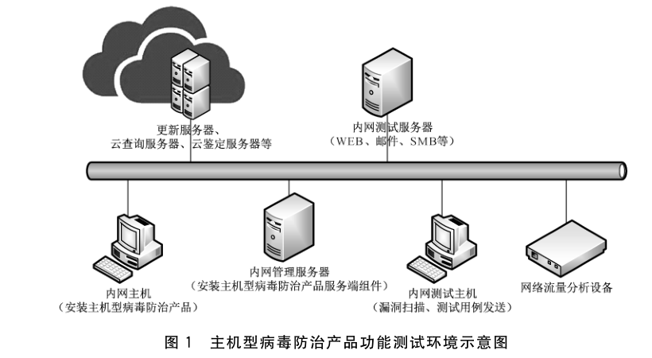
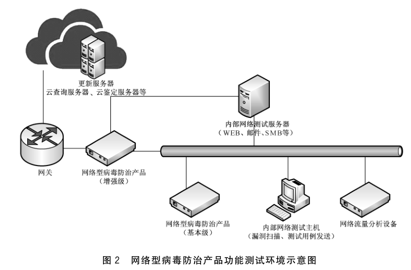
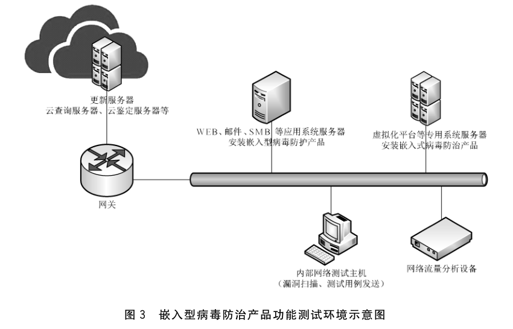

# GB/T 37090-2018 信息安全技术 病毒防治产品安全技术要求和测试评价方法

> 来源：[GB/T 37090-2018 国家标准详情](https://openstd.samr.gov.cn/bzgk/std/newGbInfo?hcno=4BD254D796EC31AE202EA2BFA8B21774)；封面发布日期：2018-12-28；实施日期：2019-07-01。
> PDF SHA-256：58fa644bb28285785abf2aee9dccb16861c73dd2861ee02d94cb3b6737e9557c。
> 转写说明：对照官方 PDF 全部 38 页图像校核文字、章节与图示；省略封面、目录、页眉、页脚及页码，保留原图 1～图 3。原文以黑体区分增强级新增或加严条款，已识别的黑体差异用加粗表示。正式引用请核对官方原文。

## 前言

本标准按照 GB/T 1.1—2009 给出的规则起草。

请注意本文件的某些内容可能涉及专利。本文件的发布机构不承担识别这些专利的责任。

本标准由全国信息安全标准化技术委员会（SAC/TC 260）提出并归口。

本标准起草单位：国家计算机病毒应急处理中心、国家网络与信息安全信息通报中心、公安部第一研究所、中国电子科技集团公司第十五研究所（信息产业信息安全测评中心）、国家信息中心、天津市公安局网络安全保卫总队。

本标准主要起草人：陈建民、杜振华、曹鹏、张瑞、张秀东、冯军亮、黄一斌、蒋勇、禄凯、刘健、王文一、张喆、李菊、舒心、徐超、胡光俊、刘威、王琚、王茗。

## 1 范围

本标准规定了病毒防治产品的技术要求，包括功能要求、安全要求和安全保障要求，并给出了测试评价方法。

本标准适用于病毒防治产品的设计、开发及检测。

## 2 术语和定义

下列术语和定义适用于本文件。

### 2.1 恶意软件 malware

能够影响计算机操作系统、应用程序和数据的完整性、可用性、可控性和保密性的计算机程序或代码的软件。

### 2.2 病毒 virus

编制或者在计算机程序中插入的破坏计算机功能或者毁坏数据，影响计算机正常使用，并能自我复制的一组计算机指令或者程序代码。

### 2.3 文件感染型病毒 file viruses

以文件为宿主，能够通过将自身包含的恶意代码插入到目标文件中，实现对目标文件的感染。

### 2.4 宏病毒 macro viruses

利用文档中的宏代码编辑的恶意代码，在允许宏代码运行的条件下，可以在打开文档时运行。

### 2.5 蠕虫 worm

通过信息系统漏洞缺陷或信息系统使用者的弱点主动进行传播的恶意程序。

### 2.6 木马程序 trojan horses program

主动与攻击者通信，接收来自攻击者的指令，并能够根据指令对所在主机进行各种恶意操作的恶意程序。

### 2.7 间谍软件 spyware

不依赖攻击者指令，潜伏在主机中，按照事先设定的执行条件收集特定的敏感信息并隐蔽地传输给攻击者的恶意程序。

### 2.8 脚本恶意程序 malicious script program

使用脚本语言编写的，并在脚本执行环境中运行的恶意程序。

### 2.9 后门程序 backdoor program

开放特定的网络端口，等待攻击者连接，并接收攻击者的指令执行相应的恶意操作的恶意程序。

### 2.10 僵尸程序 bot program

主动与攻击者通信，接收攻击者的指令，并与其他感染此类恶意程序的主机一起对特定目标发起攻击的恶意程序。

### 2.11 勒索软件 ransomware

采取加密或屏蔽用户操作等方式劫持用户对系统或数据的访问权，并籍此向用户索取勒索金的恶意程序。

### 2.12 Rootkit 恶意程序 rootkits program

以系统内核态或用户态权限运行，能够对主机操作系统组件功能调用请求进行拦截和篡改的恶意程序。

### 2.13 Bootkit 恶意程序 bootkits program

通过感染 BIOS 或 MBR 等方式植入恶意代码，篡改主机操作系统引导过程，从而感染主机操作系统的恶意程序。

### 2.14 病毒检测 virus detection

在病毒防治产品进行病毒处理时，对于确定的测试环境，能够准确地报出病毒文件和病毒名称，并记录检测结果的处理方式。

### 2.15 隔离 quarantine

在病毒防治产品进行病毒处理时，采取将病毒以及受感染的用户文件从原有位置移动到受限制存储空间的处理方式。

### 2.16 清除还原 disinfection

在病毒防治产品对受到病毒感染的宿主文件进行处理时，采取清除其中的恶意代码或使恶意代码失效，恢复宿主文件原有功能的处理方式。

### 2.17 ［病毒］删除［virus］ deletion

在病毒防治产品进行病毒处理时，将病毒文件从所在位置删除的处理方式。

### 2.18 已知病毒样本 known virus sample

经过实际测试后，病毒防治产品能够检测的病毒文件。

### 2.19 未知病毒样本 unknown virus sample

对已知病毒样本文件进行相应修改，但不改变其恶意功能而产生的新病毒文件。

### 2.20 加壳 pack

通过特定算法的变换，将原可执行文件的编码进行一次或多次的压缩、加密，产生新的文件。与原文件相比，文件内容发生变化，但功能保持不变。

### 2.21 捆绑 file bind

将两个文件进行特定方式的组合，产生新的文件。

### 2.22 用户态应用程序 user-mode application

无法直接对外部设备进行操作，且无法直接执行特权指令，通过操作系统提供的特定接口执行操作的应用程序。

## 3 缩略语

下列缩略语适用于本文件。

- BIOS：基本输入输出系统（Basic Input Output System）
- CIFS：通用网络文件系统协议（Common Internet File System）
- CPU：中央处理器（Central Processing Unit）
- DOC：微软公司 Word 文字处理软件文档格式（Microsoft Word Document）
- FTP：文件传输协议（File Transfer Protocol）
- HTML：超文本标记语言（HyperText Markup Language）
- HTTP：超文本传输协议（HyperText Transfer Protocol）
- IMAP：Internet 邮件访问协议（Internet Mail Access Protocol）
- MB：兆字节（Mega Byte）
- MBR：主引导记录（Master Boot Record）
- PDF：便携式文档格式（Portable Document Format）
- POP3：邮局协议第 3 版（Post Office Protocol Version 3）
- SMB：服务器消息块协议（Server Message Block）
- SMTP：简单邮件传输协议（Simple Mail Transfer Protocol）
- TXT：文本文件格式（Text File）
- XLS：微软公司电子表格文档格式（Microsoft Excel）
- XML：可扩展标记语言（Extensible Markup Language）

## 4 病毒防治产品描述

### 4.1 功能概述

病毒防治产品是一种以恶意软件防护作为其全部或部分功能的产品，用于检测发现或阻止恶意软件的传播以及对主机操作系统、应用软件和用户文件的篡改、窃取和破坏等。

### 4.2 运行环境概述

#### 4.2.1 主机型

安装在主机操作系统（Windows、Linux、MacOS、Android 等）之上，产品安装后通常以系统服务的方式随操作系统启动运行，能够根据用户需求对主机中的程序文件、数据文件进行病毒检测，并具有实时防护功能，主动阻止对病毒文件的访问、传输和运行。

#### 4.2.2 网络型

部署在受保护网络中，作为网关设备或网络监测设备，对网络中传播的病毒进行检测发现或阻断。

#### 4.2.3 嵌入型

针对特定应用服务，或特定的操作系统或硬件平台，通过指定的接口提供病毒防护功能。

### 4.3 技术概述

#### 4.3.1 特征码检测技术

特征码检测技术是病毒防治产品的基础性技术，其原理是通过对已知恶意软件样本的分析，抽取该恶意软件文件及其同家族具有的共性特征代码，作为检测特征，不同厂家由于各自采用的检测引擎存在差异，特征代码也不尽相同。厂家通过不断升级特征代码库，来保持产品对最新恶意软件的检测能力。

这种技术应用最为广泛，具有检测率高、误报率低的优点，但也具有人力成本高，更新及时性相对较差的缺点。

#### 4.3.2 动态行为检测技术

动态行为检测技术是通过对程序的进程操作、文件操作、注册表操作、网络操作等行为的监视，发现与已知恶意软件相似的异常行为，从而实现检测和阻断。该技术对未知恶意软件的检测效果提升较为明显，常作为特征码检测技术的重要补充。

#### 4.3.3 云检测技术

为了更快地应对新出现的恶意软件，云检测技术被提出并大规模应用，这种技术采用大数据技术和云计算技术，收集未知文件样本并在云服务器上进行分析，并将分析判定结果保存在云服务器上，同步接受客户端产品的查询，大大缩短了特征码更新周期，并降低了客户端产品对本地设备的资源消耗，但这种技术对网络的依赖性较高，一旦网络连接中断，客户端的检测能力会受到一定影响。

## 5 技术要求

### 5.1 总体说明

#### 5.1.1 技术要求分类

病毒防治产品技术要求分为功能要求、安全要求和安全保障要求三个大类。其中，功能要求是对病毒防治产品应具备的功能提出具体的要求，包括病毒检测、病毒处理、策略自定义、逃避检测防护、隔离区管理、样本提交、未知病毒检测、告警信息、日志、升级更新、统一管理、异常文件处理等；安全要求是对病毒防治产品自身安全和防护能力提出具体的要求，例如系统服务、安全保密传输、更新安全、用户数据安全、组件认证调用、自保护等；安全保障要求则针对病毒防治产品开发者和病毒防治产品自身提出具体的要求，例如开发，指导性文档、生命周期支持、测试、脆弱性评定等。

#### 5.1.2 等级划分

等级分为基本级和增强级。等级划分标准主要依据产品的功能特性。基本级主要针对只具备部分病毒家族类型或部分病毒传播媒介检测能力的产品以及将病毒防护功能作为其部分功能的产品，推荐适用于网络安全等级保护第二级及以下系统；增强级主要针对具有全部病毒家族类型、病毒传播媒介，以及未知病毒的检测、处理能力的以防病毒功能作为其全部或主要功能的产品，推荐适用于网络安全等级保护第三级及以上系统。其中“黑体字”表示基本级中没有出现或增强的要求。

### 5.2 功能要求

#### 5.2.1 基本级

##### 5.2.1.1 病毒检测

###### 5.2.1.1.1 病毒检测范围

在产品获得相应访问权限的条件下，产品应能够对以下存储位置或其他可能用于传输文件数据或程序代码的通信协议传输信道进行病毒检测，并且不应对正常的系统程序文件、应用程序文件、文档、程序代码和数据等产生误报警：

a） 主机磁盘；

b） 主机内存；

c） 主机引导区；

d） 移动存储介质。

###### 5.2.1.1.2 病毒检测类型

产品能够对一种或多种病毒家族类型进行检测。

##### 5.2.1.2 病毒处理

产品应能够对检测到的病毒进行处理，处理方式应包括以下种类的一种或多种：

a） 阻止，即产品能够阻止病毒文件的运行、恶意操作或传播；

b） 删除，即产品能够将病毒文件删除；

c） 隔离，即产品能够将病毒文件从原有位置删除，并备份到一个受限的“隔离区”内。

##### 5.2.1.3 策略自定义

###### 5.2.1.3.1 病毒检测方式

产品应能够允许用户自定义病毒检测方式，检测策略应包括以下种类的一种或多种：

a） 全面检测，即对产品能够访问的所有本地或网络位置以及所有支持的通信协议传输信道进行病毒检测；

b） 按需检测，即对用户选择的特定的本地或网络位置或指定的通信协议传输信道进行病毒检测。

###### 5.2.1.3.2 病毒处理策略

产品应能够允许用户自定义病毒处理策略，处理策略应包括以下种类的一种或多种：

a） 询问用户后处理；

b） 用户可以根据产品支持的病毒处理方式，预先设定病毒处理策略，检测到病毒后按照策略直接处理。

##### 5.2.1.4 隔离区管理

如产品支持病毒隔离处理方式，产品应允许用户查看隔离区中的文件，并至少能够进行以下类型的操作：

a） 删除文件，在删除前提示用户删除文件可能引起的后果；

b） 还原文件，允许用户按自定义路径或文件原始路径还原文件，在还原前提示用户还原文件可能引起的后果。

##### 5.2.1.5 逃避检测防护

产品应能有效检测识别无口令保护的压缩格式文件中的病毒文件，包括 zip、rar、tgz、7z 等压缩格式。

##### 5.2.1.6 告警信息

产品应能够对病毒检测事件为用户提供醒目的告警信息。告警信息应包括以下内容：

a） 病毒文件、宿主文件、进程等对象的路径和文件名称；

b） 病毒名称；

c） 检测日期和时间。

##### 5.2.1.7 日志

###### 5.2.1.7.1 日志记录

产品应能够对病毒检测事件进行日志记录，至少能够记录以下内容中的一种或多种：

a） 事件日期和时间；

b） 病毒文件、宿主文件、进程等对象的路径和文件名称；

c） 病毒名称。

###### 5.2.1.7.2 日志导出

产品应能够将日志记录的内容输出成方便人读和机读的文件格式。

###### 5.2.1.7.3 日志保存

产品应能够支持保存不少于6个月的日志记录。

##### 5.2.1.8 升级更新

###### 5.2.1.8.1 升级方式

产品应支持通过以下方式中的一种或多种进行升级：

a） 网络；

b） 离线升级包；

c） 其他能够传输升级数据的信道。

###### 5.2.1.8.2 升级内容

产品应支持对以下内容类型中的一种或多种进行升级：

a） 病毒特征库；

b） 策略文件；

c） 程序文件。

##### 5.2.1.9 统一管理

产品如具备通过管理平台对用户环境中安装部署的多个产品副本进行统一管理的功能，应支持以下功能的一种或多种：

a） 升级更新；

b） 病毒检测；

c） 病毒处理；

d） 告警信息；

e）日志；

f） 策略自定义。

##### 5.2.1.10 异常文件处理

产品应能够对以下几种异常文件进行有效的检查和处理：

a） 超大文件；

b） 畸形格式文件；

c） 其他特殊文件。

#### 5.2.2 增强级

##### 5.2.2.1 病毒检测

###### 5.2.2.1.1 病毒检测范围

在产品获得相应访问权限的条件下，产品应能够对以下存储位置或其他可能用于传输文件数据或程序代码的通信协议传输信道进行病毒检测，并且不应对正常的系统程序文件、应用程序文件、文档、程序代码和数据等产生误报警：

a） 主机磁盘；

b） 主机内存；

c） 主机引导区；

d） 移动存储介质；

e） **网络型产品应支持网络文件共享 SMB/CIFS 协议传输信道；**

f） **网络型产品应支持 HTTP 协议传输信道；**

g） **网络型产品应支持 FTP 协议传输信道；**

h） **网络型产品应支持电子邮件 SMTP/POP3/IMAP 等协议传输信道。**

###### 5.2.2.1.2 病毒检测类型

**产品应至少能够对以下病毒家族类型进行检测：**

a） **文件感染型病毒；**

b） **宏病毒；**

c） **蠕虫；**

d） **木马程序；**

e） **间谍软件；**

f） **脚本恶意程序；**

g） **后门程序；**

h） **僵尸程序；**

i） **勒索软件；**

j） **Rootkit 恶意程序；**

k） **Bootkit 恶意程序。**

##### 5.2.2.2 病毒处理

**产品应能够对检测到的病毒进行处理，处理方式应包括以下种类：**

a） 阻止，即产品能够阻止病毒文件的运行、恶意操作或传播；

b） 删除，即产品能够将病毒文件删除；

c） 隔离，即产品能够将病毒文件从原有位置删除，并备份到一个受限的“隔离区”内；

d） **清除还原，即产品应能够对已感染病毒的宿主程序文件或已感染病毒的操作系统中被病毒篡改的系统配置、系统文件等进行修复，使其恢复正常状态。**

##### 5.2.2.3 策略自定义

###### 5.2.2.3.1 病毒检测方式

**产品应能够允许用户自定义病毒检测方式，检测策略应包括以下种类：**

a） **全面检测，即对产品能够访问的所有本地或网络位置以及所有支持的通信协议传输信道进行病毒检测；**

b） **按需检测，即对用户选择的特定的本地或网络位置或指定的通信协议传输信道进行病毒检测。**

###### 5.2.2.3.2 病毒处理策略

**产品应能够允许用户自定义病毒处理策略，处理策略应包括以下种类：**

a） **询问用户后处理；**

b） **用户可以根据产品支持的病毒处理方式，预先设定病毒处理策略，检测到病毒后按照策略直接处理。**

##### 5.2.2.4 隔离区管理

如产品支持病毒隔离处理方式，产品应允许用户查看隔离区中的文件，并至少能够进行以下类型的操作：

a） 删除文件，在删除前提示用户删除文件可能引起的后果；

b） 还原文件，允许用户按自定义路径或文件原始路径还原文件，在还原前提示用户还原文件可能引起的后果。

##### 5.2.2.5 样本提交

**产品应能够允许用户在充分知情的情况下选择指定文件作为病毒样本提交给产品生产者。**

##### 5.2.2.6 逃避检测防护

###### 5.2.2.6.1 压缩文件检测

**产品应能有效检测识别采用无口令保护的多层（不超过三层）压缩格式的病毒文件。**

###### 5.2.2.6.2 加壳文件检测

**产品应能有效识别采用常见加壳技术处理后的病毒文件。**

###### 5.2.2.6.3 格式混淆检测

**产品应能有效识别常见的格式混淆技术处理后的病毒文件。**

###### 5.2.2.6.4 捆绑文件检测

**产品应能有效识别采用文件捆绑技术处理后的病毒文件。**

##### 5.2.2.7 未知病毒检测

**产品应具备对与已知病毒文件特征相似的未知病毒文件的检测能力，特征包括：**

a） **静态文件二进制特征；**

b） **动态行为特征，包括但不限于文件操作、进程操作、网络操作等。**

##### 5.2.2.8 告警信息

产品应能够对病毒检测事件为用户提供醒目的告警信息。告警信息应包括以下内容：

a） 病毒文件、宿主文件、进程等对象的路径和文件名称；

b） 病毒名称；

c） 检测日期和时间；

d） **网络型产品应提供病毒传播的来源和目的地址。**

##### 5.2.2.9 日志

###### 5.2.2.9.1 日志记录

产品应能够对病毒检测事件进行日志记录，应能够记录以下内容：

a） 事件日期和时间；

b） 病毒文件、宿主文件、进程等对象的路径和文件名称；

c） 病毒名称；

d） **网络型产品应记录病毒传播的来源地址和目的地址。**

###### 5.2.2.9.2 日志导出

产品应能够将日志记录的内容输出成方便人读和机读的文件格式。

###### 5.2.2.9.3 日志保存

产品应能够允许用户自定义日志保存期限，但最低保存期限不应少于6个月。

##### 5.2.2.10 升级更新

###### 5.2.2.10.1 升级方式

产品应支持通过以下方式进行升级：

a） 网络；

b） 离线升级包；

c） 其他能够传输升级数据的信道。

###### 5.2.2.10.2 升级内容

产品应支持对以下内容类型进行升级：

a） 病毒特征库；

b） 策略文件；

c） 程序文件。

##### 5.2.2.11 统一管理

**产品应具备通过管理平台对用户环境中安装部署的多个产品副本的以下功能进行统一管理的能力：**

a） **升级更新；**

b） **病毒检测；**

c） **病毒处理；**

d） **告警信息；**

e） **日志；**

f） **策略自定义。**

##### 5.2.2.12 异常文件处理

产品应能够对以下几种异常文件进行有效的检查和处理：

a） 超大文件；

b） 畸形格式文件；

c） 其他特殊文件。

### 5.3 安全要求

#### 5.3.1 基本级

##### 5.3.1.1 系统服务

产品应确保不包含与产品功能无关的多余网络和本地服务。

##### 5.3.1.2 安全保密传输

产品通过网络或其他通信信道进行升级、更新、查询、样本提交等时，应采取保密措施保障产品与远程服务器间通信数据传输的安全。

##### 5.3.1.3 更新安全

产品进行病毒库、策略文件和应用程序组件升级更新时，应事先对升级更新文件进行完整性和一致性校验。

##### 5.3.1.4 用户数据安全

产品应确保不收集与病毒检测无关的用户数据，对数据的收集、使用和存储应符合国家有关法律法规和相关标准。

#### 5.3.2 增强级

##### 5.3.2.1 系统服务

产品应确保不包含与产品功能无关的多余网络和本地服务。

##### 5.3.2.2 安全保密传输

**产品应能够具备以下安全保密传输能力：**

a） 产品通过网络或其他通信信道进行升级、更新、查询、样本提交等时，应采取保密措施保障产品与远程服务器间通信数据传输的安全；

b） **产品通过网络或其他通信信道与其他组件进行通信，应采取保密措施保障组件间数据传输的安全。**

##### 5.3.2.3 更新安全

产品进行病毒库、策略文件和应用程序组件升级更新时，应事先对升级更新文件进行完整性和一致性校验。

##### 5.3.2.4 用户数据安全

产品应确保不收集与病毒检测无关的用户数据，对数据的收集，使用和存储应符合国家有关法律法规和相关标准。

##### 5.3.2.5 组件认证调用

**产品的主程序和各组件之间在互相调用时，应首先对调用对象的合法性和完整性进行校验。**

##### 5.3.2.6 自保护

**产品应保护自身进程不被第三方用户态应用程序干扰正常运行，包括：**

a） **终止产品相关进程；**

b） **篡改产品相关文件或配置；**

c） **卸载产品。**

### 5.4 安全保障要求

#### 5.4.1 基本级

##### 5.4.1.1 开发

###### 5.4.1.1.1 安全架构描述

开发者应向评估者提供产品安全功能安全架构的描述，安全架构的描述应满足以下要求：

a） 应与在产品设计文档中对安全功能要求执行的抽象描述的级别一致；

b） 应描述与安全功能要求一致的产品安全功能安全域；

c） 应描述产品安全功能初始化过程为何是安全的；

d） 安全架构的描述应论证产品安全功能可防止被破坏；

e） 安全架构的描述应论证产品安全功能可防止安全功能要求执行的功能被旁路。

###### 5.4.1.1.2 安全执行功能规范

开发者应向评估者提供一个功能规范，功能规范应满足以下要求：

a） 完整地描述产品安全功能；

b） 描述所有的产品安全功能接口的目的、使用方法以及每个安全功能接口相关的所有参数；

c） 对于每个安全功能要求，功能规范应描述执行安全功能接口相关的安全功能执行行为；

d） 对于安全功能要求，功能规范应描述由安全功能执行行为相关处理而引起的直接错误信息；

e） 功能规范应论证安全功能要求到安全功能接口的对应关系。

###### 5.4.1.1.3 基础设计

开发者应向评估者提供产品的设计文档，并提供从功能规范的产品安全功能接口到产品设计中获取到的子系统层分解的映射，应满足以下要求：

a） 设计文档应根据子系统描述产品的结构；

b） 设计文档应标识产品安全功能的所有子系统；

c） 设计文档应对每一个安全功能要求支撑或安全功能要求无关的产品安全功能子系统的行为进行足够详细的描述，以确定它不是安全功能要求执行；

d） 设计文档应概括安全功能要求执行子系统的安全功能要求执行行为；

e） 设计文档应描述产品安全功能的安全功能要求执行子系统间的相互作用，以及产品安全功能的安全功能要求执行子系统与其他产品安全功能子系统间的相互作用；

f） 映射关系应证明产品设计中描述的所有行为能够映射到调用它的产品安全功能接口。

##### 5.4.1.2 指导性文档

###### 5.4.1.2.1 准备程序

开发者应向评估者提供产品的准备程序，满足以下要求：

a） 准备程序应描述与开发者交付程序相一致的安全接收所交付产品必需的所有步骤；

b） 准备程序应描述安全安装产品以及安全准备与安全目标中描述的运行环境安全目的一致的运行环境必需的所有步骤。

###### 5.4.1.2.2 操作用户指南

开发者应向评估者提供明确和合理的操作用户指南，操作用户指南应满足以下要求：

a） 操作用户指南应对每一种用户角色进行描述，在安全处理环境中应被控制的用户可访问的功能和特权，包含适当的警示信息；

b） 操作用户指南应对每一种用户角色进行描述，怎样以安全的方式使用产品提供的可用接口；

c） 操作用户指南应对每一种用户角色进行描述，可用功能和接口，尤其是受用户控制的所有安全参数，适当时应指明安全值；

d） 操作用户指南应对每一种用户角色明确说明，与需要执行的用户可访问功能有关的每一种安全相关事件，包括改变产品安全功能所控制实体的安全特性；

e） 操作用户指南应标识产品运行的所有可能状态（包括操作导致的失败或者操作性错误），它们与维持安全运行之间的因果关系和联系；

f） 操作用户指南应对每一种用户角色进行描述，为了充分实现安全目标中描述的运行环境安全目的所必须执行的安全策略。

##### 5.4.1.3 生命周期支持

###### 5.4.1.3.1 配置管理系统的使用

开发者应向评估者使用配置管理系统，提供配置管理文档，并满足以下要求：

a） 应给产品标记唯一参照号；

b） 配置管理文档应描述用于唯一标识配置项的方法；

c） 配置管理系统应唯一标识所有配置项。

###### 5.4.1.3.2 部分产品配置管理覆盖

开发者应向评估者提供产品配置项列表，满足以下要求：

a） 配置项列表应包括：产品本身、安全保障要求的评估证据和产品的组成部分；

b） 配置项列表应唯一标识配置项；

c） 对于每一个产品安全功能相关的配置项，配置项列表应简要说明该配置项的开发者。

###### 5.4.1.3.3 交付程序

开发者应将把产品或其部分交付给消费者的程序文档化，并满足以下要求：

a） 交付文档应描述，在向消费者分发产品版本时，用以维护安全性所必需的所有程序；

b） 应确认开发者在使用交付程序。

##### 5.4.1.4 测试

###### 5.4.1.4.1 覆盖证据

开发者应向评估者提供测试覆盖的证据，在测试覆盖证据中，应表明测试文档中的测试与功能规范中的安全功能接口是对应的。

###### 5.4.1.4.2 功能测试

开发者应测试安全功能，将结果文档化，并提供测试文档，测试文档应包括以下内容：

a） 测试计划，应标识要执行的测试并描述执行每个测试的方案，这些方案应包括对于其他测试结果的任何顺序依赖性；

b）预期的测试结果，应指出测试成功执行后的预期输出；

c） 实际的测试结果，应确认和预期的测试结果一致。

###### 5.4.1.4.3 独立测试——抽样

开发者应向评估者提供一组与开发者产品安全功能测试中同等的一系列资源，用于安全功能的抽样测试。

##### 5.4.1.5 脆弱性分析

开发者应向评估者提供适合测试的产品，并提供执行脆弱性分析的相关资源，包括指导性文档、功能规范、产品设计和安全架构描述。

#### 5.4.2 增强级

##### 5.4.2.1 开发

###### 5.4.2.1.1 安全架构描述

开发者应向评估者提供产品安全功能安全架构的描述，安全架构的描述应满足以下要求：

a） 应与在产品设计文档中对安全功能要求执行的抽象描述的级别一致；

b） 应描述与安全功能要求一致的产品安全功能安全域；

c） 应描述产品安全功能初始化过程为何是安全的；

d） 安全架构的描述应论证产品安全功能可防止被破坏；

e） 安全架构的描述应论证产品安全功能可防止安全功能要求执行的功能被旁路。

###### 5.4.2.1.2 完备的功能规范

开发者应向评估者提供一个功能规范，功能规范应满足以下要求：

a） 完整地描述产品安全功能；

b） 描述所有的产品安全功能接口的目的、使用方法以及每个安全功能接口相关的所有参数；

c） **对于每个安全功能要求，功能规范应描述执行安全功能接口相关的所有行为；**

d） **功能规范应描述可能由每个安全功能接口的调用而引起的所有直接错误消息；**

e） 功能规范应论证安全功能要求到安全功能接口的对应关系。

###### 5.4.2.1.3 基础模块设计

开发者应向评估者提供产品的设计文档，并提供从功能规范的产品安全功能接口到产品设计中获取到的模块层分解的映射，应满足以下要求：

a） 设计文档应根据子系统描述产品的结构；

b） **设计文档应根据模块描述产品安全功能；**

c） **设计文档应标识产品安全功能的所有子系统，描述每一个产品安全功能子系统以及产品安全功能所有子系统间的相互作用；**

d） **设计文档应提供产品安全功能子系统到产品安全功能模块间的映射关系；**

e） **设计文档应描述每一个安全功能要求执行模块，包括它的目的及与其他模块间的相互作用；**

f） **设计文档应描述每一个安全功能要求执行模块，包括它的安全功能要求相关接口、其他接口的返回值、与其他模块间的相互作用及调用的接口；**

g） **设计文档应描述每一个安全功能要求支撑或安全功能要求无关模块，包括它的目的及与其他模块间的相互作用；**

h） 映射关系应证明产品设计中描述的所有行为能够映射到调用它的产品安全功能接口。

###### 5.4.2.1.4 安全功能实现表示

**开发者应以开发人员使用的形式提供实现表示，并向评估者提供产品设计描述与实现表示实例之间的映射，应满足以下要求：**

a） **实现表示应包含全部产品安全功能；**

b） **实现表示应详细地定义安全功能，使得无须进一步设计就能生成安全功能；**

c） **产品设计描述与实现表示示例之间的映射应能证明它们的一致性。**

##### 5.4.2.2 指导性文档

###### 5.4.2.2.1 准备程序

开发者应向评估者提供产品的准备程序，满足以下要求：

a） 准备程序应描述与开发者交付程序相一致的安全接收所交付产品必需的所有步骤；

b） 准备程序应描述安全安装产品以及安全准备与安全目标中描述的运行环境安全目的一致的运行环境必需的所有步骤。

###### 5.4.2.2.2 操作用户指南

开发者应向评估者提供明确和合理的操作用户指南，操作用户指南应满足以下要求：

a） 操作用户指南应对每一种用户角色进行描述，在安全处理环境中应被控制的用户可访问的功能和特权，包含适当的警示信息；

b） 操作用户指南应对每一种用户角色进行描述，怎样以安全的方式使用产品提供的可用接口；

c） 操作用户指南应对每一种用户角色进行描述，可用功能和接口，尤其是受用户控制的所有安全参数，适当时应指明安全值；

d） 操作用户指南应对每一种用户角色明确说明，与需要执行的用户可访问功能有关的每一种安全相关事件，包括改变产品安全功能所控制实体的安全特性；

e） 操作用户指南应标识产品运行的所有可能状态（包括操作导致的失败或者操作性错误），它们与维持安全运行之间的因果关系和联系；

f） 操作用户指南应对每一种用户角色进行描述，为了充分实现安全目标中描述的运行环境安全目的所必须执行的安全策略。

##### 5.4.2.3 生命周期支持

###### 5.4.2.3.1 配置管理系统的使用

开发者应向评估者使用配置管理系统，提供配置管理文档，并满足以下要求：

a） 应给产品标记唯一参照号；

b） 配置管理文档应描述用于唯一标识配置项的方法；

c） 配置管理系统应唯一标识所有配置项。

###### 5.4.2.3.2 部分产品配置管理覆盖

开发者应向评估者提供产品配置项列表，满足以下要求：

a） 配置项列表应包括：产品本身、安全保障要求的评估证据和产品的组成部分；

b） 配置项列表应唯一标识配置项；

c） 对于每一个产品安全功能相关的配置项，配置项列表应简要说明该配置项的开发者。

###### 5.4.2.3.3 生产支持和接受程序及其自动化

**开发者应使用配置管理系统，提供配置管理文档，并满足以下要求：**

a） **应给产品标记唯一参照号；**

b） **配置管理文档应描述用于唯一标识配置项的方法；**

c） **配置管理系统应唯一标识所有配置项；**

d） **配置管理系统应提供自动化的措施使得只能对配置项进行授权变更；**

e） **配置管理系统应以自动化的方式支持产品的生产；**

f） **配置管理文档应包括配置管理计划，配置管理计划应描述配置管理系统是如何应用于产品的开发的；**

g） **配置管理计划应描述用来接受修改过的或新创建的作为产品组成部分的配置项的程序；**

h） **应提供证据论证所有配置项都正在配置管理系统下进行维护，并论证配置管理系统的运行与配置管理计划是一致的。**

###### 5.4.2.3.4 问题跟踪配置管理覆盖

**开发者应向评估者提供产品配置项列表，满足以下要求：**

a） **配置项列表应包括：产品本身、安全保障要求的评估证据、产品的组成部分、实现表示和安全缺陷报告及其解决状态；**

b） **配置项列表应唯一标识配置项；**

c） **对于每一个产品安全功能相关的配置项，配置项列表应简要说明该配置项的开发者。**

###### 5.4.2.3.5 交付程序

开发者应将把产品或其部分交付给消费者的程序文档化，并满足以下要求：

a） 交付文档应描述，在向消费者分发产品版本时，用以维护安全性所必需的所有程序；

b） 应确认开发者在使用交付程序。

###### 5.4.2.3.6 安全措施标识

**开发者应向评估者提供开发安全文档，满足以下要求：**

a） **开发安全文档应描述在产品的开发环境中，保护产品设计和实现的保密性和完整性所必需的所有物理的、程序的、人员的及其他方面的安全措施；**

b） **应确认安全措施在被使用。**

###### 5.4.2.3.7 开发者定义的生命周期模型

**开发者应建立一个生命周期模型用于产品的开发和维护，提供生命周期定义文档，并满足以下要求：**

a） **生命周期定义文档应对用于开发和维护产品的模型进行描述；**

b） **生命周期模型应为产品的开发和维护提供必要的控制。**

###### 5.4.2.3.8 明确定义的开发工具

**开发者应标识和明确定义用于开发产品的工具，并提供开发工具文档无歧义地定义所有语句和实现用到的所有协定与命令，以及所有实现依赖选项的含义。**

##### 5.4.2.4 测试

###### 5.4.2.4.1 覆盖分析

**开发者应向评估者提供测试覆盖分析，并满足以下要求：**

a） **测试覆盖分析应论证测试文档中的测试与功能规范中的安全功能接口之间的对应性；**

b） **测试覆盖分析应论证已经对功能规范中的所有产品安全功能接口都进行了测试。**

###### 5.4.2.4.2 测试：安全执行模块

**开发者应向评估者提供测试深度分析，并满足以下要求：**

a） **测试深度分析应论证测试文档中的测试与产品设计中的产品安全功能子系统、安全功能要求执行模块之间的一致性；**

b） **测试深度分析应论证产品设计中的所有产品安全功能子系统都已经进行过测试；**

c） **测试深度分析应论证产品设计中的安全功能要求执行模块都已经进行过测试。**

###### 5.4.2.4.3 功能测试

开发者应测试安全功能，将结果文档化并提供测试文档，测试文档应包括以下内容：

a） 测试计划，应标识要执行的测试并描述执行每个测试的方案，这些方案应包括对于其他测试结果的任何顺序依赖性；

b） 预期的测试结果，应指出测试成功执行后的预期输出；

c） 实际的测试结果，应确认和预期的测试结果一致。

###### 5.4.2.4.4 独立测试——抽样

开发者应向评估者提供一组与开发者产品安全功能测试中同等的一系列资源，用于安全功能的抽样测试。

##### 5.4.2.5 关注点脆弱性分析

**开发者应提供适合测试的产品，并向评估者提供执行关注点脆弱性分析的相关资源，包括指导性文档、功能规范、产品设计、安全架构描述和实现表示。**

## 6 测试评价方法

### 6.1 总体说明

测试评价方法与技术要求一一对应，它给出具体的测评方法来验证病毒防治产品是否达到技术要求中所提出的要求。它由测试环境、测试工具、测试方法和预期结果四个部分构成。

### 6.2 功能测试

#### 6.2.1 测试环境与工具

一般功能测试环境示意图见图1～图3。

功能测试需要的工具有：病毒样本库、误报样本库、远程网络主机扫描工具、系统还原工具、虚拟机软件等。

产品典型功能测试工具参见附录 A。

#### 6.2.2 基本级

##### 6.2.2.1 病毒检测

该项测试应包括以下测试内容：

a） 测试方法如下：

1） 选取产品能够检测的病毒家族类型病毒样本，构建定制病毒样本库；

2） 将包含定制病毒样本库中的病毒样本文件和误报样本库中的正常样本文件保存在 5.2.1.1.1中列举的存储位置；

3） 启动病毒检测功能。

b） 预期结果如下：

1） 产品对定制病毒样本库中的病毒样本文件至少能检测其中的90%；

2） 产品不会对误报样本库中的样本产生误报。

##### 6.2.2.2 病毒处理

该项测试应包括以下测试内容：

a） 测试方法如下：

1） 对产品进行病毒检测测试；

2） 随机选取可执行病毒样本库中的一个或多个病毒样本文件，在测试环境中激活该病毒样本文件。

b） 预期结果，产品对病毒样本的处理能够符合5.2.1.2中的要求。

##### 6.2.2.3 策略自定义

###### 6.2.2.3.1 病毒检测方式

该项测试应包括以下测试内容：

a） 测试方法如下：

1） 配置产品的病毒检测方式；

2） 分别进行病毒检测测试。

b） 预期结果，产品能够按照自定义的策略完成病毒扫描。

###### 6.2.2.3.2 病毒处理策略

该项测试应包括以下测试内容：

a） 测试方法如下：

1） 配置产品的病毒处理方式；

2） 分别进行病毒处理测试。

b） 预期结果，产品能够按照自定义的策略对病毒进行相应处理。

##### 6.2.2.4 隔离区管理

该项测试应包括以下测试内容：

a） 测试方法如下：

1） 配置产品的病毒处理方式为隔离；

2） 进行病毒检测测试；

3） 查看产品的病毒隔离区中的文件，删除其中的一个或多个文件；

4） 查看产品的病毒隔离区中的文件，对其中的一个文件进行原始路径还原操作；

5） 查看产品的病毒隔离区中的文件，对其中的一个文件按照自定义路径进行还原操作。

b） 预期结果如下：

1） 产品的病毒隔离区中的文件可被查看并删除，并且在删除前以醒目方式告知该操作可能引起的后果；

2） 产品的病毒隔离区中的文件可被查看并按照自定义路径或文件原始路径还原，并且在还原前以醒目方式告知该操作可能引起的后果。

##### 6.2.2.5 逃避检测防护

该项测试应包括以下测试内容：

a） 测试方法如下：

1） 将已知病毒样本分别采用zip、rar、tgz、7z等压缩格式进行无口令保护的单层压缩，单个压缩包内样本数量不少于2个；

2） 进行病毒检测测试。

b） 预期结果，产品能够对采用压缩技术处理后的病毒样本文件进行检测并根据策略进行相应处理。

##### 6.2.2.6 告警信息

该项测试应包括以下测试内容：

a） 测试方法如下：

1） 进行病毒检测测试；

2） 查看产品的告警信息。

b） 预期结果如下：

1） 产品具备告警功能；

2） 产品的告警信息符合5.2.1.6中的要求。

##### 6.2.2.7 日志

###### 6.2.2.7.1 日志记录

该项测试应包括以下测试内容：

a） 测试方法如下：

1） 进行病毒检测测试；

2） 查看产品的日志。

b） 预期结果如下：

1） 产品具备日志记录功能；

2） 产品的日志记录功能符合 5.2.1.7.1中的要求。

###### 6.2.2.7.2 日志导出

该项测试应包括以下测试内容：

a） 测试方法如下：

1） 配置产品的日志导出设置，选择导出格式；

2） 导出日志；

3） 打开导出的日志，检查内容是否完整准确。

b） 预期结果如下：

1） 产品具备日志导出功能；

2） 导出的日志文件内容完整准确，并方便人读和机读。

###### 6.2.2.7.3 日志保存

该项测试应包括以下测试内容：

a） 测试方法如下：

1） 查看产品是否能够允许用户保存日志记录；

2） 查看产品是否能够支持保存不少于6个月的日志记录。

b） 预期结果，产品能够支持保存不少于6个月的日志记录。

##### 6.2.2.8 升级更新

###### 6.2.2.8.1 升级方式

该项测试应包括以下测试内容：

a） 测试方法如下：

1） 配置产品分别采用5.2.1.8.1 列举的一种或多种进行升级；

2） 查看产品升级后的版本信息。

b） 预期结果，产品具备采用一定升级方式进行升级的能力。

###### 6.2.2.8.2 升级内容

该项测试应包括以下测试内容：

a） 测试方法如下：

1） 配置产品分别对5.2.1.8.2列举的一种或多种类型的内容进行升级；

2） 查看产品升级后相关内容的版本信息。

b） 预期结果，产品具备对不同升级内容进行升级的能力。

##### 6.2.2.9 统一管理

如产品具备通过管理平台对用户环境中安装部署的多个产品副本进行统一管理的功能，该项测试应包括以下测试内容：

a） 测试方法如下：

1） 配置产品的统一管理平台系统；

2） 检查产品的统一管理平台系统是否可以对5.2.1.9中列举的一种或多种功能进行统一管理。

b） 预期结果，产品具备对多个产品副本的统一管理能力。

##### 6.2.2.10 异常文件处理

该项测试应包括以下测试内容：

a） 测试方法如下：

1） 在已知病毒样本中插入或追加无效的二进制代码使该样本文件的体积大于200 MB，构成超大文件；

2） 修改病毒样本的文件头，使文件头中的信息与文件实际情况不符，构成畸形文件；

3） 在系统中新建特殊名称的文件夹，将病毒文件重命名为特殊名称并复制到该文件夹中；

4） 对上述异常文件进行病毒检测。

b）预期结果，产品能够对异常文件进行有效的检查和处理，并且产品本身不会出现功能异常现象。

#### 6.2.3 增强级

##### 6.2.3.1 病毒检测

该项测试应包括以下测试内容：

a） 测试方法如下：

1） 将包含 5.2.2.1.2 中所有病毒家族类型病毒样本的病毒样本基本库、流行病毒样本库中的病毒样本和误报样本库中的正常样本文件保存在病毒检测范围［5.2.2.1.1 a）～d）］中列举的存储位置或采用病毒检测范围［5.2.2.1.1 e）～h）］中列举的传输信道传输样本文件；

2） 启动病毒检测功能。

b） 预期结果如下：

1） **产品对病毒样本基本库中的样本至少能检测其中的 90％；**

2） **产品对流行病毒样本库中的样本至少能检测其中的 95%；**

3） 产品不会对误报样本库中的样本产生误报。

##### 6.2.3.2 病毒处理

该项测试应包括以下测试内容：

a） 测试方法如下：

1） 对产品进行病毒检测测试；

2） 随机选取可执行病毒样本库中的一个或多个病毒样本文件，在测试环境中激活该病毒样本文件。

b） **预期结果，产品对病毒样本的处理能够符合 5.2.2.2 中的要求。**

##### 6.2.3.3 策略自定义

###### 6.2.3.3.1 病毒检测方式

该项测试应包括以下测试内容：

a） 测试方法如下：

1） **按照 5.2.2.3.1 中列举的方式配置产品的病毒检测方式；**

2） 分别进行病毒检测测试。

b）预期结果，产品能够按照自定义的策略完成病毒扫描。

###### 6.2.3.3.2 病毒处理策略

该项测试应包括以下测试内容：

a） 测试方法如下：

1） **按照 5.2.2.3.2 中列举的方式配置产品的病毒处理方式；**

2） 分别进行病毒处理测试。

b） 预期结果，产品能够按照自定义的策略对病毒进行相应处理。

##### 6.2.3.4 隔离区管理

该项测试应包括以下测试内容：

a） 测试方法如下：

1） 配置产品的病毒处理方式为隔离；

2） 进行病毒检测测试；

3） 查看产品的病毒隔离区中的文件，删除其中的一个或多个文件；

4） 查看产品的病毒隔离区中的文件，对其中的一个文件进行原始路径还原操作；

5） 查看产品的病毒隔离区中的文件，对其中的一个文件按照自定义路径进行还原操作。

b） 预期结果如下：

1） 产品的病毒隔离区中的文件可被查看并删除，并且在删除前以醒目方式告知该操作可能引起的后果；

2） 产品的病毒隔离区中的文件可被查看并按照自定义路径或文件原始路径还原，并且在还原前以醒目方式告知该操作可能引起的后果。

##### 6.2.3.5 样本提交

**该项测试应包括以下测试内容：**

a） **测试方法如下：**

1） **阅读产品关于样本提交的说明信息；**

2） **启用产品的样本提交功能；**

3） **将病毒样本基本库中的病毒样本保存在产品所在主机磁盘中，并选择其中一个病毒样本文件提交给产品生产者。**

b） **预期结果：**

1） **产品具备病毒样本提交功能；**

2） **在提交启用样本提交功能前，产品对样本提交所产生的风险进行了充分说明。**

##### 6.2.3.6 逃避检测防护

###### 6.2.3.6.1 文件压缩

该项测试应包括以下测试内容：

a） 测试方法如下：

1） **将已知病毒样本保存在产品所在主机，并进行多层（至多不超过三层）压缩；**

2） 配置产品的病毒扫描策略为按需扫描，将压缩后的已知样本作为扫描目标，启动病毒检测。

b） 预期结果，产品能够对采用压缩技术处理后的病毒样本文件进行检测并根据策略进行相应处理。

###### 6.2.3.6.2 文件加壳

**该项测试应包括以下测试内容：**

a） **测试方法如下：**

1） **将已知病毒样本保存在产品所在主机，并采用加壳技术处理；**

2） **配置产品的病毒扫描策略为按需扫描，将采用加壳技术处理后的未知病毒样本作为扫描目标，启动病毒检测。**

b） **预期结果，产品能够对采用常见加壳技术处理后的病毒样本文件进行检测并删除隔离。**

###### 6.2.3.6.3 格式混淆

**该项测试应包括以下测试内容：**

a） **测试方法如下：**

1） **将已知病毒样本保存在产品所在主机，并采用格式混淆技术处理；**

2） **配置产品的病毒扫描策略为按需扫描，将采用格式混淆技术处理后的未知病毒样本所在目录作为扫描目标，启动病毒检测。**

b） **预期结果，产品能够对采用格式混淆技术处理后的病毒样本文件进行检测并删除隔离。**

###### 6.2.3.6.4 文件捆绑

**该项测试应包括以下测试内容：**

a） **测试方法如下：**

1） **将已知病毒样本保存在产品所在主机，并采用文件捆绑技术处理；**

2） **配置产品的病毒扫描策略为按需扫描，将采用文件捆绑技术处理后的未知病毒样本所在目录作为扫描目标，启动病毒检测。**

b） **预期结果，产品能够对采用文件捆绑技术处理后的病毒样本文件进行检测并删除隔离。**

##### 6.2.3.7 未知病毒检测

**该项测试应包括以下测试内容：**

a） **测试方法如下：**

1） **使用已知病毒样本的病毒生成器生成具有相似动态行为特征和二进制特征的未知病毒样本，数量不少于 100个；**

2） **以步骤1）中生成的样本构建定制病毒样本库，将定制病毒样本库中的样本文件保存在病毒检测范围［5.2.2.1.1a）~d）］中列举的存储位置或采用病毒检测范围［5.2.2.1.1e）~h）］中列举的传输信道传输样本文件；**

3） **启动病毒检测功能。**

b） **预期结果，产品对定制病毒样本库中的样本至少能检测其中的90%。**

##### 6.2.3.8 告警信息

该项测试应包括以下测试内容：

a） 测试方法如下：

1） 进行病毒检测测试；

2） 查看产品的告警信息。

b） 预期结果如下：

1） 产品具备告警功能；

2） **产品的告警信息符合 5.2.2.8 中要求。**

##### 6.2.3.9 日志

###### 6.2.3.9.1 日志记录

该项测试应包括以下测试内容：

a） 测试方法如下：

1） 进行病毒检测测试；

2） 查看产品的日志。

b） 预期结果如下：

1） 产品具备日志记录功能；

2） **产品的日志记录功能符合 5.2.2.9.1 中的要求。**

###### 6.2.3.9.2 日志导出

该项测试应包括以下测试内容：

a） 测试方法如下：

1） 配置产品的日志导出设置，选择导出格式；

2） 导出日志；

3） 打开导出的日志，检查内容是否完整准确。

b） 预期结果如下：

1） 产品具备日志导出功能；

2） 导出的日志文件内容完整准确，并方便人读和机读。

###### 6.2.3.9.3 日志保存

该项测试应包括以下测试内容：

a） 测试方法如下：

1） 查看产品是否能够允许用户自定义日志保存期限；

2） 查看产品允许用户自定义的最低保存期限是否不少于6个月。

b） 预期结果，产品能够允许用户自定义日志保存期限，最低保存期限不少于6个月。

##### 6.2.3.10 升级更新

###### 6.2.3.10.1 升级方式

该项测试应包括以下测试内容：

a） 测试方法如下：

1） **配置产品分别采用 5.2.2.10.1 列举的各种方式进行升级；**

2） 查看产品升级后的版本信息。

b）预期结果，产品具备采用多种升级方式进行升级的能力。

###### 6.2.3.10.2 升级内容

该项测试应包括以下测试内容：

a） 测试方法如下：

1） **配置产品分别对 5.2.2.10.2 中列举的各种类型内容进行升级；**

2） 查看产品升级后相关内容的版本信息。

b） 预期结果，产品具备对多种不同升级内容进行升级的能力。

##### 6.2.3.11 统一管理

该项测试应包括以下测试内容：

a） 测试方法如下：

1） 配置产品的统一管理平台系统；

2） **检查产品的统一管理平台系统是否可以对 5.2.2.11 中列举的一种或多种功能进行统一管理。**

b） 预期结果，产品具备对多个产品副本的统一管理能力。

##### 6.2.3.12 异常文件处理

该项测试应包括以下测试内容：

a） 测试方法如下：

1） 在已知病毒样本中插入或追加无效的二进制代码使该样本文件的体积大于200 MB，构成超大文件；

2） 修改病毒样本的文件头，使文件头中的信息与文件实际情况不符，构成畸形文件；

3） 在系统中新建特殊名称的文件夹，将病毒文件重命名为特殊名称并复制到该文件夹中；

4） 对上述异常文件进行病毒检测。

b） 预期结果，产品能够对异常文件进行有效的检查和处理，并且产品本身不会出现功能异常现象。

### 6.3 安全性测试

#### 6.3.1 基本级

##### 6.3.1.1 系统服务

该项测试应包括以下测试内容：

a） 测试方法，使用网络端口扫描工具对产品本身或安装该产品的主机或进行端口扫描，记录扫描结果并记录本地服务信息；

b） 预期结果，产品不含有与产品功能无关的网络和本地服务。

##### 6.3.1.2 安全保密传输

该项测试应包括以下测试内容：

a） 测试方法如下：

1） 使用网络流量分析工具或其他通信分析工具对产品通信数据传输信道进行监控；

2） 依次启用产品的升级、更新、查询、样本提交等通信相关功能；

3） 检查产品的通信内容。

b） 预期结果，产品的升级、更新、查询、样本提交等通信内容为加密内容。

##### 6.3.1.3 更新安全

该项测试应包括以下测试内容：

a） 测试方法如下：

1） 对产品的升级包安装文件在二进制编辑模式下进行修改，增加无效内容，随后检查修改后的升级安装包是否可以被正常运行安装；

2） 检查产品在下载升级更新文件过程中，是否会检查升级更新文件与远程服务器上的版本和校验值的一致性。

b） 预期结果，产品能够在更新前对升级更新文件的完整性和一致性进行校验。

##### 6.3.1.4 用户数据安全

该项测试应包括以下测试内容：

a） 测试方法如下：

1） 使用网络流量分析工具或其他通信分析工具对产品通信数据传输信道进行监控；

2） 进行病毒检测测试等各种功能测试；

3） 要求产品生产者提供通信内容说明，通信内容不应包含与病毒检测无关的用户数据；

4） 检查产品的实际通信内容是否与说明相符，是否符合国家有关法律法规和相关标准；

b） 预期结果，产品不收集与病毒检测无关的用户数据，对数据的收集、使用和存储符合国家有关法律法规和相关标准。

#### 6.3.2 增强级

##### 6.3.2.1 系统服务

该项测试应包括以下测试内容：

a） 测试方法，使用网络端口扫描工具对产品本身或安装该产品的主机或进行端口扫描，记录扫描结果并记录本地服务信息；

b） 预期结果，产品不含有与产品功能无关的网络和本地服务。

##### 6.3.2.2 安全保密传输

该项测试应包括以下测试内容：

a） 测试方法如下：

1） 使用网络流量分析工具或其他通信分析工具对产品的通信数据传输信道进行监控；

2） 产品通过网络或其他通信信道与其他组件进行通信；

3） 检查产品的通信内容。

b） 预期结果，产品与其他组件的通信内容为加密内容。

##### 6.3.2.3 更新安全

该项测试应包括以下测试内容：

a） 测试方法如下：

1） 对产品的升级包安装文件在二进制编辑模式下进行修改，增加无效内容，随后检查修改后的升级安装包是否可以被正常运行安装；

2） 检查产品在下载升级更新文件过程中，是否会检查升级更新文件与远程服务器上的版本和校验值的一致性。

b） 预期结果，产品能够在更新前对升级更新文件的完整性和一致性进行校验。

##### 6.3.2.4 用户数据安全

该项测试应包括以下测试内容：

a） 测试方法如下：

1） 使用网络流量分析工具或其他通信分析工具对产品通信数据传输信道进行监控；

2） 进行病毒检测测试等各种功能测试；

3） 要求产品生产者提供通信内容说明，通信内容不应包含与病毒检测无关的用户数据；

4） 检查产品的实际通信内容是否与说明相符，是否符合国家有关法律法规和相关标准。

b） 预期结果，产品不收集与病毒检测无关的用户数据，对数据的收集、使用和存储符合国家有关法律法规和相关标准。

##### 6.3.2.5 组件认证调用

**该项测试应包括以下测试内容：**

a） **测试方法，采用非授权的第三方用户态应用程序调用产品的部分组件功能；**

b） **预期结果，非授权的第三方用户态应用程序无法调用产品的组件功能。**

##### 6.3.2.6 自保护

**该项测试应包括以下测试内容：**

a） **测试方法如下：**

1） **使用第三方用户态应用程序尝试终止产品相关进程；**

2） **使用第三方用户态应用程序尝试篡改产品相关文件或配置；**

3） **使用第三方用户态应用程序尝试卸载产品。**

b） **预期结果如下：**

1） **产品相关进程不会被第三方用户态应用程序终止；**

2） **产品相关文件或配置不会被第三方用户态应用程序篡改；**

3） **产品不会被第三方用户态应用程序卸载。**

### 6.4 安全保障评估

#### 6.4.1 基本级

##### 6.4.1.1 开发

###### 6.4.1.1.1 安全架构描述

该项评估应包括以下评估内容：

a） 评估方法，评估者审查产品安全功能安全架构描述文档，确认是否满足 5.4.1.1.1 中的要求；

b） 预期结果，产品安全功能安全架构描述文档符合 5.4.1.1.1 中的要求。

###### 6.4.1.1.2 安全执行功能规范

该项评估应包括以下评估内容：

a） 评估方法，评估者审查开发者提供的功能规范文档，确认是否满足 5.4.1.1.2 中的要求；

b）预期结果，开发者提供了功能规范文档，并且文档符合 5.4.1.1.2中的要求。

###### 6.4.1.1.3 基础设计

该项评估应包括以下评估内容：

a） 评估方法如下：

1） 评估者审查开发者提供的产品设计文档，确认是否满足 5.4.1.1.3中对设计文档的要求；

2） 评估者审查映射关系说明，确认是否满足 5.4.1.1.3中对映射关系的要求；

3） 评估者确认设计是否所有安全功能要求的正确且完备的实例。

b） 预期结果如下：

1） 开发者提供的产品设计文档，满足基础设计5.4.1.1.3中对设计文档的要求；

2） 映射关系说明满足基础设计 5.4.1.1.3中对映射关系的要求；

3） 能够确认设计是所有安全功能要求的正确且完备的实例。

##### 6.4.1.2 指导性文档

###### 6.4.1.2.1 准备程序

该项评估应包括以下评估内容：

a） 评估方法如下：

1） 评估者审查开发者提供的准备程序，确认是否满足准备程序 5.4.1.2.1 的要求；

2） 评估者运用准备程序确认产品运行是否能被安全地准备。

b） 预期结果如下：

1） 开发者提供的准备程序，满足准备程序 5.4.1.2.1 的要求；

2） 运用准备程序能够做好产品安全运行的准备。

###### 6.4.1.2.2 操作用户指南

该项评估应包括以下评估内容：

a） 评估方法，评估者审查开发者提供的操作用户指南，确认是否满足 5.4.1.2.2 的要求；

b） 预期结果，开发者提供的操作用户指南，满足 5.4.1.2.2的要求。

##### 6.4.1.3 生命周期支持

###### 6.4.1.3.1 配置管理系统的使用

该项评估应包括以下评估内容：

a） 评估方法如下：

1） 评估者审查确认开发者是否使用了配置管理系统；

2） 评估者审查开发者提供的配置管理文档，确认是否满足 5.4.1.3.1 的要求。

b） 预期结果如下：

1） 能够确认开发者使用了配置管理系统；

2） 开发者提供的配置管理文档，满足5.4.1.3.1 的要求。

###### 6.4.1.3.2 部分产品配置管理覆盖

该项评估应包括以下评估内容：

a） 评估方法，评估者审查开发者提供的产品配置项列表，确认是否满足 5.4.1.3.2的要求；

b）预期结果，开发者提供的产品配置项列表，满足 5.4.1.3.2 的要求。

###### 6.4.1.3.3 交付程序

该项评估应包括以下评估内容：

a） 评估方法如下：

1） 评估者审查开发者提供的交付程序文档，确认是否满足 5.4.1.3.3 的要求；

2） 评估者审查确认开发者是否使用了交付程序。

b） 预期结果如下：

1） 开发者提供的交付程序文档，满足交付程序 5.4.1.3.3 的要求；

2） 能够确认开发者使用了交付程序。

##### 6.4.1.4 测试

###### 6.4.1.4.1 覆盖证据

该项评估应包括以下评估内容：

a） 评估方法，评估者审查开发者提供的测试覆盖证据，确认是否满足 5.4.1.4.1 的要求；

b） 预期结果，开发者提供的测试覆盖证据，满足覆盖证据5.4.1.4.1 的要求。

###### 6.4.1.4.2 功能测试

该项评估应包括以下评估内容：

a） 评估方法，评估者审查开发者提供的功能测试文档，确认是否满足 5.4.1.4.2的要求；

b）预期结果，开发者提供的功能测试文档，满足功能测试5.4.1.4.2的要求。

###### 6.4.1.4.3 独立测试——抽样

该项评估应包括以下评估内容：

a） 评估方法如下：

1） 评估者执行测试文档中的测试样本，以验证开发者的测试结果是否正确；

2） 评估者测试产品安全功能的一个子集，以确认产品安全功能是否按照规定运行。

b） 预期结果如下：

1） 执行测试文档中的测试样本，验证了开发者的测试结果是正确的；

2） 确认产品安全功能是按照规定运行。

##### 6.4.1.5 脆弱性分析

该项评估应包括以下评估内容：

a） 评估方法如下：

1） 评估者执行公共领域的调查以标识产品的潜在脆弱性；

2） 评估者执行独立的产品脆弱性分析去标识产品潜在的脆弱性，在分析过程中使用开发者提供的指导性文档、功能规范、产品设计和安全架构描述；

3） 评估者基于已标识的潜在脆弱性实施穿透性测试，确认产品是否能够抵抗具有基本攻击潜力的攻击者的攻击。

b） 预期结果如下：

1） 开发者提供了适合测试的产品，并提供执行脆弱性分析的相关资源；

2） 通过脆弱性分析确认产品能够抵抗具有基本攻击潜力的攻击者的攻击。

#### 6.4.2 增强级

##### 6.4.2.1 开发

###### 6.4.2.1.1 安全架构描述

该项评估应包括以下评估内容：

a） 评估方法，评估者审查产品安全功能安全架构描述文档，确认是否满足 5.4.2.1.1 的要求；

b） 预期结果，产品安全功能安全架构描述文档符合 5.4.2.1.1 的要求。

###### 6.4.2.1.2 完备的功能规范

**该项评估应包括以下评估内容：**

a） **评估方法，评估者审查开发者提供的功能规范文档，确认是否满足 5.4.2.1.2的要求；**

b） **预期结果，开发者提供了功能规范文档，并且文档符合5.4.2.1.2的要求。**

###### 6.4.2.1.3 基础模块设计

该项评估应包括以下评估内容：

a） 评估方法如下：

1） **评估者审查开发者提供的产品设计文档，确认是否满足 5.4.2.1.3中对设计文档的要求；**

2） 评估者审查映射关系说明，确认是否满足 5.4.2.1.3中对映射关系的要求；

3） 评估者确认设计是否所有安全功能要求的正确且完备的实例。

b） 预期结果如下：

1） **开发者提供的产品设计文档，满足 5.4.2.1.3中对设计文档的要求；**

2） 映射关系说明满足 5.4.2.1.3 中对映射关系的要求；

3） 能够确认设计是所有安全功能要求的正确且完备的实例。

###### 6.4.2.1.4 安全功能实现表示

**该项评估应包括以下评估内容：**

a） **评估方法如下：**

1） **评估者审查开发者提供的实现表示，确认是否满足5.4.2.1.4中对实现表示文档的要求；**

2） **评估者审查映射关系说明，确认是否满足 5.4.2.1.4中对映射关系的要求。**

b） **预期结果如下：**

1） **开发者提供的实现表示，满足 5.4.2.1.4中对实现表示文档的要求；**

2） **映射关系说明满足 5.4.2.1.4中对映射关系的要求。**

##### 6.4.2.2 指导性文档

###### 6.4.2.2.1 准备程序

该项评估应包括以下评估内容：

a） 评估方法如下：

1） 评估者审查开发者提供的准备程序，确认是否满足 5.4.2.2.1的要求；

2） 评估者运用准备程序确认产品运行是否能被安全的准备。

b） 预期结果如下：

1） 开发者提供的准备程序，满足 5.4.2.2.1 的要求；

2） 运用准备程序能够做好产品安全运行的准备。

###### 6.4.2.2.2 操作用户指南

该项评估应包括以下评估内容：

a） 评估方法，评估者审查开发者提供的操作用户指南，确认是否满足 5.4.2.2.2的要求；

b）预期结果，开发者提供的操作用户指南，满足 5.4.2.2.2的要求。

##### 6.4.2.3 生命周期支持

###### 6.4.2.3.1 配置管理系统的使用

该项评估应包括以下评估内容：

a） 评估方法如下：

1） 评估者审查确认开发者是否使用了配置管理系统；

2） 评估者审查开发者提供的配置管理文档，确认是否满足 5.4.2.3.1 的要求。

b） 预期结果如下：

1） 能够确认开发者使用了配置管理系统；

2） 开发者提供的配置管理文档，满足 5.4.2.3.1 的要求。

###### 6.4.2.3.2 部分产品配置管理覆盖

该项评估应包括以下评估内容：

a） 评估方法，评估者审查开发者提供的产品配置项列表，确认是否满足 5.4.2.3.2的要求；

b） 预期结果，开发者提供的产品配置项列表，满足 5.4.2.3.2的要求。

###### 6.4.2.3.3 生产支持和接受程序及其自动化

**该项评估应包括以下评估内容：**

a） **评估方法如下：**

1） **评估者审查确认开发者是否使用了配置管理系统；**

2） **评估者审查开发者提供的配置管理文档，确认是否满足 5.4.2.3.3的要求。**

b） **预期结果如下：**

1） **能够确认开发者使用了配置管理系统；**

2） **开发者提供的配置管理文档，满足 5.4.2.3.3的要求。**

###### 6.4.2.3.4 问题跟踪配置管理覆盖

**该项评估应包括以下评估内容：**

a） **评估方法，评估者审查开发者提供的产品配置项列表，确认是否满足 5.4.2.3.4 的要求；**

b） **预期结果，开发者提供的产品配置项列表，满足 5.4.2.3.4的要求。**

###### 6.4.2.3.5 交付程序

该项评估应包括以下评估内容：

a） 评估方法如下：

1） 评估者审查开发者提供的交付程序文档，确认是否满足 5.4.2.3.5 的要求；

2） 评估者审查确认开发者是否使用了交付程序。

b） 预期结果如下：

1） 开发者提供的交付程序文档，满足5.4.2.3.5的要求；

2） 能够确认开发者使用了交付程序。

###### 6.4.2.3.6 安全措施标识

**该项评估应包括以下评估内容：**

a） **评估方法如下：**

1） **评估者审查开发者提供的开发安全文档，确认是否满足 5.4.2.3.6的要求；**

2） **评估者审查确认开发者是否使用了文档中描述的安全措施。**

b） **预期结果如下：**

1） **开发者提供的开发安全文档，满足 5.4.2.3.6 的要求；**

2） **能够确认开发者使用了文档中描述的安全措施。**

###### 6.4.2.3.7 开发者定义的生命周期模型

**该项评估应包括以下评估内容：**

a） **评估方法如下：**

1） **评估者审查开发者提供的生命周期定义文档，确认是否满足 5.4.2.3.7的要求；**

2） **评估者审查确认开发者是否使用了文档中描述的生命周期模型为产品的开发和维护提供必要的控制。**

b） **预期结果如下：**

1） **开发者提供的生命周期定义文档，满足 5.4.2.3.7 的要求；**

2） **能够确认开发者使用了文档中描述的生命周期模型为产品的开发和维护提供必要的控制。**

###### 6.4.2.3.8 明确定义的开发工具

**该项评估应包括以下评估内容：**

a） **评估方法，评估者审查开发者所提供的开发工具文档是否明确定义了用于开发产品的工具，是否无歧义地定义所有语句和实现用到的所有协定与命令，以及所有实现依赖选项的含义；**

b） **预期结果，开发者所提供的开发工具文档明确定义了用于开发产品的工具，并且无歧义地定义所有语句和实现用到的所有协定与命令，以及所有实现依赖选项的含义。**

##### 6.4.2.4 测试

###### 6.4.2.4.1 覆盖分析

**该项评估应包括以下评估内容：**

a） **评估方法，评估者审查开发者提供的测试覆盖分析，确认是否满足 5.4.2.4.1 的要求；**

b） **预期结果，开发者提供的测试覆盖分析，满足 5.4.2.4.1 的要求。**

###### 6.4.2.4.2 测试：安全执行模块

**该项评估应包括以下评估内容：**

a） **评估方法，评估者审查开发者提供的测试深度分析，确认是否满足 5.4.2.4.2 的要求；**

b） **预期结果，开发者提供的测试深度分析，满足 5.4.2.4.2的要求。**

###### 6.4.2.4.3 功能测试

该项评估应包括以下评估内容：

a） 评估方法，评估者审查开发者提供的功能测试文档，确认是否满足 5.4.2.4.3 的要求；

b）预期结果，开发者提供的功能测试文档，满足 5.4.2.4.3 的要求。

###### 6.4.2.4.4 独立测试——抽样

该项评估应包括以下评估内容：

a） 评估方法如下：

1） 评估者执行测试文档中的测试样本，以验证开发者的测试结果是否正确；

2） 评估者测试产品安全功能的一个子集，以确认产品安全功能是否按照规定运行。

b） 预期结果如下：

1） 执行测试文档中的测试样本，验证了开发者的测试结果是正确的；

2） 确认产品安全功能是按照规定运行。

##### 6.4.2.5 关注点脆弱性分析

**该项评估应包括以下评估内容：**

a） **评估方法如下：**

1） **评估者执行公共领域的调查以标识产品的潜在脆弱性；**

2） **评估者执行独立的产品脆弱性分析去标识产品潜在的脆弱性，在分析过程中使用开发者提供的指导性文档、功能规范、产品设计、安全架构描述和实现表示；**

3） **评估者基于已标识的潜在脆弱性实施穿透性测试，确认产品是否能够抵抗具有增强型基本攻击潜力的攻击者的攻击。**

b） **预期结果如下：**

1） **开发者提供了适合测试的产品，并提供执行关注点脆弱性分析的相关资源；**

2） **通过脆弱性分析确认产品能够抵抗具有增强型基本攻击潜力的攻击者的攻击。**

## 附录 A（资料性附录）产品测试工具

### A.1 概述

为了对病毒防治产品的功能要求、安全要求等进行测试评价，测试者需要具备并使用一些专用测试样本集和工具。

### A.2 病毒样本库

#### A.2.1 病毒样本基本库

至少包含文件感染型病毒、蠕虫、木马程序、宏病毒、间谍软件、后门程序、僵尸程序、脚本恶意程序、勒索软件、Rootkit 恶意程序、Bootkit 恶意程序等多种病毒类型的样本文件集合，每种类型病毒样本数量不应少于 100 个，总样本文件数量不少于 10 000 个。

#### A.2.2 流行病毒样本库

近三个月内流行度较高的病毒类型、病毒家族及其变种的样本文件集合，总样本文件数量不少于 5 000 个。

#### A.2.3 定制病毒样本库

根据产品支持的病毒家族类型或根据特定测试项目需求选取的相应病毒家族类型样本文件的集合，其中每个病毒家族类型样本文件数量不少于 100 个。

### A.3 误报样本库

包含正常的操作系统文件、应用程序文件、数据文件等的文件集合，样本文件不少于 5 000 个。

### A.4 远程网络主机扫描工具

测试者可以借助该工具对产品所在主机开放的网络端口、服务等信息进行探测，用于安全性测试。

### A.5 系统还原工具

测试者可以借助该工具将测试环境中的操作系统和应用软件环境还原到测试前的初始状态，用于进行功能测试和安全性测试。

### A.6 虚拟机软件

测试者可以借助该软件在测试环境中搭建各种产品部署和病毒爆发环境，用于功能测试和安全性测试。

## 参考文献

- ［1］ GB/T 18336.3—2015 信息技术 安全技术 信息技术安全评估准则 第 3 部分：安全保障组件

- ［2］ GB/T 22239—2008 信息安全技术 信息系统安全等级保护基本要求

- ［3］ GA 243—2000 计算机病毒防治产品评级准则

- ［4］ AMTSO Performance Testing Guidelines
