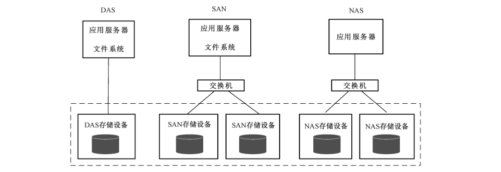
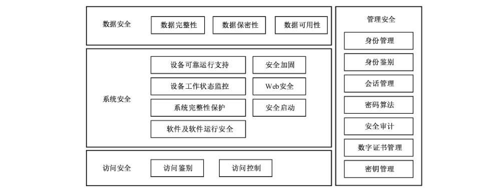

# GB/T 37939-2019 信息安全技术 网络存储安全技术要求

> 来源：[GB/T 37939-2019 国家标准详情](https://openstd.samr.gov.cn/bzgk/std/newGbInfo?hcno=7F848CE7A5F44FD7D4FC1EE0D270228C)。
> PDF SHA-256：1be1c17bbe2f3b818b5972a73593decd24131bb4d10850ea35a90890a8eebe76。
> 转写说明：对照官方 PDF 全部 33 页图像整理；省略封面、目录、页眉、页脚和页码，合并跨页续表，三张图保留原图裁切。正式引用请核对官方 PDF。

## 前言

本标准按照 GB/T 1.1—2009给出的规则起草。

请注意本文件的某些内容可能涉及专利。本文件的发布机构不承担识别这些专利的责任。

本标准由全国信息安全标准化技术委员会（SAC/TC 260）提出并归口。

本标准起草单位：中国电子技术标准化研究院、华为技术有限公司、公安部第三研究所、华中科技大学、上海交通大学、联想（北京）信息技术有限公司、北京匡恩网络科技有限责任公司、中国信息安全测评中心、杭州海康威视数字技术股份有限公司、浪潮电子信息产业股份有限公司。

本标准主要起草人：葛小宇、王伟、陈妍、刘贤刚、顾健、陆臻、王海婧、谭支鹏、吴晨涛、安高峰、李汝鑫、刘俊、钱晓东、许东阳、庞博、王峥、付卓、文中领、赵江。

## 1 范围

本标准规定了网络存储的安全技术要求，包括安全功能要求、安全保障要求。

本标准适用于网络存储的设计和实现，网络存储的安全测试和管理可参照使用。

## 2 规范性引用文件

下列文件对于本文件的应用是必不可少的。凡是注日期的引用文件，仅注日期的版本适用于本文件。凡是不注日期的引用文件，其最新版本（包括所有的修改单）适用于本文件。

- GB/T 18336.3—2015 信息技术 安全技术 信息技术安全评估准则 第3部分：安全保障组件

- GB/T 25069—2010 信息安全技术 术语

## 3 术语和定义

GB/T 18336.3—2015 和 GB/T 25069—2010界定的以及下列术语和定义适用于本文件。

### 3.1 网络存储 network storage

通过网络基于不同协议连接到服务器的专用存储设备。

> 示例：网络存储通常包括 DAS 存储设备、NAS 存储设备、SAN存储设备和对象存储设备。

### 3.2 直接附加存储 direct attached storage

将存储设备直接连接到服务器上的存储架构。

### 3.3 存储区域网络 storage area network

通过网络方式连接存储设备和应用服务器并提供数据块访问的存储架构。

### 3.4 网络附加存储 network attached storage

将存储设备直接联网并使用网络文件共享协议提供文件级数据访问的存储架构。

### 3.5 对象存储 object based storage

基于对象的方式提供数据访问的存储架构。

> 注：一个对象通常包括数据、描述该对象的元数据和该对象的唯一标识符。

### 3.6 独立磁盘冗余阵列 redundant array of independent disks

将一个个单独的磁盘以不同的组合方式形成一个逻辑硬盘。

### 3.7 镜像 mirroring

实时地将一个逻辑磁盘卷上的数据复制到若干个逻辑磁盘卷上。

### 3.8 快照 snapshot

对指定数据集合的一个完全可用拷贝，该拷贝包含源数据在拷贝时间点的静态映像。

> 注：快照可以是数据再现的一个副本或者复制。

## 4 缩略语

下列缩略语适用于本文件。

CPU：中央处理器（Central Processing Unit）

DAS：直接附加存储（Direct-attached Storage）

NAS：网络附加存储（Network Attached Storage）

RAID：独立磁盘冗余阵列（Redundant Array of Independent Disks）

SAN：存储区域网络（Storage Area Network）

WEB：万维网（World Wide Web）

WORM：一次写多次读（Write Once Read Many）

## 5 产品描述

### 5.1 网络存储描述

在信息系统中，存储设备初期只安装在服务器内，之后逐渐形成了多磁盘阵列组成的可以通过网络基于不同协议连接到服务器的专用存储设备，称为网络存储。网络存储一般有三种典型的架构，见图1，常见的为NAS存储设备、SAN 存储设备。

网络存储的三种典型架构分别是：

a） 直接附加存储（DAS）：将存储设备直接连接到服务器上使用，数据分散管理。

b） 网络附加存储（NAS）：将存储设备连接到以太网上，支持网络文件共享协议，提供数据和文件服务。

c） 存储区域网络（SAN）：是一种通过网络方式连接存储设备和应用服务器的存储架构，提供在服务器和存储设备之间的数据传输，服务器、存储设备可以独立扩展。

图1中网络存储的通用简要逻辑结构见图2。

网络存储硬件层由硬盘、CPU、内存、固件等构成，为设备运行提供基本支持。硬件层支持系统层的运行，系统层通常包含操作系统、驱动、数据库等。存储软件运行在操作系统上，提供备份、快照等存储功能。

### 5.2 网络存储安全框架

网络存储应具备的安全功能，所组成的安全框架见图3。

网络存储安全框架分为访问安全、系统安全、数据安全以及管理安全，简要介绍如下：

a） 访问安全包括：访问鉴别、访问控制。

b）系统安全包括：设备可靠运行支持、设备工作状态监控、系统完整性保护、软件及软件运行安全、安全加固、Web 安全、安全启动。

c） 数据安全包括：数据完整性、数据保密性、数据可用性。

d） 管理安全包括：身份管理、身份鉴别、会话管理、密码算法、安全审计、数字证书管理、密钥管理。

### 5.3 级别划分描述

网络存储安全功能要求分为3个级别，分别是第一级、第二级和第三级，“宋体加粗”字表示较低等级中没有出现或增强的要求，安全功能要求在不同级别间的增强或新增内容的定性表示参见附录A的表A.1；安全保障要求分为3个级别，分别是第一级、第二级和第三级，“宋体加粗”字表示较低等级中没有出现或增强的要求，安全保障要求在不同级别间的增强或新增内容的定性表示参见表A.2。在标准应用时，满足所选择的安全保障要求级别不低于安全功能要求的级别。

## 6 安全功能要求

### 6.1 第一级安全功能要求

#### 6.1.1 概述

第一级安全功能要求主要提出了网络存储需具备的基本安全功能，包含访问安全、系统安全、数据安全和管理安全四个方面。

#### 6.1.2 访问安全

##### 6.1.2.1 访问鉴别

应对访问网络存储业务的应用进行鉴别，包含以下要求：

a） 对应用提供唯一标识，并将标识和与其相关的所有可审计事件相关联；

b） 鉴别信息非明文存储，且鉴别数据不被未授权查阅和篡改；

c） 不存在可绕过鉴别机制的访问方式。

##### 6.1.2.2 访问控制

应按访问控制安全策略进行设计，实现策略控制下的访问控制功能，包含以下要求：

a） 访问控制的策略范围应包括与资源访问相关的主体、客体及它们之间的操作；

b） 对资源进行访问的内容、操作权限不超出预定义的范围，满足最小特权原则；

c） 支持业务面和管理面无法互相访问；

d） 支持对资源访问控制的策略配置。

#### 6.1.3 系统安全

##### 6.1.3.1 设备可靠运行支持

应支持管理模块冗余、电源模块冗余、控制模块冗余，并提供容错和故障恢复能力，以保证网络存储自身可靠运行。

##### 6.1.3.2 设备工作状态监控

应支持自动检测设备的工作状态，至少可检测硬件故障、网络中断、网络连接错误、软件容量预警、业务异常预警等内容，并采取告警措施。

##### 6.1.3.3 软件及软件运行安全

若自带有操作系统、数据库、Web 应用，应保证系统软件及软件运行环境不存在高风险级别的漏洞，例如，经通用漏洞评分系统评估出的高风险漏洞。

#### 6.1.4 数据安全

##### 6.1.4.1 数据完整性

应支持检测存储过程中的数据完整性错误，并提供必要的恢复措施。

##### 6.1.4.2 数据保密性

应对数据的保密性进行保护，对业务应用关键数据采用非明文存储：

a） 口令等敏感信息不得明文存储在本地，需加密保护；

b）不在URL、日志、错误消息、调试信息中暴露口令、密钥、会话标识符等敏感信息。

##### 6.1.4.3 数据可用性

###### 6.1.4.3.1 备份与恢复

应提供对数据进行备份和恢复的功能，包含以下要求：

a） 对数据进行手动备份；

b） 对数据进行全备份；

c） 对数据进行异步备份；

d） 对数据进行本地备份；

e） 卷镜像的方式提供数据的备份与恢复功能；

f） 快照的方式提供数据的备份与恢复功能。

###### 6.1.4.3.2 防病毒

应支持防病毒软件扫描，防止文件被病毒感染。

###### 6.1.4.3.3 数据冗余

应支持通过配置 RAID 保障存储数据的可靠性。

#### 6.1.5 管理安全

##### 6.1.5.1 身份管理

###### 6.1.5.1.1 身份标识管理

应提供对用户的标识功能，为每个用户提供唯一的身份标识。

###### 6.1.5.1.2 账号安全管理

应提供账号管理功能，包含以下要求：

a） 系统中的账号具有唯一性；

b）不可预留任何的未公开账号，所有账号都可被系统管理，并在资料中提供所有账号及管理操作说明。

###### 6.1.5.1.3 账号权限管理

应提供账号权限管理功能，包含以下要求：

a） 采用基于角色的账号权限管理模型；

b） 对于账号的授权应基于最小特权原则；

c） 系统中的账号不能修改自身权限。

##### 6.1.5.2 身份鉴别

###### 6.1.5.2.1 鉴别机制管理

应提供身份鉴别功能，使用的鉴别机制包含以下要求：

a） 在用户对网络存储进行操作之前，先对提出该操作请求的用户进行鉴别；

b） 对用户的最终鉴别处理、鉴权处理过程应在服务端进行，并遵循先鉴权后执行的原则。

###### 6.1.5.2.2 口令安全管理

应提供基于口令的鉴别方式，口令安全包含以下要求：

a） 对于管理面，系统提供检测口令复杂度的功能，若设置的口令不符合复杂度要求，不准许设置成功并给出合理的提示，对于系统自动生成的口令，使用安全随机数生成。

b） 口令复杂度满足以下要求：

——口令长度至少6个字符；

——口令包含至少两种字符的组合；

——口令不可与账号相同。

c） 产品出厂使用的第三方和开源软件不得使用缺省口令。

d） 不应存在用户无法修改的口令。对于出厂时缺省设置的账号、口令或用于传输的加密密钥，应提供修改机制，提醒用户修改及定期更新，并提示风险。

e） 提供的口令输入框不支持口令拷贝。

f） 操作界面中的口令不应明文显示。

g） 密码口令文件应设置访问权限，管理用户不可读取或拷贝加密的内容。

h） 用户修改自己口令时应验证旧口令。

###### 6.1.5.2.3 登录身份鉴别

应提供登录身份鉴别功能，包含以下要求：

a） 管理接口应提供接入鉴别机制，所有可对系统进行管理的人机接口以及跨信任网络的机机接口应有安全的接入鉴别机制并缺省启用，标准协议没有鉴别机制的除外；

b） 设备外部可见的可对系统进行调试或管理的物理接口应有接入鉴别机制；

c） 对于人机接口或跨信任网络的机机接口的登录身份鉴别应支持口令防暴力破解机制，当重复输入错误口令次数超过阈值时采取合适保护措施。

##### 6.1.5.3 会话管理

应提供会话管理功能，可设置会话超时机制，并在超时过后清除该会话信息。

##### 6.1.5.4 密码算法

本标准中凡涉及采用密码技术解决保密性、完整性、真实性、不可否认性需求的，须遵循国家密码管理部门的相关规定。

##### 6.1.5.5 安全审计

###### 6.1.5.5.1 审计数据产生

应支持对于以下事件进行安全审计，并生成审计数据：

a） 为下述可审计事件产生审计记录：

1） 审计功能的开启和关闭。

2） 针对数据的备份、恢复、删除、迁移等操作。

3） 以下的用户活动和关键操作行为：

——登录和注销；

——增加、删除用户和用户属性（账号、口令等）的变更；

——用户的锁定与解锁、禁用与恢复；

——角色权限变更；

——系统安全配置（如安全日志内容等配置）的变更；

——重要资源的变更，如某个重要文件的删除、修改等；

——对系统配置参数的修改；

——系统进行启动、关闭、重启、暂停、恢复、倒换等操作；

——存储业务的加载、卸载；

——对软件的升级操作，包括远程升级和本地升级；

——对重要业务数据（特别是逻辑卷、文件系统、对象等）的创建、删除、修改等。

4） 其他与系统安全有关的事件或专门定义的可审计事件。

b）对于每一个事件，其审计记录应包括：用户、被访问资源的名称、访问发起端地址或标识、事件的日期和时间、事件类型、事件是否成功，及其他与审计相关的信息。

###### 6.1.5.5.2 审计数据管理

应提供对审计数据的管理功能，包含以下要求：

a） 只有具有相应权限的用户才可读取对应的审计数据；

b） 以可被处理的形式提供审计数据。

###### 6.1.5.5.3 审计数据存储

应保证审计数据的存储安全，包含以下要求：

a） 应确保审计记录的留存时间符合法律法规要求；

b）应检测或防止对审计记录的未授权修改。

##### 6.1.5.6 数字证书管理

应提供数字证书管理功能，包含以下要求：

a） 使用通用格式的证书，且使用安全的证书签名算法；

b） 设置合理的证书有效期；

c） 支持验证证书的有效性。

##### 6.1.5.7 密钥管理

应支持密钥管理功能，包含以下要求：

a） 对密钥进行分层管理；

b） 手动输入的值，不可直接作为密钥使用；

c） 用于敏感数据加密的密钥，不可写在源代码中。

### 6.2 第二级安全功能要求

#### 6.2.1 概述

第二级安全功能要求依然从访问安全、系统安全、数据安全和管理安全四个方面提出，与第一级安全功能要求相比，增强了系统安全中硬件检测与修复、系统完整性保护、安全加固和 Web 安全等方面的要求，增强了数据安全中传输数据完整性、处理数据完整性、数据保密性和备份与恢复等方面的要求，增强了管理安全中账号安全管理、鉴别机制、审计内容和数字证书等方面的要求。

#### 6.2.2 访问安全

##### 6.2.2.1 访问鉴别

应对访问网络存储业务的应用进行鉴别，包含以下要求：

a） 对应用提供唯一标识，并将标识和与其相关的所有可审计事件相关联；

b） 鉴别信息非明文存储，且鉴别数据不被未授权查阅和篡改；

c） 不存在可绕过鉴别机制的访问方式。

##### 6.2.2.2 访问控制

应按访问控制安全策略进行设计，实现策略控制下的访问控制功能，包含以下要求：

a） 访问控制的策略范围应包括与资源访问相关的主体、客体及它们之间的操作；

b） 对资源进行访问的内容、操作权限不超出预定义的范围，满足最小特权原则；

c） 支持业务和管理面无法互相访问；

d） 支持对资源访问控制的策略配置。

#### 6.2.3 系统安全

##### 6.2.3.1 设备可靠运行支持

应保证自身可靠运行，包含以下要求：

a） 支持管理模块冗余、电源模块冗余、控制模块冗余，并提供容错和故障恢复能力；

b） **支持对内存的检测与纠错；**

c） **支持对硬盘检测和修复。**

##### 6.2.3.2 设备工作状态监控

应支持自动检测设备的工作状态，至少可检测硬件故障、网络中断、网络连接错误、软件容量预警、业务异常预警等内容，并采取告警措施。

##### 6.2.3.3 系统完整性保护

**应提供系统完整性保护功能，包含以下要求：**

a） **对软件安装包进行完整性保护并确保完整性校验流程安全可靠；**

b） **支持在固件升级和安装过程中对固件进行合法性校验。**

##### 6.2.3.4 软件及软件运行安全

若自带有操作系统、数据库、Web 应用，应保证系统软件及软件运行环境不存在高风险级别的漏洞，例如，经通用漏洞评分系统评估出的高风险漏洞。

##### 6.2.3.5 安全加固

**应支持安全加固功能，包含以下要求：**

a） **对操作系统、数据库和文件系统采用业界通用的加固规范进行安全加固；**

b） **关闭不需要的系统服务、默认共享和端口；**

c） **支持关闭不安全访问协议，并缺省关闭。**

##### 6.2.3.6 Web 安全

**应提供 web 安全功能，包含以下要求：**

a） **对于每一个需要授权访问的请求都核实用户的会话标识是否合法、用户是否被授权执行此操作；**

b） **支持在服务器端对所有来自不可信数据源的数据进行内容校验，拒绝任何没有通过校验的数据；**

c） **若输出到客户端的数据来自不可信的数据源，则对该数据进行相应的编码或转义；**

d） **通过 Web 上传文件时，在服务器端采用白名单方式对上传到 Web 内容目录下的文件类型进行严格的限制；**

e） **在Web 应用中，用户名和口令认证通过后，应更换会话标识，并使用cookie 维持会话。**

#### 6.2.4 数据安全

##### 6.2.4.1 数据完整性

###### 6.2.4.1.1 存储数据的完整性

应支持检测存储过程中的数据完整性错误，并提供必要的恢复措施。

###### 6.2.4.1.2 传输数据的完整性

**应对在网络存储内部不同组件、部件之间传输的数据提供完整性保护，支持检测传输中的数据完整性错误。**

###### 6.2.4.1.3 处理数据的完整性

**应支持对处理中的数据进行完整性保护的功能。**

##### 6.2.4.2 数据保密性

应对数据的保密性进行保护，应对业务应用关键数据采用非明文存储：

a） 口令等敏感信息不得明文存储在本地，需加密保护；

b）不在URL、日志、错误消息、调试信息中暴露口令、密钥、会话标识符等敏感信息；

c） **在非信任网络之间传输数据时，应支持采用安全传输通道或者加密后传输；**

d） **对敏感数据的访问要有认证、授权或加密机制，对于认证凭据的安全存储，在不需要还原明文的场景下，应使用不可逆算法加密。**

##### 6.2.4.3 数据可用性

###### 6.2.4.3.1 备份与恢复

应提供对数据进行备份和恢复的功能，包含以下要求：

a） 对数据进行手动备份；

b） **对数据进行自动备份；**

c） 对数据进行全备份；

d） **对数据进行增量备份；**

e） 对数据进行异步备份；

f） **对数据进行同步备份；**

g） 对数据进行本地备份；

h） **对数据进行异地备份；**

i） 卷镜像的方式提供数据的备份与恢复功能；

j） 快照的方式提供数据的备份与恢复功能；

k）通**过远程复制的方式提供数据的备份与恢复功能。**

###### 6.2.4.3.2 防病毒

应支持防病毒软件扫描，防止文件被病毒感染。

###### 6.2.4.3.3 数据冗余

应支持通过配置 RAID 保障存储数据的可靠性。

#### 6.2.5 管理安全

##### 6.2.5.1 身份管理

###### 6.2.5.1.1 身份标识管理

应提供对用户的标识功能，包含以下要求：

a） 为每个用户提供唯一的身份标识；

b） **对每个用户身份标识进行管理、维护，确保其不被非授权地访问、修改或删除。**

###### 6.2.5.1.2 账号安全管理

应提供账号管理功能，包含以下要求：

a） 系统中的账号具有唯一性；

b）不可预留任何的未公开账号，所有账号都可被系统管理，并在资料中提供所有账号及管理操作说明；

c） **若存储产品自带数据库，且有多个默认账号，应禁用或删除不使用的账号，若无法删除或禁用，应在产品资料中提示用户修改默认账号的口令、定期更新口令。**

###### 6.2.5.1.3 账号权限管理

应提供账号权限管理功能，包含以下要求：

a） 采用基于角色的账号权限管理模型；

b） 对于账号的授权应基于最小特权原则；

c） 系统中的账号不能修改自身权限。

##### 6.2.5.2 身份鉴别

###### 6.2.5.2.1 鉴别机制管理

应提供身份鉴别功能，使用的鉴别机制包含以下要求：

a） 在用户对网络存储进行操作之前，先对提出该操作请求的用户进行鉴别；

b） 对用户的最终鉴别处理、鉴权处理过程应在服务端进行，并遵循先鉴权后执行的原则；

c） **当用户连续鉴别失败达到设定次数后，采取措施阻止用户的进一步请求；**

d） **用户操作超时被断开后，重新连接时需要重新进行鉴别；**

e） **支持用户鉴别信息非明文存储，且认证数据不被未授权查阅和修改。**

###### 6.2.5.2.2 口令安全管理

应提供基于口令的鉴别方式，口令安全包含以下要求：

a） 对于管理面，系统提供检测口令复杂度的功能，若设置的口令不符合复杂度要求，不准许设置成功并给出合理的提示，对于系统自动生成的口令，应使用安全随机数生成。

b） 口令复杂度应满足以下要求：

——口令长度至少6个字符；

——口令包含至少两种字符的组合；

——口令不可与账号相同。

c） 产品出厂使用的第三方和开源软件不得使用缺省口令。

d） 不应存在用户无法修改的口令。对于出厂时缺省设置的账号/口令或用于传输的加密密钥，产品应提供修改机制，应提醒用户修改及定期更新，并提示风险。

e） 产品提供的口令输入框不支持口令拷贝。

f） 操作界面中的口令不应明文显示。

g） 密码口令文件应设置访问权限，管理用户不可读取或拷贝加密的内容。

h） 用户修改自己口令时应验证旧口令。

###### 6.2.5.2.3 登录身份鉴别

应提供登录身份鉴别功能，包含以下要求：

a） 管理接口应提供接入鉴别机制，所有可对系统进行管理的人机接口以及跨信任网络的机机接口应有安全的接入鉴别机制并缺省启用，标准协议没有鉴别机制的除外；

b） 设备外部可见的可对系统进行调试或管理的物理接口应有接入鉴别机制；

c） 对于人机接口或跨信任网络的机机接口的登录身份鉴别应支持口令防暴力破解机制，当重复输入错误口令次数超过阈值时采取合适保护措施。

##### 6.2.5.3 会话管理

应提供会话管理功能，包含以下要求：

a） 设置会话超时机制，在超时过后清除该会话信息；

b） **所有登录后才可访问的界面都应提供主动退出选项，当用户退出时，服务端应清除该用户的会话信息。**

##### 6.2.5.4 密码算法

本标准中凡涉及采用密码技术解决保密性、完整性、真实性、不可否认性需求的，须遵循国家密码管理部门的相关规定。

##### 6.2.5.5 安全审计

###### 6.2.5.5.1 审计数据产生

应支持对于以下事件进行安全审计，并生成审计数据：

a） 为下述可审计事件产生审计记录：

1） 审计功能的开启和关闭。

2） 针对数据的备份、恢复、删除、迁移等操作。

3） 以下的用户活动和关键操作行为：

——登录和注销；

——增加、删除用户和用户属性（账号、口令等）的变更；

——用户的锁定与解锁、禁用与恢复；

——角色权限变更；

——系统安全配置（如安全日志内容等配置）的变更；

——重要资源的变更，如某个重要文件的删除、修改等；

——对系统配置参数的修改；

——系统进行启动、关闭、重启、暂停、恢复、倒换等操作；

——存储业务的加载、卸载；

——对软件的升级操作，包括远程升级和本地升级；

——对重要业务数据（特别是逻辑卷、文件系统、对象等）的创建、删除、修改等。

4）其他与系统安全有关的事件或专门定义的可审计事件。

b） 对于每一个事件，其审计记录应包括：用户、被访问资源的名称、访问发起端地址或标识、事件的日期和时间、事件类型、事件是否成功，及其他与审计相关的信息。

c） **审计数据产生时的时间应由网络存储所在系统范围内唯一确定的时钟产生，以确保审计分析的正确性。**

d） **对于身份鉴别事件，审计记录应包含请求的来源。**

e） **网络会话事件还应包括：网络程序名称、协议类型、源地址、目的地址、源端口、目的端口、会话总字节数等字段。**

###### 6.2.5.5.2 审计数据管理

应提供对审计数据的管理功能，包含以下要求：

a） 只有具有相应权限的用户才可读取对应的审计数据；

b） 以可被处理的形式提供审计数据。

###### 6.2.5.5.3 审计数据存储

应保证审计数据的存储安全，包含以下要求：

a） 应确保审计记录的留存时间符合法律法规要求；

b） 应检测或防止对审计记录的未授权修改；

c） **审计数据被未授权修改时，对该操作进行审计；**

d）审**计存储已满、存储失败时，确保审计记录不丢失。**

##### 6.2.5.6 数字证书管理

应提供数字证书管理功能，包含以下要求：

a） 使用通用格式的证书，且使用安全的证书签名算法；

b） 设置合理的证书有效期；

c） 支持验证证书的有效性；

d） **证书的私钥应加密保存，私钥保护口令应满足复杂度要求并加密保存，同时控制私钥文件和证书文件的访问权限；**

e） **支持周期性检查设备上各种类型的证书是否过期或即将过期；**

f） **使用安全随机数生成密钥对。**

##### 6.2.5.7 密钥管理

应支持密钥管理功能，包含以下要求：

a） 应对密钥进行分层管理；

b） 手动输入的值，不可直接作为密钥使用；

c） 用于敏感数据加密的密钥，不可写在源代码中；

d） **密钥及相关信息在本地存储时需提供完整性保护和机密性保护。**

### 6.3 第三级安全功能要求

#### 6.3.1 概述

第三级安全功能要求依然从访问安全、系统安全、数据安全和管理安全四个方面提出，与第二级安全功能要求相比，增强了系统安全中系统完整性保护、安全启动等方面的要求，增强了数据安全中数据完整性、数据保密性、剩余信息保护和业务高可用等方面的要求，增强了管理安全中会话管理、鉴别机制管理、数字证书和密钥管理等方面的要求。

#### 6.3.2 访问安全

##### 6.3.2.1 访问鉴别

应对访问网络存储业务的应用进行鉴别，包含以下要求：

a） 对应用提供唯一标识，并将标识和与其相关的所有可审计事件相关联；

b） 鉴别信息非明文存储，且鉴别数据不被未授权查阅和篡改；

c） 不存在可绕过鉴别机制的访问方式。

##### 6.3.2.2 访问控制

应按访问控制安全策略进行设计，实现策略控制下的访问控制功能，包含以下要求：

a） 访问控制的策略范围应包括与资源访问相关的主体、客体及它们之间的操作；

b）对资源进行访问的内容、操作权限不超出预定义的范围，满足最小特权原则；

c） 支持业务面和管理面无法互相访问；

d） 支持对资源访问控制的策略配置。

#### 6.3.3 系统安全

##### 6.3.3.1 设备可靠运行支持

应保证自身可靠运行，包含以下要求：

a） 支持管理模块冗余、电源模块冗余、控制模块冗余，并提供容错和故障恢复能力；

b） 支持对内存的检测与纠错；

c） 支持对硬盘检测和修复。

##### 6.3.3.2 设备工作状态监控

应支持自动检测设备的工作状态，至少可检测硬件故障、网络中断、网络连接错误、软件容量预警、业务异常预警等内容，并采取告警措施。

##### 6.3.3.3 系统完整性保护

应提供系统完整性保护功能，包含以下要求：

a） 对软件安装包进行完整性保护并确保完整性校验流程安全可靠；

b） 支持在固件升级和安装过程中对固件进行合法性校验；

c） **对软件包进行数字签名。**

##### 6.3.3.4 软件及软件运行安全

若自带有操作系统、数据库、Web 应用，应保证系统软件及软件运行环境不存在高风险级别的漏洞，例如，经通用漏洞评分系统评估出的高风险漏洞。

##### 6.3.3.5 安全加固

应支持安全加固功能，包含以下要求：

a） 对操作系统、数据库和文件系统采用业界通用的加固规范进行安全加固；

b） 关闭不需要的系统服务、默认共享和端口；

c） 支持关闭不安全访问协议，并缺省关闭。

##### 6.3.3.6 Web 安全

应提供 Web 安全功能，包含以下要求：

a） 对于每一个需要授权访问的请求都核实用户的会话标识是否合法、用户是否被授权执行此操作；

b） 支持在服务器端对所有来自不可信数据源的数据进行内容校验，拒绝任何没有通过校验的数据；

c） 若输出到客户端的数据来自不可信的数据源，则对该数据进行相应的编码或转义；

d） 通过Web 上传文件时，在服务器端采用白名单方式对上传到Web 内容目录下的文件类型进行严格的限制；

e） 在Web 应用中，用户名和口令认证通过后，应更换会话标识，并使用cookie 维持会话。

##### 6.3.3.7 安全启动

**应支持在设备启动时对软件和固件进行完整性验证。**

#### 6.3.4 数据安全

##### 6.3.4.1 数据完整性

###### 6.3.4.1.1 存储数据的完整性

应对存储过程中的数据进行完整性保护，包含以下要求：

a） 支持检测存储过程中的数据完整性错误，并提供必要的恢复措施；

b） **提供 WORM功能。**

###### 6.3.4.1.2 传输数据的完整性

应对在网络存储内部不同组件、部件之间传输的数据提供完整性保护，包含以下要求：

a） 可检测出传输中的数据完整性错误；

**b） 检测到数据完整性错误时，采取必要的数据恢复措施。**

###### 6.3.4.1.3 处理数据的完整性

应支持对处理中的数据进行完整性保护的功能。

##### 6.3.4.2 数据保密性

###### 6.3.4.2.1 数据保密性

应对数据的保密性进行保护，包含以下要求：

a） 应对业务应用关键数据采用非明文存储：

——口令等敏感信息不得明文存储在本地，需加密保护；

——不在 URL、日志、错误消息、调试信息中暴露口令、密钥、会话标识符等敏感信息；

——在非信任网络之间传输数据时，应支持采用安全传输通道或者加密后传输；

——对敏感数据的访问要有认证、授权或加密机制，对于认证凭据的安全存储，在不需要还原明文的场景下，应使用不可逆算法加密。

b） **应支持通过加密产品对网络存储中存储的数据进行加密。**

###### 6.3.4.2.2 剩余信息保护

**应提供剩余信息保护功能，包含以下要求：**

a） **支持对鉴别信息和敏感数据所在的存储空间进行完全清除；**

b） **支持硬盘数据安全擦除，数据擦除后，不可恢复，例如，可采用的安全擦除方式有：固件的安全擦除命令、多次覆盖写入及密钥销毁等方式；**

c） **支持硬盘在脱离存储设备后，通过鉴别或加密等机制保障数据不被恶意获取。**

##### 6.3.4.3 数据可用性

###### 6.3.4.3.1 备份与恢复

应提供对数据进行备份和恢复的功能，包含以下要求：

a） 对数据进行手动备份；

b） 对数据进行自动备份；

c） 对数据进行全备份；

d） 对数据进行增量备份；

e） 对数据进行异步备份；

f） 对数据进行同步备份；

g） 对数据进行本地备份；

h） 对数据进行异地备份；

i） 卷镜像的方式提供数据的备份与恢复功能；

j） 快照的方式提供数据的备份与恢复功能；

k）通过远程复制的方式提供数据的备份与恢复功能。

###### 6.3.4.3.2 防病毒

应支持防病毒软件扫描，防止文件被病毒感染。

###### 6.3.4.3.3 数据冗余

应支持通过配置 RAID 保障存储数据的可靠性。

###### 6.3.4.3.4 高可用

**应支持高可用功能，当一个数据中心的存储系统发生故障时，业务自动切换到另一个数据中心。**

#### 6.3.5 管理安全

##### 6.3.5.1 身份管理

###### 6.3.5.1.1 身份标识管理

应提供对用户的标识功能，包含以下要求：

a） 为每个用户提供唯一的身份标识；

b） 对每个用户身份标识进行管理、维护，确保其不被非授权地访问、修改或删除；

c） **将用户身份标识和该用户的所有可审计事件相关联。**

###### 6.3.5.1.2 账号安全管理

应提供账号管理功能，包含以下要求：

a） 系统中的账号具有唯一性；

b） 不可预留任何的未公开账号，所有账号都可被系统管理，并在资料中提供所有账号及管理操作说明；

c） 若存储产品自带数据库，且有多个默认账号，应禁用或删除不使用的账号，若无法删除或禁用，应在产品资料中提示用户修改默认账号的口令、定期更新口令；

d） **应用系统人机帐号、机机帐号分离，用于程序间通信的机机账号不可作为系统维护的人机账号。**

###### 6.3.5.1.3 账号权限管理

应提供账号权限管理功能，包含以下要求：

a） 采用基于角色的账号权限管理模型；

b） 对于账号的授权应基于最小特权原则；

c） 系统中的账号不能修改自身权限。

##### 6.3.5.2 身份鉴别

###### 6.3.5.2.1 鉴别机制管理

应提供身份鉴别功能，使用的鉴别机制包含以下要求：

a） 在用户对网络存储进行操作之前，先对提出该操作请求的用户进行鉴别；

b） 对用户的最终鉴别处理、鉴权处理过程应在服务端进行，并遵循先鉴权后执行的原则；

c） 当用户连续鉴别失败达到设定次数后，采取措施阻止用户的进一步请求；

d） 用户操作超时被断开后，重新连接时需要重新进行鉴别；

e） 支持用户鉴别信息非明文存储，且认证数据不被未授权查阅和修改；

f） **提供多种鉴别机制及相应鉴别规则；**

g） **对于重要的操作，支持强制要求用户重新输入口令等鉴别信息，并在服务端完成鉴别；**

h） **应支持基于密码技术的身份鉴别机制。**

###### 6.3.5.2.2 口令安全管理

应提供基于口令的鉴别方式，口令安全包含以下要求：

a） 对于管理面，系统提供检测口令复杂度的功能，若设置的口令不符合复杂度要求，不准许设置成功并给出合理的提示，对于系统自动生成的口令，使用安全随机数生成。

b） 口令复杂度满足以下要求：

——口令长度至少6个字符；

——口令包含至少两种字符的组合；

——口令不可与账号相同。

c） 产品出厂使用的第三方和开源软件不得使用缺省口令。

d） 不应存在用户无法修改的口令。对于出厂时缺省设置的账号、口令或用于传输的加密密钥，应提供修改机制，提醒用户修改及定期更新，并提示风险。

e） 提供的口令输入框不支持口令拷贝。

f） 操作界面中的口令不应明文显示。

g） 密码口令文件应设置访问权限，管理用户不可读取或拷贝加密的内容。

h） 用户修改自己口令时应验证旧口令。

###### 6.3.5.2.3 登录身份鉴别

应提供登录身份鉴别功能，包含以下要求：

a） 管理接口提供接入鉴别机制，所有可对系统进行管理的人机接口以及跨信任网络的机机接口应有安全的接入鉴别机制并缺省启用，标准协议没有鉴别机制的除外；

b） 设备外部可见的可对系统进行调试或管理的物理接口应有接入鉴别机制；

c） 对于人机接口或跨信任网络的机机接口的登录身份鉴别应支持口令防暴力破解机制，当重复输入错误口令次数超过阈值时采取合适保护措施；

d） **允许口令错误次数、用户锁定时长的配置。**

##### 6.3.5.3 会话管理

应提供会话管理功能，包含以下要求：

a） 设置会话超时机制，在超时过后清除该会话信息；

b） 所有登录后才可访问的界面都应提供主动退出选项，当用户退出时，服务端应清除该用户的会话信息；

c） **会话标识应使用安全随机数算法生成；**

d） **应支持会话超时的时间可配置。**

##### 6.3.5.4 密码算法

本标准中凡涉及采用密码技术解决保密性、完整性、真实性、不可否认性需求的，须遵循国家密码管理部门的相关规定。

##### 6.3.5.5 安全审计

###### 6.3.5.5.1 审计数据产生

应支持对于以下事件进行安全审计，并生成审计数据：

a） 为下述可审计事件产生审计记录：

1） 审计功能的开启和关闭。

2） 针对数据的备份、恢复、删除、迁移等操作。

3） 以下的用户活动和关键操作行为：

——登录和注销；

——增加、删除用户和用户属性（账号、口令等）的变更；

——用户的锁定与解锁、禁用与恢复；

——角色权限变更；

——系统安全配置（如安全日志内容等配置）的变更；

——重要资源的变更，如某个重要文件的删除、修改等；

——对系统配置参数的修改；

——系统进行启动、关闭、重启、暂停、恢复、倒换等操作；

——存储业务的加载、卸载；

——对软件的升级操作，包括远程升级和本地升级；

——对重要业务数据（特别是逻辑卷、文件系统、对象等）的创建、删除、修改等。

4） 其他与系统安全有关的事件或专门定义的可审计事件。

b） 对于每一个事件，其审计记录应包括：用户、被访问资源的名称、访问发起端地址或标识、事件的日期和时间、事件类型、事件是否成功，及其他与审计相关的信息。

c） 审计数据产生时的时间应由网络存储所在系统范围内唯一确定的时钟产生，以确保审计分析的正确性。

d） 对于身份鉴别事件，审计记录应包含请求的来源。

e） 网络会话事件还应包括：网络程序名称、协议类型、源地址、目的地址、源端口、目的端口、会话总字节数等字段。

###### 6.3.5.5.2 审计数据管理

应提供对审计数据的管理功能，包含以下要求：

a） 只有具有相应权限的用户才可读取对应的审计数据；

b） 以可被处理的形式提供审计数据；

c） **支持条件化检索审计数据，例如，搜索、分类、排序等。**

###### 6.3.5.5.3 审计数据存储

应保证审计数据的存储安全，包含以下要求：

a） 应确保审计记录的留存时间符合法律法规要求；

b） 应检测或防止对审计记录的未授权修改；

c） 审计数据被未授权修改时，对该操作进行审计；

d） 审计存储已满、存储失败时，确保审计记录不丢失。

##### 6.3.5.6 数字证书管理

应提供数字证书管理功能，包含以下要求：

a） 使用通用格式的证书，且使用安全的证书签名算法；

b） 设置合理的证书有效期；

c） 支持验证证书的有效性；

d） 证书的私钥应加密保存，私钥保护口令应满足复杂度要求并加密保存，同时控制私钥文件和证书文件的访问权限；

e） 支持周期性检查设备上各种类型的证书是否过期或即将过期；

f） 使用安全随机数生成密钥对；

g） **支持第三方可信机构颁发的数字证书；**

h） **支持对证书的吊销状态进行验证。**

##### 6.3.5.7 密钥管理

应支持密钥管理功能，包含以下要求：

a） 应对密钥进行分层管理；

b） 手动输入的值，不可直接作为密钥使用；

c） 用于敏感数据加密的密钥，不可写在源代码中；

d） 密钥及相关信息在本地存储时需提供完整性保护和机密性保护；

e） **网络存储应支持密钥管理产品对存储进行必要的密钥管理支持。**

## 7 安全保障要求

### 7.1 第一级安全保障要求

#### 7.1.1 开发

##### 7.1.1.1 安全架构

开发者应向评估者提供产品安全功能的安全架构描述：

a） 与产品设计文档中对安全功能要求执行的抽象描述详细程度一致；

b） 描述与安全功能要求一致的产品安全功能的安全域；

c） 描述产品安全功能初始化过程为何是安全的；

d） 证实产品安全功能能够防止被破坏；

e） 证实产品安全功能能够防止安全功能要求执行的功能被旁路。

##### 7.1.1.2 功能规范

开发者应向评估者提供一个功能规范：

a） 完整描述产品的安全功能；

b） 描述所有安全功能接口的目的与使用方法；

c） 标识和描述每个安全功能接口相关的所有参数；

d） 描述安全功能接口相关的安全功能要求执行行为；

e） 描述由安全功能要求执行行为相关处理而引起的直接错误消息；

f） 证实安全功能要求到安全功能接口的追溯。

##### 7.1.1.3 产品设计

开发者应向评估者提供产品设计文档：

a） 根据子系统描述产品结构；

b） 标识产品安全功能的所有子系统；

c） 对每一个安全功能要求支撑或安全功能要求无关的安全功能子系统的行为进行足够详细的描述，以确定它不是安全功能要求执行；

d） 概括安全功能要求执行子系统的安全功能要求执行行为；

e） 描述安全功能要求执行子系统的安全功能要求执行行为；

f） 提供的映射关系能够证实设计中描述的所有行为能够映射到调用它的安全功能接口。

#### 7.1.2 指导性文档

##### 7.1.2.1 操作用户指南

开发者应向评估者提供明确和合理的操作用户指南，操作用户指南与为评估而提供的其他所有文档保持一致，对每一种用户角色的描述应满足以下要求：

a） 描述在安全处理环境中被控制的用户可访问的功能和特权，包含适当的警示信息；

b） 描述如何以安全的方式使用产品提供的可用接口；

c） 描述可用功能和接口，尤其是受用户控制的所有安全参数，适当时指明安全值，证明不存在未描述的访问接口、访问方式、命令和参数；

d） 明确说明与需要执行的用户可访问功能有关的每一种安全相关事件，包括改变安全功能所控制实体的安全特性；

e） 标识产品运行的所有可能状态（包括操作导致的失败或者操作性错误），以及它们与维持安全运行之间的因果关系和联系；

f） 充分实现安全目的所必须执行的安全策略。

##### 7.1.2.2 准备程序

开发者应向评估者提供产品及其准备程序，准备程序描述应满足以下要求：

a） 描述与开发者交付程序相一致的安全接收所交付产品必需的所有步骤；

b） 描述安全安装产品及其运行环境必需的所有步骤。

#### 7.1.3 生命周期支持

##### 7.1.3.1 配置管理能力

开发者应使用配置管理系统，并向评估者提供配置管理文档：

a） 为产品的不同版本提供唯一的标识；

b） 提供配置管理文档，配置管理文档描述用于唯一标识配置项的方法；

c） 配置管理系统应唯一标识所有配置项。

##### 7.1.3.2 配置管理范围

开发者应向评估者提供产品配置项列表：

a） 应包含：产品、安全保障要求的评估证据和产品的组成部分；

b） 配置项列表应唯一标识配置项；

c） 对于每一个安全功能相关的配置项，配置项列表应简要说明该配置项的开发者。

##### 7.1.3.3 交付程序

开发者应使用一定的交付程序交付产品，并将交付过程文档化。在给用户方交付产品的版本时，交付文档应描述为维护安全所必需的所有程序、产品交付安装包的防病毒扫描结果和产品解决的安全漏洞列表。

#### 7.1.4 测试

##### 7.1.4.1 覆盖

开发者应向评估者提供测试覆盖文档，测试覆盖的证据应表明测试文档中的测试与功能规范中安全功能接口之间的对应性。

##### 7.1.4.2 功能测试

开发者应测试产品安全功能，将结果文档化并向评估者提供测试文档。测试文档应包括以下内容：

a） 测试计划：标识要执行的测试，并描述执行每个测试的方案，这些方案包括对于其他测试结果的任何顺序依赖性；

b） 预期的测试结果：表明测试成功后的预期输出；

c） 实际测试结果：和预期的测试结果一致。

开发者应证实所有测试出的漏洞应被改正、消除或使其无效，并在消除漏洞后重新测试，以证实它们已被消除，且没有引出新的漏洞。

##### 7.1.4.3 独立测试

开发者应向评估者提供一组与其自测安全功能时使用的同等资源，以用于安全功能的抽样测试，该测试由产品开发团队之外的测评机构或测评团队完成。

##### 7.1.4.4 代码测试

开发者应对所有代码进行安全性测试，解决测试出的高风险问题，并向评估者证明代码中不包含潜在的安全缺陷或后门。

#### 7.1.5 脆弱性评定

基于已标识的潜在脆弱性，产品能够抵抗具有基本攻击潜力的攻击者的攻击。

> 注：抵抗具有基本攻击潜力的攻击者的攻击，参见 GB/T 30270—2013 的 A.8。

### 7.2 第二级安全保障要求

#### 7.2.1 开发

##### 7.2.1.1 安全架构

开发者应向评估者提供产品安全功能的安全架构描述：

a） 与产品设计文档中对安全功能要求执行的抽象描述的详细程度一致；

b） 描述与安全功能要求一致的产品安全功能的安全域；

c） 描述产品安全功能初始化过程为何是安全的；

d） 证实产品安全功能能够防止被破坏；

e） 证实产品安全功能能够防止安全功能要求执行的功能被旁路。

##### 7.2.1.2 功能规范

开发者应向评估者提供一个功能规范：

a） 完整描述产品的安全功能；

b） 描述所有安全功能接口的目的与使用方法；

c） 标识和描述每个安全功能接口相关的所有参数；

d） **总结与每个安全功能接口相关的安全功能要求支撑和无关的行为；**

e） 描述由**安全功能接口调用相关的安全实施行为和异常**而引起的直接错误消息；

f） 证实安全功能要求到安全功能接口的追溯。

##### 7.2.1.3 产品设计

开发者应向评估者提供产品设计文档：

a） 根据子系统描述产品结构；

b） 标识产品安全功能的所有子系统；

c） **对每一个安全功能要求无关子系统的行为进行足够详细的描述，以确定它是安全功能要求无关；**

d） 概括安全功能要求执行子系统的**安全功能要求支撑和无关行为**；

e） 概括安全功能要求**支撑**子系统的行为；

f） **描述**安全功能要求执行子系统的安全功能要求执行行为；

g） **描述安全功能所有子系统间的相互作用；**

h）提供的映射关系能够证实设计中描述的所有行为能够映射到调用它的安全功能接口。

#### 7.2.2 指导性文档

##### 7.2.2.1 操作用户指南

开发者应向评估者提供明确和合理的操作用户指南，操作用户指南与为评估而提供的其他所有文档保持一致，对每一种用户角色的描述应满足以下要求：

a） 描述在安全处理环境中被控制的用户可访问的功能和特权，包含适当的警示信息；

b） 描述如何以安全的方式使用产品提供的可用接口；

c） 描述可用功能和接口，尤其是受用户控制的所有安全参数，适当时指明安全值，证明不存在未描述的访问接口、访问方式、命令和参数；

d） 明确说明与需要执行的用户可访问功能有关的每一种安全相关事件，包括改变安全功能所控制实体的安全特性；

e） 标识产品运行的所有可能状态（包括操作导致的失败或者操作性错误），以及它们与维持安全运行之间的因果关系和联系；

f） 充分实现安全目的所必须执行的安全策略。

##### 7.2.2.2 准备程序

开发者应向评估者提供产品及其准备程序，准备程序描述应满足以下要求：

a） 描述与开发者交付程序相一致的安全接收所交付产品必需的所有步骤；

b） 描述安全安装产品及其运行环境必需的所有步骤。

#### 7.2.3 生命周期支持

##### 7.2.3.1 配置管理能力

开发者应使用配置管理系统，并向评估者提供配置管理文档：

a） 为产品的不同版本提供唯一的标识；

b） 提供配置管理文档，配置管理文档描述用于唯一标识配置项的方法；

c） 配置管理系统应唯一标识所有配置项；

d） **使用配置管理系统对组成产品的所有配置项进行维护；**

e） **配置管理系统应提供措施使得只能对配置项进行授权变更；**

f） **配置管理文档包括一个配置管理计划，配置管理计划描述如何使用配置管理系统开发产品；**

g） **实施的**配置管理与配置管理计划相一致。

##### 7.2.3.2 配置管理范围

开发者应向评估者提供产品配置项列表：

a） 应包含：产品、安全保障要求的评估证据、产品的组成部分、**实现表示、安全缺陷报告和安全缺陷的解决证据**；

b） 配置项列表应唯一标识配置项；

c） 对于每一个安全功能相关的配置项，配置项列表应简要说明该配置项的开发者。

##### 7.2.3.3 交付程序

开发者应使用一定的交付程序交付产品，并将交付过程文档化。在给用户方交付产品的版本时，交付文档应描述为维护安全所必需的所有程序、产品交付安装包的防病毒扫描结果和产品解决的安全漏洞列表。

##### 7.2.3.4 开发安全

**开发者应向评估者提供开发安全文档。开发安全文档应描述在产品的开发环境中，为保护产品设计和实现的保密性和完整性所必需的所有物理的、程序的、人员的和其他方面的安全措施。**

**开发安全文档还应包括产品安全运行风险分析、降低风险的证据、产品设计前的安全威胁分析报告和降低安全风险的证据。**

##### 7.2.3.5 生命周期定义

**开发者应建立一个生命周期模型对产品的开发和维护进行必要控制，并向评估者提供生命周期定义文档，描述用于开发和维护产品的模型。生命周期定义文档还应包含产品的开发和维护过程中执行安全措施的证据、在维护过程中对安全漏洞及时响应的证据等内容。**

#### 7.2.4 测试

##### 7.2.4.1 覆盖

开发者应向评估者提供测试覆盖文档：

a） 测试覆盖**分析应证实**测试文档中的测试与功能规范中安全功能接口之间的对应性；

b） 测试覆盖分析应证实已经对功能规范中的所有安全功能接口都进行了测试。

##### 7.2.4.2 深度

**开发者应向评估者提供测试深度的分析：**

a） **证实测试文档中的测试与产品设计中的安全功能子系统之间的对应性；**

b） **证实产品设计中的所有安全功能子系统都已经进行了测试。**

##### 7.2.4.3 功能测试

开发者应测试产品安全功能，将结果文档化并向评估者提供测试文档。测试文档应包括以下内容：

a） 测试计划：标识要执行的测试，并描述执行每个测试的方案，这些方案包括对于其他测试结果的任何顺序依赖性；

b） 预期的测试结果：表明测试成功后的预期输出；

c） 实际测试结果：和预期的测试结果一致。

开发者应证实所有已测试出的漏洞应被改正、消除或使其无效，并在消除漏洞后重新测试，以证实它们已被消除，且没有引出新的漏洞。

##### 7.2.4.4 独立测试

开发者应向评估者提供一组与其自测安全功能时使用的同等资源，以用于安全功能的抽样测试，该测试由产品开发团队之外的测评机构或测评团队完成。

##### 7.2.4.5 代码测试

开发者应对所有代码进行安全性测试，解决测试出的高风险问题，并向评估者证明代码中不包含潜在的安全缺陷或后门。

#### 7.2.5 脆弱性评定

基于已标识的潜在脆弱性，产品能够抵抗具有基本攻击潜力的攻击者的攻击。

> 注：抵抗具有基本攻击潜力的攻击者的攻击，参见 GB/T 30270—2013的 A.8。

### 7.3 第三级安全保障要求

#### 7.3.1 开发

##### 7.3.1.1 安全架构

开发者应向评估者提供产品安全功能的安全架构描述：

a） 与产品设计文档中对安全功能要求执行的抽象描述的详细程度一致；

b） 描述与安全功能要求一致的产品安全功能的安全域；

c） 描述产品安全功能初始化过程为何是安全的；

d） 证实产品安全功能能够防止被破坏；

e） 证实产品安全功能能够防止安全功能要求执行的功能被旁路。

##### 7.3.1.2 功能规范

开发者应向评估者提供一个功能规范：

a） 完整描述产品的安全功能；

b） 描述所有安全功能接口的目的与使用方法；

c） 标识和描述每个安全功能接口相关的所有参数；

d） 描述安全功能接口相关的**所有**行为；

e） **描述可能由每个安全功能接口的调用而引起的所有直接错误消息；**

f） 证实安全功能要求到安全功能接口的追溯。

##### 7.3.1.3 实现表示

**开发者应向评估者提供全部安全功能的实现表示，实现表示应满足以下要求：**

a） **详细地定义产品安全功能，详细程度达到无需进一步设计就能生成安全功能的程度；**

b） **以开发人员使用的形式提供；**

c） **提供产品设计描述与实现表示实例之间的映射，并证明其一致性。**

##### 7.3.1.4 产品设计

开发者应向评估者提供产品设计文档：

a） 根据子系统描述产品结构；

b） 标识产品安全功能的所有子系统；

c） **描述产品安全功能的所有子系统；**

d） 描述安全功能所有子系统间的相互作用；

e） 提供的映射关系能够证实设计中描述的所有行为能够映射到调用它的安全功能接口；

f） **根据模块描述安全功能；**

g） **提供安全功能子系统到模块间的映射关系；**

h）描**述所有安全功能要求执行模块，包括其目的及与其他模块间的相互作用；**

i） **描述所有安全功能要求执行模块的安全功能要求相关接口、其他接口的返回值、与其他模块间的相互作用及调用的接口；**

j） **描述所有安全功能要求的支撑或无关模块，包括其目的及与其他模块间的相互作用。**

#### 7.3.2 指导性文档

##### 7.3.2.1 操作用户指南

开发者应向评估者提供明确和合理的操作用户指南，操作用户指南与为评估而提供的其他所有文档保持一致，对每一种用户角色的描述应满足以下要求：

a） 描述在安全处理环境中被控制的用户可访问的功能和特权，包含适当的警示信息；

b） 描述如何以安全的方式使用产品提供的可用接口；

c） 描述可用功能和接口，尤其是受用户控制的所有安全参数，适当时指明安全值，证明不存在未描述的访问接口、访问方式、命令和参数；

d） 明确说明与需要执行的用户可访问功能有关的每一种安全相关事件，包括改变安全功能所控制实体的安全特性；

e） 标识产品运行的所有可能状态（包括操作导致的失败或者操作性错误），以及它们与维持安全运行之间的因果关系和联系；

f） 充分实现安全目的所必须执行的安全策略。

##### 7.3.2.2 准备程序

开发者应向评估者提供产品及其准备程序，准备程序描述应满足以下要求：

a） 描述与开发者交付程序相一致的安全接收所交付产品必需的所有步骤；

b） 描述安全安装产品及其运行环境必需的所有步骤。

#### 7.3.3 生命周期支持

##### 7.3.3.1 配置管理能力

开发者应使用配置管理系统，并向评估者提供配置管理文档：

a） 为产品的不同版本提供唯一的标识；

b） 提供配置管理文档，配置管理文档描述用于唯一标识配置项的方法；

c） 配置管理系统应唯一标识所有配置项；

d） 使用配置管理系统对组成产品的所有配置项进行维护；

e） 提供**自动化的**措施使得只能对配置项进行授权变更；

f） **配置管理系统提供一种自动方式来支持产品的生产；**

g） 配置管理文档包括一个配置管理计划，配置管理计划描述如何使用配置管理系统开发产品；

h） 实施的配置管理与配置管理计划相一致；

i） **配置管理计划描述用来接受修改过的或新建的作为产品组成部分的配置项的程序。**

##### 7.3.3.2 配置管理范围

开发者应向评估者提供产品配置项列表：

a） 应包括：产品、安全保障要求的评估证据、产品的组成部分、实现表示、**安全缺陷报告和安全缺陷的解决证据**；

b） 配置项列表应唯一标识配置项；

c） 对于每一个安全功能相关的配置项，配置项列表应简要说明该配置项的开发者。

##### 7.3.3.3 交付程序

开发者应使用一定的交付程序交付产品，并将交付过程文档化。在给用户方交付产品的版本时，交付文档应描述为维护安全所必需的所有程序、产品交付安装包的防病毒扫描结果和产品解决的安全漏洞列表。

##### 7.3.3.4 开发安全

开发者应向评估者提供开发安全文档。开发安全文档应描述在产品的开发环境中，为保护产品设计和实现的保密性和完整性所必需的所有物理的、程序的、人员的和其他方面的安全措施。

开发安全文档还应包括产品安全运行风险分析、降低风险的证据、产品设计前的安全威胁分析报告和降低安全风险的证据。

##### 7.3.3.5 生命周期定义

开发者应建立一个生命周期模型对产品的开发和维护进行必要控制，并向评估者提供生命周期定义文档，描述用于开发和维护产品的模型。生命周期定义文档还应包含产品的开发和维护过程中执行安全措施的证据、在维护过程中对安全漏洞及时响应的证据等内容。

##### 7.3.3.6 工具和技术

**开发者应明确定义用于实现产品的每个开发工具，并向评估者提供开发工具文档。每个开发工具的文档应无歧义地定义所有语句、实现产品用到的所有协定与命令的含义、所有实现时所依赖选项的含义。**

#### 7.3.4 测试

##### 7.3.4.1 覆盖

开发者应向评估者提供测试覆盖文档：

a） 测试覆盖分析应证实测试文档中的测试与功能规范中安全功能接口之间的对应性；

b） 测试覆盖分析应证实已经对功能规范中的所有安全功能接口都进行了测试。

##### 7.3.4.2 深度

开发者应向评估者提供测试深度的分析：

a） 证实测试文档中的测试与产品设计中的安全功能子系统**和安全功能要求执行模块**之间的一致性；

b） 证实产品设计中的所有安全功能子系统**和安全功能要求执行模块**都已经进行过测试。

##### 7.3.4.3 功能测试

开发者应测试产品安全功能，将结果文档化并向评估者提供测试文档。测试文档应包括以下内容：

a） 测试计划：标识要执行的测试，并描述执行每个测试的方案，这些方案包括对于其他测试结果的任何顺序依赖性；

b） 预期的测试结果：表明测试成功后的预期输出；

c） 实际测试结果：和预期的测试结果一致。

开发者应证实所有已测试出的漏洞应被改正、消除或使其无效，并在消除漏洞后重新测试，以证实它们已被消除，且没有引出新的漏洞。

##### 7.3.4.4 独立测试

开发者应向评估者提供一组与其自测安全功能时使用的同等资源，以用于安全功能的抽样测试，该测试由产品开发团队之外的测评机构或测评团队等评估者完成。

##### 7.3.4.5 代码测试

开发者应对所有代码进行安全性测试，解决测试出的高风险问题，并向评估者证明代码中不包含潜在的安全缺陷或后门。

#### 7.3.5 脆弱性评定

基于已标识的潜在脆弱性，产品能够抵抗具有**增强型**基本攻击潜力的攻击者的攻击。

> 注：抵抗具有增强型基本攻击潜力的攻击者的攻击，参见 GB/T 30270—2013的 A.8。

## 附录 A（资料性附录）安全要求对比

### A.1 安全功能要求对照表

安全功能要求对照见表 A.1。

**表 A.1 安全功能要求对照表**

| 类别 | 分项 | 安全功能 | 第一级 | 第二级 | 第三级 |
| --- | --- | --- | --- | --- | --- |
| 访问安全 |  | 访问鉴别 | + | + | + |
| 访问安全 |  | 访问控制 | + | + | + |
| 系统安全 |  | 设备可靠运行支持 | + | ++ | ++ |
| 系统安全 |  | 设备工作状态监控 | + | + | + |
| 系统安全 |  | 系统完整性保护 |  | + | ++ |
| 系统安全 |  | 软件及软件运行安全 | + | ++ | ++ |
| 系统安全 |  | 安全加固 |  | + | + |
| 系统安全 |  | Web 安全 |  | + | + |
| 系统安全 |  | 安全启动 |  |  | + |
| 数据安全 | 数据完整性 | 存储数据的完整性 | + | + | ++ |
| 数据安全 | 数据完整性 | 传输数据的完整性 |  | + | ++ |
| 数据安全 | 数据完整性 | 处理数据的完整性 |  | + | + |
| 数据安全 | 数据保密性 | 数据保密性 | + | ++ | +++ |
| 数据安全 | 数据保密性 | 剩余信息保护 |  |  | + |
| 数据安全 | 数据可用性 | 备份与恢复 | + | ++ | ++ |
| 数据安全 | 数据可用性 | 防病毒 | + | + | + |
| 数据安全 | 数据可用性 | 数据冗余 | + | + | + |
| 数据安全 | 数据可用性 | 高可用 |  |  | + |
| 管理安全 | 身份管理 | 身份标识管理 | + | ++ | +++ |
| 管理安全 | 身份管理 | 账号安全管理 | + | ++ | +++ |
| 管理安全 | 身份管理 | 账号权限管理 | + | + | + |
| 管理安全 | 身份鉴别 | 鉴别机制管理 | + | ++ | +++ |
| 管理安全 | 身份鉴别 | 口令安全管理 | + | + | + |
| 管理安全 | 身份鉴别 | 登录身份鉴别 | + | + | ++ |
| 管理安全 |  | 会话管理 | + | ++ | +++ |
| 管理安全 |  | 密码算法 | + | + | + |
| 管理安全 | 安全审计 | 审计数据产生 | + | ++ | ++ |
| 管理安全 | 安全审计 | 审计数据管理 | + | + | ++ |
| 管理安全 | 安全审计 | 审计数据存储 | + | ++ | ++ |
| 管理安全 |  | 数字证书管理 | + | ++ | +++ |
| 管理安全 |  | 密钥管理 | + | ++ | +++ |

> 注：“+”表示本级有要求提出；“++”表示本级要求较上一级别有增强；“+++”表示本级要求较上一级别有增强；空白表格表示本级无要求。

### A.2 安全保障要求对照表

安全保障要求对照见表 A.2。

**表 A.2 安全保障要求对照表**

| 类别 | 安全保障要求 | 第一级 | 第二级 | 第三级 |
| --- | --- | --- | --- | --- |
| 开发 | 安全架构 | + | + | + |
| 开发 | 功能规范 | + | ++ | +++ |
| 开发 | 实现表示 |  |  | + |
| 开发 | 产品设计 | + | ++ | +++ |
| 指导性文档 | 操作用户指南 | + | + | + |
| 指导性文档 | 准备程序 | + | + | + |
| 生命周期支持 | 配置管理能力 | + | ++ | +++ |
| 生命周期支持 | 配置管理范围 | + | ++ | +++ |
| 生命周期支持 | 交付程序 | + | + | + |
| 生命周期支持 | 开发安全 |  | + | + |
| 生命周期支持 | 生命周期定义 |  | + | + |
| 生命周期支持 | 工具和技术 |  |  | + |
| 测试 | 覆盖 | + | ++ | ++ |
| 测试 | 深度 |  | + | ++ |
| 测试 | 功能测试 | + | + | + |
| 测试 | 独立测试 | + | + | + |
| 测试 | 代码测试 | + | + | + |
| 脆弱性评定 |  | + | + | ++ |

> 注：“+”表示本级有要求提出；“++”表示本级要求较上一级别有增强；“+++”表示本级要求较上一级别有增强；空白表格表示本级无要求。

## 参考文献

- ［1］ GB/T 18336.1—2015 信息技术 安全技术 信息技术安全评估准则 第1部分：简介和一般模型

- ［2］ GB/T 18336.2—2015 信息技术 安全技术 信息技术安全评估准则 第2部分：安全功能组件

- ［3］ GB/T 30270—2013 信息技术 安全技术 信息技术安全性评估方法

- ［4］ ISO/IEC 27040—2015 Information technology—Security techniques—Storage security
