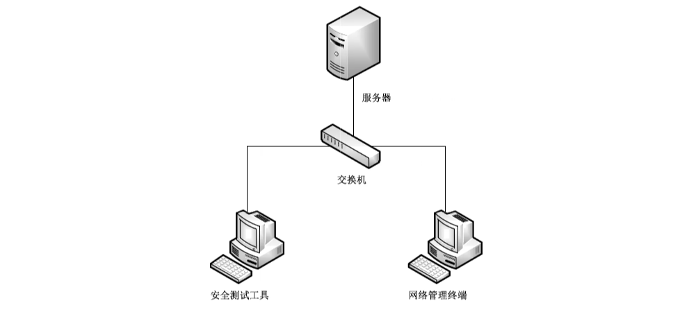

# GB/T 39680-2020 信息安全技术 服务器安全技术要求和测评准则

> 来源：[GB/T 39680-2020 国家标准详情](https://openstd.samr.gov.cn/bzgk/std/newGbInfo?hcno=8F2B83F0C3BCB52CB1A7E4E1719EFEE4)。
> 官方在线预览截图 SHA-256：73731af0687811f4c76245bb2dc0693af6be6b07ba00c0e862d99b402b62e3e6。
> 发布日期：2020-12-14；实施日期：2021-07-01。依据官方在线预览的 24 张页面图像逐页校核，保留图 1、表 B.1 及增强级黑体标记。已去除封面、目录、分页和页眉页脚；正式引用请核对官方原文。

## 前言

本标准按照 GB/T1.1—2009给出的规则起草。

本标准代替 GB/T 21028—2007《信息安全技术 服务器安全技术要求》和 GB/T 25063—2010《信息安全技术 服务器安全测评要求》。与 GB/T 21028—2007 和 GB/T 25063—2010 相比，主要技术变化如下：

- 整合了 GB/T 21028—2007 和 GB/T 25063—2010 两项标准内容，修改标准名称为《信息安全技术 服务器安全技术要求和测评准则》；

- 修改了服务器安全等级划分，由原来的五级调整为基本级和增强级（见第5章，GB/T 21028—2007的第5章和 GB/T 25063—2010的第4章～第8章）；

- 增加了安全功能要求中的固件安全技术要求和对应的测评准则（见5.1.3 和 6.2.3）；

- 增加了安全功能要求中的自身安全管理安全技术要求和对应的测评准则（见5.1.6 和 6.2.6）；

- 修改了操作系统安全技术要求（见附录 A，GB/T 21028—2007 的 5.1.1.2、5.2.1.2、5.3.1.2、5.4.1.2、5.5.1.2 和 GB/T 25063—2010 的 4.2、5.2、6.2、7.2）；

- 删除了数据库管理系统的具体安全要求和相应的测评要求（见GB/T 21028—2007 的 5.1.1.3、5.2.1.3、5.3.1.3、5.4.1.3、5.5.1.3 和 GB/T 25063—2010的 4.3、5.3、6.3、7.3）；

- 删除了应用系统的具体安全要求和相应的测评要求（见 GB/T 21028—2007 的 5.1.1.4、5.2.1.4、5.3.1.4、5.4.1.4、5.5.1.4 和 GB/T 25063—2010的 4.4、5.4、6.4、7.4）。

请注意本文件的某些内容可能涉及专利。本文件的发布机构不承担识别这些专利的责任。

本标准由全国信息安全标准化技术委员会（SAC/TC 260）提出并归口。

本标准起草单位：浪潮电子信息产业股份有限公司、联想（北京）有限公司、华为技术有限公司、新华三技术有限公司、中国信息通信研究院、蓝盾信息安全技术股份有限公司、中国网络安全审查技术与认证中心、中国电力科学研究院、公安部第三研究所、中国信息安全测评中心、中国电子技术标准化研究院、国家计算机网络与信息安全管理中心、曙光信息产业（北京）有限公司、苏州浪潮智能科技有限公司。

本标准主要起草人：张东、刘刚、李汝鑫、庞婷、万晓兰、张治兵、刘强、申永波、宋桂香、王恩东、赵江、宋好好、孙彦、毛军捷、李凌、严敏辉、葛小宇、杜克宏、雷鸣、王晖、倪平、陆臻、邓雨、张宝峰、孙亚飞、孔玉婷、白欣璐、曹柱、查丽、张天涵。

本标准所代替标准的历次版本发布情况为：

- GB/T 21028—2007；
- GB/T 25063—2010。

## 1 范围

本标准规定了服务器的安全技术要求和测评准则。

本标准适用于服务器的研制、生产、维护和测评。

## 2 规范性引用文件

下列文件对于本文件的应用是必不可少的。凡是注日期的引用文件，仅注日期的版本适用于本文件。凡是不注日期的引用文件，其最新版本（包括所有的修改单）适用于本文件。

- GB/T 9813.3—2017 计算机通用规范 第3部分：服务器

- GB/T 20272 信息安全技术 操作系统安全技术要求

- GB/T 25069 信息安全技术 术语

## 3 术语、定义和缩略语

### 3.1 术语和定义

GB/T 9813.3—2017、GB/T 20272 和 GB/T 25069界定的以及下列术语和定义适用于本文件。

#### 3.1.1 服务器 server

网络环境下为客户端计算机提供特定应用服务的计算机系统。

注1：计算机系统指服务器硬件系统，主要包含独立计算单元、存储单元、网络传输单元、监控管理单元、供电单元及驱动程序等。

注2：改写 GB/T 9813.3—2017.定义3.1。

#### 3.1.2 服务器引导固件 server boot firmware

负责服务器芯片组的初始化和配置，收集、汇总硬件资源信息并引导进入操作系统的程序。

#### 3.1.3 带外管理模块 out-of-band management module

通过专用物理通道对服务器进行控制管理和维护的独立管理单元。

> 注：例如 x86平台的基板管理控制器等。

#### 3.1.4 带外管理模块固件 out-of-band management module firmware

存在于带外管理模块中，用于实现其功能的程序。

#### 3.1.5 驱动程序 driver program

为操作系统或应用程序提供操作或控制服务器中特定设备的软件程序。

## 4 概述

服务器安全技术要求包括安全功能要求和安全保障要求。安全功能要求是对服务器应具备的安全功能提出的具体要求，包括设备标签、硬件接口安全、固件安全、驱动程序安全、可靠运行支持和自身安全管理等；安全保障要求是对服务器生命周期过程提出的具体要求，包括开发、指导性文档、生命周期支持、测试、脆弱性评定和维护等。根据安全技术要求，本标准给出了相应的安全测评准则。

根据服务器安全技术发展情况及应用需求，结合服务器安全功能的强弱，以及安全保障要求的高低，本标准将服务器安全技术要求划分为基本级和增强级。与基本级内容相比，增强级中要求有所增加的内容在正文中通过“黑体”表示。

服务器配置的操作系统宜考虑的安全要求参见附录 A，服务器安全技术要求分级表参见附录 B。

## 5 安全技术要求

### 5.1 安全功能要求

#### 5.1.1 设备标签

应在服务器显著位置设置标签，并标识服务器设备信息，包括设备型号、设备唯一识别码、生产厂商等。

#### 5.1.2 硬件接口安全

应对具备维护或调试功能的外部硬件接口采取安全控制措施，如采用专用工具、认证等。

#### 5.1.3 固件安全

##### 5.1.3.1 完整性保护

完整性保护功能应满足以下要求：

a） 对服务器引导固件、带外管理模块固件提供存储区完整性保护机制；

b） 访问服务器引导固件时，应先进行授权控制；

c） **基于可信根，在服务器启动时，对于服务器引导固件和主引导分区/初始化程序加载器进行完整性检测，并在检测到其完整性被破坏后，采取相应安全措施，如停止启动、自动恢复、报警等。**

##### 5.1.3.2 更新安全

更新安全功能应满足以下要求：

a） 提供服务器引导固件和带外管理模块固件更新的用户授权机制，应在获得用户授权后允许更新；

b） 服务器引导固件和带外管理模块固件更新时，应对其镜像文件的真实性和完整性进行校验，验证通过后允许更新；

c） **基于可信根，对待更新的服务器引导固件镜像文件进行校验，验证通过后允许更新。**

##### 5.1.3.3 固件恢复

固件恢复功能应满足以下要求：

a） 提供服务器引导固件和带外管理模块固件手动恢复机制；

b） **提供服务器引导固件和带外管理模块固件自动恢复机制，在检测到固件被破坏后，采取相应的自动恢复措施，如恢复备用固件、启用备用部件等。**

#### 5.1.4 驱动程序安全

服务器厂商提供的驱动程序应提供真实性和完整性验证机制。

#### 5.1.5 可靠运行支持

可靠运行支持应满足以下要求：

a） 对服务器的电源、风扇、硬盘等部分关键部件进行冗余设计，硬盘、风扇、电源支持热插拔功能；

b）对服务器部分关键部件的温度、电压，以及风扇转速等进行安全监控，当监测数值超过预先设定的阈值时应报警；

c） **提供服务器中央处理器（CPU）、硬盘、内存等部分关键部件的故障定位机制；**

d） **对服务器硬盘、内存等部分关键部件提供故障隔离机制，当某一部件出现故障时，服务器仍可提供计算服务。**

#### 5.1.6 自身安全管理

##### 5.1.6.1 身份标识与鉴别

**5.1.6.1.1** 带外管理模块固件中身份标识与鉴别功能应满足以下要求：

a） 对用户身份进行标识和鉴别，身份标识具有唯一性；

b） 提供默认口令修改机制；

c） 用户设置口令时，应对口令的复杂度进行验证，确保口令长度不少于8位，包含的字符类型不少于2种；

d） 具备鉴别失败处理功能，如限制连续的非法登录尝试次数措施等；

e） 具备登录连接超时自动退出机制；

f） 鉴别信息采取加密方式存储。

**5.1.6.1.2** 服务器引导固件中身份标识与鉴别功能应满足以下要求：

a） 提供默认口令修改机制；

b） 鉴别信息采取加密方式存储。

##### 5.1.6.2 授权与访问控制

**5.1.6.2.1** 带外管理模块固件中授权与访问控制安全功能应满足以下要求：

a） 依据最小权限的原则，为默认用户预置访问控制策略；

b） 在用户访问受控资源或功能时，依据设置的控制策略进行授权和访问控制；

c） 不存在未声明的功能接口。

**5.1.6.2.2** 服务器引导固件不应存在未声明的功能接口。

##### 5.1.6.3 安全审计

带外管理模块固件中安全审计功能应满足以下要求：

a） 审计事件至少包括：

1） 用户的登录和注销、系统开关机、用户创建、删除、口令修改；

2） **核心安全配置的变更，如访问控制策略、自动更新策略、安全监控策略等；**

3） **固件更新和恢复记录。**

b） 在审计记录中至少包括以下内容：事件发生日期和时间、用户名、事件描述（包括类型、操作结果）、IP 地址或主机名（采用远程管理方式时）。

c） 对审计记录进行保护，避免受到非预期的删除、修改或覆盖等。

d） 提供审计记录转存或输出功能。

##### 5.1.6.4 远程管理

带外管理模块固件中远程管理安全功能应满足以下要求：

a） 提供开放端口和服务列表，并明示其用途；

b） 采用安全的网络协议或接口对传输数据进行保护；

c） 对远程管理终端的接入进行限制，如设定网络地址范围等。

### 5.2 安全保障要求

#### 5.2.1 开发

##### 5.2.1.1 安全架构

开发者对服务器安全功能的安全架构描述应包含以下内容：

a） 与产品设计文档中对安全功能描述的范围和抽象描述级别相一致；

b） 描述服务器安全功能采取的自我保护、不可旁路的安全机制，保证服务器安全功能不被破坏和干扰。

##### 5.2.1.2 功能规范

开发者对服务器安全功能规范的描述应包含以下内容：

a） 功能规范到5.1 中安全功能要求的追溯关系；

b） 服务器所有安全功能接口的目的、使用方法及相关参数；

c） 安全功能实施过程中与安全功能接口执行相关的行为；

d） 安全功能接口执行时引起的直接错误消息。

> 注：安全功能接口是服务器向外部实体（如管理员、外部系统等）提供的操作界面。

##### 5.2.1.3 产品设计

开发者对服务器安全功能设计的描述应包含以下内容：

a） 根据子系统描述服务器安全功能的结构，并标识安全功能的所有子系统；

b） 描述安全功能子系统的行为，以及相互作用关系；

c） 提供安全子系统和安全功能接口间的对应关系。

#### 5.2.2 指导性文档

##### 5.2.2.1 操作用户指南

开发者为所有操作用户角色提供的操作用户指南应包含以下内容：

a） 描述每一种操作用户角色能访问的功能和特权，包括适当的警示信息等；

b） 对预留的外部硬件接口进行说明，包括接口名称、接口类型、功能等；

c） 描述服务器安全功能及接口的操作方法，包括配置参数的安全值等；

d） 标识和描述服务器运行的所有可能状态，包括操作导致的失败或者操作性错误等；

e） 描述实现 5.1 安全功能要求应执行的安全策略。

##### 5.2.2.2 准备程序

开发者对服务器准备程序的描述应包含以下内容：

a） 描述与开发者交付程序相一致的安全接收所交付服务器必需的所有步骤；

b）描述安全安装服务器及其运行环境支撑所必需的所有步骤。

#### 5.2.3 生命周期支持

##### 5.2.3.1 配置管理能力

开发者的配置管理能力应满足以下要求：

a） 为服务器引导固件和带外管理模块固件的不同版本提供唯一标识；

b）使用配置管理系统对组成服务器的所有配置项进行维护，并进行唯一标识；

c） 提供配置管理文档，配置管理文档应描述用于唯一标识配置项的方法；

d） **配置管理系统提供自动方式来支持服务器配置项的生成，通过自动化措施确保配置项仅接受授权变更；**

e） **配置管理文档包括一个配置管理计划，描述如何使用配置管理系统开发服务器，包括修改过的或新建的作为服务器组成部分的配置项。开发者实施的配置管理应与配置管理计划相一致。**

##### 5.2.3.2 配置管理范围

开发者建立并维护的服务器配置项列表应包含以下内容：

a） 服务器本身、服务器的组成部分和安全保障要求的评估证据；

b） 对于每一个安全功能相关的配置项，配置项列表应简要说明该配置项的开发者。

##### 5.2.3.3 交付程序

开发者应使用一定的交付程序交付服务器，交付过程的描述应包含为维护服务器安全性所必需的所有程序。

##### 5.2.3.4 开发安全

**开发者应对服务器开发环境提供必要的安全措施，从物理的、程序的、人员的和其他方面采取必要的安全措施，确保服务器设计和实现的保密性和完整性。**

##### 5.2.3.5 生命周期定义

**开发者应为服务器的开发和维护提供必要控制，并提供生命周期定义文档，该文档用于描述开发和维护服务器的模型。**

#### 5.2.4 测试

##### 5.2.4.1 测试覆盖

开发者对测试覆盖的分析和描述应包含以下内容：

a） 表明测试文档中所标识的测试与功能规范中所描述的服务器安全功能接口之间的对应性；

b） **表明a）中的对应性是完备的，并证实功能规范中的所有安全功能接口均进行了测试。**

##### 5.2.4.2 测试深度

**开发者对测试深度的分析和描述应包含以下内容：**

a） **证实测试文档中的测试与服务器设计中的安全功能子系统的一致性；**

b） **证实服务器设计中的所有安全功能子系统进行了测试。**

##### 5.2.4.3 功能测试

开发者应对服务器安全功能进行测试，并将结果文档化。功能测试文档应包含以下内容：

a） 测试计划，标识要执行的测试，并描述执行每个测试的方案，这些方案包括对于其他测试结果的任何顺序依赖性等；

b） 预期测试结果，表明测试成功后的预期输出；

c） 实际测试结果和预期测试结果的对比一致性。

##### 5.2.4.4 独立测试

开发者应提供一组与其安全功能测试时使用的同等资源，以用于安全功能的抽样测试。

##### 5.2.4.5 安全性测试

**开发者应对服务器引导固件、带外管理模块固件的安全性进行测试，并将结果文档化。安全性测试文档至少应包括测试计划，已识别的严重安全缺陷列表及修复情况等。**

#### 5.2.5 脆弱性评定

开发者应基于已标识的潜在脆弱性对服务器进行脆弱性评定，以确保服务器能够抵抗以下攻击行为：

a） 具有基本攻击潜力的攻击者的攻击；

b） **具有中等攻击潜力的攻击者的攻击。**

#### 5.2.6 维护

开发者在服务器维护阶段应满足以下要求：

a） 建立并执行服务器安全缺陷、漏洞的应急响应机制和流程；

b） 发现服务器存在安全缺陷、漏洞时，应按照既定程序及时采取修复或替代方案等补救措施。

## 6 安全测评准则

### 6.1 测试环境

服务器安全测试环境参见图1，服务器为测评对象，并应部署与其兼容的操作系统以支撑测试实施；网络管理终端主要用于服务器固件安全、可靠运行支持、安全管理等测评；安全测试工具主要用于在测试实施过程中，为服务器安全功能和安全性的测评提供支撑，常见的安全测试工具包含网络抓包工具、漏洞扫描工具、渗透测试工具等。

### 6.2 安全功能要求测评

#### 6.2.1 设备标签

设备标签的测评方法如下：

a） 测评方法：

1） 核查服务器设备标签粘贴的位置；

2） 核查设备标签标识的内容。

b） 预期结果：

1） 服务器设备标签粘贴在机箱显著位置，且用户方便查看；

2） 服务器设备标签中包括了设备型号、设备唯一识别码、生产厂商等信息。

c） 结果判定：实际测评结果与相关预期结果一致则判定为符合，其他情况判定为不符合。

#### 6.2.2 硬件接口安全

硬件接口安全的测评方法如下：

a） 测评方法：核查服务器具备维护或调试功能的外部硬件接口是否采取安全控制措施（如采用专用工具、认证等），并验证其是否有效。

b） 预期结果：具备维护或调试功能的外部硬件接口采取了安全控制措施，且相关功能有效。

c） 结果判定：实际测评结果与相关预期结果一致则判定为符合，其他情况判定为不符合。

#### 6.2.3 固件安全

##### 6.2.3.1 完整性保护

完整性保护的测评方法如下：

a） 测评方法：

1） 启用服务器引导固件、带外管理模块固件存储区保护机制，验证其完整性保护机制是否有效；

2） 在带外管理模块固件访问服务器引导固件时，验证其授权控制功能是否有效；

3） **配置可信策略，启动服务器，验证是否通过可信根对服务器引导固件和主引导分区/初始化程序加载器完整性进行了检测；**

4） **模拟服务器引导固件和主引导分区/初始化程序加载器完整性受到破坏，验证服务器启动后相应的安全措施（如停止启动、自动恢复、报警等）是否有效。**

b） 预期结果：

1） 服务器引导固件、带外管理模块固件的存储区提供了有效的完整性保护机制；

2） 带外管理模块固件访问服务器引导固件时采取了访问控制机制，可防止非授权的访问；

3） **服务器采用了可信根机制，并在启动时对服务器引导固件和主引导分区/初始化程序加载器的完整性进行了检测；**

4） **当检测到服务器引导固件和主引导分区/初始化程序加载器完整性被破坏后，可根据提供/配置的安全措施进行响应。**

c） 结果判定：实际测评结果与相关预期结果一致则判定为符合，其他情况判定为不符合。

##### 6.2.3.2 更新安全

更新安全的测评方法如下：

a） 测评方法：

1） 核查服务器引导固件和带外管理模块固件更新操作是否提供用户授权机制，如更新确认按钮等，并验证其是否有效；

2） 核查服务器引导固件和带外管理模块固件更新是否具备对其镜像文件进行真实性和完整性进行校验的安全机制；

3） 分别伪造服务器引导固件和带外管理模块固件的更新镜像文件，验证更新机制对其真实性校验是否有效；

4） 分别模拟服务器引导固件和带外管理模块固件的更新镜像文件受到破坏时，验证更新机制对其完整性校验是否有效；

5） **配置可信策略，执行服务器引导固件更新操作，验证是否基于可信根对待更新服务器引导固件镜像文件校验成功后才能执行更新操作。**

b） 预期结果：

1） 服务器引导固件和带外管理模块固件的更新操作提供了用户授权，并在用户授权后才能执行更新操作；

2） 服务器引导固件和带外管理模块固件在更新时提供了对镜像文件的真实性和完整性校验机制；

3） 服务器引导固件和带外管理模块固件的更新机制能识别伪造的镜像文件，并提示更新失败；

4） 服务器引导固件和带外管理模块固件的更新机制能识别到破坏的镜像文件，并提示更新失败；

5） **服务器采用了可信根机制，并通过可信根对服务器引导固件待更新镜像文件校验通过后才能执行更新操作。**

c） 结果判定：实际测评结果与相关预期结果一致则判定为符合，其他情况判定为不符合。

##### 6.2.3.3 固件恢复

固件恢复的测评方法如下：

a） 测评方法：

1） 对服务器引导固件和带外管理模块固件分别进行手动恢复操作，验证其是否能将备份固件进行成功恢复；

2） **分别配置服务器引导固件和带外管理模块固件自动恢复策略，触发固件自动恢复条件，验证其自动恢复功能是否有效。**

b） 预期结果：

1） 服务器引导固件和带外管理模块固件均可通过手动恢复机制进行固件恢复；

2） **服务器启动时，当检测到服务器引导固件和带外管理模块固件被破坏或不可用后，可按预期方式进行自动恢复。**

c） 结果判定：实际测评结果与相关预期结果一致则判定为符合，其他情况判定为不符合。

#### 6.2.4 驱动程序安全

驱动程序安全的测评方法如下：

a） 测评方法：通过伪造或模拟破坏驱动程序的方式，验证其安全机制是否有效。

b） 预期结果：服务器厂商提供的驱动程序提供了真实性和完整性验证机制。

c） 结果判定：实际测评结果与相关预期结果一致则判定为符合，其他情况判定为不符合。

#### 6.2.5 可靠运行支持

可靠运行支持的测评方法如下：

a） 测评方法：

1） 核查服务器是否对电源、风扇、硬盘等部件进行了冗余设计；

2） 通过故障引入操作的方式，对电源、风扇、硬盘等进行热插拔操作，验证其是否有效；

3） 登录相关监控管理界面，查看部分关键部件的温度、电压，以及风扇转速等实时监控数据；

4） 针对3）中各项监控对象，配置报警阈值，并通过模拟异常状态使各监控数据超过阈值，验证报警机制是否有效；

5） **分别模拟服务器CPU、硬盘、内存出现故障，验证服务器故障定位功能是否有效；**

6） **分别模拟服务器硬盘、内存出现故障，验证部件故障隔离机制生效后，服务器运行状态是否正常。**

b） 预期结果：

1） 服务器电源、风扇、硬盘等采用了冗余设计；

2） 服务器电源、风扇、硬盘等进行热插拔操作后，服务器仍能正常运行；

3） 服务器提供监控管理界面，可查看到部分关键部件的温度、电压，以及风扇转速等实时监控数据，且监控数据真实有效；

4） 服务器对所监测数值超过阈值时，提供报警功能，如声、光、网络报文、日志记录等；

5） **服务器可对出现故障的CPU、硬盘、内存进行提示和定位，如通过声、光、日志记录等；**

6） **服务器对硬盘、内存等部件提供了故障隔离机制，并在部件冗余配置情况下，可有效隔离出现故障的部件，且服务器仍能正常运行。**

c） 结果判定：实际测评结果与相关预期结果一致则判定为符合，其他情况判定为不符合。

#### 6.2.6 自身安全管理

##### 6.2.6.1 身份标识与鉴别

身份标识与鉴别的测评方法如下：

a） 测评方法：

1） 登录带外管理模块固件，查看已有的用户列表，并尝试创建同名用户；

2） 尝试使用合法和非法用户分别登录带外管理模块固件，验证其身份鉴别功能是否有效；

3） 尝试修改服务器引导固件和带外管理模块固件中用户默认口令，验证是否可正常修改口令；

4） 在带外管理模块中通过创建新用户或修改用户口令，验证是否对口令的复杂度进行了校验；

5） 尝试使用错误的鉴别信息登录，验证带外管理模块固件鉴别失败处理功能是否有效；

6） 登录带外管理模块固件，配置会话超时时间，验证超时后是否正常退出会话；

7） 核查服务器引导固件和带外管理模块固件中鉴别信息存储方式。

b） 预期结果：

1） 无法创建同名用户，身份标识可保证唯一性；

2） 合法用户可正常登录，非法用户无法登录；

3） 可正常修改默认口令；

4） 创建新用户时自动生成或设置的口令，以及修改用户口令时，均对口令复杂度进行了校验或满足复杂度的要求，即口令长度不少于8位，包含的字符类型不少于2种；

5） 当达到非法登录尝试次数时，采用了安全措施，如锁定账号或限制账号登录时限等；

6） 当登录会话超时后，系统将自动退出会话并清除登录会话信息；

7） 服务器引导固件和带外管理模块固件中鉴别信息采用了加密存储方式。

c） 结果判定：实际测评结果与相关预期结果一致则判定为符合，其他情况判定为不符合。

##### 6.2.6.2 授权与访问控制

授权与访问控制的测评方法如下：

a） 测评方法：

1） 以默认用户登录带外管理模块固件，核查各用户操作权限范围与预置访问控制策略是否一致，并满足了最小权限原则；

2） 配置带外管理模块固件的访问控制策略，验证用户授权与访问控制策略是否有效；

3） 通过人工分析、渗透测试等方式，验证服务器引导固件和带外管理模块固件中是否存在未声明的功能接口。

b） 预期结果：

1） 默认用户权限满足最小权限原则，与预置访问控制策略一致；

2） 用户的权限范围与配置的访问控制策略相一致；

3） 未发现未声明的功能接口。

c） 结果判定：实际测评结果与相关预期结果一致则判定为符合，其他情况判定为不符合。

##### 6.2.6.3 安全审计

安全审计的测评方法如下：

a） 测评方法：

1） 在带外管理模块固件上分别执行登录、注销、系统开关机、用户创建、删除、口令修改等操作，查看审计日志是否记录其行为；

2） **在带外管理模块固件上进行核心安全配置变更操作，如访问控制策略、自动更新策略、安全监控策略等，查看审计日志是否记录其行为；**

3） **对服务器引导固件和带外管理模块固件进行固件更新和恢复操作，查看审计日志是否记录其行为；**

4） 查看 1）、2）、3）中审计记录的详细信息；

5） 采用非授权用户访问、选择性删除记录、模拟产生大量日志等方式，验证审计记录保护措施是否可有效防止非预期的删除、修改或覆盖等；

6） 登录服务器带外管理模块，验证审计记录转存或输出功能是否有效。

b） 预期结果：

1） 在服务器带外管理模块上进行的登录、注销、系统开关机、用户创建、删除、口令修改等操作行为均记录了其行为，并在审计记录中可查看相关信息；

2） **在带外管理模块上进行的核心安全配置变更操作均记录了其行为，并在审计记录中可查看相关信息；**

3） **服务器引导固件和带外管理模块固件的更新和恢复操作均记录了其行为，并在审计记录中可查看相关信息；**

4） 审计日志事件包含发生日期和时间、用户名、事件描述（包括类型、操作结果）、IP地址或主机名（采用远程管理方式时）等；

5） 具备审计记录保护措施，可避免非预期的删除、修改或覆盖等；

6） 可转存或输出完整的审计记录，如备份，或输出到其他日志系统等。

c） 结果判定：实际测评结果与相关预期结果一致则判定为符合，其他情况判定为不符合。

##### 6.2.6.4 远程管理

远程管理的测评方法如下：

a） 测评方法：

1） 通过相关文档，核查服务器带外管理模块开放端口和服务列表，以及其用途的描述是否完整、正确；

2）通过端口扫描、查看服务进程等技术手段，核查是否存在其他未声明的开放端口和服务；

3） 通过嗅探等技术手段抓取网络传输数据包，核查网络传输数据是否为密文；

4） 配置远程管理终端接入限制策略，通过不同的IP地址或IP 段的终端远程访问带外管理模块，验证其限制策略是否有效。

b） 预期结果：

1） 对服务器带外管理模块开放的所有端口和服务列表，以及其用途进行了完整、正确的说明；

2） 未发现未声明的端口和服务；

3） 采用了安全的网络协议，并对网络传输数据进行了加密处理；

4） 可对远程终端的接入进行限制，只有合法远程终端才允许访问。

c） 结果判定：实际测评结果与相关预期结果一致则判定为符合，其他情况判定为不符合。

### 6.3 安全保障要求测评

#### 6.3.1 开发

##### 6.3.1.1 安全架构

安全架构的测评方法如下：

a） 测评方法：核查开发者提供的安全架构证据，并核查开发者提供的信息是否满足证据的内容和形式的所有要求：

1） 与服务器设计文档中对安全功能的描述范围和抽象描述级别是否相一致；

2） 是否描述了服务器安全功能采取的自我保护、不可旁路的安全机制，保证服务器安全功能不被破坏和干扰。

b） 预期结果：开发者提供的信息满足 5.2.1.1 中所述要求。

c） 结果判定：实际测评结果与相关预期结果一致则判定为符合，其他情况判定为不符合。

##### 6.3.1.2 功能规范

功能规范的测评方法如下：

a） 测评方法：核查开发者提供的功能规范证据，并核查开发者提供的信息是否满足证据的内容和形式的所有要求：

1） 是否清晰描述了与5.1 中定义的安全功能要求的关系；

2） 是否标识和描述了服务器所有安全功能接口的目的、使用方法及相关参数；

3） 描述安全功能实施过程中，是否描述了与安全功能接口执行相关的行为；

4） 是否描述了可能由安全功能接口的执行而引起的所有直接错误消息。

b） 预期结果：开发者提供的信息满足5.2.1.2中所述要求。

c） 结果判定：实际测评结果与相关预期结果一致则判定为符合，其他情况判定为不符合。

##### 6.3.1.3 产品设计

产品设计的测评方法如下：

a） 测试方法：核查开发者提供的产品设计证据，并核查开发者提供的信息是否满足证据的内容和形式的所有要求：

1） 是否根据子系统描述了服务器结构，是否标识和描述了服务器安全功能的所有子系统；

2） 是否描述了安全功能所有子系统的行为，以及相互作用关系；

3） 提供的对应关系是否能够证实安全子系统和安全功能接口的对应关系。

b） 预期结果：开发者提供的信息满足 5.2.1.3 中所述要求。

c） 结果判定：实际测评结果与相关预期结果一致则判定为符合，其他情况判定为不符合。

#### 6.3.2 指导性文档

##### 6.3.2.1 操作用户指南

操作用户指南的测评方法：

a） 测评方法：核查开发者提供的操作用户指南证据，并核查开发者提供的信息是否满足证据的内容和形式的所有要求：

1） 是否描述了用户能够访问的功能和特权，包含适当的警示信息等；

2） 是否描述了对预留的外部硬件接口说明，说明信息至少包括接口名称、接口类型、功能等；

3） 是否描述了服务器安全功能及接口的用户操作方法，包括配置参数的安全值等；

4） 是否标识和描述了服务器运行的所有可能状态，包括操作导致的失败或者操作性错误等；

5） 是否描述了保障服务器运行环境安全要求必须执行的安全策略。

b） 预期结果：开发者提供的信息满足 5.2.2.1 中所述要求。

c） 结果判定：实际测评结果与相关预期结果一致则判定为符合，其他情况判定为不符合。

##### 6.3.2.2 准备程序

准备程序的测评方法如下：

a） 测评方法：核查开发者提供的准备程序证据，并核查开发者提供的信息是否满足证据的内容和形式的所有要求：

1） 是否描述了与开发者交付程序相一致的安全接收所交付服务器必需的所有步骤；

2） 是否描述安全安装服务器及其运行环境必需的所有步骤。

b） 预期结果：开发者提供的信息满足 5.2.2.2中所述要求。

c） 结果判定：实际测评结果与相关预期结果一致则判定为符合，其他情况判定为不符合。

#### 6.3.3 生命周期支持

##### 6.3.3.1 配置管理能力

配置管理能力的测评方法如下：

a） 测评方法：核查开发者提供的配置管理能力证据，并核查开发者提供的信息是否满足证据的内容和形式的所有要求：

1） 是否为不同版本的服务器引导固件和带外管理模块固件提供了唯一的标识；

2） 配置管理系统是否对所有的配置项进行唯一的标识，并对配置项进行维护；

3） 配置管理文档是否描述了对配置项进行唯一标识的方法；

4） **是否能通过自动化配置管理系统支持服务器配置项的生成，是否仅通过自动化措施对配置项进行授权变更；**

5） **配置管理计划是否描述了用来接受修改过的或新建的作为服务器组成部分的配置项的程序；**

6） **配置管理计划是否描述了如何使用配置管理系统开发服务器，现场核查活动是否与计划一致。**

b） 预期结果：开发者提供的信息和现场活动证据内容满足5.2.3.1中所述要求。

c） 结果判定：实际测评结果与相关预期结果一致则判定为符合，其他情况判定为不符合。

##### 6.3.3.2 配置管理范围

配置管理范围测评方法如下：

a） 测试方法：核查开发者提供的配置管理范围证据，并核查开发者提供的信息是否满足证据的内容和形式的所有要求：

1） 是否包括了服务器本身、服务器的组成部分和安全保障要求的评估证据；

2） 是否对所有安全功能相关的配置项的开发者进行简要说明。

b） 预期结果：开发者提供的信息满足 5.2.3.2中所述要求。

c） 结果判定：实际测评结果与相关预期结果一致则判定为符合，其他情况判定为不符合。

##### 6.3.3.3 交付程序

交付程序的测评方法如下：

a） 测评方法：核查开发者提供的交付程序证据，并核查开发者提供的信息是否满足证据的内容和形式的所有要求：

1） 是否使用一定的交付程序交付服务器；

2） 是否使用文档描述交付过程，文档中是否包含为维护服务器安全性所必需的所有程序。

b） 预期结果：开发者提供的信息和现场活动证据内容满足5.2.3.3中所述要求。

c） 结果判定：实际测评结果与相关预期结果一致则判定为符合，其他情况判定为不符合。

##### 6.3.3.4 开发安全

**开发安全的测评方法如下：**

a） **测评方法：核查开发者提供的开发安全证据，并核查开发者提供的信息是否满足证据的内容和形式的所有要求：**

1） **开发安全文档是否描述了在开发环境中，为保护系统设计和实现的保密性和完整性所必需的所有物理的、程序的、人员的和其他方面的安全措施；**

2） **核查产品的开发环境，开发者是否使用了物理的、程序的、人员的和其他方面的安全措施保证产品设计和实现的保密性和完整性，这些安全措施是否得到了有效的执行。**

b） **预期结果：开发者提供的信息和现场活动证据内容满足 5.2.3.4 中所述要求。**

c） **结果判定：实际测评结果与相关预期结果一致则判定为符合，其他情况判定为不符合。**

##### 6.3.3.5 生命周期定义

**生命周期定义的测评方法如下：**

a） **测评方法：核查开发者提供的生命周期定义证据，并核查开发者提供的信息是否满足证据的内容和形式的所有要求：**

1） **是否使用生命周期模型对服务器的开发和维护进行了必要控制；**

2） **生命周期定义文档是否描述了用于开发和维护服务器的模型。**

b） **预期结果：开发者提供的信息应和现场活动证据内容满足 5.2.3.5中所述要求。**

c） **结果判定：实际测评结果与相关预期结果一致则判定为符合，其他情况判定为不符合。**

#### 6.3.4 测试

##### 6.3.4.1 测试覆盖

测试覆盖的测评方法如下：

a） 测评方法：核查开发者提供的测试覆盖证据，并核查开发者提供的信息是否满足证据的内容和形式的所有要求：

1） 核查开发者提供的测试覆盖文档，在测试覆盖证据中，是否表明测试文档中所标识的测试与功能规范中所描述的服务器的安全功能是对应的；

2） **核查开发者提供的测试覆盖分析结果，是否表明功能规范中的所有安全功能接口都进行了测试。**

b） 预期结果：开发者提供的信息满足 5.2.4.1中所述要求。

c） 结果判定：实际测评结果与相关预期结果一致则判定为符合，其他情况判定为不符合。

##### 6.3.4.2 测试深度

**测试深度的测评方法如下：**

a） **测评方法：核查开发者提供的测试深度证据，并核查开发者提供的信息是否满足证据的内容和形式的所有要求：**

1） **核查开发者提供的测试深度分析，是否表明测试文档中对安全功能的测试与服务器设计中的安全功能子系统的一致性；**

2） **是否能够证实所有安全功能子系统已进行了测试。**

b） **预期结果：开发者提供的信息满足 5.2.4.2中所述要求。**

c） **结果判定：实际测评结果与相关预期结果一致则判定为符合，其他情况判定为不符合。**

##### 6.3.4.3 功能测试

功能测试的测评方法如下：

a） 测评方法：核查开发者提供的功能测试证据，并核查开发者提供的信息是否满足证据的内容和形式的所有要求：

1） 核查开发者提供的测试文档，是否包括了测试计划、预期测试结果和实际测试结果；

2） 核查测试计划是否标识了要执行的测试，是否描述了每个安全功能的测试方案以及测试方案对其他测试结果的依赖关系；

3） 核查预期的测试结果是否表明了测试成功后的预期输出；

4） 核查实际的测试结果是否表明了每个被测试的安全功能能按照规定进行运作。

b） 预期结果：开发者提供的信息满足 5.2.4.3中所述要求。

c） 结果判定：实际测评结果与相关预期结果一致则判定为符合，其他情况判定为不符合。

##### 6.3.4.4 独立测试

独立测试的测评方法如下：

a） 测评方法：核查开发者提供的测试集合是否与其自测系统功能时使用的测试集合相一致，以用于安全功能的抽样测试，并核查开发者提供的资源是否满足内容形式的所有要求。

b） 预期结果：开发者提供的信息满足5.2.4.4中所述要求。

c） 结果判定：实际测评结果与相关预期结果一致则判定为符合，其他情况判定不符合。

##### 6.3.4.5 安全性测试

**安全性测试的测评方法如下：**

a） **测试实施包括：核查开发者提供的安全性测试证据，并核查开发者提供的信息是否满足证据的内容和形式的所有要求：**

1） **核查开发者是否使用文档描述了服务器引导固件、带外管理模块固件安全性测试；**

2） **核查安全性测试文档是否描述了针对已识别的严重安全缺陷列表及修复情况。**

b） **预期结果：开发者提供的信息满足5.2.4.5中所述要求。**

c） **结果判定：实际测评结果与相关预期结果一致则判定为符合，其他情况判定为不符合。**

#### 6.3.5 脆弱性评定

脆弱性评定的测评方法如下：

a） 测评方法：

1） 从攻击者可能破坏安全策略的途径出发，按照安全机制定义的安全强度级别对服务器潜在威胁进行脆弱性分析；

2） 通过渗透测试判断服务器是否能抵抗基本攻击潜力的攻击者的攻击；

3） **通过渗透测试判断服务器是否能抵抗中等攻击潜力的攻击者的攻击。**

b） 预期结果：

1） 渗透测试结果应表明服务器能够抵抗基本攻击潜力的攻击者的攻击；

2） **渗透测试结果应表明服务器能够抵抗中等攻击潜力的攻击者的攻击。**

c） 结果判定：实际测评结果与相关预期结果一致则判定为符合，其他情况判定为不符合。

#### 6.3.6 维护

维护的测评方法如下：

a） 测评方法：核查开发者提供的维护证据，并核查开发者提供的信息是否满足证据的内容和形式的所有要求：

1） 核查开发者提供的维护规范及维护过程证据，是否包含了服务器安全缺陷、漏洞应急响应相关的流程规范；

2） 现场核查开发者发现服务器存在的安全缺陷、漏洞时，是否按照既定程序及时采取修复或替代方案等补救措施。

b） 预期结果：开发者提供的信息和现场活动证据内容满足 5.2.6 中所述要求。

c） 结果判定：实际测评结果与相关预期结果一致则判定为符合，其他情况判定为不符合。

## 附录 A（资料性附录）服务器操作系统安全要求

操作系统安全性配置不当将直接影响服务器硬件系统安全效能。因此，为减小对服务器硬件系统安全效能的影响，用户在配置服务器操作系统时，宜从以下几方面考虑操作系统安全要求：

a） 应结合自身业务需求和相关安全规范要求，操作系统宜符合GB/T 20272 相关要求；

b） 对于增强级服务器，操作系统宜符合 GB/T 20272 第三级要求；

c） 对于增强级服务器，操作系统宜支持部件隔离机制，以支撑 5.1.5 d）的故障隔离机制发挥效能；

d） 对于增强级服务器，操作系统宜基于可信根，对操作系统引导程序、内核程序、关键系统服务及配置进行可信验证；

e） 当通过操作系统对服务器引导固件和带外管理模块固件进行更新时，宜采取相应的安全措施，防止非授权更新操作，并对固件的真实性和完整性进行验证；

f） 当通过操作系统对服务器引导固件和带外管理模块固件进行安全配置时，宜首先进行身份鉴别。

## 附录 B（资料性附录）服务器安全技术要求分级表

表 B.1 以表格形式列举了服务器两个等级相关的技术要求。

**表 B.1 服务器安全技术要求等级划分**

| 要求类别 | 安全技术要求 | 子项 | 基本级 | 增强级 |
| --- | --- | --- | --- | --- |
| 安全功能要求 | 设备标签 |  | 5.1.1 | 5.1.1 |
| 安全功能要求 | 硬件接口安全 |  | 5.1.2 | 5.1.2 |
| 安全功能要求 | 固件安全 | 完整性保护 | 5.1.3.1 a）、b） | 5.1.3.1 |
| 安全功能要求 | 固件安全 | 更新安全 | 5.1.3.2 a）、b） | 5.1.3.2 |
| 安全功能要求 | 固件安全 | 固件恢复 | 5.1.3.3 a） | 5.1.3.3 |
| 安全功能要求 | 驱动程序安全 |  | 5.1.4 | 5.1.4 |
| 安全功能要求 | 可靠运行支持 |  | 5.1.5 a）、b） | 5.1.5 |
| 安全功能要求 | 安全管理 | 身份标识与鉴别 | 5.1.6.1 | 5.1.6.1 |
| 安全功能要求 | 安全管理 | 授权与访问控制 | 5.1.6.2 | 5.1.6.2 |
| 安全功能要求 | 安全管理 | 安全审计 | 5.1.6.3 a）1）、b）～d） | 5.1.6.3 |
| 安全功能要求 | 安全管理 | 远程管理 | 5.1.6.4 | 5.1.6.4 |
| 安全保障要求 | 开发 | 安全架构 | 5.2.1.1 | 5.2.1.1 |
| 安全保障要求 | 开发 | 功能规范 | 5.2.1.2 | 5.2.1.2 |
| 安全保障要求 | 开发 | 产品设计 | 5.2.1.3 | 5.2.1.3 |
| 安全保障要求 | 指导性文档 | 操作用户指南 | 5.2.2.1 | 5.2.2.1 |
| 安全保障要求 | 指导性文档 | 准备程序 | 5.2.2.2 | 5.2.2.2 |
| 安全保障要求 | 生命周期支持 | 配置管理能力 | 5.2.3.1 a）～c） | 5.2.3.1 |
| 安全保障要求 | 生命周期支持 | 配置管理范围 | 5.2.3.2 | 5.2.3.2 |
| 安全保障要求 | 生命周期支持 | 交付程序 | 5.2.3.3 | 5.2.3.3 |
| 安全保障要求 | 生命周期支持 | 开发安全 | — | 5.2.3.4 |
| 安全保障要求 | 生命周期支持 | 生命周期定义 | — | 5.2.3.5 |
| 安全保障要求 | 测试 | 测试覆盖 | 5.2.4.1 a） | 5.2.4.1 |
| 安全保障要求 | 测试 | 测试深度 | — | 5.2.4.2 |
| 安全保障要求 | 测试 | 功能测试 | 5.2.4.3 | 5.2.4.3 |
| 安全保障要求 | 测试 | 独立测试 | 5.2.4.4 | 5.2.4.4 |
| 安全保障要求 | 测试 | 安全性测试 | — | 5.2.4.5 |
| 安全保障要求 | 脆弱性评定 |  | 5.2.5 a） | 5.2.5 |
| 安全保障要求 | 维护 |  | 5.2.6 | 5.2.6 |

> 注：“—”表示不适用。

## 参考文献

- ［1］ GB/T 18336（所有部分）信息技术 安全技术 信息技术安全性评估准则

- ［2］ GB/T 22239—2019 信息安全技术 网络安全等级保护基本要求

- ［3］ GB/T 36639—2018 信息安全技术 可信计算规范 服务器可信支撑平台
