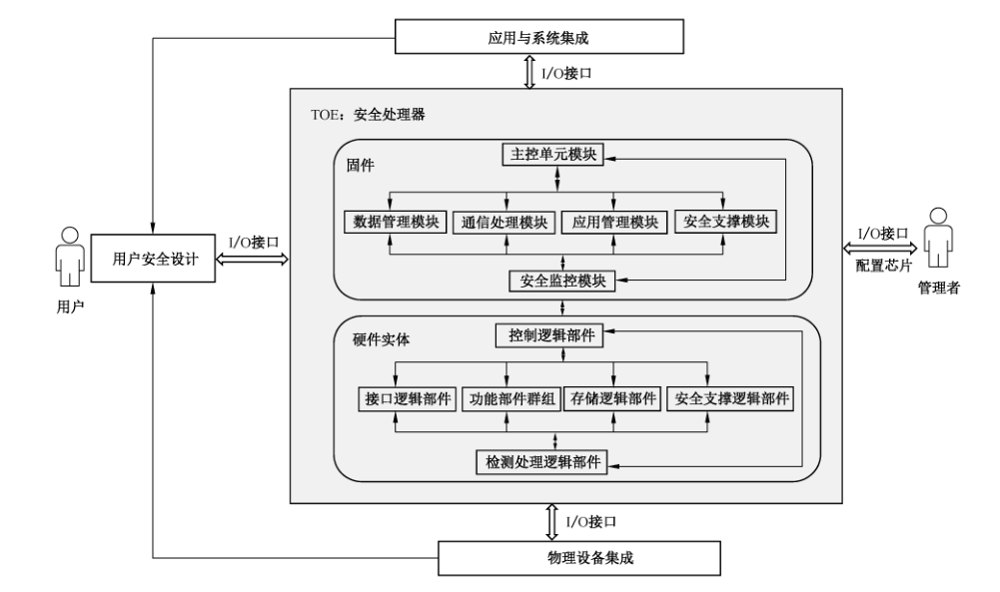
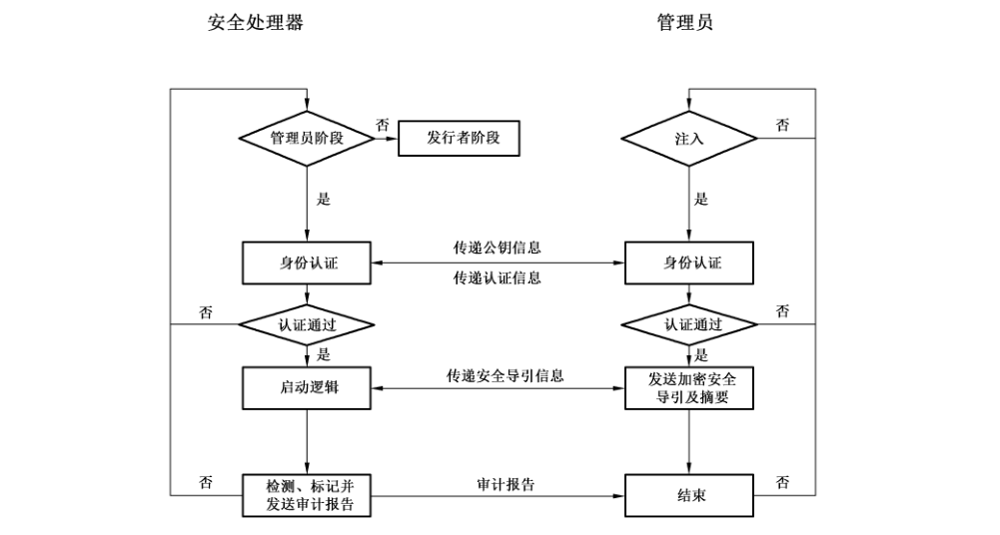
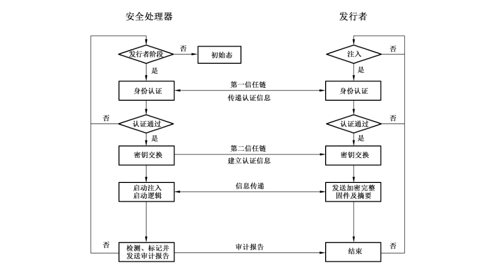
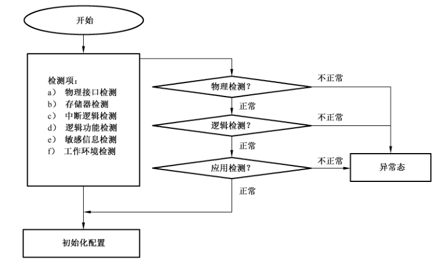
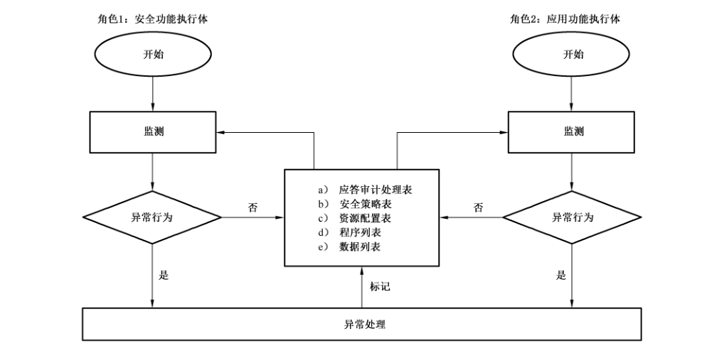

# GB/T 40653-2021 信息安全技术 安全处理器技术要求

> 来源：[GB/T 40653-2021 国家标准详情](https://openstd.samr.gov.cn/bzgk/std/newGbInfo?hcno=CF20C3EDD414E7DC8B198C2178EDCC9C)；封面发布日期：2021-10-11；实施日期：2022-05-01。
> PDF SHA-256：427435be4b20c81712c30a9359f1c8525101c975e1e1f78d96aa18c44f82307d。
> 依据官方 PDF 全部 58 页的页面图像转写与校核；省略封面、目录、页眉、页脚和分页，合并跨页段落及表格。保留原条款编号、表格适用标记和原文写法，五幅结构及流程图保留为原页图像。

## 前言

本文件按照 GB/T 1.1—2020《标准化工作导则 第1部分：标准化文件的结构和起草规则》的规定起草。

请注意本文件的某些内容可能涉及专利。本文件的发布机构不承担识别专利的责任。

本文件由全国信息安全标准化技术委员会（SAC/TC 260）提出并归口。

本文件起草单位：北京多思科技工业园股份有限公司、中国信息安全测评中心、国家密码管理局商用密码检测中心、华北电力大学、公安部第三研究所、网神信息技术（北京）股份有限公司、中国电子信息产业发展研究院、杭州华澜微电子股份有限公司、杭州安恒信息技术股份有限公司、中国人民解放军战略支援部队信息工程大学、珠海复旦创新研究院、北京多思安全芯片科技有限公司。

本文件主要起草人：刘大力、李大为、罗鹏、张翀斌、王州府、高金萍、石竑松、杨永生、曹春春、夏宏、王闯、韦安垒、杨元原、柳会鹏、李虹阳、魏晓伟、王辉、宋克、王俊宇、高艳芳、周斌。

## 1 范围

本文件规定了安全处理器的安全功能要求和安全保障要求。

本文件适用于安全处理器设计、生产和应用。

## 2 规范性引用文件

下列文件中的内容通过文中规范性引用而构成本文件中必不可少的条款。其中，注日期的引用文件，仅该日期对应的版本适用于本文件，不注日期的引用文件，其最新版本（包括所有的修改单）适用于本文件。

- GB/T 18336（所有部分）信息技术 安全技术 信息技术安全评估准则

- GB/T 25069 信息安全技术 术语

- GB/T 32915—2016 信息安全技术 二元序列随机性检测方法

## 3 术语和定义

GB/T 25069 界定的以及下列术语和定义适用于本文件。

### 3.1 安全处理器 security processor

由固件和硬件实体组成，具备物理防护、逻辑防护、应用防护能力，能够达到一定安全强度和安全等级的处理器。

> 注：安全处理器实现技术包括密码技术、物理防护技术、数据编码技术、可重组逻辑技术等。

### 3.2 物理防护 physical protection

采用攻击防护的设计、攻击检测的方法、利用检测与处理功能，监测处理器工作环境，并能支持异常行为应答审计处理，阻止物理威胁的安全能力。

> 注：攻击防护包括掩膜、封装、物理接口的安全保护设计等；攻击检测包括光，电磁，逻辑断路、短路、旁路检测等；工作环境包括温度、频率、电压测试等；应答审计处理包括通知、标记、应答处理、审计处理等措施。

### 3.3 应用防护 application protection

链接物理防护的功能，具有对程序和数据的保护能力、运行态检测和监控能力、资源调度和配置控制能力、安全通信能力，并能支持异常行为应答审计处理，阻止应用威胁的安全能力。

> 注：保护能力包括利用同态计算、密码技术应用对程序和数据处理能力，资源调度和配置控制包括安全存储、控制管理、安全配置等措施，安全通信包括加密传输、可信根传递的运用、身份认证等措施。

### 3.4 逻辑防护 logic protection

依据物理防护和应用防护的安全功能，通过资源配置、操作配置、运行态控制等方式，调整安全策略，使逻辑结构和控制具备对未知攻击更强的安全强度和弹性，阻止逻辑威胁的安全能力。

### 3.5 运行态 running state

安全处理器运行状态。

### 3.6 安全管理 security management

实施安全处理器在原始态和运行态下的控制管理。

> 注：安全管理包括原始注入、加载、检测、程序列表和数据列表管理、资源度量、资源配置和资源调度等。

### 3.7 安全监控 security monitoring

在安全处理器运行态中，实施对硬件实体的物理检测、应用检测和逻辑检测，并完成检测后的应答审计处理。

> 注：物理检测、逻辑检测、应用检测见附录 A的描述。

### 3.8 安全配置 security configuration

安全处理器在原始态和初始态下，依据安全需求进行功能配置的方法。

> 注：配置包括冗余配置、重组配置、操作配置和安全策略配置。

### 3.9 逻辑接口 logic interface

在安全处理器内，通过安全策略表、应答审计处理表、资源配置表、程序列表和数据列表的结构体，实现数据交换功能的逻辑和控制。

### 3.10 安全域 security domain

在安全处理器内，由硬件逻辑和固件共同管理控制下，供应用程序使用的安全存储实体。

## 4 缩略语

下列缩略语适用于本文件。

| 缩略语 | 中文名称 | 英文名称 |
| --- | --- | --- |
| CM | 配置管理 | Configuration Management |
| EAL | 评估保障级 | Evaluation Assurance Level |
| EEPROM | 电可擦除可编程只读存储器 | Electrically-Erasable Programmable Read-only Memory |
| I/O | 输入/输出 | Input/Output |
| IP | 知识产权 | Intellectual Property |
| IT | 信息技术 | Information Technology |
| PIN | 个人识别码 | Personal Identification Number |
| PP | 保护轮廓 | Protection Profile |
| RAM | 随机存取存储器 | Random-access Memory |
| ROM | 只读存储器 | Read-only Memory |
| SFP | 安全功能策略 | Security Function Policy |
| SFR | 安全功能要求 | Security Functional Requirement |
| ST | 安全目标 | Security Target |
| TOE | 评估对象 | Target Of Evaluation |
| TSF | TOE 安全功能 | TOE Security Functionality |
| TSFI | TSF 接口 | TSF Interface |

## 5 安全处理器一般结构

### 5.1 概述

安全处理器在处理器功能和结构中实现了物理防护、逻辑防护和应用防护设计，提供了安全的事务处理能力，保障了处理器的自身安全和服务安全，由固件和硬件实体组成。

固件的安全功能通过控制、管理、调度硬件实体的资源和数据，有效防止敏感信息泄漏，实现攻击检测、数据加密、运行态监控等物理防护功能；通过对硬件实体资源的安全配置和安全策略设计，增强逻辑防护能力；通过自身安全管理和实施安全监控，实现原始态和运行态下的数据安全、存储安全、接口安全等应用防护安全。

硬件实体包括支撑固件实施数据与接口保护的功能（如密码算法的电路逻辑）、检测与处理的功能（如工作环境和状态检测，应答审计处理），以及提供安全支撑与服务的功能（如导引加载、物理随机源、安全配置、安全策略服务）。硬件实体还包括自身安全防护设计（如版图屏蔽保护、金属网防护），防止信息泄漏和克隆，实现物理防护的能力。其中，逻辑防护功能是通过硬件的冗余配置、重组配置、操作配置的定义，提高安全强度和容错设计能力，达到逻辑防护的目的。

> 注：安全功能的实现可能包含多种方式，主要包括通过硬件实体实现，如功能部件群组；通过固件实现，如应用协议的控制；通过硬件实体和固件共同实现，如配置操作；部分应用功能转换成硬件实体功能实现，如应用流程的安全控制等。

### 5.2 安全处理器结构

安全处理器结构特征主要表现在TOE 中，其固件通过I/O接口支持应用与系统集成的加载和运行，硬件实体通过I/O接口支持物理设备集成的设计。管理者通过I/O接口使用固件链接硬件实体的控制，实现 TOE 的功能（如原始注入、安全配置、安全策略），同时用户也可通过I/O接口在TOE 的基础上依据安全需求实现安全设计和应用链接。TOE结构及运行环境见图1。

固件功能模块结构包含内容如下。

a） 主控单元模块：实现加载和初始化配置，调度其他模块实现固件安全功能，以及工作状态应答审计处理。

b） 数据管理模块：依据存储逻辑部件实现敏感信息、程序与数据、运行状态与标识等数据的标记、度量、分配、访问、销毁等。

c） 通信处理模块：实现对专用接口和通用接口以及接口初始化配置、通信协议和流程的控制、驱动程序管理以及异常状态的监测，保障数据接收与发送、数据控制等数据通信安全。

d） 应用管理模块：链接用户在应用中需求的安全功能设计，实现对应用程序的流程控制、数据和资源使用以及操作的管理。

e） 安全支撑模块：依据硬件实体和安全需求，实现对数据、功能、资源的重组配置、冗余配置、操作配置的定义并通过安全策略的分配与实施，提供安全容错处理能力。

f） 安全监控模块：实现对原始态和运行态中的数据、程序和资源的检测、监测和感知等功能，以配合主控单元模块实施调度、控制和响应。

硬件实体逻辑部件包含的内容如下。

a） 控制逻辑部件：执行固件及其应用程序加载和运行的硬件实体核心部件。主要负责乱序指令编码的译码器及其调度管理其他部件控制逻辑实现安全管理；存储器、寄存器、I/O的控制访问能力；安全支撑实现计算控制能力；冗余配置、重组配置、操作配置的调整能力；安全监控的调度能力。

b） 接口逻辑部件：实现物理接口部件和逻辑接口部件及数据缓存的数据传输控制，如接口协议控制、数据接口标识等。主要负责 TOE 和应用与系统集成、物理设备集成及用户安全设计之间的数据交换。

c） 功能部件群组：硬件实体的公共资源部件，包括实现密码及数据处理的算法部件，以及安全配置和安全策略实施提供支持的冗余部件。

d） 存储逻辑部件：包括冗余的易失性和非易失性存储器以及访问控制逻辑，还包括队列、堆栈、寄存器堆等结构及使用控制逻辑，并将其运行状态纳入到安全监控。主要负责存储、备份加密信息（如敏感信息、安全应答矢量、标识表、资源配置表）、存储区域存取访问控制等。

e） 安全支撑逻辑部件：实现导引加载、异常响应及应答处理、物理随机源等逻辑部件，为随机数生成和密钥生成以及对称和非对称密码功能提供支持。

f） 检测处理逻辑部件：包括物理检测、逻辑检测、应用检测等逻辑部件，以及应答审计处理逻辑部件（如中断矢量的管理和控制逻辑）。主要负责原始态和运行态的监测和异常处理。

注1：控制逻辑部件能够对硬件实体中其他逻辑部件实施控制及反馈响应，并通过支持固件的运行，完成安全策略、安全配置、安全管理等功能，提供安全事务处理和安全防护的能力。

注2:I/O接口包括专用接口和通用接口，专用接口主要是管理员对处理器进行初次配置的时候使用，使用后功能被禁止。通用接口主要包括输入或输出点，该点为信息流提供了输入或输出芯片的入口或出口，包括物理接口和逻辑接口。

## 6 安全目的

### 6.1 安全处理器物理防护

#### 6.1.1 物理保护（O.Physical_Protection）

安全处理器应抵抗物理攻击，防止通过诸如剖片、电路篡改、探针探测等手段实施的攻击，或能够提供安全措施显著增加实施此类攻击的困难性。

#### 6.1.2 克隆防护（O.Clone_Protection）

安全处理器应提供控制和限制克隆的方法，使得安全处理器的安全功能或敏感数据不会被复制，防止硬件盗版、芯片伪造和物理攻击。

#### 6.1.3 信息泄漏防护（O.Infoleak_Protection）

安全处理器应提供控制和限制信息泄漏的方法，使得攻击者无法通过分析诸如功耗等因素的变化来获取操作过程的信息或其他安全信息，有用信息不会通过电源、时钟、复位、I/O线而泄漏。

#### 6.1.4 故障处理（O.Failure_Handling）

安全处理器应使得即便暴露在非标准环境中时，也能够发现这些工作条件的改变，且采取相应的防护措施，防止安全信息泄漏，或使芯片进入一种安全的运行状态。这些环境影响因素包括温度、电压、时钟频率或外部能量场。

#### 6.1.5 资源自隐藏（O.Resource_Hidden）

安全处理器应具备资源自修复、资源替换和安全策略的配置等能力，抵抗资源攻击。

安全处理器应在受控且经过定义的方式下操作资源或访问数据。

#### 6.1.6 物理接口安全（O.Phyinterface_Security）

安全处理器应确保提供的物理接口安全，诸如不应含有可能旁路安全处理器定义的安全机制的物理接口，且物理接口中不应含有隐式通道，也不应含有除声明的物理接口之外的物理接口。

安全处理器应支持关闭非工作状态的物理接口且能够确保支持的各种不同物理接口输入输出的密码算法的运算数据应一致，随机数质量指标评估，应符合 GB/T 32915—2016 的要求。

#### 6.1.7 数据保护（O.Data_Protection）

安全处理器应确保TOE操作系统维护运行的区域的内部内存块的重新分配不会泄漏先前存储的任何信息和提供存储访问控制方法，包括分配、权限管理、禁止、释放等，来抵抗克隆、残余信息的利用，确保在存储体内密钥及敏感信息受到保护和对数据提供密码服务。

### 6.2 安全处理器逻辑防护

#### 6.2.1 逻辑保护（O.Logical_Protection）

安全处理器应能够抗逻辑操纵且具备安全弹性设计结构，并能够在主控操作配置下，支持主副本操作或裁决操作，增强容错能力，以抵抗逻辑攻击，防止通过诸如逻辑探测、命令修改、频谱分析等手段实施的攻击，显著增加实施此类攻击的困难性。

#### 6.2.2 数据访问控制（O.DataAcc_Control）

安全处理器应对安全处理器内部的用户数据和安全功能数据实施访问控制措施，防止在未授权情况下被访问、修改或删除。

安全处理器应在受控且经过定义的方式下操作资源或访问数据。

安全处理器应能够对安全处理器的安全功能实施重组配置、副本配置，完成主副本操作，以抵御陷门、逻辑炸弹、特洛伊木马、蠕虫、熔断、幽灵、僵尸负载等逻辑后门和逻辑漏洞。

#### 6.2.3 防缺陷插入（O.DefectIns_Protection）

安全处理器应能够防止通过分析重复探测的响应而导致的信息泄漏，以抵御插入缺陷数据重复探测的攻击。

#### 6.2.4 资源自修复（O.Selfrecovery_Resource）

安全处理器应提供功能部件群组，包含两个或两个以上相同的功能部件，在执行主副本操作或裁决操作时，功能执行体或其内部资源遇到异常行为应能实现替换、替代、修复工作，以抵御样本攻击。

#### 6.2.5 随机数生成（O.RND_Generation）

安全处理器应确保片内拥有两个或两个以上物理随机源，生成的随机数能满足应用要求的质量指标。例如，随机数不准许被预测，且具有一定的熵值，以防止攻击者猜测通过随机数生成的密钥、挑战值等信息。随机数质量指标评估，应符合 GB/T 32915—2016 的要求。

#### 6.2.6 逻辑接口安全（O.Loginterface_Security）

安全处理器应通过访问控制策略确保提供的逻辑接口安全，诸如不应含有可能旁路安全处理器定义的安全机制的逻辑接口，且接口中不应含有隐式通道，也不应含有除声明的逻辑接口之外的逻辑接口。

安全处理器应支持关闭非工作状态的逻辑接口且能够确保支持的各种不同逻辑接口输入输出的密码算法的运算数据一致，随机数质量指标评估，应符合 GB/T 32915—2016 的要求。

### 6.3 安全处理器应用防护

#### 6.3.1 应用保护（O.Application_Protection）

安全处理器应确保启动过程中加载的授权软件在执行之前验证其真实性和完整性。

安全处理器应具有安全管理、安全监控、安全通讯和安全策略等应用防护机制，以抵抗各种应用威胁和应用攻击，或能够提供安全措施显著增加实施此类攻击的困难性。

#### 6.3.2 固件安全（O.Firmware_Security）

安全处理器应防止固件程序本身不得被任何人获取或篡改，保证固件的健壮性和完整性，提供高安全的权限管理系统，以防止攻击者利用固件可能含有的后门程序，从而使攻击者获得高权限访问系统，获取安全处理器安全功能数据。

#### 6.3.3 密钥及敏感信息防护（O.KeySensitiveInfo_Protection）

安全处理器应对密钥及敏感信息提供以硬件实现的访问控制机制，使得能够正确、有效地存储密钥和敏感信息且具有主动完成密钥和敏感信息自毁的能力。

#### 6.3.4 生命周期功能控制（O.Lifecycle_Control）

安全处理器应对自身安全功能的可用性进行生命周期阶段划分，或进行权限控制，以防止攻击者滥用这些功能（如测试模式下的某些功能应在安全处理器芯片交付后关闭）。

#### 6.3.5 密码安全（O.Crypto_Security）

安全处理器应以一个动态可变的硬件实现方式支持密码功能。其使用的密码算法应符合国家及行业要求的密码管理相关标准或规范。

#### 6.3.6 配置安全（O.Configuration_Security）

安全处理器应提供自动化的安全验证工具，如安全监控，检测配置异常，并评估固件中对安全敏感的字节，以自动识别错误配置。除了安全监控，还应提供几种安全工具，包括手动测试、可信度量和配置文件自修复等。

#### 6.3.7 存储安全（O.Storage_Security）

安全处理器应确保程序和数据加密分区存储，且具有在非易失性存储器中存储初始化数据和个性化数据的能力。

### 6.4 安全处理器环境安全目的

#### 6.4.1 人员（OE.Personnel）

以一种安全的方式管理安全处理器之外的人员（角色）。例如，在安全处理器开发过程中建立的相关角色包括安全处理器的开发者、制造者、发行者、管理者和使用者等，角色管理者负责对这些角色进行管理。

#### 6.4.2 管理规范（OE.Management_Specification）

所有的设计信息文档，都应建立配置管理系统，且应由专人负责管理。

#### 6.4.3 外部数据管理（OE.ExtData_Management）

应对在安全处理器外部存储的相关数据（如TOE 的设计信息、开发及测试工具、实现代码及相关文档、初始化数据、管理性密钥等）进行保密性和完整性处理，并采取安全的管理措施。

#### 6.4.4 通信信道（OE.Communication_Channel）

安全处理器与安全处理器之间的通信路径应是可信的，应能为通信过程提供保密性和完整性保障。

#### 6.4.5 应用环境（OE.Application_Environment）

安全处理器必要时也需通过硬件产品的设计加以强化补充完善，例如：板级电路的封装形式、板卡形式的自毁和检测。而安全处理器很可能需要系统应用和系统软件的支撑，例如：系统软件和固件的双向认证。

以上给出的安全处理器安全目的相对应的安全威胁定义见附录 B。

## 7 安全功能要求

### 7.1 概述

表 1 列出了安全处理器安全功能组件，其详细内容将在下面分条描述。在描述过程中，方括号【】中的粗体字内容表示已经完成的操作，粗体斜体字内容表示还需在安全目标（ST）中确定的赋值及选择项。

**表 1 安全功能组件**

| 安全功能类 | 安全功能组件 | 编号 | EAL5 | EAL6 | EAL7 |
| --- | --- | --- | --- | --- | --- |
| FAU 类：安全审计 | FAU_ARP.1 安全告警 | 1 | √ | √ | √ |
| FAU 类：安全审计 | FAU_GEN.1 审计数据产生 | 2 | √ | √ | √ |
| FAU 类：安全审计 | FAU_SAA.1 潜在侵害分析 | 3 | √ | √ | √ |
| FAU 类：安全审计 | FAU_SAR.2 限制审计查阅 | 4 | √ | √ | √ |
| FAU 类：安全审计 | FAU_STG.1 受保护的审计迹存储 | 5 | √ | √ | √ |
| FCO 类：通信 | FCO_NRO.2 强制性原发证明 | 6 | √ | √ | √ |
| FCO 类：通信 | FCO_NRR.2 强制性接收证明 | 7 | √ | √ | √ |
| FCS 类：密码支持 | FCS_CKM.1 密钥生成 | 8 | √ | √ | √ |
| FCS 类：密码支持 | FCS_CKM.2 密钥分发 | 9 | √ | √ | √ |
| FCS 类：密码支持 | FCS_CKM.3 密钥存取 | 10 | √ | √ | √ |
| FCS 类：密码支持 | FCS_CKM.4 密钥销毁 | 11 | ○ | √ | √ |
| FCS 类：密码支持 | FCS_COP.1 密码运算 | 12 | √ | √ | √ |
| FDP 类：用户数据保护 | FDP_ACC.1 子集访问控制 | 13 | √ | √ | √ |
| FDP 类：用户数据保护 | FDP_ACF.1 基于安全属性的访问控制 | 14 | √ | √ | √ |
| FDP 类：用户数据保护 | FDP_DAU.1 基本数据鉴别 | 15 | √ | √ | √ |
| FDP 类：用户数据保护 | FDP_ETC.2 带有安全属性的用户数据输出 | 16 | √ | √ | √ |
| FDP 类：用户数据保护 | FDP_ITC.2 带有安全属性的用户数据输入 | 17 | √ | √ | √ |
| FDP 类：用户数据保护 | FDP_IFC.1 子集信息流控制 | 18 | √ | √ | √ |
| FDP 类：用户数据保护 | FDP_ITT.1 基本内部传送保护 | 19 | √ | √ | √ |
| FDP 类：用户数据保护 | FDP_RIP.1 子集残余信息保护 | 20 | √ | √ | √ |
| FDP 类：用户数据保护 | FDP_SDI.2 存储数据的完整性监视和行动 | 21 | √ | √ | √ |
| FDP 类：用户数据保护 | FDP_UCT.1 基本的数据交换机密性 | 22 | √ | √ | √ |
| FDP 类：用户数据保护 | FDP_UIT.1 数据交换完整性 | 23 | √ | √ | √ |
| FIA 类：标识和鉴别 | FIA_AFL.1 鉴别失败处理 | 24 | √ | √ | √ |
| FIA 类：标识和鉴别 | FIA_ATD.1 用户属性定义 | 25 | √ | √ | √ |
| FIA 类：标识和鉴别 | FIA_SOS.2 TSF 生成秘密 | 26 | √ | √ | √ |
| FIA 类：标识和鉴别 | FIA_UAU.1 鉴别的时机 | 27 | √ | √ | √ |
| FIA 类：标识和鉴别 | FIA_UID.1 标识的时机 | 28 | ○ | √ | √ |
| FMT 类：安全管理 | FMT_LIM.1 受限能力 | 29 | √ | √ | √ |
| FMT 类：安全管理 | FMT_LIM.2 受限可用性 | 30 | √ | √ | √ |
| FMT 类：安全管理 | FMT_MOF.1 安全功能行为的管理 | 31 | √ | √ | √ |
| FMT 类：安全管理 | FMT_MSA.1 安全属性的管理 | 32 | √ | √ | √ |
| FMT 类：安全管理 | FMT_MSA.3 静态属性初始化 | 33 | √ | √ | √ |
| FMT 类：安全管理 | FMT_MTD.1 TSF 数据的管理 | 34 | ○ | √ | √ |
| FMT 类：安全管理 | FMT_SAE.1 时限授权 | 35 | √ | √ | √ |
| FMT 类：安全管理 | FMT_SMF.1 管理功能规范 | 36 | √ | √ | √ |
| FMT 类：安全管理 | FMT_SMR.3 承担角色 | 37 | √ | √ | √ |
| FPR 类：隐私 | FPR_UNO.2 影响不可观察性的信息的分配 | 38 | √ | √ | √ |
| FPR 类：隐私 | FPR_UNO.4 授权用户可观察性 | 39 | √ | √ | √ |
| FPT 类：TSF 保护 | FPT_FLS.1 失效即保持安全状态 | 40 | √ | √ | √ |
| FPT 类：TSF 保护 | FPT_ITA.1 TSF 间可用性不超过既定可用性度量 | 41 | √ | √ | √ |
| FPT 类：TSF 保护 | FPT_ITC.1 传送过程中 TSF 间的机密性 | 42 | √ | √ | √ |
| FPT 类：TSF 保护 | FPT_ITI.2 TSF 间篡改的检测与纠正 | 43 | √ | √ | √ |
| FPT 类：TSF 保护 | FPT_ITT.1 内部 TSF 数据传送的基本保护 | 44 | √ | √ | √ |
| FPT 类：TSF 保护 | FPT_PHP.3 物理攻击抵抗 | 45 | √ | √ | √ |
| FPT 类：TSF 保护 | FPT_RCV.4 功能恢复 | 46 | ○ | √ | √ |
| FPT 类：TSF 保护 | FPT_RPL.1 重放检测 | 47 | √ | √ | √ |
| FPT 类：TSF 保护 | FPT_SSP.2 相互可信回执 | 48 | √ | √ | √ |
| FPT 类：TSF 保护 | FPT_STM.1 可靠的时间戳 | 49 | √ | √ | √ |
| FPT 类：TSF 保护 | FPT_TST.1 TSF 检测 | 50 | √ | √ | √ |
| FRU 类：资源利用 | FRU_FLT.2 受限容错 | 51 | ○ | √ | √ |
| FRU 类：资源利用 | FRU_RSA.1 最高配额 | 52 | N/A | √ | √ |
| FTA 类：TOE 访问 | FTA_SSL.3 TSF 原发会话终止 | 53 | √ | √ | √ |
| FTA 类：TOE 访问 | FTA_TSE.1 TOE 会话建立 | 54 | √ | √ | √ |
| FTP 类：可信路径/信道 | FTP_ITC.1 TSF 间可信信道 | 55 | ○ | √ | √ |
| FTP 类：可信路径/信道 | FTP_TRP.1 可信路径 | 56 | ○ | √ | √ |

“√”代表在该保障级下，应选择该组件；“○”代表在该保障级下，可选择该组件；“N/A”代表在该保障级下，该组件不适用。

### 7.2 安全告警（FAU_ARP.1）

FAU_ARP.1.1安全处理器当检测到潜在的安全侵害时，安全处理器安全功能应采取的【赋值：***动作列表，如通知、标记***】。

应用说明：已定义的动作列表，ST编写者详见表 A.3~表A.5。

### 7.3 审计数据产生（FAU_GEN.1）

FAU_GEN.1.1 安全处理器安全功能应能为下述可审计事件产生审计记录：

a） 审计功能的开启和关闭；

b）有关【选择，选取一个：***最小级、基本级、详细级、未规定***】审计级别的所有可审计事件；

c） **对于表2中相关的SFR，为其审计等级（如果规约了的话）所定义的每一可审计事件**；【赋值：***其他专门定义的可审计事件***】。

FAU_GEN.1.2安全处理器安全功能应在每个审计记录中至少记录下列信息：

a） 事件的日期和时间、事件类型、主体身份（如果适用）、事件的结果（成功或失效）；

b） 对每种审计事件类型，基于 PP/ST 中功能组件的可审计事件的定义，**为表2中所列的每一相关 SFR：**（1）**由审计等级（如果规定了一个等级的话）所定义的信息**；（2）**所有附加信息（如果是要求的话）**；【赋值：***其他审计相关信息***】。

应用说明1：如果ST编写者规约了通用准则中定义的一个审计等级（最小，基本，或详细），那么就有可能在审计等级需求和表2中所列的需求之间存在一些冲突。为此，ST 应规约范围更大的那些需求。

应用说明2：除了表2和FAU_GEN.1.1中规约的任一审计等级所要求的那些可审计事件之外，表3列出了一些附加的可审计事件，它们是在考虑 FAU_GEN.1.1 的基础上而建议的。

**表2 审计数据需求**

| 可审计事件 | 相关 SFR | 审计等级 | 附加信息 |
| --- | --- | --- | --- |
| 任务完成 | FDP_ACF.1 | 没有规约 | 任务类型 |
| 鉴别机制的成功使用和不成功使用 | FIA_UAU.1 | 基本 | 没有要求 |
| 标识机制的成功使用和不成功使用 | FIA_UID.1 | 基本 | 有企图的用户身份 |
| 管理功能的使用 | FMT_SMF.1 | 最小 | 没有要求 |
| 对一组用户的修改，他们作为角色的一部分 | FMT_SMR.3 | 最小 | 没有要求 |
| 对时间的改变 | FPT_STM.1 | 最小 | 没有要求 |
| 通过会话关闭机制，关闭交互的会话 | FTA_SSL.3 | 最小 | 没有要求 |

应用说明：除了表3和FAU_GEN.1.1 中规约的任意审计等级所要求的那些信息之外，表3所列出了附加的审计信息，它们是在考虑 FAU_GEN.1.2的基础上而建议的。

**表3审计数据建议**

| 可审计事件 | 相关 SFR | 审计等级 | 附加信息 |
| --- | --- | --- | --- |
| 任务启动 | FDP_ACF.1 | 没有规定 | 任务类型 |
| 异常行为 | FPT_TST.1 | 基本 | 没有要求 |

### 7.4 潜在侵害分析（FAU_SAA.1）

FAU_SAA.1.1安全处理器安全功能应能使用一组规则去监测审计事件，并根据这些规则指示出对实施安全处理器安全策略的潜在侵害。

FAU_SAA.1.2安全处理器安全功能应执行下列规则来监测审计事件：

a） 已知的用来指示潜在安全侵害的【赋值：***已定义的可审计事件子集***】的累积或组合；

b）【赋值：***任何其他规则***】。

应用说明：已定义的可审计事件子集，ST编写者详见表2和表3及表A.5。

### 7.5 限制审计查阅（FAU_SAR.2）

FAU_SAR.2.1 除明确准许读访问的用户外，安全处理器安全功能应禁止所有用户对审计记录的读访问。

应用说明：安全处理器安全功能应针对审计查阅提供权限管理。

### 7.6 受保护的审计迹存储（FAU_STG.1）

FAU_STG.1.1 安全处理器安全功能应保护审计迹中存储的审计记录，以避免未授权的删除。

FAU_STG.1.2安全处理器安全功能应能【选择，选取一个：***防止、检测***】对审计迹中所存审计记录的未授权修改。

应用说明：ST编写者应根据具体情况细化受保护审计迹。

### 7.7 强制性原发证明（FCO_NRO.2）

FCO_NRO.2.1 安全处理器安全功能在任何时候都应对所传送的【赋值：***信息类型列表***】强制产生原发证据。

FCO_NRO.2.2安全处理器安全功能应能将信息原发者的【赋值：***属性列表***】和信息的【赋值：***信息域列表***】与证据相关联。

FCO_NRO.2.3 给定【赋值：***原发证据的限制条件***】，安全处理器安全功能应能为【选择：***原发者、接收者或***【赋值：***第三方列表***】】提供验证信息原发证据的能力。

应用说明：安全处理器信息类型列表应包括程序列表和数据列表。

### 7.8 强制性接收证明（FCO_NRR.2）

FCO_NRR.2.1安全处理器安全功能在任何时候都应对接收到的【赋值：***信息类型列表***】强制产生接收证据。

FCO_NRR.2.2安全处理器安全功能应能将信息接收者的【赋值：***属性列表***】和信息的【赋值：***信息域列表***】与证据相关联。

FCO_NRR.2.3给定【赋值：***接收证据的限制条件***】，安全处理器安全功能应能为【选择：***原发者、接收者或***【赋值：***第三方列表***】】提供验证信息接收证据的能力。

应用说明：安全处理器信息类型列表应包括资源配置表、安全策略表、应答审计处理表、程序列表和数据列表。

### 7.9 密钥生成（FCS_CKM.1）

FCS_CKM.1.1 安全处理器安全功能应根据符合下列标准【赋值：***标准列表***】的一个特定的密钥生成算法【赋值：***密钥生成算法***】和规定的密钥长度【赋值：***密钥长度***】来生成密钥。

应用说明：密钥生成功能应由安全处理器安全支撑逻辑部件完成，此时ST编写者应根据密码算法的具体情况，赋值国家主管部门认可的相关标准及参数。

### 7.10 密钥分发（FCS_CKM.2）

安全处理器安全功能应根据符合下列标准【赋值：***标准列表***】的一个特定的密钥分发方法【赋值：***密钥分发方法***】来分发密钥。

应用说明：密钥分发功能应由一个安全处理器向其他安全处理器加密分发完成，此时ST编写者应根据密码算法的具体情况，赋值国家主管部门认可的相关标准及密钥分发方法。

### 7.11 密钥存取（FCS_CKM.3）

FCS_CKM.3.1 安全处理器安全功能应根据符合下列标准【赋值：***标准列表***】的一个特定的密钥存取方法【赋值：***密钥存取方法***】来执行【赋值：***密钥存取类型***】。

应用说明：密钥存储应以密文形式随机进行分布式存储在安全处理器的指定空间内；密钥读取应由安全处理器安全机制进行保障；此时 ST编写者应根据密码算法的具体情况，赋值国家主管部门认可的相关标准及密钥存取方法。

### 7.12 密钥销毁（FCS_CKM.4）

FCS_CKM.4.1 安全处理器安全功能应根据符合下列标准【赋值：***标准列表***】的一个特定的密钥销毁方法【赋值：***密钥销毁方法***】来销毁密钥。

应用说明：ST编写者应根据密码算法的具体情况赋值国家主管部门认可的相关标准及密钥销毁方法。

### 7.13 密码运算（FCS_COP.1）

FCS_COP.1.1 安全处理器安全功能应根据符合下列标准【赋值：***标准列表***】**的特定的密码算法**【赋值：***密钥算法***】和密钥长度【赋值：***密钥长度***】来执行【赋值：***密码运算列表***】。

应用说明：ST编写者应根据密码算法的具体情况赋值国家主管部门认可的相关标准及参数，在运算过程中实现一次一密。

### 7.14 子集访问控制（FDP_ACC.1）

FDP_ACC.1.1 安全处理器安全功能应对【**用户、管理员**，赋值：***其他主体列表***】【**读、写和执行**，赋值：***主体和客体之间的其他操作列表***】操作【**Flash、RAM、ROM 存储器及特殊功能寄存器**，赋值：***其他客体列表***】执行【**安全处理器存储器访问控制策略**，赋值：***其他安全处理器访问控制策略***】。

应用说明：ST编写者应根据具体情况细化用户数据和操作列表，且根据用户和管理员操作客体和相应控制策略的不同，应在ST 中将此组件分为不同的点进行描述。

### 7.15 基于安全属性的访问控制（FDP_ACF.1）

FDP_ACF.1.1安全处理器安全功能应基于【**用户、管理员**，赋值：***其他主体列表***】的【**鉴别状态**，赋值：***其他安全策略相关的安全属性或安全属性组***】对客体执行【**安全处理器存储器访问控制策略**，赋值：***其他安全处理器访问控制策略***】。

FDP_ACF.1.2安全处理器安全功能应执行以下规则，以决定在受控主体与受控客体间的一个操作是否被允许：【**用户鉴别是否通过，管理员鉴别是否通过，存储器访问控制寄存器的值是否满足访问要求**，赋值：***其他在受控主体和受控客体间，通过对受控客体采取受控操作来管理访问的一些规则***】。

FDP_ACF.1.3安全处理器安全功能应基于以下附加规则：【赋值：***基于安全属性的，明确授权主体访问客体的规则***】，明确授权主体访问客体。

FDP_ACF.1.4安全处理器安全功能应基于【赋值：***基于安全属性的，明确拒绝主体访问客体的规则***】明确拒绝主体访问客体。

应用说明：ST编写者应根据具体应用细化主体、客体和操作列表，并描述相应的访问控制策略。

若安全处理器没有附加的访问控制策略，可不对 FDP_ACF.1.3 和 FDP_ACF.1.4 的相应赋值项赋值。

安全属性可能简单地是一个赋予每一用户的访问表，指出允许用户使用的功能；或是赋予每一功能的访问表，指出使用这一功能所允许的用户。

### 7.16 基本数据鉴别（FDP_DAU.1）

FDP_DAU.1.1 安全处理器安全功能应提供一种能力，以生成能用来作为【**程序列表、数据列表**，赋值：***客体或其他信息类型列表***】有效性担保的证据。

FDP_DAU.1.2安全处理器安全功能应为【**用户、管理员**，赋值：***其他主体列表***】提供能力，以验证指定信息有效的证据。

应用说明：ST编写者应根据具体应用细化主体、客体和信息类型列表，并描述相应的数据鉴别策略。

### 7.17 带有安全属性的用户数据输出（FDP_ETC.2）

FDP_ETC.2.1 在安全功能策略控制下将用户数据输出到 TOE之外时，安全处理器安全功能应执行【赋值：***访问控制 SFP 和/或信息流控制 SFP***】。

FDP_ETC.2.2安全处理器安全功能应输出用户数据且带有用户数据关联的安全属性。

FDP_ETC.2.3安全处理器安全功能应确保输出安全属性到 TOE 之外时，与所输出的用户数据关联。

FDP_ETC.2.4当从 TOE 输出用户数据时，安全处理器安全功能应执行下列规则【**数据度量、数据加密**，赋值：***其他附加的输出控制规则***】。

应用说明：ST编写者应根据具体应用描述安全处理器接口，并描述相应的访问控制策略或信息流控制策略及其他附加的输出控制规则。

### 7.18 带有安全属性的用户数据输入（FDP_ITC.2）

FDP_ITC.2.1 在安全功能策略控制下从 TOE之外输入用户数据时，安全处理器安全功能应执行【赋值：***访问控制 SFP 和/或信息流控制 SFP***】。

FDP_ITC.2.2 安全处理器安全功能应使用与所输入数据相关的安全属性。

FDP_ITC.2.3 安全处理器安全功能应确保所使用的协议在安全属性和接收到的用户数据之间进行了明确的关联。

FDP_ITC.2.4 安全处理器安全功能应确保对输入用户数据的安全属性的解释与用户源数据所预期的安全属性是一样的。

FDP_ITC.2.5 当在安全功能策略控制下从TOE 之外输入用户数据时，安全处理器安全功能应执行【**数据度量、数据加密**，赋值：***其他附加的输入控制规则***】。

应用说明：ST编写者应根据具体应用描述安全处理器接口，并描述相应的访问控制策略或信息流控制策略及其他附加的输入控制规则如原始注入接口完成原始注入后该接口将被禁止或销毁，所有接口数据清零。

### 7.19 子集信息流控制（FDP_IFC.1）

FDP_IFC.1.1 安全处理器安全功能应对【**安全处理器中处理或传输的用户数据，如用户密钥等敏感信息**，赋值：***其他导致受控信息流入、流出受控主体的操作列表***】执行【**安全处理器数据处理策略**，赋值：***其他信息流控制 SFP***】。

应用说明：数据处理策略应要求除安全处理器允许用户数据可通过外部接口访问，否则不能从安全处理器中泄漏。

### 7.20 基本内部传送保护（FDP_ITT.1）

FDP_ITT.1.1 在安全处理器物理上分隔的不同的存储器、功能模块（如固件模块间、硬件实体功能执行体间）之间传递用户数据时，安全处理器安全功能应执行【选择：***安全处理器访问控制策略，安全处理器信息流控制策略***】，以防止用户数据被【选择：***泄漏，篡改，丧失可用性***】。

应用说明：ST编写者应根据具体应用细化不同的存储器、逻辑部件、功能模块，并描述相应的访问控制策略和信息流控制策略。

### 7.21 子集残余信息保护（FDP_RIP.1）

FDP_RIP.1.1安全处理器安全功能应确保一个资源的任何先前信息内容，在【选择：***分配资源到、释放资源自***】下列客体：【EEPROM、FLASH、RAM，赋值：***其他客体列表***】时不再可用。

应用说明：ST编写者应将残留在 EEPROM、FLASH、RAM 先前信息内容进行清除。

### 7.22 存储数据的完整性监视和行动（FDP_SDI.2）

FDP_SDI.2.1 安全处理器安全功能应基于下列属性：【**用户数据完整性校验值**，赋值：***其他用户数据属性***】，对所有客体，监视存储在有安全处理器安全功能控制的载体内的用户数据是否存在【赋值：***完整性错误***】。

FDP_SDI.2.2 检测到数据完整性错误时，安全处理器安全功能应【**输出错误状态**，赋值：***采取的其他动作***】。

应用说明：ST编写者应对采用的其他完整性错误处理动作进行细化描述，如检测到数据完整性错误后，TSF 应执行冷复位。

### 7.23 基本的数据交换机密性（FDP_UCT.1）

FDP_UCT.1.1安全处理器安全功能应执行【赋值：***访问控制安全功能策略和/或信息流控制安全功能策略***】，以便能【选择：***传送、接收***】用户数据，并保护其免遭未授权泄漏。

应用说明：ST编写者应使用国家主管部门规定算法，采取不定期更换密钥的措施对用户数据加密。

### 7.24 数据交换完整性（FDP_UIT.1）

FDP_UIT.1.1安全处理器安全功能应执行【赋值：***访问控制安全功能策略和/或信息流控制安全功能策略***】，以便能【选择：***传送、接收***】用户数据，并保护其免遭【选择：***篡改、删除、插入、重放***】错误。

FDP_UIT.1.2 安全处理器安全功能应能确定在用户数据的接收过程中是否发生了【选择：***篡改、删除、插入、重放***】。

应用说明：ST编写者应根据具体应用细化不同的用户数据，并描述相应的访问控制策略和信息流控制策略。

### 7.25 鉴别失败处理（FIA_AFI.1）

FIA_AFI.1.1 安全处理器安全功能应检测当【选择：***次数、数值范围***，赋值【**正整数**】，***管理员可设置的***【赋值：***可接受数值范围***】***内的一个正整数***】时，与【选择：***用户鉴别、管理员鉴别***，赋值：其他鉴别事件列表】相关的未成功鉴别尝试。

FIA_AFI.1.2 当【选择：***达到，超过***】所定义的未成功鉴别尝试次数时，安全处理器安全功能应采取的【赋值：***动作列表，如临时锁定鉴别功能至一定时间后再开启或永久锁定鉴别功能并进入废止阶段***】。

应用说明：ST编写者应根据具体应用细化成功鉴别尝试次数和动作列表。

### 7.26 用户属性定义（FIA_ATD.1）

FIA_ATD.1.1安全处理器安全功能应维护属于单个用户的下列安全属性列表：【选择：***用户标识、PIN 和密钥等鉴别数据、用户角色***、【赋值：***其他安全属性***】】。

应用说明：ST编写者应详细定义单个用户的安全属性。

### 7.27 TSF 生成秘密（FIA_SOS.2）

FIA_SOS.2.1安全处理器安全功能应提供一种机制以产生满足鉴别机制安全性要求的秘密。

FIA_SOS.2.2安全处理器安全功能应能够为【赋值：***安全处理器安全功能功能列表***】使用安全处理器安全功能产生的秘密。

应用说明：此安全功能中要求的秘密是指鉴别密钥、PIN 等安全处理器安全功能数据，ST编写者应对生成的秘密的质量进行验证，以加强秘密生成的安全性。

### 7.28 鉴别的时机（FIA_UAU.1）

FIA_UAU.1.1在用户鉴别前，安全处理器安全功能应允许执行代表用户的【赋值：***由安全处理器安全功能促成的动作列表，如读取固件标识信息操作***】。

FIA_UAU.1.2在允许执行代表该用户的任何其他由安全处理器安全功能促成的动作前，安全处理器安全功能应要求每个用户都已被成功鉴别。

应用说明：ST编写者应根据具体应用细化安全功能促成的动作列表。

### 7.29 标识的时机（FIA_UID.1）

FIA_UID.1.1 在用户被识别之前，安全处理器安全功能应允许执行代表用户的【赋值：***安全处理器安全功能促成的动作列表，如读取固件版本信息操作***】。

FIA_UID.1.2 在允许执行代表该用户的任何其他由安全处理器安全功能促成的动作前，安全处理器安全功能应要求每个用户都已被成功识别。

应用说明：ST编写者应根据具体应用细化安全功能促成的动作列表。

### 7.30 受限能力（FMT_LIM.1）

FMT_LIM.1.1TSF 应采取某种能力受限的设计和实现方法，以便可与“受限可用性（FMT_LIM.2）”相结合来实施【赋值：***受限能力和可用性策略***】。

应用说明：要求 TSF 采用了特定的设计方法，使其仅具备必需的能力（如执行动作、获取信息）。

### 7.31 受限可用性（FMT_LIM.2）

FMT_LIM.2.1TSF 应采取某种可用性受限的设计和实现方法，以便可与“受限能力（FMT_LIM.1）”相结合来实施【赋值：***受限能力和可用性策略***】。

应用说明：要求 FMT_LIM.1 提及的安全功能的可用性能得到控制，例如 TOE 某个阶段的特殊安全功能在进入下一阶段后将被删除或禁止，因而在进入新的阶段后将无法使用。

### 7.32 安全功能行为的管理（FMT_MOF.1）

FMT_MOF.1.1 安全处理器安全功能应仅限于【**管理员**，赋值：***其他已标识的授权角色***】对功能【选择：***解锁鉴别状态，初始化***，【赋值：***其他功能列表***】】具有【选择：***确定其行为、终止、激活、修改其行为***】的能力。

应用说明：此安全功能中要求的管理员或其他已标识的授权角色对功能列表进行确定其行为、终止、激活等操作的能力，因此ST编写者应细化已标识的授权角色和功能列表：

a） 管理数据访问级别，该级别一旦确定，不能变更；

b） 在安全告警事件中要执行行为的管理；

c） 通过在规则集中增加、修改或删除规则，来维护违规分析规则；

d） 改变密钥属性行为的管理，密钥属性包括密钥类型，比如公钥、私钥、密钥，有效期和用途，比如数字签名，密钥加密，密钥协议，数据加密；

e） 在鉴别失败事件中要采取行为的管理；

f） 在用户成功被鉴别之前所能采取行为的管理；

g） 授权管理员如果能改变用户被识别之前所能采取的行为列表，应对授权管理员的此种行进行管理；

h） 对撤消规则的管理；

i） 对重放中所采取行为的管理；

j） 安全处理器自检发生【选择：***初始化启动、定期间隔、其他特定条件***】时的条件的管理；

k） ST 中附加【赋值：***安全功能列表***】的管理。

### 7.33 安全属性的管理（FMT_MSA.1）

FMT_MSA.1.1安全处理器安全功能应执行【**安全处理器存储访问控制策略**，赋值：***其他处理器访问控制策略、信息流控制策略***】，以仅限于【**管理员**，赋值：***已标识的其他授权角色***】能够对安全属性【**存储访问控制寄存器的值**，赋值：***其他安全属性列表***】进行【选择：***改变默认值、查询、修改、删除***、【赋值：***其他操作***】】

应用说明：此安全功能没有定义任何强制性的安全属性，但有些属性可由 SFR包定义或由ST编写者定义。ST 编写者应定义如何管理安全属性。

### 7.34 静态属性初始化（FMT_MSA.3）

FMT_MSA.3.1安全处理器安全功能应执行【**安全处理器存储访问控制策略**，赋值：***其他访问控制策略、信息流控制策略***】，以便为执行安全处理器安全功能策略的安全属性提供【选择，从中选取一个：***受限、许可的***、【赋值：***其他特性***】】默认值。

FMT_MSA.3.2安全处理器应允许【**管理员**，赋值：***已标识的其他授权角色***】在创建客体或信息时指定替换性的初始值以代替原来的默认值。

应用说明：此安全功能要求静态属性初始化以密文形式存储在安全存储器中，并允许管理员对其进行访问控制。

### 7.35 TSF 数据的管理（FMT_MTD.1）

FMT_MTD.1.1安全处理器安全功能应仅限于【**管理员**，赋值：***已标识的其他授权角色***】能够对【**安全处理器的标识数据**，赋值：***其他安全功能数据列表***】进行【选择：***改变默认值、查询、修改、删除***、【赋值：***其他操作***】】操作。

应用说明：ST编写者应根据具体应用情况细化对管理员角色及权限的描述，使得固件进入用户使用阶段后，即便相应的管理员也无法对固件的版本信息、激活时间等标识数据进行修改。

### 7.36 时限授权（FMT_SAE.1）

FMT_SAE.1.1安全处理器安全功能应仅限于【**管理员**，赋值：***已标识的其他授权角色***】能够为【赋值：***支持有效期的安全属性列表（如管理员证书、密钥等）***】指定有效期。

FMT_SAE.1.2 对每个这样的安全属性，在超过指定的安全属性的有效期后，安全处理器安全功能应能够【赋值：***对每个安全属性将要采取的动作列表（如锁定所有安全功能或擦除所有敏感信息并进入废止阶段）***】。

应用说明：ST编写者应根据具体应用细化支持有效期的安全属性列表。

### 7.37 管理功能规范（FMT_SMF.1）

FMT_SMF.1.1 安全处理器安全功能应能够执行如下管理功能：【**初始化、检测、监控、生命周期功能控制等功能**，赋值：***其他处理器安全功能提供的安全管理功能列表***】。

应用说明：ST编写者应根据具体应用细化安全管理功能列表。

### 7.38 承担角色（FMT_SMR.3）

FMT_SMR.3.1安全处理器安全功能应要求提供一个明确请求以承担下列角色【**主控操作配置下主副本操作或裁决操作**，赋值：***其他角色***】。

应用说明：ST编写者应根据具体应用情况完善对不同角色条件的描述。

### 7.39 影响不可观察性的信息的分配（FPR_UNO.2）

FPR_UNO.2.1 安全处理器安全功能应确保【赋值：***用户和/主体列表***】不能观察到由【赋值：***受保护的用户和/或主体列表***】对【赋值：***客体列表***】进行的操作【赋值：***操作列表***】。

FPR_UNO.2.2应在TOE 的不同部分中分配【赋值：***不可观察性相关信息***】，使得下列条件在信息的生存期内成立：【赋值：***条件列表***】。

应用说明：ST编写者应确保一个用户可以使用一个资源或者服务，而其他人，特别是第三人，不能观察到该资源或者服务正被使用。

### 7.40 授权用户可观察性（FPR_UNO.4）

FPR.UNO.4.1 安全处理器安全功能应给【赋值：***授权用户集***】提供观察【赋值：***资源和/或服务列表***】使用情况的能力。

应用说明：ST编写者应确保识别授权用户集。

### 7.41 失效即保持安全状态（FPT_FLS.1）

FPT_FLS.1.1安全处理器安全功能在下列失效发生时应保持一种安全状态：【**掉电、自检失败、随机数异常、工作环境检测异常、光异常**，赋值：***安全功能的其他失败类型列表***】。

应用说明：ST 编写者应根据具体异常情况对相应的安全状态进行处理描述，详见 A.2.4。

### 7.42 TSF 间可用性不超过既定可用性度量（FPT_ITA.1）

FPT_ITA.1.1 在【**可信认证**，赋值：***其他确保可用性的条件***】条件下，安全处理器安全功能应确保提供给另一个可信IT 产品的【**有效证书**，赋值：***其他安全处理器数据类型列表***】的可用性不会超过【**证书有效期**，赋值：***其他一个既定可用性度量***】。

应用说明：此安全功能要求 ST编写者应给出并描述安全处理器既定可用性度量。

### 7.43 传送过程中 TSF 间的机密性（FPT_ITC.1）

FPT_ITC.1.1 安全处理器安全功能应保护所有从安全处理器安全功能传送到另一个可信 IT产品的安全处理器安全功能数据在传送过程中不会被未授权泄漏。

应用说明：此安全功能要求安全处理器传送数据应采用国家批准的密码算法进行加密传输。

### 7.44 TSF 间篡改的检测与纠正（FPT_ITI.2）

FPT_ITI.2.1 安全处理器安全功能应提供能力，以检测在下列度量下：【**程序校验值、数据校验值**，赋值：***一个其他既定的修改度量***】安全处理器安全功能与另一个可信IT 产品间所传送的所有安全处理器安全功能数据被修改。

FPT_ITI.2.2 安全处理器安全功能应提供能力，以验证安全处理器安全功能与另一个可信IT产品间所传送的所有安全处理器安全功能数据的完整性，以及如果检测到修改将执行【**告警、丢弃、重发**，赋值：***采取的其他行动***】。

FPT_ITI.2.3安全处理器安全功能应提供能力，以纠正安全处理器安全功能与另一个可信IT产品间所传送的所有安全处理器安全功能数据的【**数据属性**（如可用状态、机密状态），赋值：***其他修改类型***】。

应用说明：ST编写者应根据检测度量，细化应采取的行动和修改类型。

### 7.45 内部 TSF 数据传送的基本保护（FPT_ITT.1）

FPT_ITT.1.1 安全处理器安全功能应保护安全处理器安全功能数据在不同的存储器之间、安全处理器功能模块之间（如固件与硬件实体间、固件内部模块间、功能执行体之间），传送时不被【选择：***泄漏，篡改***】。

应用说明：此安全功能要求安全处理器功能模块间传送数据以密文形式。

### 7.46 物理攻击抵抗（FPT_PHP.3）

FPT_PHP.3.1安全处理器安全功能应通过自动响应以抵抗对安全处理器安全功能【**固件功能模块、硬件实体逻辑部件**，赋值：***其他 TSF 设备/元件列表***】的【**克隆、物理操纵和故障攻击，如芯片逆向分析**，赋值：***其他各种物理侵害***】，这样才能满足安全处理器安全功能要求。

应用说明：TSF将实现适当的机制，以持续对抗物理操作和物理探测。由于这些攻击（特别是操纵）的性质，TSF 无法检测到对其所有元素的攻击。因此，需要针对这些攻击提供永久性保护，如安全布局布线、硅胶封装等形式，以确保强制执行安全功能要求。因此，“自动响应”在这里是指（1）假设在任何时候可能有攻击，（2）在任何时候提供反措施。如检测与处理。

### 7.47 功能恢复（FPT_RCV.4）

FPT_RCV.4.1 安全处理器应确保【**掉电、自检失败、监控异常、随机数生成失败**，赋值：***其他功能和失效情景列表（如存储器访问错误）***】时有如下特性，即功能或者成功完成，或者针对指明的失效情景恢复到一个前后一致的且安全的状态。

应用说明：ST编写者应根据此功能要求完善功能自恢复设计。

### 7.48 重放检测（FPT_RPL.1）

FPT_RPL.1.1 安全处理器安全功能应检测对以下实体的重放：【**鉴别数据、传输数据**，赋值：***其他实体列表***】。

FPT_RPL.1.2检测到重放时，安全处理器安全功能应执行【选择：***恢复至未鉴别状态、锁定安全功能***、【赋值：***其他具体操作列表***】】。

应用说明：ST编写者应根据具体应用细化实体列表和操作列表。

### 7.49 相互可信回执（FPT_SSP.2）

FPT_SSP.2.1 当安全处理器安全功能的另一部分发出请求时，安全处理器安全功能应承认接收到一个未经修改的安全处理器安全功能数据传送。

FPT_SSP.2.2 安全处理器安全功能应通过使用回执，确保安全处理器安全功能的有关部分知道在不同部分间所传送数据处于正确状态。

应用说明：此安全功能要求安全处理器具备相互认证功能，完成传送数据的信息确认。

### 7.50 可靠的时间戳（FPT_STM.1）

FPT_STM.1.1安全处理器安全功能应有能力提供可靠的时间戳。

应用说明：不论可靠时间戳在TOE 内部产生还是在外部产生，这一PP认为均满足 FPT_STM.1。

如果可靠时间戳在 TOE 外部产生，ST编写者应考虑包括附加的 SFRs，以确保其可靠性（例如，源时间戳的鉴别、时间戳交付的完整性保护、时间戳服务的检查）。如果一个产品可以使用内部或外部的时间戳源，那么 ST编写者就按不同的操作模式来表达它们，致使每个都可予以评估。

### 7.51 TSF 检测（FPT_TST.1）

FPT_TST.1.1安全处理器安全功能应在【选择：***初始化启动期间、正常工作期间周期性地、授权用户要求时、在***【赋值：***产生自检的条件***】***条件时***】运行一套自检程序以证实【选择：【赋值：***安全处理器安全功能的组成部分***】、***安全处理器安全功能***】能正确运行。

FPT_TST.1.2安全处理器安全功能应为授权用户提供验证【选择：【赋值：***安全处理器安全功能的组成部分***】、***安全处理器安全功能数据***】完整性的能力。

FPT_TST.1.3 安全处理器安全功能应为授权用户提供验证所存储的安全处理器安全功能可执行代码完整性的能力。

应用说明：安全处理器应具有对重要的安全功能及数据进行自测的能力，以排除功能失常和数据被有意或无意篡改的情况发生。ST编写者应根据具体应用情况细化此功能要求。

### 7.52 受限容错（FRU_FLT.2）

FRU_FLT.2.1安全处理器安全功能应确保当以下失效：【**未被失效即保持安全状态（FPT_FLS.1）检测到的电压、时钟频率、温度、光异常**，赋值：***其他失效类型列表***】发生时，所有安全处理器能力均能正常发挥。

应用说明：此安全功能要求安全处理器应具备重组配置和冗余配置功能，ST 编写者应根据具体细化失效类型列表，如 A.2.4异常态描述。

### 7.53 最高配额（FRU_RSA.1）

FRU_RSA.1.1 安全处理器安全功能应对以下资源：【**资源配置表**，赋值：***其他受控资源***】分配最高配额，以便【选择：***单个用户、预定义用户组、主体***】能【选择：***同时、在规定的时间间隔内***】使用。

应用说明：ST编写者应根据应用需求针对资源配置表进行配置以达到使用目的。

### 7.54 TSF 原发会话终止（FTA_SSL.3）

FTA_SSL.3.1 TSF 应在达到【赋值：***用户不活动的时间间隔***】之后终止一个交互式会话。

应用说明：FTA_SSL.3 是实现 O.DataAcc_Control 一个基本 SFR。

### 7.55 TOE 会话建立（FTA_TSE.1）

安全处理器安全功能应能基于【赋值：***属性***】拒绝会话的建立。

应用说明：ST编写者应对属性说明，如访问位置或接口、用户安全属性（如用户身份、许可级别、完整性级别、一个角色中的成员）、时间范围等。

### 7.56 TSF 间可信信道（FTP_ITC.1）

FTP_ITC.1.1 安全处理器安全功能应在它自己和另一个可信IT 产品之间提供一条通信信道，此信道上逻辑上与其他通信信道截然不同，并对其端点进行了有保障的标识，且能保护信道中数据免遭修改或泄漏。

FTP_ITC.1.2安全处理器安全功能应允许【选择：***安全处理器安全功能、另一个可信 IT产品***】经由可信信道发起通信。

FTP_ITC.1.3对于【**安全功能数据、用户数据、敏感数据、设计信息**，赋值：***其他需要可信信道的功能列表***】，安全处理器安全功能应经由可信信道发起通信。

应用说明：ST编写者应根据具体应用细化需要可信信道的功能列表。

### 7.57 可信路径（FTP_TRP.1）

FTP_TRP.1.1安全处理器安全功能应在它自己和【选择：***远程、本地***】用户之间提供一条通信路径，此路径在逻辑上与其他通信路径截然不同，并对其端点进行了有保障的标识，并能保护通信数据免遭【选择：***修改、泄漏***、【赋值：***其他类型的完整性或机密性违背***】】。

FTP_TRP.1.2 安全处理器应允许【选择：***安全处理器安全功能、本地用户、远程用户***】经由可信路径发起通信。

FTP_TRP.1.3对于【选择：***启动用户鉴别***、【赋值：***其他需要可信路径的服务***】】，安全处理器安全功能应要求使用可信路径。

应用说明：此安全功能要求安全处理器间通信应首先确定发起者，然后建立可信的通信路径，确保数据保密性、完整性、可用性。

## 8 安全保障要求

### 8.1 通则

表 4 列出了安全处理器安全保障组件，组件的依赖关系应符合附录 C，下述各条对各组件给出了详细描述。

**表 4 安全保障组件**

| 安全保障类 | 安全保障组件 | 编号 | EAL5 | EAL6 | EAL7 |
| --- | --- | --- | --- | --- | --- |
| ADV 类：开发 | ADV_ARC.1 安全架构描述 | 1 | √ | √ | √ |
| ADV 类：开发 | ADV_FSP.5 附加错误信息的完备的半形式化功能规范 | 2 | √ | √ | N/A |
| ADV 类：开发 | ADV_FSP.6 附加形式化描述的完备的半形式化功能规范 | 3 | N/A | N/A | √ |
| ADV 类：开发 | ADV_IMP.1 TSF 实现表示 | 4 | √ | N/A | N/A |
| ADV 类：开发 | ADV_IMP.2 TSF 实现表示完全映射 | 5 | N/A | √ | √ |
| ADV 类：开发 | ADV_INT.2 内部结构合理 | 6 | √ | N/A | N/A |
| ADV 类：开发 | ADV_INT.3 内部复杂度最小化 | 7 | N/A | √ | √ |
| ADV 类：开发 | ADV_SPM.1 形式化 TOE 安全策略模型 | 8 | N/A | N/A | √ |
| ADV 类：开发 | ADV_TDS.4 半形式化模块设计 | 9 | √ | N/A | N/A |
| ADV 类：开发 | ADV_TDS.5 完全半形式化模块设计 | 10 | N/A | √ | N/A |
| ADV 类：开发 | ADV_TDS.6 带形式化高层设计表示的完全半形式化模块设计 | 11 | N/A | N/A | √ |
| AGD 类：指导性文档 | AGD_OPE.1 操作用户指南 | 12 | √ | √ | √ |
| AGD 类：指导性文档 | AGD_PRE.1 准备程序 | 13 | √ | √ | √ |
| ALC 类：生命周期支持 | ALC_CMC.4 生产支持和接受程序及其自动化 | 14 | √ | N/A | N/A |
| ALC 类：生命周期支持 | ALC_CMC.5 高级支持 | 15 | N/A | √ | √ |
| ALC 类：生命周期支持 | ALC_CMS.5 开发工具 CM 覆盖 | 16 | √ | √ | √ |
| ALC 类：生命周期支持 | ALC_DEL.1 交付程序 | 17 | √ | √ | √ |
| ALC 类：生命周期支持 | ALC_DVS.1 安全措施标识 | 18 | √ | N/A | N/A |
| ALC 类：生命周期支持 | ALC_DVS.2 充分的安全措施 | 19 | N/A | √ | √ |
| ALC 类：生命周期支持 | ALC_LCD.1 开发者定义的生命周期模型 | 20 | √ | √ | √ |
| ALC 类：生命周期支持 | ALC_LCD.2 可测量的生命周期模型 | 21 | N/A | N/A | √ |
| ALC 类：生命周期支持 | ALC_TAT.2 遵从实现标准 | 22 | √ | N/A | N/A |
| ALC 类：生命周期支持 | ALC_TAT.3 遵从实现标准——所有部分 | 23 | N/A | √ | √ |
| ASE 类：安全目标评估 | ASE_CCL.1 符合性声明 | 24 | √ | √ | √ |
| ASE 类：安全目标评估 | ASE_ECD.1 扩展组件定义 | 25 | √ | √ | √ |
| ASE 类：安全目标评估 | ASE_INT.1 引言 | 26 | √ | √ | √ |
| ASE 类：安全目标评估 | ASE_OBJ.2 安全目的 | 27 | √ | √ | √ |
| ASE 类：安全目标评估 | ASE_REQ.2 推导出的安全要求 | 28 | √ | √ | √ |
| ASE 类：安全目标评估 | ASE_SPD.1 安全问题定义 | 29 | √ | √ | √ |
| ASE 类：安全目标评估 | ASE_TSS.1 TOE 概要规范 | 30 | √ | √ | √ |
| ATE 类：测试 | ATE_COV.2 覆盖分析 | 31 | √ | N/A | N/A |
| ATE 类：测试 | ATE_COV.3 严格覆盖分析 | 32 | N/A | √ | √ |
| ATE 类：测试 | ATE_DPT.3 测试：模块设计 | 33 | √ | √ | N/A |
| ATE 类：测试 | ATE_DPT.4 测试：实现表示 | 34 | N/A | N/A | √ |
| ATE 类：测试 | ATE_FUN.1 功能测试 | 35 | √ | N/A | N/A |
| ATE 类：测试 | ATE_FUN.2 顺序的功能测试 | 36 | N/A | √ | √ |
| ATE 类：测试 | ATE_IND.2 独立测试——抽样 | 37 | √ | √ | N/A |
| ATE 类：测试 | ATE_IND.3 独立测试——完全 | 38 | N/A | N/A | √ |
| AVA 类：脆弱性评定 | AVA_VAN.4 系统的脆弱性分析 | 39 | √ | N/A | N/A |
| AVA 类：脆弱性评定 | AVA_VAN.5 高级的系统的脆弱性分析 | 40 | N/A | √ | √ |

“√”代表在该保障级下，应选择该组件。“N/A”代表在该保障级下，该组件不适用。

### 8.2 安全架构描述（ADV_ARC.1）

开发者行为元素：

- ADV_ARC.1.1D 开发者应设计并实现 TOE，确保 TSF 的安全特性不可旁路；

- ADV_ARC.1.2D 开发者应设计并实现TSF，以防止不可信主体的破坏；

- ADV_ARC.1.3D 开发者应提供 TSF 安全架构的描述。

内容和形式元素：

- ADV_ARC.1.1C 安全架构的描述应与在TOE 设计文档中对 SFR-执行的抽象描述的级别一致；

- ADV_ARC.1.2C 安全架构的描述应描述与安全功能要求一致的TSF 安全域；

- ADV_ARC.1.3C 安全架构的描述应描述 TSF 初始化过程为何是安全的；

- ADV_ARC.1.4C 安全架构的描述应证实 TSF 可防止被破坏；

- ADV_ARC.1.5C 安全架构的描述应证实 TSF 可防止 SFR-执行的功能被旁路。

评估者行为因素：

- ADV_ARC.1.1E 评估者应确认提供的信息符合证据的内容和形式要求。

### 8.3 附加错误信息的完备的半形式化功能规范（ADV_FSP.5）

开发者行为元素：

- ADV_FSP.5.1D 开发者应提供一个功能规范；

- ADV_FSP.5.2D 开发者应提供功能规范到安全功能要求的追溯。

内容和形式元素：

- ADV_FSP.5.1C 功能规范应完全描述 TSF；

- ADV_FSP.5.2C 功能规范应使用半形式化方式描述 TSFI；

- ADV_FSP.5.3C 功能规范应描述所有的TSFI 的目的和使用方法；

- ADV_FSP.5.4C 功能规范应识别和描述每个 TSFI 相关的所有参数；

- ADV_FSP.5.5C 功能规范应描述每个 TSFI 相关的所有行为；

- ADV_FSP.5.6C 功能规范应描述可能由每个 TSFI 的调用引起的所有直接错误信息；

- ADV_FSP.5.7C 功能规范应描述不是由 TSFI 调用而引起的所有错误信息；

- ADV_FSP.5.8C 功能规范应为每个包含在 TSF 实现中但不是由TSFI 调用而引起的错误消息提供基本原理；

- ADV_FSP.5.9C 功能规范应证实安全功能要求到 TSFI 的追溯。

评估者行为元素：

- ADV_FSP.5.1E 评估者应确认所提供的信息满足证据的内容和形式的所有要求；

- ADV_FSP.5.2E 评估者应确定功能规范是安全功能要求的一个准确且完备的实例化。

### 8.4 附加形式化描述的完备的半形式化功能规范（ADV_FSP.6）

开发者行为元素：

- ADV_FSP.6.1D 开发者应提供一个功能规范；

- ADV_FSP.6.2D 开发者应提供TSF 功能规范的形式化描述；

- ADV_FSP.6.3D 开发者应提供功能规范到安全功能要求的追溯。

内容和形式元素：

- ADV_FSP.6.1C 功能规范应完全描述 TSF；

- ADV_FSP.6.2C 功能规范应使用半形式化方式描述 TSFI；

- ADV_FSP.6.3C 功能规范应描述所有的TSFI 的目的和使用方法；

- ADV_FSP.6.4C 功能规范应识别和描述每个 TSFI 相关的所有参数；

- ADV_FSP.6.5C 功能规范应描述每个 TSFI 相关的所有行为；

- ADV_FSP.6.6C 功能规范应描述可能由每个 TSFI的调用引起的所有直接错误信息；

- ADV_FSP.6.7C 功能规范应描述包含在 TSF 实现表示中的所有错误信息；

- ADV_FSP.6.8C 功能规范应为每个包含在TSF 实现中但不是由TSFI 调用而引起的错误消息提供基本原理，以论证这些错误信息为何与 TSFI 无关；

- ADV_FSP.6.9C TSF 功能规范的形式化描述应使用形式化方式来描述 TSF，并且 TSFI 通过适当的非形式化解释性文字来支持；

- ADV_FSP.6.10C 功能规范应证实安全功能要求到 TSFI 的追溯。

评估者行为元素：

- ADV_FSP.6.1E 评估者应确认所提供的信息满足证据的内容和形式的所有要求；

- ADV_FSP.6.2E 评估者应确定功能规范是安全功能要求的一个准确且完备的实例化。

### 8.5 TSF 实现表示（ADV_IMP.1）

开发者行为元素：

- ADV_IMP.1.1D 开发者应为全部 TSF 提供实现表示；

- ADV_IMP.1.2D 开发者应提供 TOE 设计描述与实现表示实例之间的映射。

内容和形式元素：

- ADV_IMP.1.1C 实现表示应按详细级别定义 TSF，且详细程度达到无须进一步设计就能生成 TSF 的程度；

- ADV_IMP.1.2C 实现表示应以开发人员使用的形式提供；

- ADV_IMP.1.3C TOE设计描述与实现表示示例之间的映射应能证实它们的一致性。

评估者行为元素：

- ADV_IMP.1.1E 对于选取的实现表示示例，评估者应确认提供的信息满足证据的内容和形式的所有要求。

### 8.6 TSF 实现表示完全映射（ADV_IMP.2）

开发者行为元素：

- ADV_IMP.2.1D 开发者应为全部TSF 提供实现表示；

- ADV_IMP.2.2D 开发者应提供 TOE 设计描述与全部实现表示之间的映射。

内容和形式元素：

- ADV_IMP.2.1C 实现表示应按纤细级别定义 TSF，且详细程度达到无须进一步设计就能生成 TSF 的程度；

- ADV_IMP.2.2C 实现表示应以开发人员使用的形式提供；

- ADV_IMP.2.3C TOE 设计描述与全部实现表示之间的映射应证实它们的一致性。

评估者行为元素：

- ADV_IMP.2.1E 评估者应确认提供的信息满足证据的内容和形式的所有要求。

### 8.7 内部结构合理（ADV_INT.2）

开发者行为元素：

- ADV_INT.2.1D 开发者应设计和实现整个 TSF，使内部结构合理；

- ADV_INT.2.2D 开发者应提供内部描述和论证过程。

内容和形式元素：

- ADV_INT.2.1C 论证过程应解释描述用于判定“结构合理”的含义的特性；

- ADV_INT.2.2C TSF 内部描述应证实指定的整个 TSF 结构合理。

评估者行为元素：

- ADV_INT.2.1E 评估者应确认所提供的信息满足证据的内容和形式的所有要求；

- ADV_INT.2.2E 评估者应执行指定的TSF 子集内部分析。

### 8.8 内部复杂度最小化（ADV_INT.3）

开发者行为元素：

- ADV_INT.3.1D 开发者应设计和实现整个 TSF，使内部结构合理；

- ADV_INT.3.2D 开发者应提供内部描述和论证过程。

内容和形式元素：

- ADV_INT.3.1C 论证过程应解释描述用于判定“结构合理”及复杂性的含义的特性；

- ADV_INT.3.2C TSF 内部描述应证实指定的整个 TSF 结构合理且不过于复杂。

评估者行为元素：

- ADV_INT.3.1E 评估者应确认所提供的信息满足证据的内容和形式的所有要求；

- ADV_INT.3.2E 评估者应执行整个 TSF的内部分析。

### 8.9 形式化 TOE 安全策略模型（ADV_SPM.1）

开发者行为元素：

- ADV_SPM.1.1D 开发者应提供一个形式化的安全策略模型【赋值：被形式化模型化的策略列表】；

- ADV_SPM.1.2D 对于形式化的安全策略模型覆盖的每个策略，该模型应标识构成这一策略的安全功能要求声明的有关部分；

- ADV_SPM.1.3D 开发者应提供该模型与形式化功能规范的对应性的形式化声明；

- ADV_SPM.1.4D 开发者应提供该模型与功能规范的对应性的论证。

内容和形式元素：

- ADV_SPM.1.1C 该模型是形式化的，必要时辅以解释性的文字，并且标识模型化的TSF 安全策略；

- ADV_SPM.1.2C 对于所有被模型化的策略，模型定义该TOE 的安全，提供该TOE 不能达到非安全状态的形式化证明；

- ADV_SPM.1.3C 该模型与功能规范的一致性应采用正确的形式化级别进行论述；

- ADV_SPM.1.4C 该对应性表明功能规范相对该模型是一致的和完备的；

- ADV_SPM.1.5C 该对应性论证应表明功能规范中描述的接口相对于 ADV_SPM.1.1D 中赋值的策略是一致的和完备的。

评估者行为元素：

- ADV_SPM.1.1E 评估者应确认所提供的信息满足证据的内容和形式的所有要求。

### 8.10 半形式化模块设计（ADV_TDS.4）

开发者行为元素：

- ADV_TDS.4.1D 开发者应提供 TOE 的设计；

- ADV_TDS.4.2D 开发者应提供从功能规范的TSFI 到TOE 设计中获取到的最低层分解的映射。

内容和形式元素：

- ADV_TDS.4.1C 设计应根据子系统描述 TOE 的结构；

- ADV_TDS.4.2C 设计应根据模块描述 TSF，以 SFR-执行、SFR-支撑或 SFR-无关标出每一个模块；

- ADV_TDS.4.3C 设计应标识 TSF 的所有子系统；

- ADV_TDS.4.4C 设计应提供每一个 TSF 子系统的半形式化描述，适当时配以非形式化的、解释性的描述；

- ADV_TDS.4.5C 设计应描述TSF 所有子系统间的相互作用；

- ADV_TDS.4.6C 设计应提供 TSF 子系统到 TSF 模块间的映射关系；

- ADV_TDS.4.7C 设计应描述每一个 SFR-执行和SFR-支撑模块，包括它的目的及与其他模块间的相互作用；

- ADV_TDS.4.8C 设计应描述每一个 SFR-执行和SFR-支撑模块，包括它的安全功能要求相关接口、其他接口的返回值、与其他模块间的相互作用及调用的接口；

- ADV_TDS.4.9C 设计应描述每一个 SFR-支撑和SFR-无关模块，包括它的目的及与其他模块间的相互作用；

- ADV_TDS.4.10C 映射关系应证实 TOE 设计中描述的所有行为能够映射到调用它的 TSFI。

评估者行为元素：

- ADV_TDS.4.1E 评估者应确认提供的信息满足证据的内容和形式的所有要求。

- ADV_TDS.4.2E 评估者应确定设计是所有安全功能要求的正确且完全的实例。

### 8.11 完全半形式化模块设计（ADV_TDS.5）

开发者行为元素：

- ADV_TDS.5.1D 开发者应提供 TOE的设计；

- ADV_TDS.5.2D 开发者应提供从功能规范的TSFI 到TOE设计中获取到的最低层分解的映射。

内容和形式元素：

- ADV_TDS.5.1C 设计应根据子系统描述 TOE 的结构；

- ADV_TDS.5.2C 设计应从模块的角度描述 TSF，把每个模块指定为SFR-执行、SFR-支撑或SFR-无关；

- ADV_TDS.5.3C 设计应标识 TSF的所有子系统；

- ADV_TDS.5.4C 设计应提供每一个 TSF 子系统的半形式化描述，适当时配以非形式化的、解释性的描述；

- ADV_TDS.5.5C 设计应描述TSF 所有子系统间的相互作用；

- ADV_TDS.5.6C 设计应提供 TSF 子系统到 TSF 模块间的映射关系；

- ADV_TDS.5.7C 设计应为每一个模块提供一个半形式化描述，包括它的目的、相互作用、接口、其他接口的返回值、被其他模块调用的接口，适当时配以非形式化的、解释性的描述；

- ADV_TDS.5.8C 映射关系应证明TOE 设计中描述的所有行为能够映射到调用它的 TSFI。

评估者行为元素：

- ADV_TDS.5.1E 评估者应确认提供的信息满足证据的内容和形式的所有要求；

- ADV_TDS.5.2E 评估者应确认设计是所有安全功能要求的正确且完备的实例。

### 8.12 带形式化高层设计表示的完全半形式化模块设计（ADV_TDS.6）

开发者行为元素：

- ADV_TDS.6.1D 开发者应提供TOE 的设计；

- ADV_TDS.6.2D 开发者应提供一个从功能规范的 TSFI 到TOE设计所描述的最低层分解的映射；

- ADV_TDS.6.3D 开发者应提供 TSF 子系统的形式化说明；

- ADV_TDS.6.4D 开发者应提供 TSF 子系统和功能规范的形式化说明间的一致性论证。

内容和形式元素：

- ADV_TDS.6.1C 设计应根据子系统描述 TOE的结构；

- ADV_TDS.6.2C 设计应从模块的角度描述TSF，把每个模块指定为 SFR-执行、SFR-支撑或SFR-无关；

- ADV_TDS.6.3C 设计应标识 TSF 的所有子系统；

- ADV_TDS.6.4C 设计应提供每一个 TSF 子系统的半形式化描述，适当时配以非形式化的、解释性的描述；

- ADV_TDS.6.5C 设计应描述 TSF 所有子系统间的相互作用；

- ADV_TDS.6.6C 设计应提供 TSF 子系统到 TSF 模块间的映射关系；

- ADV_TDS.6.7C 设计应以半形式化方式描述每一个模块，包括它的目的、相互作用、接口、其他接口的返回值、被其他模块调用的接口，适当时用非形式化的、解释性的文字进行支撑；

- ADV_TDS.6.8C TSF 子系统的形式化说明应以形式化方式描述TSF，适当时配以非形式化的、解释性的描述；

- ADV_TDS.6.9C 映射关系应证实 TOE 设计中描述的所有行为能够映射到调用它的 TSFI；

- ADV_TDS.6.10C TSF 子系统和功能规范的形式化说明间的一致性证明应证实TOE设计中描述的所有行为都是调用它的 TSFI 的正确且完备的精炼。

评估者行为元素：

- ADV_TDS.6.1E 评估者应确认提供的信息满足证据的内容与形式的所有要求；

- ADV_TDS.6.2E 评估者应确认设计是所有安全功能要求的正确且完备的实例。

### 8.13 操作用户指南（AGD_OPE.1）

开发者行为描述：

- AGD_OPE.1.1D 开发者应提供操作用户指南。

内容和形式元素：

- AGD_OPE.1.1C 操作用户指南应对每一种用户角色进行描述，在安全处理环境中应被控制的用户可访问的功能和特权，包含适当的警示信息；

- AGD_OPE.1.2C 操作用户指南应对每一种用户角色进行描述，怎样以安全的方式使用 TOE提供的可用接口；

- AGD_OPE.1.3C 操作用户指南应对每一种用户角色进行描述，可用功能和接口，尤其是受用户控制的所有安全参数，适当时应指明安全值；

- AGD_OPE.1.4C 操作用户指南应对每一种用户角色明确说明，与需要执行的用户可访问功能有关的每一种安全相关事件，包括改变 TSF 所控制实体的安全特性；

- AGD_OPE.1.5C 操作用户指南应描述TOE运行的所有可能状态（包括操作导致的失败或者操作性错误），它们与维持安全运行之间的因果关系和联系；

- AGD_OPE.1.6C 操作用户指南应对每一种用户角色进行描述，为了充分实现ST 中描述运行环境安全目的所必须执行的安全策略；

- AGD_OPE.1.7C 操作用户指南应是明确和合理的。

评估者行为元素：

- AGD_OPE.1.1E 评估者应确认所提供的信息满足证据的内容和形式的所有要求。

### 8.14 准备程序（AGD_PRE.1）

开发者行为元素：

- AGD_PRE.1.1D 开发者应提供 TOE，包括它的准备程序。

内容和形式元素：

- AGD_PRE.1.1C 准备程序应描述与开发者交付程序相一致的安全接收所交付 TOE 必需的所有步骤；

- AGD_PRE.1.2C 准备程序应描述安全安装 TOE 以及安全准备与ST中描述的运行环境安全目的一致的运行环境必需的所有步骤。

评估者行为元素：

- AGD_PRE.1.1E 评估者应确认所提供的信息满足证据的内容和形式的所有要求；

- AGD_PRE.1.2E 评估者应运用准备程序确认 TOE 运行能被安全的准备。

### 8.15 生产支持和接受程序及其自动化（ALC_CMC.4）

开发者行为元素：

- ALC_CMC.4.1D 开发者应提供TOE及其参照号；

- ALC_CMC.4.2D 开发者应提供CM文档；

- ALC_CMC.4.3D 开发者应使用CM 系统。

内容和形式元素：

- ALC_CMC.4.1C 应给TOE 标记唯一参照号；

- ALC_CMC.4.2C CM 文档应描述用于唯一标识配置项的方法；

- ALC_CMC.4.3C CM 系统应唯一标识所有配置项；

- ALC_CMC.4.4C CM 系统应提供自动化的措施使得只能对配置项进行授权变更；

- ALC_CMC.4.5C CM 系统应以自动化的方式支持 TOE 的生产；

- ALC_CMC.4.6C CM文档应包括CM 计划；

- ALC_CMC.4.7C CM 计划应描述CM 系统是如何应用于 TOE 的开发的；

- ALC_CMC.4.8C CM 计划应描述用来接受修改过的或新创建的作为 TOE组成部分的配置项的程序；

- ALC_CMC.4.9C 证据应证实所有配置项都正在CM 系统下进行维护；

- ALC_CMC.4.10C 证据应证实CM 系统的运行与CM 计划是一致的。

评估者行为元素：

- ALC_CMC.4.1E 评估者应确认所提供的信息满足证据的内容和形式的所有要求。

### 8.16 高级支持（ALC_CMC.5）

开发者行为元素：

- ALC_CMC.5.1D 开发者应提供 TOE及其参照号；

- ALC_CMC.5.2D 开发者应提供CM 文档；

- ALC_CMC.5.3D 开发者应使用CM系统。

内容和形式元素：

- ALC_CMC.5.1C 应给TOE 标识唯一参照号；

- ALC_CMC.5.2C CM文档应描述用于唯一标识配置项的方法；

- ALC_CMC.5.3C CM 文档应论证接受程序对所有配置项的变更都提供了充分且适当的复查；

- ALC_CMC.5.4C CM 系统应唯一标识所有配置项；

- ALC_CMC.5.5C CM 系统应提供自动化的措施使得只能对配置项进行授权改变；

- ALC_CMC.5.6C CM 系统应以自动化的方式支持 TOE 的生产；

- ALC_CMC.5.7C CM 系统应确保负责将某个配置项接受到CM中的人不是开发此配置项的人；

- ALC_CMC.5.8C CM 系统应标识组成 TSF 的配置项；

- ALC_CMC.5.9C CM 系统应以自动化的方式支持 TOE所有变化的审计，审计迹中要包括源发者、日期和时间等信息；

- ALC_CMC.5.10C CM 系统应提供自动化的方式标识受已给定配置项的变化影响的所有其他配置项；

- ALC_CMC.5.11C CM 系统应标识用于生成 TOE 的实现表示的版本；

- ALC_CMC.5.12C CM文档应包括CM 计划；

- ALC_CMC.5.13C CM 计划应描述CM系统是如何应用于 TOE 开发过程；

- ALC_CMC.5.14C CM 计划应描述用来接受修改过的或新创建的作为 TOE 组成部分的配置项的程序；

- ALC_CMC.5.15C 证据应证实所有配置项都正在 CM 系统下进行维护；

- ALC_CMC.5.16C 证据应证实CM 系统的运行与CM 计划是一致的。

评估者行为元素：

- ALC_CMC.5.1E 评估者应确认所提供的信息满足证据的内容和形式的所有要求；

- ALC_CMC.5.2E 评估者应确定开发者提供用于测试活动的TOE 的生产支持程序的应用。

### 8.17 开发工具CM覆盖（ALC_CMS.5）

开发者行为元素：

- ALC_CMS.5.1D 开发者应提供 TOE 配置项列表。

内容和形式元素：

- ALC_CMS.5.1C 配置项列表应包括：TOE 本身、安全保障要求的评估证据、TOE的组成部分、实现表示、安全缺陷报告及其解决状态、开发工具及其相关信息；

- ALC_CMS.5.2C 配置项列表应唯一标识配置项；

- ALC_CMS.5.3C 对于每一个 TSF 相关的配置项，配置项列表应简要说明该配置项的开发者。

评估者行为元素：

- ALC_CMS.5.1E 评估者应确认所提供的信息满足证据的内容和形式的所有要求。

### 8.18 交付程序（ALC_DEL.1）

开发者行为元素：

- ALC_DEL.1.1D 开发者应将 TOE 或其他部分交付给消费者的程序文档化；

- ALC_DEL.1.2D 开发者应使用交付程序。

内容和形式元素：

- ALC_DEL.1.1C 交付文档应描述，在向消费者分发 TOE 版本时，用以维护安全性所必须的所有程序。

评估者行为元素：

- ALC_DEL.1.1E 评估者应确认所提供的信息满足证据的内容和形式的所有要求。

### 8.19 安全措施标识（ALC_DVS.1）

开发者行为元素：

- ALC_DVS.1.1D 开发者应提供开发安全文档。

内容和形式元素：

- ALC_DVS.1.1C 开发安全文档应描述在TOE 的开发环境中，保护 TOE 设计和实现的机密性和完整性所必需的所有物理的、程序的、人员的及其他方面的安全措施。

评估者行为元素：

- ALC_DVS.1.1E 评估者应确认所提供的信息满足证据的内容和形式的所有要求；

- ALC_DVS.1.2E 评估者应确认安全措施正在被使用。

### 8.20 充分的安全措施（ALC_DVS.2）

开发者行为元素：

- ALC_DVS.2.1D 开发者应提供开发安全文档。

内容和形式元素：

- ALC_DVS.2.1C 开发安全文档应描述在 TOE 的开发环境中，保护 TOE 设计和实现的机密性和完整性所必需的所有物理的、程序的、人员的及其他方面的安全措施；

- ALC_DVS.2.2C 开发安全文档应论证安全措施提供了必需的保护级别以维护 TOE 的机密性和完整性。

评估者行为元素：

- ALC_DVS.2.1E 评估者应确认所提供的信息满足证据的内容和形式的所有要求；

- ALC_DVS.2.2E 评估者应确认安全措施正在被使用。

### 8.21 开发者定义的生命周期模型（ALC_LCD.1）

开发者行为元素：

- ALC_LCD.1.1D 开发者应建立一个生命周期模型，用于 TOE 的开发和维护；

- ALC_LCD.1.2D 开发者应提供生命周期定义文档。

内容和形式元素：

- ALC_LCD.1.1C 生命周期定义文档应描述用于开发和维护 TOE的模型；

- ALC_LCD.1.2C 生命周期模型应为 TOE 的开发和维护提供必要的控制。

评估者行为元素：

- ALC_LCD.1.1E 评估者应确认所提供的信息满足证据的内容和形式的所有要求。

### 8.22 可测量的生命周期模型（ALC_LCD.2）

开发者行为元素：

- ALC_LCD.2.1D 开发者应基于一个可测量的生命周期模型，建立一个生命周期模型，用于TOE 的开发和维护；

- ALC_LCD.2.2D 开发者应提供生命周期定义文档；

- ALC_LCD.2.3D 开发者应使用可测量生命周期模型来测量 TOE的开发；

- ALC_LCD.2.4D 开发者应提供生命周期输出文档。

内容和形式元素：

- ALC_LCD.2.1C 生命周期定义文档应描述用于开发和维护 TOE 的模型，包括用于测量TOE 的质量及/或其开发的算术参数和/或量度的一些细节；

- ALC_LCD.2.2C 生命周期模型应为TOE 的开发和维护提供必要的控制；

- ALC_LCD.2.3C 生命周期输出文档应提供运用可测量的生命周期模型测量 TOE 开发的结果。

评估者行为元素：

- ALC_LCD.2.1E 评估者应确认所提供的信息满足证据的内容和形式的所有要求。

### 8.23 遵从实现标准（ALC_TAT.2）

开发者行为元素：

- ALC_TAT.2.1D 开发者应标识用于开发 TOE 的每个工具；

- ALC_TAT.2.2D 开发者应在文档中描述每个开发工具所选取的实现依赖选项；

- ALC_TAT.2.3D 开发者应描述开发者所使用的实现标准。

内容和形式元素：

- ALC_TAT.2.1C 用于实现的每个开发工具都应是明确定义的；

- ALC_TAT.2.2C 每个开发工具的文档应无歧义地定义所有语句的含义，以及实现用到的所有协定与指令；

- ALC_TAT.2.3C 每个开发工具的文档应无歧义地定义所有实现依赖选项的含义。

评估者行为元素：

- ALC_TAT.2.1E 评估者应确认所提供的信息满足证据的内容和形式的所有要求；

- ALC_TAT.2.2E 评估者应确认已经采用实现标准。

### 8.24 遵从实现标准——所有部分（ALC_TAT.3）

开发者行为元素：

- ALC_TAT.3.1D 开发者应标识用于开发 TOE的每个工具；

- ALC_TAT.3.2D 开发者应在文档中描述每个开发工具所选取的实现依赖选项；

- ALC_TAT.3.3D 开发者应描述开发者和任何TOE所有部分的第三方提供商所使用的实现标准。

内容和形式元素：

- ALC_TAT.3.1C 用于实现的每个开发工具都应是明确定义的；

- ALC_TAT.3.2C 每个开发工具的文档应无歧义地定义所有语句和实现用到的所有协定与命令的含义；

- ALC_TAT.3.3C 每个开发工具的文档应无歧义地定义所有实现依赖选项的含义。

评估者行为元素：

- ALC_TAT.3.1E 评估者应确认所提供的信息满足证据的内容和形式的所有要求；

- ALC_TAT.3.2E 评估者应确认实现标准已被采用。

### 8.25 符合性声明（ASE_CCL.1）

开发者行为元素：

- ASE_CCL.1.1D 开发者应提供符合性声明；

- ASE_CCL.1.2D 开发者应提供符合性声明的基本原理。

内容和形式元素：

- ASE_CCL.1.1C ST 应声明其与GB/T 18336（所有部分）的符合性，标识出 ST 和 TOE的符合性所遵从的 GB/T 18336（所有部分）的版本；

- ASE_CCL.1.2C 符合性声明应描述 ST 与GB/T 18336.2 的符合性，无论是与 GB/T 18336.2相符还是对 GB/T 18336.2 的扩展；

- ASE_CCL.1.3C 符合性声明应描述ST 与GB/T 18336.3 的符合性，无论是与 GB/T 18336.3相符还是对 GB/T 18336.3 的扩展；

- ASE_CCL.1.4C 符合性声明应与扩展组件定义是相符的；

- ASE_CCL.1.5C 符合性声明应标识ST 声明遵从的所有 PP 和安全要求包；

- ASE_CCL.1.6C 符合性声明应描述 ST 和包的符合性，无论是与包的相符或是与扩展包相符；

- ASE_CCL.1.7C 符合性声明的基本原理应证实TOE类型与符合性声明所遵从的PP中的TOE 类型是相符的；

- ASE_CCL.1.8C 符合性声明的基本原理应证实安全问题定义的陈述与符合性声明所遵从的PP中安全目的陈述是相符的；

- ASE_CCL.1.9C 符合性声明的基本原理应证实安全目的的陈述与符合性声明所遵从的PP中安全目的陈述是相符的；

- ASE_CCL.1.10C 符合性声明的基本原理应证实安全要求的陈述与符合性声明所遵从的PP中安全目的陈述是相符的。

评估者行为元素：

- ASE_ECD.1.1E 评估者应确认所提供的信息满足证据的内容和形式的所有要求。

### 8.26 扩展组件定义（ASE_ECD.1）

开发者行为元素：

- ASE_ECD.1.1D ，开发者应提供安全要求的陈述；

- ASE_ECD.1.2D 开发者应提供扩展组件的定义。

内容和形式元素：

- ASE_ECD.1.1C 安全要求陈述应标识所有扩展的安全要求；

- ASE_ECD.1.2C 扩展组件定义应为每一个扩展的安全要求定义一个扩展的组件；

- ASE_ECD.1.3C 扩展组件定义应描述每个扩展组件与已有组件、族和类的关联性；

- ASE_ECD.1.4C 扩展组件定义应使用已有的组件、族、类和方法学作为陈述的模型；

- ASE_ECD.1.5C 扩展组件应由可测量的和客观的元素组成，以便于证实这些元素之间的符合性或不符合性。

评估者行为元素：

- ASE_ECD.1.1E 评估者应确认所提供的信息满足证据的内容和形式的所有要求；

- ASE_ECD.1.2E 评估者应确认扩展组件不能利用已经存在的组件明确的表达。

### 8.27 ST 引言（ASE_INT.1）

开发者行为元素：

- ASE_INT.1.1D 开发者应提供ST 引言。

内容和形式元素：

- ASE_INT.1.1C ST 引言应包含 ST 参照号，TOE 参照号，TOE 概述和 TOE 描述；

- ASE_INT.1.2C ST 参照号应唯一标识 ST；

- ASE_INT.1.3C TOE 参照号应标识 TOE；

- ASE_INT.1.4C TOE 概述应概括 TOE 的用法及其主要安全特性；

- ASE_INT.1.5C TOE概述应标识 TOE 类型；

- ASE_INT.1.6C TOE 概述应标识任何 TOE 要求的非 TOE 范围内的硬件/软件/固件；

- ASE_INT.1.7C TOE 描述应描述 TOE 的物理范围；

- ASE_INT.1.8C TOE 描述应描述 TOE 的逻辑范围。

评估者行为元素：

- ASE_INT.1.1E 评估者应确认所提供的信息满足证据的内容和形式的所有要求；

- ASE_INT.1.2E 评估者应确认 TOE 参考、TOE 概述和 TOE 描述是相互一致的。

### 8.28 安全目的（ASE_OBJ.2）

开发者行为元素：

- ASE_OBJ.2.1D 开发者应提供安全目的的陈述；

- ASE_OBJ.2.2D 开发者应提供安全目的的基本原理。

内容和形式元素：

- ASE_OBJ.2.1C 安全目的的陈述应描述 TOE 的安全目的和运行环境安全目的；

- ASE_OBJ.2.2C 安全目的基本原理应追溯到 TOE 的每一个安全目的，以便于能追溯到安全目的所对抗的威胁及安全目的实施的组织安全策略；

- ASE_OBJ.2.3C 安全目的基本原理应追溯到运行环境的每一个安全目的，以便于能追溯到安全目的所对抗的威胁、安全目的实施的组织安全策略和安全目的支持的假设；

- ASE_OBJ.2.4C 安全目的基本原理应证实安全目的能抵抗所有威胁；

- ASE_OBJ.2.5C 安全目的基本原理应证实安全目的执行所有组织安全策略；

- ASE_OBJ.2.6C 安全目的基本原理应证实运行环境安全目的支持所有的假设。

评估者行为元素：

- ASE_OBJ.2.1E 评估者应确认所提供的信息满足证据的内容和形式的所有要求。

### 8.29 推导出的安全要求（ASE_REQ.2）

开发者行为元素：

- ASE_REQ.2.1D 开发者应提供安全要求的陈述；

- ASE_REQ.2.2D 开发者应提供安全要求的基本原理。

内容和形式元素：

- ASE_REQ.2.1C 安全要求的陈述应描述安全功能要求和安全保障要求；

- ASE_REQ.2.2C 应对安全功能要求和安全保障要求中使用的所有主体、客体、操作、安全属性、外部实体及其他术语进行定义；

- ASE_REQ.2.3C 安全要求的陈述应对安全要求的所有操作进行标识；

- ASE_REQ.2.4C 所有操作应被正确地执行；

- ASE_REQ.2.5C 应满足安全要求间的依赖关系，或者安全要求基本原理应论证不需要满足某个依赖关系；

- ASE_REQ.2.6C 安全要求基本原理应描述每一个安全功能要求可追溯至对应的TOE 安全目的；

- ASE_REQ.2.7C 安全要求基本原理应证实安全功能要求可满足所有的TOE安全目的；

- ASE_REQ.2.8C 安全要求基本原理应说明选择安全保障要求的理由；

- ASE_REQ.2.9C 安全要求的陈述应是内在一致的。

评估者行为元素：

- ASE_REQ.2.1E 评估者应确认所提供的信息满足证据的内容和形式的所有要求。

### 8.30 安全问题定义（ASE_SPD.1）

开发者行为元素：

- ASE_SPD.1.1D 开发者应提供安全问题定义。

内容和形式元素：

- ASE_SPD.1.1C 安全问题定义应描述威胁；

- ASE_SPD.1.2C 所有的威胁都应根据威胁主体、资产和敌对行为进行描述；

- ASE_SPD.1.3C 安全问题定义应描述组织安全策略；

- ASE_SPD.1.4C 安全问题定义应描述 TOE运行环境的相关假设。

评估者行为元素：

- ASE_SPD.1.1E 评估者应确认所提供的信息满足证据的内容和形式的所有要求。

### 8.31 TOE 概要规范（ASE_TSS.1）

开发者行为元素：

- ASE_TSS.1.1D 开发者应提供 TOE 概要规范。

内容和形式元素：

- ASE_TSS.1.1C TOE 概要规范应描述TOE 时如何满足每一项安全功能要求的。

评估者行为元素：

- ASE_TSS.1.1E 评估者应确认所提供的信息满足证据的内容和形式的所有要求；

- ASE_TSS.1.2E 评估者应确认 TOE 概要规范与TOE 概述、TOE描述是一致的。

### 8.32 覆盖分析（ATE_COV.2）

开发者行为元素：

- ATE_COV.2.1D 开发者应提供对测试覆盖的分析。

内容和形式元素：

- ATE_COV.2.1C 测试覆盖分析应证实测试文档中的测试与功能规范中 TSF 接口之间的对应性；

- ATE_COV.2.2C 测试覆盖分析应证实已经对功能规范中所有 TSF 接口都进行了测试。

评估者行为元素：

- ATE_COV.2.1E 评估者应确认所提供的信息满足证据的内容和形式的所有要求。

### 8.33 严重覆盖分析（ATE_COV.3）

开发者行为元素--ATE_COV.3.1D 开发者应提供对测试覆盖的分析。

内容和形式元素：

- ATE_COV.3.1C 测试覆盖分析应证实测试文档中的测试与功能规范中TSF 接口之间的对应性；

- ATE_COV.3.2C 测试覆盖分析应证实已经对功能规范中所有 TSF 接口进行了完全地测试。

评估者行为元素：

- ATE_COV.3.1E 评估者应确认所提供的信息满足证据的内容和形式的所有要求。

### 8.34 测试：模块设计（ATE_DPT.3）

开发者行为元素：

- ATE_IND.3.1D 开发者应提供测试深度分析。

内容和形式元素：

- ATE_IND.3.1C 深度测试分析应证实测试文档中的测试与 TOE 设计中的TSF 子系统、模块之间的一致性；

- ATE_IND.3.2C 测试深度分析应证实 TOE设计中的所有 TSF 子系统都已经进行过测试；

- ATE_IND.3.3C 测试深度分析应证实 TOE 设计中的所有 TSF 模块都已经进行过测试。

评估者行为元素：

- ATE_IND.3.1E 评估者应确认所提供的信息满足证据的内容和形式的所有要求。

### 8.35 测试：实现表示（ATE_DPT.4）

开发者行为元素：

- ATE_DPT.4.1D 开发者应提供测试深度分析。

内容和形式元素：

- ATE_DPT.4.1C 深度测试分析应证实测试文档中的测试与TOE设计中的TSF 子系统、模块之间的一致性；

- ATE_DPT.4.2C 测试深度分析应证实 TOE 设计中的所有 TSF 子系统都已经进行过测试；

- ATE_DPT.4.3C 测试深度分析应证实TOE 设计中的所有模块都已经进行过测试；

- ATE_DPT.4.4C 测试深度分析应证实 TSF 运行与其实现表示是完全一致的。

评估者行为元素：

- ATE_DPT.4.1E 评估者应确认所提供的信息满足证据的内容和形式的所有要求。

### 8.36 功能测试（ATE_FUN.1）

开发者行为元素：

- ATE_FUN.1.1D 开发者应测试 TSF，并文档化测试结果；

- ATE_FUN.1.2D 开发者应提供测试文档。

内容和形式元素：

- ATE_FUN.1.1C 测试文档应包括测试计划、预期的测试结果和实际的测试结果；

- ATE_FUN.1.2C 测试计划应标识要执行的测试并描述执行每个测试的方案，这些方案应包括对于其他测试结果的任何顺序依赖性；

- ATE_FUN.1.3C 预期的测试结果应指出测试成功执行后的预期输出；

- ATE_FUN.1.4C 实际的测试结果应和预期的测试结果一致。

评估者行为元素：

- ATE_IND.1.1E 评估者应确认所提供的信息满足证据的内容和形式的所有要求。

### 8.37 顺序的功能测试（ATE_FUN.2）

开发者行为元素：

- ATE_FUN.2.1D 开发者应测试 TSF，并文档化测试结果；

- ATE_FUN.2.2D 开发者应提供测试文档。

内容和形式元素：

- ATE_FUN.2.1C 测试文档应包括测试计划、预期的测试结果和实际的测试结果；

- ATE_FUN.2.2C 测试计划应标识要执行的测试和描述执行每个测试的方案，这些方案应包括对于其他测试结果的任何顺序依赖性；

- ATE_FUN.2.3C 预期的测试结果应指出测试成功执行后的预期输出；

- ATE_FUN.2.4C 实际的测试结果应和预期的测试结果一致；

- ATE_FUN.2.5C 测试文档应包含测试步骤顺序依赖性的一个分析。

评估者行为元素：

- ATE_IND.2.1E 评估者应确认所提供的信息满足证据的内容和形式的所有要求。

### 8.38 独立测试——抽样（ATE_IND.2）

开发者行为元素：

- ATE_IND.2.1D 开发者应提供用于测试的 TOE。

内容和形式元素：

- ATE_IND.2.1C TOE 应适合测试；

- ATE_IND.2.2C 开发者应提供一组与开发者TSF 功能测试中同等的一系列资源。

评估者行为元素：

- ATE_IND.2.1E 评估者应确认所提供的信息满足证据的内容和形式的所有要求；

- ATE_IND.2.2E 评估者应执行测试文档中的测试样本，以验证开发者的测试结果；

- ATE_IND.2.3E 评估者应测试TSF 的一个子集以确认 TSF 按照规定运行。

### 8.39 独立测试——完全（ATE_IND.3）

开发者行为元素：

- ATE_IND.3.1D 开发者应提供用于测试的 TOE。

内容和形式元素：

- ATE_IND.3.1C TOE 应适合测试；

- ATE_IND.3.2C 开发者应提供与开发者TSF 功能测试中同等的一系列资源。

评估者行为元素：

- ATE_IND.3.1E 评估者应确认所提供的信息满足证据的内容和形式的所有要求；

- ATE_IND.3.2E 评估者应执行测试文档中的所有测试，以验证开发者的测试结果；

- ATE_IND.3.3E 评估者应测试 TSF 确认全部TSF 按照规定运行。

### 8.40 系统的脆弱性分析（AVA_VAN.4）

开发者行为元素：

- AVA_VAN.4.1D 开发者应提供用于测试的TOE。

内容和形式元素：

- AVA_VAN.4.1C TOE应适合测试。

评估者行为元素：

- AVA_VAN.4.1E 评估者应确认所提供的信息满足证据的内容和形式的所有要求；

- AVA_VAN.4.2E 评估者应执行公共领域的调查以标识 TOE 的潜在脆弱性；

- AVA_VAN.4.3E 评估者应针对TOE 执行独立的、系统的脆弱性分析去标识 TOE 潜在的脆弱性，在分析过程中使用指导性文档、功能规范、TOE 设计、安全结构描述和实现表示；

- AVA_VAN.4.4E 评估者应基于已标识的潜在脆弱性实施穿透性测试，确认 TOE 能抵抗具有中等攻击潜力的攻击者的攻击。

### 8.41 高级的系统的脆弱性分析（AVA_VAN.5）

开发者行为元素：

- AVA_VAN.5.1D 开发者应提供用于测试的 TOE。

内容和形式元素：

- AVA_VAN.5.1C TOE 应适合测试。

评估者行为元素：

- AVA_VAN.5.1E 评估者应确认所提供的信息满足证据的内容和形式的所有要求；

- AVA_VAN.5.2E 评估者应执行公共领域的调查以标识 TOE 的潜在脆弱性；

- AVA_VAN.5.3E 评估者应针对TOE 执行独立的、系统的脆弱性分析去标识 TOE 潜在的脆弱性，在分析过程中使用指导性文档、功能规范、TOE 设计、安全结构描述和实现表示；

- AVA_VAN.5.4E 评估者应基于已标识的潜在脆弱性实施穿透性测试，确认 TOE 能抵抗具有高等攻击潜力的攻击者的攻击。

## 附录 A（资料性）生命周期阶段及工作状态描述

### A.1 生命周期阶段描述

安全处理器的生命周期可分为以下阶段，各个阶段内容如表 A.1 所示。

**表A.1 安全处理器的生命周期阶段说明**

| 阶段 | 活动 | 角色 |
| --- | --- | --- |
| 安全处理器硬件开发 | 设计代码量评估和逻辑需求初步评估（计划阶段）； 需求说明书和确定芯片规格定义（需求阶段）； 设计安全处理器体系结构及功能设计文档； 安全处理器功能部件设计； 安全处理器体系结构组成设计； 安全处理器逻辑验证； 安全处理电路及版图设计； 为开发者提供安全处理器相关信息，包括硬件和软件及其开发环境； 安全处理器物理验证 | 安全处理器硬件开发者 |
| 安全处理器固件开发 | 安全处理器固件安全管理设计开发； 安全处理器固件模块设计； 安全处理器固件功能设计开发； 安全处理器固件功能验证； 通过可信交付和检验接受由开发者提供的安全处理器固件 | 安全处理器固件开发者 |
| 安全处理器制造与测试 | 基于安全处理器设计的数据库，生产用于安全处理器制造的掩膜版； 晶圆生产； 完成晶圆级测试 | 安全处理器制造者 |
| 安全处理器封装与测试 | 安全处理器封装； 安全处理器封装测试 | 安全处理器封测者 |
| 安全处理器个性化 | 安全导引注入； 安全处理器初始化和最终测试 | 安全处理器管理员 |
| 安全处理器应用阶段 | 安全处理器固件和应用软件下载； 安全处理器安全检测和评估； 将成品安全处理器及使用手册交付给用户，以供用户的使用； 安全处理器废弃 | 安全处理器发行者；安全处理器评测员；安全处理器用户 |

安全处理器每个阶段过程，应制定并遵守安全规范和流程，使得产品相关的文档、代码、图纸均处于受控状态下。

### A.2 工作状态描述

#### A.2.1 原始态

原始态应完成对安全处理器的原始注入，以下给出原始注入流程及内容。

a） 管理员阶段安全导引注入流程如图 A.1所示，包含的内容如下。

1） 建立有效的信任根和传递第一信任链包括密钥生成、建立算法，标识唯一序列号、完成身份认证和安全导引装载。该项工作应由安全处理器的安全支撑逻辑部件完成。

2） 管理员应由芯片厂商指定，应与安全处理器建立信任链，实施对安全处理器进行安全引导注入，该导引包括自举、接口协议控制能力、参数设置、配置密码体系（生成信任根）、固件导引等功能，注入完成后检查审计报告。

3） 安全处理器与管理员交互流程如下：安全处理器判断是否处在管理员阶段的注入，如果处在此阶段，开始启动注入，进行接口初始化，否则进行发行者阶段的注入；管理员接到来自安全处理器的注入信息，如果判断需要注入，开始对指定芯片注入，否则，继续等待是否需要给芯片注入；

双方相互握手完毕，初始化管理员与安全处理器相互传递公钥信息，完成密钥交换和认证信息，进行身份认证；

双方认证失败，重复上述步骤；

双方认证成功，安全处理器启动逻辑，管理者可通过安全处理器专用接口发送加密安全导引及摘要；

安全处理器检测传递的数据是否正确，完成后标记并将审计报告发送给管理员，管理员检查审计报告，如果注入错误，继续注入，否则结束，安全处理器开始进入发行者阶段。

4） 管理员阶段注入结束，安全处理器能力，除了硬件能够完成发行者阶段注入外，附加固件导引注入，还包括密钥生成、算法处理、接口启动、控制接口操作等工作，为完整固件装载提供使用程序和逻辑双重引导的方法。

b）发行者阶段完整固件注入流程如图A.2所示，包含的内容如下。

1） 安全处理器应在安全导引检测完毕后，具备双注入导人策略，支持完整固件的装载。

2） 发行者应由芯片厂商指定，应与安全处理器建立信任链，实施对安全处理器进行完整固件注入，注入时应使用注入策略，注入完成后检查审计报告。

3） 安全处理器与发行者交互流程如下：安全处理器判断是否处在发行者阶段，如果处在此阶段，使用安全引导进行芯片测试并标记，开始启动注入策略，否则进行初始态；发行者判断接到来自安全处理器的注入信息，需要注入的，开始对指定芯片注入，否则，继续等待注入；

安全处理器将安全导引产生的信任链传递给发行者，双方彼此传递认证信息，完成身份认证；

双方认证失败，重复上述步骤；

双方认证成功后，安全处理器进行密钥生成，与发行者建立认证信息，形成第二信任链；

第二信任链建立完毕，安全处理器同时启动注入和逻辑，发行者发送加密完整固件及摘要给安全处理器。安全处理器应加密完整固件个性化装载（相同的程序功能以不同的程序配置文件存在于安全处理器之中，并针对程序员提供控制节点进行度量存储）；

安全处理器检测传递的完整固件及其数据是否完整，完成后标记并将审计报告发送给发行者，发行者检查审计报告，如果发现注入错误，继续注入，否则结束。

4） 发行者阶段注入结束，此时安全处理器原始注入完成，应具备通过控制、管理、调度硬件实体资源和数据，可以有效保护敏感信息泄漏，实施攻击检测、完成数据加密、运行态监控等物理防护的要求，也可以通过对硬件实体资源的安全配置、安全重组和安全策略的设计，增强逻辑防护能力，还可以通过自身安全管理、安全监控、安全通信等功能，使其在运行态下达到数据安全、存储安全、接口安全等应用防护设计的安全目的，并可以进行初始化检测和提供有关部门检测和评估的能力。

#### A.2.2 初始态

##### A.2.2.1 初始化检测流程描述

初始态应进行初始化检测，初始化检测包括自检在内的检查并测试，一般包括逻辑检测、物理检测和应用检测。检测完毕后，应给出检测报告，全正常，进入初始化配置，其中一个环节不正常时，移送异常态做处理。初始化检测流程如图 A.3 所示，包含的内容如下。

a）物理接口检测包括配置寄存器测试、接口转换测试、检查 I/O 驱动程序度量值、接口协议访问控制检测、比如应答处理等；

b）存储器检测包括检测存储数据一致性和数据完整性、存储器度量检测、存储器访问控制检测检测、检查存储空间的大小等；

c） 中断逻辑检测包括检测中断矢量值、中断服务程序度量值检测、中断管理控制检测（如中断优先级测试）等；

d） 逻辑功能检测包括逻辑资源配置表检测、可信度量检测、逻辑关键路径检测、检测静态配置文件等；

e） 敏感信息检测包括配置寄存器检测、配置信息度量检测、敏感信息度量值检测等；

f） 工作环境检测包括电压、温度、湿度检测等。

##### A.2.2.2 初始化配置描述

初始态应进行初始化配置，初始化配置内容包括但不限于以下描述：

a） 物理安全状态配置包括电压安全值、温度安全值、频率安全值、存储器度量值等；

b） 逻辑安全状态配置包括关键路径度量值、主副本操作与裁决操作选择域、状态寄存器等；

c） 应用配置包括应用参数配置、存储空间分配、主副本操作与裁决操作方式选择等；

d） 核心资源调度表、程序列表、数据列表配置；

e） 安全策略配置包括初始化安全策略、操作配置策略（如主控操作、主副本操作、裁决操作）、密钥配置策略、协议配置策略等；

f） 逻辑配置包括逻辑度量、初始化参数、标识寄存器等；

g） 接口配置包括逻辑接口和物理接口的参数设置及相关接口权限设置和接口配置寄存器。

以上配置完成后，安全处理器登记初始化配置表包括资源配置表（资源个数，资源冗余情况，资源配置情况、操作配置情况、物理随机源个数等）、程序列表、数据列表、安全策略表、应答审计处理表等，管理者经授权访问后对其进行原始配置和更改配置，配置完成，安全处理器安全强度和安全等级被确定。

#### A.2.3 工作态

在安全处理器工作状态下，安全处理器启动主控操作，形成多个异构或相同冗余的功能执行体，其中一个功能执行体，执行的角色 1 是以安全管理、安全监控为主的安全功能执行体；其中一个功能执行体，执行的角色 2 以程序运行和数据处理为应用功能执行体（包含用户安全设计），安全功能执行体监测多个异构或相同应用功能执行体程序运行和数据处理，判断各种行为是否异常，正常情况下，标记应答审计处理表、安全策略表、资源配置表、数据列表、程序列表和状态表，继续监测，否则，就对各种状态异常处理，处理结束标记，继续监测。流程如图 A.4 所示，包含的内容如下。

a） 监测应包括安全监测和运行监测。

安全监测是指包括初始化检测，还包括例如关键路径逻辑测试、固件测试、配置文件测试、返回堆栈测试、存储空间测试等。

运行监测包括根据应用的不同要求，程序设计员应对安全处理的程序有安全检测设计款项，比如说分支度量、整体程序的度量、数据度量等设计项，安全处理器利用设计款项实施运行监测。包括非访问存储器权限测试、应用程序关键节点度量测试、可信度量值测试等。

b） 异常处理负责控制调度和策略执行，应包括应答处理和审计处理。

应答处理是指无需审计处理干预，在工作态下出现的异常行为，通过内部固件所包含的策略，以及物理逻辑能够解决处理一种异常处理方式。它包括自适应（属于策略执行，通过执行相应安全策略，解决异常行为如裁决操作的结果裁决）、自修复（属于策略执行，通过执行安全策略，如重组配置、冗余配置、操作配置，替换原有功能，解决内部资源异常）、报警（属于策略执行，通过安全策略，通知外部由外部延伸处理，如审计处理）等。

审计处理是外部干预的审计行为，通过查看通知发过来的审计材料和处理的状态，然后决定如何处理的一种异常处理方式。它包括协助应答处理（属于策略执行，通过审计信息，重新配置策略或者给予处理意见）、自毁（属于策略执行，要求安全处理器通过内部处理和审计处理，都不能达到安全处理器的防护目的，经审计处理后启动自毁装置，执行自毁）、自锁（属于控制调度，安全处理器可以对某个异常行为的停止或禁止服务、中断、保存、不在加载、自锁登记等）、随机数检测等。

#### A.2.4 异常态

安全处理器应对异常行为进行感知（例如：电压感知、逻辑度量值感知、程序度量值感知、数据度量值感知、数据标识感知和状态登记感知等）和应答审计处理（包括标记、通知、应答处理、审计处理）。包括原始态异常、初始化异常和工作态异常。

——通知内容包括标记内容、告警通知（比如注入的时候三次口令输入错误，或一次注入失败就自锁）、报警内容（安全处理器发现异常行为后先进行应答处理，例如可以进行自修复和自适应处理，如果应答处理不能处理异常行为的，应审计处理，此时安全处理器应报警）、恢复状态（安全处理器已经自修复和自适应等）、裁决操作选择状态和其他异常行为，均都记录在审计报告中，并发出通知，供管理员查阅和审计处理。

标记内容包括但不限于如表A.2所示，只要安全处理器出现异常行，就应对初始化配置表进行标记处理，比如标记资源配置表中资源异常、标记程序列表程序异常、数据列表出现度量异常等。

**表A.2 标记内容表**

| 标记内容 | 标记项 |
| --- | --- |
| 双方身份认证 | 管理员与安全处理器身份认证成功；管理员与安全处理器身份认证失败；发行者与安全处理器身份认证成功；发行者与安全处理器身份认证失败 |
| 原始注入 | 安全导引注入成功；安全导引注入失败；固件注入成功；固件注入失败；应用程序注入成功；应用程序注入失败；管理者更改注入成功；管理者更改注入失败 |
| 初始化配置表 | 资源配置表正常；资源配置表异常；程序列表正常；程序列表异常；数据列表正常；数据列表异常；安全策略表正常；安全策略表异常 |

——应答处理、审计处理见工作态描述。

下述异常行为都应带有时间戳，然后根据不同的行为分别进行应答审计处理。

安全处理器原始态异常中的两个阶段的只需要标记和通知，并将其审计报告发送给管理员或发行者，管理者或发行者检查审计报告并选择安全策略进行审计处理，如表 A.3所示。

**表A.3 原始态异常行为应答审计处理表**

| 阶段 | 异常行为 | 通知 | 标记 | 应答处理 | 审计处理 |
| --- | --- | --- | --- | --- | --- |
| 管理员阶段 | 双方身份认证失败 | √ | √ | N/A | √ |
| 管理员阶段 | 安全导引注入失败 | √ | √ | N/A | √ |
| 发行者阶段 | 双方身份认证失败 | √ | √ | N/A | √ |
| 发行者阶段 | 固件注入失败 | √ | √ | N/A | √ |
| 发行者阶段 | 应用程序注入失败 | √ | √ | N/A | √ |

“√”代表在该异常行为下应给出处理结果。“N/A”代表在该异常行为下，该处理结果不适用。

安全处理器初始化异常中检测处理完成后进行标记和通知，并将其审计报告发送给用户或管理员，用户或管理员检查审计报告内容选择安全策略进行审计处理，如表A.4所示。

**表A.4 初始化异常行为应答审计处理表**

| 异常行为 | 通知 | 标记 | 应答处理 | 审计处理 |
| --- | --- | --- | --- | --- |
| 物理接口检测异常 | √ | √ | N/A | √ |
| 存储器检测异常 | √ | √ | N/A | √ |
| 中断逻辑检测异常 | √ | √ | N/A | √ |
| 逻辑功能检测异常 | √ | √ | N/A | √ |
| 敏感信息检测异常 | √ | √ | N/A | √ |
| 工作环境检测异常 | √ | √ | N/A | √ |

“√”代表在该异常行为下应给出处理结果。“N/A”代表在该异常行为下，该处理结果不适用。

安全处理器工作态异常包括安全监控和运行监测中的异常，应答审计处理结果依据安全策略会有不同的处理结果，包括应答处理的标记、自适应、自修复、自锁、通知，并将其审计报告交由管理员或用户或审计处理，它们检查审计报告内容选择安全策略进行审计处理，包括启动配置策略、自毁、标记等绪果，如表 A.5所示。

**表 A.5 工作态异常行为应答审计处理表**

| 阶段 | 异常行为 | 通知 | 标记 | 应答处理 | 审计处理 |
| --- | --- | --- | --- | --- | --- |
| 安全监测 | 物理接口检测异常 | √ | √ | √ | √ |
| 安全监测 | 存储器检测异常 | √ | √ | √ | √ |
| 安全监测 | 中断逻辑检测异常 | √ | √ | √ | √ |
| 安全监测 | 逻辑功能检测异常 | √ | √ | √ | √ |
| 安全监测 | 敏感信息检测异常 | √ | √ | √ | √ |
| 安全监测 | 工作环境检测异常 | √ | √ | √ | √ |
| 安全监测 | 配置文件异常 | √ | √ | √ | √ |
| 安全监测 | 固件异常 | √ | √ | √ | √ |
| 安全监测 | 安全存储空间异常 | √ | √ | √ | √ |
| 安全监测 | 关键路径逻辑异常 | √ | √ | √ | √ |
| 运行检测 | 可信度量值异常 | √ | √ | √ | √ |
| 运行检测 | 应用程序关键节点异常 | √ | √ | √ | √ |
| 运行检测 | 关键数据度量值异常 | √ | √ | √ | √ |
| 运行检测 | 密钥数据完整性异常 | √ | √ | √ | √ |

“√”代表在该异常行为下应给出处理结果。

## 附录 B（资料性）资产及安全问题定义

### B.1 资产

#### B.1.1 物理设计信息

物理设计信息见表 B.1。

**表 B.1 物理设计信息**

| 名称 | 注释 |
| --- | --- |
| 芯片掩膜版 | 数据包 |
| 开发辅助工具 | ROM 掩膜数据生成工具 |
| 物理测试和特征有关的数据 | 测试激励，物理验证环境，测试技术指标，芯片产生的随机数 |
| 资源信息 | 物理随机源、存储资源、算法资源、接口资源等 |

#### B.1.2 逻辑设计信息

逻辑设计信息见表 B.2。

**表 B.2 逻辑设计信息**

| 名称 | 注释 |
| --- | --- |
| 芯片逻辑 | 需求规格说明书、体系结构设计说明书、逻辑电路图、源代码 |
| 功能部件 | 芯片内的各个功能模块设计、电路图纸及其 HDL 源代码 |
| 指令体系 | 指令手册及其他相关设计文档 |
| 固件及其模块 | 需求规格说明书及相关模块设计文档，开发平台，程序源代码与目标代码 |
| 逻辑测试和特征有关的数据 | 设计原理图及相关参考文件、测试激励，验证环境，测试验证说明文档 |

#### B.1.3 应用设计信息

应用设计信息见表 B.3。

**表B.3 应用设计信息**

| 名称 | 注释 |
| --- | --- |
| 原始信息注入方法、策略 | 在安全设施中完成安全数据、安全功能策略数据和应用数据的初始化操作，如安全属性、认证数据、密钥等 |
| 安全数据 | 在安全设施中存储、传输及处理的用户鉴别信息、配置信息、协议转换规则、转换控制操作配置模式、配置文件等数据。安全功能相关的口令、密钥、证书、审计数据或安全功能的可执行代码等数据。生命周期状态数据 |
| 安全功能策略 | 对安全设施中的资源进行管理、保护和分配的一组规则。安全功能策略构成一个安全域，以防止不可信主体的干扰和篡改。一个安全设施可以有一个或多个安全功能策略。例如：初始化数据、安全数据、个性化数据存储策略等 |
| 应用软件设计 | 包含安全处理器嵌人式软件、安全处理器专用软件、支持嵌入式软件开发的信息（例如开发资料和开发平台），还包含用户安全设计中代码执行控制、代码完整性、真实性、机密性和预防回滚（加载和运行时）、数据完整性、真实性、机密性和重放保护（加载和运行时）调试/测试模式的接口 |

在安全处理器研发、系统生成、数据加载和交付使用过程中应保证上述资产的保密性、正确性、完整性和可用性。

### B.2 安全问题定义

#### B.2.1 威胁

##### B.2.1.1 物理威胁

###### B.2.1.1.1 物理操纵（T.Physical_Manipulation）

攻击者可能是利用安全处理器失效性分析和采用半导体逆向工程技术，对安全处理器实施物理剖片，或用探针探测总线数据，用光探测存储器数据，以获取安全处理器的设计信息和操作内容，进而探测 TSF 数据和用户数据。

攻击者也可能对安全处理器实施物理更改，以获取安全处理器的设计信息和操作内容，或者改变安全功能及安全功能数据，从而非法使用安全处理器。

安全处理器可能会在未上电或已上电状态下受到此类攻击，在遭受这样的攻击后可能会处于无法操作状态。

###### B.2.1.1.2 克隆（T.Clone）

攻击者可能利用版图或其他方式克隆部分或全部芯片的功能以开发进一步的攻击手段。

攻击者可能通过对安全处理器本身的详细观察来获取克隆部分或全部安全处理器所必需的信息。

攻击者通过开发安全处理器的物理模型来实验其不同的功能和处理过程，从而实现进一步的攻击以达到成功暴露安全功能数据和敏感用户数据的目的。

###### B.2.1.1.3 信息泄漏（T.Info_Leak）

攻击者可对正常使用期间安全处理器泄漏的信息加以利用，以猜测各类设计信息或者用户数据。

该类泄漏包括但不限于功耗、电磁辐射、I/O 特性、运算频率、时耗的变化或所需处理时间的变化等都有可能造成信息泄漏。攻击者可通过采用接触式（如功耗）或者非接触式（如电磁辐射和时耗）的信号测量，得到可能与正在执行的操作有关的信息，进而采用信号处理和统计分析等技术来获得密钥等敏感信息。

###### B.2.1.1.4 故障利用（T.Failure_Exploitation）

安全处理器运行过程中受到干扰时可能出现硬件故障或运算错误，利用这些故障行为或错误信息分析获取芯片内敏感信息和密钥的一种攻击方式。

这些故障可能是通过改变安全处理器的运行环境（如温度、电压、频率等，或通过注入强光、电磁干扰等方式）而触发的，也可能是由于安全处理器本身的设计缺陷而自发产生的，这些故障可能导致安全处理器的代码、系统数据或执行过程发生错误，使安全处理器在故障下运行，从而导致敏感数据泄露。

###### B.2.1.1.5 资源攻击（T.Resource_Attack）

攻击者可利用安全处理器的 IP 资源，采用伪装、故意损坏和未知漏洞等方式，诸如破坏物理随机源、存储资源、执行资源等，导致安全处理器的代码、系统数据或程序执行发生错误，从而滥用 TOE 的安全功能，获取用户数据或安全功能数据。

###### B.2.1.1.6 物理接口攻击（T.PhyInterface_Attack）

攻击者可利用安全处理器的物理接口，采用暴力拆解、物理搭线、I/O 接口数据分析、非法数据输入输出、被动侦听或旁路攻击等方式来绕过芯片的存储器访问控制措施，获取（或修改）设计信息或用户数据，或者滥用安全处理器的安全功能。

###### B.2.1.1.7 残余信息利用（T.UtiliResid_Information）

攻击者可利用安全处理器对计算过程中残留信息的处理缺陷，在安全处理器执行过程中对未删除的残留信息进行攻击，以读取、删除或修改用户数据或 TSF 数据，攻击者可能利用认证系统或者指令系统缺陷，通过分析指令及其响应码，绕过存储器访问控制机制，以非法获取存储器内容、密钥和敏感信息等存储信息，或达到滥用 TOE 安全功能等目的。

##### B.2.1.2 逻辑威胁

###### B.2.1.2.1 逻辑攻击（T.Logical_Attack）

攻击者可利用安全处理器的逻辑结构，采用侧信道攻击、能量攻击、侵入式（如功耗、I/O 接口）、非侵入式（如电磁辐射和时耗）或适应性地选择指令输入等方式来绕过芯片的安全策略，获取（或修改）设计信息或用户数据，或者滥用安全处理器的安全功能。

###### B.2.1.2.2 恶意程序攻击（T.Malware_Attack）

恶意程序通常是指带有攻击意图所编写的一段程序，一般包括陷门、逻辑炸弹、特洛伊木马、蠕虫、病毒等。

攻击者利用恶意程序通过逻辑“后门”设计和其“设计”漏洞的来修改安全功能代码及数据，破坏逻辑结构，允许不正确的访问或使用硬件资源，导致硬件资源被外部接管，以达到获取秘密信息或阻止有效用户访问资源或阻止相关应用程序运行的目的。

###### B.2.1.2.3 缺陷插入（T.Defect_Insertion）

攻击者可能通过反复地插入选定的数据，并观察相应的输出结果，从而获得安全处理器安全功能或用户相关的信息。

该威胁的特点是有目的选择和控制输入数据，而不是随机选择或控制。通过插入选定的数据并观察输出结果的变化，是对安全处理器的一种常见攻击手段。

###### B.2.1.2.4 样本攻击（T.Sample_Attack）

攻击者可通过安装带有恶意代码的应用程序（如木马程序）来获取/修改 TOE 代码或数据，或滥用 TOE 的安全功能，在 TOE 进入使用阶段前，开发者（或配置者）也可能地（或无意地，如使用了恶意的编译器）引入非法程序或错误，使 TOE 在使用阶段破坏敏感信息或导致安全功能被滥用。

###### B.2.1.2.5 随机数缺陷攻击（T.RNGDefect_Attack）

攻击者可利用物理随机源的不稳定性和低熵值等缺陷，预测或获取安全处理器安全服务中与随机数相关的信息。

###### B.2.1.2.6 逻辑接口攻击（T.logInterface_Attack）

攻击者可利用安全处理器的逻辑接口，采用暴力猜解、被动侦听、非加密数据输入输出、未按密码认证要求的输入输出或适应性地选择指令输入等方式来绕过芯片的存储器访问控制措施，获取（或修改）设计信息或用户数据，或者滥用安全处理器的安全功能。

##### B.2.1.3 应用威胁

###### B.2.1.3.1 未授权程序装载（T.UnaProgram_Loading）

攻击者可能利用未授权的程序探测或修改安全处理器安全功能代码及数据。

每个授权角色都有特定的权限仅用于下载指定的程序。未授权程序可能包括在正常操作期间不希望执行的合法程序，也可能包括用于有意刺探或修改安全处理器安全功能的未授权装载程序。

###### B.2.1.3.2 反汇编和反编译（T.Disassemble_Decompile）

使用者或攻击者利用反汇编和反编译的手段获取汇编代码和高级语言代码从而破坏应用程序以达到攻击的目的。

###### B.2.1.3.3 固件攻击（T.Firmware_Attack）

攻击者可能会通过固件更新或者利用固件本身可能含有后门程序，从而使攻击者获得高权限访问系统，或利用软件与固件互动，获取安全处理器安全功能数据或敏感的用户数据。

###### B.2.1.3.4 密钥及敏感信息攻击（T.KeySensitiveInfo_Attack）

攻击者可能通过恶意软件、密钥替换、密钥重种、选择密钥等手段对安全处理器密钥及敏感信息攻击，获取安全处理器密钥及敏感信息。

###### B.2.1.3.5 生命周期功能滥用（T.Lifecycle_Abuse）

使用者或攻击者可能会利用相关命令，尤其是测试和调试命令来获取安全处理器安全功能数据或敏感的用户数据，这些命令在安全处理器生命周期的以往某些阶段是必要的，但在现阶段是被禁止的。

这些命令在操作执行的特殊阶段是不必要的或被禁止的。例如在操作阶段使用测试命令或调试命令来显示内存或执行其他功能。生命周期阶段说明见附录A。

管理者或其他特权用户可能在未经信息或资源的拥有者或责任者许可的条件下对信息或资源进行访问。

授权角色都有特定的权限来访问安全处理器的信息，如果访问超出规定权限，会导致安全相关信息的暴露。

###### B.2.1.3.6 密码攻击（T.Crypto_Attack）

攻击者可能实施密码攻击或穷举攻击危及安全处理器的安全功能。

这种攻击可能用到一些加密函数、编码/解码函数或随机数发生器。攻击者的目标是发现密码算法中的脆弱性（脆弱性包括恶意访问加密密钥和使用密钥过程中将信息泄漏或非法访问硬件）或通过穷举来发现密钥和输入数据。攻击者的目的在于暴露安全处理器的安全功能数据从而危及用户敏感数据的安全。

###### B.2.1.3.7 配置文件攻击（T.Profile_Attack）

攻击者可能利用系统平台启动运行后，篡改或删减配置文件或配置文件设置不正确以及在运行过程中的固件和硬件有很多基于时间和顺序的交互方式上设置障碍，破坏安全处理器安全功能，如禁用的安全功能［安全启动、端口保护（如 Thunderbolt）、执行保护等］是可能造成代价高昂的平台错误配置的“事故多发地段”。如果工程师忘记了关键的配置步骤或未能正确配置数以百计的参数中的任何一个，都可能会产生各种固件安全风险。

攻击者可能利用配置文件植人木马程序或非法程序，获取安全处理器敏感信息和滥用安全处理器的安全功能。

#### B.2.2 组织安全策略

##### B.2.2.1 标识数据管理（P.IdData_Management）

安全处理器的开发、生产、测试等过程应具备标识 TOE 的能力。

一个正确的标识是最终安全处理器产品的精确实例化，应对每个安全处理器进行唯一标识。

##### B.2.2.2 密码管理（P.Crypto_Management）

密码实体、密码功能应符合国家标准及行业信息技术安全标准或规范。

##### B.2.2.3 安全通信（P.Secure_Communication）

安全处理器间的通信应使用安全的协议和程序。

安全处理器可能要进行从简单的状态检查到安全的数据传输等多种通信。至少，安全处理器应具备为可信的源建立可信信道来加载应用，或执行其他潜在的特权指令。并要一直确保其完整性。

##### B.2.2.4 配置策略（P.Configuration_Strategy）

安全处理器的配置应使用多种安全配置方式，来确保配置完整性、机密性、可用性，遇到攻击时可修复。

#### B.2.3 假设

##### B.2.3.1 不可预知的攻击（A.Unpredictable_Attack）

安全处理器应能抵抗对未知的攻击，具有威慑能力。

##### B.2.3.2 设计信息文档安全（A.DesignDocument_Security）

安全处理器各组件的设计信息文档都应是安全可控的。

##### B.2.3.3 角色管理（A.Role_Management）

假设角色以一种安全的方式被管理。

安全处理器开发、测试、生产等各阶段的角色均能按安全的流程进行操作。

##### B.2.3.4 外部数据管理（A.ExtData_Management）

假设存储在安全处理器之外的数据和密钥以一种安全的方式管理。

关于安全处理器结构、设计信息、开发及测试工具、实现代码及相关文档、个性化数据、初始化数据、所有者身份等敏感信息将被发行者或其他安全处理器之外的数据库存储。这些信息一旦泄露，将危及安全处理器的安全。因此这些数据得到充分的维护是很重要的。

由于使用安全处理器都可能引入不同的密钥，这些密钥包括共享密钥、公/私钥对等。这些密钥将由执行安全处理器功能的系统中能够控制操作的实体所提供。假设这些密钥的生成、分发、维护、销毁都是足够安全的。

## 附录 C（规范性）组件依赖关系

在选取组件时，应满足组件之间的相互依赖关系，表 C.1 和表 C.2 分别列出了所选安全功能组件和安全保障组件的内部依赖关系。

**表C.1 安全功能组件依赖关系表**

| 安全功能组件 | 依赖关系 | 引用序号 |
| --- | --- | --- |
| FAU_ARP.1 | FAU_SAA.1 | 3 |
| FAU_GEN.1 | FPT_STM.1 | 49 |
| FAU_SAA.1 | FAU_GEN.1 | 2 |
| FAU_SAR.2 | FIA_UID.1 | 28 |
| FAU_STG.1 | FAU_GEN.1 | 2 |
| FCO_NRO.2 | FIA_UID.1 | 28 |
| FCO_NRR.2 | FIA_UID.1 | 28 |
| FCS_CKM.1 | FCS_CKM.2 或 FCS_COP.1 FCS_CKM.4 | 9/12 11 |
| FCS_CKM.2 | FDP_ITC.1 或 FDP_ITC.2 或 FCS_CKM.1 FCS_CKM.4 | 8 11 |
| FCS_CKM.3 | FDP_ITC.1 或 FDP_ITC.2 或 FCS_CKM.1 FCS_CKM.4 | 8 11 |
| FCS_CKM.4 | FDP_ITC.1 或 FDP_ITC.2 或 FCS_CKM.1 | 8 |
| FCS_COP.1 | FDP_ITC.1 或 FDP_ITC.2 或 FCS_CKM.1 FCS_CKM.4 | 8 11 |
| FDP_ACC.1 | FDP_ACF.1 | 14 |
| FDP_ACF.1 | FDP_ACC.1 FMT_MSA.3 | 13 33 |
| FDP_DAU.1 | 无依赖关系 | — |
| FDP_ETC.2 | FDP_ACC.1 或 FDP_IFC.1 | 13/14 |
| FDP_ITC.2 | FDP_ACC.1 或 FDP_IFC.1 FDP_IFC.1 或 FTP_TRP.1 FPT_TDC.1 | 13/14 18/56 — |
| FDP_IFC.1 | FDP_IFF.1 | — |
| FDP_ITT.1 | FDP_ACC.1 或 FDP_ACF.1 | 13/14 |
| FDP_RIP.1 | 无依赖关系 | — |
| FDP_SDI.2 | 无依赖关系 | — |
| FDP_UCT.1 | FTP_ITC.1 或 FTP_TRP.1 FTP_ACC.1 或 FDP_IFC.1 | 55/56 13/18 |
| FDP_UIT.1 | FTP_ACC.1 或 FDP_IFC.1 FTP_ITC.1 或 FTP_TRP.1 | 13/18 55/56 |
| FIA_AFL.1 | FIA_UAU.1 | — |
| FIA_ATD.1 | 无依赖关系 | — |
| FIA_SOS.2 | 无依赖关系 | — |
| FIA_UAU.1 | FIA_UID.1 | 28 |
| FIA_UID.1 | 无依赖关系 | — |
| FMT_LIM.1 | FMT_LIM.2 | 30 |
| FMT_LIM.2 | FMT_LIM.1 | 29 |
| FMT_MOF.1 | FMT_SMR.3 | 37 |
| FMT_MSA.1 | FTP_ACC.1 或 FDP_IFC.1 FMT_SMR.3 FMT_SMF.1 | 13/18 37 36 |
| FMT_MSA.3 | FMT_MSA.1 FMT_SMR.3 | 30 37 |
| FMT_MTD.1 | FMT_SMR.3 FMT_SMF.1 | 37 36 |
| FMT_SAE.1 | FMT_SMR.3 FPT_STM.1 | 37 49 |
| FMT_SMF.1 | 无依赖关系 | — |
| FMT_SMR.3 | FIA_UID.1 | 28 |
| FPR_UNO.2 影响不可观察性的信息的分配 | FPR_UNO.1 | — |
| FPR_UNO.4 授权用户可观察性 | 无依赖关系 | — |
| FPT_FLS.1 | 无依赖关系 | — |
| FPT_ITA.1 | 无依赖关系 | — |
| FPT_ITC.1 | 无依赖关系 | — |
| FPT_ITI.2 | 无依赖关系 | — |
| FPT_ITT.1 | 无依赖关系 | — |
| FPT_PHP.3 | 无依赖关系 | — |
| FPT_RCV.4 | 无依赖关系 | — |
| FPT_RPL.1 | 无依赖关系 | — |
| FPT_SSP.2 | FPT_ITT.1 | 44 |
| FPT_STM.1 | 无依赖关系 | — |
| FPT_TST.1 | 无依赖关系 | — |
| FRU_FLT.2 | FPT_FLS.1 | 40 |
| FRU_RSA.1 | 无依赖关系 | — |
| FAT_SSL.3 | 无依赖关系 | — |
| FTA_TSE.1 | 无依赖关系 | — |
| FTP_ITC.1 | 无依赖关系 | — |
| FTP_TRP.1 | 无依赖关系 | — |

**表C.2 安全保障组件依赖关系表**

| 安全保障组件 | 依赖关系 | 引用序号 |
| --- | --- | --- |
| ADV_ARC.1 | ADV_FSP.1 ADV_TDS.1 | — — |
| ADV_FSP.5 | ADV_TDS.1 ADV_IMP.1 | — 4 |
| ADV_FSP.6 | ADV_TDS.1 ADV_IMP.1 | — 4 |
| ADV_IMP.1 | ADV_TDS.3 ALC_TAT.1 | — — |
| ADV_IMP.2 | ADV_TDS.3 ALC_TAT.1 ALC_CMC.5 | — — 15 |
| ADV_INT.2 | ADV_IMP.1 ADV_TDS.3 ALC_TAT.1 | 4 — — |
| ADV_INT.3 | ADV_IMP.1 ADV_TDS.3 ALC_TAT.1 | 4 — — |
| ADV_SPM.1 | ADV_FSP.4 | — |
| ADV_TDS.4 | ADV_FSP.5 | 2 |
| ADV_TDS.5 | ADV_FSP.5 | 2 |
| ADV_TDS.6 | ADV_FSP.6 | 3 |
| AGD_OPE.1 | ADV_FSP.1 | — |
| AGD_PRE.1 | 无依赖关系 | — |
| ALC_CMC.4 | ALC_CMS.1 ALC_DVS.1 ALC_LCD.1 | — 18 20 |
| ALC_CMC.5 | ALC_CMS.1 ALC_DVS.2 ALC_LCD.1 | — 19 20 |
| ALC_CMS.5 | 无依赖关系 | — |
| ALC_DEL.1 | 无依赖关系 | — |
| ALC_DVS.1 | 无依赖关系 | — |
| ALC_DVS.2 | 无依赖关系 | — |
| ALC_LCD.1 | 无依赖关系 | — |
| ALC_LCD.2 | 无依赖关系 | — |
| ALC_TAT.2 | ADV_IMP.1 | 4 |
| ALC_TAT.3 | ADV_IMP.1 | 4 |
| ASE_CCL.1 | ASE_ECD.1 ASE_INT.1 ASE_REQ.1 | 25 26 — |
| ASE_ECD.1 | 无依赖关系 | — |
| ASE_INT.1 | 无依赖关系 | — |
| ASE_OBJ.2 | ASE_SPD.1 | 29 |
| ASE_REQ.2 | ASE_ECD.1 ASE_OBJ.2 | 25 27 |
| ASE_SPD.1 | 无依赖关系 | — |
| ASE_TSS.1 | ASE_INT.1 ASE_REQ.1 ADV_ARC.1 | 26 — 1 |
| ATE_COV.2 | ADV_FSP.2 ATE_FUN.1 | — 35 |
| ATE_COV.3 | ADV_FSP.2 ATE_FUN.1 | — 35 |
| ATE_DPT.3 | ADV_ARC.1 ADV_TDS.4 ADV_FUN.1 | 1 9 — |
| ATE_DPT.4 | ADV_ARC.1 ADV_TDS.4 ADV_FUN.1 ADV_IMP.1 | 1 9 — 4 |
| ATE_FUN.1 | ATE_COV.1 | — |
| ATE_FUN.2 | ATE_COV.1 | — |
| ATE_IND.2 | ADV_FSP.2 AGD_OPE.1 AGD_PRE.1 ATE_COV.1 ADV_FUN.1 | — 12 13 — — |
| ATE_IND.3 | ADV_FSP.4 AGD_OPE.1 AGD_PRE.1 ATE_COV.1 ADV_FUN.1 | — 12 13 — — |
| AVA_VAN.4 | ADV_ARC.1 ADV_FSP.4 ADV_TDS.3 ADV_IMP.1 AGD_OPE.1 AGD_PRE.1 ATE_DPT.1 | 1 — — 4 12 13 — |
| AVA_VAN.5 | ADV_ARC.1 ADV_FSP.4 ADV_TDS.3 ADV_IMP.1 AGD_OPE.1 AGD_PRE.1 ATE_DPT.1 | 1 — — 4 12 13 — |
