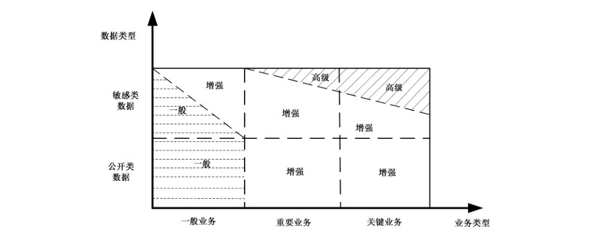
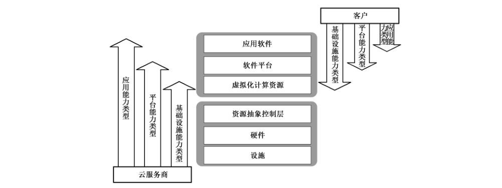

# GB/T 31167-2023 信息安全技术 云计算服务安全指南

> 来源：[GB/T 31167-2023 国家标准详情](https://openstd.samr.gov.cn/bzgk/std/newGbInfo?hcno=467099CFA3FDDF956F9DDAA1D7B30BD2)；发布日期：2023-05-23；实施日期：2023-12-01。
> PDF SHA-256：6f5529f72f5ec56ef5bb88015a5d7707d4fa38a6700ca8ae23ec0718163b18c7。
> 转写说明：依据官方 PDF 全部 28 页的页面图像核对；省略封面、目录、页眉、页脚和页码，合并跨页表格。正式引用请核对原 PDF。

## 前言

本文件按照 GB/T 1.1—2020《标准化工作导则 第1部分：标准化文件的结构和起草规则》的规定起草。

本文件代替 GB/T 31167—2014《信息安全技术 云计算服务安全指南》，与 GB/T 31167—2014相比，除结构调整和编辑性改动外，主要技术变化如下：

- 更改了适用范围，由“政府部门”更改为“客户”（见第1章，见2014年版的第1章）；
- 增加了对 GB/T 32400—2015（见第3章）、GB/T 36325—2018（见 7.3.3）、GB/T 37972—2019（见 8.1）的规范性引用；
- 增加并更改了部分术语（见第3章，2014年版的第3章）；
- 增加了“缩略语”一章（见第4章）；
- 删除了“云计算的概述”（见2014年版第4章）；
- 增加了“云能力类型”和“云服务类别”的引用（全文）；
- 将2014年版中的“5.2云计算安全风险”作为资料性附录（见附录 B）；
- 将2014年版5.3内容作为“5.2.1 角色及职责”章节内容，并增加“云服务安全提供商”作为云计算服务安全管理的新角色（见5.2.1）；
- 增加了“安全责任划分”的指导和示例（见5.2.2 和附录 A）；
- 将“审查”更改为“评估”，与相关文件统一名称（全文）；
- 删除了“效益评估”（见2014年版的6.2）；
- 更改了2014年版“6.3 政府信息分类”的标题和内容（见6.2）；
- 删除了“敏感信息”和“公开信息”相关的技术内容（见2014年版的 6.3.2、6.3.3）；
- 将标题“政府业务分类”更改为“业务分类”，扩大了业务范围（见6.3，见2014年版的6.4）；
- 更改了业务分类中关键业务的条件（见6.3.4，见2014年版的6.4.4）；
- 删除了“优先级确定”的内容（见2014年版的6.5）；
- 更改了安全保护要求，提出了三级安全能力级别（见6.4，见 2014年版的 6.6）；
- 更改了 2014年版中的图3，增加了关键业务类型和高级安全能力（见图 2）；
- 删除了“6.7.1 概述”（见2014年版的6.7.1）；
- 更改了2014年版中“6.7.2服务模式”标题及内容，由服务模式划分控制范围更改为通过能力类型划分控制范围（见 6.5.1）；
- 更改了2014年版中的图 4，将服务模式改为基本云服务能力类型（见图3）；
- 增加了指导客户在迁移时对业务系统集成需求的考虑（见6.5.7，见2014年版的 6.7.8）；
- 更改了2014年版“6.7.9 数据的存储位置”的技术内容（见 6.5.8）；
- 更改了“7.1云服务商安全能力要求”的内容，具体要求参见 GB/T 31168—2023（见7.1，见2014年版的 7.1）；
- 删除了2014年版中的7.1.1 至7.1.10章节（见2014年版7.1.1～7.1.10）；
- 将2014年版本中7.2.2的内容合并至7.2（见7.2，见2014年版的7.2）；
- 增加了服务水平协议的相关文件引用（见7.3.3、见 2014年版的7.3.3）；
- 更改了“8.1 概述”的内容，引入 GB/T 37972—2019为云服务商和运行监管方开展云计算服务运行监管活动提供指导（见8.1，见2014年版的8.1）；
- 更改了“8.2.1 概述”的内容，强调对云服务安全提供商的运行监管责任应由引入方承担（见8.2.1，见 2014年版的 8.2.1）；
- 增加了运行监管中客户的相关责任（见8.2.2，见2014年版的 8.2.2）；
- 增加了重大变更的类型（见8.4.3、见 2014年版本的 8.4.2）；
- 增加了安全事件的类型（见8.4.4，见 2014年版本的8.4.3）；
- 增加了“迁移原则”一节，用于指导客户在迁移数据时宜要求云服务商遵循的原则（见9.2.1）；
- 将 2014年版中“9.2确定移交范围”的内容更改为“9.2.2 移交范围”（见9.2.2）；
- 删除了“9.4安全删除数据”中c）条措施中的“3）存放敏感信息的介质清理后不能用于存放公开信息”（见2014年版的9.4）；
- 将 2014年版中的“9.4安全删除数据”中c）条措施中的脚注作为c）条措施中注（见9.4）。

请注意本文件的某些内容可能涉及专利。本文件的发布机构不承担识别专利的责任。

本文件由全国信息安全标准化技术委员会（SAC/TC 260）提出并归口。

本文件起草单位：四川大学、中国科学技术大学、北京信息安全测评中心、华为技术有限公司、中国电子技术标准化研究院、北京天融信网络安全技术有限公司、国家信息技术安全研究中心、中国网络安全审查技术与认证中心、中国移动通信集团有限公司、陕西省信息化工程研究院、国家工业信息安全发展研究中心、浪潮云信息技术股份公司、深信服科技股份有限公司、中国信息安全测评中心（北京）、杭州安恒信息技术股份有限公司、中国电子科技集团公司第三十研究所、华信咨询设计研究院有限公司、中电长城网际系统应用有限公司、成都蜀道易信科技有限公司、新华三技术有限公司、腾讯云计算（北京）有限责任公司。

本文件主要起草人：陈兴蜀、周亚超、王启旭、闵京华、杨苗苗、罗永刚、张建军、杨建军、左晓栋、刘海峰、张滨、江强、李媛、严敏瑞、王龑、王惠莅、张明天、张勇、卢夏、伍扬、陈雪鸿、史大为、柳彩云、张敏、邱勤、吴复伟、张晓菲、赵丹丹、望娅露、刘俊河、章建聪、陈静、万晓兰、马洪军、张格、董平、于乐、尹丽波、赵章界、朱毅、邱云翔、王永霞。

本文件及其所代替文件的历次版本发布情况为：

- 2014年首次发布为 GB/T 31167—2014；
- 本次为第一次修订。

## 引言

本文件与 GB/T 31168—2023《信息安全技术 云计算服务安全能力要求》构成了云计算服务安全管理的基础文件。GB/T 31168—2023 面向云服务商描述了为客户提供云计算服务时应具备的安全能力，本文件面向客户提出了采用云计算服务时的安全管理和技术措施。

本文件指导客户做好采用云计算服务的前期分析和规划，选择合适的云服务商与部署模式，对云计算服务进行运行监管，规避退出云计算服务或更换云服务商的安全风险。本文件指导客户在采用云计算服务的生命周期采取相应的安全技术和管理措施，保障数据和业务的安全，安全地使用云计算服务。

## 1 范围

本文件提出了客户采用云计算服务的安全管理基本原则，给出了采用云计算服务的生命周期各阶段的安全管理和技术措施，提出了云计算服务安全管理原则和相关责任划分。

本文件适用于指导客户安全地采用云计算服务。

## 2 规范性引用文件

下列文件中的内容通过文中的规范性引用而构成本文件必不可少的条款。其中，注日期的引用文件，仅该日期对应的版本适用于本文件；不注日期的引用文件，其最新版本（包括所有的修改单）适用于本文件。

- GB/T 25069—2022 信息安全技术 术语

- GB/T 31168—2023 信息安全技术 云计算服务安全能力要求

- GB/T 32400—2015 信息技术 云计算 概览与词汇

## 3 术语和定义

GB/T 25069—2022 和 GB/T 32400—2015界定的以及下列术语和定义适用于本文件。

### 3.1 云计算 cloud computing

通过网络访问可扩展的、灵活的物理或虚拟共享资源池，并按需自助获取和管理资源的模式。

> 注：资源实例包括服务器、操作系统、网络、软件、应用和存储设备等。

［来源：ISO/IEC 17788:2014,3.2.5］

### 3.2 云服务 cloud service

**云计算服务 cloud computing service**

使用定义的接口，通过云计算（3.1）提供一种或多种资源的能力。

［来源：ISO/IEC 17788:2014,3.2.8，有修改］

### 3.3 参与方 party

一个或一组自然人或法人，无论其是否注册。

［来源：GB/T 32400—2015,3.1.6，有修改］

### 3.4 云服务提供者 cloud service provider

**云服务商**

提供云计算服务的参与方。

［来源：GB/T 32400—2015,3.2.15，有修改］

### 3.5 云服务客户 cloud service customer

为使用云计算服务而处于一定业务关系中的参与方。

> 注1：业务关系不一定包含经济条款。

> 注2：本文件中云服务客户简称客户。

［来源：GB/T 32400—2015,3.2.11］

### 3.6 第三方评估机构 third party assessment organizations

独立于云计算服务提供方和使用方的专业评估机构。

### 3.7 云计算基础设施 cloud computing infrastructure

由硬件资源和资源抽象控制组件构成的支撑云计算服务的基础设施。

> 注：硬件资源包括所有的物理计算资源，涉及计算和处理组件（CPU、内存等）、存储组件（硬盘等）、网络组件（路由器、防火墙、交换机、网络链路和接口等）及其他物理计算基础元素。资源抽象控制组件对物理计算资源进行软件抽象，云服务商通过这些组件提供和管理对物理计算资源的访问。

### 3.8 云计算平台 cloud computing platform

云服务商提供的云计算基础设施及其上的服务软件的集合。

### 3.9 云计算环境 cloud computing environment

云服务商提供的云计算平台，及客户在云计算平台之上部署的软件及相关组件的集合。

### 3.10 云服务合作者 cloud service partner

支撑或协助云服务商活动、云服务客户活动，或者两者共同活动的参与方。

［来源：GB/T 32400—2015,3.2.14］

### 3.11 云服务安全提供商 cloud service security provider

支撑或协助云服务商或云服务客户的安全管理、安全技术和安全运维活动的参与方。

### 3.12 云能力类型 cloud capabilities type

根据资源使用情况对提供给云服务客户的云服务功能进行分类。

> 注：云能力类型包括应用能力类型、基础设施能力类型和平台能力类型。

［来源：GB/T 32400—2015,3.2.4］

### 3.13 应用能力类型 application capabilities type

云服务客户能使用云服务商应用的一种云能力类型。

［来源：GB/T 32400—2015,3.2.1，有修改］

### 3.14 基础设施能力类型 infrastructure capabilities type

云服务客户能配置和使用计算、存储或网络资源的一种云能力类型。

［来源：GB/T 32400—2015,3.2.25］

### 3.15 平台能力类型 platform capabilities type

云服务客户能使用云服务商支持的编程语言和执行环境来部署、管理和运行客户创建或获取的应用的一种云能力类型。

［来源：GB/T 32400—2015,3.2.31，有修改］

### 3.16 云服务类别 cloud service category

拥有某些通用功能集合的一组云计算服务（3.2）。

> 注：一种云服务类别包含一种或多种云能力类型的能力。

［来源：GB/T 32400—2015,3.2.10，有修改］

## 4 缩略语

下列缩略语适用于本文件

SLA：服务水平协议（Service Level Agreement）

## 5 云计算服务安全管理

### 5.1 概述

本章提出了云计算服务安全管理的基本原则，给出了安全管理职责划分的指导性建议，并从规划准备、选择云服务商及部署、运行监管、退出服务等四个阶段简要描述了客户采用云计算服务的生命周期安全管理需考虑的因素。

### 5.2 采用云计算服务的安全管理责任

#### 5.2.1 角色及职责

云计算服务安全管理的主要角色及责任如下。

a） 云服务商：为确保客户数据和业务系统安全，云服务商所提供的云计算平台及服务宜先通过安全评估，才能向客户提供云计算服务；宜积极配合客户的运行监管工作，对所提供的云计算服务进行运行监视，确保持续满足客户安全需求；宜在合同关系结束时满足客户数据和业务的迁移及删除需求，确保数据安全。

b） 客户：从已通过安全评估的云服务平台中选择适合的云服务商。客户宜承担部署或迁移到云计算平台上的数据和业务的最终安全责任；客户宜开展云计算服务的运行监管活动，根据相关规定开展安全监督检查。

c） 云服务安全提供商：宜通过商务合同的方式，协助或支撑云服务商或云服务客户开展安全管理、技术和运维，承担约定的安全责任。

d） 第三方评估机构：宜对云服务商及其提供的云计算服务开展独立的安全评估。

#### 5.2.2 安全责任划分

云计算环境中下至基础设施，上至用户的应用、数据，均可能面临安全风险。而由于云服务商与客户各自具有不同的控制能力，因此安全责任需要由云服务商和客户共同承担。

在分担安全责任时，由于云服务商和客户的控制范围有所不同，因此宜根据云服务类别所涉及的云能力类型协商确定安全责任边界。如果部分安全措施需要由云服务安全提供商来实施，相关责任原则上宜由引入云服务安全提供商的一方承担，该引入方和云服务安全提供商可以通过合同等方式约定责任。云服务商和客户宜保证各个角色承担责任的总和能够覆盖到系统的全部安全要素，避免责任无人承担或责任承担不明确的情况。

云服务商和云服务客户可以在服务水平协议（SLA）中明确双方各自承担的相应安全责任。

责任划分的内容可参考附录A中的示例。

### 5.3 云计算服务安全管理基本原则

采用云计算服务期间，客户宜遵守以下原则。

a） 安全管理责任不变。安全管理责任不宜随服务外包而转移，无论客户数据和业务是位于内部信息系统还是云服务商的云计算平台上，客户都是安全的最终责任人。

b） 资源的所有权不变。客户提供给云服务商的数据、设备等资源，以及云计算平台上客户业务系统运行过程中收集、产生、存储的数据和文档等都宜属客户所有，客户拥有这些资源的全部控制权。

c） 司法管辖关系不变。客户数据和业务的司法管辖权不宜因采用云计算服务而改变。除非中国法律法规有明确规定，云服务商不得依据其他国家的法律和司法要求将客户数据及相关信息提供给他国政府及组织。

d） 安全管理水平不变。承载客户数据和业务的云计算平台宜按照国家或行业管理要求进行管理，为客户提供云计算服务的云服务商宜遵守国家或行业相关安全管理政策及文件。

e） 坚持先评后用原则。客户宜要求云服务商具备保障客户数据和业务系统安全的能力，并通过第三方评估机构的安全评估。客户宜选择通过评估的云服务商，并监督云服务商切实履行安全责任，落实安全管理和防护措施。

### 5.4 云计算服务生命周期安全管理

#### 5.4.1 概述

采用云计算服务的生命周期可分为四个主要阶段：规划准备、选择云服务商与部署、运行监管、退出服务，如图1所示。

#### 5.4.2 规划准备

在规划准备阶段，客户应确定自身上云的数据和业务类型；根据数据和业务的类型确定云计算服务的安全能力要求；根据云计算服务的特点进行需求分析，确定选择云服务类别，形成决策报告。

#### 5.4.3 选择云服务商与部署

在选择云服务商与部署阶段，客户宜根据安全需求、云计算服务的安全能力和安全评估结果选择云服务商，与云服务商协商合同（包括服务水平协议、安全需求、保密要求等内容），完成数据和业务向云计算平台的部署或迁移。

#### 5.4.4 运行监管

在运行监管阶段，客户宜指导监督云服务商履行合同规定的责任义务，指导督促使用由客户提供的业务系统服务的使用者遵守国家或行业相关安全管理政策及文件，共同维护数据、业务及云计算环境的安全。

#### 5.4.5 退出服务

在退出云计算服务时，客户宜要求云服务商履行相关责任和义务，确保退出云计算服务阶段数据和业务安全，如安全返还客户数据、彻底清除云计算平台上的客户数据等。

需变更云服务商时，客户宜按5.4.3的要求选择新的云服务商，重点关注云计算服务迁移过程的数据和业务安全；也宜要求原云服务商履行相关责任和义务。

## 6 规划准备

### 6.1 概述

本章在附录B中给出了云计算可能面临的安全风险，并指导客户基于风险分析，根据业务和数据的特点选择适用的云服务类别、部署模式等。是否采用云计算服务，特别是采用社会化的云计算服务，客户依据综合平衡、评估采用云计算服务所获得的效益、可能面临的安全风险、可以采取的安全措施后做出决策。当安全风险在客户可以承受、容忍的范围内，或可能的安全事件有适当的控制或补救措施时，客户能采用云计算服务。

### 6.2 数据分类

客户在选择云计算服务之前，宜先明确计划部署在云计算服务上数据的类型。涉密数据的处理、保存、传输、利用应按国家保密相关法律法规执行。本文件将非涉密数据分为敏感类、公开类两种类型，敏感类数据可依据国家相关法律法规、标准等进一步划分为一般敏感、重要、核心数据。

### 6.3 业务分类

#### 6.3.1 业务分类原则

确定数据类型后，客户需对承载相关数据的业务进行分类。根据业务不能正常开展时可能造成的影响范围和程度，本文件将业务划分为一般业务、重要业务、关键业务等三种类型。

#### 6.3.2 一般业务

一般业务出现短期服务中断或无响应不会影响客户业务的核心功能，对公众的日常工作与生活造成的影响范围、程度有限。

通常客户对一般业务中断的容忍度以天为单位衡量。

#### 6.3.3 重要业务

重要业务一旦受到干扰或停顿，会对政务活动、对公服务等客户业务的核心功能产生较大影响，在一定范围内影响公众的工作生活，造成财产损失，引发少数人对政府的不满情绪。此类业务出现问题，造成的影响范围、程度较大。

满足以下条件之一的业务可被认为是重要业务：

- 对业务中断的容忍程度小于 24 h；

- 业务系统的服务对象每24h 超过10万用户；

- 信息发布网站的访问量超过每天500万人次；

- 出现安全事件造成100万元以上经济损失；

- 出现问题后可能造成其他较大危害。

#### 6.3.4 关键业务

关键业务一旦受到干扰或停顿，将对政务活动、对公服务等客户业务的核心功能产生严重影响，威胁国家安全和人民生命财产安全，在一定程度上动摇公众对政府的信心。

满足以下条件之一的业务可被认为是关键业务：

- 对业务中断的容忍程度小于1 h；

- 业务系统的服务对象每1h 超过100万用户；

- 出现安全事件造成5000万元以上经济损失，或危害人身安全；

- 出现安全事故会严重损害政府形象、社会秩序，或危害国家安全；

- 出现问题后严重影响单个地市级行政区30%以上人口的工作、生活；

- 出现问题后可能造成其他严重危害。

### 6.4 安全能力级别

所有的客户数据都宜得到适当的保护。对于公开类数据主要是防篡改、防丢失；对于敏感类数据还要防止未经授权披露、丢失、滥用、篡改和毁损。客户可根据自身敏感类数据的重要性级别，对敏感类数据进一步划分，如划分为一般敏感、敏感、重要、核心等数据。

所有的客户业务都宜得到适当保护，保证业务的安全性和持续性。

本文件将云计算服务安全能力划分为一般、增强和高级三个能力级别，不同类型的数据和业务对安全保护能力有着不同的要求，客户宜要求云服务商提供相应强度的安全保护能力，如图2所示。

采用云计算服务时，宜选择具有相应安全能力的云计算服务，具体为：

a） 承载公开类和一般敏感类数据的一般业务宜选择至少达到一般安全能力的云计算服务。

b） 承载公开类数据的重要业务和关键业务，以及承载敏感类数据的一般业务，宜选择至少达到增强安全能力的云计算服务。

c） 承载敏感类数据的重要业务和关键业务，客户根据实际情况进行判断，属于承载一般敏感数据的业务，宜选择至少达到增强安全能力的云计算服务；属于承载重要、核心数据的业务，宜选择达到高级安全能力的云计算服务。

d） 选择高级安全能力的云计算服务时，宜采用私有云或社区云的部署模式。

### 6.5 需求分析

#### 6.5.1 服务能力类型及控制范围

GB/T 32400—2015定义了3类不同的云能力类型：应用能力类型、平台能力类型和基础设施能力类型。不同云能力类型下云服务商与客户的控制范围不同，如图3所示，图中两侧的箭头示意了云服务商和客户的控制范围，具体如下。

a） 在应用能力类型下，应用软件层的安全措施宜由客户和云服务商分担，其他安全措施宜由云服务商实施。

b）在平台能力类型下，软件平台层的安全措施宜由客户和云服务商分担。客户宜负责自己开发和部署的应用及其运行环境的安全，其他安全措施宜由云服务商实施。

c） 在基础设施能力类型下，虚拟化计算资源层的安全措施宜由客户和云服务商分担。客户宜负责自己部署的操作系统、运行环境和应用的安全。云服务商宜负责虚拟机监视器及底层资源的安全。

图3中的下三层由设施层、硬件层和资源抽象控制层构成。设施层和硬件层是云计算环境的物理元素，设施层主要包括供配电系统、机柜、门禁、空调及新风系统、UPS电源系统、动力环境监控系统、安全防范系统、消防及报警系统、防雷及接地系统、综合布线等，硬件层包括了所有的物理计算资源，例如：服务器、网络（路由器、防火墙、交换机、网络连接和接口）、存储部件（硬盘）和其他物理计算元件。资源抽象控制层通过虚拟化或其他软件技术实现对物理计算资源的软件抽象，基于资源分配、访问控制、使用监视等软件组件实现资源的访问控制。在所有云能力类型下，客户宜要求这三层均由云服务商完全控制，所有安全措施由云服务商实施。

图3中的上三层由应用软件层、软件平台层、虚拟化计算资源层构成云计算环境的逻辑元素。虚拟化计算资源层通过服务接口，使客户可以访问虚拟机、虚拟存储、虚拟网络等计算资源。软件平台层向客户提供编译器、函数库、工具、中间件以及其他用于应用开发和部署的软件工具与组件。应用软件层向客户提供业务系统需要的应用软件，客户通过客户端或程序接口访问这些应用软件。

客户宜根据不同云服务类别的特点和自身数据及业务系统的安全管理要求，结合自身的技术能力、市场及技术成熟度等因素选择云服务类型。

#### 6.5.2 部署模式

云计算有公有云、社区云和私有云三种典型部署模式，不同的部署模式下，云计算基础设施部署的场所、客户访问云计算服务的网络链路、是否与其他客户共享资源等属性有较大差异，客户宜综合分析部署模式对自身数据和业务的影响。不同部署模式下关注的主要问题如下。

a） 是否与其他客户共享云计算平台。公有云是云服务商面向社会提供的服务，客户需要与其他未知客户共享云计算平台；社区云中的客户群体具有共同责任、相同安全需求、相同策略等属性，客户与这些有共同属性（如同一行业、同一业务需求等）的已知客户共享资源；私有云的云计算平台为客户独享，由客户或专门委托的云服务商独立管理和控制云计算平台。

b） 对云计算平台管理技能的要求。若采用私有云、社区云，且云计算平台由客户承担管理任务，客户宜具备专业的技术人才，对人员技能的要求宜高于公有云。

c） 业务的可扩展性要求。公有云的资源由大量客户共享，资源规模较大，客户可根据业务和资源使用情况随时调整资源需求，可充分扩展；社区云和私有云的灵活程度会受到具体的部署场所和策略的影响。

客户宜综合考虑以上问题，选择适合的部署模式，使安全风险可控。

#### 6.5.3 功能需求的稳定性和通用性

当客户的业务功能需求不断变化时，客户宜要求云服务商不断开发、测试和部署新的组件。云计算的多客户共享资源特点使得云计算平台基于客户的功能定制或变更较为困难。因此，为了提高应用规模和效益，云服务商通常愿意提供通用性较好、功能相对稳定和成熟的服务。

通用的功能需求有助于客户参考成熟的应用案例，包括参考其部署、运行监管、评估等最佳实践，可提高效率并降低安全风险。另外，业务功能的通用性利于实现规模化所带来的低成本效益。

客户宜综合考虑服务类别的稳定性和通用性以及服务类别之上客户部署的灵活性和可控性，将功能需求不经常发生变化的业务部署或迁移到云计算平台，还可考虑是否已有基于所选服务类型之上的自主部署的成功应用案例。

#### 6.5.4 资源的动态需求特点

针对具有临时、周期性特点的业务，如公务员招考等业务系统，可能会出现访问和请求的突发高峰，需要满足访问需求动态分配资源。此类业务采用云计算服务，可以满足动态、灵活的资源需求，且客户只需为业务系统所占用的资源支付使用费用。

客户宜优先将对资源有动态、周期变化需求的业务部署或迁移到云计算平台，可在满足业务性能需求的前提下节省资金。

#### 6.5.5 时延

时延是指云计算环境处理某个请求的时间延迟，包括客户请求消息传输到云计算环境和结果回传时间，以及云计算环境的处理时间。不同类型的应用对云计算服务的时延要求差异明显，例如，电子邮件通常容许出现短暂的服务中断和较大的网络时延，但自动化控制与实时应用一般对时延要求较高。

客户宜针对业务系统对响应速度方面的要求做详尽分析，确定业务本身对时延的容忍度，以及可能采取的补救措施等。在将数据和业务部署或迁移到云计算平台前，宜考虑响应时间、海量数据传输性能等指标要求。

#### 6.5.6 业务连续性

云计算服务是否会中断、是否能持续访问依赖于多方面因素，包括网络、云计算平台以及云服务商等。其中：

网络依赖：云计算服务依赖于互联网等网络，客户通过持续可用的网络连接来获取服务。网络依赖意味着每个应用都是网络应用，从客户到云计算平台的网络复杂度通常高于客户内部局域网。

平台依赖：尽管专业的云计算平台具有较高的可靠性，但出于人为因素（如恶意攻击或管理员的失误）、自然灾害（如洪水、台风、地震等）的原因，云计算平台故障与服务中断不可能完全避免。

云服务商依赖：采用自有系统时，即使软硬件供应商暂停技术支持、售后服务或停业，客户可能不会立即受到影响，可以继续使用其产品。对于社会化云计算服务而言，客户高度依赖云服务商提供的服务，云服务商倒闭、市场变化等主观或客观原因所造成的中断或停止，会立即导致客户所需服务的中断或停止。

在采用云计算服务前，宜对云计算服务的可靠性、持续性需求进行充分评估，宜关注中断频率与预期恢复时间。可考虑如下措施：

a） 客户与云计算平台之间的网络链路采用多个网络运营商的优质链路，做到网络冗余；

b） 确定云服务商是否有异地数据中心实现数据与业务系统的异地备份，确保因人为因素或自然灾害导致云计算平台故障或服务中断时，也能对数据进行有效保护和恢复；

c） 对云服务商的经营状态进行定期检查，发现异常及时处理。

#### 6.5.7 可移植性与互操作性

客户宜制定将数据和业务系统从某一云计算平台迁移到其他云计算平台或自有数据中心的计划，充分考虑云计算服务与其他已有或将来的业务系统集成需求。客户在选择云服务类别时宜与云服务商明确移植和集成需求，可重点考虑可移植性和互操作性。

a） 可移植性：移植是指将数据和业务系统从一个云服务商迁移到另一个云服务商的云计算平台，或迁移回客户的数据中心。可移植性取决于标准化的接口与数据格式。可移植性的实现难度与采用的云服务服务类别所对应的云能力类型有关，从基础设施能力类型、平台能力类型到应用能力类型的可移植性难度逐渐增加。

b） 互操作性：部署在云计算平台上的业务系统可能需要与其他系统进行数据交互，不同云计算平台间及与自有信息系统之间的数据交换与访问较为困难。同时，云服务商为了商业竞争的目的，对可移植性和互操作性的支持和配合一般不够积极。

#### 6.5.8 数据的存储位置

根据国家的有关规定，存储、处理客户数据的数据中心和云计算基础设施应当设在境内。客户在确定采用云计算服务时，宜要求云服务商不在境外存储、处理客户数据。

因客户需求需要将数据中心和云计算基础设施设在境外的情况，参照国家相关规定执行。

#### 6.5.9 业务系统上云

客户在确定业务系统迁移的目标后，宜根据所选择的服务类别，明确所需的运维及安全服务、服务内容、服务提供方、收费方式等，宜将业务系统上云纳入管理流程，落实到具体责任人。

#### 6.5.10 监督能力

传统计算模式中，用户直接控制、管理自己的数据和业务系统。在云计算平台中，客户的数据及运行过程中生成、获取的数据都在云服务商的直接控制下，客户没有直接的控制权。客户需要通过监管了解和掌握自身数据和业务系统在云计算平台上的状态，了解云计算平台是否提供了足够的安全防护措施满足安全需求。

客户宜通过合同明确云服务商的责任和义务，强调客户对数据和业务系统运行状态的知情权；要求云计算平台提供必要的监管接口和日志查询功能，建立有效的评估、检查机制，实现对云计算服务的有效监管。

### 6.6 形成决策报告

完成对数据和业务的综合分析后，需要形成采用云计算服务的决策报告，经本单位最高领导批准后成为指导采用云计算服务的重要依据。报告包括但不限于以下内容：

a） 背景描述：描述拟采用云计算服务的数据和业务；

b） 效益分析：从场地、人员、设备、软件、运行管理、维护升级、能耗等方面，对采用本地应用与云计算服务所需费用进行综合分析；

c） 云服务类别、部署模式选择：分析客户与云服务商的安全措施实施边界和管理边界；

d）风险分析：分析数据和业务部署到云计算环境后可能遇到的安全威胁，提出应对措施；

e） 功能需求分析：分析不同模式下的资源需求，数据的备份与恢复能力，备份数据的存储位置，数据的传输方式和网络带宽要求，拟部署到云计算平台上的业务与其他系统之间的数据交互需求等；

f） 性能需求分析：主要分析可用性、可靠性、恢复能力、事务响应时间、吞吐率等指标；

g） 安全要求：基于对准备部署到云计算平台的数据和业务的分类结果，确定云计算服务的安全能力要求；

h）业务持续性要求：将业务系统迁移到云计算平台后，原有系统可与迁移到云计算平台的业务系统并行运行一段时间；

i） 退出云计算服务或变更云服务商的初步方案；

j） 对客户相关人员进行安全意识、技术和管理培训的方案；

k）本单位负责采用云计算服务的领导、工作机构及其责任；

l） 采购和使用云计算服务过程中宜考虑的其他重要事项。

## 7 选择云服务商与部署

### 7.1 云服务商安全能力要求

为客户提供云计算服务的云服务商宜具备相应的安全能力，具体要求参见 GB/T 31168—2023。

### 7.2 选择云服务商

为保证数据和业务安全，客户宜选择通过安全评估的云服务商。选择云服务商宜考虑但不限于以下方面的因素：

a） 云服务类别能否满足需求；

b） 部署模式能否满足需求；

c） 云计算服务的安全能力（一般保护/增强保护/高级保护）能否满足需求；

d） 定制开发能力能否满足需求；

e） 云服务商对运行监管的接受程度，能否提供运行监管接口；

f） 云计算平台的可扩展性、可用性、可移植性、互操作性、功能、容量、性能等能否满足需求；

g） 云服务商能否满足 5.3c）的要求；

h） 数据的存储位置，包括数据传输的路径；

i） 灾难恢复能力能否满足需求；

j） 资源占用、带宽租用、监管、迁移或退出服务、培训等费用的计费方式和标准；

k） 出现安全事件并造成损失时，云服务商的补偿能力与责任；

l） 客户根据数据和业务的敏感程度，需要对访问数据和业务的云服务商雇员进行背景调查，宜要求云服务商配合对其雇员进行背景调查，可具体参照国家相关规定执行。

### 7.3 合同中的安全考虑

#### 7.3.1 概述

合同是明确客户与云服务商间责任和义务的基本手段。有效的合同是安全、持续使用云计算服务的基础，客户宜全面、明确地制定合同的各项条款，突出考虑安全问题。

#### 7.3.2 云服务商的责任和义务

客户在合同中宜明确云服务商需承担以下责任和义务。

a） 承载客户数据和业务的云计算平台宜按照国家或行业等安全管理要求进行管理，为客户提供云计算服务的云服务商宜遵守国家或行业等相关安全管理政策及文件。

b） 客户提供给云服务商的数据、设备等资源，以及云计算平台上客户业务运行过程中收集、产生、存储的数据和文档等都属客户所有，云服务商宜保证客户对这些资源的访问、利用、支配等权利。

c） 云服务商不宜依据其他国家的法律和司法要求将客户数据及相关信息提供给他国政府及组织，数据出境宜遵循国家相关法律法规的要求。

d） 未经客户授权，不宜访问、修改、披露、利用、转让、销毁客户数据；在服务合同终止时，宜将数据、文档等归还给客户，并按要求彻底清除数据。如果客户有明确的留存要求，宜按要求留存客户数据。

e） 采取有效管理和技术措施确保客户数据和业务系统的保密性、完整性和可用性。

f） 依法或依合同接受客户的安全监管。

g） 当发生安全事件并造成损失时，按照双方的约定承担相应责任。

h） 不以持有客户数据相要挟，配合做好客户数据和业务的迁移或退出。

i） 发生纠纷时，在双方约定期限内仍宜保证客户数据安全。

j） 法律法规明确或双方约定的其他责任和义务。

#### 7.3.3 服务水平协议

服务水平协议（SLA）约定云服务商向客户提供的云计算服务的各项具体技术和管理指标，是合同的重要组成部分。客户宜与云服务商协商服务水平协议，并作为合同附件。

服务水平协议宜与服务需求对应，针对需求分析中给出的范围或指标，在服务水平协议中要给出明确参数。服务水平协议中需对涉及到的术语、指标等明确定义，防止因二义性或理解差异造成违约纠纷或客户损失。

关于 SLA 基本要求的具体指标，见 GB/T 36325—2018。

#### 7.3.4 保密协议

客户宜与可访问客户信息或掌握客户业务运行信息的云服务商签订保密协议；宜与能够接触客户信息或掌握客户业务运行信息的云服务商雇员，签订保密协议，并作为合同附件。

客户在保密协议中宜包括以下相关信息。

<ol className="standard-subclauses">
<li>a） 遵守相关法律法规、规章制度和协议，在客户授权的前提下合理使用客户信息，不得以任何手段获取、使用未经授权的客户信息。
</li>
<li>b） 未经授权，不宜在工作职责授权范围以外访问、使用、分享客户信息。
</li>
<li>c） 未经授权，不宜泄露、披露、转让以下信息：
<ol className="standard-subclauses">
<li>1） 技术信息：同客户业务相关的程序、代码、流程、方法、文档、数据等内容；
</li>
<li>2） 业务信息：同客户业务相关的人员、财务、策略、计划、资源消耗数量、通信流量大小等业务信息；
</li>
<li>3） 安全信息：包括账号、口令、密钥、授权等用于对网络、系统、进程等进行访问的身份与权限数据，还包括对正当履行自身工作职责所需要的重要、适当和必要的信息。
</li>
</ol>
</li>
<li>d） 第三方要求披露c）中信息或客户敏感信息时，不宜响应，并立刻报告。
</li>
<li>e） 对违反或可能导致违反协议、规定、规程、策略、法律的活动或实践，一经发现，宜立即报告。
</li>
<li>f） 合同结束后，云服务商返还c）中信息和客户数据，明确返还的具体要求、内容。
</li>
<li>g） 明确保密协议的有效期。
</li>
</ol>

#### 7.3.5 合同的安全相关内容

客户在与云服务商签订合同时，宜全面考虑采用云计算服务可能面临的安全风险，并通过合同对管理、技术、人员等进行约定，要求云服务商为客户提供安全、可靠的服务。

客户在合同中宜至少包括以下安全相关内容。

<ol className="standard-subclauses">
<li>a） 云服务商的责任和义务，包括但不限于7.3.2 的全部内容。若有其他方参与，宜明确其他方的责任和义务。
</li>
<li>b） 云服务商宜遵从的技术和管理文件。
</li>
<li>c） 服务水平协议，明确客户特殊的性能需求、安全需求等。
</li>
<li>d） 保密条款，包括确定可接触客户信息特别是敏感信息的人员。
</li>
<li>e） 客户保护云服务商知识产权和商业秘密的责任和义务。
</li>
<li>f） 合同终止的条件及合同终止后云服务商宜履行的责任和义务。
</li>
<li>g） 若云计算平台中的业务系统与客户其他业务系统之间需要数据交互，约定交互方式和接口。
</li>
<li>h） 云计算安全服务的计费方式、标准，客户的支付方式等。
</li>
<li>i） 违约行为的补偿措施。
</li>
<li>j） 云计算服务部署、运行、应急处理、退出等关键时期相关的计划，这些计划可作为合同附件，涉及到的相关附件包括但不限于：
<ol className="standard-subclauses">
<li>1） 云计算服务部署方案，确定阶段性成果及时间要求；
</li>
<li>2） 运行监管计划，明确客户的运行监管要求；
</li>
<li>3） 应急响应计划、灾难恢复计划，明确处理安全事件、重大灾难事件等的流程、措施、人员等；
</li>
<li>4） 退出服务方案，明确退出云计算服务时客户数据和业务的迁移、退出方案；
</li>
<li>5） 培训计划，确定云服务商对客户的培训方式、培训内容、人员及时间。
</li>
</ol>
</li>
<li>k） 其他宜包括的安全相关内容。
</li>
</ol>

### 7.4 部署

#### 7.4.1 概述

为确保云计算服务的部署工作顺利开展，本条指导客户提前与云服务商协商制定云计算服务部署方案，该方案可作为合同附件。如果涉及将正在运行的业务系统迁移到云计算平台，本节指导客户考虑迁移过程中的数据安全及业务持续性要求。

#### 7.4.2 部署方案

客户在云计算服务部署方案至少包括以下内容。

a） 客户和云服务商双方的部署负责人和联系人，参与部署的人员及其职责。

b） 部署的实施进度计划表。

c） 相关人员的培训计划。

d） 部署阶段的风险分析。部署阶段的风险可能包括：技术人员误操作导致的数据丢失；业务系统迁移失败无法回退到初始状态；业务系统迁移过程中的业务中断；云服务商在部署过程中获得了额外的访问客户数据和资源的权限等。

e） 部署和回退策略。为降低部署阶段的安全风险，客户宜制定数据和业务系统的备份措施、业务系统迁移过程中的业务持续性措施等，制定部署失败的回退策略，避免由于部署失败导致客户数据的丢失和泄漏。

#### 7.4.3 投入运行

客户组织技术力量或委托第三方评估机构对云计算服务的功能、性能和安全性进行测试，各项指标均满足要求后方可投入正式运行。

客户数据和业务系统迁移后，原有业务系统宜与迁移到云计算平台上的业务系统并行运行一段时间，以确保业务的持续性。

云计算服务投入运行后，宜按第8章的要求加强使用过程中的运行监管，确保客户能持续获得安全、可靠的云计算服务。

## 8 运行监管

### 8.1 概述

在采用云计算服务时，虽然客户将部分控制和管理任务转移给云服务商，但网络安全的最终安全责任人还是客户。客户宜与云服务商之间明确各自承担、共同承担的安全责任，加强对云服务商的运行监管，同时对自身的云计算服务使用、管理和技术措施进行监管。GB/T 37972—2019 面向云服务客户、云服务商和运行监管方，提出了运行监管框架、过程及方式，为云服务商和运行监管方开展云计算服务运行监管活动提供指导。运行监管的主要目标是确保：

a） 合同规定的责任义务和相关政策规定得到落实，技术文件、安全管理制度得到有效实施；

b） 服务质量达到合同要求；

c） 变更管理受控；

d） 及时有效地响应安全事件。

### 8.2 云服务商和客户运行监管的角色与责任

#### 8.2.1 概述

本条给出了在运行监管过程中客户、云服务商的相关责任，指导客户按照合同、规章制度和文件加强对云服务商和自身的运行监管，指出云服务商、第三方评估机构宜积极参与和配合。同时，提出客户与云服务商宜明确负责运行监管的责任人和联系方式，强调对云服务安全提供商的运行监管责任应由引入方承担。

#### 8.2.2 客户的监管责任

客户在运行监管活动中的责任如下。

<ol className="standard-subclauses">
<li>a） 监督云服务商严格履行合同规定的各项责任和义务，自觉遵守有关主管部门安全的规章制度和文件。
</li>
<li>b） 协助云服务商处理重大安全事件。
</li>
<li>c） 按照国家或行业安全检查要求，对云服务商的云计算平台开展年度安全检查。
</li>
<li>d） 在云服务商的支持配合下，对以下方面进行监管：
<ol className="standard-subclauses">
<li>1） 服务运行状态；
</li>
<li>2） 性能指标，如资源使用情况；
</li>
<li>3） 特殊安全需求；
</li>
<li>4） 云计算平台提供的监视技术和接口；
</li>
<li>5） 其他必要的监管活动。
</li>
</ol>
</li>
<li>e） 加强对云计算服务和业务使用者、及客户引入的相关合作方的安全教育和监管。
</li>
<li>f） 对自身负责的云计算环境及客户端的安全措施进行监管。
</li>
<li>g） 评估自身数据和业务安全级别变更产生的安全风险并处置。
</li>
</ol>

客户根据运行监管过程中获得的相关材料进行风险评估（客户可以根据自身情况确定是否委托第三方评估机构），若发现问题则要求云服务商进行整改。若评估结果表明云服务商存在严重问题，不能满足客户需求，客户可以选择退出服务或变更云服务商，并根据情况及时向监管部门报告。

#### 8.2.3 云服务商的责任

客户宜要求云服务商在运行监管中履行的责任如下：

a） 严格履行合同规定的责任和义务，遵守国家或行业信息系统安全管理政策及文件；

b） 开展周期性的风险评估和监测，保证安全能力持续符合GB/T 31168—2023，包括：监测非授权的远程连接，持续监测账号管理、策略改变、特权功能、系统事件等活动，监测与其他信息系统的数据交互等；

c） 按照合同要求或双方的约定，向客户提供相关的接口和材料，配合客户的监管活动；

d） 云计算平台出现重大变更后，及时向客户报告情况，并委托第三方评估机构进行安全评估；

e） 出现重大安全事件时，及时向客户报告事件及处置情况，并向监管部门报告；

f） 持续开展对雇员的安全教育，监督雇员遵守相关制度。

客户宜要求云服务商执行运行监视活动，提供运行监视材料和接口；提交年度运行报告、重大变更申请和安全事件报告等相关材料；接受第三方评估机构的测评，并及时开展整改工作。

### 8.3 客户自身的运行监管

#### 8.3.1 概述

本条描述了客户宜将云计算服务纳入其安全管理工作内容，加强云计算服务使用过程中对自身的运行监管，主要涉及对云计算服务及业务系统使用者的违规及违约情况、自身负责的安全措施实施情况的监管。

#### 8.3.2 对违规及违约情况的监管

客户宜对云计算服务及业务系统使用者进行监管，要求其遵守国家有关安全的法律法规、文件及合同要求：

a） 不宜向云计算平台和相关系统传送恶意程序、垃圾数据，以及其他可能影响云计算平台正常运行的代码；

b） 不宜利用云计算平台实施网络攻击；

c） 不宜对云计算平台进行网络攻击，窃取或篡改数据资料；

d） 不宜利用云计算平台可能存在的技术缺陷或漏洞破坏云服务商和客户的权益；

e） 不宜利用云计算平台制作、复制、发布、传播法律法规禁止的信息。

#### 8.3.3 对安全措施的监管

客户宜对其负责的云计算环境及客户端的安全措施进行监管，确保安全措施已实施并正常运行，宜监管的安全措施包括但不限于：

a） 宜监管客户账号，包括管理员账号和一般用户账号，发现任何非法使用客户账号的情况，宜在权限范围内处置，必要时通知云服务商；

b）宜监管客户端的安全防护措施，如恶意代码防护、浏览器版本及插件更新、智能移动终端安全加固等；

c） 宜监管客户在不同云能力类型环境中的相应安全措施；

d） 宜由客户或委托第三方评估机构对客户负责实施的安全措施进行安全测评和检查；

e） 宜监管客户在迁移前后的安全措施，包括应用层、传输层、网络层、物理层面等的安全防护措施。

### 8.4 对云服务商的运行监管

#### 8.4.1 概述

本条描述了客户宜将云计算服务运行状态纳入其安全管理工作内容，加强云计算服务使用过程中对云服务商的运行监管，主要涉及对云服务商及其提供的云计算服务运行状态的监管。

#### 8.4.2 运行状态监管

客户通过运行状态监管了解和掌握云服务商及其提供的云计算服务的状态，运行监管内容宜包括：

a） 安全事件响应；

b） 重大变更处理；

c） 整改记录；

d） 安全策略更新；

e） 应急响应计划更新；

f） 应急响应演练；

g） 漏洞管理；

h） 云服务商委托第三方评估机构的测评。

#### 8.4.3 重大变更类型

客户或委托第三方评估机构评估云计算平台中重大变更可能带来的风险，并根据评估结果确定需要进一步采取的措施，包括退出云计算服务。重大变更宜包括但不限于：

a） 鉴别（包括身份鉴别和数据源鉴别）和访问控制措施的变更；

b） 数据存储实现方法的变更；

c） 云计算平台中软件代码的更新；

d） 备份机制和流程的变更；

e） 变更已有网络连接或新建网络连接；

f） 安全措施的更改与撤除；

g） 已部署软硬件产品的替换；

h） 云计算服务分包商的变更，例如提供云服务类别所涉及的平台能力类型、应用能力类型的服务商更换为其提供基础设施能力类型的服务商。

i） 云计算服务安全级别的变更；

j） 使用新的加密模块或服务，或对现有模块/服务的更改；

k）云系统范围的更改，包括但不限于：操作系统升级、中间件变更、移除系统组件或提供的服务等；

l） 使用新的数据中心或迁移到新的设备中；

m）云计算服务所有权的变化；

n） 云服务商分析得出结论认为变更将对客户业务系统的安全状态产生不利影响，则须将其视为重大变更。

#### 8.4.4 安全事件类型

在运行监管活动中，客户、云服务商的任何一方发现安全事件，都宜及时通知对方，云服务商宜及时对安全事件进行处置。安全事件宜包括但不限于：

a） 非授权访问事件，如对云计算环境下的业务系统、数据或其他计算资源进行非授权逻辑或物理访问等；

b） 拒绝服务攻击事件；

c） 恶意代码感染，如云计算环境被病毒、蠕虫、特洛伊木马等恶意代码感染；

d） 客户违反云计算服务的使用策略，例如发送垃圾邮件、滥用资源影响其他云租户等；

e） 数据因云计算服务故障而损坏或丢失。

## 9 退出服务

### 9.1 退出要求

合同或云服务商服务承诺等书面文件到期或其他原因都可能导致客户退出云计算服务，或将数据和业务系统迁移到其他云计算平台上。客户退出云计算服务的过程复杂，需要注意以下环节：

a） 在签订合同或云服务商服务承诺等书面文件时提前约定退出条件，以及退出时客户、云服务商的责任和义务，宜与云服务商协商数据和业务系统迁移出云计算平台的接口和方案；

b） 在退出服务过程中，云服务商宜返还合同或服务承诺等书面文件所订明的可迁出的客户数据；

c） 在将数据和业务系统迁移回客户数据中心或其他云计算平台的过程中，宜满足业务的可用性和持续性要求，如采取原业务系统与新部署业务系统并行运行一段时间等措施；

d） 及时取消云服务商对客户资源的物理和电子访问权限；

e） 提醒云服务商在客户退出云计算服务后仍宜承担的责任和义务，如保密要求等；

f） 退出云计算服务后需要确保云服务商按要求保留数据或彻底清除数据；

g） 如需变更云服务商，宜首先按照选择云服务商的要求，执行云服务商选择阶段的各项活动，确定新的云服务商并签署合同或云服务商服务承诺等书面文件。完成云计算服务的迁移后再退出原云计算服务。

### 9.2 确定数据移交范围

#### 9.2.1 迁移原则

客户要求云服务商在数据迁移时宜遵循的原则包括：

a） 优先原则：依据“重点防护，分步迁移”的思想，对关键业务，实施重点保护，最后进行迁移；对重要业务，保护适度减弱；对一般业务，可作为最先迁移业务；

b） 实用性原则：充分考虑应用业务的特殊性，把满足用户需求作为重要设计依据；

c） 可扩展性和维护性原则：为适应将来的发展，系统宜具有良好的可扩展性和可维护性，部署便利、使用简便、维护集中，并可以实现服务和应用的灵活扩展；

d） 标准化原则：严格按照国家相关法规、政策及文件要求，保证系统质量，提供完整、准确、详细的迁移文档；

e）纵深防御原则：采用多级防御保护措施，从多种安全手段、多方面、多角度来实现业务系统的迁移。

#### 9.2.2 移交范围

从云计算平台迁移出的数据，不仅包括客户移交给云服务商的数据和资料，还包括客户业务系统在云计算平台上运行期间产生、收集的数据以及相关文档资料，如数据文件、程序代码、说明书、技术资料、运行日志等。客户宜与云服务商制订详细的移交清单，清单包括但不限于以下内容。

a） 数据文件。每个数据文件均标明：文件名称、数据文件内容的描述、存储格式、文件大小、校验值、类型（敏感或公开）等；要求云服务商提供解密方法与密钥，实现加密文件的移交；提供技术资料或转换工具，实现非通用格式文件的移交。

b） 程序代码。针对客户定制的功能或业务系统，在合同或云服务商承诺等书面文件明确是否移交可执行程序、源代码及技术资料，可能涉及的内容包括：可执行程序、源代码、功能描述、设计文档、开发及运行环境描述、维护手册、用户使用手册等。

c） 其他数据。根据事先的约定和双方协商，确定需移交的其他数据，包括客户业务运行期间收集、统计的相关数据，如云计算服务的客户行为习惯统计、网络流量特征等资料。

d） 文档资料。客户使用云计算服务过程中提供给云服务商的各种文档资料，及双方共同完成的涉及客户的相关资料。

### 9.3 验证数据的完整性

客户对云服务商返还的数据进行完整性验证，宜采取的安全措施包括：

a） 要求云服务商根据移交数据清单完整返还客户数据，包括历史数据和归档数据等；

b） 监督云服务商返还客户数据的过程，并验证返还数据的有效性，如对加密数据进行解密并验证；利用工具恢复专有格式数据并验证等；

c） 可通过业务系统验证数据的有效性和完整性，如将数据和业务系统部署在新的平台上运行验证等。

### 9.4 安全删除数据

客户退出云计算服务后，要求云服务商安全处理客户数据，并承担相关的责任和义务。客户宜采取的安全措施包括：

<ol className="standard-subclauses">
<li>a） 退出服务后，要求云服务商按合同或承诺等书面文件要求安全存储客户数据一段时间；
</li>
<li>b）通过书面授权，要求云服务商删除客户数据及所有备份；
</li>
<li>c） 要求云服务商安全处置存放客户数据的存储介质，涉及以下方面：
<ol className="standard-subclauses">
<li>1） 重用前进行介质清理，不可清理的介质采取物理销毁；
<blockquote>
注：介质清理是指删除介质上数据的过程，该过程不会破坏介质。
</blockquote>
</li>
<li>2） 要求云服务商记录介质清理过程，并对过程进行监督。
</li>
</ol>
</li>
</ol>

## 附录 A（资料性）安全责任划分示例

本附录给出了云服务商和客户的安全责任划分示例，涉及基础设施能力类型、平台能力类型和应用能力类型三种不同云能力类型下各个安全层面的要求、安全组件以及责任方。可以供政务云项目及其他类型的云项目进行安全责任划分时参考。

图 A.1 给出了云服务商与客户责任划分边界。表 A.1 介绍了在基础设施能力类型下云服务商与客户的安全责任划分情况，表 A.2 介绍了在平台能力类型下云服务商与客户的安全责任划分情况，表 A.3 介绍了在应用能力类型下云服务商与客户的安全责任划分情况。

**表 A.1 基础设施能力类型下云服务商与客户的责任划分**

| 层面 | 安全要求 | 安全组件 | 责任方 |
| --- | --- | --- | --- |
| 物理和环境安全 | 物理位置选择 | 数据中心及物理设施 | 云服务商 |
| 网络和通信安全 | 网络结构、访问控制、远程访问、入侵防范、安全审计 | 物理网络及附属设备、虚拟网络管理平台 | 云服务商 |
| 网络和通信安全 | 网络结构、访问控制、远程访问、入侵防范、安全审计 | 客户虚拟网络安全域 | 客户 |
| 设备和计算安全 | 身份鉴别、访问控制、安全审计、入侵防范、恶意代码防范、资源控制、镜像和快照保护 | 物理网络及附属设备、虚拟网络管理平台、物理宿主机及附属设备、虚拟机管理平台、镜像等 | 云服务商 |
| 设备和计算安全 | 身份鉴别、访问控制、安全审计、入侵防范、恶意代码防范、资源控制、镜像和快照保护 | 客户虚拟网络设备、虚拟安全设备、虚拟机等 | 客户 |
| 应用和数据安全 | 安全审计、资源控制、接口安全、数据完整性、数据保密性、数据备份恢复 | 云管理平台（含运维和运营）、镜像、快照等 | 云服务商 |
| 应用和数据安全 | 安全审计、资源控制、接口安全、数据完整性、数据保密性、数据备份恢复 | 客户应用系统及相关软件组件、客户应用系统配置、客户业务相关数据等 | 客户 |
| 安全管理机构和人员 | 设置专门管理安全的机构，管理对各类安全权限进行授权和审批 | 平台安全权限的授权和审批流程、文档等 | 云服务商 |
| 安全管理机构和人员 | 设置专门管理安全的机构，管理对各类安全权限进行授权和审批 | 应用安全权限的授权管理 | 客户 |
| 系统安全建设管理 | 安全方案设计、测试验收、云服务商选择、供应链管理 | 云计算平台接口、安全措施、供应链管理流程、安全事件和重要变更信息 | 云服务商 |
| 系统安全建设管理 | 安全方案设计、测试验收、云服务商选择、供应链管理 | 云服务商选择及管理流程 | 客户 |
| 系统安全运维管理 | 系统的监控和审计管理 | 平台相关监控和审计管理的相关流程、策略和数据管理 | 云服务商 |
| 系统安全运维管理 | 系统的监控和审计管理 | 应用相关的策略和数据管理 | 客户 |

**表 A.2 平台能力类型下云服务商与客户的责任划分**

| 层面 | 安全要求 | 安全组件 | 责任方 |
| --- | --- | --- | --- |
| 物理和环境安全 | 物理位置选择 | 数据中心及物理设施 | 云服务商 |
| 网络和通信安全 | 网络结构、访问控制、远程访问、入侵防范、安全审计 | 物理网络及附属设备、虚拟网络管理平台、虚拟网络安全域 | 云服务商 |
| 设备和计算安全 | 身份鉴别、访问控制、安全审计、入侵防范、恶意代码防范、资源控制、镜像和快照保护 | 物理网络及附属设备、虚拟网络管理平台、物理宿主机及附属设备、虚拟机管理平台、镜像、虚拟机、虚拟网络设备、虚拟安全设备等 | 云服务商 |
| 应用和数据安全 | 安全审计、资源控制、接口安全、数据完整性、数据保密性、数据备份恢复 | 云管理平台（含运维和运营）、镜像、快照等 | 云服务商 |
| 应用和数据安全 | 安全审计、资源控制、接口安全、数据完整性、数据保密性、数据备份恢复 | 客户应用系统及相关软件组件、客户应用系统配置、客户业务相关数据等 | 客户 |
| 应用和数据安全 | 安全审计、资源控制、接口安全、数据完整性、数据保密性、数据备份恢复 | 云管理平台（含运维和运营）、镜像、快照等 | 云服务商 |
| 应用和数据安全 | 安全审计、资源控制、接口安全、数据完整性、数据保密性、数据备份恢复 | 客户应用系统及相关软件组件、客户应用系统配置、客户业务相关数据等 | 客户 |
| 安全管理机构和人员 | 设置专门管理安全的机构，管理对各类安全权限进行授权和审批 | 平台安全权限的授权和审批流程、文档等 | 云服务商 |
| 安全管理机构和人员 | 设置专门管理安全的机构，管理对各类安全权限进行授权和审批 | 应用安全权限的授权管理 | 客户 |
| 系统安全建设管理 | 安全方案设计、测试验收、云服务商选择、供应链管理 | 云计算平台接口、安全措施、供应链管理流程、安全事件和重要变更信息 | 云服务商 |
| 系统安全建设管理 | 安全方案设计、测试验收、云服务商选择、供应链管理 | 云服务商选择及管理流程 | 客户 |
| 系统安全运维管理 | 系统的监控和审计管理 | 平台相关监控和审计管理的相关流程、策略和数据管理 | 云服务商 |
| 系统安全运维管理 | 系统的监控和审计管理 | 应用相关的策略和数据管理 | 客户 |

**表 A.3 应用能力类型下云服务商与客户的责任划分**

| 层面 | 安全要求 | 安全组件 | 责任方 |
| --- | --- | --- | --- |
| 物理和环境安全 | 物理位置选择 | 数据中心及物理设施 | 云服务商 |
| 网络和通信安全 | 网络结构、访问控制、远程访问、入侵防范、安全审计 | 物理网络及附属设备、虚拟网络管理平台、虚拟网络安全域 | 云服务商 |
| 设备和计算安全 | 身份鉴别、访问控制、安全审计、入侵防范、恶意代码防范、资源控制、镜像和快照保护 | 物理网络及附属设备、虚拟网络管理平台、物理宿主机及附属设备、虚拟机管理平台、镜像、虚拟机、虚拟网络设备、虚拟安全设备等 | 云服务商 |
| 应用和数据安全 | 安全审计、资源控制、接口安全、数据完整性、数据保密性、数据备份恢复 | 云管理平台（含运维和运营）、镜像、快照等、应用系统及相关软件组件 | 云服务商 |
| 应用和数据安全 | 安全审计、资源控制、接口安全、数据完整性、数据保密性、数据备份恢复 | 客户应用系统配置、客户业务相关数据等 | 客户 |
| 安全管理机构和人员 | 设置专门管理安全的机构，管理对各类安全权限进行授权和审批 | 平台安全权限的授权和审批流程、文档等 | 云服务商 |
| 安全管理机构和人员 | 设置专门管理安全的机构，管理对各类安全权限进行授权和审批 | 应用账户权限的授权管理 | 客户 |
| 系统安全建设管理 | 安全方案设计、测试验收、云服务商选择、供应链管理 | 云计算平台接口、安全措施、供应链管理流程、安全事件和重要变更信息 | 云服务商 |
| 系统安全建设管理 | 安全方案设计、测试验收、云服务商选择、供应链管理 | 云服务商选择及管理流程 | 客户 |
| 系统安全运维管理 | 系统的监控和审计管理 | 平台相关监控和审计管理的相关流程、策略和数据管理 | 云服务商 |
| 系统安全运维管理 | 系统的监控和审计管理 | 应用相关的数据管理 | 客户 |

## 附录 B（资料性）云计算安全风险

### B.1 客户对数据和业务系统的控制能力减弱

传统模式下，客户的数据和业务系统都位于客户的数据中心，在客户的直接管理和控制范围。在云计算环境中，客户将自己的数据和业务系统迁移到云计算平台，使云服务商在技术上具备了对这些数据和业务的直接控制能力。客户数据以及在后续运行过程中生成、获取的数据都处于云服务商的直接控制范围，云服务商具有超范围访问、利用或操控客户数据的能力。

客户将数据和业务系统迁移到云计算平台后，其数据和业务系统安全性也需依赖于云服务商及其所采取的安全措施。若缺少相关必要的监管措施，将导致客户难以了解和掌握云服务商安全措施的实施情况和运行状态，难以对这些安全措施进行有效监督和管理，不能有效监管云服务商的内部人员对客户数据的非授权访问和使用，增加了客户数据和业务的风险。

### B.2 客户与云服务商之间的责任难以界定

传统模式下，按照谁主管谁负责、谁运行谁负责的原则，安全责任相对清楚。在云计算模式下，云计算平台的管理和运行主体与数据安全的责任方不同，相互之间的责任如何界定，缺乏明确的规定。不同的云能力类型和部署模式、云计算环境的复杂性也增加了界定云服务商与客户之间责任的难度。

云服务商可能还会采购、使用其他云服务商的服务，如提供应用能力类型服务的云服务商可能将其服务建立在其他云服务商的平台能力类型或基础设施能力类型服务之上，这种情况导致了责任更加难以界定。

### B.3 司法管辖权问题

一些国家的政府可能依据本国法律要求其国家的云服务商提供可以访问数据中心的途径，甚至要求云服务商提供位于他国数据中心的数据。客户的数据存储在国外云服务商的数据中心，可能引起数据和业务的司法管辖权冲突。

### B.4 数据所有权保障面临风险

客户将数据存放在云计算平台上，有时需要云服务商依法或依合同的配合才能将数据安全迁出。

在服务终止或发生纠纷时，云服务商还可能违反法律、法规或合同的约定，以删除或不归还客户数据为要挟，损害客户对数据的所有权和支配权。云服务商通过对客户的资源消耗、通信流量、缴费等数据的收集统计，可以获取客户的大量相关信息，对这些信息的归属往往没有明确规定，容易引起纠纷。

### B.5 数据保护更加困难

云计算平台采用虚拟化等技术实现多客户共享计算资源，虚拟机之间的隔离和防护容易受到攻击，跨虚拟机的非授权数据访问风险突出。云服务商可能会使用其他云服务商的服务，使用第三方组件，使云计算平台结构复杂且动态变化。随着复杂性的增加，云计算平台实施有效的数据保护措施更加困难，客户数据被未授权访问、篡改、泄露和丢失的风险增大。

### B.6 数据残留

存储客户数据的存储介质由云服务商拥有，客户不能直接管理和控制存储介质。当客户退出云计算服务时，客户宜要求云服务商完全删除客户的数据，包括备份数据和运行过程中产生的客户相关数据。目前，还缺乏有效的机制、文件或工具来验证云服务商是否实施了完全删除操作，客户退出云计算服务后其数据仍然可能完整保存或残留在云计算平台上。

### B.7 容易产生对云服务商的过度依赖

由于缺乏统一的标准和接口，客户数据和业务难以在不同的云计算平台间迁移，同样也难以从云计算平台迁移回客户的数据中心。另外云服务商出于自身利益考虑，往往不愿意为客户的数据和业务提供可迁移能力，导致客户对云服务商的过度依赖，这种依赖可能导致客户的业务随云服务商的干扰或停止服务而停止运转。

## 参考文献

- [1] GB/T 29245—2012 信息安全技术 政府部门信息安全管理基本要求
- [2] GB/T 32399—2015 信息技术 云计算 参考架构
- [3] GB/T 35273—2020 信息安全技术 个人信息安全规范
- [4] GB/T 35279—2017 信息安全技术 云计算安全参考架构
- [5] GB/T 36325—2018 信息技术 云计算 云服务级别协议基本要求
- [6] GB/T 37972—2019 信息安全技术 云计算服务运行监管框架
- [7] ISO/IEC 17788:2014 Information technology—Cloud computing—Overview and vocabulary
- [8] ISO/IEC 22123-1:2021 Information technology—Cloud computing—Part 1: Vocabulary
- [9] NIST SP 500-322: Evaluation of Cloud Computing Services Based on NIST SP 800-145, February, 2018
- [10] NIST SP 800-37 (rev 2): Guide for Applying the Risk Management Framework to Federal Information Systems, April 23, 2021
- [11] DEPARTMENT OF DEFENSE CLOUD COMPUTING SECURITY REQUIREMENTS GUIDE. Version1, Release3, 6 March, 2017
- [12] FedRAMP Continuous Monitoring Strategy & Guide. Version3.2, April 4, 2018
- [13] FedRAMP Concept of Operations (CONOPS). Version1.2, July, 27, 2012
