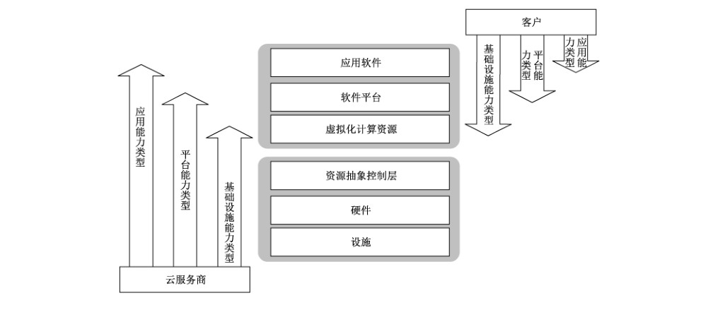
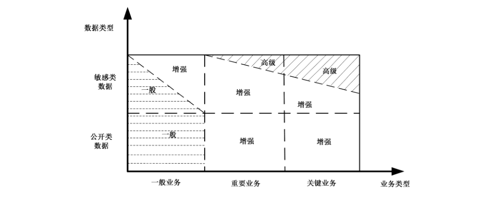

# GB/T 31168-2023 信息安全技术 云计算服务安全能力要求

> 来源：[GB/T 31168-2023 国家标准详情](https://openstd.samr.gov.cn/bzgk/std/newGbInfo?hcno=B9226EFE52E3BE662354F8B5DFF9A137)；发布日期：2023-05-23；实施日期：2023-12-01。
> PDF SHA-256：0dd51f876ca7f3039cc4c83a93c7f3695c42910ad2da65129a0f2737ce17a0d2。
> 转写说明：对照官方 PDF 全部 77 页图像逐页核对；省略封面、目录、页眉、页脚和页码，合并跨页内容。表 A.1、A.2 和附录 B 填写模板按原图重建，图 1、图 2 保留原图。正式引用请核对官方原文。

## 前言

本文件按照GB/T 1.1—2020《标准化工作导则 第1部分：标准化文件的结构和起草规则》的规定起草。

本文件代替 GB/T 31168—2014《信息安全技术 云计算服务安全能力要求》，与GB/T 31168—2014相比，除结构调整和编辑性改动外，主要技术变化如下：

a） 更改了本文件的适用范围（见第1章，2014年版的第1章）；

b）增加了对 GB/T 32400—2015 和 GB/T 35273—2020的规范性引用（见第3章、9.1.1）；

c） 更改了部分术语和定义（见第3章，2014年版的第3章）；

d） 增加了“缩略语”一章（见第4章）；

e） 将“云服务模式”更改为“云能力类型”（见5.1）；

f）增加了高级要求，每类安全要求分别对应一般要求、增强要求和高级要求（见 5.4）；

g） 删除了“本文件的结构”（见2014年版的4.7）；

h） 删除了原各类要求分别对应的策略与规程，整合至第14章的“策略与规程”（见14.1，2014年版的5.1、6.1、7.1、8.1、9.1、10.1、11.1、12.1、13.1 和 14.1）；

i） 增加了“安全管理功能的通信保护”（见 7.14）；

j） 增加了“WEB 访问安全”“API 访问安全”（见 8.21、8.22）；

k） 增加了“数据保护”一章，提出数据安全要求，确保客户迁移数据过程中的业务连续性和数据完整性（见第9章）；

l） 将“维护”一章的名称更改为“维护管理”（见第11章，2014年版的第9章）；

m）更改了“机房设计”的内容（见第16章，2014年版的第14章）。

请注意本文件的某些内容可能涉及专利。本文件的发布机构不承担识别专利的责任。

本文件由全国信息安全标准化技术委员会（SAC/TC 260）提出并归口。

本文件起草单位：中电数据服务有限公司、四川大学、杭州安恒信息技术股份有限公司、中国科学技术大学、中国电子技术标准化研究院、中国网络安全审查技术与认证中心、国家信息技术安全研究中心、中国信息安全测评中心、中国信息通信研究院、北京信息安全测评中心、国家工业信息安全发展研究中心、中国软件评测中心、中国移动通信集团有限公司、中电长城网际系统应用有限公司、神州网信技术有限公司、深信服科技股份有限公司、宁夏西云数据科技有限公司、三六零数字安全科技集团有限公司、蚂蚁科技集团股份有限公司、合肥高维数据技术有限公司、上海市方达（北京）律师事务所、北京中测安华科技有限公司、中电和瑞科技有限公司、阿里云计算有限公司、武汉理工大学、四川发展大数据产业投资有限责任公司、南方电网数字传媒科技有限公司、上海观安信息技术股份有限公司、中科锐眼（天津）科技有限公司。

本文件主要起草人：周亚超、罗永刚、左晓栋、陈兴蜀、李世锋、张建军、闵京华、杨建军、李斌、伍扬、王惠莅、张弛、单博深、许皖秀、崔占华、王启旭、杨苗苗、张明天、刘佳良、胡华明、丁晓、史大为、卢夏、李媛、何延哲、刘俊河、王强、陈雪鸿、杨帅锋、柳彩云、胡振泉、耿贵宁、邵江宁、韦韬、郭亮、贾依真、叶润国、田辉、尹云霞、杜宇鸽、安兆彬、吴复伟、张滨、江为强、刘雨桁、杨婷、李安伦、肖广娣、程军军、王坤、张峰、邱勤、艾青松、龙毅宏、张大江、黄少青、果靖、郑珂雪、陈清明、王永基、郑起、杨勃、王朝栋、张照龙、蒋韬、赵洪宇。

本文件及其所替代文件的历次版本发布情况为：

——2014 年首次发布 GB/T 31168—2014；

——本次为第一次修订。

## 引言

本文件与GB/T 31167—2023《信息安全技术 云计算服务安全指南》构成了云计算服务安全管理的基础文件。GB/T 31167—2023提出了客户采用云计算服务的安全管理基本原则，给出了采用云计算服务的生命周期各阶段的安全管理和技术措施；本文件面向云服务商，描述了提供云计算服务时应具备的安全技术能力。

参照 GB/T 31167—2023，本文件分为一般要求，增强要求和高级要求。根据云计算平台上的数据敏感度和业务重要性的不同，云服务商具备的安全能力也各不相同。

## 1 范围

本文件规定了云服务商提供云计算服务时应具备的安全能力。

本文件适用于对云计算服务能力的建设、监督、管理和评估。

## 2 规范性引用文件

下列文件中的内容通过文中的规范性引用而构成本文件必不可少的条款。其中，注日期的引用文件，仅该日期对应的版本适用于本文件；不注日期的引用文件，其最新版本（包括所有的修改单）适用于本文件。

- GB/T 25069—2022 信息安全技术 术语

- GB/T 31167—2023 信息安全技术 云计算服务安全指南

- GB/T 32400—2015 信息技术 云计算 概览与词汇

- GB/T 35273—2020 信息安全技术 个人信息安全规范

- GB 50174 数据中心设计规范

## 3 术语和定义

GB/T 25069—2022、GB/T 31167—2023 和 GB/T 32400—2015 界定的以及下列术语和定义适用于本文件。

### 3.1 云计算 cloud computing

通过网络访问可扩展的、灵活的物理或虚拟共享资源池，并按需自助获取和管理资源的模式。

> 注：资源实例包括服务器、操作系统、网络、软件、应用和存储设备等。

### 3.2 云计算服务 cloud computing service

使用定义的接口，借助云计算（3.1）提供一种或多种资源的能力。

### 3.3 云服务商 cloud service provider

提供云计算服务（3.2）的参与方。

### 3.4 云服务客户 cloud service customer

为使用云计算服务而处于一定业务关系中的参与方。

注1：业务关系不一定包含经济条款。

注2：本文件中云服务客户简称客户。

### 3.5 云服务用户 cloud service user

云服务客户（3.4）中使用云服务的自然人或实体代表。

［来源：GB/T 32400—2015,3.2.17］

### 3.6 云服务租户 cloud service tenant

对一组物理和虚拟资源进行共享访问的一个或多个云服务用户。

［来源：GB/T 32400—2015,3.2.37］

### 3.7 云计算平台 cloud computing platform

云服务商提供的云计算基础设施及其上的服务软件的集合。

### 3.8 云能力类型 cloud capabilities type

根据资源使用情况对提供给云服务客户的云服务功能进行分类。

> 注：云能力类型包括应用能力类型、基础设施能力类型和平台能力类型。

### 3.9 外部信息系统 external information system

云计算平台之外的信息系统。

> 注：外部信息系统的所有权、控制权一般不由云服务商掌握，其安全措施的使用或有效性不由云服务商直接控制。

### 3.10 开发商 developer

信息系统、组件或服务的开发者、制造商、系统集成商、供应商和经销商等。

> 注：开发商一般是云服务商的内部开发团队或通过签订合同委托开发的外部开发团队，包括个人、企业、非营利组织、开源组织等。

## 4 缩略语

下列缩略语适用于本文件。

API：应用程序编程接口（application programming interface）
CPU：中央处理单元（central processing unit）
DDoS：分布式拒绝服务（distributed denial of service）
DoS：拒绝服务（denial of service）
FTP：文件传输协议（file transfer protocol）
HTTP：超文本传输协议（hypertext transfer protocol）
IaaS：基础设施即服务（infrastructure as a service）
IP：网络互联协议（internet protocol）
iSCSI：互联网小型计算机系统接口（internet small computer system interface）
MAC：介质访问控制层（media access control）
PaaS：平台即服务（platform as a service）
PKI：公钥基础设施（public key infrastructure）
SaaS：软件即服务（software as a service）
SLA：服务水平协议（service level agreement）
TELNET：远程登录协议（teletype network）
USB：通用串行总线（universal serial bus）
vCPU：虚拟中央处理单元（virtual central processing unit）
VPC：虚拟私有云（virtual private cloud）
VPN：虚拟专用网（virtual private network）
WEB：全球广域网（world wide web）

## 5 云计算安全要求的表达与实现

### 5.1 云计算安全措施的实施责任

云计算环境的安全性由云服务商和客户共同保障。在某些情况下，云服务商还要依靠其他组织提供计算资源和服务，其他组织也应承担安全责任。为保障云计算服务的安全，达到云计算服务的安全能力要求，云计算安全措施的实施主体有多个，各类主体的安全责任因不同的云能力类型而异。

依据 GB/T 31167—2023，云能力类型是根据资源使用情况对提供给客户的云服务功能进行的分类，主要包括应用能力类型、平台能力类型和基础设施能力类型。

在图1中，云计算的设施层（物理环境）、硬件层（物理设备）、资源抽象控制层都处于云服务商的完全控制下，所有安全责任由云服务商承担。应用软件层、软件平台层、虚拟化计算资源层的安全责任则由双方共同承担，越靠近底层的云服务（即基础设施能力类型的云服务），客户的管理和安全责任越大；反之，云服务商的管理和安全责任越大。

考虑到云服务商可能还需要其他组织提供的服务，如 SaaS 或PaaS 服务提供商可能依赖于 IaaS 服务提供商的基础资源服务。在这种情况下，某些安全措施由其他组织提供。

因此，云计算安全措施的实施责任有4类，如表1所示。

**表1 云计算安全措施的实施责任**

| 责任 | 示例 |
| --- | --- |
| 由云服务商承担 | 针对应用能力类型的云服务，云服务商对平台上安装的软件进行安全升级 |
| 由客户承担 | 针对基础设施能力类型的云服务，客户对其安装的应用中的用户行为进行审计 |
| 由云服务商和客户共同承担 | 云服务商的应急演练计划需要与客户的应急演练计划相协调。在实施应急演练时，需要客户与云服务商相互配合 |
| 由其他组织承担 | 有的应用能力类型服务提供商需要利用基础设施能力类型服务提供商的基础设施服务，相应的物理与环境保护措施应由基础设施能力类型服务提供商予以实施 |

本文件不对客户承担的安全责任提出要求。客户按照GB/T 31167—2023及其他有关网络安全的标准落实其安全责任。

如果云服务商依赖于其他组织提供的服务或产品，则其所承担的安全责任直接或间接地转移至其他组织，云服务商应以合同或其他方式对相应安全责任进行规定并予以落实。但是，云服务商仍是客户或主管部门开展云计算服务安全管理的直接对象。

### 5.2 云计算安全措施的作用范围

在同一个云计算平台上，可能有多个应用系统或服务，某些安全措施应作用于整个云计算平台。例如，云服务商实施的人员安全措施即适用于云计算平台上每一个应用系统。这类安全措施称为通用安全措施。

某些安全措施仅作用于特定的应用或服务。例如，云计算平台上电子邮件系统的访问控制措施与文字处理系统的访问控制措施可能不同。这类安全措施称为专用安全措施。

在特殊情况下，某些安全措施的一部分属于通用安全措施，另一部分属于专用安全措施。例如，云计算平台上电子邮件系统的应急响应计划既要利用云服务商的整体应急响应资源（如应急保障队伍），也要针对电子邮件系统的备份与恢复做出专门考虑。这类安全措施称为混合安全措施。

云服务商为客户提供云计算服务时，每一类云计算应用或服务均应实现本文件规定的安全要求。

云服务商可以不再重复实现通用安全措施，平台上每个具体的应用系统或服务直接继承该安全措施即可。

### 5.3 安全要求的分类

本文件对云服务商提出了安全能力要求，反映了云服务商在保障云计算环境中客户业务和数据的安全性时应具备的安全能力。这些安全要求分为11类，每一类安全要求包含若干项具体要求。

- 系统开发与供应链安全：云服务商应在开发云计算平台时对其提供充分保护，对信息系统、组件和服务的开发商提出相应要求，为云计算平台配置足够的资源，并充分考虑安全需求。云服务商应确保其供应商采取了必要的安全措施。云服务商还应为客户提供有关安全措施的文档和信息，配合客户完成对云计算平台和业务系统的管理。

- 系统与通信保护：云服务商应在云计算平台的外部边界和内部关键边界上监视、控制和保护网络通信，并采用结构化设计、软件开发技术和软件工程方法有效保护云计算平台的安全性。

- 访问控制：云服务商应在允许人员、进程、设备访问云计算平台之前，对其进行身份标识及鉴别，并限制其可执行的操作和使用的功能。

- 数据保护：云服务商应严格保护云计算平台的客户数据，建立数据安全管理制度，确保境内运营中收集和产生的客户数据在境内存储，提供数据分类分级及安全保护、重要数据的备份与恢复等功能，协助客户完成数据迁移并在服务结束时安全返还数据。

- 配置管理：云服务商应对云计算平台进行配置管理，在系统生命周期内建立和维护云计算平台（包括硬件、软件、文档等）的基线配置和详细清单，并设置和实现云计算平台中各类产品的安全配置参数。

- 维护管理：云服务商应对云计算平台设施和软件系统进行维护，并对维护所使用的工具、技术、机制以及维护人员进行有效的管理，且做好相关记录。

- 应急响应：云服务商应为云计算平台制定应急响应计划，并定期演练，确保在紧急情况下重要信息资源的可用性。云服务商应建立事件处理计划，包括对事件的预防、检测、分析和控制及系统恢复等，对事件进行跟踪、记录并向相关人员报告。云服务商应具备容灾恢复能力，建立必要的备份与恢复设施和机制，支撑客户业务的连续性计划。

- 审计：云服务商应根据安全需求和客户要求，制定可审计事件清单，明确审计记录内容，实施审计并妥善保存审计记录，对审计记录进行定期分析和审查，还应防范对审计记录的非授权访问、修改和删除行为。

- 风险评估与持续监控：云服务商应定期或在威胁环境发生变化时，对云计算平台进行风险评估，确保云计算平台的安全风险处于可接受水平。云服务商应制定监控目标清单，对目标进行持续安全监控，并在发生异常和非授权情况时发出警报。

- 安全组织与人员：云服务商应确保能够接触客户数据或业务的各类人员（包括供应商人员）上岗时具备履行其安全责任的素质和能力，还应在授予相关人员访问权限之前对其进行审查并定期复查，在人员调动或离职时履行安全程序，对于违反安全规定的人员进行处罚。

- 物理与环境安全：云服务商应确保机房位于境内，机房选址、设计、供电、消防、温湿度控制等符合相关标准的要求。云服务商应对机房进行监控，严格限制各类人员与运行中的云计算平台设备进行物理接触，确需接触的，需通过云服务商的明确授权。

### 5.4 安全要求的表述形式

依据GB/T 31167—2023，本文件提出了一般、增强和高级三个能力级别的具体指标要求，将云计算服务安全能力要求分为一般要求、增强要求和高级要求。所有的客户数据都应该得到适当保护，为不同类型的数据提供相应的保护能力；所有的客户业务都应得到适当保护，保证业务的安全性和连续性。

GB/T 31167—2023给出了业务类型、数据类型与安全能力级别之间的对应关系，云服务商为客户提供相应强度的安全保护，如图2所示。

本文件中每一项安全要求均以一般要求、增强要求和高级要求的形式给出，附录A给出了不同安全能力级别选择及相关要求的数量统计情况。

高级要求和增强要求分别是对其低一级要求的补充和强化。在实现高级要求或增强要求时，其低一级要求应首先得到满足。有的安全要求只列出了增强要求，一般要求标为“无”，这表明对于具有一般安全能力的云服务商来说，此项无安全要求。对于安全要求中增强要求为“无”的，表明只需要满足一般要求。对于安全要求中高级要求为“无”的，表明只需要满足增强要求。

即使对同等安全能力水平的云服务商，其实现安全要求的方式也可能会有差异。为此，本文件在描述安全要求时引入了“赋值”和“选择”这两种变量，并以［赋值：……］和［选择：……；……］的形式给出。

“赋值”表示云服务商在实现安全要求时，要由其定义具体的数值或内容。“选择”表示云服务商在实现安全要求时，应选择一个给定的数值或内容。

云服务商在向客户提供云计算服务前，应确定并实现“赋值”和“选择”的具体数值或内容。

“赋值”和“选择”示例如下：云服务商应在［赋值：云服务商定义的时间段］后自动［选择：删除；禁用］临时和应急账号。

### 5.5 安全要求的调整

本文件提出的安全要求是通常情况下云服务商应具备的安全能力。在具体的应用场景下，云服务商有可能需要对这些安全要求进行调整。

调整的方式有：

- 删减：未实现某项安全要求，或只实现了某项安全要求的一部分；

- 补充：某项安全要求不足以满足云服务商的特定安全目标，故增加新的安全要求，或对标准中规定的某项安全要求进行强化；

- 替代：使用其他安全要求替代标准中规定的某项安全要求，以满足相同的安全目标。

调整的原因有多种，例如：

- 已知某些目标客户有特殊的需求；

- 云服务商的安全责任因应用能力类型、平台能力类型和基础设施能力类型等不同的云能力类型不同，云服务商为了实现本文件中规定的安全要求，所选择的安全措施的实施范围、实施强度可能不同；

- 出于成本等因素考虑，实现替代性的安全要求；

- 具有更强的安全能力。

### 5.6 安全计划

为了建立向客户提供安全的云计算服务的能力，云服务商应制定安全计划，详细说明对本文件提出的安全要求的实现情况。云服务商应在安全计划中对“赋值”和“选择”给出具体的数值或内容，必要时还需对本文件提出的安全要求进行调整。

当云计算平台提供多个应用或服务时，云服务商应分别制定每个应用或服务的安全计划。

安全计划包括但不限于以下内容。

- 云计算平台的基本描述，包括：

  - 系统拓扑；

  - 系统运营单位；

  - 与外部系统的互连情况；

  - 云能力类型和部署模式；

  - 系统软硬件清单；

  - 数据流等。

- 为实现本文件规定的安全要求而采取的安全措施的具体情况。对每项安全要求，云服务商均应在以下6个选项中选择其一作为对实现情况的整体描述，并针对性地提供详细说明。

  - 满足。此种情况下，应说明为满足安全要求而采取的具体措施。

  - 部分满足。此种情况下，对已满足的安全要求应说明所采取的具体措施，对不满足的安全要求应说明理由。

  - 计划满足。此种情况下，应说明时间进度安排以及在此期间的风险管控措施。

  - 替代。此种情况下，应说明替代理由并说明所实现的安全目标与原安全要求之间的关系。

  - 不满足。此种情况下，应说明不满足的理由。

  - 不适用。此种情况下，应说明不适用的理由。

- 对云服务商新增的安全目标及对应的安全措施的说明。

- 对客户安全责任的说明，以及对客户应实施的安全措施的建议。

附录B给出了安全计划中本文件安全要求的实现情况描述模板以及不适用项的识别方法。

## 6 系统开发与供应链安全

### 6.1 资源分配

#### 6.1.1 一般要求

云服务商应：

a） 对保护信息系统和服务所需的资源（如有关资金、场地、人力等）进行详细分析，并确保这些资源的可用性；

b） 在预算管理过程中对网络安全资源需求予以重点考虑，在工作计划和预算文件中，将网络安全作为单列项予以考虑。

#### 6.1.2 增强要求

无。

#### 6.1.3 高级要求

无。

### 6.2 系统生命周期

#### 6.2.1 一般要求

云服务商应：

a） 在系统生命周期中充分考虑安全因素，确保安全措施同步规划、同步建设、同步使用；

b） 明确信息系统生命周期的网络安全角色和责任，确定相应责任人；

c） 将信息安全风险管理过程集成到系统生命周期活动中；

d） 在系统生命周期中应用安全工程原则，根据实际情况可包括：在设计阶段制定安全策略和措施；实施分层保护；划定物理和逻辑安全边界等。

#### 6.2.2 增强要求

无。

#### 6.2.3 高级要求

无。

### 6.3 采购过程

#### 6.3.1 一般要求

云服务商应根据相关规定和标准的要求以及可能的客户需求：

a） 基于风险评估方法，在采购合同或其他文件中提出安全要求，可包括：安全功能要求、安全强度要求、安全保障要求、安全相关文档要求、保密要求、开发环境和预期运行环境描述、验收准则、强制配置要求（如功能、端口、协议和服务）；

b） 与供应商签订协议，明确安全和保密义务与责任，确保供应链安全事件信息或威胁信息能够及时传达到供应链上的有关各方；

c） 与供应商签订 SLA，确保与供应商签订的SLA 中的相关指标，不低于拟与客户所签订的 SLA中的相关指标。

#### 6.3.2 增强要求

云服务商应要求信息系统、组件或服务的开发商：

a） 提供安全功能或安全机制描述；

b） 提供系统开发过程质量保障证据，例如：表明其在系统开发过程中使用了成熟的系统工程方法、软件开发方法、测试技术或质量控制过程；

c） 在交付时实现安全配置，禁用不必要或高风险的功能、端口、协议或服务，并将该安全配置作为重新安装或升级时的缺省配置；

d） 制定对安全措施有效性的持续监控计划。

#### 6.3.3 高级要求

无。

### 6.4 系统文档

#### 6.4.1 一般要求

云服务商应满足以下要求。

a） 确保云计算平台具有管理员文档且涵盖以下信息：

1） 信息系统、组件或服务的安全配置，以及安装和运行说明；

2） 安全特性或功能的使用和维护说明；

3） 与管理功能有关的配置和使用说明。

b） 确保云计算平台具有用户文档，且涵盖以下信息：

1） 安全功能、机制及其使用方法；

2） 信息系统、组件或服务的安全使用方法或说明；

3）用户安全责任。

c） 基于风险管理策略，按照要求保护上述文档。

d） 将上述文档分发至云计算平台的管理员、用户和相关角色。

#### 6.4.2 增强要求

无。

#### 6.4.3 高级要求

无。

### 6.5 关键性分析

#### 6.5.1 一般要求

无。

#### 6.5.2 增强要求

云服务商应在［赋值：云服务商定义的系统生命周期中的决策点］，如规划、设计或发生重大变更时，对云计算平台进行关键性分析，以确定关键信息系统组件和功能，并分析该功能或组件失效对系统业务的影响。

#### 6.5.3 高级要求

无。

### 6.6 外部服务

#### 6.6.1 一般要求

云服务商应：

a） 要求外部服务提供商遵从并实施云服务商的安全要求；

b） 明确外部服务提供商的安全分工与责任，同时要求外部服务提供商接受相关客户监督；

c） 对外部服务提供商所提供的安全措施的合规性进行持续监控，例如：在服务水平协议中明确，对发现的不合规情况提供补救措施和响应要求；

d）选择可信赖的外部服务提供商，例如：有过良好合作或具备相关资质的提供商。

#### 6.6.2 增强要求

云服务商应满足以下要求。

a） 在采购或外包安全服务（如应急保障服务）前，评估该服务带来的风险。

b）确保安全服务的采购或外包得到安全责任部门以及相关人员或角色的批准。

c） 要求外部服务提供商明确说明该服务涉及的功能、端口、协议和其他服务。

d）基于［赋值：云服务商定义的安全要求、属性、因素或者其他条件］建立并保持与外部服务提供商的信任关系。例如：信任关系可以是基于合同或服务水平协议、服务模式、采取的安全控制措施及其有效性，评估外部服务提供商的安全性和可控性。

e） 根据评估情况，采取安全防护措施，包括：

1） 对外部服务提供商人员进行背景审查或要求外部服务提供商提供可信的人员背景审查结果；

2） 检查外部服务提供商资本变更记录；

3） 定期或不定期检查外部服务提供商的设施。

f） 基于［赋值：云服务商定义的要求或条件］，限制［选择：数据处理；数据；信息系统服务］的地点，如本地或境内。

#### 6.6.3 高级要求

无。

### 6.7 开发商安全体系架构

#### 6.7.1 一般要求

无。

#### 6.7.2 增强要求

云服务商应满足以下要求。

a） 要求信息系统、组件或服务的开发商制定设计规范和安全体系架构，且符合下列条件：

1） 该架构能够清晰体现信息系统的安全防护、技术运维和安全管理体系，并符合或支持云服务商的整体安全架构；

2） 准确完整地描述了所需的安全功能，并为物理和逻辑组件分配了安全措施；

3） 说明各项安全功能、机制和服务如何协同工作，以提供完整一致的保护能力。

b） 要求信息系统、组件或服务的开发商提供云服务所需的相关信息，说明与安全相关的硬件、软件和固件。

c） 要求信息系统、组件或服务的开发商编制非形式化的说明书，说明安全相关的硬件、软件和固件的接口，并通过非形式化的证明，说明该说明书完全覆盖了与安全相关的硬件、软件和固件的接口。

#### 6.7.3 高级要求

无。

### 6.8 开发过程、标准和工具

#### 6.8.1 一般要求

无。

#### 6.8.2 增强要求

云服务商应：

a） 要求信息系统、组件或服务的开发商明确安全需求，制定开发规范；

b） 要求信息系统、组件或服务的开发商在开发过程的初始阶段定义质量度量标准，并以［选择：［赋值：云服务商定义的频率］；［赋值：云服务商定义的项目审查里程碑］；交付时］为节点，检查质量度量标准的落实情况；

c） 要求信息系统、组件或服务的开发商确定安全问题追踪工具，并在开发过程期间使用；

d） 要求信息系统、组件或服务的开发商以［赋值：云服务商定义的广度和深度］对信息系统进行威胁和脆弱性分析；

e） 要求信息系统、组件或服务的开发商使用［赋值：自行定义或云服务商定义的工具］执行漏洞分析，明确漏洞利用的可能性，确定漏洞消减措施，并将工具的输出和分析结果提交给［赋值：云服务商定义的人员或角色］；

f） 要求信息系统、组件或服务的开发商即使在交付信息系统、组件或服务后，也应跟踪漏洞情况，在发布漏洞补丁前提前通知云服务商，且应将漏洞补丁交由云服务商审查、验证并允许云服务商自行安装；

g） 在信息系统、组件或服务的开发和测试环境使用生产数据时，先行批准、记录并进行保护；

h）要求信息系统、组件或服务的开发商制定应急预案，并将应急预案纳入云服务商的应急响应计划中。

#### 6.8.3 高级要求

无。

### 6.9 开发过程配置管理

#### 6.9.1 一般要求

云服务商应要求信息系统、组件或服务的开发商：

a） 在信息系统、组件或服务的开发过程中实施配置管理；

b） 记录和保存基本配置信息，对配置信息实施变更控制，根据实际情况，配置项包括但不限于：形式化模型、功能、高层设计说明书、低层设计说明书、其他设计数据、实施文档、源代码和硬件原理图、目标代码的运行版本、版本对比工具、测试设备和文档；

c） 得到云服务商的批准后，才能对所提供的信息系统、组件或服务进行变更；

d） 记录对信息系统、组件或服务的变更及其所产生的安全影响，并及时更新基本配置信息库；

e） 跟踪信息系统、组件或服务中的安全缺陷和解决方案。

#### 6.9.2 增强要求

云服务商应：

a） 要求信息系统、组件或服务的开发商提供能够验证软件和固件组件完整性的方法；

b） 在没有专用的开发商配置团队支持的情况下，由本组织的人员建立相应的配置管理流程；

c） 要求信息系统、组件或服务的开发商提供对硬件组件进行完整性验证的方法，如防伪标签、可核查序列号、防篡改技术等；

d） 要求信息系统、组件或服务的开发商，在开发过程中使用工具验证软件或固件源代码、目标代码的当前版本与以往版本异同，并采取措施保证安全相关的硬件、软件和固件的出厂版本与现场运行版本一致，现场更新与开发商内部版本一致。

#### 6.9.3 高级要求

无。

### 6.10 开发商安全测试和评估

#### 6.10.1 一般要求

云服务商应要求开发商对所开发的信息系统、组件或服务：

a） 制定并实施安全评估计划；

b） 以［赋值：云服务商定义的深度和覆盖面］在［选择：单元；集成；系统；回归］测试过程中实施安全测试或评估；

c） 提供安全评估计划的实施证明材料，并提供安全评估结果；

d） 实施可验证的缺陷修复过程；

e） 更正在安全评估过程中发现的脆弱性和不足。

#### 6.10.2 增强要求

云服务商应满足以下要求。

a） 要求信息系统、组件或服务的开发商在开发阶段使用静态代码分析工具识别常见缺陷，并记录分析结果。

b） 要求信息系统、组件或服务的开发商实施威胁和脆弱性分析，并测试或评估已开发完成的信息系统、组件或服务。

c） 在对信息系统、组件或服务的开发商进行评估时，采取以下方式：

1） 选择第三方验证开发商实施安全评估计划的正确性以及在安全测试或评估过程中产生的证据；

2） 确保第三方能够获得足够的资料来完成验证过程，或已被授予获得此类信息的访问权限。

d） 要求信息系统、组件或服务的开发商对［赋值：云服务商定义的特定代码］实施代码审查。

e） 要求信息系统、组件或服务的开发商按照［赋值：云服务商定义的约束条件］，以［赋值：云服务商定义的广度和深度］执行渗透性测试。

f） 要求信息系统、组件或服务的开发商分析所提供的硬件、软件和固件容易受到攻击的脆弱点。

g） 要求信息系统、组件或服务的开发商验证安全测试或评估范围满足［赋值：云服务商定义的广度和深度要求］。

#### 6.10.3 高级要求

云服务商应满足以下要求。

a） 在对信息系统、组件或服务的开发商进行评估时：

1） 选择独立第三方验证开发商实施安全评估计划的正确性以及在安全测试或评估过程中产生的证据；

2） 确保独立第三方能够获得足够的资料来完成验证过程，或已被授予获得此类信息的访问权限。

b） 要求信息系统、组件或服务的开发商对［赋值：云服务商定义的特定代码］实施人工代码审查。

人工代码审查可用于对关键组件代码审查，该代码实现与应用程序或外部环境威胁相关性较大或不适合使用自动分析工具检查其脆弱性，审查结果应易于理解且向云服务商提供，并确保云服务商可重构系统。

c） 要求信息系统、组件或服务的开发商在运行阶段使用动态代码分析工具识别常见缺陷，并记录分析结果。

d） 要求信息系统、组件或服务的开发商在系统生命周期中，可采用技术手段对信息系统、组件或服务开展高弹性或高韧性测试，以达到以下效果：验证信息系统是否对故障异常情况具有较强的恢复能力，避免故障或异常情造成严重影响与后果；主动识别并修复压力环境下的故障问题。

### 6.11 开发商提供的培训

#### 6.11.1 一般要求

云服务商应要求信息系统、组件或服务的开发商提供技术培训，以正确使用所交付系统或产品中的安全功能、措施和机制。

#### 6.11.2 增强要求

无。

#### 6.11.3 高级要求

无。

### 6.12 组件真实性

#### 6.12.1 一般要求

无。

#### 6.12.2 增强要求

云服务商应：

a） 制定和实施防赝品的策略和规程，检测并防止赝品组件进入信息系统；

b） 根据实际情况，向正品厂商、相关外部机构、云服务商安全责任部门或相关人员报告赝品组件；

c） 对相关人员或角色进行有关赝品组件检测的培训；

d） 在等待服务或维修，以及已送修的组件返回时，对关键组件的配置进行检查；

e） 销毁废弃的信息系统组件；

f） 按照［赋值：云服务商定义的频率］检查信息系统中是否有赝品组件。

#### 6.12.3 高级要求

无。

### 6.13 不被支持的系统组件

#### 6.13.1 一般要求

无。

#### 6.13.2 增强要求

云服务商应在开发商、供应商或厂商不再对系统组件提供支持时，替换该系统组件；或当因业务需要等原因需继续使用时，提供正当理由并经过本组织领导层的批准，并为不被支持的系统组件提供内部支持或来自其他外部提供商的支持。

#### 6.13.3 高级要求

无。

### 6.14 供应链保护

#### 6.14.1 一般要求

云服务商应满足以下要求。

a） 对云计算平台的供应链过程进行定义和管理，对供应链过程和参与者进行唯一标识，并建立管理操作规程，包括：

1） 供应链过程，包括硬件、软件和固件开发过程，运输和装卸过程，人员和物理安全程序，以及涉及供应链单元生产或发布的其他程序；

2） 供应链参与者指供应链中具有特定角色和责任的独立个体。

b） 识别对云计算服务的安全性存在重要影响的外包服务或采购的产品。

c） 确保［赋值：云服务商定义的网络关键设备和网络安全专用产品］通过国家规定的检测认证，例如：防火墙、安全隔离与信息交换产品（网闸）、反垃圾邮件产品、网络脆弱性扫描产品、安全数据库系统。

d） 在运输或仓储时使用防篡改包装，例如：采取防伪标签、安全封条、中性化包装，不体现包装物的信息，对包装物的封箱、开箱过程进行监督和记录，对封条使用和货柜安全操作建立指导性规程。

e） 当采购的网络产品和服务可能影响国家安全的，要求通过网络安全审查。

#### 6.14.2 增强要求

云服务商应满足以下要求。

a） 采用供应链保护措施，以降低攻击者利用供应链造成的危害；根据实际情况，保护措施包括但不限于：

1） 优先购买现货产品，避免购买定制设备；

2） 在能提供相同产品的多个不同供应商中做选择，以防范供应商锁定风险；

3） 选择有声誉的企业，建立合格供应商列表（含潜在供应商）；

4） 缩短采购决定和交付的时间间隔；

5） 使用可信或可控的分发、交付和仓储手段；

6） 限制从特定供应商或国家采购产品或服务；

7） 保护供应链相关信息，包括：用户身份、信息系统、组件或服务的用途、供应商身份、供应商处理过程、安全需求、设计说明书、测评结果、信息系统或组件配置等信息；在制定保护措施时，宜确定哪些信息可通过汇聚或推导分析而获得供应链关键信息，并采取针对性的措施予以防范，例如：向供应商屏蔽关键信息，采取匿名采购或委托采购；

8） 制定物流管理规程，完整记录入库、转库等物流信息，确保产品的可追溯性；在此基础上，建立标签码追溯数据管理规程和配套系统，确保从物料到产品交付的可追溯性。

b）优先选择满足下列条件的供应商：

1） 保护措施符合法律、法规、政策、标准以及云服务商的安全要求；

2） 企业运转过程和安全措施相对透明，具有相关文档记录；

3） 对下级供应商、关键组件和服务的安全提供了进一步的核查；

4） 在合同中声明不使用有恶意代码产品或假冒产品。

c） 在签署合同前对供应商进行评估，根据实际情况，包括但不限于：

1） 分析供应商对信息系统、组件和服务的设计、开发、实施、验证、交付、支持过程；

2） 评价供应商在开发信息系统、组件或服务时接受的安全培训和积累的经验，以判断其安全能力。

d） 按照［赋值：云服务商定义的频率］，识别供应链安全风险，综合分析各方面的信息，包括执法部门披露的信息、网络安全通报、应急响应机构的风险提示等，以发现来自开发、生产、交付过程以及人员和环境的风险，该分析尽可能覆盖到各层供应商和候选供应商。

e） 采用［赋值：云服务商定义的保护措施］确认所收到的信息系统或组件真实且未被篡改，如光学标签等；对于硬件，要求供应商提供详细和完整的组件清单和产地清单。

f） 明确供应商选择和退出的机制，当变更供应商时，对供应商变更带来的安全风险进行评估，并采取有关措施对风险进行控制。

g） 采取有关措施（如签订协议），使供应链安全事件信息或威胁信息能够及时传达到供应链相关方。

h） 采购网络产品和服务时，明确安全要求以及供应商的安全责任和义务，根据实际情况，可包括商用密码要求、维保服务外包要求等方面。

#### 6.14.3 高级要求

云服务商应：

a） 使用不同供应商提供的关键组件，并储备足够的备用组件，如可支撑业务运行一年；

b） 形成本组织内部的供应链图谱，掌握供应链全景信息；

c） 定期开展供应链安全评估，及时发现风险，并调整供应链安全保护策略、制度和安全措施等。

## 7 系统与通信保护

### 7.1 边界保护

#### 7.1.1 一般要求

云服务商应：

a） 在连接外部网络或外部信息系统的边界以及内部关键边界上，对通信进行监控；

b） 将允许外部公开直接访问的组件，划分在一个与内部网络逻辑隔离的子网络上，如隔离区（DMZ），确保允许外部人员访问的组件与允许客户访问的组件在逻辑层面实现严格的网络隔离；

c） 确保与外部网络或信息系统的连接只能通过严格管理的接口进行，该接口上应部署有边界保护设备。

#### 7.1.2 增强要求

云服务商应满足以下要求。

a） 为云计算服务搭建物理独立的资源池，确保资源池的计算资源、存储资源、网络资源不被服务于其他类型的客户的平台和系统所使用，且仅通过部署了边界保护设备或措施的受控接口与连接外部网络或服务于其他类型的客户的平台和系统相连。

b） 限制云计算平台外部访问接入点的数量，以便对进出通信和网络流量实施有效监控。

c） 采取以下措施对外部通信进行保护：

1） 对每一个外部的电信服务接口进行管理；

2） 对每一个接口制定通信流策略；

3） 采取有关措施对所传输的信息流进行必要的保密性和完整性保护；

4） 当根据业务需要，出现通信流策略的例外情况时，将业务需求和通信持续时间记录到通信流策略的例外项中；

5） 按照［赋值：云服务商定义的频率］，对网络通信流策略中的例外项进行审查，在通信流策略中删除不再需要的例外项。

d）确保云计算平台网络出入口在默认情况下拒绝所有网络通信流量，仅允许满足最小业务需求的网络通信流量通过。

e） 支持客户使用独立的代理服务器实现信息的导入导出。

f） 确保在［赋值：云服务商定义的边界保护失效情况］下，云计算平台中的［赋值：云服务商定义的受影响部分］能够安全地终止运行。

g） 采取措施满足不同客户或同一客户不同业务的信息系统之间隔离的需求。

#### 7.1.3 高级要求

云服务商应：

a） 对存在安全隐患的功能与其他业务功能进行隔离；

b） 采取相关措施，防止通过受控接口泄露数据；

c） 提供将［赋值：云服务商定义的组件］与其他组件动态隔离或分离的能力；

d） 采用边界保护机制隔离［赋值：云服务商定义的组件］，这些组件支持［赋值：云服务商定义的任务或业务功能］。

### 7.2 传输的保密性和完整性保护

#### 7.2.1 一般要求

云服务商应采用密码技术保证通信过程中数据的保密性和完整性。

#### 7.2.2 增强要求

云服务商应提供满足国家密码管理法律法规的通信加密和签名验签设施。

#### 7.2.3 高级要求

云服务商应在通信前基于密码技术对通信的双方进行验证或认证。

### 7.3 网络中断

#### 7.3.1 一般要求

无。

#### 7.3.2 增强要求

云服务商应采取有关措施，确保在应用层通信会话结束时以及在［赋值：云服务商定义的不活动时间］之后，终止云计算平台相关网络连接。

#### 7.3.3 高级要求

无。

### 7.4 可信路径

#### 7.4.1 一般要求

无。

#### 7.4.2 增强要求

云服务商应采取有关措施，确保在云计算平台用户和系统安全功能之间建立一条可信的通信路径，如通过专线、VPN 等方式，安全功能至少应包括：系统鉴别、再鉴别、服务分配和回收。

#### 7.4.3 高级要求

无。

### 7.5 密码使用和管理

#### 7.5.1 一般要求

云服务商应按照国家密码管理有关规定使用和管理云计算平台中使用的密码设施，并按规定生成、使用和管理密钥。

#### 7.5.2 增强要求

针对法律、行政法规和国家有关规定要求使用商用密码进行保护的关键信息基础设施，云服务商应当使用商用密码进行保护，自行或者委托商用密码检测机构开展商用密码应用安全性评估。

#### 7.5.3 高级要求

无。

### 7.6 设备接入保护

#### 7.6.1 一般要求

云服务商应：

a） 限制本地及远程终端设备接入云计算平台，在设备接入云计算平台前对其进行唯一性标识和鉴别，例如：基于设备的媒体访问控制（MAC）地址；

b） 对唯一性标识进行集中管理，确保通过唯一性标识可快速查找到设备；

c） 禁止在云计算平台中接入带网络通信功能的等协同计算设备，例如：摄像头、相机、麦克风、白板、打印机；

d） 对接入云计算平台的移动存储设备进行标识，确保只能经其授权的移动存储设备才可接入云计算平台；

e） 禁止在云计算平台及其远程运维网络中接入移动智能设备或产品，如智能手机、个人平板电脑、电子阅读器、智能穿戴式设备等；

f） 关闭网络设备中未使用的网络接口；

g） 严格限制运维终端中数据交换接口的使用，例如：USB、存储卡、光盘、蓝牙、红外等接口。

#### 7.6.2 增强要求

云服务商应在远程运维终端接入云计算平台前对其进行安全检查，确保安全状态符合云计算平台的安全要求后，才可接入云计算平台。

#### 7.6.3 高级要求

无。

### 7.7 移动代码

#### 7.7.1 一般要求

云服务商应根据安全需求和客户的要求，制定移动代码使用策略，对移动代码的使用进行限制，并对允许使用的移动代码进行监视。其中，移动代码是指在服务过程中从服务端下载并在客户端执行的代码，包括控件、插件和脚本程序，如JavaScript、ActiveX、VBScript、宏命令等。

#### 7.7.2 增强要求

云服务商应：

a） 在移动代码执行前采取必要的安全措施，至少对移动代码进行来源确认；

b）禁止自动执行移动代码。

#### 7.7.3 高级要求

无。

### 7.8 会话认证

#### 7.8.1 一般要求

云服务商应在用户注销或会话终止时使会话标识符失效。

#### 7.8.2 增强要求

云服务商应提供验证通信会话（如云计算平台的管理会话、业务会话等）双方身份真实性和保护通信会话真实性的能力，以防止中间人攻击、会话劫持等。通信会话保护可采用以下方式，包括：建立专用的会话通道对相关会话进行封装；提供公用和专用网络的端对端加密和验证服务；建立安全的数据交换机制，为网络连接提供数据加密、服务器认证以及可选择的客户机认证等。

#### 7.8.3 高级要求

无。

### 7.9 恶意代码防护

#### 7.9.1 一般要求

云服务商应：

a） 在网络出入口以及系统中的主机、移动计算和存储设备上实施恶意代码防护机制；

b） 建立相应维护机制，确保恶意代码防护机制得到及时更新，如升级病毒库；

c） 及时对恶意代码告警记录进行检查和分析。

#### 7.9.2 增强要求

云服务商应：

a） 自动更新恶意代码防护机制；

b）集中管理恶意代码防护机制。

#### 7.9.3 高级要求

云服务商应：

a） 具备不依赖病毒库特征的情况下对恶意代码防护的机制；

b） 发现恶意代码后，保留恶意代码样本，并具备对恶意代码进行溯源分析的能力。

### 7.10 内存防护

#### 7.10.1 一般要求

无。

#### 7.10.2 增强要求

云服务商应采取内存防护措施对内存进行防护，避免非授权代码执行。

#### 7.10.3 高级要求

无。

### 7.11 系统虚拟化安全性

#### 7.11.1 一般要求

云服务商应满足以下要求。

a） 确保虚拟机的镜像安全，并保证：

1） 提供虚拟机镜像、快照文件完整性校验功能，防止虚拟机镜像被恶意篡改；

2） 采取有关措施保证逻辑卷同一时刻只能被一个虚拟机挂载。

b） 实现虚拟化平台的资源隔离，并保证：

1） 虚拟机只能访问分配给该虚拟机的物理磁盘空间；

2） 不同虚拟机之间的虚拟 CPU（vCPU）指令实现隔离；

3） 不同虚拟机之间实现内存隔离；

4） 确保某个虚拟机崩溃后不影响虚拟机监控器（Hypervisor）及其他虚拟机。

c） 提供资源隔离失败后的告警措施。

d） 支持虚拟机安全隔离，在虚拟机监控器（Hypervisor）层提供虚拟机与物理机之间的安全隔离措施，控制虚拟机之间以及虚拟机和物理机之间所有的数据通信。

e） 提供虚拟化平台操作管理员权限分离机制。

f） 确保虚拟镜像模板的配置正确性，并明确模板的谱系来源。

#### 7.11.2 增强要求

云服务商应：

a） 提供虚拟机跨物理机迁移过程中的保护措施；

b） 提供对虚拟机所在物理机范围进行指定或限定的能力；

c） 提供防止虚拟机镜像文件数据被非授权访问的功能；

d） 对虚拟机模板文件、配置文件等重要数据进行完整性检测；

e） 采取措施确保虚拟机的内存被释放或再分配给其他虚拟机前得到完全释放。

#### 7.11.3 高级要求

云服务商应支持采用虚拟机镜像或快照文件加密的方式，防止虚拟机镜像或快照文件数据被非授权访问。

### 7.12 网络虚拟化安全性

#### 7.12.1 一般要求

云服务商应：

a） 针对不同云服务租户虚拟网络资源（如 VPC）间的访问实施网络逻辑隔离，保证不同云服务租户之间的网络隔离要求，并提供访问控制措施；针对同一云服务租户的不同业务，能够提供网络隔离能力和访问控制措施；

b） 对虚拟机的网络接口的带宽进行管理；

c） 能够为云服务租户业务提供虚拟化的负载均衡方案，保证云服务租户业务的可靠性。

#### 7.12.2 增强要求

无。

#### 7.12.3 高级要求

无。

### 7.13 存储虚拟化安全性

#### 7.13.1 一般要求

云服务商应：

a） 支持将对存储数据的安全控制措施应用到逻辑和物理存储实体上，确保不会因信息在物理存储位置上的改变而导致安全控制措施被旁路；

b） 禁止或限制对物理存储实体的直接访问；

c） 确保对不同云服务租户所使用的虚拟存储资源，实现逻辑隔离；

d） 在云服务租户解除其存储资源的使用后，提供存储数据清除措施，确保［赋值：云服务商定义的租户数据］能够在［赋值：云服务商定义的需要清除租户数据的操作］后在物理存储设备级别上被有效清除，例如：镜像文件、快照文件应在迁移或删除虚拟机后被有效清除；

e） 提供虚拟存储数据审计措施；

f） 提供虚拟存储数据访问控制措施；

g） 提供虚拟存储冗余备份支持。

#### 7.13.2 增强要求

云服务商应：

a） 提供存储协议级数据访问授权，如实施iSCSI 等存储协议级别的安全控制；

b） 允许客户部署满足国家密码管理规定的数据加密方案，能够在云计算平台以密文形式存储客户数据；

c） 支持第三方加密及密钥管理方案。

#### 7.13.3 高级要求

无。

### 7.14 安全管理功能的通信保护

#### 7.14.1 一般要求

云服务商应：

a） 将云计算平台管理流量与客户业务流量进行分离；

b） 能够对物理资源和虚拟资源按照策略做统一管理调度与分配；

c） 提供实时的虚拟机监控机制，通过带内或带外的技术手段对虚拟机的运行状态、资源占用、迁移等信息进行监控。

#### 7.14.2 增强要求

云服务商应：

a） 确保虚拟化平台的管理命令采用加密方式进行传输；

b） 当对云计算平台进行远程维护管理时，防止远程管理设备同时直接连接其他网络资源；

c） 为云计算平台建立独立的运维网络分区，部署资源管理平台、运维管理系统等实施运维管理；

d） 为云计算平台提供集中管控能力，包括系统管理、审计管理、配置管理等。

#### 7.14.3 高级要求

无。

## 8 访问控制

### 8.1 用户标识与鉴别

#### 8.1.1 一般要求

云服务商应：

a） 对信息系统的用户进行唯一标识和鉴别；

b） 对特权账号的网络访问实施多因子鉴别。

#### 8.1.2 增强要求

云服务商应：

a） 对账号的网络访问实施多因子鉴别，并确保至少一个因子由与系统分离的设备提供，以防止多因子鉴别凭证同时遭到破坏或泄露；

b） 对特权账号的网络访问实施抗重放鉴别机制，如动态口令，确保云计算平台能够抗重放攻击。

#### 8.1.3 高级要求

云服务商应：

a） 对特权账号的本地访问实施多因子鉴别；

b） 对非特权账号的网络访问实施抗重放鉴别机制，确保云计算平台能够抗重放攻击。

### 8.2 标识符管理

#### 8.2.1 一般要求

云服务商应：

a） 在［赋值：云服务商定义的时间段］内防止对用户或设备标识符的重用；

b） 在［赋值：云服务商定义的时间段］后禁用不活动的用户标识符。

#### 8.2.2 增强要求

云服务商应：

a） 对［赋值：云服务商定义的人员类型］进行进一步标识，如合同商或境外公民，便于了解通信方的身份（如将电子邮件的接收者标识为合同商，以便与本组织人员相区分）；

b）在标识跨组织、跨平台的用户时进行沟通协调，以满足相关组织或平台的标识符管理策略。

#### 8.2.3 高级要求

无。

### 8.3 鉴别凭证管理

#### 8.3.1 一般要求

云服务商应满足以下要求。

a） 通过以下步骤管理鉴别凭证：

1） 验证鉴别凭证接收对象（个人、组、角色或设备）的身份；

2） 确定鉴别凭证的初始内容；

3） 确保鉴别凭证能够有效防止伪造和篡改；

4） 针对鉴别凭证的初始分发、丢失处置以及重置，建立和实施管理流程；

5） 强制要求用户更改鉴别凭证的默认内容；

6） 明确鉴别凭证的最小和最大生存时间限制以及再用条件；

7） 对［赋值：云服务商定义的鉴别凭证］，强制要求在［赋值：云服务商定义的时间段］之后更新鉴别凭证；

8） 保护鉴别凭证内容，防止被泄露和篡改；

9） 采取由设备实现的特定安全措施以保护鉴别凭证，例如：由设备生成证书或密码；

10） 当组或角色账号的成员属性发生变化时，变更该账号的鉴别凭证。

b） 对于基于口令的鉴别：

1） 建立相关机制，支持强制执行最小口令复杂度，该复杂度应满足［赋值：云服务商定义的口令复杂度规则］；

2） 建立相关机制，能够在用户更新口令时，强制变更［赋值：云服务商定义的数目］个字符，确保新旧口令不同；

3） 对存储和传输的口令进行加密；

4） 强制执行最小和最大生存时间限制，以满足［赋值：云服务商定义的最小生存时间和最大生存时间］。

c） 对于基于硬件令牌的鉴别，定义令牌安全质量要求，并部署相关机制予以满足，如基于 PKI 的令牌。

#### 8.3.2 增强要求

云服务商应满足以下要求。

a） 对于基于 PKI 的鉴别：

1） 通过构建到信任根的认证路径并对其进行验证，包括检查证书状态信息，以确保认证过程的安全；

2） 对相应私钥进行保护。

b）确保未加密的静态鉴别凭证未被嵌入到应用、访问脚本中。

c） 接收［赋值：云服务商定义的鉴别凭证］时，通过本人或可信第三方实施。

#### 8.3.3 高级要求

云服务商应及时禁用缓存的鉴别凭证。

### 8.4 鉴别凭证反馈

#### 8.4.1 一般要求

云服务商应确保信息系统在鉴别过程中能够隐藏鉴别信息的反馈，以防止鉴别信息被非授权利用。

#### 8.4.2 增强要求

无。

#### 8.4.3 高级要求

无。

### 8.5 密码模块鉴别

#### 8.5.1 一般要求

云服务商应确保系统中的密码模块对操作人员设置了鉴别机制，该机制应满足国家密码管理的有关规定。

#### 8.5.2 增强要求

无。

#### 8.5.3 高级要求

无。

### 8.6 账号管理

#### 8.6.1 一般要求

云服务商应满足以下要求。

a） 指定专门的部门或人员进行账号管理，对账号的申请、建立、删除等操作进行控制。

b） 标识帐号类型，例如：个人账号、组帐号、访客账号等。

c） 当发生以下情况时，通知账号管理员：

1） 当临时账号不再需要时；

2） 当用户离职或调动时；

3） 当变更信息系统用途时。

d） 按照［赋值：云服务商定义的频率］，检查账号是否符合账号管理的要求。

#### 8.6.2 增强要求

云服务商应：

a） 采用自动机制实施账号管理，避免共享账号的存在；

b） 在［赋值：云服务商定义的时间段］后，自动［选择：删除；禁用］临时和应急账号；

c） 在［赋值：云服务商定义的时间段］后，自动关闭非活跃账号；

d） 采用自动机制，对账号的建立、更改、禁用和终止行为进行审计，并报告［赋值：云服务商定义的人员或角色］；

e） 根据基于角色的访问方案建立和管理特权账号，将信息系统的访问及特权纳入角色属性，并对特权角色的分配进行跟踪和监视。

#### 8.6.3 高级要求

云服务商应：

a） 针对［赋值：云服务商定义的账号］，设置账号使用条件，例如：仅在特定日期、时间段或场景下使用；

b） 监测是否存在账号异常使用情况，并将情况向［赋值：云服务商定义的人员或角色］通报。

### 8.7 访问控制的实施

#### 8.7.1 一般要求

云服务商应：

a） 对云计算平台上信息和系统资源的逻辑访问进行授权；

b） 按照［赋值：云服务商定义的职责分离规则］，对访问进行授权。

#### 8.7.2 增强要求

云服务商应确保客户可以依据［赋值：云服务商定义的强制实施的访问控制策略］，确定主体对客体的访问，该策略应规定以下要求。

a） 针对已获得信息访问权的主体，限制其实施以下任何行为：

1） 将信息传递给非授权的主体和客体；

2） 将权限授予其他主体；

3） 变更主体、客体、信息系统或组件的安全属性；

4） 对新创建或修改后的客体，变更其已经关联的安全属性；

5） 变更访问控制管理规则。

b） 针对［赋值：云服务商定义的主体］，可明确授予［赋值：云服务商定义的特权］，不被a）条的部分或全部条件所约束。

#### 8.7.3 高级要求

云服务商应保证客户可以依据［赋值：云服务商定义的强制实施的访问控制策略］，确定主体对客体的访问，该策略应适用于云计算平台所有主体对客体的访问。

### 8.8 信息流控制

#### 8.8.1 一般要求

无。

#### 8.8.2 增强要求

云服务商应在确保客户隐私权和安全利益的前提下：

a） 按照［赋值：云服务商定义的信息流控制策略］，控制系统内或互连系统间的信息流动，包括限制受控信息流向互联网、限制云计算平台上的客户及其他重要信息流向境外或在境外处理、限制云计算平台主动对外部网络的访问、限制跨 VPC 的数据流动、限制某些数据格式或含关键字的信息流出云计算平台；

b） 在不同的安全域之间传输信息时，检查信息中是否存在［赋值：云服务商定义的禁止类信息］，并遵循［赋值：云服务商定义的安全策略］，禁止传输此类信息；

c） 唯一地标识和鉴别以［选择：组织；系统；应用；个人］为标识的源和目的地址，以实施信息流策略。例如：禁止信息流向境外目的地址；

d） 使用同一设备或系统对多个不同安全域上的计算平台、应用或数据进行访问时，防止不同安全域之间的任何信息以违背信息流策略的方式进行流动。

#### 8.8.3 高级要求

云服务商应在［赋值：云服务商定义的条件］下，对［赋值：云服务商定义的信息流］实施人工审查。

### 8.9 最小特权

#### 8.9.1 一般要求

云服务商应：

a） 确保用户提供的访问权限是其完成指定任务所必需的，且符合本组织的业务需求；

b） 对［赋值：云服务商定义的安全功能和安全相关信息］的访问进行明确授权。

#### 8.9.2 增强要求

云服务商应：

a） 确保具有访问系统安全功能或安全相关信息特权的账号或角色用户，当访问非安全功能时，宜使用非特权账号或角色；

b） 限制［赋值：云服务商定义的人员或角色］具有特权账号；

c） 确保信息系统能够阻止非特权用户执行特权功能，以防禁止、绕过或替代已实施的安全措施。

#### 8.9.3 高级要求

云服务商应：

a） 限制仅［赋值：云服务商定义的强制操作需求］，才可授权对［赋值：云服务商定义的特权命令］进行网络访问，并在系统安全计划中记录此类访问的基本原理；

b） 定期审核所分配的特权账号，以验证对此类特权的需求；根据业务需求，必要时应重新分配或删除特权账号；

c） 防止［赋值：云服务商定义的云计算平台软件］使用比用户所运行软件更高的权限运行。

### 8.10 未成功的登录尝试

#### 8.10.1 一般要求

云服务商应：

a） 将［赋值：云服务商定义的时间段］内连续登录失败的上限限定为［赋值：云服务商定义的次数］；

b） 当登录失败次数超过上限时，系统将锁定账号，直至［选择：达到［赋值：云服务商定义的时间段］；由管理员解锁］。

#### 8.10.2 增强要求

无。

#### 8.10.3 高级要求

云服务商应在［赋值：云服务商定义的次数］的连续不成功地设备登录尝试之后，采用技术措施清除［赋值：云服务商定义的移动设备］的信息。

### 8.11 系统使用通知

#### 8.11.1 一般要求

云服务商应满足以下要求。

a） 在准予用户访问系统之前，向用户显示系统使用通知消息或标语，根据有关政策法规的要求，提供隐私和安全通知，并声明：

1） 用户正访问某重要单位的信息系统；

2） 系统的使用过程可能被监视、记录并受到审计；

3） 禁止对系统进行越权使用，否则将承担法律责任；

4） 一旦使用该系统，则表明同意受到监视和记录。

b） 在屏幕上保留通知消息或标语，直到用户登录或继续使用系统。

#### 8.11.2 增强要求

无。

#### 8.11.3 高级要求

无。

### 8.12 前次访问通知

#### 8.12.1 一般要求

云服务商应在用户登录系统后，显示前次登录信息。根据实际情况，前次登录信息可包括：上一次登录时间、上一次登录IP地址等设备信息、已经累计登录失败次数等。

#### 8.12.2 增强要求

无。

#### 8.12.3 高级要求

无。

### 8.13 并发会话控制

#### 8.13.1 一般要求

无。

#### 8.13.2 增强要求

云服务商应确保云计算平台的［赋值：云服务商定义的账号］，没有两个或两个以上的并发会话。

#### 8.13.3 高级要求

云服务商应确保云计算平台的各账号，没有两个或两个以上的并发会话。

### 8.14 会话锁定

#### 8.14.1 一般要求

无。

#### 8.14.2 增强要求

云服务商应：

a） 当用户在［赋值：云服务商定义的时间段］内未活动或者用户主动发起锁定指令时，实施会话锁定，以防止继续访问云计算平台；

b） 保持会话锁定，直到用户通过已有的标识和鉴别过程，再次建立连接；

c） 对锁定前可见的信息进行隐藏，并显示公开可见的图像。

#### 8.14.3 高级要求

无。

### 8.15 未进行标识和鉴别情况下可采取的行动

#### 8.15.1 一般要求

云服务商应确定无需进行标识和鉴别即可在云计算平台上实施的用户行为，并说明理由。该行为要符合云服务商的安全策略，并且与云计算平台上系统的功能相一致。

#### 8.15.2 增强要求

无。

#### 8.15.3 高级要求

无。

### 8.16 安全属性

#### 8.16.1 一般要求

无。

#### 8.16.2 增强要求

云服务商应：

a） 针对［赋值：云服务商定义的主体、用户（包括外部的IT 产品）、客体、信息、会话和/或资源］，定义安全属性，确定安全属性值或范围；

b） 提供关联手段，在信息的存储、处理、传输中，将［赋值：云服务商定义的安全属性］与信息相关联。例如：将信息的安全属性与其访问权限、访问环境关联起来。

#### 8.16.3 高级要求

无。

### 8.17 远程访问

#### 8.17.1 一般要求

云服务商应：

a） 对［赋值：云服务商定义的远程访问方法］明确使用限制、配置和连接要求；

b） 明确远程访问的实施条件，采取有关措施保证远程访问的安全；

c） 在允许远程连接前，对远程访问方式进行授权；

d） 实时监视非授权的云服务远程连接，并在发现非授权连接时采取适当的处置措施。

#### 8.17.2 增强要求

云服务商应：

a） 自动监视和控制远程访问会话，以检测网络攻击，确保远程访问策略得以实现；

b） 使用密码机制，以保证远程访问会话的保密性和完整性；

c） 确保所有远程访问只能经过有限数量的、受管理的访问控制点；

d） 对远程执行特权命令进行限制（如删除虚拟机、创建系统账号、配置访问授权、执行系统管理功能、审计系统事件或访问事件日志等），仅在为满足［赋值：云服务商定义的需求］的情况下，才能通过远程访问的方式，授权执行特权命令或访问安全相关信息，并采取更严格的保护措施且进行审计；在安全计划中应说明这种远程访问的合理性；

e） 在远程访问时禁止使用非安全的网络协议，例如：FTP、TELNET、HTTP 等；

f） 针对集中对多个云计算平台进行远程运维的，采取措施对集中运维环境、网络接入方式、运维终端、不同云计算平台鉴别凭证等进行安全保护；

g） 针对远程接入方式为非物理专线且由供应商提供的，对供应商远程接入方式进行安全评估，要求供应商提供服务资质、远程接入的安全性证书或第三方安全检测报告。

#### 8.17.3 高级要求

无。

### 8.18 无线访问

#### 8.18.1 一般要求

云服务商应：

a） 限制云计算平台上的无线网络功能；

b） 对授权使用的无线网络采取必要的安全措施。

#### 8.18.2 增强要求

云服务商应禁止云计算平台上的无线网络功能。

#### 8.18.3 高级要求

无。

### 8.19 外部信息系统的使用

#### 8.19.1 一般要求

云服务商应：

a） 明确列出何种情况下允许授权人员通过外部信息系统，对云计算平台进行访问；

b） 明确列出何种情况下允许授权人员通过外部信息系统，对云计算平台上的信息进行处理、存储或传输。

#### 8.19.2 增强要求

云服务商应满足以下要求。

a） 确保仅在以下情况下，允许授权人员通过外部信息系统进行访问，或利用外部信息系统处理、存储、传输云计算平台上的信息：

1） 外部信息系统正确实现了云服务商安全策略和安全计划所要求的安全措施，并通过了独立第三方机构的测试。

2） 与外部信息系统对应的实体签订了系统连接或信息处理协议，且该协议经过独立第三方机构的评价。

b） 限制授权人员在外部信息系统上使用由云服务商控制的移动存储媒体。

#### 8.19.3 高级要求

云服务商应：

a） 禁止通过外部信息系统访问云计算平台；

b） 禁止通过外部信息系统处理、存储、传输云计算平台上的信息；

c） 禁止在外部信息系统上使用由云服务商控制的移动存储媒体。

### 8.20 可供公众访问的内容

#### 8.20.1 一般要求

云服务商应：

a） 指定专人负责发布公开信息；

b） 开展人员安全意识培训，确保发布的信息中不含有非公开信息；

c） 在发布前对拟发布信息进行审查，防止含有非公开信息；

d） 按照［赋值：云服务商定义的频率］审查公开发布的信息中是否含有非公开信息，一经发现，立即删除。

#### 8.20.2 增强要求

无。

#### 8.20.3 高级要求

无。

### 8.21 WEB访问安全

#### 8.21.1 一般要求

云服务商应：

a） 支持 WEB 代码安全防护的能力，包括对输入输出进行有效性检查，以及采取防范认证漏洞、权限漏洞、会话漏洞、WEB 服务漏洞、注入漏洞等代码漏洞相关措施；

b） 支持对用户通过 WEB访问资源进行访问控制的能力；

c） 支持 WEB远程访问安全传输能力。

#### 8.21.2 增强要求

无。

#### 8.21.3 高级要求

无。

### 8.22 API 访问安全

#### 8.22.1 一般要求

云服务商应：

a） 支持服务 API 调用前实施用户鉴别和鉴权的功能；

b） 支持涉及云服务租户资源操作的服务 API 调用前验证用户凭据的功能；

c） 支持用户调用服务 API 的访问控制功能；

d） 支持服务 API 接口的防范重放、代码注入、DoS/DDoS 等攻击的功能；

e） 支持服务 API 接口安全传输的功能；

f） 支持服务 API 接口过载保护的功能，保障不同服务级别用户间业务的公平性以及系统资源利用最大化；

g） 支持服务 API 的调用日志记录的功能。

#### 8.22.2 增强要求

无。

#### 8.22.3 高级要求

无。

## 9 数据保护

### 9.1 通用数据安全

#### 9.1.1 一般要求

云服务商应：

a） 通过与客户签订的合同或其他形式，声明未经客户授权不得收集、使用或处理客户数据；

b） 明确数据安全管理角色或责任人，对数据处理操作进行授权、访问控制和安全审计等；

c） 为客户开展数据分类分级和数据安全保护工作，提供相应的安全技术措施和产品工具支持，包括数据加密、数据备份、数据脱敏、数据防泄漏、数据防篡改等；

d） 依据GB/T35273—2020，为客户的个人信息保护工作提供支持，通过合同或其他形式明确涉及云服务商的个人信息保护内容；

e） 确保境内运营过程中收集和产生的客户数据在境内存储；

f） 支持云服务租户自主设置数据备份、数据导出、数据重置等权限。

#### 9.1.2 增强要求

云服务商应：

a） 针对［赋值：云服务商定义的操作］，对数据处理操作进行记录并保留［赋值：云服务商定义的时间］；

b） 针对通过集中的管理节点对分布式计算中心进行远程运维的，采用密码技术确保集中运维管理数据和集中运维系统配置数据在传输与存储过程的保密性和完整性。

#### 9.1.3 高级要求

无。

### 9.2 媒体访问和使用

#### 9.2.1 一般要求

云服务商应：

a） 限制媒体访问权限，根据服务模式和业务要求，仅允许特定人员、角色或信息系统组件访问存储客户数据的媒体；

b）［选择：限制；禁止］在［赋值：云服务商定义的系统或组件］中使用［赋值：云服务商定义的媒体］。

#### 9.2.2 增强要求

云服务商应：

a） 限制对各类媒体的访问，并对媒体访问操作进行审计；

b） 对各类媒体进行标记，以标明其中所含信息的分发限制、处理注意事项以及其他有关安全标记（如”敏感级”）；

c） 在受控区域中，采取物理控制措施安全地存放媒体，如磁带、外置或可移动硬盘、Flash 驱动器、光盘等，并对这些媒体提供持续安全保护，直到对其进行销毁或净化；

d） 在受控区域之外传递数字媒体时，采用密码机制来保护其中信息的保密性和完整性；

e） 确保各类媒体在受控区域之外的传递过程得到记录；

f） 当媒体从高风险区域返回时，检测该媒体中的系统或组件是否受到篡改，例如：当本组织人员从高风险地区返回时，应对其移动设备、笔记本电脑或者其他组件进行检测。

#### 9.2.3 高级要求

云服务商应：

a） 采用自动机制限制对各类媒体的访问，并对媒体访问情况进行审计；

b） 在移动存储媒体连接到云计算平台之前，采用非破坏性技术对媒体进行净化；

c） 对媒体净化和诊断活动进行审核、批准、追溯、记录和检验。

### 9.3 剩余信息保护

#### 9.3.1 一般要求

云服务商应：

a） 确保用户鉴别凭证等敏感信息所在的存储空间被释放或再分配给其他用户前得到完全清除；

b）确保大量存储过敏感信息的存储媒体在报废、维修或重新利用前，采取技术措施清除信息。

#### 9.3.2 增强要求

云服务商应：

a） 在云服务租户解除存储资源的使用后，确保被云服务租户所解除的存储资源的所有数据在物理存储上被完全清除，例如：镜像文件、快照文件在迁移或删除虚拟机后能被完全清除；

b） 在客户删除业务应用数据时，删除云计算平台中存储的所有副本；

c） 当存储客户数据的媒体在报废、超出云服务商控制之外使用或回收再利用前，采取措施对其进行净化，所采用净化措施的强度，覆盖范围应与数据类别或敏感级别相匹配。

#### 9.3.3 高级要求

无。

### 9.4 数据使用保护

#### 9.4.1 一般要求

无。

#### 9.4.2 增强要求

云服务商应使用数据挖掘防范和检测技术，检测和防范对客户数据进行非授权的数据挖掘。

#### 9.4.3 高级要求

无。

### 9.5 数据共享保护

#### 9.5.1 一般要求

无。

#### 9.5.2 增强要求

云服务商应：

a） 允许授权用户判断共享者的访问授权是否符合［赋值：云服务商定义的信息共享环境］中的数据访问限制策略，以确保数据共享安全；

b） 使用自动机制或人工过程，支持用户的数据共享决策。

#### 9.5.3 高级要求

无。

### 9.6 数据迁移保护

#### 9.6.1 一般要求

云服务商应：

a） 在客户服务合同到期时，安全地返还云计算平台上的客户数据；

b） 在客户定义的时间内，删除云计算平台上存储的客户数据，并确保不能以商业市场的技术手段恢复；

c） 为客户数据迁移提供技术手段，并协助完成数据迁移，包括：

1） 具备在同架构云计算平台上将客户数据快速迁入或迁出的能力；

2） 具备在异构云计算平台上将客户数据迁入或迁出的能力；

3） 针对客户数据量大等可能导致迁移过程执行受阻的因素，制定应对措施；

4） 数据格式应支持主流硬件厂商的硬件平台和操作系统平台使用的典型数据库产品，支持异构数据库间的数据集成与协同，并保证多数据库（异构或同构）之间的全局事务一致性；

5） 在数据迁移过程中，中止源云计算平台上的客户业务系统服务，停止数据访问，并保持客户数据的完整性。

#### 9.6.2 增强要求

在迁移交付执行过程中，云服务商应根据客户需要，提供以下支持：

a） 将源云计算平台上业务系统内的数据与目标云计算平台内的新业务系统进行数据同步；

b） 提供客户数据迁移过程中产生的相关记录或文档；

c） 在合同或其他文件中说明客户数据迁移中涉及云服务商的潜在法律风险及处置措施，包括因受管辖的国家及需遵循的法规政策引发的长臂管辖、司法调查等造成客户数据无法迁移、迁移后数据未清除或数据存留等情况。

#### 9.6.3 高级要求

在客户数据迁移过程中，云服务商应根据客户需要，确保源云计算平台所承载的客户关键业务系统不会出现服务中断。

## 10 配置管理

### 10.1 配置管理计划

#### 10.1.1 一般要求

无。

#### 10.1.2 增强要求

云服务商应：

a） 制定并实施云计算平台的配置管理计划；

b） 在配置管理计划中，规定配置管理相关人员的角色和职责，并详细规定配置管理的流程，包括配置变更管理流程、配置参数及基线配置管理流程、信息系统组件清单管理流程等；

c） 在系统生命周期内，建立配置项标识和管理流程；

d） 定义信息系统的配置项并将其纳入配置管理计划；

e） 保护配置管理计划，以防非授权的泄露和变更。

#### 10.1.3 高级要求

无。

### 10.2 基线配置

#### 10.2.1 一般要求

云服务商应按照配置要求制定、记录并维护信息系统当前的基线配置。

#### 10.2.2 增强要求

云服务商应满足以下要求。

a） 在以下情况下重新审查和更新基线配置：

1） 按照［赋值：云服务商定义的频率］；

2） 当系统发生重大变更时；

3） 安装和更新系统组件后。

b） 保留［赋值：云服务商定义的信息系统基线配置的历史版本］，必要时恢复相关配置，如软件、硬件、固件、配置文件和配置记录。

c） 在云计算平台相关设施或设备将被携至高风险地区时，按照［赋值：云服务商定义的配置要求］进行配置；返回后，按照［赋值：云服务商定义的安全防护措施］，对设备进行防护。

#### 10.2.3 高级要求

无。

### 10.3 变更控制

#### 10.3.1 一般要求

云服务商应：

a） 明确云计算平台中有哪些变更需要包含在系统受控配置列表中，如主机配置项、网络配置项等；

b） 明确需定期变更的受控配置列表，并按照［赋值：云服务商定义的频率］对病毒库、入侵检测规则库、防火墙规则库、漏洞库等与网络安全相关的重要配置项进行更新；

c） 在云计算平台上实施变更之前，对信息系统的变更项进行分析，判断该变更事项对云计算安全带来的潜在影响；

d） 审查所提交的信息系统受控配置的变更事项，根据安全影响分析结果决定批准或否决，并进行记录；

e） 记录和保护信息系统中受控配置的变更记录，防止非授权的泄露和更改；

f） 按照［赋值：云服务商定义的频率］对涉及系统受控配置变更的有关活动进行审查；

g） 明确受控配置变更的管理部门，负责协调和监管涉及受控配置变更的有关活动；

h） 根据客户要求，确定应报告的配置变更事项；在实施变更之前，向客户提供下列变更信息：

1） 变更计划发生的日期和时间；

2） 系统变更的详细信息；

3） 变更的安全影响分析结论。

#### 10.3.2 增强要求

云服务商应：

a） 在云计算平台上实施变更之前，对受控配置变更项进行测试、验证和记录；

b） 对云计算平台上的变更实施物理或逻辑访问控制，并对变更动作进行审计；

c） 限制信息系统开发商和集成商对生产环境中的信息系统及其硬件、软件和固件进行直接变更；

d） 按照［赋值：云服务商定义的频率］，对开发商和集成商掌握的变更权限进行审查并重新评估。

#### 10.3.3 高级要求

云服务商应满足以下要求。

a） 采用自动机制实施变更并提供授权，包括：

1） 针对［赋值：云服务商定义的时间段］内未经批准或不批准的变更建议进行提醒；

2） 获得授权前禁止变更；

3） 记录对云计算平台的所有变更；

4） 完成对云计算平台的授权变更后，通知［赋值：云服务商定义的人员或角色］。

b） 实施变更前，测试、验证、记录变更并形成文档。

c） 要求网络安全人员代表参与云计算平台的变更决策。

d） 使用密码机制确保变更控制的安全性。

e） 在与运行环境隔离的测试环境中对变更进行测试，以发现潜在问题、不兼容或恶意代码带来的安全影响。

f） 定期对变更情况进行复审，防止发生未授权变更。

g） 针对［赋值：云服务商定义的配置设置］的未授权变更，采取安全措施。

### 10.4 配置参数的设置

#### 10.4.1 一般要求

云服务商应：

a） 按照［赋值：云服务商定义的安全配置核对表］，建立、记录并实现信息系统中所使用的信息技术产品的配置参数设置；

b） 当因［赋值：云服务商定义的运行需求］或其他原因，发生［赋值：云服务商定义的信息系统组件］的配置参数与已设配置不符的情况时，记录相关信息，并需经过［赋值：云服务商定义的人员或角色］的批准；

c） 监控配置参数的变更。

#### 10.4.2 增强要求

云服务商应：

a） 对配置参数进行集中管理、应用和验证；

b） 按照［赋值：云服务商定义的安全措施］，处理对［赋值：云服务商定义的配置设置］的非授权变更。对非授权变更的响应措施包括：更换有关人员，恢复已建立的配置，或在极端情况下中断受影响的信息系统的运行等。

#### 10.4.3 高级要求

云服务商应采用自动机制对配置参数进行集中管理、应用和验证。

### 10.5 最小功能原则

#### 10.5.1 一般要求

云服务商应：

a） 对云计算平台按照仅提供必需功能进行配置，以减少系统面临的风险；

b）禁止或限制使用［赋值：云服务商定义的功能、端口、协议和服务］。例如：禁止从互联网访问云计算平台上的高风险端口（如蠕虫、木马、勒索软件等常用端口），严格限制从内部网络对高风险端口的访问。

#### 10.5.2 增强要求

云服务商应：

a）按照［赋值：云服务商定义的频率］，识别不必要或不安全的功能、端口、协议和服务；

b） 关闭不必要或不安全的功能、端口、协议和服务；

c） 依据软件使用和限制策略，建立云计算平台授权软件列表，禁止在云计算平台上运行非授权软件。

#### 10.5.3 高级要求

云服务商应：

a） 针对［赋值：云服务商定义的关键设备］建立授权软件列表，禁止在设备中运行非授权软件。授权软件列表中应包含常驻进程数量、可执行文件路径、运行所需权限等信息；

b） 针对［赋值：云服务商定义的关键设备］，使用白名单机制自动阻止非授权软件的执行，并按照［赋值：云服务商定义的频率］检查设备中运行程序列表是否与白名单保持一致。

### 10.6 信息系统组件清单

#### 10.6.1 一般要求

云服务商应满足以下要求。

a） 制定和维护信息系统组件清单，该清单满足下列要求：

1） 能准确反映当前信息系统的情况；

2） 与信息系统边界一致；

3） 达到网络安全管理所必要的颗粒度；

4） 包含［赋值：云服务商定义的为实现有效的资产追责所必要的信息］。

b） 按照［赋值：云服务商定义的频率］，审查并更新信息系统组件清单。

c） 当安装或移除一个完整的信息系统组件时，或当信息系统更新时，更新其信息系统组件清单，并记录信息系统组件清单的变更。

d） 建立和维护云计算平台的资产清单，包括资产责任部门、重要程度和所处位置等内容，确认云计算服务平台的所有组件均已列入资产清单，如该组件属于其他组织，应予以注明并说明原因。

#### 10.6.2 增强要求

云服务商应：

a） 按照［赋值：云服务商定义的频率］，检测云计算服务平台中新增的非授权软件、硬件或固件组件；

b） 当检测到非授权的组件或设备时，［选择：禁止其网络访问；对其进行隔离；通知［赋值：云服务商定义的人员或角色］］；

c） 在信息系统组件清单中，明确承担其责任的［选择（一个或多个）：人员、岗位、角色］。

#### 10.6.3 高级要求

云服务商应：

a） 按照［赋值：云服务商定义的频率］，使用自动机制检测云计算服务平台中新增的非授权软件、硬件或固件组件；

b） 使用自动机制维护信息系统组件清单。

## 11 维护管理

### 11.1 受控维护

#### 11.1.1 一般要求

云服务商应：

a） 根据供应商的规格说明以及自身的业务要求，对云计算平台组件的维护和修理进行规划、实施、记录，并对维护和维修记录进行审查；

b） 审批和监视所有维护行为，包括现场维护、远程维护，以及对设备的异地维护；

c） 在将云计算平台组件转移到云服务商外部进行非现场的维护或维修前，对设备进行净化，清除媒体中的信息；

d） 在对云计算平台或组件进行维护或维修后，检查所有可能受影响的安全措施，以确认其仍正常发挥功能；

e） 在维护记录中，至少包括：维护日期和时间、维护人员姓名、陪同人员姓名、对维护活动的描述、被转移或替换的设备列表（包括设备标识号）等信息；

f） 将维护记录保留至少6个月；

g） 确保经过审批后，才可将云计算平台的组件转移到云服务商外部进行非现场维护或维修。

#### 11.1.2 增强要求

针对［赋值：云服务商定义的重要维护操作］，云服务商应建立双人或多人监督机制，确保重要维护操作过程受控。

#### 11.1.3 高级要求

云服务商应采用自动机制规划、实施、记录对云计算平台组件的维护或维修。

### 11.2 维护工具

#### 11.2.1 一般要求

云服务商应审批、控制并监视维护工具的使用。

#### 11.2.2 增强要求

云服务商应：

a） 检查由维护人员带入云计算平台场所内部的维护工具，以确保维护工具未被不当修改；

b） 在使用诊断或测试程序前，对其进行恶意代码检测；

c） 为防止具有信息存储功能的维护设备在非授权情况下被转移出云服务商的控制范围，采取以下一种或多种措施，并获得本组织安全责任部门的批准：

1） 确认待转移设备中没有云服务商和用户的信息；

2） 净化或破坏设备；

3） 将设备留在场所内部且规定不得移出。

#### 11.2.3 高级要求

无。

### 11.3 远程维护

#### 11.3.1 一般要求

云服务商应：

a） 明确远程维护和诊断连接相关策略和规程，对远程维护和诊断活动进行审批和监视；

b） 仅允许使用符合［赋值：云服务商定义的远程维护策略］并经批准的远程维护和诊断工具；

c） 在建立远程维护和诊断会话时采取强鉴别技术。例如：使用动态口令令牌、短信验证码、密码等组合；

d） 建立和保存对远程维护和诊断活动的记录，远程维护日志保存至少6个月；

e） 在远程维护完成后终止会话和网络连接；

f） 对所有远程维护和诊断活动进行审计，按照［赋值：云服务商定义的频率］对所有远程维护和诊断会话的记录进行审查；

g） 确保云计算平台的日常运维地点位于境内。

#### 11.3.2 增强要求

云服务商应采用密码机制保护远程维护和诊断通信的完整性和保密性。

#### 11.3.3 高级要求

云服务商应对［赋值：云服务商定义的组件］实施远程维护和诊断活动之前，先净化组件并与云计算平台断开连接，维护后检查并再次净化组件，才可重新连接到云计算平台，以降低安装恶意软件的风险。

### 11.4 维护人员

#### 11.4.1 一般要求

云服务商应：

a） 建立对维护人员的授权流程，对已获授权的人员建立列表；

b）确保仅限列表中的维护人员，才可在没有人员陪同时进行系统维护；不在列表中的人员，应在授权且技术可胜任的人员陪同与监管下，才可开展维护活动。

#### 11.4.2 增强要求

云服务商应：

a） 通过合同、协议或其他方式，对运维人员能力或运维方资质提出要求；

b）通过合同、协议或其他方式，对所有运维方进行管理；

c） 针对运维外包的情况，采取措施防止对运维服务多次外包；云服务商可与开发商、运维方签署三方协议，防止对运维服务进行二次外包。

#### 11.4.3 高级要求

云服务商应与［赋值：云服务商定义的重要运营维护岗位］人员直接签署合同。

### 11.5 及时维护

#### 11.5.1 一般要求

云服务商应建立［赋值：云服务商定义的系统组件］的备品备件列表，并确保备品备件能够在发生故障的［赋值：云服务商定义的时间段］内投入运行。

#### 11.5.2 增强要求

无。

#### 11.5.3 高级要求

无。

### 11.6 缺陷修复

#### 11.6.1 一般要求

云服务商应：

a） 标识、报告和修复云计算平台的缺陷；

b） 在与安全相关的软件和固件升级包发布后，及时安装升级包；

c） 在安装前测试软件和固件升级包，验证其是否有效，分析其对云计算平台可能带来的影响；

d） 将缺陷修复活动纳入组织的配置管理过程之中。

#### 11.6.2 增强要求

云服务商应使用自动机制，按照［赋值：云服务商定义的频率］对缺陷修复后的组件进行检测。

#### 11.6.3 高级要求

无。

### 11.7 安全功能验证

#### 11.7.1 一般要求

云服务商应：

a） 验证［赋值：云服务商定义的安全功能］是否正常运行；

b） 当发生［赋值：云服务商定义的系统转换状态］时或者按照［赋值：云服务商定义的频率］，对安全功能进行验证；

c） 当安全功能验证失败时，通知［赋值：云服务商定义的人员或角色］；

d） 当发生异常情况时，关闭或重启信息系统，或者采取［赋值：云服务商定义的行为］。

#### 11.7.2 增强要求

无。

#### 11.7.3 高级要求

无。

### 11.8 软件和固件完整性

#### 11.8.1 一般要求

云服务商应：

a） 建立完整性评估流程，确保软件和固件的完整性；

b） 具备检测［赋值：云服务商定义的软件和固件］在安装、传递、存储过程中的非授权更改的能力。

#### 11.8.2 增强要求

云服务商应：

a） 按照［赋值：云服务商定义的频率］对云计算平台进行完整性扫描，评估软件和固件的完整性；

b） 确保云计算平台具有检测非授权系统变更的能力，并制定响应措施；

c） 在云计算平台上安装或升级软件之前，验证其完整性。

#### 11.8.3 高级要求

云服务商应：

a） 当完整性验证出现异常时，自动通知［赋值：云服务商定义的人员或角色］；

b）能够检测［赋值：云服务商定义的软件和固件］在运行过程中的非授权更改，当完整性遭受破坏时自动响应，如关闭或重启系统；

c） 禁止在获得有限保证或无保证且未提供源代码的情况下，使用二进制或机器可执行代码；除非是在执行强制任务或操作且获得授权批准的情况下，可以不用提供源代码。

## 12 应急响应

### 12.1 事件处理计划

#### 12.1.1 一般要求

云服务商应满足以下要求。

a） 制定云计算平台的事件处理计划，该计划应：

1） 说明启动事件处理计划的条件和方法；

2） 说明本组织内与事件处理有关的组织架构；

3） 定义需要报告的安全事件；

4） 提供事件处理能力的度量目标；

5） 定义必要的资源和管理支持；

6） 由［赋值：云服务商定义的人员或角色］审查和批准。

b） 向［赋值：云服务商定义的人员、角色或部门］，发布事件处理计划。

c） 按照［赋值：云服务商定义的频率］，审查事件处理计划。

d） 如系统发生变更或事件处理计划在实施、执行或测试中遇到问题，及时修改事件处理计划并通报［赋值：云服务商定义的人员、角色或部门］。

e） 防止事件处理计划被非授权泄露或更改。

#### 12.1.2 增强要求

无。

#### 12.1.3 高级要求

无。

### 12.2 事件处理

#### 12.2.1 一般要求

云服务商应：

a） 为安全事件的处理提供必需的资源和管理支持；

b） 协调应急响应活动与事件处理活动，并与相关外部组织（如供应链中的外部服务提供商等）进行协调；

c） 将当前事件处理活动的经验，纳入事件处理、培训及演练计划，并实施相应的变更。

#### 12.2.2 增强要求

云服务商应使用自动机制支持事件处理过程。

#### 12.2.3 高级要求

云服务商应：

a） 制定应急值守制度，对处置风险隐患和可疑事件的操作进行记录；

b） 将对组件的动态重新配置功能，作为事件处理能力的一部分；

c） 与外部组织沟通和共享事件信息，以实现跨组织的事件发现和响应机制。

### 12.3 事件报告

#### 12.3.1 一般要求

云服务商应：

a） 根据事件处理计划，监控和报告安全事件；

b） 当发现可疑的安全事件时，及时向本组织的事件处理部门报告，涉及客户的数据时应根据与客户的约定向客户报告；

c） 建立事件报告渠道，当发生影响较大的安全事件时，向国家和地方应急响应组织及有关信息安全主管部门报告。

#### 12.3.2 增强要求

云服务商应使用自动机制支持事件报告过程。

#### 12.3.3 高级要求

无。

### 12.4 事件处理支持

#### 12.4.1 一般要求

云服务商应落实事件处理所需的各类资源，为用户处理、报告安全事件提供咨询和帮助。

#### 12.4.2 增强要求

云服务商应：

a） 使用自动机制，为事件处理提供进一步的资源支持；

b） 在事件处理部门和外部的信息安全组织之间建立直接合作关系，能够在必要时获得外部组织的协助。

#### 12.4.3 高级要求

无。

### 12.5 安全警报

#### 12.5.1 一般要求

云服务商应：

a） 持续不断地从国家和地方应急响应组织及有关安全主管部门接收安全警报、建议和提示；

b） 在必要时发出内部的安全警报、建议和提示；

c） 向［选择：［赋值：云服务商定义的人员、角色或部门］；［赋值：云服务商定义的外部组织］］，传达安全警报、建议和提示；

d） 能够在已经确立的时间段内针对安全警报、建议和指示做出响应；如果无法做出响应，应向安全警报、建议和提示的下达部门及客户告知原因。

#### 12.5.2 增强要求

无。

#### 12.5.3 高级要求

无。

### 12.6 错误处理

#### 12.6.1 一般要求

云服务商应满足以下要求。

a） 标识出云计算平台各类安全相关错误的状态。

b） 在错误日志和管理员消息中产生出错消息，并提供必要信息用于更正活动，但出错消息不能泄露以下信息：

1） 用户名和口令的组合；

2） 用来验证口令重设请求的属性值（如安全提问）；

3） 可标识到个人的信息；

4） 用于鉴别身份的生物数据或人员特征；

5） 与内部安全功能有关的内容（如私钥、白名单或黑名单规则）；

6） 其他重要或敏感数据。

c） 仅向授权人员展现出错消息。

#### 12.6.2 增强要求

无。

#### 12.6.3 高级要求

无。

### 12.7 应急响应计划

#### 12.7.1 一般要求

云服务商应满足以下要求。

a） 制定云计算平台的应急响应计划，该计划应：

1） 标识出云计算平台的基本业务功能及其应急响应需求；

2） 进行业务影响分析，标识关键信息系统和组件及其安全风险，确定优先次序；

3） 提供应急响应的恢复目标、恢复优先级和度量指标；

4） 描述应急响应的结构和组织形式，明确应急响应责任人的角色、职责及其联系信息；

5） 由［赋值：云服务商定义的人员或角色］审查和批准。

b） 将应急响应计划向［赋值：云服务商定义的人员、角色或部门］进行通报。

c） 按照［赋值：云服务商定义的频率］更新应急响应计划。

d） 如云计算平台发生变更或应急响应计划在实施、执行或测试中遇到问题，及时修改应急响应计划，并通报［赋值：云服务商定义的人员、角色或部门］和客户。

e） 防止应急响应计划被非授权泄露和更改。

f） 在发生安全事件时，确保应急响应计划的实施能够维持云计算平台的基本业务功能，并能最终完全恢复信息系统且不减弱原安全措施。

g） 当本组织的管理架构、云计算平台或运行环境发生重大变更时，及时更新应急响应计划。

#### 12.7.2 增强要求

云服务商应：

a） 规划容量，确保应急操作过程中具备必要的信息处理容量、通信容量和环境支持能力；

b） 列明用于支撑基本业务功能的关键资产；

c） 在应急响应计划启动后［赋值：云服务商定义的时间段］内，恢复云计算平台的基本业务功能。

#### 12.7.3 高级要求

云服务商应在应急响应计划启动后［赋值：云服务商定义的时间段］内，恢复云计算平台的所有业务功能。

### 12.8 应急响应培训

#### 12.8.1 一般要求

云服务商应：

a） 向［赋值：云服务商定义的人员或角色］提供应急响应培训；

b） 当云计算平台变更时或按照［赋值：云服务商定义的频率］，提供应急响应培训。

#### 12.8.2 增强要求

云服务商应在应急响应培训中加入事件模拟，以有效应对危机情形。

#### 12.8.3 高级要求

云服务商应采用自动机制来提供更全面、真实的应急响应培训环境。

### 12.9 应急演练

#### 12.9.1 一般要求

云服务商应：

a） 至少每年制定或修订应急演练计划，应急演练计划宜征求客户意见；

b） 按照［赋值：云服务商定义的频率］，执行应急演练计划；

c） 在生产系统实施的应急演练，至少在演练开始前［赋值：云服务商与客户确定的时间］之前通知客户和其他有关部门，征得同意后，实施应急演练；

d） 与客户和其他有关部门（如应急响应组织）进行沟通协调，为应急演练提供保障条件；

e） 记录和核查应急演练结果，并根据需要修正应急响应计划。

#### 12.9.2 增强要求

云服务商应将信息系统备份能力列入演练计划，包括检验备份的可靠性和信息完整性。

#### 12.9.3 高级要求

云服务商应基于仿真环境定期开展模拟演练，根据技术发展和安全需要，更新演练场景库。

### 12.10 信息系统备份

#### 12.10.1 一般要求

根据客户的业务连续性保障需求，云服务商应采取适当的备份措施并在安全计划中说明，包括：

a） 具备系统级备份能力，按照［赋值：云服务商定义的频率］，对信息系统中的系统级信息进行备份如配置数据、业务数据、系统状态、操作系统及应用软件等；

b） 防止通过备份过程访问客户的明文数据；

c） 为用户提供多种备份方案；

d） 在存储位置保护备份信息的保密性、完整性和可用性；

e） 具有验证信息系统备份连续有效的方法，并按照［赋值：云服务商定义的频率］进行验证；

f） 向客户提供下列信息，支持客户制定其自身的备份策略和规程：

1） 备份的范围；

2） 备份方式和数据格式；

3） 验证备份数据完整性的规程；

4） 恢复备份数据的规程。

#### 12.10.2 增强要求

根据客户的业务连续性保障需求，云服务商应具备系统级容灾能力并在安全计划中说明，确保遭受供电供水中断、水淹、火灾、网络故障、硬件损毁等灾难时，能够在灾难发生24 h内恢复业务运行。

#### 12.10.3 高级要求

根据客户的业务连续性保障需求，云服务商应具备系统级容灾能力并在安全计划中说明，确保遭受供电供水中断、水淹、火灾、网络故障、硬件损毁以及洪水、海啸、台风、地震等灾难时，能够在灾难发生1 h内恢复业务运行。

### 12.11 支撑客户的业务连续性计划

#### 12.11.1 一般要求

根据客户的业务连续性保障需求，云服务商应：

a） 具备灾难恢复能力，确保客户业务可持续；

b） 对云计算服务为客户业务连续性带来的风险进行评估，包括云计算服务失败、云服务商和客户之间网络连接中断、云计算服务终止等，并将相关的风险情况告知客户；

c） 将应急响应计划、灾难恢复计划及支撑客户实施业务连续性计划的有关措施告知客户，并根据客户的业务连续性计划的需要，对应急响应计划、灾难恢复计划进行相应调整。

#### 12.11.2 增强要求

无。

#### 12.11.3 高级要求

无。

### 12.12 电信服务

#### 12.12.1 一般要求

无。

#### 12.12.2 增强要求

云服务商应：

a） 建立备用电信服务，当主通信能力不可用时，确保在满足客户业务需求的时间段内恢复有关系统的运行；

b） 制定主和备用通信服务协议，明确列出满足客户业务需求的服务供给优先级。

#### 12.12.3 高级要求

云服务商应：

a） 与不同的电信运营商签署主和备用通信服务协议；

b） 要求主和备用电信运营商制定应急响应计划。

## 13 审计

### 13.1 可审计事件

#### 13.1.1 一般要求

云服务商应：

a） 制定并维护［赋值：云服务商定义的可审计事件］的审计记录，例如：账号登录、账号管理、客体访问、策略变更、特权功能、系统事件、对云计算平台的操作等；

b） 建立协调机制，与本组织内外需要审计信息的其他组织就安全审计功能进行协调，以增强相互间的支持，协调确定可审计事件清单；

c） 制定需连续审计的事件清单，并确定各事件的审计频率，该清单为上述可审计事件清单的子集；

d） 云服务商应按照［赋值：云服务商定义的频率］对可审计事件清单进行审查和更新。

#### 13.1.2 增强要求

无。

#### 13.1.3 高级要求

无。

### 13.2 审计记录内容

#### 13.2.1 一般要求

云服务商应确保审计记录内容至少包括：事件类型、事件发生的时间和地点、事件来源、事件结果以及与事件相关的用户或主体的身份。

#### 13.2.2 增强要求

云服务商应确保审计记录内容还包括：会话、连接、事务、活动持续期、接收和发出的字节数量、用于诊断或标识事件的附加信息报文、用于描述和标识行动客体或资源的特征等信息。

#### 13.2.3 高级要求

云服务商应能够集中管理和配置由［赋值：云服务商定义的组件］生成的审计记录内容。

### 13.3 审计记录存储容量

#### 13.3.1 一般要求

云服务商应：

a） 按照［赋值：云服务商定义的审计记录存储要求］配置审计记录存储容量；

b） 当审计记录存储容量用完时，按照［赋值：云服务商定义的策略］进行处理，如覆盖最早的审计记录、报警等。

#### 13.3.2 增强要求

无。

#### 13.3.3 高级要求

当审计记录存储容量达到存储上限的［赋值：云服务商定义的百分比］，云服务商应在［赋值：云服务商定义的时间段内］向［赋值：云服务商定义的人员或角色］报警。

### 13.4 审计过程失败时的响应

#### 13.4.1 一般要求

云服务商应在审计过程失败时，向［赋值：云服务商定义的人员或角色］报警。

#### 13.4.2 增强要求

云服务商应在审计过程失败时，采取［赋值：云服务商定义的安全措施］。

#### 13.4.3 高级要求

云服务商应在审计过程失败时，在［赋值：云服务商定义的时间段内］采取处置措施。

### 13.5 审计的审查、分析和报告

#### 13.5.1 一般要求

云服务商应：

a） 按照［赋值：云服务商定义的频率］对审计记录进行审查和分析，以发现［赋值：云服务商定义的不当或异常活动］，并向［赋值：云服务商定义的人员或角色］报告；

b）明确对审计记录进行审查、分析、报告的策略，策略应符合法律法规要求并根据客户需求或信息系统面临的威胁环境的变化进行及时调整；

c） 向客户提供审计分析报告，该报告至少包括下述内容，以便对云服务商的服务情况进行监管：

1） 提供的云计算性能指标是否达到SLA 的要求；

2） 云计算平台网络安全状态的整体描述；

3） 审计中发现的异常情况以及处置情况；

4） 云计算平台中涉及客户业务的敏感操作的情况及其统计分析；

5） 云计算平台中涉及客户业务的远程访问的总体情况及其统计分析。

#### 13.5.2 增强要求

云服务商应：

a） 针对［赋值：云服务商定义的重要维护操作］，定期或在维护操作完成后［赋值：云服务商定义的时间内］对维护操作审计记录进行审查分析，及时发现违规或误操作等异常行为；

b）使用自动机制对审查、分析和报告过程进行整合，以支持对可疑活动的调查和响应。

#### 13.5.3 高级要求

云服务商应：

a） 使用自动机制对不同审计库上的审计记录进行关联性分析；

b） 对脆弱性扫描信息、执行信息和网络监控信息以及［赋值：云服务商定义的从其他来源收集的信息］的审计记录进行关联性分析，以支持异常活动的识别；

c） 对审计记录信息与物理访问监控信息进行关联性分析，以支持可疑、不适当、异常或恶意活动的识别；

d） 指定与审查、分析和报告审计信息相关的［选择（一个或多个）：云计算平台过程、角色或用户］的行为；

e） 当执行信息、情报信息或者其他可靠来源的信息发生变化且有风险时，对审计的审查、分析和报告的策略进行相应调整。

### 13.6 审计处理和报告生成

#### 13.6.1 一般要求

云服务商应提供审计处理和审计报告生成的功能，并满足以下要求：

a） 支持实时或准实时的审查、分析和报告，以及安全事件事后调查；

b） 审计处理和报告工具应不改变原始的审计数据。

#### 13.6.2 增强要求

云服务商应能够根据审计记录中的审计类别，按照需求对审计记录进行处理。审计类别包括用户身份、事件类型、事件发生位置、事件发生时间以及事件涉及的IP地址和系统资源等。

#### 13.6.3 高级要求

云服务商应：

a） 根据［赋值：云服务商定义的组件］的审计记录，实施安全审计跟踪且审计踪迹在［赋值：云服务商定义的时间戳允许范围］内是时间关联的；根据审计数据源和内容的不同，审计跟踪可包括行为审计、流量审计、日志审计、移动应用审计；

b） 支持在［赋值：云服务商定义的时间］内，基于［赋值：云服务商定义的可选择事件标准］，为［赋值：云服务商定义的人员或角色］提供审计变更。

### 13.7 时间戳

#### 13.7.1 一般要求

云服务商应使用云计算平台内部系统时钟生成审计记录的时间戳，并满足［赋值：云服务商定义的时间颗粒度］。

#### 13.7.2 增强要求

云服务商应按照［赋值：云服务商定义的频率］将云计算平台内部系统时钟与国家授时中心权威时间源进行同步。

#### 13.7.3 高级要求

无。

### 13.8 审计信息保护

#### 13.8.1 一般要求

云服务商应：

a） 保护审计信息和审计工具，防止非授权访问、篡改或删除；

b） 向客户提供证据，证明所有提供给客户的审计数据都是真实、完整的，未被修改、隐藏或删除。

#### 13.8.2 增强要求

云服务商应：

a） 按照［赋值：云服务商定义的频率］将审计记录备份到与所审计系统或组件不处于同一物理位置的系统或组件之中；

b） 将对审计管理功能的访问授权限制为［赋值：云服务商定义的特权用户子集］。

#### 13.8.3 高级要求

云服务商应：

a） 确保用户能够了解云计算平台中与用户相关的操作活动，允许用户进行审计监控；

b） 采取措施防止在审计过程中记录用户的敏感信息，如明文口令等；

c） 使用密码机制来保护审计信息和审计工具的完整性。

### 13.9 抗抵赖性

#### 13.9.1 一般要求

云服务商应采取措施确保关键操作的抗抵赖性。例如：针对生成文件、发送和接收消息、审批行为（如表示同意或签署合同）等，采用数字签名、自动接收回执等方式确保其抗抵赖性，以保护未生成文件的作者、未发送或接收消息的发送方或接收方、未签署文件的审批人。

#### 13.9.2 增强要求

云服务商应支持抗抵赖性。

#### 13.9.3 高级要求

云服务商应防止人员或程序错误否认已执行的［赋值：云服务商定义的抗抵赖行为］。

### 13.10 审计记录留存

#### 13.10.1 一般要求

云服务商应按照［赋值：云服务商定义的符合记录留存策略的时间段］来保存审计记录，如审计记录至少保存6个月，以支持安全事件的事后调查，并应符合法律法规及客户的审计记录留存要求。

#### 13.10.2 增强要求

无。

#### 13.10.3 高级要求

无。

## 14 风险评估与持续监控

### 14.1 风险评估

#### 14.1.1 一般要求

云服务商应：

a） 在建设云计算平台时开展风险评估；

b）确保至少每年一次以及当云计算平台发生重大变更（如发现新的威胁和漏洞）或者在出现其他可能影响系统安全状态的条件时，重新开展风险评估；

c） 将评估结果记录在风险评估报告中，并将风险评估结果发布至［赋值：云服务商定义的人员或角色］；

d） 根据风险评估报告，有针对性地对云计算平台进行安全整改，将风险降低到可接受的水平。

#### 14.1.2 增强要求

无。

#### 14.1.3 高级要求

无。

### 14.2 脆弱性扫描

#### 14.2.1 一般要求

云服务商应：

a） 使用脆弱性扫描工具和技术，按照［赋值：云服务商定义的频率］对云计算平台进行脆弱性扫描，并标识和报告可能影响该平台或应用的安全漏洞；

b） 根据脆弱性扫描结果，及时修复漏洞或有针对性地进行安全整改，将漏洞影响降低到可接受的水平；

c） 在本组织范围内与［赋值：云服务商定义的人员或角色］共享脆弱性扫描和安全评估过程得到的信息，以及时消除其他系统中的类似漏洞。

#### 14.2.2 增强要求

云服务商应：

a） 按［选择：［赋值：云服务商定义的频率］；启动新的扫描前；新的漏洞信息发布后］更新漏洞库；

b） 确保所使用的脆弱性扫描工具能够清楚呈现扫描所覆盖的广度和深度（如已扫描的信息系统组件和已核查的漏洞）；

c） 在脆弱性扫描活动中，使用被扫描对象的特权账号对［赋值：云服务商定义的信息系统组件］进行［赋值：云服务商定义的脆弱性扫描行动］，以实施更全面的扫描；

d） 使用自动机制比较不同时间的脆弱性扫描结果，以判断漏洞趋势。

#### 14.2.3 高级要求

云服务商应将漏洞扫描工具的输出信息相关联，以发现是否存在多漏洞或多跳板攻击方。

### 14.3 持续监控

#### 14.3.1 一般要求

云服务商应：

a） 根据自身及客户在持续监控方面的需要，制定持续监控策略，明确监控的度量指标和监控频率；

b） 根据持续监控策略，对已定义的度量指标进行持续的安全状态监控；

c） 对评估和监控产生的安全相关信息进行关联和分析；

d） 对安全相关信息分析结果进行响应；

e） 按照［赋值：云服务商定义的频率］向网络安全责任部门和相关人员报告信息系统安全状态。

#### 14.3.2 增强要求

无。

#### 14.3.3 高级要求

云服务商应：

a） 按照［赋值：云服务商定义的频率］安排实施渗透性测试以及深度检测，以验证系统的安全状态；

b） 通过使用互连安全协议，授权连接其他系统，定期审查和更新互连安全协议；

c） 记录不同网络互连及其接口特性、安全要求和传输信息属性。

### 14.4 信息系统监测

#### 14.4.1 一般要求

云服务商应：

a）能够针对［赋值：云服务商定义的监测目标］，发现攻击行为；

b） 能够检测出非授权的本地、网络和远程连接；

c） 能够发现对信息系统的非授权使用；

d） 能够对入侵检测工具收集的信息进行保护，防止非授权访问、修改或删除；

e） 当威胁环境发生变化、信息系统风险增加时，提升信息系统监测级别；

f） 确保信息系统监测活动符合法律规定的个人信息保护合规要求；

g） 根据实际需要或者按照［赋值：云服务商定义的频率］，向［赋值：云服务商定义的人员或角色］提供［赋值：云服务商定义的信息系统监测信息］。

#### 14.4.2 增强要求

云服务商应满足以下要求。

a） 使用自动工具对攻击事件进行准实时或实时分析。

b）信息系统应按照［赋值：云服务商定义的频率］监测进出的通信，以发现异常或非授权的行为。

c） 当下述迹象发生时，信息系统应向［赋值：云服务商定义的人员或角色］发出警报：

1） 受保护的信息系统文件或目录在未得到正常通知的情况下被修改；

2） 发生异常资源消耗；

3） 审计功能被禁止或修改，导致审计可见性降低；

4） 审计或日志记录因不明原因被删除或修改；

5） 预期之外的用户发起了资源或服务请求；

6） 信息系统报告了管理员或关键服务账号的登录失败或口令变更情况；

7） 进程或服务的运行方式与系统常规情况不符；

8） 在生产系统上保存或安装与业务无关的程序、工具、脚本。

d） 防止非授权用户绕过入侵检测和入侵防御机制。

e） 对信息系统运行状态（包括CPU、内存、网络）进行监视，并能够对资源的非法越界使用发出警报。

#### 14.4.3 高级要求

云服务商应：

a） 具备技术监测能力或委托专业机构对云计算平台实施7×24 h监测；

b） 根据从［赋值：云服务商定义的来源］识别风险点，并实施［赋值：云服务商定义的监测］；

c） 对特权用户实施［赋值：云服务商定义的附加监测］；

d） 对网络服务进行监测，以发现和审核未经授权或批准的网络过程，并向［赋值：云服务商定义的人员或角色］报警；

e） 采用自动机制提供安全警报和安全建议信息。

### 14.5 垃圾信息监测

#### 14.5.1 一般要求

云服务商提供网络内容或电子邮件等服务时应：

a） 在系统的出入口和网络中的工作站、服务器或移动计算设备上部署垃圾信息监测与防护机制，以检测并应对电子邮件、电子邮件附件、WEB访问或其他渠道的垃圾信息；

b） 在出现新的发布包时，及时更新垃圾信息监测与防护机制。

#### 14.5.2 增强要求

云服务商提供网络内容或电子邮件等服务时应：

a） 采取集中的监测与防护机制管理垃圾信息；

b） 自动更新垃圾信息监测与防护机制。

#### 14.5.3 高级要求

无。

## 15 安全组织与人员

### 15.1 安全策略与规程

#### 15.1.1 一般要求

云服务商应满足以下要求。

a） 制定安全策略与规程，并分发至［赋值：云服务商定义的人员或角色］：

1） 策略涉及安全目标、范围、角色、责任和安全框架等，涵盖系统开发、供应链安全、系统与通信保护、访问控制、数据保护、配置管理、维护管理、应急响应、审计、风险评估与持续监控、安全组织与人员、物理与环境安全等方面。具体而言，策略可包括但不限于：供应链保护策略、访问控制策略、信息流控制策略、移动代码策略、远程访问策略、远程维护策略、数据保护策略、系统和数据备份策略、风险管理策略、审计的审查分析报告策略、审计记录留存策略、持续监控策略等；

2） 相关规程，以推动安全策略及有关安全措施的实施。

b） 按照［赋值：云服务商定义的频率］审查和更新安全策略及相关规程。

#### 15.1.2 增强要求

无。

#### 15.1.3 高级要求

无。

### 15.2 安全组织

#### 15.2.1 一般要求

云服务商应：

a） 由本组织最高管理层人员作为网络安全的第一负责人；

b） 设立网络安全管理部门，并与本组织其他业务部门协调；

c） 保持与外部组织的协调机制和适当联系；

d） 实施内部威胁防范程序，包括跨部门的内部威胁事件处理团队。

#### 15.2.2 增强要求

无。

#### 15.2.3 高级要求

无。

### 15.3 岗位风险与职责

#### 15.3.1 一般要求

云服务商应：

a） 标识出所有岗位的风险；

b） 建立上岗人员的筛选准则；

c） 按照［赋值：云服务商定义的频率］，评审和更新各岗位的风险标识；

d） 根据岗位风险，明确所有岗位的网络安全职责，并与客户共同确定涉及云计算服务的安全职责；

e） 对［赋值：云服务商定义的关键职责］进行分离，例如：系统管理员不能同时兼任审计管理员；

f） 记录职责分离情况，通过访问控制等措施落实职责分离；

g） 由专人负责［赋值：云服务商定义的关键岗位］，并配备2人以上共同管理。

#### 15.3.2 增强要求

无。

#### 15.3.3 高级要求

无。

### 15.4 人员筛选

#### 15.4.1 一般要求

云服务商应：

a） 确保授权访问信息系统的人员已经经过筛选，［赋值：云服务商定义的人员背景信息和筛选结果］（如国籍、从业经历、教育背景、犯罪记录等）应可供客户查阅；

b）按照［赋值：云服务商定义的再筛选条件和频率］，对授权访问人员进行再筛选。

#### 15.4.2 增强要求

无。

#### 15.4.3 高级要求

无。

### 15.5 人员离职

#### 15.5.1 一般要求

云服务商一旦决定终止与某人员的雇用关系，应：

a） 在［赋值：云服务商定义的期限］内，禁止该人员对信息系统的访问；

b） 终止或撤销与该人员相关的任何身份鉴别物或凭证；

c） 与该人员进行离职面谈，签订离职后的保密协议，包括［赋值：云服务商定义的网络安全事宜］；

d） 收回该人员所有涉及本组织云计算平台的相关资产；

e） 确保之前由该人员控制的信息和信息系统仍然可用。

#### 15.5.2 增强要求

云服务商应在［赋值：云服务商定义的期限］内，将人员离职情况通知［赋值：云服务商定义的人员或角色］。

#### 15.5.3 高级要求

云服务商应在［赋值：云服务商定义的期限］内，采用自动机制将人员离职情况通知［赋值：云服务商定义的人员或角色］。

### 15.6 人员调动

#### 15.6.1 一般要求

云服务商应：

a） 在人员被再分配或调动至其他内部岗位时，评审和确认是否有必要保留其对信息系统或设施的逻辑和物理访问权限；

b） 在［赋值：云服务商定义的正式下达调令后期限］内，启动［赋值：云服务商定义的再分配或调动行动］；

c） 修改该人员的访问授权；

d） 在［赋值：云服务商定义的期限］内，将人员调动情况通知［赋值：云服务商定义的人员或角色］。

#### 15.6.2 增强要求

无。

#### 15.6.3 高级要求

无。

### 15.7 第三方人员安全

#### 15.7.1 一般要求

云服务商应：

a） 为第三方供应商（如服务组织、合同商、开发商、外部应用提供商）建立人员安全要求，包括安全角色和责任；

b） 要求第三方供应商遵守本组织的人员安全要求；

c） 要求第三方供应商在［赋值：云服务商定义的期限］内，将拥有本组织凭证或系统访问权限的第三方人员的任何调动或离职情况及时通知［赋值：组织指定的人员或角色］。

#### 15.7.2 增强要求

无。

#### 15.7.3 高级要求

无。

### 15.8 人员处罚

#### 15.8.1 一般要求

云服务商应：

a） 对于违反本组织安全策略与制度的人员，启动处罚程序；

b） 在启动处罚程序时，在［赋值：云服务商定义的期限］内，通知［赋值：云服务商定义的人员或角色］，指明受处罚人员及处罚原因。

#### 15.8.2 增强要求

无。

#### 15.8.3 高级要求

无。

### 15.9 安全培训

#### 15.9.1 一般要求

云服务商应满足以下要求。

a） 在以下情况下为内部人员、客户及其他有关人员（包括管理层人员和合同商）提供基础的安全意识培训：

1） 内部人员、客户及其他有关人员接受初始培训时；

2） 系统变更时；

3） 按照［赋值：云服务商定义的频率］。

b） 在以下情况下为承担安全角色和职责的人员提供基于角色的安全技能培训：

1） 被授权访问信息系统或者执行所分配的职责之前；

2） 系统变更时；

3） 按照［赋值：云服务商定义的频率］。

c） 记录信息系统安全培训活动，包括基础的安全意识培训和特定的信息系统安全培训。

d） 在［赋值：云服务商定义的时间段］内，保存人员的培训记录。

#### 15.9.2 增强要求

云服务商应在安全意识培训中加入有关发现和报告内部威胁的培训。

#### 15.9.3 高级要求

无。

## 16 物理与环境安全

### 16.1 物理设施与设备选址

#### 16.1.1 一般要求

云服务商应：

a） 在机房选址时，满足 GB 50174的相关规定，如：避免设在建筑物的顶层或地下室；

b） 对机房面临的潜在物理和环境危险进行评估，形成评估报告，并在其风险管理策略中防范此类风险；

c） 控制机房位置信息的知悉范围；

d）确保机房位于境内，包括云服务器及运行关键业务和数据的物理设备等。

#### 16.1.2 增强要求

无。

#### 16.1.3 高级要求

云服务商应优化部署组件的位置，以减少其面临的物理、环境灾害以及非授权访问的可能性。

### 16.2 物理和环境规划

#### 16.2.1 一般要求

云服务商应：

a） 在进行计算机机房设计时，满足 GB 50174的相关规定；

b） 合理划分机房物理区域，合理布置信息系统组件，以防范［赋值：云服务商定义的物理和环境威胁（如火灾、电磁泄漏等）］和非授权访问；

c） 提供足够的物理空间、电源容量、网络容量、制冷容量，以满足基础设施快速扩容的需求；

d） 设置机房防盗报警系统；

e） 设置机房监控报警系统；

f） 设置防雷保护装置，防止感应雷；

g） 设置防水检测和报警装置；

h） 主机房和安装有电子信息设备的辅助区，地板或地面有静电泄放措施和接地构造；

i） 设置冗余或并行的电力电缆线路为计算机系统供电；

j） 建立备用供电系统。

#### 16.2.2 增强要求

云服务商应将云计算资源池集中部署在隔离的物理区域，并通过物理访问控制措施与服务于其他客户的平台和系统区分开，如门禁系统。

#### 16.2.3 高级要求

无。

### 16.3 物理环境访问授权

#### 16.3.1 一般要求

云服务商应：

a） 制定和维护具有机房访问权限的人员名单；

b） 发布授权凭证；

c） 按照［赋值：云服务商定义的频率］对授权人员名单和凭证进行审查；

d） 及时从授权访问名单中删除不再需要访问机房的人员。

#### 16.3.2 增强要求

云服务商应根据职位、角色以及访问的必要性对机房进行细粒度的物理访问授权。

#### 16.3.3 高级要求

无。

### 16.4 物理环境访问控制

#### 16.4.1 一般要求

云服务商应：

a） 对所有机房的［赋值：云服务商定义的机房出入点］实施物理访问授权，具体包括：在准许进入机房前验证其访问授权、使用［赋值：云服务商定义的物理访问控制系统或设备］或警卫实施机房出入控制等；

b） 制定和维护［赋值：云服务商定义的出入点］的物理访问审计日志；

c） 为公共访问区提供［赋值：云服务商定义的安全措施］，以实施访问控制；

d） 在［赋值：云服务商定义的环境］中，对访问者的行为进行陪同和监视；

e） 确保钥匙、访问凭证以及其他物理访问设备的安全；

f） 按照［赋值：云服务商定义的频率］对［赋值：云服务商定义的物理访问设备］进行盘点；

g） 按照［赋值：云服务商定义的频率］或在钥匙丢失、访问凭证受损以及相关人员发生变动的情况下，更换钥匙和访问凭证。

#### 16.4.2 增强要求

除对机房出入口实施访问控制外，云服务商还应严格限制对云计算平台设备的物理接触，包括但不限于：

a） 机房的来访人员应经过申请和审批流程，并限制和监控其活动范围；

b） 机房划分区域并在不同区域之间设置物理隔离装置，在重要区域前设置交付或安装等过渡区域；

c） 重要区域应配置电子门禁系统，监控、鉴别和记录进入的人员。

#### 16.4.3 高级要求

无。

### 16.5 输出设备访问控制

#### 16.5.1 一般要求

云服务商应对［赋值：云服务商定义的输出设备］进行物理访问控制，防止非授权人员获得输出的信息。

#### 16.5.2 增强要求

无。

#### 16.5.3 高级要求

云服务商应对［赋值：云服务商定义的关键区域］实施电磁泄漏防护技术。

### 16.6 物理访问监控

#### 16.6.1 一般要求

云服务商应：

a） 对信息系统进行物理访问监控，以检测物理安全事件并做出响应。

b） 按照［赋值：云服务商定义的频率］以及当［赋值：云服务商定义的事件］发生时，对物理访问日志进行审查。

c） 就审查和调查结果与云服务商的事件处理部门进行协调。

d） 安装物理入侵警报装置。

#### 16.6.2 增强要求

云服务商应对物理入侵警报装置和监控设备进行监视。

#### 16.6.3 高级要求

无。

### 16.7 访客访问记录

#### 16.7.1 一般要求

云服务商应：

a） 制定和维护云计算平台所在机房的访客访问记录，并保留至［赋值：云服务商定义的时间段］后；

b） 按照［赋值：云服务商定义的频率］对访问记录进行审查。

#### 16.7.2 增强要求

云服务商应保护访客访问记录的完整性，避免人为修改或删除。

#### 16.7.3 高级要求

云服务商应采用自动机制维护和检查访客访问记录。

### 16.8 设备运送和移除

#### 16.8.1 一般要求

云服务商应：

a） 建立重要设备台帐，明确设备所有权，并确定责任人；

b） 对［赋值：云服务商定义的信息系统组件］进入和离开机房进行授权和监控，并制定和维护相关记录。

#### 16.8.2 增强要求

无。

#### 16.8.3 高级要求

无。

## 附录 A（资料性）

### 安全能力要求汇总

依据 GB/T 31167—2023，采用云计算服务时，宜选择具有相应安全能力的云计算服务，确保客户数据和客户业务得到适当保护，包括以下内容。

a） 承载公开类数据的一般业务宜选择至少达到一般安全能力的云计算服务。

b） 承载敏感类数据的一般业务和重要业务，客户根据实际情况进行判断，属于承载一般敏感数据的业务，宜选择至少达到增强安全能力的云计算服务；属于承载重要、核心数据的业务，宜选择达到高级安全能力的云计算服务。

c） 承载公开类数据的重要业务和关键业务，宜选择至少达到增强安全能力的云计算服务。

d） 承载敏感类数据的关键业务，宜采用私有云或社区云，宜选择达到高级安全能力的云计算服务。

本文件第6章～第16 章提出了11类、114子类安全能力要求，表A.1 提供了各类安全能力对应的一般要求、增强要求、高级要求的数量统计情况，表A.2 提供了各章节对应的不同安全能力级别相关要求的数量统计情况。

**表A.1 按安全能力类型划分的安全能力要求数量统计表**

| 序号 | 类 | 子类 | 一般要求 | 增强要求 | 高级要求 | 小计 |
| --- | --- | --- | --- | --- | --- | --- |
| 1 | 系统开发与供应链安全 | 14 | 33 | 48 | 7 | 88 |
| 2 | 系统与通信保护 | 14 | 36 | 30 | 8 | 74 |
| 3 | 访问控制 | 22 | 45 | 37 | 15 | 97 |
| 4 | 数据保护 | 6 | 13 | 17 | 4 | 34 |
| 5 | 配置管理 | 6 | 18 | 20 | 12 | 50 |
| 6 | 维护管理 | 8 | 28 | 12 | 6 | 46 |
| 7 | 应急响应 | 12 | 42 | 12 | 9 | 63 |
| 8 | 审计 | 10 | 18 | 9 | 14 | 41 |
| 9 | 风险评估与持续监控 | 5 | 21 | 11 | 9 | 41 |
| 10 | 安全组织与人员 | 9 | 33 | 2 | 1 | 36 |
| 11 | 物理与环境安全 | 8 | 34 | 7 | 3 | 44 |
|  | 合计 | 114 | 321 | 205 | 88 | 614 |

**表 A.2 按章节划分的安全能力要求数量统计表**

| 类 | 子类 | 一般要求 | 增强要求 | 高级要求 | 小计 |
| --- | --- | ---: | ---: | ---: | ---: |
| 6 系统开发与供应链安全 | 6.1 资源分配 | 2 | 0 | 0 | 2 |
| 6 系统开发与供应链安全 | 6.2 系统生命周期 | 4 | 0 | 0 | 4 |
| 6 系统开发与供应链安全 | 6.3 采购过程 | 3 | 4 | 0 | 7 |
| 6 系统开发与供应链安全 | 6.4 系统文档 | 4 | 0 | 0 | 4 |
| 6 系统开发与供应链安全 | 6.5 关键性分析 | 0 | 1 | 0 | 1 |
| 6 系统开发与供应链安全 | 6.6 外部服务 | 4 | 6 | 0 | 10 |
| 6 系统开发与供应链安全 | 6.7 开发商安全体系架构 | 0 | 3 | 0 | 3 |
| 6 系统开发与供应链安全 | 6.8 开发过程、标准和工具 | 0 | 8 | 0 | 8 |
| 6 系统开发与供应链安全 | 6.9 开发过程配置管理 | 5 | 4 | 0 | 9 |
| 6 系统开发与供应链安全 | 6.10 开发商安全测试和评估 | 5 | 7 | 4 | 16 |
| 6 系统开发与供应链安全 | 6.11 开发商提供的培训 | 1 | 0 | 0 | 1 |
| 6 系统开发与供应链安全 | 6.12 组件真实性 | 0 | 6 | 0 | 6 |
| 6 系统开发与供应链安全 | 6.13 不被支持的系统组件 | 0 | 1 | 0 | 1 |
| 6 系统开发与供应链安全 | 6.14 供应链保护 | 5 | 8 | 3 | 16 |
| 7 系统与通信保护 | 7.1 边界保护 | 3 | 7 | 4 | 14 |
| 7 系统与通信保护 | 7.2 传输的机密性和完整性保护 | 1 | 1 | 1 | 3 |
| 7 系统与通信保护 | 7.3 网络中断 | 0 | 1 | 0 | 1 |
| 7 系统与通信保护 | 7.4 可信路径 | 0 | 1 | 0 | 1 |
| 7 系统与通信保护 | 7.5 密码使用和管理 | 1 | 1 | 0 | 2 |
| 7 系统与通信保护 | 7.6 设备接入保护 | 7 | 1 | 0 | 8 |
| 7 系统与通信保护 | 7.7 移动代码 | 1 | 2 | 0 | 3 |
| 7 系统与通信保护 | 7.8 会话认证 | 1 | 1 | 0 | 2 |
| 7 系统与通信保护 | 7.9 恶意代码防护 | 3 | 2 | 2 | 7 |
| 7 系统与通信保护 | 7.10 内存防护 | 0 | 1 | 0 | 1 |
| 7 系统与通信保护 | 7.11 系统虚拟化安全性 | 6 | 5 | 1 | 12 |
| 7 系统与通信保护 | 7.12 网络虚拟化安全性 | 3 | 0 | 0 | 3 |
| 7 系统与通信保护 | 7.13 存储虚拟化安全性 | 7 | 3 | 0 | 10 |
| 7 系统与通信保护 | 7.14 安全管理功能的通信保护 | 3 | 4 | 0 | 7 |
| 8 访问控制 | 8.1 用户标识与鉴别 | 2 | 2 | 2 | 6 |
| 8 访问控制 | 8.2 标识符管理 | 2 | 2 | 0 | 4 |
| 8 访问控制 | 8.3 鉴别凭证管理 | 3 | 3 | 1 | 7 |
| 8 访问控制 | 8.4 鉴别凭证反馈 | 1 | 0 | 0 | 1 |
| 8 访问控制 | 8.5 密码模块鉴别 | 1 | 0 | 0 | 1 |
| 8 访问控制 | 8.6 账号管理 | 4 | 5 | 2 | 11 |
| 8 访问控制 | 8.7 访问控制的实施 | 2 | 2 | 1 | 5 |
| 8 访问控制 | 8.8 信息流控制 | 0 | 4 | 1 | 5 |
| 8 访问控制 | 8.9 最小特权 | 2 | 3 | 3 | 8 |
| 8 访问控制 | 8.10 未成功的登录尝试 | 2 | 0 | 1 | 3 |
| 8 访问控制 | 8.11 系统使用通知 | 2 | 0 | 0 | 2 |
| 8 访问控制 | 8.12 前次访问通知 | 1 | 0 | 0 | 1 |
| 8 访问控制 | 8.13 并发会话控制 | 0 | 1 | 1 | 2 |
| 8 访问控制 | 8.14 会话锁定 | 0 | 3 | 0 | 3 |
| 8 访问控制 | 8.15 未进行标识和鉴别情况下可采取的行动 | 1 | 0 | 0 | 1 |
| 8 访问控制 | 8.16 安全属性 | 0 | 2 | 0 | 2 |
| 8 访问控制 | 8.17 远程访问 | 4 | 7 | 0 | 11 |
| 8 访问控制 | 8.18 无线访问 | 2 | 1 | 0 | 3 |
| 8 访问控制 | 8.19 外部信息系统的使用 | 2 | 2 | 3 | 7 |
| 8 访问控制 | 8.20 可供公众访问的内容 | 4 | 0 | 0 | 4 |
| 8 访问控制 | 8.21 Web 访问安全 | 3 | 0 | 0 | 3 |
| 8 访问控制 | 8.22 API 访问安全 | 7 | 0 | 0 | 7 |
| 9 数据保护 | 9.1 通用数据安全 | 6 | 2 | 0 | 8 |
| 9 数据保护 | 9.2 媒体访问和使用 | 2 | 6 | 3 | 11 |
| 9 数据保护 | 9.3 剩余信息保护 | 2 | 3 | 0 | 5 |
| 9 数据保护 | 9.4 数据使用保护 | 0 | 1 | 0 | 1 |
| 9 数据保护 | 9.5 数据共享保护 | 0 | 2 | 0 | 2 |
| 9 数据保护 | 9.6 数据迁移保护 | 3 | 3 | 1 | 7 |
| 10 配置管理 | 10.1 配置管理计划 | 0 | 5 | 0 | 5 |
| 10 配置管理 | 10.2 基线配置 | 1 | 3 | 0 | 4 |
| 10 配置管理 | 10.3 变更控制 | 8 | 4 | 7 | 19 |
| 10 配置管理 | 10.4 配置参数的设置 | 3 | 2 | 1 | 6 |
| 10 配置管理 | 10.5 最小功能原则 | 2 | 3 | 2 | 7 |
| 10 配置管理 | 10.6 信息系统组件清单 | 4 | 3 | 2 | 9 |
| 11 维护管理 | 11.1 受控维护 | 7 | 1 | 1 | 9 |
| 11 维护管理 | 11.2 维护工具 | 1 | 3 | 0 | 4 |
| 11 维护管理 | 11.3 远程维护 | 7 | 1 | 2 | 10 |
| 11 维护管理 | 11.4 维护人员 | 2 | 3 | 1 | 6 |
| 11 维护管理 | 11.5 及时维护 | 1 | 0 | 0 | 1 |
| 11 维护管理 | 11.6 缺陷修复 | 4 | 1 | 0 | 5 |
| 11 维护管理 | 11.7 安全功能验证 | 4 | 0 | 0 | 4 |
| 11 维护管理 | 11.8 软件和固件完整性 | 2 | 3 | 3 | 8 |
| 12 应急响应 | 12.1 事件处理计划 | 5 | 0 | 0 | 5 |
| 12 应急响应 | 12.2 事件处理 | 3 | 1 | 3 | 7 |
| 12 应急响应 | 12.3 事件报告 | 3 | 1 | 0 | 4 |
| 12 应急响应 | 12.4 事件处理支持 | 1 | 2 | 0 | 3 |
| 12 应急响应 | 12.5 安全警报 | 4 | 0 | 0 | 4 |
| 12 应急响应 | 12.6 错误处理 | 3 | 0 | 0 | 3 |
| 12 应急响应 | 12.7 应急响应计划 | 7 | 3 | 1 | 11 |
| 12 应急响应 | 12.8 应急培训 | 2 | 1 | 1 | 4 |
| 12 应急响应 | 12.9 应急演练 | 5 | 1 | 1 | 7 |
| 12 应急响应 | 12.10 信息系统备份 | 6 | 1 | 1 | 8 |
| 12 应急响应 | 12.11 支持客户的业务连续性计划 | 3 | 0 | 0 | 3 |
| 12 应急响应 | 12.12 电信服务 | 0 | 2 | 2 | 4 |
| 13 审计 | 13.1 可审计事件 | 4 | 0 | 0 | 4 |
| 13 审计 | 13.2 审计记录内容 | 1 | 1 | 1 | 3 |
| 13 审计 | 13.3 审计记录存储容量 | 2 | 0 | 1 | 3 |
| 13 审计 | 13.4 审计过程失败时的响应 | 1 | 1 | 1 | 3 |
| 13 审计 | 13.5 审计的审查、分析和报告 | 3 | 2 | 5 | 10 |
| 13 审计 | 13.6 审计处理和报告生产 | 2 | 1 | 2 | 5 |
| 13 审计 | 13.7 时间戳 | 1 | 1 | 0 | 2 |
| 13 审计 | 13.8 审计信息保护 | 2 | 2 | 3 | 7 |
| 13 审计 | 13.9 抗抵赖性 | 1 | 1 | 1 | 3 |
| 13 审计 | 13.10 审计记录留存 | 1 | 0 | 0 | 1 |
| 14 风险评估与持续监控 | 14.1 风险评估 | 4 | 0 | 0 | 4 |
| 14 风险评估与持续监控 | 14.2 脆弱性扫描 | 3 | 4 | 1 | 8 |
| 14 风险评估与持续监控 | 14.3 持续监控 | 5 | 0 | 3 | 8 |
| 14 风险评估与持续监控 | 14.4 信息系统监测 | 7 | 5 | 5 | 17 |
| 14 风险评估与持续监控 | 14.5 垃圾信息监测 | 2 | 2 | 0 | 4 |
| 15 安全组织与人员 | 15.1 安全策略与管理制度 | 2 | 0 | 0 | 2 |
| 15 安全组织与人员 | 15.2 安全组织 | 4 | 0 | 0 | 4 |
| 15 安全组织与人员 | 15.3 岗位风险与职责 | 7 | 0 | 0 | 7 |
| 15 安全组织与人员 | 15.4 人员筛选 | 2 | 0 | 0 | 2 |
| 15 安全组织与人员 | 15.5 人员离职 | 5 | 1 | 1 | 7 |
| 15 安全组织与人员 | 15.6 人员调动 | 4 | 0 | 0 | 4 |
| 15 安全组织与人员 | 15.7 第三方人员安全 | 3 | 0 | 0 | 3 |
| 15 安全组织与人员 | 15.8 人员处罚 | 2 | 0 | 0 | 2 |
| 15 安全组织与人员 | 15.9 安全培训 | 4 | 1 | 0 | 5 |
| 16 物理与环境安全 | 16.1 物理设施与设备选址 | 4 | 0 | 1 | 5 |
| 16 物理与环境安全 | 16.2 物理和环境规划 | 10 | 1 | 0 | 11 |
| 16 物理与环境安全 | 16.3 物理环境访问授权 | 4 | 1 | 0 | 5 |
| 16 物理与环境安全 | 16.4 物理环境访问控制 | 7 | 3 | 0 | 10 |
| 16 物理与环境安全 | 16.5 输出设备访问控制 | 1 | 0 | 1 | 2 |
| 16 物理与环境安全 | 16.6 物理访问监控 | 4 | 1 | 0 | 5 |
| 16 物理与环境安全 | 16.7 访客访问记录 | 2 | 1 | 1 | 4 |
| 16 物理与环境安全 | 16.8 设备运送和移除 | 2 | 0 | 0 | 2 |
| 合计 |  | 321 | 205 | 88 | 614 |

## 附录 B（资料性）

### 本文件的实现情况描述

为了建立向客户提供安全的云计算服务的能力，云服务商应制定安全计划，详细说明对本文件的实现情况。本文件提出的安全要求是通常情况下云服务商应具备的安全能力。结合云计算服务能力类型、服务模式、部署模式及客户需求的不同，云服务商可以对这些安全要求进行调整，包括删减、补充、替代。目标为一般安全能力的云计算服务，可在安全计划中删除与增强要求和高级要求有关的内容。目标为增强安全能力的云计算服务，可在安全计划中删除与高级要求有关的内容。

如表 B.1 所示，针对第6章至第16章各节中的每项安全要求，云服务商应描述以下内容：

a） 安全要求实现情况及理由；根据部署和实现情况，在“满足”“部分满足”“计划满足”“替代满足”“不满足”“不适用”6个选项中选择其一作为对该条安全要求实现情况的整体描述（在相应选择处划√）；

b） 具体赋值和选择；针对该条安全要求中给出的赋值和选择项，需在表格中明确列出赋值和选择的具体参数；

c） 采取的安全措施；

d） 拟提供的证据或针对未完全满足情况所作的说明；

e） 对客户相关安全责任和安全措施的建议。

**表 B.1 各项安全要求实现情况描述**

| 安全要求列项 | 满足 | 部分满足 | 计划满足 | 替代满足 | 不满足 | 不适用 | 具体赋值/选择 | 采取的安全措施 |
| --- | --- | --- | --- | --- | --- | --- | --- | --- |
| a） |  |  |  |  |  |  |  |  |
| b） |  |  |  |  |  |  |  |  |

拟提供的证据或针对未完全满足情况所作的说明：

a）

b）

对客户相关安全责任和安全措施的建议：

云服务商可通过以下方法识别不适用项。

a） 分析云计算服务能力类型、服务模式和部署模式，识别不适用项。例如：当云服务商提供的 SaaS 服务依赖于其他云服务商提供的 IaaS 服务时，可将针对云计算平台基础设施的安全要求，标识为该 SaaS 服务的不适用项；当云服务商提供的 SaaS 服务依赖于同一家云服务商提供的 PaaS 或 SaaS 服务时，根据具体情况，识别不适用项。

b） 分析目标客户的特定需求和业务应用情况，识别不适用项。

c） 结合安全能力级别，调整不适用项。分析所识别的不适用项可能带来的安全风险，是否符合相应安全能力级别要求。例如：对于增强或高级能力级别要求，如果“传输保密性和完整性保护”等安全要求不满足，可能会对客户的敏感类数据或重要业务带来安全风险，则不能将其识别为不适用项。

在本文件提出的安全要求之外，如果存在新增安全措施，云服务商应逐项列表进行详细描述，如表 B.2 所示。

**表 B.2 云服务商新增安全措施**

| 序号 | 名称 |
| --- | --- |
|  |  |

新增安全措施的目标：

新增安全措施的具体描述：

与本文件中有关条款的关系：

## 参考文献

- ［1］ GB/T 32399—2015 信息技术 大数据参考架构
- ［2］ JR/T 0166—2020 云计算技术金融应用规范 技术架构
- ［3］ JR/T 0167—2020 云计算技术金融应用规范 安全技术要求
- ［4］ JR/T 0168—2020 云计算技术金融应用规范 容灾
- ［5］ ISO/IEC 27017 Information technology—Security techniques—Code of practice for information security controls based on ISO/IEC 27002 for cloud services
- ［6］ NIST SP 800-53 Rev.5: 2020 Security and Privacy Controls for Information Systems and Organizations
- ［7］ Federal Risk and Authorization Management Program (FedRAMP) security control baseline for computing computing services (2020)
