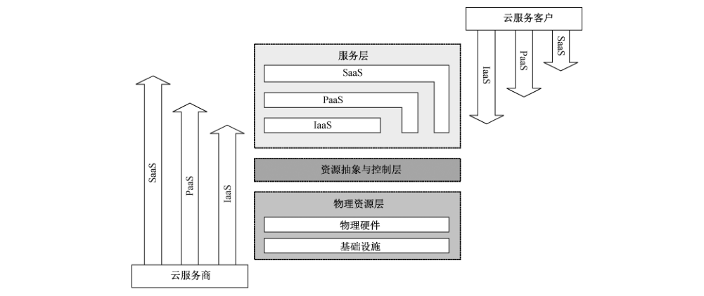
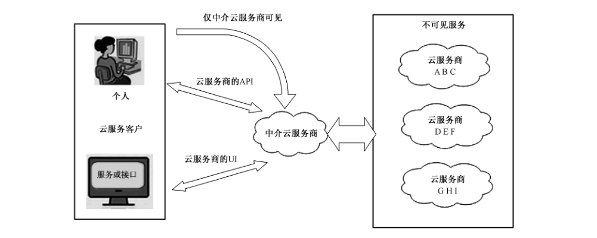
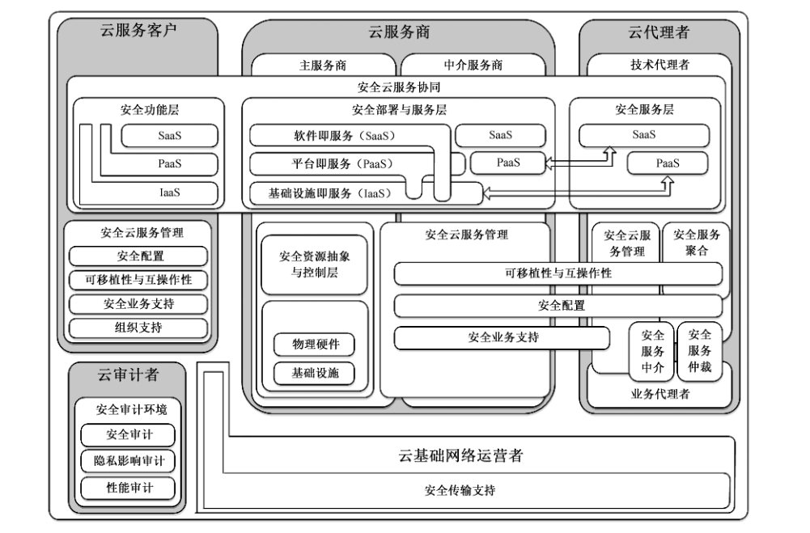

# GB/T 35279-2017 信息安全技术 云计算安全参考架构

> 来源：[GB/T 35279-2017 国家标准详情](https://openstd.samr.gov.cn/bzgk/std/newGbInfo?hcno=BE773D63CBEBE06FB3FF9D1C22700337)；封面发布日期：2017-12-29；实施日期：2018-07-01。
> PDF SHA-256：48b3564c4ed07487eb81f74df1a8331c354d99ab0a8538eab973c7f0d482a4f0。
> 转写说明：将官方 PDF 逐页渲染为图像，以原页图像核对文字、列表与图示；OCR 草稿仅作定位和初稿，不作为定稿依据。省略封面、目录、分页、页眉和页脚。正式引用请核对原 PDF。

## 前言

本标准按照 GB/T 1.1-2009给出的规则起草。

本标准由全国信息安全标准化技术委员会（SAC/TC 260）提出并归口。

本标准起草单位：北京大学软件与微电子学院、中国电子技术标准化研究院、中国科学院信息工程研究所信息安全国家重点实验室、中国科学院软件研究所、韶关学院、北京鼎普科技股份有限公司、北京时代新威信息技术有限公司、中国移动通信集团公司、华为技术有限公司、中国电信股份有限公司北京研究院、成都信息工程大学、中金数据系统有限公司、中国银联股份有限公司、阿里云计算有限公司、浪潮（北京）电子信息有限公司、国云科技股份有限公司、上海众人网络安全技术有限公司、东软集团股份有限公司、北京天融信网络安全技术有限公司、新华三技术有限公司、黑龙江省电子信息产品监督检验院、百度在线网络技术（北京）有限公司、汉柏科技有限公司、中国信息安全研究院有限公司、中国信息安全测评中心、中国电子科技集团第30研究所、西安电子科技大学、重庆邮电大学、成都电子科技大学、西安未来国际信息股份有限公司。

本标准主要起草人：卿斯汉、王惠莅、刘贤刚、陈驰、谢垂益、季统凯、谈剑峰、李雪莹、王海洋、王新杰、陈雪秀、杨晨、罗锋盈、马文平、柏洪涛、任兰芳、葛小宇、唐洪玉、万国根、崔玲、杨阳、赵江、崔进、龚一斌、史翔宇、方舟、马杰、王智民、刘冬梅、都婧、王强、周启明、陈晓峰、田玲、冯超、路娜、王希忠、沈晴霓、文伟平、徐菲、邹琪、孙松儿、李彦宾、黄永洪。

## 引言

云计算是一种以服务为特征的计算模式，它通过对各种计算资源进行抽象，以新的业务模式提供高性能、低成本的持续计算、存储空间及各种软件服务，支撑各类信息化应用，能够合理配置计算资源，提高计算资源的利用率，降低成本，促进节能减排，实现真正的理想的绿色计算。

云计算带来诸多便利与优势的同时也给信息安全带来了多个层面的冲击与挑战。云计算的服务计算模式，动态虚拟化管理方式以及多层服务模式等引发了新的信息安全问题；云服务级别协议所具有的动态性及多方参与的特点，对责任认定及现有的信息安全体系带来了新的冲击；云计算的强大计算与存储能力被非法利用时，将对现有的安全管理体系产生巨大影响等。

在一种云服务中，信息与业务的安全性涉及所有参与该服务的云计算角色。为了清晰地描述云服务中各种参与角色的安全责任，需要构建云计算安全参考架构，提出云计算角色、角色安全职责、安全功能组件以及它们之间的关系。

本标准适用于指导所有云计算参与者在进行云计算系统规划时对安全的评估与设计。

## 1 范围

本标准规定了云计算安全参考架构，描述了云计算角色，规范了各角色的安全职责、安全功能组件及其关系。

本标准适用于指导所有云计算参与者在进行云计算系统规划时对安全的评估与设计。

## 2 规范性引用文件

下列文件对于本文件的应用是必不可少的。凡是注日期的引用文件，仅注日期的版本适用于本文件。凡是不注日期的引用文件，其最新版本（包括所有的修改单）适用于本文件。

- GB/T 25069—2010 信息安全技术 术语

- GB/T 31167—2014 信息安全技术 云计算服务安全指南

## 3 术语和定义

GB/T 25069—2010 和 GB/T 31167—2014界定的术语和定义适用于本文件。为了便于使用，以下重复列出了 GB/T 31167—2014中的术语和定义。

### 3.1 云计算 cloud computing

通过网络访问可扩展的、灵活的物理或虚拟资源池，并可按需自助获取与管理资源的模式。

> 注：资源实例包括服务器、操作系统、网络、软件、应用与存储设备等。

［GB/T 31167—2014，定义3.1］

### 3.2 云服务商 cloud service provider

云计算服务的供应方。

> 注：云服务商管理、运营、支撑云计算的计算基础设施及软件，通过网络交付云计算的资源。

［GB/T 31167—2014，定义3.3］

### 3.3 云服务客户 cloud service consumer

为使用云计算服务同云服务商建立业务关系的参与方。

［GB/T 31167—2014，定义3.4］

### 3.4 云计算环境 cloud computing environment

云服务商提供的云计算平台，及客户在云计算平台之上部署的软件及相关组件的集合。

［GB/T 31167—2014，定义3.8］

### 3.5 云审计者 cloud auditor

一般为独立的第三方审计机构，负责审计云服务的供应与使用，覆盖运营、性能与安全。

## 4 概述

### 4.1 云计算的相关概念

云计算由一个可配置的共享资源池组成，该资源池提供网络、服务器、存储、应用与服务等多种硬件与软件资源。资源池具备自我管理能力，用户只需少量参与就可以方便快捷地按需获取资源。云计算提高了资源可用性，具有5个基本特征、3种服务模式和4种部署模型。

云计算的5个基本特征为按需自助服务、泛在接入、资源池化、快速伸缩性与服务可计量。具体内容参见GB/T 31167—2014。

云计算的3种服务模式为软件即服务（SaaS）、平台即服务（PaaS）与基础设施即服务（IaaS）。具体内容参见 GB/T 31167—2014。

云计算的4种部署模型为私有云、公有云、社区云和混合云。具体内容参见 GB/T 31167—2014。

### 4.2 云计算的参与角色

在云计算的业务执行流程中，主要有5类角色：云服务商、云服务客户、云审计者、云代理者和云基础网络运营者。每个角色可以由一个或多个实体（个人或机构）担任，针对不同的云计算服务模式与部署模型上述角色中的某几个角色也可以由同一实体担任，各类角色具体描述如下：

- 云服务商是负责为云服务客户直接或间接提供服务的实体，云服务商的相关活动主要包括云服务资源的部署、编排、运营、监控与管理等。

- 云服务客户是为使用云资源同云服务商建立业务关系的参与方，云服务客户可以直接作为用户使用云服务，云服务客户也可为保证用户使用云服务的运行稳定而提供服务计量、计费与资源购买等运营管理服务。

- 云代理者是管理云服务使用、性能与交付的实体，并在云服务商与云服务客户之间进行协商。

一般来说，云代理者提供下述3类服务：聚合、仲裁与中介。

- 云审计者负责对云服务进行独立评估、审计，负责审计云服务的供应与使用。云审计通常覆盖运营、性能与安全，检查一组特定的审计准则是否得到满足。

- 云基础网络运营者是云服务连接与传输的执行者，主要提供基础网络通信服务。

### 4.3 云计算的安全挑战

对于云服务客户，最适合其业务与安全需求的云计算安全方案和云服务模式与部署模型密切相关。

每个迁移到云的应用都具有不同的安全需求，应根据这些需求部署相应的安全措施。云计算安全参考架构在理论与实践上继承了传统的网络安全与信息安全知识，同时也增加了基于云特性的安全需求。

这些云特性包括：

- 宽带网络接入；

- 降低云服务客户对数据中心的可视性及控制力度；

- 动态的系统边界；

- 多租户；

- 数据驻留在云服务商；

- 自动部署与弹性扩展。

这些云计算自身的特性给云服务客户带来了与传统信息技术解决方案不同的安全风险（具体参见附录 A），影响生态系统的安全。为保持迁移到云后的数据的安全级别，云服务客户应提前确定所有云特有的风险及调整后的安全措施，并通过商业合同或服务级别协议（SLA）要求云服务商识别、控制并正确部署所有的安全组件。

云服务客户应基于风险分析确定应部署的安全措施，确保迁移到云中的数据与应用安全。云服务客户应根据不同情形明确云服务商与云代理者各自的安全职责及应采取的安全措施。

所有的云参与者都有职责保障云服务安全，确保能够满足云服务客户的安全需求，包括但不限于：

- 风险分析、风险评估、脆弱性评估、业务持续性规划与灾难备份规划；

- 物理与环境安全策略、用户账户终止程序、持续规划，包括：测试协议、事件报告与应急响应规划、设备布局等；

- 符合国家、行业、企业等相关信息安全标准；

- 供应商设施、安全基础设施、人力资源管理、物理安全与环境安全；

- 将服务的恢复计划纳入量化的恢复点目标（RPO）与恢复时间目标（RTO）；

- 云服务商与云代理者的安全现状。

### 4.4 云计算参与角色的安全职责

#### 4.4.1 服务模式与控制范围

在GB/T 31167—2014中描述了云服务商和云服务客户在不同服务模式下的安全控制范围。如图1所示，云服务客户实施安全组件的责任在IaaS 服务中较大，在PaaS 服务中降低，在SaaS服务中最小，而云服务商与云代理者共同负责实施的安全组件，责任从 IaaS、PaaS 到SaaS分别增多。

#### 4.4.2 云服务客户

云服务客户浏览来自云服务商或云代理者的服务目录，请求适当的服务。云服务客户应遵循云服务商或云代理者的云服务级别协议（SLA）。云服务客户可在有效使用服务前，与云服务商或云代理者签署服务合同，使用云服务级别协议方式明确云服务商与/或云代理者需要满足的安全技术与安全要求。

任何代表组织（例如：政府）处理组织信息或运行信息系统的云服务客户、云服务商与云代理者应满足与原组织相同的安全需求。安全需求也适用于在外部子系统上存储、处理或传输的政府信息，以及子系统或相关系统所提供的任何服务。

当政府机构（作云服务客户）选购云服务时，云服务客户负责确定保护数据迁移到云所需的安全组件集与相关控制措施，并确定与/或认可所选择的组件与控制措施实施的方式。一般情况下，所选择的安全组件与控制措施由云服务客户、云服务商与云代理者共同实施，并承担各自的安全责任。

#### 4.4.3 云服务商

云服务商是负责为云服务客户直接或间接提供服务的实体，获取并管理用于提供服务的云基础架构，运行 SaaS、PaaS 云软件，通过网络向云服务客户交付云服务。云服务商的活动可以分类：服务部署、服务编排、服务管理、安全与隐私保护。

从技术角度，云服务商既可以直接向云服务客户提供服务，也可以面向技术代理者提供服务。技术代理者可以加入透明的功能层改进与扩展云服务商的服务（详见5.4）。目前，主要有两种类型的云服务商：主服务商与中介服务商。

- 主服务商。主服务商通过其自有的基础设施为用户提供服务。虽然主服务商可以通过第三方（如代理者、中介服务商等）向云服务客户提供服务，但主服务商一般不会提供源自其他云服务商的服务。

- 中介服务商。中介服务商具有与其他云服务商交互的能力，并可使主服务商不可见且对云服务用户透明（如图2所示）。从安全角度，所有要求主服务商提供的安全服务与组件，中介服务商也同样需要提供。

#### 4.4.4 云代理者

云代理者是管理云服务使用、性能与交付的实体，并在云服务商与云服务客户之间进行协商。

随着云计算的演进，由云服务客户完成云服务的集成可能过于复杂。这种情况下，云服务客户可以向云代理者请求服务，而不是直接与云服务商签署合同。云代理者提供一个单一的入口点管理多个云服务。云代理者与云中介服务商的主要区别有两点：一是云代理者有能力为多个不同的云服务商提供一个单独的一致性接口；二是对客户的透明可见性：客户明确知道谁在后台提供服务；而中介云服务商则不提供这种透明可见性。

承担云代理者角色的组织可能提供下列服务：

- 聚合：云代理者聚合与集成多个服务到一个或多个新服务中。云代理者提供数据集成，并确保数据在云服务客户与多个云服务商之间安全移动；

- 仲裁：服务仲裁与服务聚合相似，只是被聚合的服务不固定。服务仲裁说明云代理者可以根据数据或服务上下文的特点，从多个云服务商灵活地选择服务；

- 中介：云代理者为云服务客户改进某些服务，或提供增值服务增强原有的服务。例如：访问云服务的管理、身份管理、性能报告、增强的安全性等。

作为云代理者的组织可以提供下述一种或两种服务：

- 业务与关系支持服务（例如：计费与合同中介、仲裁与聚合）；

- 技术支持服务（例如：服务聚合、仲裁与技术中介）；主要的工作是处理多个云服务商之间的互操作性。

云业务代理者只提供业务与关系服务，不处理云服务客户在云中的任何数据、操作或组件（例如：图像、卷、防火墙）。

相反，云技术代理者与云服务客户的资产进行交互：云技术代理者从多个云服务商处聚合服务，并通过处理单点入口与互操作性增加一个技术功能层。这两种云代理者角色不是相互排斥的。例如：一个特定实体可以在一个场景下作为云业务代理者，在另一个场景下作为云技术代理者，并在第三种场景下同时作为云业务代理者与云技术代理者。

云业务代理者也可以提供增值中介服务，例如：服务目录查询、订购处理、客户关系管理、统一计费等。

云技术代理者可以提供跨云服务商的技术服务，如云服务协同、负荷管理与业务激增管理，统一的身份识别与授权管理、安全管理、度量检索、成本与使用情况报告等。

#### 4.4.5 云审计者

云审计者是对云服务进行独立评估的一方，对云服务商提供的服务在安全控制、隐私影响、性能等方面进行评估。

云审计者应对信息系统的安全措施与已接受的审计标准的一致性进行评估，确定安全措施是否正确实施，判断产生的结果是否符合系统的安全需求。安全审计也应包括与法规与安全策略的一致性验证。云审计者应确保审计记录未被修改，法律与业务数据已按需求归档。

由于审计过程的重要性、审计的复杂性与被审计目标的多变性，本标准对云审计的分析仅从安全角度出发，只考虑云审计者在审计过程、评估过程与审计报告中对保护访问与收集数据的安全组件的责任。

#### 4.4.6 云基础网络运营者

云基础网络运营者通过网络、通信与其他访问设备为云服务客户与云服务商之间提供云服务的连接与传输。例如：云服务客户可以通过网络设备［例如：计算机、笔记本电脑、移动电话、移动互联网设备（MIDs）等］获得云服务。云服务的分配一般由网络与电信运营商或传输代理提供，传输代理是指提供存储介质（如高容量的硬盘驱动器）物理传输的商业组织。云服务商与云基础网络运营者应签署服务级别协议（SLA），提供与 SLAs 级别一致的服务，并可要求云基础网络运营者提供云服务客户与云服务商之间专用、安全的连接。

云基础网络运营者还应关注数据进出云时可能面临的安全风险与威胁，负责维护跨越其管理系统的安全措施，并进行安全测试与风险管理。云基础网络运营者还应能提供专用线路，包括国际专用线路。

云基础网络运营者的安全责任不随云服务所选择的服务模型而改变。

## 5 云计算安全参考架构

### 5.1 概述

基于云计算的特性、3种服务模式与5类角色建立的云计算安全参考架构如图3所示。

图3中的云计算安全参考架构是基于角色的分层描述，其中包括下述安全组件与子组件：

云服务客户：

- 安全云服务管理
  - 业务支持安全需求
  - 服务提供与配置安全需求
  - 可移植性与互操作安全需求
  - 安全组织支持
- 安全云服务协同
  - 安全功能层

云服务商：

- 安全云服务协同
  - 安全部署与服务层
  - 安全资源抽象与控制层（硬件与设施）—仅主服务商
  - 安全物理资源层（硬件与设施）—仅主服务商
- 安全云服务管理
  - 安全供应与配置
  - 安全可移植性与互操作性
  - 安全业务支持

云代理者：

- 安全云服务协同—仅技术代理者
  - 安全服务层
- 安全服务聚合
  - 安全聚合与配置（技术方面的配合）—仅技术代理者
  - 安全可移植性与互操作性（技术方面的配合）—仅技术代理者
- 安全云服务管理
  - 安全供应与配置—仅技术代理者
  - 安全可移植性与互操作性—仅技术代理者
  - 安全业务支持
- 安全服务中介
  - 安全供应与配置
- 安全服务仲裁
  - 安全供应与配置

云审计者：

- 安全审计环境

云基础网络运营者：

- 安全传输支持
  - 安全可移植性与互操作性

### 5.2 云服务客户

#### 5.2.1 安全云服务管理

##### 5.2.1.1 概述

安全云服务管理包含支撑用户业务运行与管理所需的安全功能。用户业务运行与管理的安全需求包括：

- 业务支持安全需求
- 服务提供与配置安全需求
- 移植与互操作安全需求
- 安全组织支持（包括组织处理、策略与步骤）

由上述需求得出该组件的功能如下：

- 业务支持安全
- 配置安全
- 移植与互操作安全
- 组织性支持安全

##### 5.2.1.2 业务支持安全

云服务客户的业务支持安全架构组件涵盖用于运行业务操作的服务，包括：

- 管理与其他云参与者（云服务商、云代理者、云基础网络运行者与云审计者）的业务关系，提供符合最佳安全实践的协作，例如：认证与授权云参与者之间的交互。

- 跟进业务流程，并根据安全最佳实践解决与其他云参与者之间的云相关问题，包括：安全业务处理与操作的持续性。

- 管理服务合同，包括：建立、协商、关闭或终止合同，确保不存在安全隐患。

- 仅在安全隐患解决后实现服务。

- 付款与发票管理，确保不存在欺诈性付款并遵循网络安全最佳实践。

通过云服务客户的访问控制策略、业务持续性规划与多种生产效率跟踪机制，业务支持安全架构组件也可实现对组织成员与合约商的身份与凭证管理。这些服务能够保证云计算环境中业务的日常运行安全。

##### 5.2.1.3 配置安全

云服务客户配置安全架构组件包括保证云资源配置安全并与现有的安全标准、规范、法规相一致，同时满足服务级别协议需求的任何能力、工具与策略。云资源配置安全准则可能还包括云服务客户与云服务商规定的专有措施。

云服务客户的云资源配置安全管理应涵盖下述领域：

- 快速部署：基于所请求的服务、资源或能力自动部署云服务。例如：安全快速部署管理确保请求来自一个已通过认证与授权的源。

- 资源变化：在修复、升级与新增云节点时调整配置与资源分配。例如：安全资源变化管理确保资源变化请求来自一个已通过认证与授权的源。

- 监测与报告：发现与监测虚拟资源，监测云的操作与事件，并生成安全报告。

- 度量：度量的安全管理是指云服务商实施特定的内部控制措施，确保可对存储加密、可对处理沙箱化、可报告异常带宽使用、且用户账户管理与云服务客户的安全策略一致。

- 服务级别协议管理：根据已确定的策略进行 SLA 合同定义（带有服务质量参数的基本模式）、SLA 监控与 SLA实施。

##### 5.2.1.4 可移植性与互操作安全

云服务客户、云供应商与云代理者均应满足如下安全可移植性与互操作性要求：

- 安全可移植性与互操作性架构子组件应确保数据与应用程序可安全地转移到多个云服务中。

- 应保证系统维护时间与中断次数符合服务级别协议（SLA）中的最低接受等级。

- 应通过安全与统一的管理接口为云服务客户提供一种机制，使云服务客户可在多个云服务中进行数据与应用的互操作。

- 安全可移植性与互操作性的需求应根据所选择服务类型的不同而不同。

对于云服务客户，映射到架构子组件的安全组件应为数据与/或应用程序转换到不同的云服务商或云技术代理者提供更大的灵活性。

##### 5.2.1.5 安全组织支持

安全组织支持架构子组件覆盖了组织机构提供的策略、规程与处理过程，支持整体云安全服务管理。对于云服务客户，映射到组织支持架构子组件的安全组件包含（但不限于）：一致性管理；基于治理风险与合规性的审计管理；技术安全标准；最佳实践与管理的相关性；符合规范与标准的信息安全策略。

#### 5.2.2 安全云服务协同

##### 5.2.2.1 概述

云服务协同是系统组件的一种组合，支持云服务商对计算资源进行部署、协调与管理，为云服务客户提供安全的云服务。安全服务协同是一个过程，需要所有的云参与者通力合作，基于云服务类型与部署模型不同程度地实现各自的安全职责。

安全服务层涉及云服务商、云代理者与云服务客户。云服务客户仅需确保云服务接口，以及接口之上功能层的安全。根据云部署模型的不同，云服务接口可能位于 IaaS、PaaS或SaaS 层。云服务客户只能依靠云服务商或云技术代理者保障云服务接口以下服务的安全。

##### 5.2.2.2 安全功能层

基于使用的云服务模型（IaaS、PaaS 与 SaaS），云服务客户部署安全组件集保护云功能层安全，并与其他云参与者已部署的安全组件集密切相关。

在 SaaS 云服务中，云服务客户对其使用的应用服务具有很少的管理权限，即对云及其安全组件具有很少的控制权。

在PaaS 云服务中，云服务客户对应用服务具有控制权，并对主机环境设置具有部分控制权，但对平台下层的基础设施（如网络，服务器，操作系统与存储介质等）具有有限的管理权或访问权。

在IaaS 云服务中，云服务客户可以使用系统提供的基础设施与计算资源（例如：虚拟计算机）满足基本的计算需求。同时，云服务客户也可以访问更多的基础计算资源，并控制更多的应用软件，包括操作系统与网络等。例如：在IaaS 云服务中，云服务客户可以在各个服务层（IaaS、PaaS 与 SaaS）实现基础设施保护服务（例如：边界防火墙）。然而，云服务客户无法在 PaaS与 SaaS 层部署服务器防火墙安全组件，只能依靠云服务商提供服务器防火墙服务。因此，云服务客户应在服务级别协议中明确所需的安全防护级别。

### 5.3 云服务商

#### 5.3.1 云服务商的框架组件与子组件概述

根据云服务商的服务范围与实施的活动，云服务商的架构组件为：服务部署、服务编排、云服务管理、云服务安全与隐私保护。由于安全与隐私保护、数据内容管理、服务级别协议（SLA）等是跨组件的，安全参考架构模型将云服务商的安全活动交错分布到所有的组件层，覆盖云服务商负责的全部领域，并且将安全性嵌入到与云服务商有关的全部架构组件中。另外，云部署作为云服务的一部分，直接与云服务商提供的服务相关。因此，安全参考架构为云服务商定义了下列框架组件与子组件：

- 安全云服务管理
  - 安全供应与配置
  - 安全可移植性与互操作性
  - 安全业务支持
- 安全云服务协同
  - 安全物理资源层（硬件与设施）—仅主服务商
  - 安全资源抽象与控制层（硬件与设施）—仅主服务商
  - 安全部署与服务层

主服务商通过技术代理者直接向云服务客户提供服务，或与中介服务商等合作伙伴间接地向云服务客户提供服务。中介服务商也可将一个或多个主服务商的服务集成后向云服务客户提供服务。多个云服务商之间形成依赖关系，此依赖关系通常对云服务客户不可见，即主服务商与中介服务商提供服务的方式对云服务客户没有区别。中介服务商负责的安全组件与控制措施与主服务商相同，并需在多个云服务商之间进行协调。

#### 5.3.2 安全云服务协同

##### 5.3.2.1 概述

本标准描述一个3层模型，代表云服务商交付服务需提供的3种类型的系统组件，这三层是：

- 服务层：代表云服务商提供的3类服务（IaaS、PaaS 与 SaaS）；

- 资源抽象与控制层：包含通过软件抽象，云服务商用于提供与管理访问物理计算资源的系统组件；

- 物理资源层：包括所有的物理计算资源，例如：硬件资源（CPU 与内存）、网络设备与软件（路由器、防火墙、交换机、网络链接与接口）、存储组件（硬盘）以及其他物理计算基础设施元素。

安全参考体系架构组件由下述三层构成：

- 安全部署与服务层；

- 安全资源抽象与控制层；

- 安全物理资源层。

##### 5.3.2.2 安全部署与服务层

基于所提供的云服务类型（例如：SaaS, PaaS 或 IaaS）与云部署模型（例如：公有云或私有云），云服务商实施保障服务层安全的安全组件集。对于云服务中的每一个实例，云服务商负责实施的安全组件集都与其他云参与者实施的安全组件集密切相关。

对于IaaS 云服务，云服务商提供与物理计算资源相关的服务，包括服务器、网络、存储与主机基础设施。云服务商运行所需的云软件，通过一套服务接口与计算资源抽象（例如：虚拟机与虚拟网络接口），将计算资源提供给IaaS 云服务客户。不管采用哪种云服务，云服务商始终控制物理硬件与云软件，因此能够提供这些基础设施服务（例如：物理服务器、网络设备、存储设备、主机操作系统、虚拟监控器等）。

对于 PaaS 云服务，云服务商管理平台的计算基础设施，并运行提供平台组件能力的云软件，例如：运行时软件执行栈、数据库与其他中间件组件。通常，提供 PaaS服务的云服务商也为云服务客户提供开发、部署与管理的工具。这些工具可集成到开发环境（IDEs）、云软件开发版本、软件开发套件（SDKs）或部署与管理工具中。

对于 SaaS 云服务，云服务商部署、配置、维护与更新云基础设施上的应用软件，使服务可以按照期望的服务级别供应给云服务客户。SaaS 云服务商对管理和控制应用程序与基础设施负主要责任。

##### 5.3.2.3 安全资源抽象与控制层

安全资源抽象与控制层是包含云服务商实现的安全组件的架构组件，通过软件抽象提供安全访问与管理物理计算资源的功能。资源抽象组件的例子包括虚拟监控器、虚拟机、虚拟数据存储这样的软件元素。资源抽象组件应确保相关物理资源有效、安全与可靠的使用。虚拟机技术通常在本层使用，但提供必要软件抽象的其他方法也可以使用。本层的控制部分系指负责资源分配、访问控制与使用监控的安全软件组件。这是将多种物理资源及其软件抽象进行绑定，实现资源池化、动态分配与测量服务的软件架构。

云服务商应采用适当的安全机制，确保只有经过授权的用户才能访问系统、服务与数据，且用户或租户不能未经许可访问其他租户的信息。系统应隔离系统管理功能与用户相关的功能（包括用户接口服务），不能将系统管理功能暴露给非特权用户。安全功能应与非安全功能隔离，并可作分层结构实施，使各层之间最少交互，并保障低层功能与高层功能的独立性。

##### 5.3.2.4 安全物理资源层

安全物理资源层是架构子组件，包含需要确保物理计算资源安全的安全组件。本层包括硬件资源，例如：计算机（CPU 与内存）、网络（路由、防火墙、交换机、网络连接与接口）、存储部件（硬盘）与其他物理计算基础设施元素。它还包括设施资源，例如：供暖、通风与空调（HVAC）、电力、通讯及其他物理设备。

#### 5.3.3 安全云服务管理

##### 5.3.3.1 概述

云服务管理可以如下描述：

- 供应与配置需求；

- 可移植性与互操作性需求；

- 业务支持需求。

此外，基于不同的云服务结构，安全云服务管理的不同部分可由云服务商或云代理者支持与实现。

这些服务可通过云服务客户的安全云服务管理进行补充。

##### 5.3.3.2 安全供应与配置

安全供应与配置架构子组件包含确保云资源安全配置与供应的所有安全组件（例如：能力、工具或策略），并应符合相应的安全标准、法规与规范。安全配置云资源的准则也包含云服务客户与云服务商在服务级别协议（SLA）中确定的专用措施。

云服务商对云资源配置的安全管理与供应涉及的领域参见 5.2.1.3。

##### 5.3.3.3 安全可移植性与互操作性

云服务客户、云供应商与云代理者均应满足的安全可移植性与互操作性要求，参见 5.2.1.4。

基于不同的云服务模型，安全可移植性与互操作性的需求也不同。例如：对于云服务商，SaaS 云服务可能要求在不同云上运行的多个应用之间进行数据集成；IaaS 云服务可能要求迁移数据与应用到新的云上，与此同时确保应用程序仍可操作。第一个例子只需简单地将数据以标准格式提取并备份即可。

第二个例子则需首先捕获虚拟机映像，然后将它们迁移到一个或多个有可能采用不同虚拟化技术的新云服务商。基于云服务客户在服务级别协议（SLA）中定义的安全策略的配置仍需保留。迁移后，需删除或记录任何云服务商特定的虚拟机映像扩展。云服务商应理解并满足云服务客户的可移植性与互操作性需求。

##### 5.3.3.4 安全业务支持

安全业务支持架构子组件包含运行面向客户的业务操作所用的所有安全组件，使云服务商以安全方式对云服务客户、云代理者及其他云服务商进行业务支持。

中介云服务商应确保下游服务商适当地实施了他们自己负责的安全组件与控制措施，且风险与责任已经明确。

与云服务客户签署合同并明确责任后，业务支持的责任由主服务商与中介服务商共同承担。云服务商业务支持的职责包括：

- 云服务客户管理：管理云服务客户账户、打开/关闭/终止账户、管理用户配置文件、管理云服务客户关系、基于云服务客户的安全策略解决云服务客户的问题等。

- 合同管理：管理服务合同，包括建立/协商/关闭/终止合同等；提供云服务客户安全审计与报告所需的信息。

- 备品备件管理：以安全方式建立与管理服务目录等。

- 记账与计费：管理云服务客户的计费信息、发送计费状态、处理收到的支付、追踪发票等，确保有效跟踪与纠正欺诈活动。

- 报告与审计：监控用户操作、生成报告等，支持云服务客户的安全审计与监控需求。

- 定价与评级：评估云服务并确定价格，在不违反云服务客户保护的法律下，基于用户的配置处理促销与定价规则等。

### 5.4 云代理者

#### 5.4.1 概述

云代理者系指管理云服务的使用、性能与交付，并协调云服务商与云服务客户之间关系的实体。云计算安全参考架构模型中强调了两种类型的云代理者：技术代理者与业务代理者。

通常，云代理者提供的服务组合可以分为5种架构组件：安全服务聚合、安全服务仲裁、安全服务中介、安全云服务管理和安全云服务协同。其中，前4个组件分别对应云代理者所提供的服务，第5个组件则对应云代理者的责任，即作为安全云服务协同的一部分保障云服务的安全性。5个架构组件的详细定义如下：

- 安全服务聚合：该架构组件包含将多个独立服务融合与集成到一个或多个新服务的安全组件。

  云代理者提供数据集成功能，并确保基于云服务客户的安全策略数据在云服务客户与多个云服务商之间安全迁移。安全服务聚合可以如下描述：
  - 可移植性与互操作性的技术需求
  - 供应与配置的技术需求
- 安全服务仲裁：该架构组件类似于安全服务聚合组件，只是所聚合的服务是不固定的。服务仲裁意味着云代理者可以从多个云服务商灵活地选择服务。例如：云代理者可使用信用评分服务选择一个具有最高分数的云服务商。

- 安全服务中介：该架构组件包含的安全组件，可使云代理者为云服务客户改进某些服务，或提供增值服务增强原有的服务，同时确保云服务客户的安全策略正确实施。增强原有云服务的例子包括：访问云服务的管理、身份管理、性能报告、增强的安全性等。

- 安全云服务管理：该架构组件包含云代理者提供运营服务所必需的，支持全部服务功能（技术与业务）管理的所有安全组件。安全云服务管理可以如下描述：
  - 业务支持需求
  - 供应与配置的业务需求
  - 可移植性与互操作性的业务需求
- 安全云服务协同：该架构组件包含的安全组件，可使技术代理者基于云部署模型（例如：私有云和公有云）与服务模式（例如：IaaS、PaaS 和 SaaS），确保所提供服务及附加服务的安全。

在实践中，技术代理者用于保护云服务客户的数据迁移到云的安全组件集，与提供类似服务的中介服务商所使用的安全组件集相同。有关如何提取技术代理者的安全组件集的细节参见 5.4.2。

#### 5.4.2 技术代理者

在安全云服务协同与安全云服务管理方面，技术代理者与中介服务商的职责是类似的。

通过从多个云服务商聚集服务、增加一个新的技术功能层、处理互操作性问题等，技术代理者与云服务客户的操作过程、云组件和/或客户数据进行交互。在安全参考架构模型中，云代理者与技术代理者架构组件的设计方式是强调云参与者的主要角色。例如：安全可移植性/互操作性架构子组件延伸到安全云服务管理与安全服务聚合组件中，说明云代理者职责的两个方面：安全云服务管理下的业务及管理方面与安全服务聚合下的技术方面。中介服务商并不聚合服务，而是嵌入主服务商提供的服务。技术代理者与中介服务商提供类似安全服务所需的安全组件集是相同的。

技术代理者的架构组件与子组件如下：

- 安全云服务协同
  - 安全服务层（技术方面）
- 安全服务聚合
  - 安全供应与配置（技术方面）
  - 安全可移植性与互操作性（技术方面）
- 安全服务管理
  - 安全供应与配置（管理方面）
  - 安全可移植性与互操作性（管理方面）
  - 安全业务支持
- 安全服务中介
  - 安全供应与配置（技术方面）
- 安全服务仲裁
  - 安全供应与配置（技术方面）

#### 5.4.3 业务代理者

业务代理者提供业务与关系支持服务（仲裁与业务中介）。与技术代理者相反，业务代理者不接触任何云服务客户在云中的数据、操作过程与其他组件（例如：镜像、卷或防火墙）。

业务代理者的架构组件与子组件包括：

- 安全服务管理
  - 安全业务支持
- 安全服务中介
  - 安全供应与配置（业务方面）
- 安全服务仲裁
  - 安全供应与配置（业务方面）

为简单起见，接下来的章节将对两种云代理者一起讨论架构组件。

#### 5.4.4 安全云服务协同

##### 5.4.4.1 概述

云代理者用于确保安全云服务协同的安全组件依赖于云服务类型与部署模型。云代理者实施的安全组件与其他云参与者的安全组件密切相关。

如图4所示，云代理者在平台服务层或软件服务层提供服务，它们分别建立在IaaS或 PaaS 云服务商的基础之上。

##### 5.4.4.2 安全服务层

云代理者为保证服务层安全采用的安全组件集依赖于服务类型（例如：PaaS 或 SaaS）。可能在多个云服务商提供的PaaS 组件上聚合 SaaS 应用，或在云服务商提供的IaaS组件上聚合 PaaS组件。但是，这不是必需的，且依赖关系是可选的。每种服务都可以单独提供。技术代理者实施额外功能层的安全需求依赖于所使用的云服务层类型。

对于 SaaS 云服务，云技术代理者可聚合多个云服务商的服务，并能够配置、维护、更新部署到这些聚合服务中的软件应用，使云服务以期望的服务级别提供给云服务客户，并满足客户所有的安全需求。

提供 SaaS 云服务的技术代理者承担管理与控制应用程序安全的主要责任。

对于 PaaS 云服务，云技术代理者可安全聚合多个云服务商的服务，并为云服务客户提供开发、部署与管理迁移到云的工具。这些工具可以是开发环境（IDEs）、云软件开发版本、软件开发套件（SDKs）或部署与管理工具。

技术代理者不参与资源抽象与控制层或物理资源层中安全组件与控制措施的实施。

#### 5.4.5 安全服务聚合

云代理者整合与集成多个服务为一个或多个新服务，提供数据集成功能，并确保数据在云服务客户与多个云服务商之间的安全迁移。

安全服务聚合架构组件说明了技术代理者的责任，即保证所有数据的安全性，对云服务商的服务请求及云服务商的响应均需达到所需的保密性、完整性与可用性级别。该组件还涉及云代理者的责任，即根据用户合同与服务级别协议（SLA）中的安全需求，保证达到规定的安全级别。作服务聚合者，技术代理者仅支持传输中的云服务客户数据，因此静止数据的安全性与技术代理者提供的聚合服务无关。

云代理者安全服务聚合架构组件所包含的安全组件集类似于中介服务商，其技术差异在于云代理者对下层云服务商提供的透明性。云代理者应向下层云服务商暴露报告、仪表板与所有计划的信息，但对中介服务商，这不是必要工作。

介于云服务客户与多个聚合的云服务商之间的技术代理者，应提供双向功能栈安全服务，即向上面向云服务客户，向下面向下层云服务商。相应地，所有的报告与计划应考虑云代理者—云服务客户接口与云代理者—云服务商接口。

安全服务聚合相关的两个架构子组件是：

- 安全供应与配置
- 安全可移植性与互操作性

对于技术云代理者，向云服务客户提供的供应与配置功能的安全需求类似于云服务商，安全可移植性与互操作性的安全需求也类似于云服务商（更多信息参见 5.3.3.2与 5.3.3.3）。

#### 5.4.6 安全云服务管理

##### 5.4.6.1 概述

安全云服务管理架构组件包含所有与服务相关的功能，这些功能对云服务客户所需服务的运维管理是必不可少的。云服务管理可以如下描述：

- 可移植性与互操作性需求
- 供应与配置需求
- 业务支持需求

基于云服务的结构，云服务商或云代理者可以实施安全云服务不同方面的管理。这些架构组件可由云服务客户的安全云服务管理架构组件补充。

安全云服务管理的子组件如下，如图5所示：

- 安全可移植性与互操作性
- 安全供应与配置
- 安全业务支持

##### 5.4.6.2 安全可移植性与互操作性

云服务客户、云供应商与云代理者均应满足安全可移植性与互操作性要求，参见5.2.1.4。

##### 5.4.6.3 安全供应与配置

安全供应与配置架构子组件包含诸如能力、工具或策略的所有安全组件，确保云资源的安全配置与供应符合相应的安全标准、法规与规范。

云代理者安全供应与配置涉及的领域参见 5.2.1.3。

##### 5.4.6.4 安全业务支持

云代理者可通过改进特定的面向客户的业务运营，以及向云服务客户提供增值服务提供与业务相关的服务。例如：定价与评级、合同管理、记账与计费。

安全业务支持架构子组件是一组支持云服务客户的业务相关服务。该子组件包含用于支持云代理者以服务商或以代理角色进行业务操作的安全组件。

云代理者安全业务支持的职责参见5.3.3.4。

#### 5.4.7 安全服务中介

云代理者可通过改进特定的功能，以及向云服务客户提供增值服务增强给定的服务。这些功能改进包括：管理云服务的访问、身份管理、性能报告与增强的安全性等。

安全服务中介架构组件表明云代理者的职责是，确保新增加的所有功能都保持所要求的机密性、完整性与可用性级别，并满足云服务客户在合同与服务级别协议（SLA）中规定的安全需求。

提供服务中介的技术代理者采用的安全组件类似于服务聚合情形，但根据中介技术代理者提供的增值服务，组件与控制措施通常具有更高的优先级。例如：作为第三方授权者，仅提供身份管理运营（不提供任何服务聚合或服务仲裁）的技术代理者，应具有较强的安全控制。同时，系统与通信保护可能具有较低的优先级，因云服务客户在云中的数据并不迁移到云代理者的系统。需要注意的是，即使对性能报告这样的中介服务，云代理者也应保护系统的安全，确保报告是可信的和正确的，且只提供给授权用户。

#### 5.4.8 安全服务仲裁

安全服务仲裁架构组件本质上类似于安全服务聚合组件，不同之处是仲裁期间云代理者组合与集成的服务不固定。亦即，云代理者具有从多个云服务商为云服务客户动态选择服务的灵活性。

提供服务仲裁的技术代理者采用的安全组件类似于服务聚合情形，只是特别强调下述能力：保证选择的安全服务没有服务可用性障碍与安全问题，确保仲裁时云服务商之间安全与快速切换，并达到云服务客户在合同与/或服务级别协议（SLA）中规定的机密性、完整性与可用性级别。

### 5.5 云审计者

云审计者是对云服务、信息系统运维、性能、隐私影响与安全进行独立评估的云参与者。

云审计者可为任何其他云参与者执行各类审计。云审计者需要一个安全的审计环境，确保从责任方以安全与可信的方式收集目标证据。通常，云审计者可用的安全组件与相关的控制措施独立于云服务模式与/或被审计的云参与者。

支持云审计过程的安全审计环境架构组件需要（但不限于）下列机制：

- 安全组件与相关安全控制：有关于安全组件与相关安全控制的信息对云审计者可用；

- 安全档案：支持法律与业务过程的审计结果，例如：电子发现、归档需求与实施对云审计者可用；

- 安全存储：各责任方的目标证据可以用安全方式在云中收集与存储，以备今后参考。加密与混淆的存储信息对云审计者可用；

- 数据位置：在审计过程中，云审计者应确保数据适用于相关的管辖权规则，从而数据位置信息对云审计者可用；

- 度量：性能审计需从度量系统中获得信息，云审计者应能安全地访问这些信息；

- 服务级别协议（SLA）：服务审计需访问要求审计与被审计的各方之间的所有协议，以及支持以安全方式实施服务级别协议（SLA）的任何机制；

- 隐私：隐私影响评估要求系统安全与配置信息的可用性，以及在云中实施数据保护的任何机制的可用性。

### 5.6 云基础网络运营者

云基础网络运营者是提供云服务连接与传输的云参与者。从用户角度，用户与云服务商或云代理者有更为直接的关系。所以除非云服务商或云代理者同时充当云基础网络运营者的角色，否则云基础网络运营者的角色不被注意。因此，为履行合同义务并满足指定的服务要求，云基础网络运营者应对云服务商与云代理者的云服务提供安全传输支持。

虽然云基础网络运营者具有安全服务管理功能：保证安全的服务交付及满足用户的安全需求，但这些功能并不直接提供给云服务客户。

## 附录 A（资料性附录）云计算的安全风险

### A.1 云计算法律风险

云计算服务具有应用地域广、信息流动性大等特点，信息服务或用户数据可能分布在不同地区甚至不同国家，可能导致组织（例如：政府）信息安全监管等方面的法律差异与纠纷；同时，云计算的多租户、虚拟化等特点使用户间的物理界限模糊，可能导致司法取证难等问题。

### A.2 政策与组织风险

#### A.2.1 可移植性风险（过度依赖风险）

用户将数据存放在云计算平台，没有云服务商的配合很难独自将其数据安全迁出。因此，在服务终止或发生纠纷时，云服务商可能以删除或不归还用户数据为要挟，损害用户对数据的所有权与支配权。

此外，云服务商可以通过收集统计用户的资源消耗、通讯流量、缴费等数据，获取用户的大量信息。对这些信息的归属往往没有明确规定，容易引起纠纷。

云计算服务缺乏统一的标准与接口，导致不同云计算平台上的用户数据与业务难以相互迁移，同样也难以从云计算平台迁移回用户的数据中心。同时，云服务商出于自身利益考虑，往往不愿意为用户的数据与业务提供可迁移能力。这种对特定云服务商的潜在依赖，可能导致用户的业务因云服务商的干扰或停止服务而终止，也可能导致数据与业务迁移到其他云服务商的代价过高。

#### A.2.2 可审查性风险（合规风险）

可审查性风险是指用户无法对云服务商如何存储、处理、传输数据进行审查。虽然云服务商对云服务的安全性提供技术支持，但最终仍是云服务客户对其数据安全负责。因此，云服务商应满足合规性要求，并应进行公正的第三方审查。

### A.3 云计算技术安全风险

#### A.3.1 数据泄露风险

一方面，云服务客户能够在任何地点通过网络直接访问云计算平台；另一方面，云服务商可能控制用户的某些数据。因此，云服务商应提供安全、可靠、有效的用户认证及相应的访问控制机制保护用户数据的完整性与保密性，防止数据泄露与非法篡改。同时，云服务商拥有存储用户数据的介质，用户不能直接管理与控制存储介质，所以用户终止云计算服务后其数据还可能保存或残留在云计算平台上，仍然存在数据泄露风险。

#### A.3.2 隔离失败风险

在云计算环境中，计算能力、存储与网络在多个用户之间共享。如果不能对不同用户的存储、内存、虚拟机、路由等进行有效隔离，恶意用户就可能访问其他用户的数据并进行修改、删除等操作。

#### A.3.3 应用程序接口（API）滥用风险

云服务中的应用程序接口（API）允许任意数量的交互应用，虽然可以通过管理进行控制，但API 滥用风险仍然存在。

#### A.3.4 业务连续性风险

业务连续性风险包括但不限于以下方面：

网络性能。例如：“宽带不宽”已成为云计算发展的瓶颈。网络攻击事件层出不穷、防不胜防，因此由于网络而造成云服务不可用的情况是云服务商无法控制的。

终端风险。在海量终端接入云服务的情况下，终端风险会严重威胁到云服务的质量；此外，如果用户在使用云服务时对云服务中某些参数设置不当，会对云服务的性能造成一定影响。

拒绝服务攻击。由于用户、信息资源的高度集中，云计算平台容易成为黑客攻击的目标，由此拒绝服务造成的后果与破坏性将会明显超过传统的企业网应用环境。

当用户的数据与业务应用于云计算平台时，其业务流程将依赖于云计算服务的连续性，这对 SLA、IT 流程、安全策略、事件处理与分析等都提出了挑战。另外，当发生系统故障时，应保证用户数据的快速恢复。

#### A.3.5 基础设施不可控风险

公有云服务商的用户管理接口可以通过互联网访问，并可获得较大的资源集，可能导致多种潜在的风险，使恶意用户能够控制多个虚拟机的用户界面、操作云服务商界面等。

#### A.3.6 运营风险

云服务商常常通过硬件提供商和基础软件提供商采购硬件与软件，然后采用相关技术构建云计算平台，然后再向云服务客户提供云服务。硬件提供商和基础软件提供商等都是云服务供应链中不可缺少的参与角色，如果任何一方突然无法继续供应，云服务商又不能立即找到新的供应方，就会导致供应链中断，进而导致相关的云服务故障或终止。

#### A.3.7 恶意人员风险

在大多数情形，任何用户都可以注册使用云计算服务。恶意用户搜索并利用云计算服务的安全漏洞，上传恶意攻击代码，非法获取或破坏其他用户的数据和应用。此外，内部工作人员（例如：云服务商系统管理员与审计员）的失误或恶意攻击更加难于防范，并会导致云计算服务的更大破坏。
