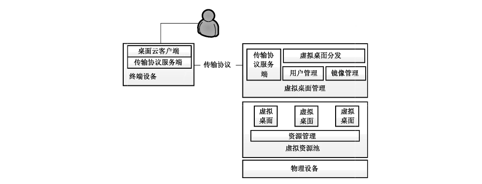
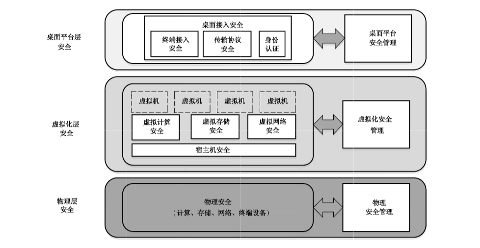

# GB/T 37950-2019 信息安全技术 桌面云安全技术要求

> 来源：[GB/T 37950-2019 国家标准详情](https://openstd.samr.gov.cn/bzgk/std/newGbInfo?hcno=D6E34954248A8B365BA9095F91F38670)；[官方在线预览](https://openstd.samr.gov.cn/bzgk/std/showGb?type=online&hcno=D6E34954248A8B365BA9095F91F38670&request_locale=zh)；发布日期：2019-08-30；实施日期：2020-03-01。
> 官方在线预览页面图像 SHA-256：cff97ad85d00dfef05735902977b6516abfc3e54a3d7747a1b95cbed4eab48ca。
> 转写说明：对照官方在线预览全部 22 页截图校正图像识别文字、图表和条款层级；省略封面、目录、页眉和页脚。正式引用请核对官方预览原页。

## 前言

本标准按照 GB/T 1.1—2009 给出的规则起草。

请注意本文件的某些内容可能涉及专利。本文件的发布机构不承担识别这些专利的责任。

本标准由全国信息安全标准化技术委员会（SAC/TC 260）提出并归口。

本标准起草单位：中国电子科技集团公司第三十研究所、公安部第三研究所、中国电子技术标准化研究院、神州网信技术有限公司、华为技术有限公司、卫士通信息产业股份有限公司、电子科技大学、成都大学、北京国电通网络技术有限公司、武汉大学、中国信息安全研究院有限公司、深圳市深信服电子科技有限公司、湖南麒麟信安科技有限公司。

本标准主要起草人：王强、望娅露、陈妍、刘晓毅、张剑、冯成燕、郭小华、王惠莅、赵华、罗俊、陈爱国、万国根、李祉岐、王丽娜、刘伯仲、杨晨、刘文清、李占伟。

## 1 范围

本标准规定了基于虚拟化技术的桌面云在应用过程中的安全技术要求。

本标准适用于桌面云的安全设计、开发，可用于指导桌面云安全测试。

## 2 规范性引用文件

下列文件对于本文件的应用是必不可少的。凡是注日期的引用文件，仅注日期的版本适用于本文件。凡是不注日期的引用文件，其最新版本（包括所有的修改单）适用于本文件。

- GB/T 2887—2011 计算机场地通用规范

- GB/T 5271.8—2001 信息技术 词汇 第8部分：安全

- GB/T 9361—2011 计算机场地安全要求

- GB/T 25069—2010 信息安全技术 术语

- GB/T 31915—2015 信息技术 弹性计算应用接口

## 3 术语和定义

GB/T 5271.8—2001、GB/T 25069—2010 和 GB/T 31915—2015界定的以及下列术语和定义适用于本文件。

### 3.1 桌面云 desktop cloud

一种基于云计算的桌面交付模式。

> 注：在该模式下，通过将计算机桌面进行虚拟化，把个人计算环境集中存储于数据中心，为用户提供按需分配、快速交付的桌面。用户使用终端设备通过网络访问该桌面。

### 3.2 虚拟桌面 virtual desktop

一种基于虚拟化技术所提供的桌面应用。

> 注：虚拟桌面支持用户使用终端设备进行交互操作，以获得与传统个人计算机一致的用户体验。

### 3.3 桌面虚拟化 desktop virtualization

一种基于服务器虚拟化，并允许用户远程访问桌面并进行输入输出操作的技术。

### 3.4 瘦终端 thin client

一种使用处理器、裁剪后的操作系统，可实现对传输协议解码、显示和信息输入，为用户提供虚拟桌面交付的终端设备。

### 3.5 零终端 zero client

一种无通用处理器、无本地硬盘、无通用操作系统的终端设备。

> 注：零终端通过专用硬件协议处理芯片，实现传输协议解码、显示和信息输入，为用户提供虚拟桌面交付的终端设备。

### 3.6 胖终端 thickclient

一种具备通用处理器、本地硬盘、通用操作系统，并可安装虚拟桌面客户端软件的终端设备。

示例：传统个人计算机和便携计算机。

### 3.7 移动终端 mobile client

一种在移动环境中使用的计算机终端设备。

示例：数字移动电话机、便携计算机等。

### 3.8 虚拟化 virtualization

一种资源管理技术，将处理器、存储和网络等计算机物理资源予以抽象、转换后以软件形态呈现出来，以简化管理并提高物理设备的资源利用率。

### 3.9 客户操作系统 guest OS

运行在虚拟机中，供用户直接使用的操作系统。

### 3.10 虚拟机监视器 hypervisor

一种虚拟资源的管理软件，协调多个客户操作系统对宿主机硬件资源的访问，并在各虚拟机之间施加防护。

### 3.11 宿主机 host

一种安装了虚拟机监控器并提供虚拟机服务的服务器。

### 3.12 虚拟机 virtual machine

通过虚拟化技术整合、抽象和隔离的，具有完整硬件系统功能的计算机。

### 3.13 虚拟机镜像 virtual machine image

虚拟机对应的文件系统镜像。

> 注：包括操作系统及虚拟机运行需要的软件。

### 3.14 虚拟机模板 virtual machine template

配置虚拟机所需的元数据集合。

注1：虚拟机模板用于方便地生成虚拟机。

注2：包括 CPU 数量、内存大小和磁盘大小等。

### 3.15 虚拟机热迁移 virtual machine live migration

动态迁移  
实时迁移

通过一定的方式将实时运行的虚拟机在不关闭虚拟机的情况下从一台物理服务器迁移到另一台物理服务器上的迁移方式。

## 4 缩略语

下列缩略语适用于本文件。

BIOS：基本输入输出系统（Basic Input Output System）

CPU：中央处理器（Central Processing Unit）

ID：身份（IDentity）

IP：网络之间互连的协议（Internet Protocol）

I/O：输入/输出（Input/Output）

MAC：媒体访问控制（Media Access Control）

USB：通用串行总线（Universal Serial Bus）

VLAN：虚拟局域网（Virtual Local Area Network）

VxLAN：扩展虚拟局域网（Virtual Extensible LAN）

## 5 概述

### 5.1 桌面云基础功能架构

桌面云基础功能架构由服务端功能和客户端功能组成，具体描述如下：客户端主要是在终端设备（包括瘦终端、胖终端、零终端以及移动终端）上安装或预先加载的桌面云客户端软件，提供对外设指令的接收、解码传输协议、用户界面。服务端主要是在硬件基础上，通过不同技术手段，建立虚拟桌面，并能够对虚拟桌面进行创建、修改、删除等基本操作，对虚拟桌面网络和存储进行配置和管理，同时针对已经建立的虚拟桌面分配给不同的桌面用户，对所有的桌面镜像进行集中管理。服务端还包括传输协议的服务端，负责接收用户操作信息并将虚拟桌面推送给用户。图1给出了一个桌面云的参考功能示意图。对于主流桌面云的技术架构和部署场景可参考附录 A。

### 5.2 桌面云安全参考架构

图2给出了一个桌面云安全架构的参考图。桌面云安全架构可以划分为3层，分别为：物理层、虚拟化层、桌面平台层。具体描述如下：

a） 物理层安全：物理层为桌面云的运行提供所需要的物理资源，包括物理计算资源、物理存储资源、物理网络资源。物理层的安全涉及环境安全和物理设备安全（包括终端设备的物理安全、桌面云服务器的物理安全、存储设备安全和网络设备安全等），以及相对应的对物理层进行管理的物理安全管理。

b） 虚拟化层安全：虚拟化层为桌面云的运行提供所需要的虚拟资源，包括虚拟计算资源、虚拟存储资源、虚拟网络资源。虚拟化层的安全主要包括：宿主机安全（仅针对托管型 Hypervisor）、虚拟计算安全、虚拟存储安全和虚拟网络安全，以及相对应的对虚拟资源层进行管理的虚拟化安全管理。

c） 桌面平台层安全：桌面平台层为用户提供了一个安全的桌面平台以支持在虚拟化层上运行各种应用软件。桌面平台层的安全主要包括：桌面接入安全（其中包括终端设备接入虚拟桌面的安全、传输协议安全以及桌面用户身份认证），以及相对应的对桌面云平台进行管理的桌面平台安全管理。

### 5.3 安全技术要求的表述形式

本标准将桌面云安全技术要求分为一般要求和增强要求。企业或者政府机构需要根据自身信息和业务进行分析，按照信息的敏感程度和所涉及的业务的重要程度选择相应的安全技术要求进行桌面云的设计、开发和检测。

本标准中的每一项安全要求以一般要求和增强要求的形式给出，增强要求是对一般要求的补充和强化，在实现增强要求时，一般要求应首先得到满足。

## 6 物理层安全

### 6.1 环境安全

按照 GB/T 2887—2011中第4章、第5章和GB/T 9361—2011中第5章～第10章的规定实施。

### 6.2 物理设备安全

#### 6.2.1 一般要求

包括：

a） 应按照 GB/T 2887—2011中第5章的规定实施；

b） 设备中不应提供扩展插槽和多余的物理端口，应关闭不需要的物理端口；

c）瘦终端的BIOS 应仅能从内置设备引导，不保留其他引导方式。

#### 6.2.2 增强要求

瘦终端的内置存储应支持基于硬件的加密。

### 6.3 物理安全管理

包括：

a） 按照 GB/T 2887—2011中第5章的规定实施；

b）应支持对物理设备的端口使用情况进行监控。

## 7 虚拟化层安全

### 7.1 宿主机安全

#### 7.1.1 身份鉴别

##### 7.1.1.1 一般要求

包括：

a） 应对登录宿主机的用户进行身份标识和鉴别；

b） 宿主机的不同用户应具有不同的用户名，用户名应具有唯一性；

c） 宿主机的用户身份标识应具有不易被冒用的特点，口令应有复杂度要求并定期更换；

d） 应启用宿主机登录失败处理功能，可采取结束会话、限制登录次数和自动退出等措施；

e） 当对宿主机进行远程管理时，应采取必要措施，防止鉴别信息在网络传输过程中被窃听。

##### 7.1.1.2 增强要求

应支持第三方身份鉴别方案。

#### 7.1.2 访问控制

##### 7.1.2.1 一般要求

包括：

a） 应启用访问控制功能，依据安全策略控制管理用户对宿主机资源的访问；

b） 应根据管理用户的角色分配权限，实现管理用户的权限分离，仅授予管理用户所需的最小权限；

c） 应严格限制默认账户的访问权限，修改默认账户的默认口令。

##### 7.1.2.2 增强要求

无。

#### 7.1.3 剩余信息保护

##### 7.1.3.1 一般要求

无。

##### 7.1.3.2 增强要求

包括：

a） 应保证管理员用户和桌面云用户的鉴别信息所在的存储空间，被释放或再分配给其他用户前得到清除，无论这些信息是存放在硬盘上还是在内存中；

b）应确保系统内的文件、目录和数据库记录等资源所在的存储空间，被释放或重新分配给其他用户前得到消除；

c） 应确保在虚拟机运行时产生的临时文件所在的宿主机的存储空间，在虚拟机销毁后得到清除。

#### 7.1.4 入侵防范

##### 7.1.4.1 一般要求

宿主机操作系统应遵循最小安装的原则，仅安装需要的组件和应用程序，并保持系统补丁及时得到更新。

##### 7.1.4.2 增强要求

包括：

a） 宿主机操作系统关键区域（如操作系统配置文件、账户管理模块、操作系统外设管理模块等）应仅支持只读方式；

b） 应能够检测到对宿主机进行入侵的行为，能够记录入侵的源 IP、攻击类型、攻击目的、攻击时间，并在发生严重入侵事件时提供报警。

#### 7.1.5 恶意代码防范

##### 7.1.5.1 一般要求

宿主机操作系统应能对恶意代码进行防范。

##### 7.1.5.2 增强要求

无。

### 7.2 虚拟计算安全

#### 7.2.1 完整性校验

##### 7.2.1.1 一般要求

无。

##### 7.2.1.2 增强要求

应对虚拟机监视器和虚拟机操作系统镜像进行完整性校验，确保系统未被篡改。

#### 7.2.2 虚拟化安全隔离

##### 7.2.2.1 一般要求

包括：

a） 应保证虚拟机与虚拟机监视器之间的资源隔离，管控虚拟机之间以及虚拟机和虚拟机监视器之间所有的数据通信；

b） 应保证不同虚拟机之间的资源隔离，某个虚拟机崩溃后不影响虚拟机监视器及其他虚拟机；

c） 应保证不同虚拟机之间 CPU 指令隔离；

d） 应保证不同虚拟机之间内存的隔离；

e） 应保证虚拟机仅能接收到目的地址，包括自己的报文；

f） 应保证虚拟机只能访问分配给自己的存储空间；

g） 应保证 I/O 端口的隔离。

##### 7.2.2.2 增强要求

包括：

a） 支持虚拟机内存独占模式；

b） 支持宿主机CPU 独占模式。

#### 7.2.3 迁移安全

##### 7.2.3.1 一般要求

虚拟机应支持热迁移。

##### 7.2.3.2 增强要求

包括：

a） 应采取技术手段保证迁移过程中数据的保密性；

b） 应采取技术手段保证迁移后数据的完整性。

### 7.3 虚拟存储安全

#### 7.3.1 一般要求

包括：

a） 应支持多副本存储；

b） 应采取措施对重要数据完整性进行保护；

c） 应支持对虚拟磁盘设置访问策略，保证用户数据不能被其他非授权用户访问；

d） 应支持对虚拟磁盘进行加密；

e） 应支持在用户要求删除数据或设备弃置、转售前将其所有数据彻底清除；

f） 应支持将虚拟机监视器的数据，如安全配置、访问策略等内容作关键数据进行备份；

g） 应支持存储迁移时原存储空间数据彻底清除；

h） 应支持查询用户数据及备份的存储位置。

#### 7.3.2 增强要求

如果部署场景为公共桌面云，应支持虚拟机磁盘加密后的数据和密钥分开存储。

### 7.4 虚拟网络安全

#### 7.4.1 架构安全

##### 7.4.1.1 一般要求

包括：

a） 应保证关键网络设备及虚拟化网络设备的业务处理能力具备冗余空间，满足业务高峰期需要；

b） 应保证核心网络的带宽满足业务高峰期需要；

c） 应保证虚拟机只能接收到目的地址，包括自己地址的报文；

d） 应能监控虚拟机之间、虚拟机与宿主机之间的流量；

e） 应提供开放接口，允许接入第三方安全产品。

##### 7.4.1.2 增强要求

无。

#### 7.4.2 网络隔离

##### 7.4.2.1 一般要求

包括：

a） 应保证不同类型流量分离，如管理流量、桌面云用户业务流量分离；

b） 应支持网络安全域划分，确保虚拟机之间的安全隔离，支持 VLAN/VxLAN 或安全组等方式；

c） 应采用技术手段防止桌面用户修改虚拟网卡的IP地址、MAC地址；

d） 应支持 IP 地址和 MAC地址绑定；

e） 应能对虚拟机的网络接口带宽进行设置；

f） 应避免部分虚拟机对虚拟化网络资源的过度占用以及网络故障影响其他虚拟机的正常使用。

##### 7.4.2.2 增强要求

无。

#### 7.4.3 入侵防范

##### 7.4.3.1 一般要求

包括：

a） 应防止虚拟机使用虚假的IP或MAC地址对外发起攻击；

b） 应禁止虚拟机修改 VLAN ID，防止虚拟机 VLAN 跳跃攻击；

c） 应支持在虚拟网络中对虚拟机监视器和虚拟机的入侵行为进行检测，并在发生入侵事件时提供告警。

##### 7.4.3.2 增强要求

包括：

a） 应支持虚拟机绑定固定 IP；

b）应支持网络端口访问控制，关闭暂未使用的端口。

### 7.5 虚拟化安全管理

#### 7.5.1 用户管理

##### 7.5.1.1 一般要求

包括：

a） 凡需登录虚拟化管理平台的管理员用户，应先进行标识；

b）管理员用户标识应使用用户名/用户 ID，并保证在虚拟化管理平台中的唯一性；

c） 提供虚拟资源管理员权限分离机制，例如，系统管理员、安全管理员、安全审计员等不同的管理员账户；

d） 虚拟化管理平台的管理员按职能分割和最小授权原则，并形成相互制约、监督的关系；

e） 应能由管理员定义合适的用户角色，对用户按最小授权原则进行管理。

##### 7.5.1.2 增强要求

无。

#### 7.5.2 身份鉴别

##### 7.5.2.1 一般要求

包括：

a） 实现对管理员用户身份的鉴别，并在每次登录系统时进行鉴别；

b） 鉴别信息应采用非明文方式存储和传输；

c） 在会话超时后，系统应断开会话或重新鉴别用户，系统应提供时限的默认值；

d） 应提供鉴别失败处理功能，能够预定义鉴别尝试的最大值（包括尝试次数和时间的阈值），以及达到该值时系统应采取的措施。

##### 7.5.2.2 增强要求

包括：

a） 应采用两种或两种以上组合的鉴别技术；

b） 应支持基于可信第三方的认证方式。

#### 7.5.3 访问控制

##### 7.5.3.1 一般要求

包括：

a） 访问控制的覆盖范围应包括与资源访问相关的主体、客体及它们之间的操作；

b） 授权用户对受保护资源进行访问的内容、操作权限不能超出预定义的范围；

c） 访问控制主体为：虚拟机、管理员用户等；

d） 受保护的资源至少包括：CPU、存储、网络等。

##### 7.5.3.2 增强要求

包括：

a） 应对远程执行特权命令进行限制；

b） 应实时监视远程管理连接，在发现未授权连接时采取一定措施，例如，断开连接。

#### 7.5.4 宿主机管理

##### 7.5.4.1 一般要求

应支持实时检测硬件故障状态，对故障硬件实施自动隔离，并进行告警。

##### 7.5.4.2 增强要求

无。

#### 7.5.5 虚拟机管理

##### 7.5.5.1 一般要求

包括：

a） 应提供虚拟机定时策略和批量操作功能，包括虚拟机的启动、重启、挂起、恢复、关机等；

b） 应能在虚拟机异常时，根据策略采取相应措施；

c） 应限制单个虚拟机对系统资源的最大使用配额。

##### 7.5.5.2 增强要求

无。

#### 7.5.6 虚拟存储管理

##### 7.5.6.1 一般要求

应支持对存储数据的加密密钥进行管理。

##### 7.5.6.2 增强要求

应支持基于策略的用户数据存储，为不同类型或安全需求的数据提供不同的存储位置。

#### 7.5.7 虚拟网络管理

##### 7.5.7.1 一般要求

包括：

a） 应提供与当前运行状况相符的虚拟网络结构信息图；

b） 应支持虚拟化平台管理网络数据传输的保密性和完整性；

c） 应保证访问控制策略在虚拟机迁移前后一致并有效；

d） 应能根据用户数据的不同安全要求，划分成不同的网络安全域，支持不同数据之间的隔离。

##### 7.5.7.2 增强要求

应对虚拟化网络资源、网络结构及相应访问控制策略进行实时更新和集中监控。

#### 7.5.8 安全监控

##### 7.5.8.1 一般要求

包括：

a） 应支持对虚拟机状态的实时监控，形成各种安全等事件信息；

b） 应支持自定义安全事件，包括事件类型等；

c） 应支持对安全事件信息进行处理，形成不同级别的安全告警信息；

d） 应支持设置多种告警方式。

##### 7.5.8.2 增强要求

包括：

a） 应支持对运行时安全策略执行状态的检查；

b） 应提供监控信息的接口，提供数据供第三方审计，实现集中监控。

#### 7.5.9 安全审计

##### 7.5.9.1 一般要求

包括：

a） 应能对以下事件生成审计日志：

1） 管理员关键操作行为，包括宿主机配置、虚拟资源分配、虚拟资源管理、虚拟资源异常使用等；

2） 管理员的登录、登出、修改密码等日常行为；

b） 审计日志应包括事件类型、事件时间、事件主体、事件客体、用户 IP、事件描述和事件结果等字段；

c） 审计日志应存储在掉电非易失性存储介质中；

d） 当存储空间将要耗尽时，应采取相应措施，保证审计日志不丢失；

e） 应支持对审计日志进行备份；

f） 应保护审计日志不被未授权地访问、修改和破坏；

g） 应提供审计日志的可选择查询功能，支持按以下条件之一或组合进行查询：事件类型、事件时间、事件主体、事件客体、用户IP、日志级别、事件结果或关键词查询；

h）应提供对审计日志的导出功能。

##### 7.5.9.2 增强要求

应为安全审计的数据提供接口，提供数据供第三方审计，实现集中审计。

## 8 桌面平台层安全

### 8.1 桌面接入安全

#### 8.1.1 用户标识

##### 8.1.1.1 一般要求

包括：

a） 系统应为用户提供唯一的身份标识，同时将用户的身份标识与该用户的所有可审计事件相关联；

b） 系统应能对用户进行角色划分，能针对不同的用户角色设定不同的权限。

##### 8.1.1.2 增强要求

无。

#### 8.1.2 身份鉴别

##### 8.1.2.1 一般要求

包括：

a） 系统应在每次请求访问虚拟桌面前，进行用户身份鉴别，身份鉴别的机制应达到一定的口令复杂度要求；

b） 在设定的时间段内没有任何操作的情况下，系统应断开会话或重新鉴别用户，系统应提供时限的默认值；

c） 应提供鉴别失败处理功能，当用户鉴别尝试不成功次数在一定时间段内超过指定值后，系统应采取相应措施阻止用户在限定时间内进一步的鉴别请求。

##### 8.1.2.2 增强要求

身份鉴别机制应采用多因子认证进行身份鉴别。

#### 8.1.3 终端安全

##### 8.1.3.1 一般要求

包括：

a） 终端设备应在成功进行身份鉴别后才能接入桌面云网络，防止非法的终端接入；

b） 系统若支持不同的终端设备（包括胖终端、瘦终端、零终端和移动终端等），应能在有安全需求的情况下，针对不同的终端设备限制接入方式；

c） 确保终端设备只能与服务端设备进行数据通信；

d） 如果桌面终端为瘦终端，应保证瘦终端中嵌入式操作系统的完整性；

e） 如果桌面终端为瘦终端，应保证瘦终端不对外暴露内置存储访问接口；

f） 如果桌面终端为瘦终端，应保证瘦终端不提供软件安装的接口；

g） 如果桌面终端为胖终端和移动终端，应支持对桌面客户端软件进行完整性检验。

##### 8.1.3.2 增强要求

如果域场景为多域场景且终端设备为瘦终端，应保证终端设备存储空间内保存的所有敏感数据在域间切换时得到彻底清除。

#### 8.1.4 传输安全

##### 8.1.4.1 一般要求

包括：

a） 应采用安全的传输协议进行桌面访问，确保传输数据的保密性和完整性；

b）应支持对单个桌面的多重会话进行限制。

##### 8.1.4.2 增强要求

应支持非移动终端设备与桌面平台之间的双向认证。

### 8.2 桌面平台管理安全

#### 8.2.1 用户标识

##### 8.2.1.1 一般要求

包括：

a） 应支持为管理员提供唯一的身份标识，同时将管理员的身份标识与该管理员的所有可审计事件相关联；

b） 应支持将管理员角色根据不同的管理要求进行分类，并形成相互制约、监督的关系；

c） 应支持由管理员定义合适的桌面用户角色，对桌面用户按最小授权原则进行管理；

d） 应支持对桌面用户进行管理，支持增、删、改用户，并对用户参数进行设置；

e） 用户鉴别相关数据应以非明文方式存储；

f） 应支持对桌面用户进行角色划分，能针对不同的用户角色设定不同的权限，能针对相同角色的用户下发相同的策略。

##### 8.2.1.2 增强要求

无。

#### 8.2.2 身份鉴别

##### 8.2.2.1 一般要求

包括：

a） 系统应在每次请求访问管理平台前，进行管理员身份鉴别应达到一定的口令复杂度要求；

b） 在设定的时间段内没有任何操作的情况下，系统应断开会话或重新鉴别管理员，系统应提供时限的默认值；

c） 当用户鉴别尝试不成功次数在一定时间段内超过指定值后，系统应采取相应的措施阻止用户在限定时间内进一步的鉴别请求。

##### 8.2.2.2 增强要求

身份鉴别的机制应采用多因子认证对管理员用户进行身份鉴别。

#### 8.2.3 访问控制

##### 8.2.3.1 一般要求

包括：

a） 访问控制的覆盖范围应包括与资源访问相关的主体、客体及它们之间的操作；

b） 授权用户对受保护资源进行访问的内容、操作权限不能超出预定义的范围；

c） 访问控制主体为：用户、业务系统等；

d） 受保护的资源至少包括：虚拟机、镜像、模板、快照等。

##### 8.2.3.2 增强要求

无。

#### 8.2.4 终端设备管理

##### 8.2.4.1 一般要求

包括：

a） 应能限制终端设备连接桌面云，例如，仅能在特定 IP 地址范围、MAC、一定时间范围接入桌面云；

b） 应提供终端设备操作审计；

c） 应支持对终端设备的外设接口（如 USB 接口等）或剪切板进行控制。

##### 8.2.4.2 增强要求

应限制截屏功能，防止通过截屏进行非法数据外传。

#### 8.2.5 防恶意软件加载和补丁管理

##### 8.2.5.1 一般要求

无。

##### 8.2.5.2 增强要求

应采取一定的措施防止系统中的恶意软件加载并对补丁进行统一管理，包括但不限于以下措施中的一种或几种：

a） 支持对虚拟桌面中的防恶意代码软件和操作系统补丁提供统一管理和升级管理；

b） 采用白名单策略对虚拟桌面中应用软件加载进行控制。

#### 8.2.6 镜像、模板和快照安全

##### 8.2.6.1 一般要求

包括：

a） 应支持对虚拟机模板文件进行完整性保护；

b） 应提供对虚拟机镜像文件、模板文件和快照的操作日志；

c） 应支持对虚拟机模板、快照的统一管理，禁止未授权用户对虚拟机模板和快照的修改、删除等操作。

##### 8.2.6.2 增强要求

包括：

a） 应支持对虚拟机镜像文件进行保密性保护；

b） 应保证虚拟机的镜像、快照的剩余信息得到完全清除。

#### 8.2.7 备份与恢复机制

##### 8.2.7.1 一般要求

包括：

a） 应提供用户数据备份机制，当用户虚拟磁盘数据丢失（如磁盘异常删除等）时，可以恢复数据；

b） 应提供多种备份策略，满足不同安全级别的用户需求；

c） 在故障发生后，虚拟桌面能恢复到备份点的状态；

d） 若虚拟桌面分配给临时用户使用，在虚拟桌面被用户释放后能恢复到初始状态。

##### 8.2.7.2 增强要求

无。

#### 8.2.8 安全监控

##### 8.2.8.1 一般要求

支持对用户在线状态、用户使用状态、虚拟机运行状态、终端在线状态等的实时监控，形成安全事件信息等。

##### 8.2.8.2 增强要求

包括：

a） 应支持对运行时安全策略执行状态的检查；

b） 应支持自定义安全事件，包括事件类型等；

c） 应支持对安全事件信息进行处理，形成不同级别的安全告警信息；

d） 应支持设置多种告警方式。

#### 8.2.9 安全审计

##### 8.2.9.1 一般要求

包括：

a） 应能对用户和管理员的所有操作行为进行记录形成日志，包括登录桌面、日常业务操作等；

b）审计日志应至少包括事件类型、事件时间、事件主体、事件客体、IP 地址、事件描述和事件结果等字段；

c） 审计日志应存储在掉电非易失性存储介质中；

d） 当存储空间将要耗尽时，应采取相应措施，保证审计日志不丢失；

e） 应支持对审计日志进行备份；

f） 只允许授权的管理员访问审计日志；

g） 应保护审计日志不被未授权地访问、修改和破坏；

h） 应提供审计日志的可选择查询功能，支持按以下条件之一或组合进行查询：事件类型、事件时间、事件主体、事件客体、IP 地址和事件结果或关键词；

i） 应提供对审计日志的导出和删除功能；

j） 应通过安全的方式对日志进行查看，以保证传输过程的保密性和完整性。

##### 8.2.9.2 增强要求

无。

## 附录 A（资料性附录）桌面云场景描述

### A.1 主流桌面云技术架构

目前市场上的桌面云技术架构根据计算的位置分为两大类，一类是在服务器端进行计算的桌面云技术架构，通常称为虚拟桌面架构（Virtual Desktop Infrastructure，VDI）；另一类是在用户端进行计算的桌面云技术架构，包括虚拟操作系统架构（Virtual OS Infrastructure，VOI）和智能桌面虚拟化（Intelligent Desktop Virtualization，IDV）架构。

虚拟桌面架构是利用虚拟化技术，使用户可以通过网络使用在服务器端的计算和存储资源，用户在进行操作后，由服务器端进行计算，将结果形成图像以视频帧压缩后传输到本地计算设备，本地计算设备进行还原显示，本地计算设备仅接收桌面图像，不存储用户数据。

智能桌面虚拟化架构是利用虚拟化技术，服务器端运行虚拟机，用户通过传输协议连接服务端虚拟机运行的镜像，用户将该镜像文件缓存至本地，利用本地资源进行计算，服务器端负责管理和分发虚拟机镜像。

虚拟操作系统架构是通过 I/O 重定向等技术，服务器端分发操作系统镜像文件，镜像文件直接在本地计算设备上，虚拟化出完全工作于本机物理硬件之上的操作系统，服务器端负责管理和分发操作系统镜像。三种桌面云技术架构对比见表 A.1。

**表A.1 三种桌面云架构对比**

| 对比项 | VDI | IDV | VOI |
| --- | --- | --- | --- |
| 管理 | 集中 | 集中 | 集中 |
| 运行 | 集中 | 本地 | 本地 |
| 存储 | 集中 | 集中 | 集中、本地 |
| 网络需求 | 高 | 低 | 低 |
| 用户体验 | 依赖于网络质量 | 接近本地 | 接近本地 |
| 外设兼容性 | 差 | 好 | 好 |
| 离线使用 | 部分支持 | 支持 | 支持 |
| 终端操作系统 | 通用桌面操作系统、移动操作系统 | 通用桌面操作系统、移动操作系统 | 通用桌面操作系统 |
| 安全性 | 高 | 中 | 低 |

本标准主要基于虚拟桌面架构提出安全技术要求，针对智能桌面虚拟化架构和虚拟操作系统架构，除第7章内容外，可根据架构的变化，选择性参考本标准。

### A.2 桌面云部署场景

#### A.2.1 私有桌面云

私有桌面系统是指基于虚拟化技术的、面向企业内部用户的虚拟桌面，用户可以通过能联网的 PC 机、便携计算机、数字移动电话机、瘦终端等设备，在企业规定的范围内访问自己的云桌面。员工通过安装在桌面系统中的办公软件（如通用办公软件、内部系统等）来进行正常的办公活动，例如，处理邮件、编辑文档等。传统的私有桌面系统以独立、分散的 PC 环境为主。这种方式的优点是桌面性能好，个性化能力强。但也存在例如管理维护困难、企业或组织数据安全无法保证、无法融入企业或组织数据中心容灾体系等问题。

私有桌面云能够为用户提供托管式桌面服务。相对于本地的独立桌面系统而言，托管式桌面通过虚拟化技术集中部署在集中数据中心，用户端仅需要一个连接和显示的终端设备就可以通过网络显示并运行一个托管于数据中心的桌面系统，包括完整的独立操作系统和用户所需要用到的各种办公软件。

这种网络访问的方式为用户提供了非常灵活的工作处理能力和移动办公的能力。

私有桌面云和私有云类似，是单独为某个企业或组织建立的。私有桌面云的托管式桌面系统，与传统的独立桌面系统，在用户使用上并没有任何区别。但是集中化部署的托管式桌面在保证了桌面性能和个性化能力的基础上很好地解决了管理维护和企业数据安全的问题。

#### A.2.2 公共桌面云

公共桌面云是基于虚拟化技术的、面向大众或大型工业组织的虚拟桌面，用户可以通过能联网的 PC 机、便携计算机、数字移动电话机、瘦终端等设备，随时随地访问自己的云桌面。该场景与私有桌面云不同之处在于，公共桌面云的基础设施为某个云服务厂商所有。一般来说，公共桌面云的运维和管理在服务提供商的数据中心中实现，该数据中心通过配置动态资源为各种类型的用户提供虚拟桌面服务。

公共桌面云使得公共用户不必在一个固定的场所，不用在指定的台式设备上就可以直接访问云服务，直接调配、使用在公有云上的文档、应用、数据、计算和存储资源。公共桌面云可以为用户提供更灵活的接入方式，以及更容易操作、安全和高性能的桌面体验。

### A.3 桌面云域场景

#### A.3.1 单域桌面云

在单域桌面云场景中，一个终端设备仅能访问一个安全域，如图 A.1 所示。

#### A.3.2 多域桌面云

在多域桌面云场景中，一个终端设备可以访问多个安全域，如图 A.2 所示。

## 参考文献

- ［1］ GB/T 22239—2008 信息安全技术 信息系统安全等级保护基本要求

- ［2］ GB/T 31167—2014 信息安全技术 云计算服务安全指南

- ［3］ GB/T 31168—2014 信息安全技术 云计算服务安全能力要求

- ［4］ GB/T 32399—2015 信息技术 云计算 参考架构

- ［5］ GB/T 32400—2015 信息技术 云计算 概览与词汇
