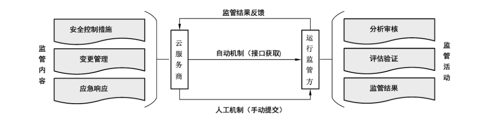

# GB/T 37972-2019 信息安全技术 云计算服务运行监管框架

> 来源：[GB/T 37972-2019 国家标准详情](https://openstd.samr.gov.cn/bzgk/std/newGbInfo?hcno=0D9A0F03C7C532612CDD8800367F6E63)；发布日期：2019-08-30；实施日期：2020-03-01。
> PDF SHA-256：e48641660926a865e355bf9e6bb823f83ee058cbcb5d9d0a9d6fc0501426802c。
> 转写说明：依据官方 PDF 全部 22 页的页面图像核对；省略封面、目录、页眉、页脚和页码，合并跨页表格。正式引用请核对原 PDF。

## 前言

本标准按照 GB/T 1.1—2009给出的规则起草。

请注意本文件的某些内容可能涉及专利。本文件的发布机构不承担识别这些专利的责任。

本标准由全国信息安全标准化技术委员会（SAC/TC 260）提出并归口。

本标准起草单位：四川大学、中国电子技术标准化研究院、北京安信天行技术有限公司、北京信息安全测评中心、华为技术有限公司、阿里云计算有限公司、腾讯云计算有限公司、中国移动通信有限公司研究院、广州赛宝认证中心服务有限公司、西安未来国际信息股份有限公司、陕西省信息化工程研究院、中国电子科技网络信息安全有限公司。

本标准主要起草人：陈兴蜀、罗永刚、李想、刘小茵、上官晓丽、钟金鑫、赵章界、葛龙、王伟、王永霞、张磊、沈锡庸、杨思磊、葛小宇、王惠莅、白杨、王启旭、胡影。

## 引言

随着云计算技术的蓬勃发展，政府部门及重点行业等对采用云计算服务有了大量需求，为确保云服务客户安全地使用云计算服务，确保云服务商的安全能力符合国家相关标准要求，确保云计算服务各相关方能够实时、有效地掌握云计算服务的运行质量和安全状态，制定云计算服务运行监管框架。

本标准以 GB/T 31167—2014《信息安全技术 云计算服务安全指南》为依据，以GB/T 31168—2014《信息安全技术 云计算服务安全能力要求》为要求，规范了政府部门云服务客户在使用云计算服务的过程中，云服务商、运行监管方的相关责任及监管内容，提出了运行监管框架、过程及方式。同时，本标准为云服务商支撑云计算服务运行监管活动提供指导，为运行监管方开展运行监管提供指导。

## 1 范围

本标准确定了云计算服务运行监管框架，规定了安全控制措施监管、变更管理监管和应急响应监管的内容及监管活动，给出运行监管实现方式的建议。

本标准适用于对政府部门使用的云计算服务进行运行监管，也可供重点行业和其他企事业单位使用云计算服务时参考。

## 2 规范性引用文件

下列文件对于本文件的应用是必不可少的。凡是注日期的引用文件，仅注日期的版本适用于本文件。凡是不注日期的引用文件，其最新版本（包括所有的修改单）适用于本文件。

- GB/T 31167—2014 信息安全技术 云计算服务安全指南

- GB/T 31168—2014 信息安全技术 云计算服务安全能力要求

## 3 术语和定义

GB/T 31167—2014界定的以及下列术语和定义适用于本文件。

### 3.1 运行监管方 operation supervision organization

独立于云计算服务相关方，且具有专业技术能力，开展运行监管的机构。

## 4 云计算服务运行监管目的及框架

### 4.1 运行监管目的

开展云计算服务运行监管的目的是保障：

a） 云计算服务持续满足国家相关法律法规、行政命令、政策和标准；

b） 云计算服务相关方能够及时、有效地掌握云计算平台的运行质量和安全状态；

c） 云计算服务的安全风险可控；

d） 云计算服务的安全能力持续满足要求。

从而确保 GB/T 31167—2014中8.1 提出的运行监管主要目标。

### 4.2 运行监管框架

云计算服务运行监管框架是基于国家标准 GB/T 31167 —2014和 GB/T 31168—2014中的运行监管要求而提出的。云计算服务运行监管框架如图1所示。

云服务商应对云计算服务实施安全控制、变更管理及应急响应等方面的管理和技术措施，并为运行监管方提供已实施相关管理和技术措施的支撑材料，形成交付件（对监管活动起到佐证作用的任何实体，包括但不限于各种文档、图片、录音、录像、实物、数据等，并以纸质、电子等形式有效保存），附录 A 给出了运行监管交付件参考模版，附录 B 给出了安全控制措施运行监管列表。

运行监管方对云服务商的交付件进行分析审核、评估验证等监管活动，形成监管结果告知云计算服务相关方，必要时应根据监管结果给出合理的意见和建议。

### 4.3 运行监管的角色及责任

#### 4.3.1 运行监管角色

运行监管框架包含两个主要角色：

a） 云服务商。通过国家网络安全审查并为政府部门提供服务的云服务商。

b） 运行监管方。云服务客户的管理部门（例如：政府信息安全管理部门、云服务客户的主管部门等）指定或委托的运行监管方。

#### 4.3.2 云服务商的责任

云服务商应确保：

a） 云计算平台中的安全控制措施持续有效；

b） 云计算平台中的重大变更风险可控；

c） 云计算平台中的应急响应及时充分；

d） 向运行监管方按约定的内容、形式、频率、人工或自动机制等提交运行监管所需交付件，并确保交付件真实可靠；

e） 根据运行监管方反馈的监管结果对相关的管理和技术措施进行整改。

从而履行 GB/T 31167—2014中8.2.3规定的云服务商在运行监管中的责任。

#### 4.3.3 运行监管方的责任

运行监管方应：

a） 对云计算服务的安全控制措施、重大变更和应急响应等进行运行监管；

b） 与云服务商协商运行监管接口，即交付件的内容、形式、频率和人工或自动机制等；

c） 确保云服务商提交的交付件安全，不得将交付件、涉及云服务商的知识产权和商业秘密的材料提供给第三方；

d） 对云服务商提交的交付件进行分析及审核；

e） 根据分析、审核结果对云计算服务的安全能力进行评估，必要时应以抽查、核查及测试等方式对交付件中的内容进行验证；

f） 根据评估验证结论，形成评估报告并告知云计算服务相关方，必要时应给出整改意见和建议。

从而帮助云服务客户履行GB/T 31167—2014中8.2.2规定的客户在运行监管活动中的责任。

## 5 安全控制措施监管

### 5.1 安全控制措施内容

安全控制措施涉及的主要内容包括但不限于：

a） 系统开发与供应链安全；

b） 系统与通信保护；

c） 访问控制；

d） 配置管理；

e）维护；

f） 应急响应与灾备；

g）审计；

h） 风险评估与持续监控；

i） 安全组织与人员；

j） 物理与环境安全。

### 5.2 安全控制措施监管环节

安全控制措施的监管环节包括：

a） 运行监管方制定安全控制监管策略与计划，明确监管目的与要求、监管方法与手段，细化安全控制措施的监管内容、交付件类型、格式及频率等；

b） 云服务商根据运行监管方制定的安全控制措施监管策略与计划，对云计算平台的安全状态实施持续监控，提交有关安全控制措施有效性的相关交付件；

c） 运行监管方根据云服务商提交的交付件，对云计算平台的安全控制措施进行分析、审核，必要时，应对安全控制措施的有效性进行评估，并将结果告知云计算服务相关方。

## 6 变更管理监管

### 6.1 变更管理内容

变更管理涉及的主要内容包括但不限于（见GB/T 31167—2014中8.4.2 重大变更监管）：

a） 鉴别（包括身份鉴别和数据源鉴别）和访问控制措施的变更；

b） 数据存储实现方法的变更；

c） 备份机制和流程的变更；

d） 与外部服务商网络连接的变更；

e） 安全控制措施的变更；

f） 已部署的商业软硬件产品的变更；

g） 云计算服务分包商的变更，例如 PaaS、SaaS 服务商更换 IaaS 服务商；

h） 云计算服务运行主体的变更；

i） 云计算平台软件版本的变更；

j）云计算平台基础设施的变更；

k）系统IT架构的变更。

### 6.2 变更管理监管环节

重大变更的监管环节如下：

a） 运行监管方制定变更管理监管策略与计划，明确监管目的与要求、方法与手段、交付件等；

b） 云服务商在实施重大变更之前，应对变更项进行安全影响分析，必要时应对变更项进行测试、验证，并根据与运行监管方约定的格式、内容、时间，提交有关重大变更安全性的相关交付件；

c） 运行监管方根据云服务商提交的交付件，对云计算平台的变更项进行分析、审核，必要时，应对变更项的安全性进行评估、验证，并将结果告知云计算服务相关方。

## 7 应急响应监管

### 7.1 应急响应内容

应急响应涉及的主要内容包括但不限于（见GB/T 31167—2014中8.4.3 安全事件监管）：

a） 非授权访问事件，如对云计算平台下的业务系统、数据或其他计算资源进行非授权逻辑或物理访问等；

b） 发生安全攻击事件，如拒绝服务攻击；

c） 恶意代码感染，如云计算平台被病毒、蠕虫、特洛伊木马等恶意代码感染；

d） 云计算平台宕机；

e） 重大安全威胁发现；

f） 重大安全信息泄露。

### 7.2 应急响应监管环节

应急响应的监管环节如下：

a） 运行监管方制定应急响应监管策略与计划，明确监管目的与要求、监管方法与手段，细化应急响应的监管内容、交付件类型、格式等；

b） 云服务商在检测到可能会导致云服务客户的业务中断或对云服务客户数据的保密性和完整性有威胁的安全事件时，开展并记录应急响应活动，形成应急响应交付件并及时提交给运行监管方；

c） 运行监管方根据云服务商提交的交付件，对安全事件及应急响应活动进行分析、评估，必要时，应对应急响应活动的充分性进行评估、验证，并将结果告知云计算服务相关方。

## 8 云计算服务运行监管的实现方式

### 8.1 概述

运行监管方应通过有效、准确、及时的方式获取有关云计算平台安全的信息及交付件，以便对云计算服务安全能力开展分析、评估、审核、验证等监管活动。获取运行监管信息和交付件的实现方式包括：手工机制和自动机制。

### 8.2 人工机制

云服务商根据与运行监管方约定的内容及频率，以确定的非在线方式，向运行监管方提交支撑运行监管活动的相关交付件，交付件列表可参考附录 B。

### 8.3 自动机制

#### 8.3.1 主要内容

自动机制监管的主要内容包括但不限于：

a） 限制对各类介质的访问，并对介质访问情况进行审计；

b） 对配置项的参数进行集中管理、应用和验证；

c） 检测云计算服务平台中新增的非授权软件、硬件或固件组件；

d） 维护信息系统组件清单；

e） 支持事件处理过程；

f） 支持事件报告过程；

g） 提高事件响应支持资源的可用性；

h） 对审查、分析和报告过程进行整合，以支持对可疑活动的调查和响应；

i） 比较不同时间的脆弱性扫描结果，以判断信息系统漏洞趋势；

j）更新恶意代码防护机制；

k）管理账号；

l）监视和控制远程访问会话，以检测网络攻击，确保远程访问策略得以实现；

m）对缺陷修复后的组件进行检测；

n） 对攻击事件进行准实时分析；

o） 温湿度控制。

#### 8.3.2 要求

实现自动机制时应考虑：

a）遵守国家相关法律、行政命令、指令、政策、条例、标准和指导方针；

b）使用开放性规范、标准、技术及协议；

c） 从各种信息源中提取信息；

d） 提供与其他工具的可交互性；

e）能够对安全控制、变更管理及应急响应过程中的信息进行整合并格式化输出。

## 附录 A（资料性附录）运行监管交付件模版

### A.1 安全控制措施报告表

云服务商应逐项对照附录 A 的各项要求的实现情况在表 A.1 中进行说明。

**表 A.1 安全控制措施报告表**

| 部分 | 字段或填写说明 |
| --- | --- |
| 云服务商 | 云服务商名称；云计算服务名称 |
| 安全能力 | 安全类；安全项；安全属性：□ 一般要求、□ 增强要求；章节号 |
| 内容描述 | 对内容中给出的赋值和选择项，需在表格中明确列出赋值和选择的具体参数 |
| 安全措施 | 措施名称；作用范围：□ 通用、□ 专用、□ 混用 |
| 安全控制措施说明 | 对采用的安全控制措施的功能、效果及可用性等特性进行说明 |
| 拟提供的证据（可另附页） | 能证明安全控制措施有效性的说明 |

### A.2 重大变更报告表

对于计划中的重大变更，云服务商应在计划实施之前，以与运行监管方约定的时间内，在表 A.2 中进行说明。

**表 A.2 重大变更报告表**

| 字段 | 内容或选项 |
| --- | --- |
| 云服务商 | 云服务商名称；云计算服务名称 |
| 云服务客户、安全能力要求 | 云服务客户；□ 一般、□ 增强 |
| 服务模式 | □ 软件即服务（SaaS）；□ 平台即服务（PaaS）；□ 基础设施即服务（IaaS）；□ 其他（请注明） |
| 部署模式 | □ 公有云；□ 私有云；□ 社区云；□ 混合云；□ 其他（请注明） |
| 计划日期 | 变更计划开始日期；变更计划完成日期 |
| 联系人 | 姓名；职务；电子邮件；电话 |
| 变更类型 | □ 云服务商变动（云服务商名称、注册地、企业性质、管理层）；□ 物理环境变化（机房位置）；□ 网络环境变化（网络架构、与外部信息系统的连接、与外部服务商的连接）；□ 云平台关键软件组成变更（版本、代码、组件、供应商）；□ 云平台关键硬件组成变更（硬件组成、IP 地址、供应商）；□ 供应链关键服务商变更；□ 云计算服务分包商的变更，例如 PaaS、SaaS 服务商更换 IaaS 服务商；□ 鉴别（包括身份鉴别和数据源鉴别）和访问控制措施的变更；□ 数据存储的实现方法变更；□ 备份机制和流程变更；□ 安全措施的撤除；□ 其他 |
| 说明 | 变更原因说明；变更情况说明；变更影响分析（可另附页） |

### A.3 重大安全事件报告表

云服务商应在发现重大安全事件的第一时间，启动应急响应程序并告知运行监管方，事件响应完成后，依据时间响应处理过程的情况，在表 A.3 中进行说明。

**表 A.3 重大安全事件报告表**

| 字段 | 内容或选项 |
| --- | --- |
| 云服务商名称 |  |
| 报告时间 | 年、月、日、时、分 |
| 发现事件的情况 | 发生了什么事件；发生事件的时间；发现人；发现人所属部门 |
| 重大安全事件的详细描述（如以前出现过此类情况，也应加以说明） | 事件发生过程和原因等情况；受影响的用户、业务及其损失；已确定的风险；是否向云服务客户、国家和地方应急响应组织及有关信息安全主管部门等报告；其他 |
| 安全事件的类型 | □ 有害程序事件；□ 网络攻击事件；□ 信息破坏事件；□ 信息内容安全事件；□ 设备设施故障；□ 灾害性事件；□ 其他信息安全事件 |
| 安全事件的级别 | □ 特别重大安全事件；□ 重大安全事件；□ 较大安全事件；□ 一般安全事件 |
| 受影响的资产（提供受事件影响或与事件影响有关的资产的描述） | 例如：信息/数据、硬件、软件、网络设备、通信设施、文档等 |
| 涉及信息系统名称及主要用途 |  |
| 事件对业务的负面影响 | □ 违背保密性（即泄露）；□ 违背完整性（即篡改）；□ 违背可用性（即不可用性）；□ 违背抗抵赖性；□ 遭受破坏 |
| 攻击者的描述（实际的或觉察的动机） | □ 犯罪/经济效益；□ 消遣/黑客攻击；□ 政治/恐怖主义；□ 报复；□ 其他 |
| 计划采取的解决事件行动 |  |
| 符合现有事件处理计划 | □ 符合；□ 不符合，原因： |
| 是否修订了事件处理计划 | □ 是；□ 否，原因： |
| 是否修订了应急响应计划 | □ 是；□ 否，原因： |
| 事件处理过程描述 | 事件处置开始时间和结束时间；事件处置人员、所属部门和联系方式；其他 |
| 事件处理完成后对安全产生影响分析 |  |
| 提交的证据及编号 |  |
| 签署 | 签名；日期 |

## 附录 B（资料性附录）安全控制措施运行监管列表

安全控制措施运行监管情况见表 B.1。

**表 B.1 安全控制措施运行监管表**

| 安全类 | 安全项 | 属性 | 内容 | GB/T 31168—2014 |
| --- | --- | --- | --- | --- |
| 系统开发与供应链安全 | 资源分配 | 一般要求 | c）在工作计划和预算文件中，将信息安全作为单列项予以说明。 | 5.2 |
| 系统开发与供应链安全 | 采购过程 | 一般要求 | 云服务商应根据相关法律、法规、政策和标准的要求，以及可能的客户需求，并在风险评估的基础上，将以下内容列入信息系统采购合同： a）安全功能要求； b）安全强度要求； c）安全保障要求； d）安全相关文档要求； e）保密要求； f）开发环境和预期运行环境描述； g）验收准则； h）强制配置要求，如功能、端口、协议和服务。 | 5.4 |
| 系统开发与供应链安全 | 开发过程、标准和工具 | 增强要求 | c）按照［赋值：云服务商定义的频率］审查开发过程、标准、工具以及工具选项和配置，判定有关过程、标准、工具以及工具选项和配置是否满足［赋值：云服务商定义的安全需求］。 d）要求信息系统、组件或服务的开发商在开发过程的初始阶段定义质量度量标准，并以［选择：［赋值：云服务商定义的频率］；［赋值：云服务商定义的项目审查里程碑］；交付时］为节点，检查质量度量标准的落实情况。 i）要求信息系统、组件或服务的开发商即使在交付信息系统、组件或服务后，也应跟踪信息系统、组件或服务的漏洞情况，在发布漏洞补丁前便应通知云服务商，且应将漏洞补丁交由云服务商审查、验证并允许云服务商自行安装。 | 5.10 |
| 系统开发与供应链安全 | 开发商安全测试和评估 | 一般要求 | a）制定并实施安全评估计划。 b）以［赋值：云服务商定义的深度和覆盖度］执行［选择：单元；集成；系统；回归］测试或评估。 | 5.12 |
| 系统开发与供应链安全 | 开发商安全测试和评估 | 增强要求 | e）要求信息系统、组件或服务的开发商按照［赋值：云服务商定义的约束条件］，以［赋值：云服务商定义的广度和深度］执行渗透性测试。 | 5.12 |
| 系统开发与供应链安全 | 组件真实性 | 增强要求 | b）向［选择：正品厂商；［赋值：云服务商定义的外部报告机构］；［赋值：云服务商定义的人员和角色］；其他有关方面］报告赝品组件。 f）按照［赋值：云服务商定义的频率］检查信息系统中是否有赝品组件。 | 5.15 |
| 系统开发与供应链安全 | 供应链保护 | 一般要求 | b）确保［赋值：云服务商定义的重要设备］通过［赋值：政府和行业有关部门已设立的信息安全测评制度］的安全检测。 | 5.17 |
| 系统与通信保护 | 边界保护 | 一般要求 | a）在连接外部系统的边界和内部关键边界上，对通信进行监控；在客户之外的外部人员访问系统的关键逻辑边界和客户访问系统的关键逻辑边界上，对通信进行监控。 b）将允许外部公开直接访问的组件，划分在一个与内部网络逻辑隔离的子网络上。并确保允许外部人员访问的组件与允许客户访问的组件在逻辑层面实现严格的网络隔离。 c）确保与外部网络或信息系统的连接只能通过严格管理的接口进行，根据云服务商的安全架构，该接口上应部署有边界保护设备。 | 6.2 |
| 系统与通信保护 | 边界保护 | 增强要求 | a）为云计算服务搭建物理独立的计算平台、存储平台、内部网络环境及相关维护、安防、电源等设施，并经由受控边界与外部网络相连。 g）构建物理上独立的管理网络，连接管理工具和被管设备或资源，以对云计算平台进行管理。 c）采取以下措施： 1）对每一个外部的电信服务接口进行管理； 2）为每一个接口制定通信流策略； 3）采取有关措施对所传输的信息流进行必要的保密性和完整性保护； 4）当根据业务需要，出现通信流策略的例外情况时，将业务需求和通信持续时间记录到通信流策略的例外条款中； 5）按照［赋值：云服务商定义的频率］，对网络通信流策略中的例外条款进行审查，在通信流策略中删除不再需要的例外条款。 | 6.2 |
| 系统与通信保护 | 恶意代码防护 | 一般要求 | c）配置恶意代码防护机制，以： 1）按照［赋值：云服务商定义的频率］定期扫描信息系统，以及在［选择：终端；网络出入口］下载、打开、执行外部文件时对其进行实时扫描； 2）当检测到恶意代码后，实施［选择：阻断或隔离恶意代码；向管理员报警；［赋值：云服务商定义的活动］］。 d）及时掌握系统的恶意代码误报率，并分析误报对信息系统可用性的潜在影响。 | 6.11 |
| 访问控制 | 鉴别凭证管理 | 一般要求 | a）通过以下步骤管理鉴别凭证： 4）针对鉴别凭证的初始分发、丢失处置以及收回，建立和实施管理规程； 6）明确鉴别凭证的最小和最大生存时间限制以及再用条件； a）通过以下步骤管理鉴别凭证： 7）对［赋值：云服务商定义的鉴别凭证］，强制要求在［赋值：云服务商定义的时间段］之后更新鉴别凭证。 b）对于基于口令的鉴别： 4）强制执行最小和最大生存时间限制，以满足［赋值：云服务商定义的最小生存时间和最大生存时间］。 | 7.5 |
| 访问控制 | 账号管理 | 一般要求 | i）按照［赋值：云服务商定义的频率］，检查账号是否符合账号管理的要求。 | 7.8 |
| 访问控制 | 账号管理 | 增强要求 | b）在［赋值：云服务商定义的时间段］后自动［选项：删除；禁用］临时和应急账号。 c）在［赋值：云服务商定义的时间段］后自动关闭非活跃账号。 | 7.8 |
| 访问控制 | 无线访问 | 一般要求 | 云服务商应禁用无线网络直接访问云计算平台。 | 7.20 |
| 访问控制 | 可供公共访问的内容 | 一般要求 | d）按照［赋值：云服务商定义的频率］审查公开发布的信息中是否含有非公开信息，一经发现，立即删除。 | 7.23 |
| 配置管理 | 配置管理计划 | 增强要求 | a）制定并实施云计算平台的配置管理计划。 b）在配置管理计划中，规定配置管理相关人员的角色和职责，并详细规定配置管理的流程。 c）在系统生命周期内，建立配置项标识和管理流程。 d）定义信息系统的配置项并将其纳入配置管理计划。 e）保护配置管理计划，以防非授权的泄露和变更。 | 8.2 |
| 配置管理 | 变更控制 | 一般要求 | d）审查所提交的信息系统受控配置的变更事项，根据安全影响分析结果进行批准或否决，并记录变更决定。 e）保留信息系统中受控配置的变更记录。 f）按照［赋值：云服务商定义的频率］对与系统受控配置的变更有关的活动进行审查。 | 8.4 |
| 配置管理 | 最小功能原则 | 增强要求 | a）按照［赋值：云服务商定义的频率］，对信息系统进行审查，以标识不必要或不安全的功能、端口、协议或服务。 b）关闭［赋值：云服务商定义的不必要或不安全的功能、端口、协议和服务］。 c）信息系统应按照［选择：［赋值：云服务商定义的软件使用与限制策略］；对软件使用的授权规则］，禁止运行相关程序。 d）按照白名单策略，确定［赋值：云服务商定义的在云计算平台上允许运行的软件］，禁止非授权软件在云计算平台上运行，并按照［赋值：云服务商定义的频率］，审查和更新授权软件列表。 | 8.6 |
| 配置管理 | 信息系统组件清单 | 一般要求 | a）制定和维护信息系统组件清单，该清单应满足下列要求： 1）能准确反映当前信息系统的情况； 2）与信息系统边界一致； 3）达到信息安全管理所必要的颗粒度； 4）包含［赋值：云服务商定义的为实现有效的资产追责所必要的信息］。 b）按照［赋值：云服务商定义的频率］，审查并更新信息系统组件清单。 | 8.7 |
| 配置管理 | 信息系统组件清单 | 增强要求 | a）按照［赋值：云服务商定义的频率］，使用自动机制检测云计算服务平台中新增的非授权软件、硬件或固件组件。 | 8.7 |
| 维护 | 远程维护 | 一般要求 | f）对所有远程维护和诊断活动进行审计，按照［赋值：云服务商定义的频率］对所有远程维护和诊断会话的记录进行审查。 | 9.4 |
| 维护 | 维护人员 | 一般要求 | a）建立对维护人员的授权流程，对已获授权的维护组织或人员建立列表。 | 9.5 |
| 维护 | 缺陷修复 | 一般要求 | a）标识、报告和修复云计算平台的缺陷。 b）在与安全相关的软件和固件升级包发布后，及时安装升级包。 | 9.7 |
| 维护 | 缺陷修复 | 增强要求 | 云服务商应使用自动检测机制，按照［赋值：云服务商定义的频率］对缺陷修复后的组件进行检测。 | 9.7 |
| 维护 | 安全功能验证 | 一般要求 | a）验证［赋值：云服务商定义的安全功能］是否正常运行。 | 9.8 |
| 维护 | 软件、固件、信息完整性 | 增强要求 | a）按照［赋值：云服务商定义的频率］对云计算平台进行完整性扫描，并重新评估软件、固件和信息的完整性。 | 9.9 |
| 应急响应与灾备 | 事件处理计划 | 一般要求 | a）制定信息系统的事件处理计划，该计划应： 1）说明启动事件处理计划的条件和方法； 2）说明事件处理能力的组织结构； 3）定义需要报告的安全事件； 4）提供组织内事件处理能力的度量目标； 5）定义必要的资源和管理支持，以维护和增强事件处理能力； 6）由［赋值：云服务商定义的人员或角色］审查和批准。 b）向［赋值：云服务商定义的人员、角色或部门］发布事件处理计划。 c）按照［赋值：云服务商定义的频率］审查事件响应计划。 d）如系统发生变更或事件响应计划在实施、执行或测试中遇到问题，及时修改事件处理计划并通报［赋值：云服务商定义的人员、角色或部门］。 e）防止事件处理计划非授权泄露和更改。 | 10.2 |
| 应急响应与灾备 | 事件处理 | 一般要求 | c）将当前事件处理活动的经验，纳入事件处理、培训及演练计划，并实施相应的变更。 | 10.3 |
| 应急响应与灾备 | 事件报告 | 一般要求 | a）根据应急响应计划，监控和报告安全事件。 b）当发现可疑的安全事件时，在［赋值：云服务商定义的时间段］内，向本组织的事件处理部门报告。 c）建立事件报告渠道，当发生影响较大的安全事件时，向国家和地方应急响应组织及有关信息安全主管部门报告。 | 10.4 |
| 应急响应与灾备 | 应急响应计划 | 一般要求 | c）按照［赋值：云服务商定义的频率］更新应急响应计划。 d）如系统发生变更或应急响应计划在实施、执行或测试中遇到问题，及时修改应急响应计划并向［赋值：云服务商定义的人员、角色或部门］及客户进行通报。 | 10.8 |
| 应急响应与灾备 | 应急培训 | 一般要求 | a）向［赋值：云服务商定义的人员或角色］提供应急响应培训。 b）当信息系统变更时，或按照［赋值：云服务商定义的频率］，重新开展培训。 | 10.9 |
| 应急响应与灾备 | 应急演练 | 一般要求 | a）至少每年制定或修订应急演练计划，并与客户充分协商，听取客户意见。 b）按照［赋值：云服务商定义的频率］执行应急演练计划，并且至少在演练开始前［赋值：云服务商与客户确定的时间］之前通知客户和相关部门。 | 10.10 |
| 应急响应与灾备 | 信息系统备份 | 一般要求 | a）具备系统级备份能力，按照［赋值：云服务商定义的频率］，对信息系统中的系统级信息进行备份，如系统状态、操作系统及应用软件。 e）具有验证信息系统备份连续有效的方法，并按照［赋值：云服务商定义的频率］进行验证。 | 10.11 |
| 审计 | 可审计事件 | 一般要求 | c）制定信息系统内需连续审计的事件清单，并确定各事件的审计频率，该清单为上述可审计事件清单的子集。 | 11.2 |
| 审计 | 可审计事件 | 增强要求 | 云服务商应按照［赋值：云服务商定义的频率］对可审计清单进行审查和更新。 | 11.2 |
| 审计 | 审计的审查、分析和报告 | 一般要求 | a）按照［赋值：云服务商定义的频率］对审计记录进行审查和分析，以发现［赋值：云服务商定义的不当或异常活动］，并向［赋值：云服务商定义的人员或角色］报告。 | 11.6 |
| 风险评估与持续监控 | 策略与规程 | 一般要求 | b）按照［赋值：云服务商定义的频率］或当需要时，审查和更新综合风险管理策略、风险评估策略、持续性的监控策略及相关规程。 | 12.1 |
| 风险评估与持续监控 | 风险评估 | 一般要求 | b）按照［赋值：云服务商定义的频率］定期开展风险评估，或者在信息系统或运行环境发生重大变更（包括发现新的威胁和漏洞）时，或者在出现其他可能影响系统安全状态的条件时，重新进行风险评估。 c）将评估结果记录在风险评估报告中，并将风险评估结果发布至［赋值：云服务商定义的人员或角色］。 d）根据风险评估报告，有针对性地对云计算平台信息系统进行安全整改，将风险降低到［赋值：云服务商定义的可接受的水平］。 | 12.2 |
| 风险评估与持续监控 | 脆弱性扫描 | 一般要求 | a）使用脆弱性扫描工具和技术，按照［赋值：云服务商定义的频率］对云计算平台信息系统及其上的应用程序进行脆弱性扫描，并标识和报告可能影响该系统或应用的新漏洞。 b）根据风险评估或脆弱性扫描结果，在［赋值：云服务商定义的响应时间段］内修复漏洞。 | 12.3 |
| 风险评估与持续监控 | 脆弱性扫描 | 增强要求 | a）确保所使用的脆弱性扫描工具具有迅速更新漏洞库的能力。 b）按［选择：［赋值：云服务商定义的频率］；启动新的扫描前；新的漏洞信息发布后］更新信息系统漏洞库。 d）在脆弱性扫描活动中，使用特权账号对［赋值：云服务商定义的信息系统组件］进行［赋值：云服务商定义的脆弱性扫描行动］，以实现更全面扫描。 c）确保所使用的脆弱性扫描工具能够展现扫描所覆盖的广度和深度（如已扫描的信息系统组件和已核查的漏洞）。 | 12.3 |
| 风险评估与持续监控 | 持续监控 | 一般要求 | a）制定持续性的监控策略，并实施持续性监控，内容包括： 1）确定待监控的度量指标； 2）确定监控频率。 c）根据持续性监控策略，对已定义的度量指标进行持续的安全状态监控。 d）对评估和监控产生的安全相关信息进行关联和分析。 e）对安全相关信息分析结果进行响应。 f）按照［赋值：云服务商定义的频率］向［赋值：云服务商定义的人员或角色］报告信息系统安全状态。 | 12.4 |
| 风险评估与持续监控 | 持续监控 | 增强要求 | 云服务商应每年安排实施未事先声明的渗透性测试以及深度检测，以验证系统的安全状态。 | 12.4 |
| 风险评估与持续监控 | 信息系统监测 | 一般要求 | a）能够针对［赋值：云服务商定义的监测目标］，发现攻击行为。 b）能够检测出非授权的本地、网络和远程连接。 c）能够通过［赋值：云服务商定义的技术和方法］，发现对信息系统的非授权使用。 d）能够对入侵监测工具收集的信息进行保护，防止非授权访问、修改或删除。 e）当威胁环境发生变化、信息系统风险增加时，提升信息系统监测级别。 f）确保信息系统监控活动符合关于隐私保护的相关政策法规。 g）按照需要或［赋值：云服务商定义的频率］，向［赋值：云服务商定义的人员或角色］提供［赋值：云服务商定义的信息系统监控信息］。 | 12.5 |
| 风险评估与持续监控 | 信息系统监测 | 增强要求 | a）使用自动工具对攻击事件进行准实时分析。 b）信息系统应按照［赋值：云服务商定义的频率］监测进出的通信，以发现异常或非授权的行为。 c）当下述迹象发生时，信息系统应向［赋值：云服务商定义的人员或角色］发出警报： 1）受保护的信息系统文件或目录在没有得到正常的变更或配置管理渠道通知的情况下被修改； 2）当发生异常资源消耗时； 3）审计功能被禁止或修改，导致审计可见性降低； 4）审计或日志记录在无法解释的情况下被删除或修改； 5）预期之外的用户发起了资源或服务请求； 6）信息系统报告了管理员或关键服务账号的登录失败或口令变更情况； 7）进程或服务的运行方式与系统的一般情况不符； 8）在生产系统上保存或安装与业务无关的程序、工具、脚本。 d）防止非授权用户绕过入侵检测和入侵防御机制。 e）对信息系统运行状态（包括 CPU、内存、网络）进行监视，并能够对资源的非法越界使用发出警报。 | 12.5 |
| 风险评估与持续监控 | 垃圾信息监测 | 一般要求 | a）在系统的出入口和网络中的工作站、服务器或移动计算设备上部署垃圾信息监测与防护机制，以检测并应对电子邮件、电子邮件附件、web 访问或其他渠道的垃圾信息。 b）在出现新的发布包时，及时更新垃圾信息监测与防护机制。 | 12.6 |
| 安全组织与人员 | 安全组织 | 一般要求 | a）建立管理框架来启动和控制组织内信息安全的实现： 1）设立［赋值：云服务商定义的人员或角色］作为信息安全的第一负责人，由本组织最高管理层人员担任； 2）设立［赋值：云服务商定义的部门］作为信息安全的责任部门，并通过［赋值：云服务商定义的机制］与本组织其他业务部门协调。 b）建立［赋值：云服务商定义的机制］，以保持与［赋值：云服务商定义的外部组织］的适当联系。 c）实施内部威胁防范程序，包括跨部门的内部威胁事件处理团队。 | 13.2 |
| 安全组织与人员 | 安全规章制度 | 一般要求 | a）制定信息安全规章制度，并传达至内外部相关人员。 b）在信息安全策略或计划发生变更时，或者按照［赋值：云服务商定义的频率］，评审和更新信息安全规章制度，以确保其持续的适用性和有效性。 | 13.4 |
| 安全组织与人员 | 人员筛选 | 一般要求 | a）确保授权访问信息系统的人员已经经过筛选，人员背景信息和筛选结果应可供客户查阅。 b）按照［赋值：云服务商定义的再筛选条件和频率］，审查访问人员的再筛选结果。 | 13.6 |
| 安全组织与人员 | 访问协议 | 一般要求 | a）制定云计算平台的访问协议。 b）按照［赋值：云服务商定义的频率］，评审和更新该访问协议。 c）确保云计算平台的访问人员： 1）在被授予访问权之前，签署合适的访问协议； 2）根据工作需要，或者按照［赋值：云服务商定义的频率］，重新签署访问协议。 | 13.9 |
| 安全组织与人员 | 安全培训 | 一般要求 | a）在以下情况下为信息系统用户（包括管理层人员和合同商）提供基础的安全意识培训： 1）作为新用户初始培训的一部分； 2）在因信息系统变更而需要时； 3）按照［赋值：云服务商定义的频率］。 b）在以下情况下为被分配了安全角色和职责的人员提供基于角色的安全技能培训： 1）在授权访问信息系统或者执行所分配的职责之前； 2）在因信息系统变更而需要时； 3）按照［赋值：云服务商定义的频率］。 d）按照［赋值：云服务商定义的时间段］，保存人员的培训记录。 | 13.12 |
| 物理与环境安全 | 物理环境访问授权 | 一般要求 | a）制定和维护具有机房访问权限的人员名单。 c）按照［赋值：云服务商定义的频率］对授权人员名单和凭证进行审查。 | 14.4 |
| 物理与环境安全 | 物理环境访问控制 | 一般要求 | a）对所有机房的［赋值：云服务商定义的机房出入点］实施物理访问授权，具体包括：在准许进入机房前验证其访问授权、使用［赋值：云服务商定义的物理访问控制系统或设备］或警卫实施机房出入控制等。 b）制定和维护［赋值：云服务商定义的出入点］的物理访问审计日志。 f）按照［赋值：云服务商定义的频率］对［赋值：云服务商定义的物理访问设备］进行盘点。 g）按照［赋值：云服务商定义的频率］或在钥匙丢失、访问凭证受损以及相关人员发生变动的情况下，更换钥匙和访问凭证。 | 14.5 |
| 物理与环境安全 | 物理访问监控 | 一般要求 | b）按照［赋值：云服务商定义的频率］，或当［赋值：云服务商定义的事件发生或有迹象发生］时，对物理访问日志进行审查。 | 14.8 |
| 物理与环境安全 | 访客访问记录 | 一般要求 | a）制定和维护云计算平台机房的访客访问记录，并保留至［赋值：云服务商定义的时间段］。 b）按照［赋值：云服务商定义的频率］对访问记录进行审查。 | 14.9 |
| 物理与环境安全 | 温湿度控制能力 | 一般要求 | a）维护云计算平台所在机房的温湿度，使其符合 GB 50174—2008 的相关规定。 b）实时监控温湿度水平。 | 14.13 |

## 参考文献

- ［1］ GB/T 24363—2009 信息安全技术 信息安全应急响应计划规范

- ［2］ GB/T 32400—2015 信息技术 云计算 概览与词汇

- ［3］ GB 50174—2008 电子信息系统机房设计规范

- ［4］ FedRAMP Continuous Monitoring Strategy & Guide. Version 2.0, June 6, 2014

- ［5］ FedRAMP Incident Communications Procedure. Version 1.0, April 8, 2013

- ［6］ NIST Special Publication 800-137, Information Security Continuous Monitoring (ISCM) for Federal Information Systems and Organizations. September 2011
