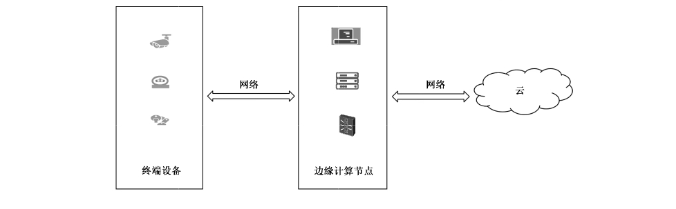
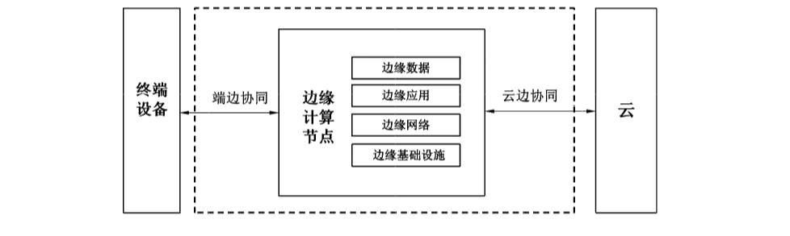
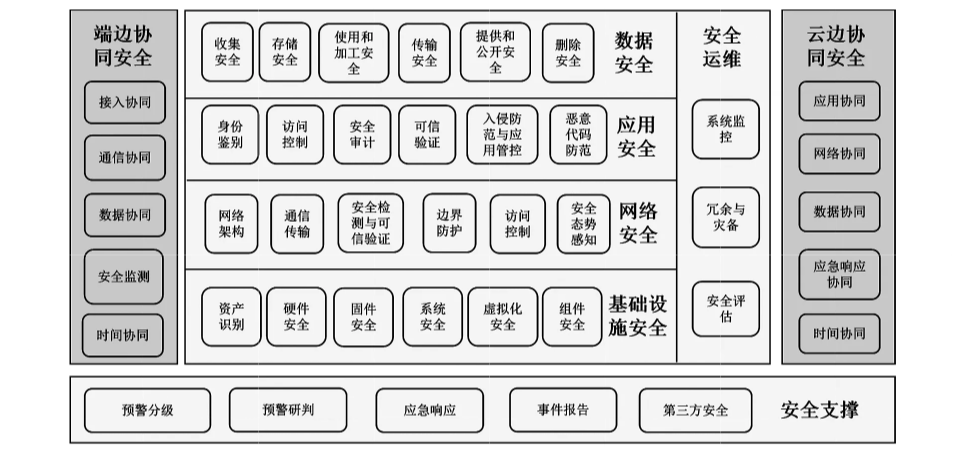
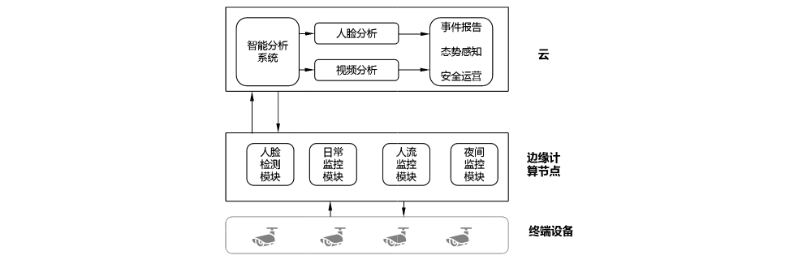
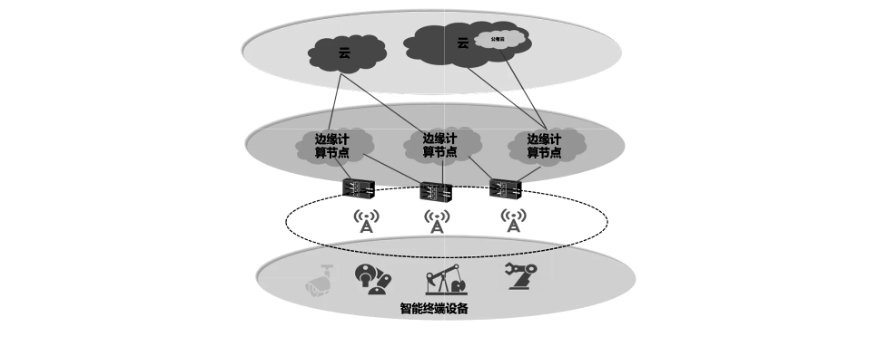

# GB/T 42564-2023 信息安全技术 边缘计算安全技术要求

> 来源：[GB/T 42564-2023 国家标准详情](https://openstd.samr.gov.cn/bzgk/std/newGbInfo?hcno=28A1C34E6197E88867B7B6B8C6E26F16)；发布日期：2023-05-23；实施日期：2023-12-01。
> 官方在线预览截图 SHA-256：5c6d348ee7094ac74081888070255ccdf75f51ff241e53ab7d693368b6cc06ee。
> 转写说明：依据官方在线预览全部 23 页的页面图像核对；省略封面、目录、页眉、页脚和页码，保留六张图示并合并跨页表格。正式引用请核对官方原页。

## 前言

本文件按照GB/T1.1—2020《标准化工作导则 第1部分：标准化文件的结构和起草规则》的规定起草。

请注意本文件的某些内容可能涉及专利。本文件的发布机构不承担识别专利的责任。

本文件由全国信息安全标准化技术委员会（SAC/TC 260）提出并归口。

本文件起草单位：中移（杭州）信息技术有限公司、中国移动通信集团有限公司、中国电子技术标准化研究院、国家计算机网络应急技术处理协调中心、公安部第三研究所、国家工业信息安全发展研究中心、中电长城网际系统应用有限公司、华为技术有限公司、腾讯云计算（北京）有限责任公司、深信服科技股份有限公司、联想（北京）有限公司、海信集团控股股份有限公司、亚信安全科技股份有限公司、北京百度网讯科技有限公司、新华三技术有限公司、阿里云计算有限公司、浪潮电子信息产业股份有限公司、北京科技大学、北京山石网科信息技术有限公司、杭州海康威视数字技术股份有限公司、北京天融信网络安全技术有限公司、大唐微电子技术有限公司、杭州安恒信息技术股份有限公司、启明星辰信息技术集团股份有限公司、之江实验室、中国科学院信息工程研究所、中国电子科技网络信息安全有限公司、北京神州绿盟科技有限公司、上海三零卫士信息安全有限公司、国网新疆电力有限公司电力科学研究院、深圳渊联技术有限公司、广东省电信规划设计院有限公司、北京眼神科技有限公司、北京数字认证股份有限公司、郑州信大捷安信息技术股份有限公司、广州大学、中国汽车工程研究院股份有限公司、上海观安信息技术股份有限公司、深圳市海梁科技有限公司、恒安嘉新（北京）科技股份公司、飞诺门阵（北京）科技有限公司、罗克韦尔自动化（中国）有限公司、罗克佳华科技集团股份有限公司、成都卫士通信息产业股份有限公司、上海依图网络科技有限公司、施耐德电气（中国）有限公司、杭州谐云科技有限公司。

本文件主要起草人：路晓明、邱勤、王晨光、张锦卫、鲁青、智绪龙、孙彦、王文磊、张艳、孙岩、闵京华、严敏瑞、王永霞、訾然、黄建东、高雪松、薛辉、吴月升、万晓兰、李晓成、宋桂香、林福宏、任亮、周少鹏、王龑、王勇、李剑锋、毕亲波、李振廷、刘玉岭、毕敏、尹雅伟、干露、舒斐、叶思海、陆伟宙、尚可、王新华、梁松涛、徐光侠、全代勇、谢江、郭剑锋、徐昕白、葛强、彭小波、李玮、张文科、刘亦珩、阎新华、王翱宇、吴君轶、黄一鸣、章继虎、王晓明。

## 1 范围

本文件规定了边缘计算安全框架以及安全框架下的基础设施安全、网络安全、应用安全、数据安全、安全运维、安全支撑、端边协同安全、云边协同安全技术要求。

本文件适用于指导边缘计算提供者和边缘计算开发者开展边缘计算的研发、测试、部署和运营。

## 2 规范性引用文件

下列文件中的内容通过文中的规范性引用而构成本文件必不可少的条款。其中，注日期的引用文件，仅该日期对应的版本适用于本文件；不注日期的引用文件，其最新版本（包括所有的修改单）适用于本文件。

- GB/T 20271—2006 信息安全技术 信息系统通用安全技术要求

- GB/T 22239—2019 信息安全技术 网络安全等级保护基本要求

- GB/T 25069 信息安全技术 术语

- GB/T 30276—2020 信息安全技术 网络安全漏洞管理规范

- GB/T 35273—2020 信息安全技术 个人信息安全规范

- GB/T 35293—2017 信息技术 云计算 虚拟机管理通用要求

- GB/T 37092—2018 信息安全技术 密码模块安全要求

- GB/T 37988—2019 信息安全技术 数据安全能力成熟度模型

- GB/T 38626—2020 信息安全技术 智能联网设备口令保护指南

- GB/T 39786—2021 信息安全技术 信息系统密码应用基本要求

- GB/T 41479—2022 信息安全技术 网络数据处理安全要求

## 3 术语和定义

GB/T 20271—2006、GB/T 25069、GB/T 35273—2020界定的以及下列术语和定义适用于本文件。

### 3.1 边缘 edge

相关数字和物理实体之间的边界，由联网的传感器和执行部件构成。

［来源：ISO/IEC TR 23188:2019,3.1.2］

### 3.2 边缘计算 edge computing

一种在边缘或边缘附近进行数据处理与存储的分布式计算形式。

［来源：ISO/IEC TR 23188:2019,3.1.3，有修改］

### 3.3 边缘计算节点 edge computing node

在边缘或边缘附近提供存储、计算、网络等资源的实体。

### 3.4 边缘计算服务 edge computing service

通过边缘计算已定义的接口提供一种或多种能力。

### 3.5 边缘计算提供者 edge computing provider

提供边缘计算服务的参与方。

### 3.6 边缘计算使用者 edge computing user

为使用边缘计算服务而处于一定业务关系中的参与方。

### 3.7 边缘计算开发者 edge computing developer

提供边缘计算的开发、测试和集成的参与方。

### 3.8 边缘应用 edge computing application

部署并运行在边缘节点上的应用程序，在边缘实现对数据的本地处理和业务逻辑的本地执行。

### 3.9 边缘基础设施 edge computing infrastructure

承载边缘计算服务的硬件设备、系统软件以及用于监控或管理边缘节点的软件工具等基础设施。

### 3.10 边缘网络 edge computing network

终端设备、边缘节点和云之间的通信网络。

### 3.11 边缘数据 edge computing data

在边缘节点与终端设备、云交互的过程中，收集、存储、使用、加工、传输、提供、公开及删除的数据。

### 3.12 协同安全 collaborative security

两个及以上的不同实体或系统相互配合过程中的安全。

### 3.13 边缘计算系统 edge computing system

实现边缘计算的系统。

## 4 缩略语

下列缩略语适用于本文件。

- AI：人工智能（Artificial Intelligence）
- APP：移动互联网应用程序（Application）
- APT：高级持续性威胁（Advanced Persistent Threat）
- DDoS：分布式拒绝服务攻击（Distributed Denial of Service）
- IoT：物联网（Internet of Things）
- IPS：入侵防御系统（Intrusion Prevention System）
- MEC：多接入边缘计算（Multi-Access Edge Computing）
- NTSC：国家授时中心（National Time Service Center）
- UTC：世界协调时间（Universal Time Coordinated）
- 4G：第四代移动通信技术（4th Generation Mobile Communication Technology）
- 5G：第五代移动通信技术（5th Generation Mobile Communication Technology）

## 5 概述

### 5.1 参考架构

边缘计算参考架构一般由终端设备、边缘计算节点和云三层以及三层之间的网络组成，见图1。

其中：

a） 终端设备位于网络末端，此类设备的计算能力较弱、存储空间较小、网络带宽有限；

b） 边缘计算节点位于终端设备和云之间，在边缘或边缘的附近提供存储、计算和网络等资源服务；

c） 云具有强大的计算和存储资源，提供大量数据的存储、分析和处理服务。

### 5.2 相关方的安全责任

边缘计算系统和服务的研发、测试、部署和运营过程中，涉及的相关方包括边缘计算提供者、边缘计算开发者和边缘计算使用者。

- 边缘计算提供者：负责边缘计算服务建设、管理和运维的安全，确保边缘计算服务的安全交付和运营，并向边缘计算使用者提供安全指导。边缘计算提供者包括边缘计算服务运维者、边缘计算业务运营者以及边缘计算安全运营者。

- 边缘计算开发者：负责边缘计算系统开发、测试和集成的安全。边缘计算开发者包括边缘计算硬件开发者、边缘计算软件开发者、边缘计算应用开发者、边缘计算测试者以及边缘计算系统集成者。

- 边缘计算使用者：以符合国家法律法规和边缘计算提供者安全指导的方式使用边缘计算服务，例如不能恶意攻击边缘计算服务、保护自身帐号安全等。边缘计算使用者包括边缘计算使用人员，以及调用边缘计算服务的企业用户。

### 5.3 主要安全风险

边缘计算技术逐渐趋于成熟，催生出新的应用场景（典型应用场景见附录A），但也存在敏感数据泄漏、设备被入侵劫持、系统被网络攻击等风险，边缘计算具体的安全风险因素分析见附录 B。

### 5.4 安全防护范围

边缘计算安全包括终端设备、边缘计算节点和云三者自身的安全以及三者之间的协同安全，其中，终端设备安全见 GB/T 37044—2018，云安全见 GB/T 35279—2017，本文件主要考虑边缘计算节点自身安全，以及边缘计算节点与终端设备、云之间的协同安全，见图2。

## 6 边缘计算安全要求

### 6.1 边缘计算安全框架

本文件基于边缘计算安全防护范围，抽象出边缘计算安全框架，见图3。

边缘计算安全框架对应的基础设施安全、网络安全、数据安全、安全运维、安全支撑、端边协同安全和云边协同安全防护措施如下：

a） 边缘基础设施安全包括资产识别、硬件安全、固件安全、系统安全、虚拟化安全和组件安全等安全防护措施，以保证边缘基础设施的安全；

b）边缘网络安全包括网络架构、通信传输、安全检测与可信验证、边界防护、访问控制和安全态势感知等安全防护措施，以保证边缘网络的安全；

c） 边缘应用安全包括身份鉴别、访问控制、安全审计、可信验证、入侵防范与应用管控和恶意代码防范等防护措施，提升边缘应用的安全可靠性以及边缘计算节点对应用的安全管控；

d） 边缘数据安全包括边缘计算节点上以及云边协同和端边协同过程中的数据收集安全、存储安全、使用和加工安全、传输安全、提供和公开安全以及删除安全；

e） 边缘计算的安全运维包括系统监控、冗余与灾备和安全评估等安全防护措施，以保证边缘计算节点安全运行；

f） 边缘计算的安全支撑包括预警分级、预警研判、应急响应、事件报告和第三方安全等防护措施，以保证边缘计算节点的安全运行；

g） 端边协同安全包括终端设备和边缘计算节点之间协同时的接入、通信、数据和时间协同安全以及安全监测；

h）云边协同安全包括云和边缘计算节点之间协同时的应用、网络、数据和时间协同安全以及应急响应协同安全。

边缘计算安全技术要求与边缘计算相关方的对应关系见附录C。

本文件中凡涉及采用密码技术的，应遵循密码相关国家标准和行业标准。

### 6.2 基础设施安全要求

#### 6.2.1 资产识别

边缘计算开发者提供的边缘计算系统应：

a） 具备识别边缘计算中相关资产的能力，资产包括硬件、固件、系统、虚拟化组件（例如虚拟机、容器）、系统组件等；

b） 支持基于资产类别、资产重要性和支撑业务的重要性，对资产进行优先级排序；

c） 能够确定并记录资产识别的方式。

边缘计算提供者应建立规范的资产清单列表，对基础设施资产管理过程中涉及的工具记录，并定期维护和更新资产清单。

#### 6.2.2 硬件安全

边缘计算开发者提供的边缘计算系统应：

a） 在硬件显著位置设置设置标签，标签内容包括设备信息，例如序列号、资产标识等，以便查找和明确责任；

b）在关键部件（包括硬盘、主板、网卡等）设置标签，防止关键部件被随意替换；

c） 选择安全性高的硬件设备，防止硬件设备被破解；

d） 具备针对关键部件的数据校验功能；

e） 具备容错、冗余或者热备份的安全功能，以提供连续不间断运行功能；

f） 具备自动化配置数据的能力，并能保障机密数据和配置数据在自动化配置过程中的安全。

#### 6.2.3 固件安全

边缘计算开发者提供的边缘计算系统应：

a） 支持对固件的常规性漏洞自动扫描；

b）具备自动监控固件完整性的功能，对异常行为进行告警。

#### 6.2.4 系统安全

边缘计算开发者提供的边缘计算系统应：

a） 支持普通操作模式和系统维护模式，两种模式具有不同的操作权限，普通操作模式的用户无法升级到系统维护模式，系统支持用户登录鉴权功能，例如基于实体数字证书的用户登录鉴权；

b） 支持系统安全启动机制，系统建立初始化环境，监控安全启动过程；

c） 支持开机校验，系统启动后对操作系统、内核等进行校验，防止未授权的应用加载以及非法访问；

d） 及时对系统存在的漏洞打补丁，漏洞处置符合 GB/T 30276—2020中5.4的规定；

e） 为每个边缘计算使用者分配唯一的身份标识；

f） 支持对身份鉴别的失败次数设置上限，对超过上限次数的边缘计算使用者进行权限限制，对于使用口令进行身份鉴别的设置口令复杂度规则，口令的生成策略符合GB/T 38626—2020中7.1的规定；

g） 支持对边缘计算使用者的权限管理，支持分级分组，例如根据不同边缘计算使用者等级、分组、时间段分配不同的访问权限，仅允许授权的边缘计算使用者访问指定的业务内容，以及对业务执行相应操作；

h） 支持对边缘计算使用者的身份管理，对不同的边缘计算使用者分配不同的访问权限，仅允许授权使用者访问指定的应用。

#### 6.2.5 虚拟化安全

边缘计算开发者提供的边缘计算系统应：

a） 支持容器编排、管理等组件本身的安全保护，保证边缘计算节点上的容器安全；

b） 支持容器之间的安全隔离，加强容器逃逸安全问题的防护；

c） 对部署在边缘环境中的容器进行隔离，防止恶意用户的流量流入到容器中；

d） 符合 GB/T 35293—2017中第9章和第10章的规定。

#### 6.2.6 组件安全

边缘计算开发者提供的边缘计算系统应：

a） 采用GB/T 37092—2018中第7章规定的安全一级密码模块；

b） 符合GB/T 39786—2021 规定的第一级密码应用基本要求；

c） 支持对协议栈的数据源验证、数据完整性验证，对协议栈中传输数据进行加密，防止数据通过明文传输；

d） 符合GB/T 30276—2020中5.4的组件中的漏洞处置规定。

### 6.3 网络安全要求

#### 6.3.1 网络架构

边缘计算提供者应：

a） 保证业务处理能力具备冗余空间，满足业务高峰期需要；

b） 绘制与业务运行情况相符的网络拓扑结构图；

c） 为边缘计算节点设置唯一的标识。

#### 6.3.2 通信传输

边缘计算开发者提供的边缘计算系统应：

a） 支持采用安全协议保证网络通信的安全性；

b） 支持通信过程中防止重放攻击，例如采用时间戳技术防止重放攻击；

c） 支持防中间人攻击等功能。

#### 6.3.3 安全检测与可信验证

边缘计算开发者提供的边缘计算系统应：

a） 支持网络流量检测功能，具备对传输流量实时监控，及时发现异常并响应；

b） 支持常见网络攻击的检测功能，例如 DDoS 攻击、僵木蠕、垃圾邮件、恶意代码等；

c） 符合 GB/T 22239—2019中 6.1.2.2 和 7.1.2.3的规定。

#### 6.3.4 边界防护

边缘计算开发者提供的边缘计算系统应符合 GB/T 22239—2019中6.1.3.1 的规定。

#### 6.3.5 访问控制

边缘计算开发者提供的边缘计算系统应符合GB/T 22239—2019中6.1.3.2的规定。

#### 6.3.6 安全态势感知

边缘计算开发者提供的边缘计算系统应：

a） 支持态势感知平台对边缘计算节点的安全状态的采集功能，并将进程运行、资源使用等系统运行状态上传至态势感知平台；

b） 支持根据态势感知平台的指令进行安全处置响应。

### 6.4 应用安全要求

#### 6.4.1 身份鉴别

边缘计算开发者提供的边缘计算系统应：

a） 支持对边缘计算应用的身份管理，并为每个边缘计算使用者分配唯一的身份标识；

b） 支持对部署的应用进行合法性验证，仅允许通过验证的应用部署到边缘计算节点；

c） 支持对身份鉴别的失败次数设置上限，对超过上限次数的应用进行权限限制，对于使用口令进行身份鉴别的设置口令复杂度规则，口令的生成策略符合 GB/T 38626—2020中7.1 的规定；

d） 对通信对方发来的身份鉴别和报文信息进行鉴别验证，对通信对方身份合法性、接收信息的安全性，保证通信的安全性。

#### 6.4.2 访问控制

边缘计算开发者提供的边缘计算系统应：

a） 支持对边缘计算使用者调用应用自身功能、接口和数据的访问控制能力；

b） 支持对边缘计算应用的权限管理，支持分级分组，可根据不同边缘计算应用等级、分组、时间段分配不同的访问权限，仅允许授权的边缘计算应用访问指定的业务内容，以及对业务执行相应操作；

c） 符合GB/T 22239—2019中7.1.4.2的规定。

#### 6.4.3 安全审计

边缘计算开发者提供的边缘计算系统应符合 GB/T 22239—2019中 7.1.4.3的规定。

#### 6.4.4 可信验证

边缘计算开发者提供的边缘计算系统应符合 GB/T 22239—2019中7.1.4.6 的规定。

#### 6.4.5 入侵防范与应用管控

边缘计算开发者提供的边缘计算系统应：

a） 支持对应用安装、运行、更新、卸载等过程的安全监控，防止应用非授权操作；

b） 支持对部署在边缘计算节点上的应用来源合法性进行验证，例如通过应用签名的验证，对安装或升级的应用安装包或升级文件进行完整性检测；

c） 支持对应用性能、流量、带宽占用、行为、时间等进行实时监测、分析和报警；

d） 支持主动对接口进行检测的功能，特别是在对外提供能力开放接口时，例如支持对接口的访问频率进行限制，对超过正常请求频率范围的访问进行预警；

e） 支持对应用接口的调用进行鉴权（例如通过基于证书的签名验证等）的功能，对可访问资源范围、操作权限进行限定；

f） 支持对关键代码进行加固，防止应用二次打包和篡改；

g） 支持应用防篡改保护功能，防止边缘计算应用程序的关键资产，如代码、AI 模型文件、资源文件、配置、布局等被增加、修改或删除；

h）符合 GB/T 22239—2019中 7.1.4.4 的规定。

边缘计算提供者在应用安装和卸载时应严格管控，由专门管理员操作。

#### 6.4.6 恶意代码防范

边缘计算开发者提供的边缘计算系统应符合 GB/T 22239—2019中7.1.4.5的规定。

### 6.5 数据安全要求

#### 6.5.1 收集安全

边缘计算开发者提供的边缘计算系统应：

a） 支持数据格式的标准化、规范化收集；

b） 支持在数据采集过程中加入国家标准时间戳以确保数据完整性，收集过程中对重点数据的安全管控，防止丢失或采集不完整；

c） 符合 GB/T 37988—2019中6.1.2.3列项的第三项的规定；

d） 符合 GB/T 35273—2020中第5章的个人信息收集的规定。

#### 6.5.2 存储安全

边缘计算开发者提供的边缘计算系统应：

a） 支持根据不同的数据类型、数据容量、业务需求建立相应的数据存储机制；

b） 支持对数据分享、禁止使用和数据清除有效期的配置功能；

c） 支持将涉及国家安全、社会公共秩序、公民个人隐私等重要数据进行异地备份和保护的功能；

d） 支持管理员设置备份策略，按照设定的时间自动进行数据备份，且对存储的边缘计算节点数据进行保护；

e） 支持使用国家标准时间戳，保证数据存储时间完整以及数据的完整性；

f）符合 GB/T 37988—2019中 8.1.2.3 列项的第三项的规定；

g） 符合GB/T 41479—2022 中5.3的规定。

#### 6.5.3 使用和加工安全

边缘计算开发者提供的边缘计算系统应：

a） 支持对数据使用过程进行实时监测的功能，防止数据在使用过程中丢失、窃取及篡改；

b） 支持对数据溯源的功能，确保所有数据的流向都可查询，对数据的流转进行记录，可按筛选条件进行查询；

c） 支持去重、压缩操作的功能，保证使用后的数据不影响对数据完整性的审计；

d） 支持使用国家标准时间戳固化数据使用过程，防止数据在使用过程中丢失、篡改；

e） 支持记录数据使用和加工的过程状态，对使用和加工过程加入可信时间戳，支持对使用和加工过程进行存证，如时间、数据内容、数据接收方等。

#### 6.5.4 传输安全

边缘计算开发者提供的边缘计算系统应：

a） 符合GB/T 37988—2019中7.1.2.2列项的第三项的规定；

b）符合 GB/T 37988—2019中7.1.2.3列项的第三项的规定。

#### 6.5.5 提供和公开安全

边缘计算开发者提供的边缘计算系统应符合GB/T 35273—2020中9.4和9.5的规定。

#### 6.5.6 删除安全

边缘计算开发者提供的边缘计算系统应符合 GB/T 35273—2020中8.3的规定。

### 6.6 安全运维要求

#### 6.6.1 系统监控

边缘计算开发者提供的边缘计算系统应：

a） 支持对边缘计算节点运行状况进行监控，对影响系统正常运行的问题进行预警通告；

b） 支持对边缘计算节点运行情况的日志记录，以便提供意外事件的溯源依据；

c） 针对边缘计算节点的系统监控情况，支持如日报、周报或月报的运维报告导出功能。

#### 6.6.2 冗余与灾备

边缘计算开发者提供的边缘计算系统应：

a） 支持在灾难发生时快速留存边缘计算节点上最新的业务数据，对数据进行备份；

b） 符合GB/T 20271—2006中4.2.6列项的第四项的规定。

边缘计算提供者应：

c） 配备必要的备份通信线路及网络设备，满足在灾难演练和灾难恢复期间的通信网络要求；

d） 建立备份的主机和网络系统，保障在灾难发生时边缘计算相关业务的快速恢复，不影响业务方的正常生产运行。

#### 6.6.3 安全评估

边缘计算提供者应：

a） 建立边缘计算节点的安全评估机制，例如使用漏洞扫描工具、弱口令识别技术，记录边缘计算节点脆弱性程度、系统类别等脆弱性信息；

b） 对边缘计算节点上部署的应用、开放接口和数据传输协议等网络体系进行安全评估；

c） 支持对敏感数据在收集、存储、传输、备份等过程中进行分析和评估，对可能导致敏感数据损失的严重隐患提出改进措施。

### 6.7 安全支撑要求

#### 6.7.1 预警分级

边缘计算开发者提供的边缘计算系统应将预警事件分为不同等级，例如可分为四级，由高到低依次用红色、橙色、黄色和蓝色表示。

#### 6.7.2 预警研判

边缘计算提供者应：

a） 支持根据严重程度对安全事件划定预警级别，安全事件类型可分为特别重大、重大、较大和一般事件；

b） 根据告警事件的基本信息对告警事件进行研判，基本信息可包括告警开始时间、受攻击情况、攻击时长等信息；

c） 结合预警事件级别以及研判结果，给出响应的具体措施。

#### 6.7.3 应急响应

边缘计算提供者应：

a） 规范应急响应流程，支持对关键的边缘计算节点意外宕机、无法启动时的快速排查；

b）建立安全事件应急响应机制，在边缘计算节点发生网络安全攻击事件时，能够及时响应并下发处置，快速阻断攻击行为。

#### 6.7.4 事件报告

边缘计算开发者提供的边缘计算系统应根据定制化需求，形成相应安全事件报告，报告内容可针对一个安全事件，也可针对过去一天、一周、一月以及一年的安全事件。

边缘计算提供者应具备根据已发生的安全事件形成分析报告的能力，内容不限于攻击事件发生时间、事件级别、事件分析过程、处置措施以及事件造成的影响等。

#### 6.7.5 第三方安全

边缘计算开发者提供的边缘计算系统应：

a） 支持对边缘计算节点的研发、更新配置等操作的审计功能，对非法/恶意操作行为建立事后审计机制；

b） 具备建立第三方组件版本清单的功能，支持自动或手动更新安全漏洞，提升安全漏洞的修复效率；

c） 支持对采用的第三方组件进行安全检测与验证，建立第三方组件的安全基线。

### 6.8 端边协同安全要求

#### 6.8.1 接入协同

边缘计算开发者提供的边缘计算系统应：

a） 支持终端与边缘计算节点之间的双向身份鉴别，禁止终端与边缘计算节点间的非法访问；

b） 对各种终端设备建立标识，为每个终端分配唯一的设备标识；

c） 支持边缘计算节点对终端设备的安全调度。

#### 6.8.2 通信协同

边缘计算开发者提供的边缘计算系统应：

a） 支持建立安全的通信信道或路径，保障通信数据的保密性、完整性；

b） 满足通信协议健壮性要求，防范异常报文攻击；

c） 保证数据传输安全，使用稳定可靠的通信传输介质。

#### 6.8.3 数据协同

边缘计算开发者提供的边缘计算系统应：

a） 在收集异构数据时支持对数据标准化处理与完整性校验，保证数据在传输时完整性；

b） 支持边缘计算节点对终端设备上传重要数据的安全存储和处理功能，仅允许授权边缘计算使用者对数据的处理；

c） 支持在边缘计算节点对终端设备的数据进行删除，且在删除操作前需要确认。

#### 6.8.4 安全监测

边缘计算开发者提供的边缘计算系统应：

a） 支持对终端设备的接入监测，对终端设备运行情况进行监控并记录运行情况；

b） 支持端边协同时安全监测，对边缘计算节点、终端设备以及二者之间的网络进行监测，及时监测恶意的终端设备或边缘计算节点发起的恶意攻击。

#### 6.8.5 时间协同

边缘计算开发者提供的边缘计算系统应：

a） 建立端边时间同步机制，且时间偏差满足具体应用场景的行业要求；

b） 支持边缘计算节点的时间由云统一提供或直接溯源到国家标准时间 UTC（NTSC）。

### 6.9 云边协同安全要求

#### 6.9.1 应用协同

边缘计算开发者提供的边缘计算系统应：

a） 支持对云与边缘计算节点互调用的应用接口进行身份鉴别，支持对接口的访问控制，例如仅允许白名单内的访问；

b） 支持对部署在云上的应用进行安全隔离，防止云边协同时边缘应用之间未授权访问；

c） 支持对接口进行安全检测，保证云边协同时接口调用的安全。

#### 6.9.2 网络协同

边缘计算开发者提供的边缘计算系统应：

a） 支持边缘计算节点与云之间的网络安全检测能力，对常见的网络层、应用层攻击以及恶意代码流量等进行检测；

b） 保障云边之间进行信息交互的可靠性和低时延，使用安全的介质或通信网络，例如使用专网保证传输的实时性和安全性。

#### 6.9.3 数据协同

边缘计算开发者提供的边缘计算系统应：

a） 支持数据在云边协同传输时的完整性校验，防止数据在上传和下载时被恶意篡改；

b） 支持数据在云边协同时的安全存储，以及云边协同时的数据完整性和可用性，防止数据丢失或损坏；

c） 支持数据在云边协同时的安全分发、处理和销毁，仅允许授权的边缘计算使用者对云边协同时的数据进行操作。

#### 6.9.4 应急响应协同

边缘计算开发者提供的边缘计算系统应支持云边协同安全监测功能，监测边缘计算节点与云之间协同时的攻击态势，支持对 DDoS攻击、APT攻击等攻击行为的监测。

边缘计算提供者应：

a） 根据告警事件的严重程度，对告警事件进行分类分级，支持对攻击事件进行记录并形成报告，报告内容包括攻击时间、攻击类型、攻击事件的严重情况等；

b）具备完善的安全应急响应机制，根据告警事件分类分级结果选择相应的处置方式。

#### 6.9.5 时间协同

边缘计算开发者提供的边缘计算系统应：

a） 建立云边时间同步机制，且时间偏差满足具体应用场景的行业要求；

b） 支持云的时间来源于国家标准时间 UTC（NTSC），并根据应用场景需求提出时间溯源认证要求。

## 附录 A（资料性）边缘计算典型应用场景

### A.1 智慧园区安防系统解决方案

传统的视频监控系统只存储视频，需要安防分析平台实现视频分析处理，消耗大量存储、计算和带宽资源。智能园区安防系统通过在边缘计算节点实现视频实时预处理、智能存储和推理，将初步分析结果上传至智能分析平台，通过人脸识别和视频分析，对园区内进行安全态势感知，实现全面化的安全运营。

通过边缘计算端到端的智能园区监控解决方案（见图A.1），大大简化了监控系统对云端依赖，并降低处理时延和资源消耗。但是在整个边缘计算安全解决方案中，也存在相应的安全风险，例如：

- 数据隐私泄露风险：边缘计算节点缺乏保护措施，可能导致视频数据泄露、视频识别结果篡改、设备被盗等；
- 安全存储：边缘设备由于受资源限制，以及存储位置位于网络边缘侧，存在数据存储安全风险；
- 云边协同：在视频的数据从边缘层上传至云端时，存在安全风险；
- 传输安全：数据上传至云的过程中可能被恶意截获或篡改；
- 网络攻击风险：边缘设备增加了系统网络暴露面，甚至可能加剧 DDoS 攻击规模。

对于在智慧园区安防系统的边缘计算节点存在以上安全风险，本文件提出了在数据安全、云边协同、网络安全等方面的技术要求。

### A.2 工业互联网场景下解决方案

传统的工业互联网随着人力成本不断增长、物质需求不断提升，逐步向工业智能化发展。但是在工业互联网场景下，边缘设备只能处理局部数据，全局信息的融合需要依托云，因此工业互联网场景是云边协同的典型应用（见图A.2）。工业互联网借助边缘计算智能设备以处理局部的数据，因此数据的基础分析时延几乎零；边缘层将初步分析的结果上传至云端，由云端对数据进行进一步分析和处理。

工业现场中的边缘计算节点能够支持自主地计算和存储，及时检测异常以预防单节点故障导致工业控制系统业务中断。云端对位于边缘的节点进行管理，将上传的数据进行存储、分析和态势感知，全方位监控和管理位于工业现场中的边缘计算节点。但是在上述解决方案中，边缘计算仍存在如下安全风险：

- 数据安全风险：边缘侧设备远离核心位置，所处环境复杂，数据的存储、备份等存在安全风险；
- 云边协同安全风险：边缘设备将初步分析结果上传至云端，通过云边协同进行数据交互，存在应用、数据、网络协同的安全风险；
- 安全运维风险：由于处于边缘层靠近设备侧，分布式部署，涉及的设备数量比较多，所以在安全运维方面存在安全风险。

对于工业互联网场景下边缘计算节点存在的安全风险，本文件提出了在数据安全、云边协同、安全运维等方面的技术要求。

### A.3 运营商场景下解决方案

5G 网络引入了 MEC，改变了4G 中网络和业务分离的状态，通过对传统无线网络增加移动边缘计算平台网元，将业务平台（包含内容、服务、应用）下沉到移动网络边缘，并提供计算和数据存储服务。

5G时代下，移动边缘计算技术将会推动云同移动网络融合，并可能在技术及商业生态上带来新一轮的变革和颠覆。5G 中移动边缘计算实现了就近提供计算、存储资源，节省了传输时延，满足了5G场景下大带宽、低时延的需求。

移动边缘计算在满足了5G 场景下低时延、大带宽的需求的同时，也存在着相应的安全风险，例如：

- 边缘基础设施安全风险：边缘计算节点多，管理量大；安全边界多，易受入侵，包括非法物理接入；
- 应用安全风险：集成不可信第三方 APP，对5G 核心网带来威胁；移动边缘计算平台漏洞导致数据泄露、软件被篡改；
- 网络安全风险：运营商网络及企业网络相互攻击渗透，以及公网非法访问企业内网。

对于运营商场景下（见图 A.3）边缘计算节点存在的安全风险，本文件提出了在基础设施安全、应用安全、网络安全等方面的技术要求。

## 附录 B（资料性）边缘计算安全风险因素

### B.1 概述

边缘计算在边缘或边缘附近进行数据处理和存储，可达到低时延传输、加快交付速度并改善使用体验，也因此在边缘应用、边缘基础设施、边缘网络、边缘数据等方面存在诸多安全风险因素。

### B.2 使用不安全通信协议

边缘计算因其高带宽、低时延的特点，服务于较多的垂直行业，在不同的应用场景下涉及不同的网络协议，但是这些网络协议在安全性方面的考虑是不足的。尤其在工业环境、物联网场景中，其设备设计简单，多使用未考虑安全风险的私有协议，缺少加密、认证等措施，易于被窃听和篡改；在电信运营商边缘计算场景下，多采用无线通信协议，为保证正常的通信，往往会较多地考虑通信的性能，对传输过程中数据的保密性、完整性、真实性和不可否认性等方面缺少安全设计。

### B.3 数据防护缺失

边缘计算系统就近提供服务，远离核心的数据机房，对于边缘计算节点的数据在收集、存储、传输中缺少相应的安全措施，可能会导致攻击者在数据边缘对证据进行销毁。如果数据防护能力不足（例如不具备数据备份、数据恢复功能）的边缘计算节点被黑客利用，恶意操作边缘计算节点上承载的核心数据，则会存在数据被泄露或破坏的风险。

### B.4 隐私保护不足

多数边缘计算节点受自身资源限制，缺乏对数据加密或解密的功能，这使得它容易受到攻击者的攻击，而且边缘计算节点上的数据多是涉及用户隐私的核心数据。因此提升边缘计算节点的隐私安全保护功能，保护用户隐私数据不被窃取、泄露，对于边缘计算的数据安全至关重要。

### B.5 缺少轻量级的身份鉴别

对于边缘计算系统而言，在边缘计算节点接入、边缘计算使用者接入和第三方应用接入时要具备身份鉴别功能，防止非法访问。边缘计算环境下终端具有很强的移动性，边缘计算节点如何实现对边缘设备切换时的高效认证至关重要。但是由于边缘计算节点资源有限，因此适用于部署轻量级的身份鉴别，保证边缘计算节点的接入安全。

### B.6 不安全的接口

边缘计算除了在边缘侧提供计算、存储功能，同时也能通过开放的接口对外提供服务。攻击者可能通过开放的接口利用漏洞恶意接入，向边缘计算应用发起攻击。因此在提供对外能力开放的同时，也要确保边缘计算的接口安全，对接口的访问进行限制，防止未授权的非法访问。

### B.7 访问控制策略不足

在不影响资源共享基础上，实现对边缘计算节点访问权限的管理，防止信息被非授权访问，保证系统安全、保护个人隐私。在边缘计算中，访问控制难以实施的主要原因在于：

a） 边缘计算服务提供商需具备在多角色接入环境下的访问控制功能；

b） 访问控制应支持边缘计算使用者基本信息和策略信息的远程提供；

c） 支持访问控制信息的定期更新；

d） 需具备高分布式且动态异构数据的访问控制。

实现以上4点的安全访问控制策略是边缘计算在安全研发、测试、部署和运营过程中的重要考虑。

### B.8 不安全的系统与组件

边缘计算节点与终端设备、云之间的信息交互存在信任问题，在不同的边缘计算场景下，例如电信运营商、工业边缘计算、企业和 IoT 边缘计算场景下，如果边缘计算节点使用不安全的操作系统，一旦被攻击者恶意利用其存在的漏洞，通过权限提升或者恶意软件入侵边缘数据中心，进而获取控制权限，则会导致边缘计算上承载的业务连续性被破坏。

### B.9 恶意的边缘计算节点

由于边缘计算覆盖场景、实体比较多，导致边缘计算涉及的安全层面比较多，尤其是边缘计算节点位于基站或路由器侧，甚至在无线接入点的网络边缘，使得边缘计算安全防护较为困难。由于软件安全防护能力弱，恶意边缘计算使用者很容易通过系统漏洞入侵和控制部分边缘计算节点，发起非法监听流量的行为等。现有的安全监测技术，例如 IPS、防火墙、蜜罐等难以实现全面的安全防护。

### B.10 易遭受和发起分布式拒绝服务

由于边缘设备使用简单的处理器和操作系统，只有有限的计算资源和带宽资源，未能提供纵深防御方案防止黑客入侵。攻击者可利用边缘设备的弱点，控制此设备对核心的边缘计算业务发起大流量的 DDoS 攻击。因此，提升边缘计算网络安全，防止因设备漏洞带来的安全风险，是边缘计算的一个巨大挑战。

### B.11 硬件安全支持不足

由于边缘计算节点远离云层，靠近设备侧，因此被恶意攻击的可能性很大。边缘计算节点可由虚拟化容器实现，容器需要共享底层操作系统，由于缺少必要的安全隔离导致安全威胁更加严重。边缘计算节点在提供可靠服务同时，要求边缘计算的基础设施以较高性能提供安全可靠的服务。

以上是边缘计算面临的安全风险，本文件针对不同的安全风险均提供了相应的安全技术要求，见表B.1。

**表 B.1 安全风险与安全技术要求对应关系**

| 序号 | 安全挑战 | 安全技术要求 |
| --- | --- | --- |
| 1 | B.2 | 6.3.2 |
| 2 | B.3 | 6.5 |
| 3 | B.4 | 6.3.2、6.5.4 |
| 4 | B.5 | 6.4.1 |
| 5 | B.6 | 6.4.5 |
| 6 | B.7 | 6.4.2 |
| 7 | B.8 | 6.2 |
| 8 | B.9 | 6.2.3、6.3.3 |
| 9 | B.10 | 6.3.3 |
| 10 | B.11 | 6.2.2、6.2.3 |

## 附录 C（资料性）边缘计算相关方与安全技术要求对应表

根据5.2中相关方的安全责任和第6章安全技术要求，梳理了相关方与安全技术要求的对应关系，见表C.1。

**表C.1 边缘计算相关方与安全技术要求对应关系**

| 边缘计算相关方 | 安全技术要求类别 | 条款 |
| --- | --- | --- |
| 边缘计算开发者 | 6.2 基础设施安全要求 | 6.2.1、6.2.2、6.2.3、6.2.4、6.2.5、6.2.6 |
| 边缘计算开发者 | 6.3 网络安全要求 | 6.3.2、6.3.3、6.3.4、6.3.5、6.3.6 |
| 边缘计算开发者 | 6.4 应用安全要求 | 6.4.1、6.4.2、6.4.3、6.4.4、6.4.5、6.4.6 |
| 边缘计算开发者 | 6.5 数据安全要求 | 6.5.1、6.5.2、6.5.3、6.5.4、6.5.5、6.5.6 |
| 边缘计算开发者 | 6.6 安全运维要求 | 6.6.1、6.6.2 |
| 边缘计算开发者 | 6.7 安全支撑要求 | 6.7.1、6.7.4、6.7.5 |
| 边缘计算开发者 | 6.8 端边协同安全要求 | 6.8.1、6.8.2、6.8.3、6.8.4、6.8.5 |
| 边缘计算开发者 | 6.9 云边协同安全要求 | 6.9.1、6.9.2、6.9.3、6.9.4、6.9.5 |
| 边缘计算提供者 | 6.2 基础设施安全要求 | 6.2.1 |
| 边缘计算提供者 | 6.3 网络安全要求 | 6.3.1 |
| 边缘计算提供者 | 6.4 应用安全要求 | 6.4.5 |
| 边缘计算提供者 | 6.6 安全运维要求 | 6.6.2、6.6.3 |
| 边缘计算提供者 | 6.7 安全支撑 | 6.7.2、6.7.3、6.7.4 |
| 边缘计算提供者 | 6.9 云边协同安全要求 | 6.9.4 |

## 参考文献

- ［1］ GB/T 35279—2017 信息安全技术 云计算安全参考架构

- ［2］ GB/T 37044—2018 信息安全技术 物联网安全参考模型及通用要求

- ［3］ ISO/IEC TR 23188:2020 Information technology—Cloud Computing—Edge Computing Landscape
