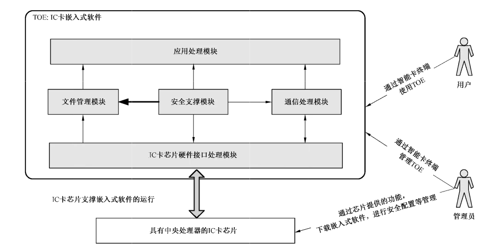

# GB/T 20276-2016 信息安全技术 具有中央处理器的IC卡嵌入式软件安全技术要求

> 来源：[GB/T 20276-2016 国家标准详情](https://openstd.samr.gov.cn/bzgk/std/newGbInfo?hcno=575530D2A4375FD7E6163F42A2180753)。
> 官方在线预览截图 SHA-256：6c1961c6f52f5908a717ab3fad2fb1fa2bb135c45bd4c195071e3951e13c54c0。
> 发布日期：2016-08-29；实施日期：2017-03-01。依据官方在线预览的 34 页图像逐页核对，保留图 1，合并跨页续表。已去除封面、目录、分页和页眉页脚，正式引用请核对官方原文。

## 前言

本标准按照 GB/T 1.1—2009给出的规则起草。

本标准代替 GB/T 20276—2006《信息安全技术 智能卡嵌入式软件安全技术要求（EAL4 增强级）》。本标准与 GB/T 20276—2006 相比，主要变化如下：

——将标准名称变更为《信息安全技术 具有中央处理器的 IC 卡嵌入式软件安全技术要求》；

——第 3 章对术语进行了更新描述；

——第 4 章重新描述了 IC 卡嵌入式软件的结构和应用环境，并进行了更清晰的 TOE 范围定义；

——第 5 章对安全问题定义进行了整合和精简，共定义了 6 个威胁、3 项组织安全策略和 5 个假设；

——第 6 章根据新的安全问题定义更新了对 TOE 安全目的的描述；

——第 7 章对安全功能要求进行了调整，以细化新的安全目的描述，明确指出了 EAL4+ 和 EAL5+ 分别应满足的安全功能要求；并对安全保障要求进行了调整，增加了 EAL5+ 要求的保障组件；

——第 8 章对新的安全问题定义与安全目的、安全目的与安全要求之间的对应关系基本原理重新进行了梳理，还分析了组件之间的依赖关系。

本标准由全国信息安全标准化技术委员会（SAC/TC 260）提出并归口。

本标准起草单位：中国信息安全测评中心、北京多思科技工业园股份有限公司、天地融科技股份有限公司、北京邮电大学、吉林信息安全测评中心。

本标准主要起草人：张翀斌、石竑松、高金萍、杨永生、王宇航、饶华一、王亚楠、陈佳哲、李东声、李明、曹春春、沈敏锋、崔宝江、赵晶玲、唐喜庆、刘占丰、刘丽、邹兆亮。

本标准所代替标准的历次版本发布情况为：

——GB/T 20276—2006。

## 引言

IC 卡应用范围的扩大和应用环境复杂性的增加，要求 IC 卡嵌入式软件具有更强的安全保护能力。

本标准的 EAL4+ 是在 EAL4 的基础上将 AVA_VAN.3 增强为 AVA_VAN.4；EAL5+ 是在 EAL5 的基础上将 AVA_VAN.4 增强为 AVA_VAN.5，并将 ALC_DVS.1 增强为 ALC_DVS.2。

## 1 范围

本标准规定了对 EAL4 增强级和 EAL5 增强级的具有中央处理器的 IC 卡嵌入式软件进行安全保护所需要的安全技术要求，涵盖了安全问题定义、安全目的、安全要求、基本原理等内容。

本标准适用于具有中央处理器的 IC 卡嵌入式软件产品的测试、评估和采购，也可用于指导该类产品的研制和开发。

## 2 规范性引用文件

下列文件对于本文件的应用是必不可少的。凡是注日期的引用文件，仅注日期的版本适用于本文件。凡是不注日期的引用文件，其最新版本（包括所有的修改单）适用于本文件。

- GB/T 18336（所有部分）信息技术 安全技术 信息技术安全评估准则

- GB/T 25069—2010 信息安全技术 术语

## 3 术语和定义、缩略语

### 3.1 术语和定义

GB/T 25069—2010和 GB/T 18336.1中界定的以及下列术语和定义适用于本文件。

#### 3.1.1 个人化数据 Personalization data

在IC卡嵌入式软件的个人化过程中写入的数据，用于配置与特定应用或用户相关的参数。

### 3.2 缩略语

下列缩略语适用于本文件。

CM：配置管理（Configuration Management）

EAL：评估保障级（Evaluation Assurance Level）

EEPROM：电可擦除可编程只读存储器（Electrically-Erasable Programmable Read-only Memory）

IC：集成电路（Integrated Circuit）

I/O：输入/输出（Input/Output）

RAM：随机存取存储器（Random-Access Memory）

ROM：只读存储器（Read-Only Memory）

ST：安全目标（Security Target）

TOE：评估对象（Target of Evaluation）

TSF：TOE 安全功能（TOE Security Functionality）

## 4 IC 卡嵌入式软件描述

具有中央处理器的IC 卡嵌入式软件（简称IC 卡嵌入式软件）存放在IC 卡的非易失性存储器（例如ROM、EEPROM或Flash等）中，并在IC卡芯片内运行。该软件用于管理芯片硬件资源和数据，通过芯片的通信接口与IC卡终端设备交换信息，以响应用户发起的数据加密、数据签名及鉴权认证等应用请求，实现对应用功能的支持。

一般情况下，IC 卡嵌入式软件由负责处理芯片硬件接口，实现文件管理、安全支撑、通信处理和应用处理等功能的模块组成，其中安全支撑模块提供安全配置、安全事务处理及密码支持等功能，以便为其他模块的安全执行提供支持，以保护IC 卡的内部数据及安全功能。文件管理模块和通信处理模块作为基础模块，主要用于实现对应用功能的支持。IC卡嵌入式软件的一般结构及运行环境如图1所示。

在嵌入式软件的运行环境中，用户和（TOE 开发、个人化及发卡等阶段的）管理员可通过IC卡终端与IC 卡嵌入式软件交互，管理员也可能通过操作芯片中的IC专用软件下载嵌入式软件并配置IC卡硬件平台。另一方面，攻击者可以通过发送、监听和篡改通信消息以及探测IC卡芯片电路等方式实施攻击，以获取或破坏敏感数据信息，甚至滥用安全功能。为此，IC卡嵌入式软件应采取防护措施以保障嵌入式软件的数据和功能的安全。

## 5 安全问题定义

### 5.1 资产

需要保护的资产：

——TSF 数据（如 TOE 中的访问控制列表、鉴别状态、安全配置数据、管理性的密钥等信息）；

——用户数据（TOE 中不属于 TSF 数据的信息，如用户身份标识等信息）；

——安全能力（如 TOE 的签名能力和动态码产生能力等）。

应用说明：ST编写者应根据具体的应用情况细化对资产的描述。

### 5.2 威胁

#### 5.2.1 物理操纵（T.Physical_Manipulation）

攻击者可利用IC 卡芯片失效性分析和半导体逆向工程技术，对IC卡芯片实施物理剖片，以获取IC 卡芯片设计信息和嵌入式软件的二进制代码，进而探测 TSF 数据和用户数据信息。

攻击者也可能对IC卡芯片实施物理更改，以达到获取或改变数据信息或安全功能的目的。

IC卡芯片可能会在未上电或已上电状态下受到此类攻击，在遭受攻击后可能会处于无法操作的状态。

#### 5.2.2 信息泄漏（T.Info_Leak）

攻击者可对TOE 正常使用过程中泄漏的信息加以利用，以猜测 TSF数据或用户数据。

功耗、电磁辐射、I/O 特性、运算频率、时耗等侧信道信息的变化情况都有可能造成信息的泄漏。攻击者可通过采用接触式（如功耗）或非接触式（如电磁辐射和时耗）的信号测量，得到与正在执行的操作有关的信息，进而采用信号处理和统计分析等技术来获得密钥等敏感信息。

#### 5.2.3 故障利用（T.Failure_Exploitation）

攻击者可通过分析 TOE 的运行故障以获取 TSF 数据、用户数据或滥用 TOE 的安全功能。

这些故障可能是通过改变TOE 的运行环境（如温度、电压、频率等，或通过注入强光等方式）而触发的，也可能是由于 TOE本身的设计缺陷而自发产生的，这些故障可能导致TOE 的代码、系统数据或执行过程发生错误，使TOE 在故障下运行，从而导致敏感数据泄漏。

#### 5.2.4 生命周期功能滥用（T.Lifecycle_Misuse）

攻击者可利用相关接口，尤其是测试和调试接口来获取 TSF 数据或用户数据。这些接口在TOE生命周期的过往阶段是必要的，但在现阶段是被禁止的。例如，若测试命令或调试命令在使用阶段仍可用，则可被攻击者用于读取存储器内容或执行其他功能。

#### 5.2.5 逻辑攻击（T.Logical_Attack）

攻击者可利用TOE 的逻辑接口，采用暴力猜解、被动侦听或适应性地选择指令输入等方式来获取/修改用户数据或TSF数据，或者滥用 TOE 的安全功能，主要包括以下形式：

a）密码攻击：攻击者可利用密码算法或协议的安全缺陷实现攻击，以达到获取密钥、猜测随机数或解密密文等目的。

b） 重放攻击：攻击者可通过重放历史数据，如重放通过侦听获得的鉴别数据来旁路安全机制，以获取敏感数据信息或滥用 TOE的安全功能。

c） 访问控制措施旁路：攻击者可通过利用 TOE 对文件及其他数据的访问控制缺陷，绕过访问控制规则，以读取、删除或修改用户数据或 TSF 数据。

d） 残余信息利用：攻击者可利用TOE 对计算过程中的残留信息的处理缺陷，在TOE执行过程中对未删除的残留信息进行攻击，以获取敏感信息或滥用 TOE 的安全功能。

应用说明：逻辑接口是 TOE与智能终端之间的数据交换接口，包括语法上遵循国际标准定义或行业私有定义的指令与响应码。攻击者可能利用认证系统或指令系统缺陷，通过分析指令及其响应码，绕过存储器访问控制机制，以非法获得存储器内容、密钥和 PIN 等信息，或达到滥用 TOE 安全功能等目的。ST编写者应根据应用情况完善对逻辑攻击的描述。

#### 5.2.6 非法程序攻击（T.IllegalPrg_Attack）

攻击者可通过安装带有恶意代码的应用程序（如木马程序）来获取/修改 TOE 代码或数据，或滥用TOE 的安全功能；在TOE 进入使用阶段前，开发者（或配置者）也可能有意地（或无意地，如使用了恶意的编译器）引入非法程序或错误，使TOE 在使用阶段泄漏敏感信息或导致安全功能被滥用。

应用说明：对于可以下载新应用的嵌入式软件而言，需要在整个生命周期阶段考虑此攻击；对于无法下载新应用的单应用的嵌入式软件，主要在使用阶段前的其他生命周期阶段中考虑此攻击。

### 5.3 组织安全策略

#### 5.3.1 密码管理（P.Crypto_Management）

密码的使用必须符合国家制定的相关信息技术安全标准。

#### 5.3.2 标识数据管理（P.IdData_Management）

IC 卡嵌入式软件的初始化、个人化等过程应具备标识 TOE 的能力。

应用说明：IC卡嵌入式软件的初始化、个人化过程可产生多种标识信息，这些信息存储在IC卡内部，可用于向外部发行实体标识 TOE，如厂商信息、版本号、激活时间等，以实现对生产情况的回溯查询能力。这些标识信息随嵌入式软件的不同而存在差异，在编写ST文档时应描述具体的标识方法和内容。

#### 5.3.3 芯片选型（P.Chip_Selection）

TOE应采用至少通过EAL4＋测评的IC卡芯片。

### 5.4 假设

#### 5.4.1 通信信道（A.Comm_Channel）

假定 TOE 与IC卡终端之间的通信信道是安全可靠的（如满足私密性和完整性）。

应用说明：ST编写者应根据嵌入式软件的具体应用情况解释“安全可靠”的具体含义。

#### 5.4.2 应用程序（A.App_Program）

假定在 TOE 中安装应用程序的流程符合规范，且合法安装的应用程序不包含恶意代码。

#### 5.4.3 芯片硬件（A.Chip_Hardware）

假定 TOE 运行所依赖的底层芯片具备足以保证 TOE 安全运行所需的物理安全防护能力。

应用说明：TOE 的底层芯片必须能够抵抗物理攻击、环境干扰攻击、侧信道攻击等。同时，芯片提供的密码功能可以是由处理器或安全算法库来实现的。

#### 5.4.4 外部数据管理（A.OutData_Management）

假定存放在TOE 之外的数据，如TOE设计信息、初始化数据、管理性密钥等敏感信息，会以一种安全的方式进行管理。

#### 5.4.5 人员（A.Personnel）

假定使用 TOE 的人员已具备基本的安全防护知识并具有良好的使用习惯，且以安全的方式使用 TOE。TOE 开发、生产、个人化和发卡各阶段的操作人员均按安全的流程进行操作。

## 6 安全目的

### 6.1 TOE 安全目的

#### 6.1.1 标识数据存储（O.IdData_Storage）

TOE 应具备在非易失性存储器中存储初始化数据和个人化数据的能力。

#### 6.1.2 用户标识（O.User_Identification）

TOE 应明确地标识出可使用各种逻辑接口的用户。

#### 6.1.3 用户鉴别（O.User_Authentication）

用户应通过鉴别过程才可访问或使用TOE 中的用户数据和安全功能数据。

#### 6.1.4 防重放攻击（O.Replay_Prevention）

TOE 应提供安全机制以抵御重放攻击，如采用只可一次性使用的随机因子等措施。

#### 6.1.5 残留信息清除（O.ResidualInfo_Clearance）

TOE 应确保重要的数据在使用完成，或遭受掉电攻击后会被删除或被安全处理，不会留下可被攻击者利用的残留数据信息。

#### 6.1.6 信息泄漏防护（O.InfoLeak_Prevention）

TOE 应提供控制或限制信息泄漏的方法，使得通过测量功耗、电磁辐射、时耗等信息的变化情况无法或难以获得用户数据和安全功能数据。

#### 6.1.7 数据访问控制（O.DataAcc_Control）

TOE 应对在 TOE 内部的用户数据和安全功能数据实施访问控制措施，防止在未授权情况下被访问、修改或删除。

#### 6.1.8 状态恢复（O.Status_Recovery）

TOE 在检测到故障后应将工作状态恢复或调整至安全状态，防止攻击者利用故障实施攻击。

#### 6.1.9 生命周期功能控制（O.Lifecycle_Control）

TOE 应对自身安全功能的可用性进行生命周期阶段划分，或进行权限控制，以防止攻击者滥用这些功能（如下载模式下的某些功能应在 TOE 交付后关闭）。

#### 6.1.10 密码安全（O.Crypto_Security）

TOE 应以一个安全的方式支持密码功能，其使用的密码算法必须符合国家、行业或组织要求的密码管理相关标准或规范。

应用说明：如果 TOE 所使用的密码算法均由芯片实现，则应将此安全目的移至 ST的环境安全目的中。

### 6.2 环境安全目的

#### 6.2.1 人员（OE.Personnel）

TOE 开发、初始化和个人化等生命周期阶段中涉及的特定人员应能严格地遵守安全的操作规程，以保证 TOE 在生命周期过程中的安全性。

#### 6.2.2 通信信道（OE.Comm_Channel）

TOE与IC 卡终端之间的通信路径是可信的，能为通信过程提供保密性和完整性保障。

#### 6.2.3 应用程序（OE.App_Program）

安装应用程序到 TOE的流程必须规范，且合法安装的应用程序不应包含恶意代码。

#### 6.2.4 芯片硬件（OE.Chip_Hardware）

TOE 的底层芯片必须能够抵抗物理攻击、环境干扰攻击和侧信道攻击等。

#### 6.2.5 外部数据管理（OE.OutData_Management）

应对在IC卡芯片外部存储的相关数据（如TOE的设计信息、开发及测试工具、实现代码及相关文档、初始化数据、管理性密钥等）进行机密性和完整性处理，并采取安全的管理措施。

## 7 安全要求

### 7.1 安全功能要求

#### 7.1.1 安全功能要求概述

表 1 列出了 IC 卡嵌入式软件的安全功能组件，其详细内容将在下面分条描述。在描述过程中，方括号【】中的粗体字内容表示已经完成的操作，粗体斜体字内容表示还需在安全目标（ST）中确定的赋值及选择项。

**表 1 安全功能组件**

| 组件分类 | 安全功能组件 | 序号 | EAL4+ | EAL5+ |
| --- | --- | ---: | :---: | :---: |
| FCS 类：密码支持 | FCS_CKM.1 密钥生成 | 1 | √ | √ |
| FCS 类：密码支持 | FCS_CKM.4 密钥销毁 | 2 | √ | √ |
| FCS 类：密码支持 | FCS_COP.1 密码运算 | 3 | √ | √ |
| FDP 类：用户数据保护 | FDP_ACC.1 子集访问控制 | 4 | √ | √ |
| FDP 类：用户数据保护 | FDP_ACF.1 基于安全属性的访问控制 | 5 | √ | √ |
| FDP 类：用户数据保护 | FDP_IFC.1 子集信息流控制 | 6 | √ | √ |
| FDP 类：用户数据保护 | FDP_ITT.1 基本内部传送保护 | 7 | √ | √ |
| FDP 类：用户数据保护 | FDP_RIP.1 子集残余信息保护 | 8 | √ | N/A |
| FDP 类：用户数据保护 | FDP_RIP.2 完全残余信息保护 | 9 | N/A | √ |
| FIA 类：标识和鉴别 | FIA_AFL.1 鉴别失败处理 | 10 | √ | √ |
| FIA 类：标识和鉴别 | FIA_ATD.1 用户属性定义 | 11 | √ | √ |
| FIA 类：标识和鉴别 | FIA_SOS.1 秘密的验证 | 12 | ○ | √ |
| FIA 类：标识和鉴别 | FIA_UAU.1 鉴别的时机 | 13 | √ | √ |
| FIA 类：标识和鉴别 | FIA_UAU.4 一次性鉴别机制 | 14 | √ | √ |
| FIA 类：标识和鉴别 | FIA_UAU.5 多重鉴别机制 | 15 | ○ | √ |
| FIA 类：标识和鉴别 | FIA_UAU.6 重鉴别 | 16 | √ | √ |
| FIA 类：标识和鉴别 | FIA_UID.1 标识的时机 | 17 | √ | √ |
| FMT 类：安全管理 | FMT_MOF.1 安全功能行为的管理 | 18 | √ | √ |
| FMT 类：安全管理 | FMT_MSA.1 安全属性的管理 | 19 | √ | √ |
| FMT 类：安全管理 | FMT_MSA.3 静态属性初始化 | 20 | √ | √ |
| FMT 类：安全管理 | FMT_MTD.1 TSF 数据的管理 | 21 | √ | √ |
| FMT 类：安全管理 | FMT_MTD.2 TSF 数据限值的管理 | 22 | √ | √ |
| FMT 类：安全管理 | FMT_SMF.1 管理功能规范 | 23 | √ | √ |
| FMT 类：安全管理 | FMT_SMR.1 安全角色 | 24 | √ | √ |
| FPT 类：TSF 保护 | FPT_FLS.1 失效即保持安全状态 | 25 | √ | √ |
| FPT 类：TSF 保护 | FPT_ITT.1 内部 TSF 数据传送的基本保护 | 26 | √ | √ |
| FPT 类：TSF 保护 | FPT_RCV.4 功能恢复 | 27 | √ | √ |
| FPT 类：TSF 保护 | FPT_RPL.1 重放检测 | 28 | √ | √ |
| FPT 类：TSF 保护 | FPT_TST.1 TSF 测试 | 29 | ○ | √ |

> 注：√ 代表在该保障级下应选择该组件；○ 代表在该保障级下可选择该组件；N/A 代表在该保障级下该组件不适用。

#### 7.1.2 安全功能要求描述

##### 7.1.2.1 密钥生成（FCS_CKM.1）

FCS_CKM.1.1 IC 卡嵌入式软件安全功能应根据符合下列标准【赋值：***相关标准***】的一个特定的密钥生成算法【赋值：***密钥生成算法***】和规定的密钥长度【赋值：***密钥长度***】来生成密钥。

应用说明：该组件仅适用于密钥生成功能由嵌入式软件本身完成的情况，此时 ST编写者应根据密码算法的具体情况，赋值国家主管部门认可的相关标准及参数。若密钥由外部环境生成，则可以不选择此组件。

##### 7.1.2.2 密钥销毁（FCS_CKM.4）

FCS_CKM.4.1 IC 卡嵌入式软件安全功能应根据符合下列标准【赋值：***标准列表***】的一个特定的密钥销毁方法【赋值：***密钥销毁方法***】来销毁密钥。

应用说明：ST编写者应根据密码算法的具体情况赋值国家主管部门认可的相关标准及密钥销毁方法。

##### 7.1.2.3 密码运算（FCS_COP.1）

FCS_COP.1.1 IC 卡嵌入式软件安全功能应根据符合下列标准【赋值：***标准列表***】的特定的密码算法【赋值：***密码算法***】和密钥长度【赋值：***密钥长度***】来执行【赋值：***密码运算列表***】。

应用说明：ST编写者应根据密码算法的具体情况赋值国家主管部门认可的相关标准及参数。

##### 7.1.2.4 子集访问控制（FDP_ACC.1）

FDP_ACC.1.1 IC 卡嵌入式软件安全功能应对【**用户、管理员**，赋值：***其他主体列表***】【选择：**删除、修改、读取、使用**，【赋值：***其他具体操作列表***】】【**用户数据**，赋值：***其他客体列表***】执行【**IC 卡嵌入式软件用户数据访问控制策略**】。

应用说明：ST编写者应根据具体情况细化用户数据和操作列表，且根据用户和管理员操作客体和相应控制策略的不同，应在ST 中将此组件分为不同的点进行描述，此原则适用于以下各组件的描述情况。

##### 7.1.2.5 基于安全属性的访问控制（FDP_ACF.1）

FDP_ACF.1.1 IC 卡嵌入式软件安全功能应基于【**用户、管理员**，赋值：***其他主体列表***】的【**鉴别状态**，赋值：***其他安全策略相关的安全属性或属性组***】对客体执行【**IC 卡嵌入式软件用户数据访问控制策略**】。

FDP_ACF.1.2 IC 卡嵌入式软件安全功能应执行以下规则，以决定在受控主体与受控客体间的一个操作是否被允许：【**用户鉴别是否通过、管理员鉴别是否通过**，赋值：***在受控主体和受控客体间，通过对受控客体采取受控操作来管理访问的一些规则***】。

FDP_ACF.1.3 IC 卡嵌入式软件安全功能应基于以下附加规则：【赋值：***基于安全属性的，明确授权主体访问客体的规则***】，明确授权主体访问客体。

FDP_ACF.1.4 IC 卡嵌入式软件安全功能应基于【赋值：***基于安全属性的，明确拒绝主体访问客体的规则***】明确拒绝主体访问客体。

应用说明：ST编写者应根据具体应用细化客体和操作列表。若嵌入式软件没有附加访问控制策略，可不对 FDP_ACF.1.3 和 FDP_ACF.1.4 的相应赋值项赋值。

##### 7.1.2.6 子集信息流控制（FDP_IFC.1）

FDP_IFC.1.1 IC 卡嵌入式软件安全功能应对【**用户数据访问**，赋值：***其他导致受控信息流入、流出受控主体的操作列表***】执行【**数据传输过程的保密性处理策略**，赋值：***其他信息流控制策略***】。

##### 7.1.2.7 基本内部传送保护（FDP_ITT.1）

FDP_ITT.1.1 在 IC 卡嵌入式软件物理上分隔的部分之间，如不同软件模块之间传递用户数据时，IC 卡嵌入式软件安全功能应执行【**数据传输过程的保密性处理策略**，【赋值：***其他信息流控制策略***】】，以防止用户数据被【选择：***泄漏、篡改，或无法使用***】。

##### 7.1.2.8 子集残余信息保护（FDP_RIP.1）

FDP_RIP.1.1 IC 卡嵌入式软件安全功能应确保一个资源的任何先前信息内容，在【选择：***分配资源到、释放资源自***】下列客体：【**EEPROM、Flash**，赋值：***其他客体列表***】时不再可用。

##### 7.1.2.9 完全残余信息保护（FDP_RIP.2）

FDP_RIP.2.1 IC 卡嵌入式软件安全功能应确保一个资源的任何先前信息内容，在【选择：***分配资源到、释放资源自***】所有客体时不再可用。

##### 7.1.2.10 鉴别失败处理（FIA_AFL.1）

FIA_AFL.1.1 IC 卡嵌入式软件安全功能应能检测出当【选择：【赋值：***正整数***】、**管理员可设置的**【赋值：***可接受数值范围***】**内的一个正整数**】时，与【选择：**用户鉴别、管理员鉴别**，【赋值：***其他鉴别事件列表***】】相关的未成功鉴别尝试。

FIA_AFL.1.2 当【选择：***达到、超过***】所定义的未成功鉴别尝试次数时，IC 卡嵌入式软件安全功能应采取的【赋值：***动作列表（如临时锁定鉴别功能至一段时间后再开启，或永久锁定鉴别功能并进入废止阶段）***】。

##### 7.1.2.11 用户属性定义（FIA_ATD.1）

FIA_ATD.1.1 IC 卡嵌入式软件安全功能应维护属于单个用户的下列安全属性列表：【选择：***用户标识、PIN 和密钥等鉴别数据、用户角色***，【赋值：***其他安全属性***】】。

##### 7.1.2.12 秘密的验证（FIA_SOS.1）

FIA_SOS.1.1 IC 卡嵌入式软件安全功能应提供一种机制以验证秘密满足保证鉴别机制安全性的安全要求。

应用说明：此安全功能要求中的秘密是指如鉴别密钥、PIN 等IC卡嵌入式软件安全功能数据。在EAL5+的情况下，IC卡嵌入式软件应对保存的秘密的质量进行验证，以加强秘密设置的安全性。

##### 7.1.2.13 鉴别的时机（FIA_UAU.1）

FIA_UAU.1.1 在用户被鉴别前，IC 卡嵌入式软件安全功能应允许执行代表用户的【赋值：***IC 卡嵌入式软件安全功能仲裁的动作列表（如读取软件标识信息操作）***】。

FIA_UAU.1.2 在允许执行代表该用户的任何其他由IC卡嵌入式软件安全功能促成的动作前，IC 卡嵌入式软件安全功能应要求每个用户都已被成功鉴别。

##### 7.1.2.14 一次性鉴别机制（FIA_UAU.4）

FIA_UAU.4.1 IC 卡嵌入式软件安全功能应防止与【**用户鉴别、管理员鉴别**，赋值：***其他确定的鉴别机制***】有关的鉴别数据的重用。

##### 7.1.2.15 多重鉴别机制（FIA_UAU.5）

FIA_UAU.5.1 IC 卡嵌入式软件安全功能应提供【赋值：***多重鉴别机制列表，如 PIN 验证和按键确认双重鉴别机制***】以支持用户鉴别。

FIA_UAU.5.2 IC 卡嵌入式软件安全功能应根据【赋值：***多重鉴别机制的工作规则***】鉴别任何用户所声称的身份。

应用说明：在EAL5＋的情况下，IC卡嵌入式软件应要求对重要的安全功能必须进行多重鉴别的能力，以实现基于多重因素的鉴别，如PIN验证和按键确认，或生物特征识别等，ST编写者应细化此功能要求。

##### 7.1.2.16 重鉴别（FIA_UAU.6）

FIA_UAU.6.1 IC 卡嵌入式软件安全功能应在【**安全状态复位后**，赋值：***其他需要重鉴别的条件列表***】条件下重新鉴别用户。

##### 7.1.2.17 标识的时机（FIA_UID.1）

FIA_UID.1.1 在用户被识别之前，IC 卡嵌入式软件安全功能应允许执行代表用户的【赋值：***其他 IC 卡嵌入式软件安全功能仲裁的动作列表（如读取嵌入式软件的版本信息操作）***】。

FIA_UID.1.2 在允许执行代表该用户的任何其他IC 卡嵌入式软件安全功能仲裁动作之前，IC卡嵌入式软件安全功能应要求每个用户身份都已被成功识别。

##### 7.1.2.18 安全功能行为的管理（FMT_MOF.1）

FMT_MOF.1.1 IC 卡嵌入式软件安全功能应仅限于【**管理员**，赋值：***其他已标识的授权角色***】对功能【选择：***解锁鉴别状态、初始化、【赋值：其他功能列表】***】具有【选择：***确定其行为、终止、激活、修改其行为***】的能力。

##### 7.1.2.19 安全属性的管理（FMT_MSA.1）

FMT_MSA.1.1 IC 卡嵌入式软件安全功能应执行【**IC 卡嵌入式软件用户数据访问控制策略**，赋值：***其他访问控制策略、信息流控制策略***】，以仅限于【**管理员**，赋值：***其他已标识的授权角色***】能够对安全属性【赋值：***安全属性列表***】进行【**重置**，选择：***改变默认值、查询、修改、删除、【赋值：其他操作】***】。

##### 7.1.2.20 静态属性初始化（FMT_MSA.3）

FMT_MSA.3.1 IC 卡嵌入式软件安全功能应执行【**IC 卡嵌入式软件用户数据访问控制策略**，赋值：***其他访问控制策略、信息流控制策略***】，以便为用于执行 IC 卡嵌入式软件安全功能的安全属性提供【选择：***受限的、许可的、【赋值：其他特性】***】默认值。

FMT_MSA.3.2 IC 卡嵌入式软件安全功能应允许【**管理员**，赋值：***已标识的授权角色***】在创建客体或信息时指定替换性的初始值以代替原来的默认值。

##### 7.1.2.21 TSF数据的管理（FMT_MTD.1）

FMT_MTD.1.1 IC 卡嵌入式软件安全功能应仅限于【**管理员**，赋值：***其他已标识的授权角色***】能够对【**IC 卡嵌入式软件的版本信息、激活时间等标识数据**，赋值：***其他安全功能数据列表***】进行【选择：***改变默认值、查询、修改、删除、清除、【赋值：其他操作】***】操作。

应用说明：ST编写者应根据具体应用情况细化对管理员角色的描述，使得嵌入式软件在进入用户使用阶段后，即便相应的管理员也无法对IC卡嵌入式软件的版本信息、激活时间等标识数据进行修改。

##### 7.1.2.22 TSF 数据限值的管理（FMT_MTD.2）

FMT_MTD.2.1 IC 卡嵌入式软件安全功能应仅限于【**管理员**，赋值：***其他已标识的授权角色***】规定【**连续鉴别失败尝试次数**，赋值：***其他安全功能数据列表***】的限值。

FMT_MTD.2.2 如果 IC 卡嵌入式软件安全功能数据达到或超过了设定的限值，IC 卡嵌入式软件安全功能应采取下面的动作：【赋值：***要采取的动作（如锁定所有安全功能，或擦除所有敏感数据信息并进入废止状态）***】。

##### 7.1.2.23 管理功能规范（FMT_SMF.1）

FMT_SMF.1.1 IC 卡嵌入式软件安全功能应能够执行如下管理功能：【**应用初始化、生命周期功能控制等功能**，赋值：***IC 卡嵌入式软件安全功能提供的安全管理功能列表***】。

##### 7.1.2.24 安全角色（FMT_SMR.1）

FMT_SMR.1.1 IC 卡嵌入式软件安全功能应维护角色【**管理员、用户**，赋值：***已标识的授权角色***】。

FMT_SMR.1.2 IC卡嵌入式软件安全功能应能够把用户和角色关联起来。

应用说明：ST编写者应根据具体应用情况完善对管理员角色的描述。

##### 7.1.2.25 失效即保持安全状态（FPT_FLS.1）

FPT_FLS.1.1 IC 卡嵌入式软件安全功能在下列失效发生时应保持一种安全状态：【**掉电、自检失败**，赋值：***其他失效类型列表（如存储器空间分配或访问错误）***】。

##### 7.1.2.26 内部 TSF 数据传送的基本保护（FPT_ITT.1）

FPT_ITT.1.1 IC 卡嵌入式软件安全功能应保护安全功能数据在物理上的分离部分，如不同的软件功能模块之间传送时不被【选择：***泄漏、篡改***】。

##### 7.1.2.27 功能恢复（FPT_RCV.4）

FPT_RCV.4.1 IC 卡嵌入式软件安全功能应确保在【**掉电、自检失败**，赋值：***其他功能和失效情景列表（如存储器访问错误）***】时有如下特性，即功能或者成功完成，或者针对指明的失效情景恢复到一个前后一致的且安全的状态。

##### 7.1.2.28 重放检测（FPT_RPL.1）

FPT_RPL.1.1 IC 卡嵌入式软件安全功能应检测对以下实体的重放：【**鉴别数据**，赋值：***其他实体列表***】。

FPT_RPL.1.2 检测到重放时，IC 卡嵌入式软件安全功能应执行【赋值：***具体操作列表（如恢复至未鉴别状态，或在检测到连续多次重放后临时锁定安全功能）***】。

##### 7.1.2.29 TSF 测试（FPT_TST.1）

FPT_TST.1.1 IC 卡嵌入式软件安全功能应在【**上电启动期间、正常工作期间、授权用户要求时**，赋值：***其他条件***】时运行一套自检程序以证明【**密码运算功能**，【赋值：***IC 卡嵌入式软件的其他安全功能***】】运行的正确性。

FPT_TST.1.2 IC 卡嵌入式软件安全功能应为授权用户提供验证【选择：***TSF 数据、【赋值：IC 卡嵌入式软件的某些安全功能】***】完整性的能力。

FPT_TST.1.3 IC 卡嵌入式软件安全功能应为授权用户提供验证所存储的TSF 可执行代码完整性的能力。

应用说明：在EAL5+的情况下，IC卡嵌入式软件应具有对重要的安全功能及数据进行自测的能力，以排除功能失常和数据被有意或无意篡改的情况发生。ST 编写者应根据具体应用情况细化此功能要求。

### 7.2 安全保障要求

#### 7.2.1 安全保障要求概述

表 2 列出了 IC 卡嵌入式软件的安全保障组件。下述各条对各组件给出了详细的描述。

**表 2 安全保障组件**

| 组件分类 | 安全保障组件 | 序号 | EAL4+ | EAL5+ |
| --- | --- | ---: | :---: | :---: |
| ADV 类：开发 | ADV_ARC.1 安全架构描述 | 1 | √ | √ |
| ADV 类：开发 | ADV_FSP.4 完备的功能规范 | 2 | √ | N/A |
| ADV 类：开发 | ADV_FSP.5 附加错误信息的完备的半形式化功能规范 | 3 | N/A | √ |
| ADV 类：开发 | ADV_IMP.1 TSF 实现表示 | 4 | √ | √ |
| ADV 类：开发 | ADV_INT.2 内部结构合理 | 5 | N/A | √ |
| ADV 类：开发 | ADV_TDS.3 基础模块设计 | 6 | √ | N/A |
| ADV 类：开发 | ADV_TDS.4 半形式化模块设计 | 7 | N/A | √ |
| AGD 类：指导性文档 | AGD_OPE.1 操作用户指南 | 8 | √ | √ |
| AGD 类：指导性文档 | AGD_PRE.1 准备程序 | 9 | √ | √ |
| ALC 类：生命周期支持 | ALC_CMC.4 生产支持和接受程序及其自动化 | 10 | √ | √ |
| ALC 类：生命周期支持 | ALC_CMS.4 问题跟踪 CM 覆盖 | 11 | √ | N/A |
| ALC 类：生命周期支持 | ALC_CMS.5 开发工具 CM 覆盖 | 12 | N/A | √ |
| ALC 类：生命周期支持 | ALC_DEL.1 交付程序 | 13 | √ | √ |
| ALC 类：生命周期支持 | ALC_DVS.1 安全措施标识 | 14 | √ | N/A |
| ALC 类：生命周期支持 | ALC_DVS.2 充分的安全措施 | 15 | N/A | √ |
| ALC 类：生命周期支持 | ALC_LCD.1 开发者定义的生命周期模型 | 16 | √ | √ |
| ALC 类：生命周期支持 | ALC_TAT.1 明确定义的开发工具 | 17 | √ | N/A |
| ALC 类：生命周期支持 | ALC_TAT.2 遵从实现标准 | 18 | N/A | √ |
| ASE 类：安全目标评估 | ASE_CCL.1 符合性声明 | 19 | √ | √ |
| ASE 类：安全目标评估 | ASE_ECD.1 扩展组件定义 | 20 | √ | √ |
| ASE 类：安全目标评估 | ASE_INT.1 ST 引言 | 21 | √ | √ |
| ASE 类：安全目标评估 | ASE_OBJ.2 安全目的 | 22 | √ | √ |
| ASE 类：安全目标评估 | ASE_REQ.2 推导出的安全要求 | 23 | √ | √ |
| ASE 类：安全目标评估 | ASE_SPD.1 安全问题定义 | 24 | √ | √ |
| ASE 类：安全目标评估 | ASE_TSS.1 TOE 概要规范 | 25 | √ | √ |
| ATE 类：测试 | ATE_COV.2 覆盖分析 | 26 | √ | √ |
| ATE 类：测试 | ATE_DPT.2 测试：安全执行模块 | 27 | √ | N/A |
| ATE 类：测试 | ATE_DPT.3 测试：模块设计 | 28 | N/A | √ |
| ATE 类：测试 | ATE_FUN.1 功能测试 | 29 | √ | √ |
| ATE 类：测试 | ATE_IND.2 独立测试—抽样 | 30 | √ | √ |
| AVA 类：脆弱性评定 | AVA_VAN.4 系统的脆弱性分析 | 31 | √ | N/A |
| AVA 类：脆弱性评定 | AVA_VAN.5 高级的系统的脆弱性分析 | 32 | N/A | √ |

> 注 1：√ 代表在该保障级下应选择该组件；N/A 代表在该保障级下该组件不适用。
>
> 注 2：对于安全保障组件的选取，本标准在 EAL4 的基础上将 AVA_VAN.3 增强为 AVA_VAN.4 和 AVA_VAN.5，以分别对应 EAL4+ 和 EAL5+ 的测评要求。此外，EAL5+ 还在 EAL5 的基础上将 ALC_DVS.1 升级为 ALC_DVS.2。

#### 7.2.2 安全保障要求描述

##### 7.2.2.1 安全架构描述（ADV_ARC.1）

开发者行为元素：ADV_ARC.1.1D 开发者应设计并实现 TOE，确保 TSF 的安全特性不可旁路。

ADV_ARC.1.2D 开发者应设计并实现 TSF，以防止不可信主体的破坏。

ADV_ARC.1.3D 开发者应提供 TSF 安全架构的描述。

内容和形式元素：ADV_ARC.1.1C 安全架构的描述应与在TOE 设计文档中对SFR-执行的抽象描述的级别一致。

ADV_ARC.1.2C 安全架构的描述应描述与安全功能要求一致的TSF 安全域。

ADV_ARC.1.3C 安全架构的描述应描述TSF 初始化过程为何是安全的。

ADV_ARC.1.4C 安全架构的描述应证实 TSF 可防止被破坏。

ADV_ARC.1.5C 安全架构的描述应证实 TSF 可防止 SFR-执行的功能被旁路。

评估者行为元素：ADV_ARC.1.1E 评估者应确认提供的信息符合证据的内容和形式要求。

##### 7.2.2.2 完备的功能规范（ADV_FSP.4）

开发者行为元素：ADV_FSP.4.1D 开发者应提供一个功能规范。

ADV_FSP.4.2D 开发者应提供功能规范到安全功能要求的追溯。

内容和形式元素：ADV_FSP.4.1C 功能规范应完全描述 TSF。

ADV_FSP.4.2C 功能规范应描述所有的TSFI 的目的和使用方法。

ADV_FSP.4.3C 功能规范应识别和描述每个 TSFI 相关的所有参数。

ADV_FSP.4.4C 对于每个 SFR-执行 TSFI，功能规范应描述 TSFI 相关的所有行为。

ADV_FSP.4.5C 功能规范应描述可能由每个 TSFI 的调用而引起的所有直接错误消息。

ADV_FSP.4.6C 功能规范应证实安全功能要求到 TSFI 的追溯。

评估者行为元素：ADV_FSP.4.1E 评估者应确认所提供的信息满足证据的内容和形式的所有要求。

ADV_FSP.4.2E 评估者应确定功能规范是安全功能要求的一个准确且完备的实例化。

##### 7.2.2.3 附加错误信息的完备的半形式化功能规范（ADV_FSP.5）

开发者行为元素：ADV_FSP.5.1D 开发者应提供一个功能规范。

ADV_FSP.5.2D 开发者应提供功能规范到安全功能要求的追溯。

内容和形式元素：ADV_FSP.5.1C 功能规范应完全描述 TSF。

ADV_FSP.5.2C 功能规范应用半形式化方式描述 TSFI。

ADV_FSP.5.3C 功能规范应描述所有的TSFI的目的和使用方法。

ADV_FSP.5.4C 功能规范应识别和描述每个 TSFI 相关的所有参数。

ADV_FSP.5.5C 功能规范应描述每个 TSFI 相关的所有行为。

ADV_FSP.5.6C 功能规范应描述可能由每个 TSFI 的调用引起的所有直接错误消息。

ADV_FSP.5.7C 功能规范应描述不是由 TSFI 调用而引起的所有错误消息。

ADV_FSP.5.8C 功能规范应为每个包含在TSF 实现中但不是由 TSFI 调用而引起的错误消息提供基本原理。

ADV_FSP.5.9C 功能规范应证实安全功能要求到 TSFI的追溯。

评估者行为元素：ADV_FSP.5.1E 评估者应确认所提供的信息满足证据的内容和形式的所有要求。

ADV_FSP.5.2E 评估者应确定功能规范是安全功能要求的一个准确且完备的实例化。

##### 7.2.2.4 TSF实现表示（ADV_IMP.1）

开发者行为元素：ADV_IMP.1.1D 开发者应为全部 TSF 提供实现表示。

ADV_IMP.1.2D 开发者应提供 TOE 设计描述与实现表示实例之间的映射。

内容和形式元素：ADV_IMP.1.1C 实现表示应按详细级别定义TSF，且详细程度达到无须进一步设计就能生成TSF 的程度。

ADV_IMP.1.2C 实现表示应以开发人员使用的形式提供。

ADV_IMP.1.3C TOE 设计描述与实现表示示例之间的映射应能证实它们的一致性。

评估者行为元素：ADV_IMP.1.1E 对于选取的实现表示示例，评估者应确认提供的信息满足证据的内容和形式的所有要求。

##### 7.2.2.5 内部结构合理（ADV_INT.2）

开发者行为元素：ADV_INT.2.1D 开发者应设计和实现整个 TSF，使其内部结构合理。

ADV_INT.2.2D 开发者应提供内部描述和论证过程。

内容和形式元素：ADV_INT.2.1C 论证过程应描述用于判定“结构合理”的含义的特性。

ADV_INT.2.2C TSF 内部描述应证实指定的整个 TSF结构合理。

评估者行为元素：ADV_INT.2.1E 评估者应确认所提供的信息满足证据的内容和形式的所有要求。

ADV_INT.2.2E 评估者应执行指定的TSF 子集内部分析。

##### 7.2.2.6 基础模块设计（ADV_TDS.3）

开发者行为元素：ADV_TDS.3.1D 开发者应提供TOE的设计。

ADV_TDS.3.2D 开发者应提供从功能规范的 TSFI 到 TOE 设计中获取到的最低层分解的映射。

内容和形式元素：ADV_TDS.3.1C 设计应根据子系统描述 TOE 的结构。

ADV_TDS.3.2C 设计应根据模块描述 TSF。

ADV_TDS.3.3C 设计应标识 TSF的所有子系统。

ADV_TDS.3.4C 设计应描述每一个 TSF 子系统。

ADV_TDS.3.5C 设计应描述 TSF所有子系统间的相互作用。

ADV_TDS.3.6C 设计应提供 TSF 子系统到 TSF 模块间的映射关系。

ADV_TDS.3.7C 设计应描述每一个SFR-执行模块，包括它的目的及与其他模块间的相互作用。

ADV_TDS.3.8C 设计应描述每一个 SFR-执行模块，包括它的安全功能要求相关接口、其他接口的返回值、与其他模块间的相互作用及调用的接口。

ADV_TDS.3.9C 设计应描述每一个 SFR-支撑或 SFR-无关模块，包括它的目的及与其他模块间的相互作用。

ADV_TDS.3.10C 映射关系应证实 TOE 设计中描述的所有行为能够映射到调用它的 TSFI。

评估者行为元素：ADV_TDS.3.1E 评估者应确认提供的信息满足证据的内容与形式的所有要求。

ADV_TDS.3.2E 评估者应确定设计是所有安全功能要求的正确且完全的实例。

##### 7.2.2.7 半形式化模块设计（ADV_TDS.4）

开发者行为元素：ADV_TDS.4.1D 开发者应提供TOE的设计。

ADV_TDS.4.2D 开发者应提供从功能规范的 TSFI 到TOE 设计中获取到的最低层分解的映射。

内容和形式元素：ADV_TDS.4.1C 设计应根据子系统描述 TOE的结构。

ADV_TDS.4.2C 设计应根据模块描述 TSF，以 SFR-执行、SFR-支撑或 SFR-无关标出每一个模块。

ADV_TDS.4.3C 设计应标识 TSF 的所有子系统。

ADV_TDS.4.4C 设计应提供每一个 TSF 子系统的半形式化描述，适当时配以非形式化的、解释性的描述。

ADV_TDS.4.5C 设计应描述 TSF 所有子系统间的相互作用。

ADV_TDS.4.6C 设计应提供 TSF 子系统到 TSF模块间的映射关系。

ADV_TDS.4.7C 设计应描述每一个 SFR-执行和 SFR-支撑模块，包括它的目的及与其他模块间的相互作用。

ADV_TDS.4.8C 设计应描述每一个 SFR-执行和 SFR-支撑模块，包括它的安全功能要求相关接口、其他接口的返回值、与其他模块间的相互作用及调用的接口。

ADV_TDS.4.9C 设计应描述每一个 SFR-支撑和 SFR-无关模块，包括它的目的及与其他模块间的相互作用。

ADV_TDS.4.10C 映射关系应证实 TOE 设计中描述的所有行为能够映射到调用它的 TSFI。

评估者行为元素：ADV_TDS.4.1E 评估者应确认提供的信息满足证据的内容与形式的所有要求。

ADV_TDS.4.2E 评估者应确定设计是所有安全功能要求的正确且完全的实例。

##### 7.2.2.8 操作用户指南（AGD_OPE.1）

开发者行 元素：AGD_OPE.1.1D 开发者应提供操作用户指南。

内容和形式元素：AGD_OPE.1.1C 操作用户指南应对每一种用户角色进行描述，在安全处理环境中应被控制的用户可访问的功能和特权，包含适当的警示信息。

AGD_OPE.1.2C 操作用户指南应对每一种用户角色进行描述，怎样以安全的方式使用TOE提供的可用接口。

AGD_OPE.1.3C 操作用户指南应对每一种用户角色进行描述，可用功能和接口，尤其是受用户控制的所有安全参数，适当时应指明安全值。

AGD_OPE.1.4C 操作用户指南应对每一种用户角色明确说明，与需要执行的用户可访问功能有关的每一种安全相关事件，包括改变 TSF 所控制实体的安全特性。

AGD_OPE.1.5C 操作用户指南应标识TOE运行的所有可能状态（包括操作导致的失败或者操作性错误），它们与维持安全运行之间的因果关系和联系。

AGD_OPE.1.6C 操作用户指南应对每一种用户角色进行描述，为了充分实现 ST 中描述的运行环境安全目的所必须执行的安全策略。

AGD_OPE.1.7C 操作用户指南应是明确和合理的。

评估者行为元素：AGD_OPE.1.1E 评估者应确认所提供的信息满足证据的内容和形式的所有要求。

##### 7.2.2.9 准备程序（AGD_PRE.1）

开发者行为元素：AGD_PRE.1.1D 开发者应提供 TOE，包括它的准备程序。

内容和形式元素：AGD_PRE.1.1C 准备程序应描述与开发者交付程序相一致的安全接收所交付 TOE 必需的所有步骤。

AGD_PRE.1.2C 准备程序应描述安全安装 TOE 以及安全准备与ST 中描述的运行环境安全目的一致的运行环境必需的所有步骤。

评估者行为元素：AGD_PRE.1.1E 评估者应确认所提供的信息满足证据的内容和形式的所有要求。

AGD_PRE.1.2E 评估者应运用准备程序确认 TOE运行能被安全的准备。

##### 7.2.2.10 生产支持和接受程序及其自动化（ALC_CMC.4）

开发者行为元素：ALC_CMC.4.1D 开发者应提供 TOE 及其参照号。

ALC_CMC.4.2D 开发者应提供CM 文档。

ALC_CMC.4.3D 开发者应使用CM 系统。

内容和形式元素：ALC_CMC.4.1C 应给 TOE 标记唯一参照号。

ALC_CMC.4.2C CM 文档应描述用于唯一标识配置项的方法。

ALC_CMC.4.3C CM 系统应唯一标识所有配置项。

ALC_CMC.4.4C CM 系统应提供自动化的措施使得只能对配置项进行授权变更。

ALC_CMC.4.5C CM 系统应以自动化的方式支持 TOE 的生产。

ALC_CMC.4.6C CM文档应包括CM计划。

ALC_CMC.4.7C CM 计划应描述CM 系统是如何应用于 TOE的开发的。

ALC_CMC.4.8C CM 计划应描述用来接受修改过的或新创建的作为TOE组成部分的配置项的程序。

ALC_CMC.4.9C 证据应证实所有配置项都正在CM 系统下进行维护。

ALC_CMC.4.10C 证据应证实CM 系统的运行与CM 计划是一致的。

评估者行为元素：ALC_CMC.4.1E 评估者应确认所提供的信息满足证据的内容和形式的所有要求。

##### 7.2.2.11 问题跟踪 CM 覆盖（ALC_CMS.4）

开发者行为元素：ALC_CMS.4.1D 开发者应提供 TOE 配置项列表。

内容和形式元素：ALC_CMS.4.1C 配置项列表应包括：TOE 本身、安全保障要求的评估证据、TOE 的组成部分、实现表示和安全缺陷报告及其解决状态。

ALC_CMS.4.2C 配置项列表应唯一标识配置项。

ALC_CMS.4.3C 对于每一个 TSF 相关的配置项，配置项列表应简要说明该配置项的开发者。

评估者行为元素：ALC_CMS.4.1E 评估者应确认所提供的信息满足证据的内容和形式的所有要求。

##### 7.2.2.12 开发工具 CM 覆盖（ALC_CMS.5）

开发者行为元素：ALC_CMS.5.1D 开发者应提供 TOE 配置项列表。

内容和形式元素：ALC_CMS.5.1C 配置项列表应包括：TOE 本身、安全保障要求的评估证据、TOE 的组成部分、实现表示、安全缺陷报告及其解决状态、开发工具及其相关信息。

ALC_CMS.5.2C 配置项列表应唯一标识配置项。

ALC_CMS.5.3C 对于每一个 TSF 相关的配置项，配置项列表应简要说明该配置项的开发者。

评估者行为元素：ALC_CMS.5.1E 评估者应确认所提供的信息满足证据的内容和形式的所有要求。

##### 7.2.2.13 交付程序（ALC_DEL.1）

开发者行为元素：ALC_DEL.1.1D 开发者应将把 TOE或其部分交付给消费者的程序文档化。

ALC_DEL.1.2D 开发者应使用交付程序。

内容和形式元素：ALC_DEL.1.1C 交付文档应描述，在向消费者分发 TOE 版本时，用以维护安全性所必需的所有程序。

评估者行为元素：ALC_DEL.1.1E 评估者应确认所提供的信息满足证据的内容和形式的所有要求。

##### 7.2.2.14 安全措施标识（ALC_DVS.1）

开发者行为元素：ALC_DVS.1.1D 开发者应提供开发安全文档。

内容和形式元素：ALC_DVS.1.1C 开发安全文档应描述在TOE 的开发环境中，保护 TOE设计和实现的机密性和完整性所必需的所有物理的、程序的、人员的及其他方面的安全措施。

评估者行为元素：ALC_DVS.1.1E 评估者应确认所提供的信息满足证据的内容和形式的所有要求。

ALC_DVS.1.2E 评估者应确认安全措施正在被使用。

##### 7.2.2.15 充分的安全措施（ALC_DVS.2）

开发者行为元素：ALC_DVS.2.1D 开发者应提供开发安全文档。

内容和形式元素：ALC_DVS.2.1C 开发安全文档应描述在 TOE 的开发环境中，保护 TOE 设计和实现的机密性和完整性所必需的所有物理的、程序的、人员的及其他方面的安全措施。

ALC_DVS.2.2C 开发安全文档应论证安全措施提供了必需的保护级别以维护 TOE 的机密性和完整性。

评估者行为元素：ALC_DVS.2.1E 评估者应确认所提供的信息满足证据的内容和形式的所有要求。

ALC_DVS.2.2E 评估者应确认安全措施正在被使用。

##### 7.2.2.16 开发者定义的生命周期模型（ALC_LCD.1）

开发者行为元素：ALC_LCD.1.1D 开发者应建立一个生命周期模型，用于 TOE 的开发和维护。

ALC_LCD.1.2D 开发者应提供生命周期定义文档。

内容和形式元素：ALC_LCD.1.1C 生命周期定义文档应描述用于开发和维护 TOE 的模型。

ALC_LCD.1.2C 生命周期模型应为 TOE 的开发和维护提供必要的控制。

评估者行为元素：ALC_LCD.1.1E 评估者应确认所提供的信息满足证据的内容和形式的所有要求。

##### 7.2.2.17 明确定义的开发工具（ALC_TAT.1）

开发者行为元素：ALC_TAT.1.1D 开发者应标识用于开发 TOE 的每个工具。

ALC_TAT.1.2D 开发者应在文档中描述每个开发工具所选取的实现依赖选项。

内容和形式元素：ALC_TAT.1.1C 用于实现的每个开发工具都应是明确定义的。

ALC_TAT.1.2C 每个开发工具的文档应无歧义地定义所有语句和实现用到的所有协定与命令的含义。

ALC_TAT.1.3C 每个开发工具的文档应无歧义地定义所有实现依赖选项的含义。

评估者行为元素：ALC_TAT.1.1E 评估者应确认所提供的信息满足证据的内容和形式的所有要求。

##### 7.2.2.18 遵从实现标准（ALC_TAT.2）

开发者行为元素：ALC_TAT.2.1D 开发者应标识用于开发TOE 的每个工具。

ALC_TAT.2.2D 开发者应在文档中描述每个开发工具所选取的实现依赖选项。

ALC_TAT.2.3D 开发者应描述开发者所使用的实现标准。

内容和形式元素：ALC_TAT.2.1C 用于实现的每个开发工具都应是明确定义的。

ALC_TAT.2.2C 每个开发工具的文档应无歧义地定义所有语句的含义，以及实现用到的所有协定与指令。

ALC_TAT.2.3C 每个开发工具的文档应无歧义地定义所有实现依赖选项的含义。

评估者行为元素：ALC_TAT.2.1E 评估者应确认所提供的信息满足证据的内容和形式的所有要求。

ALC_TAT.2.2E 评估者应确认已经采用实现标准。

##### 7.2.2.19 符合性声明（ASE_CCL.1）

开发者行为元素：ASE_CCL.1.1D 开发者应提供符合性声明。

ASE_CCL.1.2D 开发者应提供符合性声明的基本原理。

内容和形式元素：ASE_CCL.1.1C ST 应声明其与 GB/T 18336 的符合性，标识出 ST 和TOE 的符合性所遵从的GB/T 18336 的版本。

ASE_CCL.1.2C 符合性声明应描述 ST 与 GB/T 18336.2 的符合性，无论是与 GB/T 18336.2 相符还是对 GB/T 18336.2 的扩展。

ASE_CCL.1.3C 符合性声明应描述 ST 与 GB/T 18336.3 的符合性，无论是与 GB/T 18336.3 相符还是对 GB/T 18336.3的扩展。

ASE_CCL.1.4C 符合性声明应与扩展组件定义是相符的。

ASE_CCL.1.5C 符合性声明应标识 ST声明遵从的所有PP和安全要求包。

ASE_CCL.1.6C 符合性声明应描述 ST 和包的符合性，无论是与包的相符或是与扩展包相符。

ASE_CCL.1.7C 符合性声明的基本原理应证实TOE类型与符合性声明所遵从的PP中的TOE类型是相符的。

ASE_CCL.1.8C 符合性声明的基本原理应证实安全问题定义的陈述与符合性声明所遵从的PP中的安全问题定义陈述是相符的。

ASE_CCL.1.9C 符合性声明的基本原理应证实安全目的陈述与符合性声明所遵从的PP 中的安全目的陈述是相符的。

ASE_CCL.1.10C 符合性声明的基本原理应证实安全要求的陈述与符合性声明所遵从的PP中的安全要求的陈述是相符的。

评估者行为元素：ASE_CCL.1.1E 评估者应确认所提供的信息满足证据的内容和形式的所有要求。

##### 7.2.2.20 扩展组件定义（ASE_ECD.1）

开发者行为元素：ASE_ECD.1.1D 开发者应提供安全要求的陈述。

ASE_ECD.1.2D 开发者应提供扩展组件的定义。

内容和形式元素：ASE_ECD.1.1C 安全要求陈述应标识所有扩展的安全要求。

ASE_ECD.1.2C 扩展组件定义应为每一个扩展的安全要求定义一个扩展的组件。

ASE_ECD.1.3C 扩展组件定义应描述每个扩展的组件与已有组件、族和类的关联性。

ASE_ECD.1.4C 扩展组件定义应使用已有的组件、族、类和方法学作为陈述的模型。

ASE_ECD.1.5C 扩展组件应由可测量的和客观的元素组成，以便于证实这些元素之间的符合性或不符合性。

评估者行为元素：ASE_ECD.1.1E 评估者应确认所提供的信息满足证据的内容和形式的所有要求。

ASE_ECD.1.2E 评估者应确认扩展组件不能利用已经存在的组件明确的表达。

##### 7.2.2.21 ST 引言（ASE_INT.1）

开发者行为元素：ASE_INT.1.1D 开发者应提供ST引言。

内容和形式元素：ASE_INT.1.1C ST 引言应包含 ST 参照号、TOE 参照号、TOE 概述和 TOE 描述。

ASE_INT.1.2C ST 参照号应唯一标识 ST。

ASE_INT.1.3C TOE 参照号应标识 TOE。

ASE_INT.1.4C TOE概述应概括TOE 的用法及其主要安全特性。

ASE_INT.1.5C TOE概述应标识 TOE类型。

ASE_INT.1.6C TOE 概述应标识任何 TOE 要求的非 TOE 范围内的硬件/软件/固件。

ASE_INT.1.7C TOE 描述应描述 TOE 的物理范围。

ASE_INT.1.8C TOE 描述应描述 TOE的逻辑范围。

评估者行为元素：ASE_INT.1.1E 评估者应确认所提供的信息满足证据的内容和形式的所有要求。

ASE_INT.1.2E 评估者应确认 TOE 参考、TOE概述和 TOE 描述是相互一致的。

##### 7.2.2.22 安全目的（ASE_OBJ.2）

开发者行为元素：ASE_OBJ.2.1D 开发者应提供安全目的的陈述。

ASE_OBJ.2.2D 开发者应提供安全目的的基本原理。

内容和形式元素：ASE_OBJ.2.1C 安全目的的陈述应描述 TOE 的安全目的和运行环境安全目的。

ASE_OBJ.2.2C 安全目的基本原理应追溯到TOE的每一个安全目的，以便于能追溯到安全目的所对抗的威胁及安全目的实施的组织安全策略。

ASE_OBJ.2.3C 安全目的基本原理应追溯到运行环境的每一个安全目的，以便于能追溯到安全目的所对抗的威胁、安全目的实施的组织安全策略和安全目的支持的假设。

ASE_OBJ.2.4C 安全目的基本原理应证实安全目的能抵抗所有威胁。

ASE_OBJ.2.5C 安全目的基本原理应证实安全目的执行所有组织安全策略。

ASE_OBJ.2.6C 安全目的基本原理应证实运行环境安全目的支持所有的假设。

评估者行为元素：ASE_OBJ.2.1E 评估者应确认所提供的信息满足证据的内容和形式的所有要求。

##### 7.2.2.23 推导出的安全要求（ASE_REQ.2）

开发者行为元素：ASE_REQ.2.1D 开发者应提供安全要求的陈述。

ASE_REQ.2.2D 开发者应提供安全要求的基本原理。

内容和形式元素：ASE_REQ.2.1C 安全要求的陈述应描述安全功能要求和安全保障要求。

ASE_REQ.2.2C 应对安全功能要求和安全保障要求中使用的所有主体、客体、操作、安全属性、外部实体及其他术语进行定义。

ASE_REQ.2.3C 安全要求的陈述应对安全要求的所有操作进行标识。

ASE_REQ.2.4C 所有操作应被正确地执行。

ASE_REQ.2.5C 应满足安全要求间的依赖关系，或者安全要求基本原理应论证不需要满足某个依赖关系。

ASE_REQ.2.6C 安全要求基本原理应描述每一个安全功能要求可追溯至对应的TOE 安全目的。

ASE_REQ.2.7C 安全要求基本原理应证实安全功能要求可满足所有的TOE安全目的。

ASE_REQ.2.8C 安全要求基本原理应说明选择安全保障要求的理由。

ASE_REQ.2.9C 安全要求的陈述应是内在一致的。

评估者行为元素：ASE_REQ.2.1E 评估者应确认所提供的信息满足证据的内容和形式的所有要求。

##### 7.2.2.24 安全问题定义（ASE_SPD.1）

开发者行为元素：ASE_SPD.1.1D 开发者应提供安全问题定义。

内容和形式元素：ASE_SPD.1.1C 安全问题定义应描述威胁。

ASE_SPD.1.2C 所有的威胁都应根据威胁主体、资产和敌对行为进行描述。

ASE_SPD.1.3C 安全问题定义应描述组织安全策略。

ASE_SPD.1.4C 安全问题定义应描述 TOE运行环境的相关假设。

评估者行为元素：ASE_SPD.1.1E 评估者应确认所提供的信息满足证据的内容和形式的所有要求。

##### 7.2.2.25 TOE 概要规范（ASE_TSS.1）

开发者行为元素：ASE_TSS.1.1D 开发者应提供TOE 概要规范。

内容和形式元素：ASE_TSS.1.1C TOE 概要规范应描述 TOE 是如何满足每一项安全功能要求的。

评估者行为元素：ASE_TSS.1.1E 评估者应确认所提供的信息满足证据的内容和形式的所有要求。

ASE_TSS.1.2E 评估者应确认 TOE 概要规范与 TOE 概述、TOE描述是一致的。

##### 7.2.2.26 覆盖分析（ATE_COV.2）

开发者行为元素：ATE_COV.2.1D 开发者应提供对测试覆盖的分析。

内容和形式元素：ATE_COV.2.1C 测试覆盖分析应证实测试文档中的测试与功能规范中 TSF 接口之间的对应性。

ATE_COV.2.2C 测试覆盖分析应证实已经对功能规范中的所有 TSF 接口都进行了测试。

评估者行为元素：ATE_COV.2.1E 评估者应确认所提供的信息满足证据内容和形式的所有要求。

##### 7.2.2.27 测试：安全执行模块（ATE_DPT.2）

开发者行为元素：ATE_DPT.2.1D 开发者应提供测试深度分析。

内容和形式元素：ATE_DPT.2.1C 深度测试分析应证实测试文档中的测试与 TOE 设计中的 TSF 子系统、SFR-执行模块之间的一致性。

ATE_DPT.2.2C 测试深度分析应证实 TOE 设计中的所有TSF 子系统都已经进行过测试。

ATE_DPT.2.3C 测试深度分析应证实 TOE设计中的SFR-执行模块都已经进行过测试。

评估者行为元素：ATE_DPT.2.1E 评估者应确认所提供的信息满足证据内容和形式的所有要求。

##### 7.2.2.28 测试：模块设计（ATE_DPT.3）

开发者行为元素：ATE_DPT.3.1D 开发者应提供测试深度分析。

内容和形式元素：ATE_DPT.3.1C 深度测试分析应证实测试文档中的测试与 TOE 设计中的TSF 子系统、模块之间的一致性。

ATE_DPT.3.2C 测试深度分析应证实 TOE设计中的所有 TSF 子系统都已经进行过测试。

ATE_DPT.3.3C 测试深度分析应证实 TOE 设计中的所有 TSF模块都已经进行过测试。

评估者行为元素：ATE_DPT.3.1E 评估者应确认所提供的信息满足证据内容和形式的所有要求。

##### 7.2.2.29 功能测试（ATE_FUN.1）

开发者行为元素：ATE_FUN.1.1D 开发者应测试TSF，并文档化测试结果。

ATE_FUN.1.2D 开发者应提供测试文档。

内容和形式元素：ATE_FUN.1.1C 测试文档应包括测试计划、预期的测试结果和实际的测试结果。

ATE_FUN.1.2C 测试计划应标识要执行的测试并描述执行每个测试的方案，这些方案应包括对于其他测试结果的任何顺序依赖性。

ATE_FUN.1.3C 预期的测试结果应指出测试成功执行后的预期输出。

ATE_FUN.1.4C 实际的测试结果应和预期的测试结果一致。

评估者行为元素：ATE_FUN.1.1E 评估者应确认所提供的信息满足证据内容和形式的所有要求。

##### 7.2.2.30 独立测试—抽样（ATE_IND.2）

开发者行为元素：ATE_IND.2.1D 开发者应提供用于测试的TOE。

内容和形式元素：ATE_IND.2.1C TOE 应适合测试。

ATE_IND.2.2C 开发者应提供一组与开发者 TSF 功能测试中同等的一系列资源。

评估者行为元素：ATE_IND.2.1E 评估者应确认所提供的信息满足证据的内容和形式的所有要求。

ATE_IND.2.2E 评估者应执行测试文档中的测试样本，以验证开发者的测试结果。

ATE_IND.2.3E 评估者应测试 TSF 的一个子集以确认 TSF按照规定运行。

##### 7.2.2.31 系统的脆弱性分析（AVA_VAN.4）

开发者行为元素：AVA_VAN.4.1D 开发者应提供用于测试的 TOE。

内容和形式元素：AVA_VAN.4.1C TOE应适合测试。

评估者行为元素：AVA_VAN.4.1E 评估者应确认所提供的信息满足证据的内容和形式的所有要求。

AVA_VAN.4.2E 评估者应执行公共领域的调查以标识 TOE 的潜在脆弱性。

AVA_VAN.4.3E 评估者应针对TOE执行独立的、系统的脆弱性分析去标识TOE 潜在的脆弱性，在分析过程中使用指导性文档、功能规范、TOE设计、安全结构描述和实现表示。

AVA_VAN.4.4E 评估者应基于已标识的潜在脆弱性实施穿透性测试，确认TOE能抵抗具有中等攻击潜力的攻击者的攻击。

##### 7.2.2.32 高级的系统的脆弱性分析（AVA_VAN.5）

开发者行为元素：AVA_VAN.5.1D 开发者应提供用于测试的 TOE。

内容和形式元素：AVA_VAN.5.1C TOE 应适合测试。

评估者行为元素：AVA_VAN.5.1E 评估者应确认所提供的信息满足证据的内容和形式的所有要求。

AVA_VAN.5.2E 评估者应执行公共领域的调查以标识 TOE 的潜在脆弱性。

AVA_VAN.5.3E 评估者应针对TOE执行独立的、系统的脆弱性分析去标识 TOE 潜在的脆弱性，在分析过程中使用指导性文档、功能规范、TOE 设计、安全结构描述和实现表示。

AVA_VAN.5.4E 评估者应基于已标识的潜在脆弱性实施穿透性测试，确认 TOE 能抵抗具有高等攻击潜力的攻击者的攻击。

## 8 基本原理

### 8.1 安全目的基本原理

表 3 说明了 TOE 的安全目的能应对所有可能的威胁、假设和组织安全策略。

**表 3 安全目的与威胁、组织安全策略、假设的对应关系**

| 序号 | 安全目的 | 对应的威胁、组织安全策略和假设 |
| ---: | --- | --- |
| 1 | 标识数据存储 O.IdData_Storage | 标识数据管理 P.IdData_Management |
| 2 | 用户标识 O.User_Identification | 非法程序攻击 T.IllegalPrg_Attack；逻辑攻击 T.Logical_Attack |
| 3 | 用户鉴别 O.User_Authentication | 非法程序攻击 T.IllegalPrg_Attack；逻辑攻击 T.Logical_Attack |
| 4 | 防重放攻击 O.Replay_Prevention | 逻辑攻击 T.Logical_Attack |
| 5 | 残留信息清除 O.ResidualInfo_Clearance | 逻辑攻击 T.Logical_Attack |
| 6 | 信息泄漏防护 O.InfoLeak_Prevention | 信息泄漏 T.Info_Leak |
| 7 | 数据访问控制 O.DataAcc_Control | 非法程序攻击 T.IllegalPrg_Attack；逻辑攻击 T.Logical_Attack |
| 8 | 状态恢复 O.Status_Recovery | 故障利用 T.Failure_Exploitation |
| 9 | 生命周期功能控制 O.Lifecycle_Control | 生命周期功能滥用 T.Lifecycle_Misuse |
| 10 | 密码安全 O.Crypto_Security | 逻辑攻击 T.Logical_Attack；物理操纵 T.Physical_Manipulation；密码管理 P.Crypto_Management |
| 11 | 人员 OE.Personnel | 人员 A.Personnel |
| 12 | 通信信道 OE.Comm_Channel | 通信信道 A.Comm_Channel |
| 13 | 应用程序 OE.App_Program | 非法程序攻击 T.IllegalPrg_Attack；应用程序 A.App_Program |
| 14 | 芯片硬件 OE.Chip_Hardware | 信息泄漏 T.Info_Leak；故障利用 T.Failure_Exploitation；物理操纵 T.Physical_Manipulation；芯片选型 P.Chip_Selection；芯片硬件 A.Chip_Hardware |
| 15 | 外部数据管理 OE.OutData_Management | 外部数据管理 A.OutData_Management |

下面论述每一种威胁、组织安全策略和假设都至少有一个或一个以上安全目的与其对应，因此是完备的。论述过程也说明了没有一个安全目的没有相应的威胁、组织安全策略和假设与之对应，这证明每个安全目的都是必要的；没有多余的安全目的不对应威胁、组织安全策略和假设，因此说明了安全目的是充分的。

T.IllegalPrg_Attack

为了抵御非法程序攻击，通过 O.User_Identification、O.User_Authentication 确保下载应用程序前，用户必须已被明确标识并进行了安全鉴别；O.DataAcc_Control 确保对数据实施了访问控制管理，以防止非法程序绕过访问控制措施读取或修改数据；另外，OE.App_Program 确保应用程序的开发过程不会包含恶意代码且下载过程能以一种安全的规程进行。

T.Info_Leak

针对攻击者利用 TOE 执行过程中泄漏的功耗、电磁辐射及时耗等侧信道信息而发起的侧信道等信息泄漏攻击，O.InfoLeak_Prevention 要求 TOE 必须具有抵抗或缓解此类攻击的能力。OE.Chip_Hardware 可确保硬件平台能够抵御侧信道攻击，因而保证由硬件平台实现的密码算法在此攻击下的安全性。

T.Failure_Exploitation

故障利用攻击可通过分析 TOE 的运行故障以获取敏感数据信息或滥用 TOE 的安全功能，为此，O.Status_Recovery 确保当故障发生时 TOE 工作状态可恢复或调整至安全状态，而不泄漏有利于攻击者的故障信息。OE.Chip_Hardware 可确保硬件平台能够抵御故障引入攻击，因而保证由硬件平台实现的密码算法在此攻击下的安全性。

T.Lifecycle_Misuse

攻击者利用生命周期功能滥用而造成对 TOE 的安全威胁，可通过 O.Lifecycle_Control 控制特定生命周期的特定指令和功能，通过对 TOE 生命周期各阶段进行管理来防止此类攻击。

T.Logical_Attack

逻辑攻击是攻击者利用嵌入式软件的逻辑接口，对数据或安全功能造成威胁，O.User_Identification、O.User_Authentication 确保可访问各逻辑接口的用户已被明确标识且通过了安全鉴别，因而防止攻击者对各逻辑接口的非法访问；此外 O.Replay_Prevention 要求通过相关安全机制以抵御重放攻击；O.ResidualInfo_Clearance 要求安全数据在使用完成后被完全删除，抵御攻击者利用残余信息而获取敏感信息或滥用 TOE 的安全功能；O.DataAcc_Control 要求对文件系统及其他数据实施访问控制管理，防止攻击者绕过访问控制机制获取或篡改数据信息；O.Crypto 要求 TOE 以安全的方式支持密码功能，以抵御利用密码算法的安全缺陷而进行的逻辑攻击。

T.Physical_Manipulation

物理操纵攻击是攻击者利用芯片失效性分析和半导体逆向工程技术，对芯片实施物理剖片和探测，以获取存储于芯片内的数据信息。OE.Chip_Hardware 可确保硬件平台能够抵御物理操纵攻击，O.Crypto_Security 进一步确保即使遭受物理剖片和电路探测等攻击后仍可保证密码安全。

P.Crypto_Management

强调了使用国家或行业的密码标准和规范的要求，O.Crypto_Security 直接满足了这一组织安全策略要求，可确保在设计和开发过程中正确使用这些标准。

P.IdData_Management

对 IC 卡嵌入式软件的开发和个人化等过程应具备标识 TOE 的能力提出要求，这一策略可直接由 O.IdData_Storage 安全目的来满足。

P.Chip_Selection

确立了 TOE 应采用至少通过 EAL4+ 测评的 IC 卡芯片，提出 OE.Chip_Hardware 确保芯片可抵抗物理攻击、环境干扰攻击、侧信道攻击等，以至少达到 EAL4+ 安全要求。

A.Comm_Channel

应确保 TOE 与 IC 卡终端之间的通信信道是安全可靠的，OE.Comm_Channel 提供了环境安全目的，确保通信路径是可信的。

A.App_Program

该假设对安装在 IC 卡嵌入式软件之上的应用程序本身及其安装流程的安全性提出了条件，OE.App_Program 提供了针对性的环境安全目的，可满足该假设条件。

A.Chip_Hardware

对 TOE 运行所依赖的底层芯片抵抗物理攻击的安全性提出要求，OE.Chip_Hardware 提供了环境安全目的，确保芯片能够抵抗物理攻击、环境干扰攻击和侧信道攻击等。

A.OutData_Management

该假设对安全功能数据在 TOE 外部存储和管理的安全性提出了要求，OE.OutData_Management 提供了针对性的环境安全目的，可确保外部存储和管理 TSF 数据的措施是安全的。

A.Personnel

该假设对 TOE 用户的使用安全性提出了要求，OE.Personnel 环境要求确保操作人员需要在经过培训后严格地遵守安全的操作规程，因此可以满足这一假设。

### 8.2 安全要求基本原理

表 4 说明了安全要求的充分必要性基本原理，即每个安全目的都至少有一个安全要求（包括功能要求和保障要求）组件与其对应，每个安全要求都至少解决了一个安全目的，因此安全要求对安全目的而言是充分和必要的。

**表 4 安全要求与安全目的的对应关系**

| 序号 | 安全要求 | 对应的安全目的 |
| ---: | --- | --- |
| 1 | FCS_CKM.1 密钥生成 | 密码安全 O.Crypto_Security；用户鉴别 O.User_Authentication |
| 2 | FCS_CKM.4 密钥销毁 | 残留信息清除 O.ResidualInfo_Clearance |
| 3 | FCS_COP.1 密码运算 | 密码安全 O.Crypto_Security；用户鉴别 O.User_Authentication |
| 4 | FDP_ACC.1 子集访问控制 | 数据访问控制 O.DataAcc_Control |
| 5 | FDP_ACF.1 基于安全属性的访问控制 | 数据访问控制 O.DataAcc_Control |
| 6 | FDP_IFC.1 子集信息流控制 | 信息泄漏防护 O.InfoLeak_Prevention |
| 7 | FDP_ITT.1 基本内部传送保护 | 信息泄漏防护 O.InfoLeak_Prevention |
| 8 | FDP_RIP.1 子集残余信息保护 | 残留信息清除 O.ResidualInfo_Clearance |
| 9 | FDP_RIP.2 完全残余信息保护 | 残留信息清除 O.ResidualInfo_Clearance |
| 10 | FIA_AFL.1 鉴别失败处理 | 用户鉴别 O.User_Authentication |
| 11 | FIA_ATD.1 用户属性定义 | 用户标识 O.User_Identification；用户鉴别 O.User_Authentication |
| 12 | FIA_SOS.1 秘密的验证 | 用户鉴别 O.User_Authentication |
| 13 | FIA_UAU.1 鉴别的时机 | 用户鉴别 O.User_Authentication；数据访问控制 O.DataAcc_Control；生命周期功能控制 O.Lifecycle_Control |
| 14 | FIA_UAU.4 一次性鉴别机制 | 用户鉴别 O.User_Authentication；防重放攻击 O.Replay_Prevention |
| 15 | FIA_UAU.5 多重鉴别机制 | 用户鉴别 O.User_Authentication |
| 16 | FIA_UAU.6 重鉴别 | 用户鉴别 O.User_Authentication |
| 17 | FIA_UID.1 标识的时机 | 用户标识 O.User_Identification；数据访问控制 O.DataAcc_Control |
| 18 | FMT_MOF.1 安全功能行为的管理 | 数据访问控制 O.DataAcc_Control |
| 19 | FMT_MSA.1 安全属性的管理 | 数据访问控制 O.DataAcc_Control |
| 20 | FMT_MSA.3 静态属性初始化 | 数据访问控制 O.DataAcc_Control |
| 21 | FMT_MTD.1 TSF 数据的管理 | 标识数据存储 O.IdData_Storage；数据访问控制 O.DataAcc_Control |
| 22 | FMT_MTD.2 TSF 数据限值的管理 | 数据访问控制 O.DataAcc_Control |
| 23 | FMT_SMF.1 管理功能规范 | 生命周期功能控制 O.Lifecycle_Control |
| 24 | FMT_SMR.1 安全角色 | 用户标识 O.User_Identification；用户鉴别 O.User_Authentication；生命周期功能控制 O.Lifecycle_Control |
| 25 | FPT_FLS.1 失效即保持安全状态 | 状态恢复 O.Status_Recovery |
| 26 | FPT_ITT.1 内部 TSF 数据传送的基本保护 | 信息泄漏防护 O.InfoLeak_Prevention |
| 27 | FPT_RCV.4 功能恢复 | 状态恢复 O.Status_Recovery |
| 28 | FPT_RPL.1 重放检测 | 防重放攻击 O.Replay_Prevention |
| 29 | FPT_TST.1 TSF 测试 | 状态恢复 O.Status_Recovery |

O.IdData_Storage

FMT_MTD.1 可满足对 IC 卡嵌入式软件初始化及个人化等数据中的标识信息进行安全存储，并防止在使用阶段被修改的要求。

O.User_Identification

安全标识的安全目的可由 FIA_ATD.1、FIA_UID.1 通过维护用户的安全属性及对每个用户身份的成功标识获得满足。

O.User_Authentication

通过 FIA_AFL.1、FIA_ATD.1、FIA_SOS.1、FIA_UAU.1、FIA_UAU.4、FIA_UAU.5、FIA_UAU.6、FMT_SMR.1 对鉴别机制的实现及与角色的关联进行要求；并通过 FCS_CKM.1、FCS_COP.1 对安全鉴别实现方式所使用的密码相关机制进行要求。

O.Replay_Prevention

通过 FIA_UAU.4 对鉴别数据防重放进行要求，FPT_RPL.1 对鉴别数据之外的重要数据实体防重放进行要求。

O.ResidualInfo_Clearance

通过 FCS_CKM.4 对密钥数据的销毁进行要求，并通过 FDP_RIP.1 或 FDP_RIP.2 对重要数据资源释放或销毁后提出不可再被访问的要求，以满足残余信息清除的目的。

O.InfoLeak_Prevention

通过 FDP_IFC.1、FDP_ITT.1 及 FPT_ITT.1 保证用户数据和 TSF 数据在计算过程及内部传输过程中不会泄漏能被攻击者利用的有效信息，以此来满足 TOE 抵抗侧信道等信息泄漏攻击的安全目的。

O.DataAcc_Control

通过 FDP_ACC.1、FDP_ACF.1 要求对 TOE 内部的用户数据实施访问控制管理，防止未授权的访问；FIA_UAU.1、FIA_UID.1 要求用户在执行安全功能前需进行正确地标识并通过安全鉴别；FMT_MOF.1、FMT_MSA.1、FMT_MSA.3、FMT_MTD.1 和 FMT_MTD.3 要求对安全属性等安全功能数据及安全功能进行授权管理以防止未授权访问。在上述安全功能组件的配合下将可实现数据保护的安全目的。

O.Status_Recovery

通过 FPT_FLS.1、FPT_RCV.4 对发生异常后的功能恢复及安全状态保持情况提出要求，FPT_TST.1 要求对安全功能的正确性和相关数据的完整性进行自检，这些组件可满足检测到故障后调整至安全状态的目的。

O.Lifecycle_Control

通过 FIA_UAU.1、FMT_SMR.1 要求 TOE 用户在不同生命周期阶段中必须按角色进行鉴别才能实施相应操作，并通过 FMT_SMF.1 要求对特定生命周期阶段具有特定指令及操作的要求，来共同满足生命周期控制的安全目的。

O.Crypto_Security

通过 FCS_CKM.1、FCS_COP.1、FCS_CKM.4 对密码相关操作进行要求可满足密码安全的安全目的。

### 8.3 组件依赖关系

在选取组件时，必须满足所选组件之间的相互依赖关系，表5和表6分别列出了所选安全功能组件和安全保障组件的内部依赖关系。

**表 5 安全功能组件依赖关系表**

| 序号 | 安全功能组件 | 依赖关系 | 引用序号 |
| ---: | --- | --- | --- |
| 1 | FCS_CKM.1 | FCS_CKM.2 或 FCS_COP.1 | 3 |
| 1 | FCS_CKM.1 | FCS_CKM.4 | 2 |
| 2 | FCS_CKM.4 | FDP_ITC.1 或 FDP_ITC.2 或 FCS_CKM.1 | 1 |
| 3 | FCS_COP.1 | FDP_ITC.1 或 FDP_ITC.2 或 FCS_CKM.1 | 1 |
| 3 | FCS_COP.1 | FCS_CKM.4 | 2 |
| 4 | FDP_ACC.1 | FDP_ACF.1 | 5 |
| 5 | FDP_ACF.1 | FDP_ACC.1 | 4 |
| 5 | FDP_ACF.1 | FMT_MSA.3 | 20 |
| 6 | FDP_IFC.1 | 无 | — |
| 7 | FDP_ITT.1 | FDP_ACC.1 | 4 |
| 7 | FDP_ITT.1 | FDP_IFC.1 | 6 |
| 8 | FDP_RIP.1 | 无 | — |
| 9 | FDP_RIP.2 | 无 | — |
| 10 | FIA_AFL.1 | FIA_UAU.1 | 13 |
| 11 | FIA_ATD.1 | 无 | — |
| 12 | FIA_SOS.1 | 无 | — |
| 13 | FIA_UAU.1 | FIA_UID.1 | 17 |
| 14 | FIA_UAU.4 | 无 | — |
| 15 | FIA_UAU.5 | 无 | — |
| 16 | FIA_UAU.6 | 无 | — |
| 17 | FIA_UID.1 | 无 | — |
| 18 | FMT_MOF.1 | FMT_SMF.1 | 23 |
| 18 | FMT_MOF.1 | FMT_SMR.1 | 24 |
| 19 | FMT_MSA.1 | FDP_ACC.1 或 FDP_IFC.1 | 4 |
| 19 | FMT_MSA.1 | FMT_SMF.1 | 23 |
| 19 | FMT_MSA.1 | FMT_SMR.1 | 24 |
| 20 | FMT_MSA.3 | FMT_MSA.1 | 19 |
| 20 | FMT_MSA.3 | FMT_SMR.1 | 24 |
| 21 | FMT_MTD.1 | FMT_SMF.1 | 23 |
| 21 | FMT_MTD.1 | FMT_SMR.1 | 24 |
| 22 | FMT_MTD.2 | FMT_MTD.1 | 21 |
| 22 | FMT_MTD.2 | FMT_SMR.1 | 24 |
| 23 | FMT_SMF.1 | 无 | — |
| 24 | FMT_SMR.1 | FIA_UID.1 | 17 |
| 25 | FPT_FLS.1 | 无 | — |
| 26 | FPT_ITT.1 | 无 | — |
| 27 | FPT_RCV.4 | 无 | — |
| 28 | FPT_RPL.1 | 无 | — |
| 29 | FPT_TST.1 | 无 | — |

除增强组件之外，本标准的 EAL4+ 和 EAL5+ 中选择的安全保障组件及其依赖关系分别与 EAL4 和 EAL5 的要求一致。这些增强组件与其他组件的依赖关系见表 6。这些依赖组件除 ADV_FSP.2 外都已在本标准中直接选取。由于 ADV_FSP.4 可用来满足对组件 ADV_FSP.2 的依赖关系，因此整体上所有要求的组件均已被选取。

**表 6 安全保障组件依赖关系表**

| 序号 | 安全保障组件 | 依赖关系 |
| ---: | --- | --- |
| 1 | AVA_VAN.4 | ADV_ARC.1、ADV_FSP.2、ADV_IMP.1、ADV_TDS.3、AGD_OPE.1、AGD_PRE.1 |
| 2 | AVA_VAN.5 | ADV_ARC.1、ADV_FSP.2、ADV_IMP.1、ADV_TDS.3、AGD_OPE.1、AGD_PRE.1 |
| 3 | ALC_DVS.2 | 无 |

## 参考文献

- ［1］ Smart Card Open Platform Protection Profile, Version 2.1, IT Security Certification Center, Korea, 2010, KECS-PP-0097a-2008

- ［2］ Security IC Platform Protection Profile, Version 1.0, 15.06.2007 Registered and Certified by Bundesamt für Sicherheit in der Informationstechnik (BSI) under the reference BSI-PP-0035
