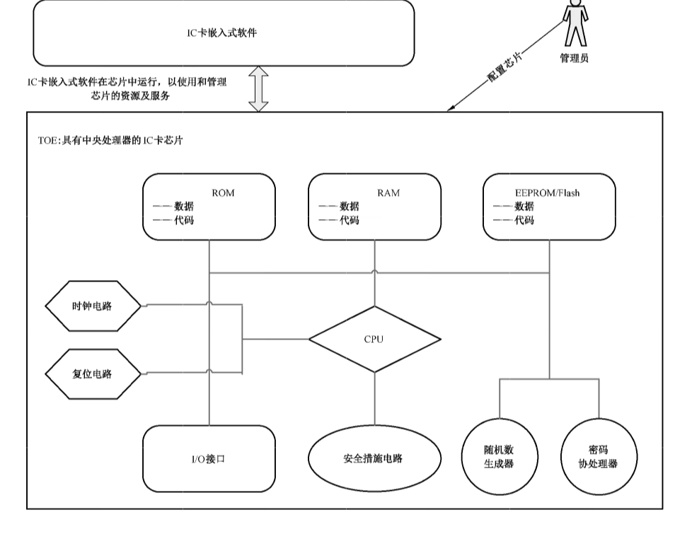

# GB/T 22186-2016 信息安全技术 具有中央处理器的IC卡芯片安全技术要求

> 来源：[GB/T 22186-2016 国家标准详情](https://openstd.samr.gov.cn/bzgk/std/newGbInfo?hcno=605BEE087D47366FE76A2FA9F1907A37)；封面发布日期：2016-08-29；实施日期：2017-03-01。
> 官方在线预览截图 SHA-256：33989e0964ea671c635aa5fd59184443a3146c1db60f670a44bbe6ca0cdca421。
> 转写说明：对照官方在线预览全部 37 页图像校核文字、图示和跨页表格；省略封面、目录、页眉、页脚及页码，保留原图 1。正式引用请核对官方原文。
> 原文疑点：表 3 第 5 行印为 O.Lifecycle_Contro，与第 6.1.4 节的 O.Lifecycle_Control 不同；表 4 第 15 行称“标识安全”，第 6.1.8 节称“标识数据存储”。以下按各自原页保留。

## 前言

本标准按照 GB/T 1.1—2009 给出的规则起草。

本标准代替 GB/T 22186—2008《信息安全技术 具有中央处理器的集成电路（IC）卡芯片安全技术要求（评估保证级 4 增强级）》。本标准与 GB/T 22186—2008 相比，主要变化如下：

- 标准名称变更为《信息安全技术 具有中央处理器的 IC 卡芯片安全技术要求》；
- 第 3 章对术语进行了更新描述；
- 第 4 章重新描述了 IC 卡芯片的结构，并进行了更清晰的 TOE 范围定义；
- 第 5 章对安全问题定义进行了整合和精简，共定义了 6 个威胁、2 项组织安全策略和 2 个假设；
- 第 6 章根据新的安全问题定义更新了对 TOE 安全目的的描述；
- 第 7 章描述了两个扩展族 FMT_LIM 和 FPT_TST，分别用于处理对 TOE 的受限可用性以及自检相关的安全功能要求，以便更合理地描述 IC 卡芯片的安全性；
- 第 8 章对安全功能要求进行了调整，以细化新的安全目的描述，明确指出了 EAL4+、EAL5+ 和 EAL6+ 分别应满足的安全功能要求；并对安全保证要求进行了调整，增加了 EAL5+ 和 EAL6+ 要求的保障组件；
- 第 9 章对新的安全问题定义与安全目的、安全目的与安全要求之间的对应关系基本原理进行了更新描述，并分析了组件之间的依赖关系。

本标准由全国信息安全标准化技术委员会（SAC/TC 260）提出并归口。

本标准起草单位：中国信息安全测评中心、北京多思科技工业园股份有限公司、清华大学、吉林信息安全测评中心。

本标准主要起草人：杨永生、张翀斌、石竑松、高金萍、王宇航、李贺鑫、贾炜、曹春春、沈敏锋、乌力吉、张向民、唐喜庆、闫明、昌彦伟、方欣。

本标准所代替标准的历次版本发布情况为：GB/T 22186—2008。

## 引言

IC 卡芯片应用范围的扩大和应用环境复杂性的增加，要求 IC 卡芯片具有更强的保护数据能力。

本标准的 EAL4+ 是在 EAL4 的基础上将 AVA_VAN.3 增强为 AVA_VAN.4；EAL5+ 是在 EAL5 的基础上将 ALC_DVS.1 增强为 ALC_DVS.2，AVA_VAN.4 增强为 AVA_VAN.5；EAL6+ 是在 EAL6 的基础上增加 ALC_FLR.1。

## 1 范围

本标准规定了对具有中央处理器的集 IC 卡芯片达到 EAL4+、EAL5+、EAL6+ 所要求的安全功能要求及安全保障要求，涵盖了安全问题定义、安全目的、扩展组件定义、安全要求、基本原理等内容。

本标准适用于IC卡芯片产品的测试、评估和采购，也可用于指导该类产品的研制和开发。

## 2 规范性引用文件

下列文件对于本文件的应用是必不可少的。凡是注日期的引用文件，仅注日期的版本适用于本文件。凡是不注日期的引用文件，其最新版本（包括所有的修改单）适用于本文件。

- GB/T 18336（所有部分）信息技术 安全技术 信息技术安全评估准则

- GB/T 25069—2010 信息安全技术 术语

## 3 术语和定义、缩略语

### 3.1 术语和定义

GB/T 25069—2010和 GB/T 18336.1界定的以及下列术语和定义适用于本文件。

#### 3.1.1 IC 专用软件 IC dedicated software

由IC 卡芯片设计者开发，并存在于IC 卡集成电路中的专用软件。这些专用软件通常在生产过程中用于测试，也可以用来提供额外的服务以便于硬件使用，其中专用测试软件的部分功能只限定在特定阶段使用。

#### 3.1.2 初始化数据 initialization data

由IC 卡芯片制造者定义，用于标识芯片以便追踪生产过程和生命周期阶段的数据，如IC卡芯片的唯一标识号。

#### 3.1.3 预个人化数据 pre-personalization data

在IC 卡芯片制造阶段由制造者写入非易失性存储器中的数据，以便后续生命周期阶段追溯IC卡芯片的制造过程。

#### 3.1.4 IC 卡嵌入式软件 IC card embedded software

存放在具有中央处理器的IC卡的非易失性存储器（例如 ROM、EEPROM 或 Flash 等）中，并在IC卡芯片内运行的软件。该软件用于管理芯片硬件资源和数据，通过芯片的通信接口与IC卡终端设备交换信息，以响应用户发起的数据加密、数据签名及鉴权认证等应用请求，实现对应用功能的支持。

### 3.2 缩略语

下列缩略语适用于本文件。

CPU：中央处理器（Central Processing Unit）

CM：配置管理（Configuration Management）

EAL：评估保障级（Evaluation Assurance Level）

EEPROM：电可擦除可编程只读存储器（Electrically-Erasable Programmable Read-only Memory）

IC：集成电路（Integrated Circuit）

I/O：输入/输出（Input/Output）

IT：信息技术（Information Technology）

RAM：随机存取存储器（Random-Access Memory）

ROM：只读存储器（Read-Only Memory）

ST：安全目标（Security Target）

TOE：评估对象（Target of Evaluation）

TSF：TOE 安全功能（TOE Security Functionality）

USB：通用串行总线（Universal Serial Bus）

## 4 IC 卡芯片描述

本标准的评估对象（TOE）是指具有中央处理器的 IC 卡芯片（以下简称 IC 卡芯片），一般由处理单元、易失性存储器 RAM 和非易失性存储器 ROM/EEPROM/Flash、I/O 接口（接触式、非接触式或其他类型接口，如 USB 接口）、随机数生成器、密码协处理器和安全措施电路（如用于防止物理探测、环境压力威胁的硬件模块）等电路模块组成。此外，TOE 还包括由集成电路设计者/制造者加入的 IC 专用软件。这些专用软件（也被称为 IC 固件）通常在生产过程中用于测试，也可以（如以库文件的形式）用来提供额外的服务以便硬件使用。IC 卡嵌入式软件是 TOE 的用户，运行在 IC 卡芯片中，但不属于 TOE 的组成部分。IC 卡芯片的一般结构和运行环境如图 1 所示（值得注意的是，根据芯片的实际用途，IC 卡芯片也可能不含某些电路模块，如 ROM、EEPROM 等）。

在此运行环境中，管理员可通过IC 卡芯片中的IC专用软件（或直接通过芯片接口或电路）对芯片进行基本配置；另一方面，攻击者可以通过利用IC卡嵌入式软件接口，或探测IC 卡芯片电路等方式来实施攻击，以破坏IC 卡芯片的敏感数据信息或滥用其安全功能。为此，IC卡芯片应采取防护措施以保障芯片的数据和功能的安全。

## 5 安全问题定义

### 5.1 资产

需要保护的资产：

- TSF 数据（如存储器访问控制寄存器等安全寄存器的配置、访问控制列表和预置密钥等信息）；
- 用户数据（如嵌入式软件代码、用户密钥或口令等与用户或具体应用相关的，但不属于 TSF 安全数据的信息）；
- 为嵌入式软件提供的安全服务（如安全算法库、随机数生成能力）。

应用说明：ST 编写者应根据具体的应用情况细化对资产的描述。

### 5.2 威胁

#### 5.2.1 物理操纵（T.Physical_Manipulation）

攻击者可利用IC 卡芯片失效性分析和半导体逆向工程技术，对IC卡芯片实施物理剖片，以获取IC 卡芯片的设计信息，进而探测 TSF 数据和用户数据信息。

攻击者也可能对IC卡芯片实施物理更改，以达到获取或改变数据信息或安全功能的目的。

IC卡芯片可能会在未上电或已上电状态下受到此类攻击，在遭受攻击后可能会处于无法操作的状态。

#### 5.2.2 信息泄漏（T.Info_Leak）

攻击者可对IC 卡芯片正常使用过程中泄漏的信息加以利用，以猜测 TSF 数据或用户数据。

功耗、电磁辐射、I/O 特性、运算频率、时耗等侧信道信息的变化情况都有可能造成信息的泄漏。攻击者可通过采用接触式（如功耗）或非接触式（如电磁辐射和时耗）的信号测量，得到与正在执行的操作有关的信息，进而采用信号处理和统计分析等技术来获得密钥等敏感信息。

#### 5.2.3 故障利用（T.Failure_Exploitation）

攻击者可通过分析IC 卡芯片的运行故障以获取敏感数据信息或滥用IC卡芯片的安全功能。

这些故障可能是通过改变 IC 卡芯片的运行环境（如温度、电压、频率等，或通过注入强光等方式）而触发的，也可能是由于 IC 卡芯片本身的设计缺陷而自发产生的，这些故障可能导致 IC 卡芯片的代码、系统数据或执行过程发生错误，使 IC 卡芯片在故障下运行，从而导致敏感数据泄露。

#### 5.2.4 生命周期功能滥用（T. Lifecycle_Abuse）

攻击者可利用相关接口，尤其是测试和调试接口来获取 TSF 数据或用户数据。这些接口在 IC 卡芯片生命周期的过往阶段是必要的，但在现阶段是被禁止的。例如，若测试命令或调试命令在使用阶段仍可用，则可被攻击者用于显示存储器内容或执行其他功能。

#### 5.2.5 逻辑攻击（T.Logical_Attack）

攻击者可利用TOE 的逻辑接口，采用暴力猜解、被动侦听或适应性地选择指令输入等方式来绕过芯片的存储器访问控制措施，获取（或修改）用户数据或 TSF 数据，或者滥用 TOE的安全功能。

应用说明：逻辑接口是IC 卡芯片与智能终端之间的数据交换接口，包括语法上遵循国际标准定义或行业私有定义的指令与响应码。攻击者可能利用IC卡芯片的认证系统或指令系统缺陷，通过分析指令及其响应码，绕过存储器访问控制机制，以非法获得存储器内容、密钥等信息，或达到滥用 TOE安全功能等目的。

#### 5.2.6 随机数缺陷攻击（T.RNGDefect_Attack）

攻击者可利用噪音源的不稳定性和低熵值等缺陷，预测或获取 IC 卡芯片安全服务中与随机数相关的信息。

### 5.3 组织安全策略

#### 5.3.1 密码管理（P.Crypto_Management）

密码的使用必须符合国家标准及行业或组织的信息技术安全标准或规范。

#### 5.3.2 标识数据管理（P.IdData_Management）

IC 卡芯片的生产、测试等过程应具备标识 TOE的能力。

### 5.4 假设

#### 5.4.1 人员（A.Personnel）

假设 IC 卡芯片使用人员（如嵌入式软件的设计和开发人员）遵循一套安全的流程，严格遵照芯片用户指南及安全建议的要求调用芯片的安全规则和安全功能。

IC 卡芯片开发、测试、生产等各阶段的操作人员均能按安全的流程进行操作。

#### 5.4.2 外部数据管理（A.OutData_Management）

假设在IC 卡芯片之外的数据和密钥以一种安全的方式进行管理。

关于IC 卡芯片结构、设计信息，开发及测试工具、实现代码及相关文档、初始化数据、所有者身份等敏感信息将被发行者或其他IC卡芯片之外的数据库存储。

## 6 安全目的

### 6.1 IC 卡芯片安全目的

#### 6.1.1 物理防护（O.Physical_Protection）

IC 卡芯片应抵抗物理攻击，防止通过诸如剖片探测、电路篡改等手段实施的攻击，或能够提供安全措施显著增加实施此类攻击的困难性。

#### 6.1.2 信息泄漏防护（O.InfoLeak_Prevention）

IC 卡芯片必须提供控制和限制信息泄漏的方法，使得通过测量功耗、电磁辐射、时耗等信息的变化情况难以获得敏感信息。

#### 6.1.3 故障处理（O.Failure_Handling）

IC 卡芯片应使得即便暴露在非标准环境中时，也能防止安全信息泄漏，或使芯片进入一种安全的运行状态。这些环境影响因素包括温度、电压、时钟频率或外部能量场。

#### 6.1.4 生命周期功能控制（O.Lifecycle_Control）

IC 卡芯片应对自身安全功能的可用性进行生命周期阶段划分，或进行权限控制，以防止攻击者滥用这些功能（如测试模式下的某些功能应在IC 卡芯片交付后关闭）。

#### 6.1.5 逻辑攻击抵抗（O.LogAttack_Prevention）

IC 卡芯片应能抵抗逻辑攻击，或能够提供安全措施显著增加实施此类攻击的困难性。

#### 6.1.6 随机数生成（O.RND_Generation）

IC卡芯片应确保生成的随机数能满足应用要求的质量指标。例如，随机数应不能被预测，且具有一定的熵值，以防止攻击者猜测通过随机数生成的密钥、挑战值等信息。

#### 6.1.7 密码安全（O.Crypto_Security）

IC卡芯片必须以一个安全的方式支持密码功能，其使用的密码算法必须符合国家、行业或组织要求的密码管理相关标准或规范。

#### 6.1.8 标识数据存储（O.IdData_Storage）

IC 卡芯片必须提供在非易失性存储器中存储初始化数据和预个人化数据的手段。

### 6.2 环境安全目的

#### 6.2.1 人员（OE.Personnel）

IC 卡芯片的设计、开发、生产和交付等生命周期阶段中涉及的特定人员能严格地遵守安全的操作规程，以保证 TOE 在生命周期过程中的安全性。

#### 6.2.2 芯片使用（OE.Chip_Usage）

为了保证 IC 卡芯片能够被安全地使用，要求嵌入式软件开发人员应严格遵照 IC 卡芯片的用户指南和安全建议，以一套安全的流程进行嵌入式软件的设计和开发。

#### 6.2.3 外部数据管理（OE.OutData_Management）

应对在IC卡芯片外部存储的相关数据（如IC卡芯片的设计信息、开发及测试工具、实现代码及相关文档、初始化数据、管理性密钥等）进行机密性和完整性处理，并采取安全的管理措施。

## 7 扩展组件定义

### 7.1 族 FMT_LIM 定义

#### 7.1.1 族行为

为了定义 TOE 的 IT 安全功能要求，这里定义 FMT 类中扩展的 FMT_LIM 族，以描述 TOE 安全功能的能力和可用性相关的要求。

本族定义了限制能力和功能可用性的要求。值得注意的是，FDP_ACF 族规范了对功能的访问限制要求，而本族要求安全功能采纳特定的设计方法，以使其能力和可用性能得到控制。

FMT_LIM 受限能力和可用性

#### 7.1.2 组件层次

FMT_LIM.1 受限能力要求TSF 采用了特定的设计方法，使其仅具备必需的能力（如执行动作，获取信息）。

FMT_LIM.2 受限可用性要求 FMT_LIM.1 提及的安全功能的可用性能得到控制，例如 TOE 某个阶段的特殊安全功能在进入下一阶段后将被删除或禁止，因而在进入新的阶段后将无法使用。

#### 7.1.3 FMT_LIM.1、FMT_LIM.2 管理

尚无预见的管理活动。

#### 7.1.4 FMT_LIM.1、FMT_LIM.2 审计

尚无预见的审计活动。

#### 7.1.5 FMT_LIM.1 受限能力

从属于：无其他组件。

依赖于：FMT_LIM.2受限可用性。

**7.1.5.1 FMT_LIM.1.1** TSF 应采取某种能力受限的设计和实现方法，以便可与“受限可用性（FMT_LIM.2）”相结合来实施【赋值：受限能力和可用性策略】。

应用说明：方括号【】中的粗体字的内容表示已经完成的操作，粗体斜体字的内容表示还需在安全目标（ST）中确定的赋值及选择项，此约定也适用于后续章节。

#### 7.1.6 FMT_LIM.2 受限可用性

从属于：无其他组件。

依赖于：FMT_LIM.1 受限能力。

**7.1.6.1 FMT_LIM.2.1** TSF 应采取某种可用性受限的设计和实现方法，以便可与“受限能力（FMT_LIM.1）”相结合来实施【赋值：受限能力和可用性策略】。

### 7.2 族 FPT_TST 定义

#### 7.2.1 族行为

FPT_TST.1 组件要求授权用户能验证TSF 数据和 TSF 可执行代码的完整性，对IC 卡芯片产品而言这个要求过于严格，因而并不完全适合IC 卡芯片产品。另一方面，为了保障IC 卡芯片的安全，又需要有安全功能自测能力，因此在族 FPT_TST 中扩展了一个新的组件（通过裁剪 FPT_TST.1 而得到的），以适于IC 卡芯片实施安全功能自检。

本族在原族的基础上扩展了一个新的组件，以便于IC卡芯片实施 TSF 自检功能。

#### 7.2.2 组件层次

FPT_TST：TSF 自检。

FPT_TST.1 为 FPT_TST 中的原有组件，本标准保持其原始描述，不做任何修改。

FPT_TST.2 子集TSF测试具有测试安全功能正确操作的能力。这些测试可以在调用安全算法模块时执行。

#### 7.2.3 FPT_TST.2 管理

尚无预见的管理活动。

#### 7.2.4 FPT_TST.2 审计

尚无预见的审计活动。

#### 7.2.5 FPT_TST.2 子集 TSF 测试

从属于：无其他组件。

依赖关系：无依赖关系。

**7.2.5.1 FPT_TST.2.1** IC 卡芯片安全功能应在【选择：初始化启动期间、正常工作期间周期性、授权用户要求时、在【赋值：产生自检的条件】条件时】运行一套自检程序以证明【选择：【赋值：TSF 的组成部分】、TSF】运行的正确性。

## 8 安全要求

### 8.1 安全功能要求

#### 8.1.1 概述

表 1 列出了 IC 卡芯片安全功能组件，下述各条对各组件给出了详细描述。

**表1 安全功能组件**

| 安全功能类 | 安全功能组件 | 编号 | EAL4+ | EAL5+ | EAL6+ |
| --- | --- | --- | --- | --- | --- |
| FCS 类：密码支持 | FCS_CKM.1 密钥生成 | 1 | 必选 | 必选 | 必选 |
| FCS 类：密码支持 | FCS_COP.1 密码运算 | 2 | 必选 | 必选 | 必选 |
| FDP 类：用户数据保护 | FDP_ACC.1 子集访问控制 | 3 | 必选 | 必选 | 必选 |
| FDP 类：用户数据保护 | FDP_ACF.1 基于安全属性的访问控制 | 4 | 必选 | 必选 | 必选 |
| FDP 类：用户数据保护 | FDP_IFC.1 子集信息流控制 | 5 | 必选 | 必选 | 必选 |
| FDP 类：用户数据保护 | FDP_ITT.1 基本内部传送保护 | 6 | 必选 | 必选 | 必选 |
| FDP 类：用户数据保护 | FDP_SDI.1 存储数据完整性监视 | 7 | 可选 | 必选 | 不适用 |
| FDP 类：用户数据保护 | FDP_SDI.2 存储数据完整性监视和行动 | 8 | 可选 | 可选 | 必选 |
| FIA 类：标识和鉴别 | FIA_UAU.1 鉴别的时机 | 9 | 可选 | 必选 | 必选 |
| FIA 类：标识和鉴别 | FIA_AFL.1 鉴别失败处理 | 10 | 可选 | 必选 | 必选 |
| FMT 类：安全管理 | FMT_LIM.1 受限能力 | 11 | 必选 | 必选 | 必选 |
| FMT 类：安全管理 | FMT_LIM.2 受限可用性 | 12 | 必选 | 必选 | 必选 |
| FMT 类：安全管理 | FMT_MSA.1 安全属性的管理 | 13 | 必选 | 必选 | 必选 |
| FMT 类：安全管理 | FMT_MSA.3 静态属性初始化 | 14 | 必选 | 必选 | 必选 |
| FMT 类：安全管理 | FMT_MTD.1 TSF 数据的管理 | 15 | 必选 | 必选 | 必选 |
| FMT 类：安全管理 | FMT_SMF.1 管理功能规范 | 16 | 必选 | 必选 | 必选 |
| FMT 类：安全管理 | FMT_SMR.1 安全角色 | 17 | 必选 | 必选 | 必选 |
| FPT 类：安全功能保护 | FPT_FLS.1 失效即保持安全状态 | 18 | 必选 | 必选 | 必选 |
| FPT 类：安全功能保护 | FPT_ITT.1 内部 TSF 数据传送的基本保护 | 19 | 必选 | 必选 | 必选 |
| FPT 类：安全功能保护 | FPT_PHP.3 物理攻击抵抗 | 20 | 必选 | 必选 | 必选 |
| FPT 类：安全功能保护 | FPT_TST.2 子集 TSF 测试 | 21 | 可选 | 必选 | 必选 |
| FRU：资源利用 | FRU_FLT.2 受限容错 | 22 | 必选 | 必选 | 必选 |

注：原表用“√”表示必选组件，“○”表示可选组件，“N/A”表示该保障级下不适用。

#### 8.1.2 描述

##### 8.1.2.1 密钥生成（FCS_CKM.1）

FCS_CKM.1.1 IC 卡芯片安全功能应根据符合下列标准【赋值：标准列表】的一个特定的密钥生成算法【赋值：密钥生成算法】和规定的密钥长度【赋值：密钥长度】来生成密钥。

应用说明：该组件仅适用于密钥生成功能由 IC 卡芯片本身完成的情况，此时 ST 编写者应根据密码算法的具体情况，赋值国家主管部门认可的相关标准及参数。若密钥由外部环境生成，则可以不选择此组件。

##### 8.1.2.2 密码运算（FCS_COP.1）

FCS_COP.1.1 IC 卡芯片安全功能应根据符合下列标准【赋值：标准列表】的特定的密码算法【赋值：密码算法】和密钥长度【赋值：密钥长度】来执行【赋值：密码运算列表】。

应用说明：ST编写者应根据密码算法的具体情况赋值国家主管部门认可的相关标准及参数。

##### 8.1.2.3 子集访问控制（FDP_ACC.1）

FDP_ACC.1.1 IC 卡芯片安全功能应对【IC 卡嵌入式软件、管理员，赋值：其他主体列表】【读、写和执行，赋值：主体和客体之间的其他操作列表】操作【Flash、RAM、ROM 存储器，及特殊功能寄存器，赋值：其他客体列表】执行【IC 卡芯片存储器访问控制策略，赋值：其他 IC 卡芯片访问控制策略】。

应用说明：ST编写者应根据具体情况细化用户数据和操作列表，且根据用户和管理员操作客体和相应控制策略的不同，应在ST 中将此组件分为不同的点进行描述，此原则适用于以下各组件的描述情况。

##### 8.1.2.4 基于安全属性的访问控制（FDP_ACF.1）

FDP_ACF.1.1 IC 卡芯片安全功能应基于【存储器访问控制寄存器的值，赋值：其他安全策略相关的安全属性或安全属性组】对客体执行【IC卡芯片存储器访问控制策略，赋值：其他IC卡芯片访问控制策略】。

FDP_ACF.1.2 IC 卡芯片安全功能应执行以下规则，以决定在受控主体与受控客体间的一个操作是否被允许：【存储器访问控制寄存器的值是否满足访问要求，赋值：其他在受控主体和受控客体间，通过对受控客体采取受控操作来管理访问的一些规则】。

FDP_ACF.1.3 IC 卡芯片安全功能应基于以下附加规则：【赋值：基于安全属性的，明确授权主体访问客体的规则】，明确授权主体访问客体。

FDP_ACF.1.4 IC 卡芯片安全功能应基于【赋值：基于安全属性的，明确拒绝主体访问客体的规则】明确拒绝主体访问客体。

应用说明：ST 编写者应根据具体应用细化主体、客体和操作列表，并描述相应的访问控制策略。

若IC 卡芯片没有附加的访问控制策略，可不对 FDP_ACF.1.3 和 FDP_ACF.1.4 的相应赋值项赋值。

##### 8.1.2.5 子集信息流控制（FDP_IFC.1）

FDP_IFC.1.1 IC 卡芯片安全功能应对【赋值：IC 卡芯片中处理或传输的用户数据，如用户密钥等敏感信息】执行【IC 卡芯片数据处理策略】。

应用说明：数据处理策略应要求除非IC卡嵌入式软件允许用户数据可通过外部接口访问，否则不能从 IC 卡芯片中泄露。

##### 8.1.2.6 基本内部传送保护（FDP_ITT.1）

FDP_ITT.1.1 在IC 卡芯片物理上分隔的不同的存储器、CPU 与其他IC 卡芯片功能模块（如密码协处理器）之间传递用户数据时，IC卡芯片安全功能应执行【IC 卡芯片数据处理策略】，以防止用户数据被【选择：泄露，篡改，或无法使用】。

##### 8.1.2.7 存储数据完整性监视（FDP_SDI.1）

FDP_SDI.1.1 IC 卡芯片安全功能应基于下列属性：【用户数据完整性校验值，赋值：其他用户数据属性】，对所有客体，监视存储在由 IC 卡芯片安全功能控制的载体内的用户数据的【完整性错误】。

应用说明：ST的编写者应对需要完整性监视的用户数据进行细化描述。

##### 8.1.2.8 存储数据完整性监视和行动（FDP_SDI.2）

FDP_SDI.2.1 IC 卡芯片安全功能应基于下列属性：【用户数据完整性校验值，赋值：其他用户数据属性】，对所有客体，监视存储在由IC卡芯片安全功能控制的载体内的用户数据的【完整性错误】。

FDP_SDI.2.2 检测到数据完整性错误时，IC 卡芯片安全功能应【输出错误状态，赋值：采取的其他动作】。

应用说明：ST 的编写者应对采取的其他完整性错误处理动作进行细化描述。

##### 8.1.2.9 鉴别的时机（FIA_UAU.1）

FIA_UAU.1.1 在用户被鉴别前，IC卡芯片安全功能应允许执行代表用户的【赋值：由IC卡芯片安全功能促成的动作列表，如读取IC卡芯片标识信息操作】。

FIA_UAU.1.2 只有在用户已被成功鉴别后，才能执行所有其他受 IC 卡芯片安全功能控制的动作。

应用说明：此处用户仅指执行IC专用软件相应功能的操作主体，即管理员角色。

##### 8.1.2.10 鉴别失败处理（FIA_AFL.1）

FIA_AFL.1.1 IC 卡芯片安全功能应检测当【赋值：次数或数值范围】时，与【IC专用软件的管理员鉴别，赋值：其他鉴别事件列表】相关的未成功鉴别尝试。

FIA_AFL.1.2 当【选择：达到，超过】所定义的未成功鉴别尝试次数时，IC卡芯片安全功能应采取的【赋值：动作列表，如永久锁定鉴别功能】。

##### 8.1.2.11 受限能力（FMT_LIM.1）

FMT_LIM.1.1 IC 卡芯片安全功能应采取某种能力受限的设计和实现方法，以便可与“受限可用性（FMT_LIM.2）”相结合来实施【赋值：受限的能力和可用性策略】。

##### 8.1.2.12 受限可用性（FMT_LIM.2）

FMT_LIM.2.1 IC 卡芯片安全功能应采取某种可用性受限的设计和实现方法，以便可与“受限能力（FMT_LIM.1）”相结合来实施【赋值：受限的能力和可用性策略】。

应用说明：ST 的编写者应对受限的能力和可用性策略进行细化，以描述实施该策略的两个方面：一方面描述IC 卡芯片安全功能在用户环境下可用，但是使其能力受限的规则；而另一方面描述IC 卡芯片的安全功能在用户环境中被禁止或删除，从而不可用的方法的规则。

##### 8.1.2.13 安全属性的管理（FMT_MSA.1）

FMT_MSA.1.1 IC 卡芯片安全功能应执行【IC卡芯片存储器访问控制策略，赋值：其他IC卡芯片访问控制策略、信息流控制策略】，以仅限于【管理员，赋值：已标识的其他授权角色】能够对安全属性【存储器访问控制寄存器的值，赋值：其他安全属性列表】进行【选择：改变默认值、查询、修改、删除，【赋值：其他操作】】。

##### 8.1.2.14 静态属性初始化（FMT_MSA.3）

FMT_MSA.3.1 IC 卡芯片安全功能应执行【IC卡芯片存储器访问控制策略，赋值：其他访问控制策略、信息流控制策略】，以便用于执行IC卡芯片安全功能策略的安全属性提供【选择：受限的、许可的、【赋值：其他特性】】默认值。

FMT_MSA.3.2 IC 卡芯片安全功能应允许【管理员，赋值：已标识的其他授权角色】在创建客体或信息时指定替换性的初始值以代替原来的默认值。

##### 8.1.2.15 TSF 数据的管理（FMT_MTD.1）

FMT_MTD.1.1 IC 卡芯片安全功能应仅限于【管理员，赋值：已标识的其他授权角色】能够对【IC卡芯片的标识数据，赋值：其他安全功能数据列表】进行【选择：改变默认值、查询、修改、删除、清除、【赋值：其他操作】】操作。

应用说明：ST编写者应根据具体应用情况细化对管理员角色的描述，使得IC芯片在进入使用阶段后，即便相应的管理员也无法对芯片的标识数据进行修改。

##### 8.1.2.16 管理功能规范（FMT_SMF.1）

FMT_SMF.1.1 IC 卡芯片安全功能应能够执行如下管理功能：【生命周期控制功能，赋值：其他IC卡芯片安全功能提供的安全管理功能列表】。

##### 8.1.2.17 安全角色（FMT_SMR.1）

FMT_SMR.1.1 IC 卡芯片安全功能应维护角色【管理员，赋值：已标识的其他授权角色】。

FMT_SMR.1.2 IC 卡芯片安全功能应能够把用户和角色关联起来。

应用说明：ST编写者应根据具体应用情况完善对管理员角色的描述。

##### 8.1.2.18 失效即保持安全状态（FPT_FLS.1）

FPT_FLS.1.1 IC 卡芯片安全功能在下列失效发生时应保持一种安全状态：【电压异常、时钟频率异常、温度异常、光异常，赋值：安全功能的其他失败类型列表】。

##### 8.1.2.19 内部 TSF 数据传送的基本保护（FPT_ITT.1）

FPT_ITT.1.1 IC 卡芯片安全功能应保护IC卡芯片安全功能数据在不同的存储器之间、CPU 与其他IC卡芯片功能模块之间（如密码协处理器）之间，传送时不被【选择：泄漏，篡改】。

##### 8.1.2.20 物理攻击抵抗（FPT_PHP.3）

FPT_PHP.3.1 IC 卡芯片安全功能应通过自动响应以抵抗对 IC 卡芯片安全功能【密码处理器、随机数生成器，赋值：其他 TSF 设备/元件列表】的【物理篡改和物理探针攻击，如芯片逆向分析，赋值：其他各种物理侵害】，这样才能满足 IC 卡芯片安全功能要求。

##### 8.1.2.21 子集 TSF 测试（FPT_TST.2）

FPT_TST.2.1 IC 卡芯片安全功能应在【初始启动期间、正常工作期间、授权用户要求时、【赋值：其他产生自检的条件】】运行一套自检程序以证明【密码运算功能，【赋值：IC 卡芯片的其他安全功能】】运转的正确性。

##### 8.1.2.22 受限容错（FRU_FLT.2）

FRU_FLT.2.1 IC 卡芯片安全功能应确保当以下失效：【未被失效即保持安全状态（FPT_FLS.1）检测到的电压、时钟频率、温度、光异常，赋值：其他故障类型列表】发生时，所有 IC 卡芯片能力均能正常发挥。

### 8.2 安全保障要求

#### 8.2.1 概述

表 2 列出了安全保障组件。下述各条对各组件给出了详细的描述。

**表2 安全保障组件**

| 组件分类 | 安全保障组件 | 编号 | EAL4+ | EAL5+ | EAL6+ |
| --- | --- | --- | --- | --- | --- |
| ADV 类：开发 | ADV_ARC.1 安全架构描述 | 1 | 必选 | 必选 | 必选 |
| ADV 类：开发 | ADV_FSP.4 完备的功能规范 | 2 | 必选 | 不适用 | 不适用 |
| ADV 类：开发 | ADV_FSP.5 附加错误信息的完备的半形式化功能规范 | 3 | 不适用 | 必选 | 必选 |
| ADV 类：开发 | ADV_IMP.1 TSF 实现表示 | 4 | 必选 | 必选 | 不适用 |
| ADV 类：开发 | ADV_IMP.2 TSF 实现表示完全映射 | 5 | 不适用 | 不适用 | 必选 |
| ADV 类：开发 | ADV_INT.2 内部结构合理 | 6 | 不适用 | 必选 | 不适用 |
| ADV 类：开发 | ADV_INT.3 内部复杂度最小化 | 7 | 不适用 | 不适用 | 必选 |
| ADV 类：开发 | ADV_SPM.1 形式化 TOE 安全策略模型 | 8 | 不适用 | 不适用 | 必选 |
| ADV 类：开发 | ADV_TDS.3 基础模块设计 | 9 | 必选 | 不适用 | 不适用 |
| ADV 类：开发 | ADV_TDS.4 半形式化模块设计 | 10 | 不适用 | 必选 | 不适用 |
| ADV 类：开发 | ADV_TDS.5 完全半形式化模块设计 | 11 | 不适用 | 不适用 | 必选 |
| AGD 类：指导性文档 | AGD_OPE.1 操作用户指南 | 12 | 必选 | 必选 | 必选 |
| AGD 类：指导性文档 | AGD_PRE.1 准备程序 | 13 | 必选 | 必选 | 必选 |
| ALC 类：生命周期支持 | ALC_CMC.4 生产支持和接受程序及其自动化 | 14 | 必选 | 必选 | 不适用 |
| ALC 类：生命周期支持 | ALC_CMC.5 高级支持 | 15 | 不适用 | 不适用 | 必选 |
| ALC 类：生命周期支持 | ALC_CMS.4 问题跟踪 CM 覆盖 | 16 | 必选 | 不适用 | 不适用 |
| ALC 类：生命周期支持 | ALC_CMS.5 开发工具 CM 覆盖 | 17 | 不适用 | 必选 | 必选 |
| ALC 类：生命周期支持 | ALC_DEL.1 交付程序 | 18 | 必选 | 必选 | 必选 |
| ALC 类：生命周期支持 | ALC_DVS.1 安全措施标识 | 19 | 必选 | 不适用 | 不适用 |
| ALC 类：生命周期支持 | ALC_DVS.2 充分的安全措施 | 20 | 不适用 | 必选 | 必选 |
| ALC 类：生命周期支持 | ALC_FLR.1 基本的缺陷纠正 | 21 | 不适用 | 不适用 | 必选 |
| ALC 类：生命周期支持 | ALC_LCD.1 开发者定义的生命周期模型 | 22 | 必选 | 必选 | 必选 |
| ALC 类：生命周期支持 | ALC_TAT.1 明确定义的开发工具 | 23 | 必选 | 不适用 | 不适用 |
| ALC 类：生命周期支持 | ALC_TAT.2 遵从实现标准 | 24 | 不适用 | 必选 | 不适用 |
| ALC 类：生命周期支持 | ALC_TAT.3 遵从实现标准一所有部分 | 25 | 不适用 | 不适用 | 必选 |
| ASE 类：安全目标评估 | ASE_CCL.1 符合性声明 | 26 | 必选 | 必选 | 必选 |
| ASE 类：安全目标评估 | ASE_ECD.1 扩展组件定义 | 27 | 必选 | 必选 | 必选 |
| ASE 类：安全目标评估 | ASE_INT.1 ST 引言 | 28 | 必选 | 必选 | 必选 |
| ASE 类：安全目标评估 | ASE_OBJ.2 安全目的 | 29 | 必选 | 必选 | 必选 |
| ASE 类：安全目标评估 | ASE_REQ.2 推导出的安全要求 | 30 | 必选 | 必选 | 必选 |
| ASE 类：安全目标评估 | ASE_SPD.1 安全问题定义 | 31 | 必选 | 必选 | 必选 |
| ASE 类：安全目标评估 | ASE_TSS.1 TOE 概要规范 | 32 | 必选 | 必选 | 必选 |
| ATE 类：测试 | ATE_COV.2 覆盖分析 | 33 | 必选 | 必选 | 不适用 |
| ATE 类：测试 | ATE_COV.3 覆盖的严格分析 | 34 | 不适用 | 不适用 | 必选 |
| ATE 类：测试 | ATE_DPT.2 测试：安全执行模块 | 35 | 必选 | 不适用 | 不适用 |
| ATE 类：测试 | ATE_DPT.3 测试：模块设计 | 36 | 不适用 | 必选 | 必选 |
| ATE 类：测试 | ATE_FUN.1 功能测试 | 37 | 必选 | 必选 | 不适用 |
| ATE 类：测试 | ATE_FUN.2 顺序的功能测试 | 38 | 不适用 | 不适用 | 必选 |
| ATE 类：测试 | ATE_IND.2 独立测试—抽样 | 39 | 必选 | 必选 | 必选 |
| AVA 类：脆弱性评定 | AVA_VAN.4 系统的脆弱性分析 | 40 | 必选 | 不适用 | 不适用 |
| AVA 类：脆弱性评定 | AVA_VAN.5 高级的系统的脆弱性分析 | 41 | 不适用 | 必选 | 必选 |

注 1：原表用“√”表示在该保障级下应选择该组件，“N/A”表示不适用。

注 2：对于安全保障组件的选取，本标准的 EAL4+ 是在 EAL4 的基础上将 AVA_VAN.3 增强为 AVA_VAN.4；EAL5+ 是在 EAL5 的基础上将 ALC_DVS.1 增强为 ALC_DVS.2，AVA_VAN.4 增强为 AVA_VAN.5；EAL6+ 是在 EAL6 的基础上增加 ALC_FLR.1。

#### 8.2.2 描述

##### 8.2.2.1 安全架构描述（ADV_ARC.1）

开发者行为元素：ADV_ARC.1.1D 开发者应设计并实现 TOE，确保 TSF 的安全特性不可旁路。

ADV_ARC.1.2D 开发者应设计并实现 TSF，以防止不可信主体的破坏。

ADV_ARC.1.3D 开发者应提供 TSF 安全架构的描述。

内容和形式元素：ADV_ARC.1.1C 安全架构的描述应与在TOE 设计文档中对SFR-执行的抽象描述的级别一致。

ADV_ARC.1.2C 安全架构的描述应描述与安全功能要求一致的TSF 安全域。

ADV_ARC.1.3C 安全架构的描述应描述 TSF 初始化过程为何是安全的。

ADV_ARC.1.4C 安全架构的描述应证实 TSF 可防止被破坏。

ADV_ARC.1.5C 安全架构的描述应证实 TSF 可防止 SFR-执行的功能被旁路。

评估者行为元素：ADV_ARC.1.1E 评估者应确认提供的信息符合证据的内容和形式要求。

##### 8.2.2.2 完备的功能规范（ADV_FSP.4）

开发者行为元素：ADV_FSP.4.1D 开发者应提供一个功能规范。

ADV_FSP.4.2D 开发者应提供功能规范到安全功能要求的追溯。

内容和形式元素：ADV_FSP.4.1C 功能规范应完全描述TSF。

ADV_FSP.4.2C 功能规范应描述所有的TSFI 的目的和使用方法。

ADV_FSP.4.3C 功能规范应识别和描述每个 TSFI 相关的所有参数。

ADV_FSP.4.4C 对于每个 SFR-执行 TSFI，功能规范应描述TSFI 相关的所有行为。

ADV_FSP.4.5C 功能规范应描述可能由每个TSFI的调用而引起的所有直接错误消息。

ADV_FSP.4.6C 功能规范应证实安全功能要求到 TSFI 的追溯。

评估者行为元素：ADV_FSP.4.1E 评估者应确认所提供的信息满足证据的内容和形式的所有要求。

ADV_FSP.4.2E 评估者应确定功能规范是安全功能要求的一个准确且完备的实例化。

##### 8.2.2.3 附加错误信息的完备的半形式化功能规范（ADV_FSP.5）

开发者行为元素：ADV_FSP.5.1D 开发者应提供一个功能规范。

ADV_FSP.5.2D 开发者应提供功能规范到安全功能要求的追溯。

内容和形式元素：ADV_FSP.5.1C 功能规范应完全描述 TSF。

ADV_FSP.5.2C 功能规范应用半形式化方式描述 TSFI。

ADV_FSP.5.3C 功能规范应描述所有的 TSFI 的目的和使用方法。

ADV_FSP.5.4C 功能规范应识别和描述每个 TSFI 相关的所有参数。

ADV_FSP.5.5C 功能规范应描述每个 TSFI 相关的所有行为。

ADV_FSP.5.6C 功能规范应描述可能由每个 TSFI 的调用引起的所有直接错误消息。

ADV_FSP.5.7C 功能规范应描述不是由 TSFI调用而引起的所有错误消息。

ADV_FSP.5.8C 功能规范应为每个包含在 TSF 实现中但不是由 TSFI 调用而引起的错误消息提供基本原理。

ADV_FSP.5.9C 功能规范应证实安全功能要求到 TSFI的追溯。

评估者行为元素：ADV_FSP.5.1E 评估者应确认所提供的信息满足证据的内容和形式的所有要求。

ADV_FSP.5.2E 评估者应确定功能规范是安全功能要求的一个准确且完备的实例化。

##### 8.2.2.4 TSF 实现表示（ADV_IMP.1）

开发者行为元素：ADV_IMP.1.1D 开发者应为全部 TSF 提供实现表示。

ADV_IMP.1.2D 开发者应提供 TOE 设计描述与实现表示实例之间的映射。

内容和形式元素：ADV_IMP.1.1C 实现表示应按详细级别定义TSF，且详细程度达到无须进一步设计就能生成TSF 的程度。

ADV_IMP.1.2C 实现表示应以开发人员使用的形式提供。

ADV_IMP.1.3C TOE 设计描述与实现表示实例之间的映射应能证实它们的一致性。

评估者行为元素：ADV_IMP.1.1E 对于选取的实现表示示例，评估者应确认提供的信息满足证据的内容和形式的所有要求。

##### 8.2.2.5 TSF 实现表示完全映射（ADV_IMP.2）

开发者行为元素：ADV_IMP.2.1D 开发者应为全部TSF 提供实现表示。

ADV_IMP.2.2D 开发者应提供 TOE设计描述与全部实现表示之间的映射。

内容和形式元素：ADV_IMP.2.1C 实现表示应按详细级别定义 TSF，且详细程度达到无须进一步设计就能生成TSF 的程度。

ADV_IMP.2.2C 实现表示应以开发人员使用的形式提供。

ADV_IMP.2.3C TOE 设计描述与全部实现表示之间的映射应证实它们的一致性。

评估者行为元素：ADV_IMP.2.1E 评估者应确认提供的信息满足证据的内容和形式的所有要求。

##### 8.2.2.6 内部结构合理（ADV_INT.2）

开发者行为元素：ADV_INT.2.1D 开发者应设计和实现整个 TSF，使其内部结构合理。

ADV_INT.2.2D 开发者应提供内部描述和论证过程。

内容和形式元素：ADV_INT.2.1C 论证过程应描述用于判定“结构合理”的含义的特性。

ADV_INT.2.2C TSF 内部描述应证实指定的整个 TSF结构合理。

评估者行为元素：ADV_INT.2.1E 评估者应确认所提供的信息满足证据的内容和形式的所有要求。

ADV_INT.2.2E 评估者应执行指定的TSF 子集内部分析。

##### 8.2.2.7 内部复杂度最小化（ADV_INT.3）

开发者行为元素：ADV_INT.3.1D 开发者应设计和实现整个 TSF，使内部结构合理。

ADV_INT.3.2D 开发者应提供内部描述和论证过程。

内容和形式元素：ADV_INT.3.1C 论证过程应解释描述用于判定“结构合理”及复杂性的含义的特性。

ADV_INT.3.2C TSF 内部描述应证实指定的整个 TSF结构合理且不过于复杂。

评估者行为元素：ADV_INT.3.1E 评估者应确认所提供的信息满足证据的内容和形式的所有要求。

ADV_INT.3.2E 评估者应执行整个 TSF 的内部分析。

##### 8.2.2.8 形式化 TOE 安全策略模型（ADV_SPM.1）

开发者行为元素：ADV_SPM.1.1D 开发者应提供一个形式化的安全策略模型【赋值：被形式化模型化的策略列表】。

ADV_SPM.1.2D 对于形式化安全策略模型覆盖的每个策略，该模型应标识构成这一策略的安全功能要求声明的有关部分。

ADV_SPM.1.3D 开发者应提供该模型与形式化功能规范的对应性的形式化证明。

ADV_SPM.1.4D 开发者应提供该模型与功能规范的对应性的论证。

内容和形式元素：ADV_SPM.1.1C 该模型应是形式化的，必要时辅以解释性的文字，并且标识模型化的TSF 安全策略。

ADV_SPM.1.2C 对于所有被模型化的策略，模型定义该 TOE 的安全，提供该 TOE 不能达到非安全状态的形式化证明。

ADV_SPM.1.3C 该模型与功能规范的一致性应采用正确的形式化级别进行论述。

ADV_SPM.1.4C 该对应性应表明功能规范相对该模型是一致的和完备的。

ADV_SPM.1.5C 该对应性论证应表明功能规范中描述的接口相对于 ADV_SPM.1.1D 中赋值的策略是一致的和完备的。

评估者行为元素：ADV_SPM.1.1E 评估者应确认所提供的信息满足证据的内容和形式的所有要求。

##### 8.2.2.9 基本模块设计（ADV_TDS.3）

开发者行为元素：ADV_TDS.3.1D 开发者应提供 TOE 的设计。

ADV_TDS.3.2D 开发者应提供从功能规范的 TSFI 到 TOE 设计中获取到的最低层分解的映射。

内容和形式元素：ADV_TDS.3.1C 设计应根据子系统描述 TOE的结构。

ADV_TDS.3.2C 设计应根据模块描述 TSF。

ADV_TDS.3.3C 设计应标识 TSF的所有子系统。

ADV_TDS.3.4C 设计应描述每一个 TSF 子系统。

ADV_TDS.3.5C 设计应描述 TSF 所有子系统间的相互作用。

ADV_TDS.3.6C 设计应提供 TSF 子系统到 TSF 模块间的映射关系。

ADV_TDS.3.7C 设计应描述每一个 SFR-执行模块，包括它的目的及与其他模块间的相互作用。

ADV_TDS.3.8C 设计应描述每一个 SFR-执行模块，包括它的安全功能要求相关接口、其他接口的返回值、与其他模块间的相互作用及调用的接口。

ADV_TDS.3.9C 设计应描述每一个 SFR-支撑或 SFR-无关模块，包括它的目的及与其他模块间的相互作用。

ADV_TDS.3.10C 映射关系应证实TOE 设计中描述的所有行为能够映射到调用它的 TSFI。

评估者行为元素：ADV_TDS.3.1E 评估者应确认提供的信息满足证据的内容与形式的所有要求。

ADV_TDS.3.2E 评估者应确定设计是所有安全功能要求的正确且完全的实例。

##### 8.2.2.10 半形式化模块设计（ADV_TDS.4）

开发者行为元素：ADV_TDS.4.1D 开发者应提供 TOE 的设计。

ADV_TDS.4.2D 开发者应提供从功能规范的TSFI 到TOE设计中获取到的最低层分解的映射。

内容和形式元素：ADV_TDS.4.1C 设计应根据子系统描述 TOE 的结构。

ADV_TDS.4.2C 设计应根据模块描述 TSF，以 SFR-执行、SFR-支撑或 SFR-无关标出每一个模块。

ADV_TDS.4.3C 设计应标识 TSF 的所有子系统。

ADV_TDS.4.4C 设计应提供每一个 TSF 子系统的半形式化描述，适当时配以非形式化的、解释性的描述。

ADV_TDS.4.5C 设计应描述 TSF 所有子系统间的相互作用。

ADV_TDS.4.6C 设计应提供 TSF 子系统到 TSF 模块间的映射关系。

ADV_TDS.4.7C 设计应描述每一个 SFR-执行和 SFR-支撑模块，包括它的目的及与其他模块间的相互作用。

ADV_TDS.4.8C 设计应描述每一个 SFR-执行和 SFR-支撑模块，包括它的安全功能要求相关接口、其他接口的返回值、与其他模块间的相互作用及调用的接口。

ADV_TDS.4.9C 设计应描述每一个 SFR-支撑和 SFR-无关模块，包括它的目的及与其他模块间的相互作用。

ADV_TDS.4.10C 映射关系应证实TOE设计中描述的所有行为能够映射到调用它的 TSFI。

评估者行为元素：ADV_TDS.4.1E 评估者应确认提供的信息满足证据的内容与形式的所有要求。

ADV_TDS.4.2E 评估者应确定设计是所有安全功能要求的正确且完全的实例。

##### 8.2.2.11 完全半形式化模块设计（ADV_TDS.5）

开发者行为元素：ADV_TDS.5.1D 开发者应提供 TOE 的设计。

ADV_TDS.5.2D 开发者应提供从功能规范的TSFI到TOE设计中获取到的最低层分解的映射。

内容和形式元素：ADV_TDS.5.1C 设计应根据子系统描述 TOE 的结构。

ADV_TDS.5.2C 设计应从模块的角度描述TSF，把每个模块指定为SFR-执行、SFR-支撑或SFR-无关。

ADV_TDS.5.3C 设计应标识 TSF 的所有子系统。

ADV_TDS.5.4C 设计应提供每一个 TSF 子系统的半形式化描述，适当时配以非形式化的、解释性的描述。

ADV_TDS.5.5C 设计应描述 TSF 所有子系统间的相互作用。

ADV_TDS.5.6C 设计应提供 TSF 子系统到TSF 模块间的映射关系。

ADV_TDS.5.7C 设计应为每一个模块提供一个半形式化描述，包括它的目的、相互作用、接口、其他接口的返回值、被其他模块调用的接口，适当时配以非形式化的、解释性的描述。

ADV_TDS.5.8C 映射关系应证明 TOE 设计中描述的所有行为能够映射到调用它的 TSFI。

评估者行为元素：ADV_TDS.5.1E 评估者应确认提供的信息满足证据的内容与形式的所有要求。

ADV_TDS.5.2E 评估者应确定设计是所有安全功能要求的正确且完备的实例。

##### 8.2.2.12 操作用户指南（AGD_OPE.1）

开发者行为元素：AGD_OPE.1.1D 开发者应提供操作用户指南。

内容和形式元素：AGD_OPE.1.1C 操作用户指南应对每一种用户角色进行描述，在安全处理环境中应被控制的用户可访问的功能和特权，包含适当的警示信息。

AGD_OPE.1.2C 操作用户指南应对每一种用户角色进行描述，怎样以安全的方式使用 TOE 提供的可用接口。

AGD_OPE.1.3C 操作用户指南应对每一种用户角色进行描述，可用功能和接口，尤其是受用户控制的所有安全参数，适当时应指明安全值。

AGD_OPE.1.4C 操作用户指南应对每一种用户角色明确说明，与需要执行的用户可访问功能有关的每一种安全相关事件，包括改变 TSF 所控制实体的安全特性。

AGD_OPE.1.5C 操作用户指南应标识TOE运行的所有可能状态（包括操作导致的失败或者操作性错误），它们与维持安全运行之间的因果关系和联系。

AGD_OPE.1.6C 操作用户指南应对每一种用户角色进行描述，为了充分实现 ST 中描述的运行环境安全目的所必须执行的安全策略。

AGD_OPE.1.7C 操作用户指南应是明确和合理的。

评估者行为元素：AGD_OPE.1.1E 评估者应确认所提供的信息满足证据的内容和形式的所有要求。

##### 8.2.2.13 准备程序（AGD_PRE.1）

开发者行为元素：AGD_PRE.1.1D 开发者应提供 TOE，包括它的准备程序。

内容和形式元素：AGD_PRE.1.1C 准备程序应描述与开发者交付程序相一致的安全接收所交付 TOE 必需的所有步骤。

AGD_PRE.1.2C 准备程序应描述安全安装TOE以及安全准备与 ST 中描述的运行环境安全目的一致的运行环境必需的所有步骤。

评估者行为元素：AGD_PRE.1.1E 评估者应确认所提供的信息满足证据的内容和形式的所有要求。

AGD_PRE.1.2E 评估者应运用准备程序确认 TOE运行能被安全的准备。

##### 8.2.2.14 生产支持和接受程序及其自动化（ALC_CMC.4）

开发者行为元素：ALC_CMC.4.1D 开发者应提供 TOE及其参照号。

ALC_CMC.4.2D 开发者应提供CM文档。

ALC_CMC.4.3D 开发者应使用 CM 系统。

内容和形式元素：ALC_CMC.4.1C 应给 TOE标记唯一参照号。

ALC_CMC.4.2C CM 文档应描述用于唯一标识配置项的方法。

ALC_CMC.4.3C CM 系统应唯一标识所有配置项。

ALC_CMC.4.4C CM 系统应提供自动化的措施使得只能对配置项进行授权变更。

ALC_CMC.4.5C CM 系统应以自动化的方式支持 TOE的生产。

ALC_CMC.4.6C CM 文档应包括CM计划。

ALC_CMC.4.7C CM 计划应描述CM 系统是如何应用于 TOE 的开发的。

ALC_CMC.4.8C CM 计划应描述用来接受修改过的或新创建的作为 TOE 组成部分的配置项的程序。

ALC_CMC.4.9C 证据应证实所有配置项都正在CM 系统下进行维护。

ALC_CMC.4.10C 证据应证实CM 系统的运行与CM 计划是一致的。

评估者行为元素：ALC_CMC.4.1E 评估者应确认所提供的信息满足证据的内容和形式的所有要求。

##### 8.2.2.15 高级支持（ALC_CMC.5）

开发者行为元素：ALC_CMC.5.1D 开发者应提供 TOE 及其参照号。

ALC_CMC.5.2D 开发者应提供CM文档。

ALC_CMC.5.3D 开发者应使用 CM 系统。

内容和形式元素：ALC_CMC.5.1C 应给 TOE标记唯一参照号。

ALC_CMC.5.2C CM 文档应描述用于唯一标识配置项的方法。

ALC_CMC.5.3C CM 文档应论证接受程序对所有配置项的变更都提供了充分且适当的复查。

ALC_CMC.5.4C CM 系统应唯一标识所有配置项。

ALC_CMC.5.5C CM 系统应提供自动化的措施使得只能对配置项进行授权改变。

ALC_CMC.5.6C CM 系统应以自动化的方式支持 TOE的生产。

ALC_CMC.5.7C CM 系统应确保负责将某个配置项接受到 CM 中的人不是开发此配置项的人。

ALC_CMC.5.8C CM 系统应标识组成 TSF 的配置项。

ALC_CMC.5.9C CM 系统应以自动化的方式支持 TOE所有变化的审计，审计迹中要包括源发者、日期和时间等信息。

ALC_CMC.5.10C CM 系统应提供自动化的方式标识受已给定配置项的变化影响的所有其他配置项。

ALC_CMC.5.11C CM 系统应能标识用于生成 TOE 的实现表示的版本。

ALC_CMC.5.12C CM 文档应包括CM计划。

ALC_CMC.5.13C CM 计划应描述CM系统是如何应用于 TOE开发过程。

ALC_CMC.5.14C CM 计划应描述用来接受修改过的或新创建的作为 TOE 组成部分的配置项的程序。

ALC_CMC.5.15C 证据应证实所有配置项都正在CM 系统下进行维护。

ALC_CMC.5.16C 证据应证实 CM 系统的运行与 CM 计划是一致的。

评估者行为元素：ALC_CMC.5.1E 评估者应确认所提供的信息满足证据的内容和形式的所有要求。

ALC_CMC.5.2E 评估者应决定开发者提供用于测试活动的 TOE 的生产支持程序的应用。

##### 8.2.2.16 问题跟踪 CM 覆盖（ALC_CMS.4）

开发者行为元素：ALC_CMS.4.1D 开发者应提供 TOE 配置项列表。

内容和形式元素：ALC_CMS.4.1C 配置项列表应包括：TOE 本身、安全保障要求的评估证据、TOE 的组成部分、实现表示和安全缺陷报告及其解决状态。

ALC_CMS.4.2C 配置项列表应唯一标识配置项。

ALC_CMS.4.3C 对于每一个 TSF 相关的配置项，配置项列表应简要说明该配置项的开发者。

评估者行为元素：ALC_CMS.4.1E 评估者应确认所提供的信息满足证据的内容和形式的所有要求。

##### 8.2.2.17 开发工具 CM 覆盖（ALC_CMS.5）

开发者行为元素：ALC_CMS.5.1D 开发者应提供TOE 配置项列表。

内容和形式元素：ALC_CMS.5.1C 配置项列表应包括：TOE 本身、安全保障要求的评估证据、TOE 的组成部分、实现表示、安全缺陷报告及其解决状态、开发工具及其相关信息。

ALC_CMS.5.2C 配置项列表应唯一标识配置项。

ALC_CMS.5.3C 对于每一个 TSF 相关的配置项，配置项列表应简要说明该配置项的开发者。

评估者行为元素：ALC_CMS.5.1E 评估者应确认所提供的信息满足证据的内容和形式的所有要求。

##### 8.2.2.18 交付程序（ALC_DEL.1）

开发者行为元素：ALC_DEL.1.1D 开发者应将把 TOE或其部分交付给消费者的程序文档化。

ALC_DEL.1.2D 开发者应使用交付程序。

内容和形式元素：ALC_DEL.1.1C 交付文档应描述，在向消费者分发 TOE 版本时，用以维护安全性所必需的所有程序。

评估者行为元素：ALC_DEL.1.1E 评估者应确认所提供的信息满足证据的内容和形式的所有要求。

##### 8.2.2.19 安全措施标识（ALC_DVS.1）

开发者行为元素：ALC_DVS.1.1D 开发者应提供开发安全文档。

内容和形式元素：ALC_DVS.1.1C 开发安全文档应描述在TOE 的开发环境中，保护 TOE设计和实现的机密性和完整性所必需的所有物理的、程序的、人员的及其他方面的安全措施。

评估者行为元素：ALC_DVS.1.1E 评估者应确认所提供的信息满足证据的内容和形式的所有要求。

ALC_DVS.1.2E 评估者应确认安全措施正在被使用。

##### 8.2.2.20 充分的安全措施（ALC_DVS.2）

开发者行为元素：ALC_DVS.2.1D 开发者应提供开发安全文档。

内容和形式元素：ALC_DVS.2.1C 开发安全文档应描述在 TOE 的开发环境中，保护 TOE 设计和实现的机密性和完整性所必需的所有物理的、程序的、人员的及其他方面的安全措施。

ALC_DVS.2.2C 开发安全文档应论证安全措施提供了必需的保护级别以维护 TOE 的机密性和完整性。

评估者行为元素：ALC_DVS.2.1E 评估者应确认所提供的信息满足证据的内容和形式的所有要求。

ALC_DVS.2.2E 评估者应确认安全措施正在被使用。

##### 8.2.2.21 基本的缺陷纠正（ALC_FLR.1）

开发者行为元素：ALC_FLR.1.1D 开发者应文档化缺陷纠正程序并提交给 TOE 开发者。

内容和形式元素：ALC_FLR.1.1C 缺陷纠正程序文档应描述用于跟踪每一个 TOE 发布版本中所有已报告安全缺陷的程序。

ALC_FLR.1.2C 缺陷纠正程序应要求描述所提供的每个安全缺陷的性质和影响，以及缺陷修正的情况。

ALC_FLR.1.3C 缺陷纠正程序应要求标识对每一个安全缺陷所采取的修正动作。

ALC_FLR.1.4C 缺陷纠正程序文档应描述用于提供缺陷信息、修正物和修正动作指南给TOE用户的方法。

评估者行为元素：ALC_FLR.1.1E 评估者应确认所提供的信息满足证据的内容和形式的所有要求。

##### 8.2.2.22 开发者定义的生命周期模型（ALC_LCD.1）

开发者行为元素：ALC_LCD.1.1D 开发者应建立一个生命周期模型，用于 TOE 的开发和维护。

ALC_LCD.1.2D 开发者应提供生命周期定义文档。

内容和形式元素：ALC_LCD.1.1C 生命周期定义文档应描述用于开发和维护 TOE的模型。

ALC_LCD.1.2C 生命周期模型应为 TOE 的开发和维护提供必要的控制。

评估者行为元素：ALC_LCD.1.1E 评估者应确认所提供的信息满足证据的内容和形式的所有要求。

##### 8.2.2.23 明确定义的开发工具（ALC_TAT.1）

开发者行为元素：ALC_TAT.1.1D 开发者应标识用于开发TOE的每个工具。

ALC_TAT.1.2D 开发者应在文档中描述每个开发工具所选取的实现依赖选项。

内容和形式元素：ALC_TAT.1.1C 用于实现的每个开发工具都应是明确定义的。

ALC_TAT.1.2C 每个开发工具的文档应无歧义地定义所有语句和实现用到的所有协定与命令的含义。

ALC_TAT.1.3C 每个开发工具的文档应无歧义地定义所有实现依赖选项的含义。

评估者行为元素：ALC_TAT.1.1E 评估者应确认所提供的信息满足证据的内容和形式的所有要求。

##### 8.2.2.24 遵从实现标准（ALC_TAT.2）

开发者行为元素：ALC_TAT.2.1D 开发者应标识用于开发 TOE 的每个工具。

ALC_TAT.2.2D 开发者应在文档中描述每个开发工具所选取的实现依赖选项。

ALC_TAT.2.3D 开发者应描述开发者所使用的实现标准。

内容和形式元素：ALC_TAT.2.1C 用于实现的每个开发工具都应是明确定义的。

ALC_TAT.2.2C 每个开发工具的文档应无歧义地定义所有语句的含义，以及实现用到的所有协定与指令。

ALC_TAT.2.3C 每个开发工具的文档应无歧义地定义所有实现依赖选项的含义。

评估者行为元素：ALC_TAT.2.1E 评估者应确认所提供的信息满足证据的内容和形式的所有要求。

ALC_TAT.2.2E 评估者应确认已经采用实现标准。

##### 8.2.2.25 遵从实现标准—所有部分（ALC_TAT.3）

开发者行为元素：ALC_TAT.3.1D 开发者应标识用于开发 TOE 的每个工具。

ALC_TAT.3.2D 开发者应在文档中描述每个开发工具所选取的实现依赖选项。

ALC_TAT.3.3D 开发者应描述开发者和任何TOE 所有部分的第三方提供商所使用的实现标准。

内容和形式元素：ALC_TAT.3.1C 用于实现的每个开发工具都应是明确定义的。

ALC_TAT.3.2C 每个开发工具的文档应无歧义地定义所有语句和实现用到的所有协定与命令的含义。

ALC_TAT.3.3C 每个开发工具的文档应无歧义地定义所有实现依赖选项的含义。

评估者行为元素：ALC_TAT.3.1E 评估者应确认所提供的信息满足证据的内容和形式的所有要求。

ALC_TAT.3.2E 评估者应确认实现标准已被采用。

##### 8.2.2.26 符合性声明（ASE_CCL.1）

开发者行为元素：ASE_CCL.1.1D 开发者应提供符合性声明。

ASE_CCL.1.2D 开发者应提供符合性声明的基本原理。

内容和形式元素：ASE_CCL.1.1C ST 应声明其与 GB/T 18336 的符合性，标识出 ST 和 TOE 的符合性所遵从的 GB/T 18336 的版本。

ASE_CCL.1.2C 符合性声明应描述 ST 与 GB/T 18336.2 的符合性，无论是与 GB/T 18336.2 相符还是对 GB/T 18336.2 的扩展。

ASE_CCL.1.3C 符合性声明应描述 ST 与 GB/T 18336.3 的符合性，无论是与 GB/T 18336.3 相符还是对GB/T 18336.3的扩展。

ASE_CCL.1.4C 符合性声明应与扩展组件定义是相符的。

ASE_CCL.1.5C 符合性声明应标识 ST声明遵从的所有PP和安全要求包。

ASE_CCL.1.6C 符合性声明应描述 ST 和包的符合性，无论是与包的相符或是与扩展包相符。

ASE_CCL.1.7C 符合性声明的基本原理应证实TOE类型与符合性声明所遵从的PP中的TOE类型是相符的。

ASE_CCL.1.8C 符合性声明的基本原理应证实安全问题定义的陈述与符合性声明所遵从的PP中的安全问题定义陈述是相符的。

ASE_CCL.1.9C 符合性声明的基本原理应证实安全目的陈述与符合性声明所遵从的PP 中的安全目的陈述是相符的。

ASE_CCL.1.10C 符合性声明的基本原理应证实安全要求的陈述与符合性声明所遵从的PP中的安全要求的陈述是相符的。

评估者行为元素：ASE_CCL.1.1E 评估者应确认所提供的信息满足证据的内容和形式的所有要求。

##### 8.2.2.27 扩展组件定义（ASE_ECD.1）

开发者行为元素：ASE_ECD.1.1D 开发者应提供安全要求的陈述。

ASE_ECD.1.2D 开发者应提供扩展组件的定义。

内容和形式元素：ASE_ECD.1.1C 安全要求陈述应标识所有扩展的安全要求。

ASE_ECD.1.2C 扩展组件定义应为每一个扩展的安全要求定义一个扩展的组件。

ASE_ECD.1.3C 扩展组件定义应描述每个扩展的组件与已有组件、族和类的关联性。

ASE_ECD.1.4C 扩展组件定义应使用已有的组件、族、类和方法学作为陈述的模型。

ASE_ECD.1.5C 扩展组件应由可测量的和客观的元素组成，以便于证实这些元素之间的符合性或不符合性。

评估者行为元素：ASE_ECD.1.1E 评估者应确认所提供的信息满足证据的内容和形式的所有要求。

ASE_ECD.1.2E 评估者应确认扩展组件不能利用已经存在的组件明确的表达。

##### 8.2.2.28 ST 引言（ASE_INT.1）

开发者行为元素：ASE_INT.1.1D 开发者应提供ST引言。

内容和形式元素：ASE_INT.1.1C ST引言应包含 ST参照号、TOE参照号、TOE 概述和 TOE描述。

ASE_INT.1.2C ST 参照号应唯一标识 ST。

ASE_INT.1.3C TOE 参照号应标识 TOE。

ASE_INT.1.4C TOE 概述应概括TOE 的用法及其主要安全特性。

ASE_INT.1.5C TOE 概述应标识 TOE类型。

ASE_INT.1.6C TOE 概述应标识任何 TOE 要求的非TOE范围内的硬件/软件/固件。

ASE_INT.1.7C TOE描述应描述 TOE 的物理范围。

ASE_INT.1.8C TOE 描述应描述 TOE的逻辑范围。

评估者行为元素：ASE_INT.1.1E 评估者应确认所提供的信息满足证据的内容和形式的所有要求。

ASE_INT.1.2E 评估者应确认 TOE 参考、TOE 概述和 TOE 描述是相互一致的。

##### 8.2.2.29 安全目的（ASE_OBJ.2）

开发者行为元素：ASE_OBJ.2.1D 开发者应提供安全目的的陈述。

ASE_OBJ.2.2D 开发者应提供安全目的的基本原理。

内容和形式元素：ASE_OBJ.2.1C 安全目的的陈述应描述 TOE 的安全目的和运行环境安全目的。

ASE_OBJ.2.2C 安全目的基本原理应追溯到TOE的每一个安全目的，以便于能追溯到安全目的所对抗的威胁及安全目的实施的组织安全策略。

ASE_OBJ.2.3C 安全目的基本原理应追溯到运行环境的每一个安全目的，以便于能追溯到安全目的所对抗的威胁、安全目的实施的组织安全策略和安全目的支持的假设。

ASE_OBJ.2.4C 安全目的基本原理应证实安全目的能抵抗所有威胁。

ASE_OBJ.2.5C 安全目的基本原理应证实安全目的执行所有组织安全策略。

ASE_OBJ.2.6C 安全目的基本原理应证实运行环境安全目的支持所有的假设。

评估者行为元素：ASE_OBJ.2.1E 评估者应确认所提供的信息满足证据的内容和形式的所有要求。

##### 8.2.2.30 推导出的安全要求（ASE_REQ.2）

开发者行为元素：ASE_REQ.2.1D 开发者应提供安全要求的陈述。

ASE_REQ.2.2D 开发者应提供安全要求的基本原理。

内容和形式元素：ASE_REQ.2.1C 安全要求的陈述应描述安全功能要求和安全保障要求。

ASE_REQ.2.2C 应对安全功能要求和安全保障要求中使用的所有主体、客体、操作、安全属性、外部实体及其他术语进行定义。

ASE_REQ.2.3C 安全要求的陈述应对安全要求的所有操作进行标识。

ASE_REQ.2.4C 所有操作应被正确地执行。

ASE_REQ.2.5C 应满足安全要求间的依赖关系，或者安全要求基本原理应论证不需要满足某个依赖关系。

ASE_REQ.2.6C 安全要求基本原理应描述每一个安全功能要求可追溯至对应的TOE 安全目的。

ASE_REQ.2.7C 安全要求基本原理应证实安全功能要求可满足所有的TOE安全目的。

ASE_REQ.2.8C 安全要求基本原理应说明选择安全保障要求的理由。

ASE_REQ.2.9C 安全要求的陈述应是内在一致的。

评估者行为元素：ASE_REQ.2.1E 评估者应确认所提供的信息满足证据的内容和形式的所有要求。

##### 8.2.2.31 安全问题定义（ASE_SPD.1）

开发者行为元素：ASE_SPD.1.1D 开发者应提供安全问题定义。

内容和形式元素：ASE_SPD.1.1C 安全问题定义应描述威胁。

ASE_SPD.1.2C 所有的威胁都应根据威胁主体、资产和敌对行为进行描述。

ASE_SPD.1.3C 安全问题定义应描述组织安全策略。

ASE_SPD.1.4C 安全问题定义应描述 TOE运行环境的相关假设。

评估者行为元素：ASE_SPD.1.1E 评估者应确认所提供的信息满足证据的内容和形式的所有要求。

##### 8.2.2.32 TOE 概要规范（ASE_TSS.1）

开发者行为元素：ASE_TSS.1.1D 开发者应提供 TOE概要规范。

内容和形式元素：ASE_TSS.1.1C TOE 概要规范应描述 TOE 是如何满足每一项安全功能要求的。

评估者行为元素：ASE_TSS.1.1E 评估者应确认所提供的信息满足证据的内容和形式的所有要求。

ASE_TSS.1.2E 评估者应确认 TOE 概要规范与 TOE 概述、TOE 描述是一致的。

##### 8.2.2.33 覆盖分析（ATE_COV.2）

开发者行为元素：ATE_COV.2.1D 开发者应提供对测试覆盖的分析。

内容和形式元素：ATE_COV.2.1C 测试覆盖分析应证实测试文档中的测试与功能规范中TSF 接口之间的对应性。

ATE_COV.2.2C 测试覆盖分析应证实已经对功能规范中的所有 TSF 接口都进行了测试。

评估者行为元素：ATE_COV.2.1E 评估者应确认所提供的信息满足证据内容和形式的所有要求。

##### 8.2.2.34 严格覆盖分析（ATE_COV.3）

开发者行为元素：ATE_COV3.1D 开发者应提供对测试覆盖的分析。

内容和形式元素：ATE_COV3.1C 测试覆盖分析应证实测试文档中的测试与功能规范中 TSF 接口之间的对应性。

ATE_COV3.2C 测试覆盖分析应证实已经对功能规范中的所有 TSF接口进行了完全地测试。

评估者行为元素：ATE_COV3.1E 评估者应确认所提供的信息满足证据内容和形式的所有要求。

##### 8.2.2.35 测试：安全执行模块（ATE_DPT.2）

开发者行为元素：ATE_DPT.2.1D 开发者应提供测试深度分析。

内容和形式元素：ATE_DPT.2.1C 深度测试分析应证实测试文档中的测试与 TOE 设计中的 TSF 子系统、SFR-执行模块之间的一致性。

ATE_DPT.2.2C 测试深度分析应证实 TOE 设计中的所有 TSF 子系统都已经进行过测试。

ATE_DPT.2.3C 测试深度分析应证实 TOE 设计中的SFR-执行模块都已经进行过测试。

评估者行为元素：ATE_DPT.2.1E 评估者应确认所提供的信息满足证据内容和形式的所有要求。

##### 8.2.2.36 测试：模块设计（ATE_DPT.3）

开发者行为元素：ATE_DPT.3.1D 开发者应提供测试深度分析。

内容和形式元素：ATE_DPT.3.1C 深度测试分析应证实测试文档中的测试与TOE设计中的TSF 子系统、模块之间的一致性。

ATE_DPT.3.2C 测试深度分析应证实 TOE 设计中的所有TSF 子系统都已经进行过测试。

ATE_DPT.3.3C 测试深度分析应证实 TOE 设计中的所有TSF 模块都已经进行过测试。

评估者行为元素：ATE_DPT3.1E 评估者应确认所提供的信息满足证据内容和形式的所有要求。

##### 8.2.2.37 功能测试（ATE_FUN.1）

开发者行为元素：ATE_FUN.1.1D 开发者应测试 TSF，并文档化测试结果。

ATE_FUN.1.2D 开发者应提供测试文档。

内容和形式元素：ATE_FUN.1.1C 测试文档应包括测试计划、预期的测试结果和实际的测试结果。

ATE_FUN.1.2C 测试计划应标识要执行的测试并描述执行每个测试的方案，这些方案应包括对于其他测试结果的任何顺序依赖性。

ATE_FUN.1.3C 预期的测试结果应指出测试成功执行后的预期输出。

ATE_FUN.1.4C 实际的测试结果应和预期的测试结果一致。

评估者行为元素：ATE_FUN.1.1E 评估者应确认所提供的信息满足证据内容和形式的所有要求。

##### 8.2.2.38 顺序的功能测试（ATE_FUN.2）

开发者行为元素：ATE_FUN.2.1D 开发者应测试 TSF，并文档化测试结果。

ATE_FUN.2.2D 开发者应提供测试文档。

内容和形式元素：ATE_FUN.2.1C 测试文档应包括测试计划、预期的测试结果和实际的测试结果。

ATE_FUN.2.2C 测试计划应标识要执行的测试和描述执行每个测试的方案，这些方案应包括对于其他测试结果的任何顺序依赖性。

ATE_FUN.2.3C 预期的测试结果应指出测试成功执行后的预期输出。

ATE_FUN.2.4C 实际的测试结果应和预期的测试结果一致。

ATE_FUN.2.5C 测试文档应包含测试步骤顺序依赖性的一个分析。

评估者行为元素：ATE_FUN.2.1E 评估者应确认所提供的信息满足证据的内容和形式的所有要求。

##### 8.2.2.39 独立测试—抽样（ATE_IND.2）

开发者行为元素：ATE_IND.2.1D 开发者应提供用于测试的 TOE。

内容和形式元素：ATE_IND.2.1C TOE应适合测试。

ATE_IND.2.2C 开发者应提供一组与开发者 TSF 功能测试中同等的一系列资源。

评估者行为元素：ATE_IND.2.1E 评估者应确认所提供的信息满足证据的内容和形式的所有要求。

ATE_IND.2.2E 评估者应执行测试文档中的测试样本，以验证开发者的测试结果。

ATE_IND.2.3E 评估者应测试 TSF 的一个子集以确认 TSF 按照规定运行。

##### 8.2.2.40 系统的脆弱性分析（AVA_VAN.4）

开发者行为元素：AVA_VAN.4.1D 开发者应提供用于测试的 TOE。

内容和形式元素：AVA_VAN.4.1C TOE 应适合测试。

评估者行为元素：AVA_VAN.4.1E 评估者应确认所提供的信息满足证据的内容和形式的所有要求。

AVA_VAN.4.2E 评估者应执行公共领域的调查以标识 TOE 的潜在脆弱性。

AVA_VAN.4.3E 评估者应针对TOE执行独立的、系统的脆弱性分析去标识 TOE 潜在的脆弱性，在分析过程中使用指导性文档、功能规范、TOE 设计、安全结构描述和实现表示。

AVA_VAN.4.4E 评估者应基于已标识的潜在脆弱性实施穿透性测试，确认 TOE能抵抗具有中等攻击潜力的攻击者的攻击。

##### 8.2.2.41 高级的系统的脆弱性分析（AVA_VAN.5）

开发者行为元素：AVA_VAN.5.1D 开发者应提供用于测试的 TOE。

内容和形式元素：AVA_VAN.5.1C TOE 应适合测试。

评估者行为元素：AVA_VAN.5.1E 评估者应确认所提供的信息满足证据的内容和形式的所有要求。

AVA_VAN.5.2E 评估者应执行公共领域的调查以标识 TOE 的潜在脆弱性。

AVA_VAN.5.3E 评估者应针对TOE执行独立的、系统的脆弱性分析去标识 TOE 潜在的脆弱性，在分析过程中使用指导性文档、功能规范、TOE 设计、安全结构描述和实现表示。

AVA_VAN.5.4E 评估者应基于已标识的潜在脆弱性实施穿透性测试，确认 TOE 能抵抗具有高等攻击潜力的攻击者的攻击。

## 9 基本原理

### 9.1 安全目的的基本原理

表 3 说明了 TOE 的安全目的能应对所有可能的威胁、假设和组织安全策略，即每一种威胁、假设和组织安全策略都至少有一个或一个以上安全目的与其对应，因此是完备的。没有一个安全目的没有相应的威胁、假设和组织安全策略与之对应，这证明每个安全目的都是必要的；没有多余的安全目的不对应威胁、假设和组织安全策略，因此说明了安全目的是充分的。

**表3 安全目的与威胁、组织安全策略、假设的对应关系**

| 序号 | 安全目的 | 对应的威胁、组织安全策略和假设 |
| --- | --- | --- |
| 1 | 物理防护 O.Physical_Protection | 物理操纵 T.Physical_Manipulation |
| 2 | 逻辑攻击抵抗 O.LogAttack_Prevention | 逻辑攻击 T.Logical_Attack |
| 3 | 信息泄漏防护 O.InfoLeak_Prevention | 信息泄漏 T.Info_Leak |
| 4 | 故障处理 O.Failure_Handling | 故障利用 T.Failure_Exploitation |
| 5 | 生命周期功能控制 O.Lifecycle_Contro | 生命周期功能滥用 T.Lifecycle_Abuse |
| 6 | 随机数生成 O.RND_Generation | 随机数缺陷攻击 T.RNGDefect_Attack |
| 7 | 密码安全 O.Crypto_Security | 密码管理 P.Crypto_Management |
| 8 | 标识数据存储 O.IdData_Storage | 标识数据管理 P.IdData_Management |
| 9 | 人员 OE.Personnel | 人员 A.Personnel |
| 10 | 芯片使用 OE.Chip_Usage | 人员 A.Personnel |
| 11 | 外部数据管理 OE.OutData_Management | 外部数据管理 A.OutData_Management |

T.Physical_Manipulation

该威胁通过采取电路操作的方式来实施对 IC 卡芯片的物理探测和修改等形式的攻击。

O.Physical_Protection 直接对抗了这个威胁。物理保护安全目的强调在构造 TOE 时考虑保护层机制、数据加密、地址扰乱以及特殊的集成电路版图布线等措施，意在增大更改 IC 卡芯片电路、或从 IC 卡芯片中获取信息的困难性；或者使得即使获取了数据信息，也要使解析有用信息变得困难，从而降低运用这些信息进行攻击的风险。

T.Logical_Attack

该威胁通过选择输入，观察对应的输出，并进行相应的分析来获得敏感数据或滥用安全功能。

O.LogAttack_Prevention 直接对抗了这类威胁。该安全目的强调在硬件和IC 专用软件的构造上设立相应的安全机制，限制攻击者对芯片接口的任意访问来避免或降低逻辑攻击的威胁。

T.Info_Leak

该威胁通过收集并分析 IC 卡芯片执行过程中泄漏的信息，通过分析诸如功耗、时间等因素的变化来获得敏感数据或滥用安全功能。O.InfoLeak_Prevention 直接对抗了这种威胁，它确保了攻击者从这些暴露的信息中无法达到攻击的目的。

T.Failure_Exploitation

该威胁着眼于将极端的环境条件强加给 IC 卡芯片，来达到直接或间接引起安全策略的失败。

O.Failure_Handling 对抗了这种威胁，它确保当IC 卡芯片暴露于设计标准之外的条件时能够以合理的方式运行（也就是说，不能泄漏安全信息）。

T.Lifecycle_Abuse

该威胁通过特殊的接口或物理攻击手段，来达到滥用安全功能或获得敏感数据的目的。

O.Lifecycle_Control 直接对抗了这种威胁，确保功能的可用性在生命周期不同阶段进行了划分，且进行了访问控制管理。

T.RNGDefect_Attack

该威胁通过分析随机数的随机性来了解随机数发生器的缺陷，从而达到后续猜测密钥等目的。

O.RND_Generation 确保生成的随机数能达到应用要求的质量，从而可抵抗这种威胁。

P.Crypto_Management

该组织安全策略要求密码的使用必须符合标准。这一策略由 O.Crypto_Security 来陈述，该目的确保了这些标准对密码使用的规范性。

P.IdData_Management

该组织安全策略要求 IC 卡芯片的标识必须是清晰的、完整的并且是唯一的。这一策略通过 O.IdData_Storage 来陈述，该目的可确保这种标识的有效性。

A.OutData_Management

该假设要求安全地管理在 IC 卡芯片之外的敏感数据信息。OE.OutData_Management 提出了针对性的环境安全目的，确立了为 IC 卡芯片的安全使用而对与 IC 卡芯片结构、设计相关信息机密性和完整性的要求，这些要求由 IC 卡芯片以外的环境满足。

A.Personnel

该假设要求芯片的设计、测试和生产等阶段的相关人员能严格地遵守安全的操作规程。OE.Personnel 和 OE.Chip_Usage 共同为此提出了针对性的环境安全要求。

### 9.2 安全要求的基本原理

表 4 说明了安全要求的充分必要性合理性，即每个安全目的都至少有一个安全要求（包括功能要求和保障要求）组件与其对应，每个安全要求都至少解决了一个安全目的，因此安全要求对安全目的而言是充分和必要的。

**表4 安全要求与安全目的的对应关系**

| 序号 | 安全要求 | 对应的安全目的 |
| --- | --- | --- |
| 1 | FCS_CKM.1 密钥生成 | 随机数生成 O.RND_Generation；密码安全 O.Crypto_Security |
| 2 | FCS_COP.1 密码运算 | 密码安全 O.Crypto_Security |
| 3 | FDP_ACC.1 子集访问控制 | 逻辑攻击抵抗 O.LogAttack_Prevention |
| 4 | FDP_ACF.1 基于安全属性的访问控制 | 逻辑攻击抵抗 O.LogAttack_Prevention |
| 5 | FDP_IFC.1 子集信息流控制 | 信息泄漏防护 O.InfoLeak_Prevention |
| 6 | FDP_ITT.1 基本内部传送保护 | 信息泄漏防护 O.InfoLeak_Prevention |
| 7 | FDP_SDI.1 存储数据完整性监视 | 逻辑攻击抵抗 O.LogAttack_Prevention |
| 8 | FDP_SDI.2 存储数据完整性监视和行动 | 逻辑攻击抵抗 O.LogAttack_Prevention |
| 9 | FIA_UAU.1 鉴别的时机 | 逻辑攻击抵抗 O.LogAttack_Prevention |
| 10 | FIA_AFL.1 鉴别失败处理 | 逻辑攻击抵抗 O.LogAttack_Prevention |
| 11 | FMT_LIM.1 受限能力 | 生命周期功能控制 O.Lifecycle_Control |
| 12 | FMT_LIM.2 受限可用性 | 生命周期功能控制 O.Lifecycle_Control |
| 13 | FMT_MSA.1 安全属性的管理 | 逻辑攻击抵抗 O.LogAttack_Prevention |
| 14 | FMT_MSA.3 静态属性初始化 | 逻辑攻击抵抗 O.LogAttack_Prevention |
| 15 | FMT_MTD.1 TSF 数据的管理 | 标识安全 O.IdData_Storage |
| 16 | FMT_SMF.1 管理功能规范 | 逻辑攻击抵抗 O.LogAttack_Prevention |
| 17 | FMT_SMR.1 安全角色 | 逻辑攻击抵抗 O.LogAttack_Prevention |
| 18 | FPT_FLS.1 失效即保持安全状态 | 故障处理 O.Failure_Handling |
| 19 | FPT_ITT.1 内部安全功能数据传送的基本保护 | 信息泄漏防护 O.InfoLeak_Prevention |
| 20 | FPT_PHP.3 物理攻击抵抗 | 物理防护 O.Physical_Protection |
| 21 | FPT_TST.2 子集 TSF 测试 | 故障处理 O.Failure_Handling |
| 22 | FRU_FLT.2 受限容错 | 故障处理 O.Failure_Handling |

以下详细讨论了安全目的与安全功能要求之间的对应关系：

O.Physical_Protection

该目的可通过安全功能要求 FPT_PHP.3 来实现，FPT_PHP.3 可通过自动响应来抵抗对 IC 卡芯片的剖片探测及电路篡改攻击。在此方面，IC 卡芯片很可能需要 IC 卡嵌入式软件的附加支持，如中断响应支持等。这些附加支持应在指南文档中标识清楚，与 FPT_PHP.3 共同满足此安全目的。

O.LogAttack_Prevention

该目的可通过安全功能要求 FDP_ACC.1、FDP_ACF.1、FMT_MSA.1、FMT_MSA.3、FMT_SMF.1、FDP_SDI.1、FDP_SDI.2、FIA_UAU.1 和 FIA_AFL.1 的共同作用来实现。组件 FDP_ACC.1 和 FDP_ACF.1 要求对用户数据进行访问控制；组件 FMT_MSA.1、FMT_MSA.3 和 FMT_SMF.1 强调了对安全属性和安全功能数据的管理；组件 FDP_SDI.1 和 FDP_SDI.2 可以保证数据不被篡改。同时，安全功能要求 FIA_UAU.1、FIA_AFL.1 进一步强调了使用功能前的访问控制要求，可防止对 IC 卡芯片指令接口的遍历情况，从而实现对逻辑攻击的防护目的。

O.InfoLeak_Prevention

该目的可通过安全功能要求 FPT_ITT.1、FDP_ITT.1 与 FDP_IFC.1 的共同作用来实现。这些组件明确要求机密数据（TSF 数据或用户数据）在传输或处理过程中得到保护，并尽可能地降低信息泄漏量，从而达到抵抗侧信道的目的。

O.Failure_Handling

该目的可通过安全功能要求 FPT_FLS.1、FRU_FLT.2 与 FPT_TST.2 的共同作用来实现。FPT_FLS.1 要求 IC 卡芯片在发生某些故障时可进入一个安全状态；FRU_FLT.2 要求 IC 卡芯片在某些发生故障时可保证功能的正确性；FPT_TST.2 要求 IC 卡芯片应对安全功能进行自检，以尽可能地发现故障。因此，这些组件的共同作用可实现 O.Failure_Handling 的安全目的。

O.Lifecycle_Control

该目的可通过安全功能要求 FMT_LIM.1 和 FMT_LIM.2 的共同作用来实现。这些组件可通过限制 IC 卡芯片生命周期中的特定阶段的功能来实现对 IC 卡芯片数据、安全功能和服务的保护。

O.RND_Generation

该目的可通过安全功能要求 FCS_CKM.1 来实现。组件 FCS_CKM.1 要求 IC 卡芯片提供一个随机数发生器，并产生足以满足特定标准要求的随机数。

O.Crypto_Security

该目的可通过安全功能要求 FCS_COP.1、FCS_CKM.1 的共同作用来实现。组件 FCS_COP.1 要求密码算法及其密钥长度必须符合一个既定的标准；FCS_CKM.1 要求生成满足标准的密钥。如果 IC 卡芯片需要具备密钥存储和销毁方面的安全功能，在 ST 中可明确这些要求。由这些组件的共同作用可以实现 O.Crypto_Security 安全目的。

O.IdData_Storage

该目的可通过安全功能要求 FMT_MTD.1 来实现。该组件明确要求在非易失性存储器中存储 IC 卡芯片标识信息以满足 O.IdData_Storage 安全目的。

### 9.3 组件依赖关系基本原理

在选取组件时，必须满足所选组件之间的相互依赖关系，表5和表6分别列出了所选安全功能组件和安全保障组件的内部依赖关系。

**表5 安全功能组件依赖关系表**

| 序号 | 安全功能组件 | 依赖关系 | 引用序号 |
| --- | --- | --- | --- |
| 1 | FCS_CKM.1 | FCS_CKM.2 或 FCS_COP.1 FCS_CKM.4 | 2 — |
| 2 | FCS_COP.1 | FDP_ITC.1 或 FDP_ITC.2 或 FCS_CKM.1 FCS_CKM.4 | 1 — |
| 3 | FDP_ACC.1 | FDP_ACF.1 | 4 |
| 4 | FDP_ACF.1 | FDP_ACC.1 FMT_MSA.3 | 3 14 |
| 5 | FDP_IFC.1 | 无 | — |
| 6 | FDP_ITT.1 | FDP_ACC.1 或 FDP_IFC.1 | 3 |
| 7 | FDP_SDI.1 | 无 | — |
| 8 | FDP_SDI.2 | 无 | — |
| 9 | FIA_UAU.1 | FIA_UID.1 | — |
| 10 | FIA_AFL.1 | FIA_UAU.1 | 9 |
| 11 | FMT_LIM.1 | FMT_LIM.2 | 12 |
| 12 | FMT_LIM.2 | FMT_LIM.1 | 11 |
| 13 | FMT_MSA.1 | FDP_ACC.1 或 FDP_IFC.1 FMT_SMR.1 FMT_SMF.1 | 3 17 16 |
| 14 | FMT_MSA.3 | FMT_MSA.1 FMT_SMR.1 | 13 17 |
| 15 | FMT_MTD.1 | FMT_SMR.1 FMT_SMF.1 | 17 16 |
| 16 | FMT_SMF.1 | 无 | — |
| 17 | FMT_SMR.1 | FIA_UID.1 | — |
| 18 | FPT_FLS.1 | 无 | — |
| 19 | FPT_ITT.1 | 无 | — |
| 20 | FPT_PHP.3 | 无 | — |
| 21 | FPT_TST.2 | 无 | — |
| 22 | FRU_FLT.2 | FPT_FLS.1 | 18 |

注：由于 FCS_CKM.4、FIA_UID.1 不适用于被评估的 TOE，在安全功能要求一节中未予描述。

除增强组件之外，本标准的 EAL4+、EAL5+ 和 EAL6+ 中选择的安全保障组件及其依赖关系分别与 EAL4、EAL5 和 EAL6 的要求一致。增强组件与其他组件的依赖关系见表 6。这些依赖组件除 ADV_FSP.2 外都已在本标准中直接选取。由于 ADV_FSP.4 可用来满足对组件 ADV_FSP.2 的依赖关系，因此整体上所有要求的组件均已被选取。

**表6 安全保障组件依赖关系表**

| 序号 | 安全保障组件 | 依赖关系 |
| --- | --- | --- |
| 1 | AVA_VAN.4 | ADV_ARC.1、ADV_FSP.2、ADV_IMP.1、ADV_TDS.3、AGD_OPE.1、AGD_PRE.1 |
| 2 | AVA_VAN.5 | ADV_ARC.1、ADV_FSP.2、ADV_IMP.1、ADV_TDS.3、AGD_OPE.1、AGD_PRE.1 |
| 3 | ALC_DVS.2 | 无 |
| 4 | ALC_FLR.1 | 无 |

## 参考文献

- [1] Security IC Platform Protection Profile, Version 1.0, 15.06.2007 Registered and Certified by Bundesamt für Sicherheit in der Informationstechnik (BSI) under the reference BSI-PP-0035.
