# GB/T 31507-2015 信息安全技术 智能卡通用安全检测指南

> 来源：[GB/T 31507-2015 国家标准详情](https://openstd.samr.gov.cn/bzgk/std/newGbInfo?hcno=EEB02002B3133AD4D3DECBD32A282814)；封面发布日期：2015-05-15；实施日期：2016-01-01。
> PDF SHA-256：d6e36e4855b42f2bac7750ae559d8cf8bb4c2451d1f28012c6f871c2f0d293a1。
> 转写说明：逐页对照官方 PDF 的 46 页图像校核文字、表格及 17 张图；省略封面、目录、页眉与页码，合并印刷折行。正式引用请核对原 PDF。

## 前言

本标准按照GB/T 1.1—2009给出的规则起草。

本标准由全国信息安全标准化委员会（SAC/TC 260）提出并归口。

本标准起草单位：国家信息技术安全研究中心、中国电子技术标准化研究院、国民技术股份有限公司、中国信息安全测评中心、中国金融电子化公司标准化中心。

本标准主要起草人：方进社、宫亚峰、隋忻、贾嘉、熊克琦、张正义、王欢、杜楠、陈星、高建、牟宁波、张翀斌、杨永生、李国俊、韩建国、田小雨、赵晓荣。

## 1 范围

本标准规定了智能卡类产品进行安全性检测的一般性过程和方法。

本标准适用于智能卡安全性检测评估和认证。

## 2 规范性引用文件

下列文件对于本文件的应用是必不可少的。凡是注日期的引用文件，仅注日期的版本适用于本文件。凡是不注日期的引用文件，其最新版本（包括所有的修改单）适用于本文件。

- GB/T 20276—2006 信息安全技术 智能卡嵌入式软件 安全技术要求（EAL.4 增强级）

- GB/T 22186—2008 信息安全技术 具有中央处理器的集成电路（IC）卡芯片安全技术要求（评估保证级 4 增强级）
- CCDB-2008-04-001 智能卡的潜在应用攻击（Application of Attack Potential to Smartcards V.2.5）

## 3 术语、定义和缩略语

### 3.1 术语和定义

下列术语和定义适用于本文件。

#### 3.1.1 智能卡 smart card

具有中央处理器（CPU）的集成电路（IC）卡，是将一个具有中央处理器的集成电路芯片镶嵌于塑料基片中，并封装成卡的形式。

> 注：从数据传输方式上可分为接触式智能卡和非接触式智能卡。

#### 3.1.2 智能卡产品 smart card production

具有CPU 集成电路芯片和芯片操作系统的智能卡，且包括非标准形态但同样具有CPU 集成电路芯片和芯片操作系统的产品。

> 注：智能卡产品的标准形态和技术规格被 GB/T 14916—2006 和 GB/T 16649 系列国家标准以及 ISO/IEC 7816、ISO/IEC 14443 国际标准所规定；智能卡产品整体可作为复合性受测件。

#### 3.1.3 独立安全功能检测 independent security functional testing

由评估者（或其委托的具有资质的专业实验室）所独立进行，但要根据并参考开发者的功能检测文档和（或）利用开发者的检测资源，对智能卡安全功能集合的子集（参见附录A）和检测文档抽样进行的安全功能检测。

#### 3.1.4 渗透性检测 penetration testing

由评估者基于对受测智能卡的脆弱性分析而进行的，以获取智能卡的安全资产、旁路或破解智能卡的安全机制为目标，以模仿攻击技术为手段（参见附录 B）的安全性检测。

#### 3.1.5 侵入检测 invasive testing

渗透性检测的一类。通过打开芯片的封装并取出片芯，使用精密电子设备对片芯的物理结构和电路信号进行观察、测量，或改变某些电路单元的功能以获取密钥等敏感信息，检测芯片对侵入攻击的防御能力。

#### 3.1.6 半侵入检测 semi-invasive testing

渗透性检测的一类。通过打开芯片的顶部或底部封装层，在其运行的特定时刻使用光注入，电磁操纵、放射线注入等手段，以获取敏感信息，检测芯片对半侵入攻击的防御能力。

#### 3.1.7 非侵入检测 non-invasive testing

渗透性检测的一类。不对芯片进行任何物理损伤或改变，在其运行的特定时刻，通过采集并观察其能耗、时间或电磁辐射等物理量，并进行相应分析以获取敏感信息；或通过故障引入方式和差错分析的方法检测芯片对非侵入攻击的防御能力。

#### 3.1.8 评估者 evaluator

所涉及的检测受测件活动及其安全性评估活动的执行者，通常由专业的智能卡安全检测、评估人员或机构担任。

#### 3.1.9 委托者（委托方）sponsor

委托人可以是政府或行业管理部门，亦可以是检测对象（受测件）的设计者、开发者、制造者、拥有者或其应用系统的业主等。

#### 3.1.10 其他角色 other ruler

受测件的设计、开发、制造和使用人员。

#### 3.1.11 虚拟机 virtual machine

通过软件模拟的具有完整硬件系统功能的一种特殊的软件，在计算机平台和终端用户之间创建一种环境，而终端用户则是基于这个软件所创建的环境来操作软件。

### 3.2 缩略语

下列缩略语适用于本文件。

CC：信息安全评估通用准则（Common Criteria for Information Technology Security Evaluation）

CEM：CC 体系中信息安全评估方法论（Common Methodology for Information Technology Security Evaluation）

COS：（智能卡）芯片操作系统（Chip Operating System）

CPU：中央处理器（Central Processing Unit）

EAL：评估保证级（Evaluation Assurance Level）

EEPROM：电可擦除可编程只读存储器（Electrically-Erasable Programmable Read-only Memory）

FLASH：闪存（Flash memory）

IT：信息技术（Information Technology）

I/O：输入/输出（Input/Output）

IC：集成电路（Integrated Circuit）

PP：保护轮廓（Protection Profile）

RAM：随机存取存储器（Random-Access Memory）

ROM：只读存储器（Read-Only Memory）

ST：安全目标（Security Target）

## 4 智能卡安全检测总则

### 4.1 受测件的一般模型

#### 4.1.1 封闭结构的智能卡产品

封闭结构的智能卡产品即所谓 Native 卡产品，它们的COS通常是专门为某类应用或某个行业开发的，其操作系统与应用密切相关，所以一般不具有通用性。基本结构如图1所示。

#### 4.1.2 开放结构的智能卡产品

开放结构智能卡产品，在其操作系统层与应用层间夹有一个虚拟机层面，各类不同应用程序可灵活加载，运行或卸载，见图2。典型产品如JAVA 卡。

#### 4.1.3 智能卡芯片

智能卡芯片由微处理器、安全电路组件、时钟电路、复位逻辑和输入/输出端口和存储器组成，可能还有硬件的随机数发生器和密码算法协处理器。芯片还可包括用于制作期间的检测专用软件。专用软件（也称为芯片固件），除检测外也可提供附加服务（如COS可调用的底层程序库）。除芯片专用软件外，芯片中还可能包含进行检测的硬件。在芯片上运行的所有其他软件都称为嵌入式软件，不属于芯片的一部分，见图3。

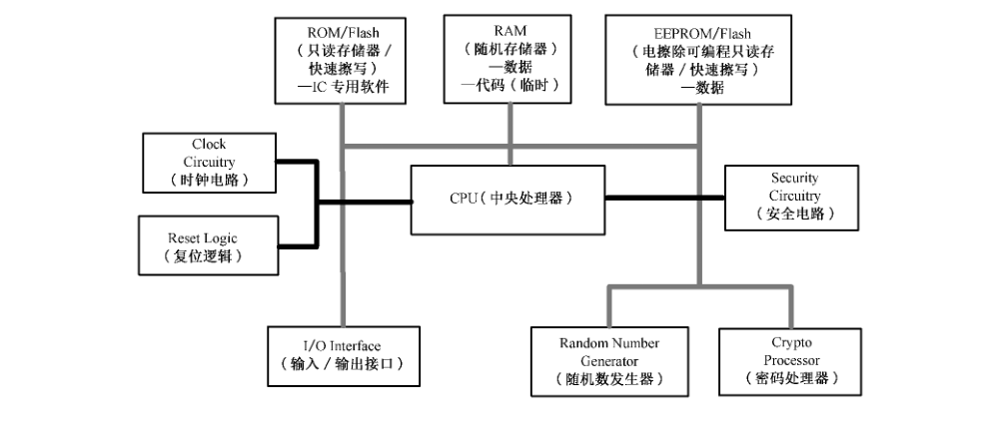

> 注：智能卡芯片可独立成为受测件。

#### 4.1.4 智能卡嵌入式软件

嵌入式软件指存储在智能卡卡内并可运行的软件，主要功能是控制智能卡和外界的信息交换，管理智能卡的存储器并完成各种命令的处理。嵌入式软件可存储在非易失性非编程存储器（只读存储器）内，也可存储于非易失性可编程存储器（例如 EEPROM 或闪存）内。嵌入式软件一般由基础软件（操作系统、通用例程和解释器）和应用软件组成，并且不是由芯片商开发的。嵌入式软件的基本模型可见图1和图2中“嵌入式软件”部分。

> 注：智能卡嵌入式软件也可独立成为受测件。

### 4.2 检测主体和客体

#### 4.2.1 主体

检测主体为检测者和评估者。

#### 4.2.2 客体

检测客体即受测件，它们一般为智能卡芯片、智能卡嵌入软件或智能卡产品。

### 4.3 检测目的

检测目的指为智能卡芯片、嵌入式软件和智能卡产品的设计、生产、应用提供安全性评估的客观依据。

### 4.4 检测依据

检测依据指依据有关标准及其相关技术文档和委托方确认文件实施检测。

### 4.5 检测内容

#### 4.5.1 检测内容定义

检测内容是关于检测主体对检测客体所进行的实验性技术活动的描述。

#### 4.5.2 检测框架

检测框架是关于检测内容的概念和分类的结构性定义。参见附录C。

### 4.6 检测要素

#### 4.6.1 检测要素分布

检测要素分布在检测的输入、保障条件、输出等方面，见图4。

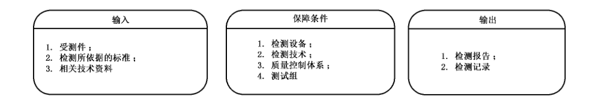

#### 4.6.2 检测要素：输入

检测要素中输入是按照检测框架和检测内容进行设置。

输入项如下：

a） 受测件：

1） 智能卡芯片。

2）智能卡嵌入软件。

3） 复合性智能卡产品。

b） 检测所依据的标准：官方发布的各类标准或检测机构自己制定的检测技术文件。参见附录 D。

c） 相关技术资料：有关受测件的各类技术资料。

#### 4.6.3 检测要素：保障条件

检测要素中的保障条件为检测正常进行的前提条件。

保障条件如下：

a） 检测设备：检测机构完成检测活动所需配备的软、硬件设备。可参考 CCDB-2009-03-003 及Joint Interpretation Library-Application of Attack Potential to Smatcard-V.2.7. February 2009。

b） 检测技术：检测者为完成检测活动所需掌握的知识和技能。可参考 CCDB-2009-03-003 及Joint Interpretation Library-Application of Attack Potential to Smatcard-V.2.7. February 2009。

c） 质量控制体系：检测机构为保证检测质量而制定的管理体系。

d） 检测组：检测机构为完成检测任务而建立的组织。

#### 4.6.4 检测要素：输出

检测要素的输出是针对检测方案按照检测计划实施后的实际检测结果。

输出项如下：

a） 检测报告：检测者在检测活动完成后根据检测结果撰写的提交给委托方或认证机构的报告性文档。详见第 7 章。

b） 检测记录：检测者在检测活动中记录检测信息的文档。

### 4.7 检测过程

一个智能卡芯片和嵌入式软件或复合产品智能卡的安全检测评估过程可分为 4 个阶段，见图 5：

阶段一：准备与启动。参见附录 E、附录 F。

阶段二：安全功能查证。

阶段三：渗透性检测。

阶段四：检测报告。

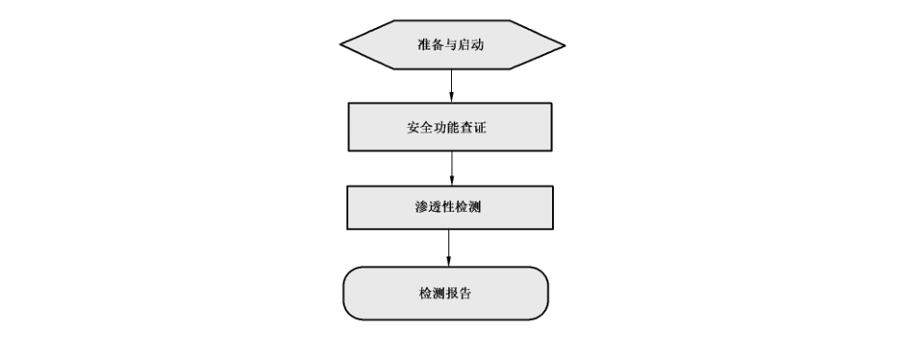

## 5 安全功能查证

### 5.1 概述

#### 5.1.1 阶段主要任务

安全功能查证的目的是对受测件做出基本的安全功能和生命周期各环节安全保障措施的检查和验证。方法是通过阅读、研究受测件的技术文档和管理文档，寻找、分析、检查、确认设计者已经依据某级别安全功能和安全保障要求设计了相应的安全功能及其安全保障措施，以及这些安全功能和安全保障措施的合理性、合规性、必要性和充分性；并通过检测手段确定这些安全功能设计在受测件上工程实现的有效性和活跃性；在安全保障措施的检查中，检测者还应通过现场检查和实验室检测手段证明受测件样品与同型号量产产品在品质上的一致性，见图6。

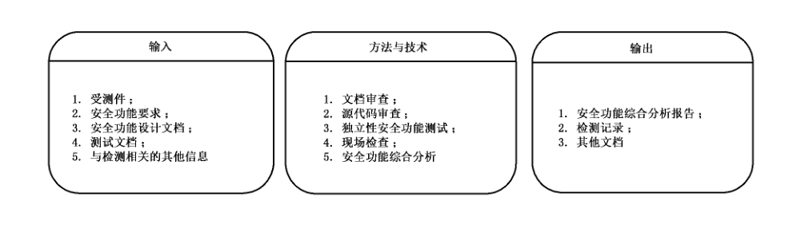

#### 5.1.2 安全功能查证：输入

安全功能查证中输入按照检测方检测方案进行设计，达到最合理与优化。

输入项如下：

a） 受测件：任务启动阶段委托方向检测方正式交付的受测样本；

b） 安全功能要求：受测件设计阶段所参考、依据的安全功能要求文件，如PP 或其他形式的规范、标准；

c） 安全功能设计文档：受测件开发者制作的ST 文件和其他有关设计文件，详见 5.3.5.1b）；

d） 检测文档：开发者的安全功能检测文档，详见 5.3.5.1c）。

#### 5.1.3 安全功能查证：方法与技术

安全功能查证中方法与技术是针对检测方案进行鉴别选择。

方法与技术如下：

a） 文档审查（见5.3.2）；

b） 源代码审查（见 5.3.4）；

c） 独立性安全功能检测：通过抽取选择甚至完全重复设计者的安全功能检测以证明设计者所设计的安全功能的实现情况（见5.3.5）；

d） 现场检查（见 5.3.3）；

e） 安全功能综合分析：检测者从通过上述几种手段正面理解受测件安全功能的设计者的意图和思路，确认受测件安全功能的实现情况，并与设计者依据的安全功能要求文件进行比对和分析，得出这些安全功能要求（包括安全保障要求）是否得到满足的结论；

#### 5.1.4 安全功能查证：输出

安全功能查证中输出按照检测方的检测方案与计划进行查证，输出结果。

输出项如下：

a） 安全功能综合分析报告：检测者的过程性中间报告，是检测者审查、分析开发方依据的安全功能要求、开发方的安全功能设计文档和实施源代码审查、现场检查、独立性安全功能检测等检测工作后得出的分析结论。结论应明确指出受测件的安全功能与开发方所声称依据的安全功能要求的一致性程度。

b） 检测记录：检测者在本阶段检测活动中产生的所有记录，应妥善保存并归档。

c） 其他文档：凡有可能成为下阶段输入的文档，均应保存；其他可销毁。

### 5.2 实施说明

虽然某些有关智能卡检测的安全标准中不要求检测方进行安全性功能检测，或者由于得不到委托方的有效资源支持，致使该级别检测所需要进行的文档审查、现场检查、源代码检查、甚至独立性安全功能检测都不能进行，安全功能查证工作仍可实施。例如检测者可根据所掌握的各类信息和相似受测件的检测经验进行脆弱性推论分析，也可以通过搭建模拟运行环境使受测件运行并采集其运行参数和数据来分析其安全功能的存在性和有效性。

### 5.3 实施内容

#### 5.3.1 主要内容

安全功能查证的主要内容，见图 7。

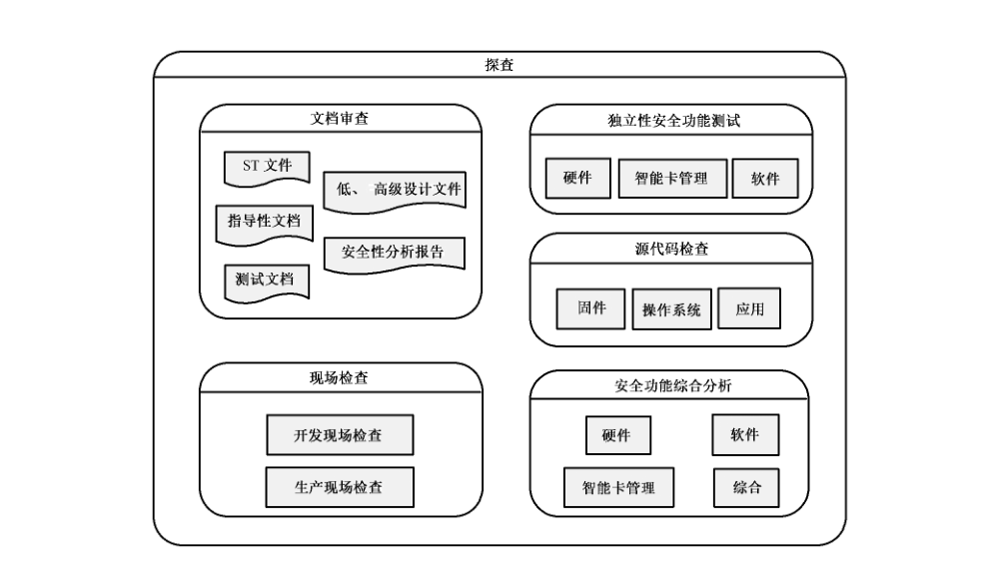

#### 5.3.2 文档审查

为保证一定级别检测的质量和效率，检测者需或宜进行白盒检测，因此检测方应该要求委托方提供有关受测件足够的技术文档以支持安全性检测评估。这些文档包括：设计（开发）者的ST 文档、低层和高层设计文件、指导性文档、源代码、安全功能强度分析报告和安全功能检测文档。

检测方所需要的技术文档的重要性、详细度和机密性与所进行的安全评估等级和遵守的规范相关。

检测方不应向委托方索取超出所进行的安全评估等级所必需或所依照的标准之外的技术资料。

文档审查的主要输出是文档评审意见，标明文档是否合格；当意见为不合格时，应通知委托方修改或补交，见图8。

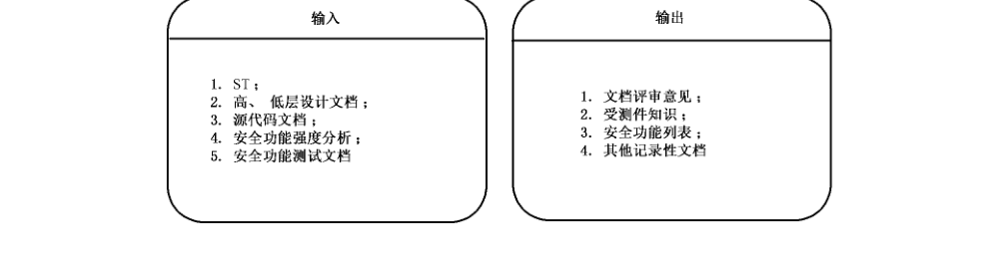

#### 5.3.3 现场检查

现场指受测件的设计、开发、生产、初始化和个人化的工作现场。现场检查是检测者确认受测件依据的安全要求文档（如 PP）所规定的在生命周期各阶段应有的安全保障要求是否被落实的重要手段。

当进行中的检测评估活动所依据的规范、标准对现场检查有要求并且所计划的评估项目必须在这些现场得到证据时，检测者应要求委托者安排进行现场检查。检查中可对芯片和软件的设计环境、生产环境、中测环境、成测环境、算法灌装环境、重要参数预装环境、密钥管理环境，库房安全以及产品交付过程安全性进行全面考察，确认产品所处的各环节环境中对受测件安全资产及安全性不存在威胁和隐患。

现场检查的具体内容和方法请参考 CCMB-2007-09-004。

#### 5.3.4 源代码检查

##### 5.3.4.1 概述

源代码包括智能卡嵌入式软件源代码、专用软件（芯片固件）源代码。

当所进行的检测评估项目所依据的标准和级别要求检测受测件的源代码，或检测方认为阅读受测件源代码能显著提高评估工作的质量和效率时，检测方可向委托方要求提供部分或全部源代码。

源代码检查的目的是为了让检测人员理解设计者的意图和思路以及各项安全功能的具体实现方法，是寻找受测件脆弱点的最有效方法之一，是目前彻底消除软件“后门”隐患的唯一途径，同时可为制定和实施渗透性检测计划提供思路和依据。

源代码检查的输入、输出，见图 9。

##### 5.3.4.2 源代码格式与检测工具

委托方应使用文本格式将源代码提供给检测方。且源代码应有详细的注释，以便评估者能够理解代码的各部分所代表的意义以及它们如何运行，此阶段中，若是需要用源代码，则受检方则要提供源代码编译器。

##### 5.3.4.3 源代码在产品中使用的证据

检测方需要有证据表明委托者提供的源代码确实是在智能卡的送检版本中使用的。这个要求适用于在智能卡中执行和载入的所有类型的代码。

可通过以下两种方法提供证据：

——委托方提供一个声明，说明送检版本的代码是源代码一对一的编译结果，并给出编译工具的名称；

——委托方同时将送检版本的可执行代码提供给检测方，检测方自己将该可执行代码与由所交付的源代码编译后产生的可执行代码进行一致性比较。

#### 5.3.5 独立性安全功能检测

独立性安全功能检测的要素，见图10。

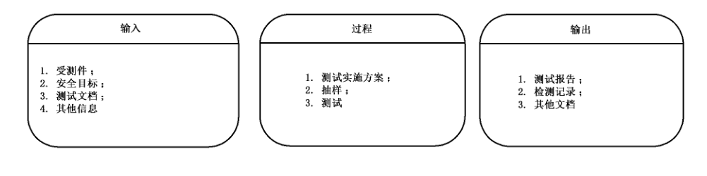

##### 5.3.5.1 独立性安全功能检测：输入

检测方应按照独立性安全功能检测准备检测的输入项。

输入项如下：

a） 受测件：任务启动阶段委托方向检测方正式交付的受测样本。

b） 安全目标：独立性安全功能检测的性质是功能符合性检测，所依据的安全功能设计文档应为开发者的安全目标（ST）文档。在开发者不能提供ST 文档的情况下，可参见附录A，或开发者依据 PP文件。

c） 检测文档：开发者对受测件进行安全功能检测时制作的文档，包括：检测计划、检测程序描述、预期的检测结果和实际的检测结果等。

d） 其他信息：当委托方不能提供检测文档时，检测方可要求提供其他任何有助于进行安全功能检测的材料或信息。当检测实验室的检测环境缺乏某些设备或工具时，可以请求开发方协助提供，但在使用先要经过仔细鉴定。

##### 5.3.5.2 独立性安全功能检测：过程

检测方应按照独立性安全功能检测准备检测的过程要素项。

检测过程要素如下：

a） 检测实施方案：检测者在审查、研究开发者的ST 和安全功能检测文档的基础上制定出独立性安全功能检测实施方案。

制定增量检测情况下的独立性安全功能检测方案时，需考虑的关键因素是本次提交检测的受测件是否相比过去检测时增加了新的安全功能或保护措施，抑或对原有的安全功能或保护措施进行了改动，若是，则可侧重考虑将新增加的安全功能列入检测方案；若无，则可根据以前的独立性安全功能检测报告内容选择不再进行独立性安全功能检测。

选择不做独立性安全功能检测的根据应该是检测者能确定：若重复以往的检测用例，只能获得完全一样的结果。为此，检测者可适当做些实验进行证明。

当受测件是复合性智能卡，即具有两个或两个以上开发者（芯片、操作系统和应用）时，检测者应注意分别选取所有各层面的安全功能子集和抽取每个开发者的安全功能检测文档。在检测方案中应将各层面的检测用例明确分开，按照芯片层、操作系统层再到应用层的顺序进行设计和实施。

检测者还可以对所选取的安全功能子集或检测用例子集加以补充，增加自己的检测用例。补充和增加的前提是检测者对受测件的设计有深入理解，并对其安全功能有充分分析的基础上，或者是出于某种特定的应用要求。

b） 抽样：检测者应检测受测件的一个安全功能子集；并且评估者应抽样执行开发者的安全功能检测文档里的检测用例，以确认受测件的安全功能按照所设计的安全规范运行并且验证开发者的检测结果。

检测者也可以完全重复开发者的安全功能检测，亦即将开发者的安全功能检测文档的所有检测用例列入自己的检测方案。

c） 检测实施：独立性安全功能检测由检测方独立实施，除了基于“改进设计”需求而进行的检测外，委托方或开发方的人员不得参与可能对检测结论产生影响的任何活动。

实施检测时应按检测方案对复合性受测件逐层，逐项进行检测，并分别记录。

检测方应在自己的实验室内完成所有的独立性安全功能检测项目。

##### 5.3.5.3 独立性安全功能检测：输出

检测方应按照检测方案和检测记录准备独立性安全功能检测输出检测报告。

输出项如下：

a） 报告：检测方应根据检测方案和检测记录独立完成独立性安全功能检测报告。

b） 检测记录：检测机构应通过自己的质量保障体系和技术手段保证检测记录的严谨、详细和真实。

c） 安全功能强度分析：开发者应根据安全目标（ST）中要求的安全机制对受测件进行安全功能强度分析，证明其达到了 PP和ST 中申明的最低安全功能强度要求。

检测者应在审查、分析开发方安全功能强度分析文档和独立性安全功能检测的基础上确认或质疑开发方的安全功能强度分析结论，得出自己的分析结论。

具体分析方法和规则请参考 CCMB-2007-09-004。

## 6 渗透性检测

### 6.1 概述

#### 6.1.1 阶段目标和工作内容

检测者进行渗透性检测的目的是通过实施模拟攻击者行为的试验活动，检验受测件的安全功能强度亦即对攻击行为的抵抗力强度。

此阶段的主要工作内容是：检测者在对受测件进行安全功能综合分析和脆弱性分析的基础上，充分考虑到当下已知的针对智能卡的攻击方法（参见但不限于附录B的内容）和检测实验室的资源情况，独立制定出符合评估等级标准要求的渗透性检测计划，并实行之。

这个阶段的工作质量对智能卡安全检测评估项目的结果至关重要，检测方应向委托方证明自身合格的能力和合法的资质。

渗透性检测的要素，见图 11。

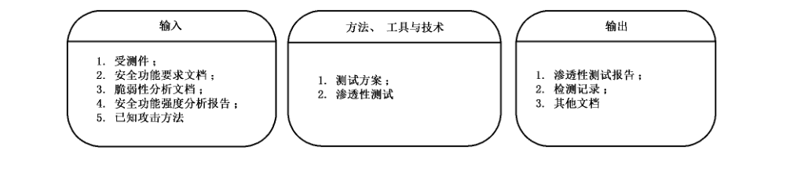

#### 6.1.2 渗透性检测：输入

渗透性检测的输入是按照检测方案和检测计划对实际的检测内容的设置。

输入项如下：

a） 受测件：智能卡芯片、软件或智能卡产品。

b） 安全功能要求文档：受测件安全功能设计时所依据的，标明了明确的安全功能强度要求（或脆弱性要求）的文档，如PP文件。

c） 脆弱性分析文档：包括开发者提供的脆弱性分析文档和检测者独立做出的脆弱性分析文档（探查阶段输出）。

d） 安全功能强度分析报告：检测者在强度探查阶段的输出。

e） 已知攻击方法：已知攻击方法参见附录 B，并关注当下有关智能卡攻击手段和技术的最新信息，可参考 Joint Interpretation Library-Application of Attack Potential to Smatcard-V.2.7. February 2009。

#### 6.1.3 渗透性检测：方法、工具与技术

渗透性检测的方法、工具和技术是依据检测方案选取的合理有效的对应项。

方法、工具与技术如下：

a） 检测方案：基于所有输入项和自身资源、能力而制定的具体检测计划。

b） 渗透性检测，见6.4。

#### 6.1.4 渗透性检测：输出

渗透性检测的输出项是依据检测方案按照检测步骤进行实际检测的输出。

输出项如下：

a） 渗透性检测报告：检测者独立完成的渗透性检测的结果报告。可作为下阶段的输入。

b） 检测记录：检测者独立完成的渗透性检测的过程记录。可作为下阶段的输入。

c） 其他文档：在渗透性检测过程中产生的其他正式或非正式文件，如检测者独立做出的脆弱性分析报告。

### 6.2 渗透性检测准备

#### 6.2.1 抵抗力要求

委托方和评估方应明确对受测件的抵抗力要求。参见附录G。

在选择某个安全级别，如 EAL4+，评估标准时，委托方和评估方应明白国标与国际组织相应标准之间的对抵抗力要求的区别（可参见附录 G）。选择其他标准的安全评估、检测项目时，若该标准有明确的抵抗力指标，应按其规定设计渗透性检测方案；若不存在明确的抵抗力指标，应参见附录 G。

#### 6.2.2 脆弱性分析

开发者应做受测件的脆弱性分析，并将所标识的脆弱性分布文档化，如将脆弱点列表。

评估者应在开发者脆弱性分析的基础上进行渗透性检测，以证明开发者的结论正确与否。

评估者还应独立地对受测件进行脆弱性分析，旨在发现受测件是否存在尚未被开发者标志的可能被攻击者利用的脆弱性。

对复合性受测件的脆弱性分析宜从芯片到系统软件再到应用逐层顺序进行，并对结果进行综合考虑和整体分析。

脆弱性分析的具体实施方法请参考 CCMB-2007-09-004。

#### 6.2.3 追加受测件

受测件在启动阶段应已被交付，参见附录F.4.3.3受测件交付。但在本阶段，特别是侵入式检测时，受测件可能会大量损坏，若考虑需要追加受测件，检测者可向委托者提出要求。

#### 6.2.4 检测资源

检测者应独立完成对检测资源的调配和部署。

### 6.3 渗透性检测实施方案

#### 6.3.1 制定方案的基础

渗透性检测方案的基础是所依据标准的抵抗力要求和检测者独立对受测件所做的脆弱性分析文档。

#### 6.3.2 制定方案的原则

检测方案应由检测小组独立制定，委托方不宜参与。

检测者主要根据受测件本身的特点和所做的评估等级对其抵抗力的要求（参见附录 F）而制定检测方案。但不宜为仅针对同一等级抵抗力而不考虑受测件的差异而制定一套一成不变的检测方案。

同时检测者必须考虑当下所有已知的攻击智能卡的手段和技术，可参见但不限于附录B中的攻击方法列表。

方案制定者应该以攻击者的角度考虑问题，攻击的目标一般直指受测件的安全资产，也可以是某个或某些安全功能。

检测者又不完全等同于攻击者，攻击目标未达成并不等于检测失败，反而可能是证实了受测件应具有的抵抗力（参见附录 F），也即达到了检测的目的。因此制定检测方案时要注意某项攻击应在什么时间、什么状态下结束。

方案应保持一定的灵活性，因为在攻击的过程中，可能会遭遇到未预料的结果；也可能某项攻击只能获得一个中间结果，但这个中间结果可成为另一种攻击的起点或阶梯，这些都需要随时修改或补充原方案。方案的执行与修改将交替进行。

方案制定者还应考虑检测者所掌握的资源情况和估算检测成本。

#### 6.3.3 增量检测情况

检测者要参考该受测件以往的检测记录和报告，制定方案时应着重挑选以往攻击成功的项目再次检测，或采用自前次检测以来新发展的攻击技术进行检测。

### 6.4 渗透性检测实施

#### 6.4.1 独立实施

渗透性检测由检测方独立实施，除了基于“改进设计”需求而进行的检测外，委托方或开发方的人员不得参与可能对检测结论产生影响的任何活动。

#### 6.4.2 实施过程

渗透性检测的实施过程是一个研究、探索的过程。检测者应在检测方案的框架下根据受测件当下的具体反应采取对应措施，修改攻击路径或方法。渗透性检测过程见图12。

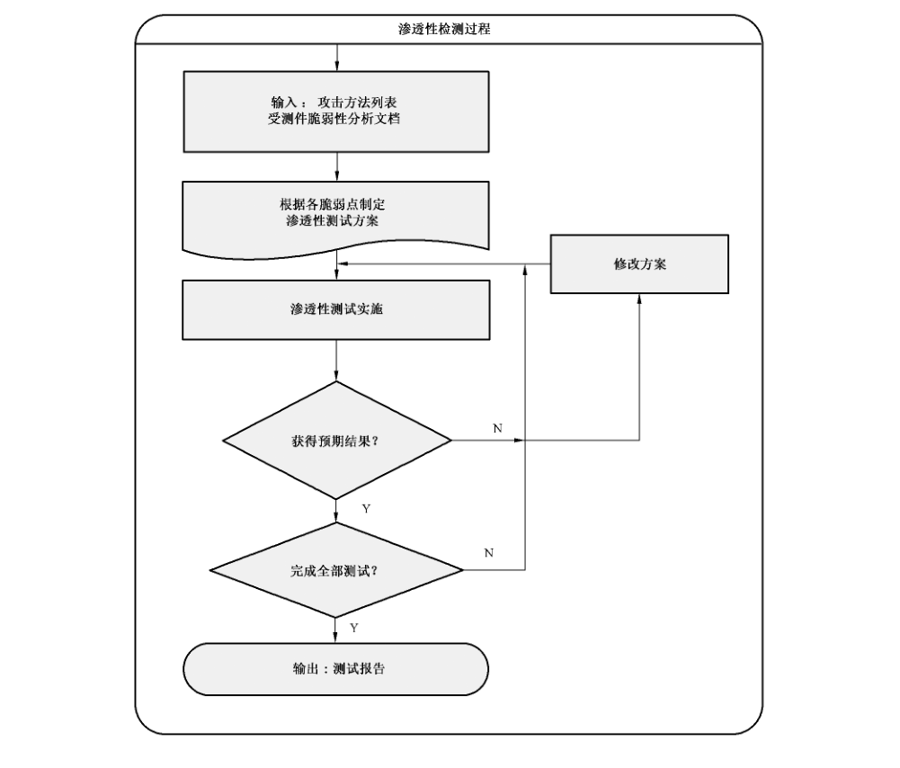

#### 6.4.3 检测记录

检测机构应通过自己的质量保障体系和技术手段保证检测记录严谨、详细、真实。

#### 6.4.4 检测地点

检测方宜在独立、可控实验室完成渗透性检测。

### 6.5 渗透性检测报告

检测方应根据检测方案和检测记录独立完成渗透性检测报告。

## 7 检测报告

### 7.1 概述

实验室在完成检测任务后应根据检测和评估的结果写出最终的格式化的检测报告，并提交委托方或认证机构。

### 7.2 报告主要内容

报告的格式和内容原则上由认证机构和检测机构共同制定，可参考 CCDB-2008-04-001。

### 7.3 关于攻击场景的描述尺度

#### 7.3.1 概述

参与智能卡安全性检测的各方均应清楚渗透性检测技术和过程的泄露会对其他方和社会带来的安全威胁，因此各方均有责任和义务保守检测活动的细节信息不被扩散。检测方在撰写检测报告时首先需要慎重考虑。

#### 7.3.2 检测报告中的尺度把握

检测方应根据报告接受者的身份决定检测报告中对渗透性检测场景的细节把握尺度。

#### 7.3.3 接受者为认证机构或实验室技术管理者

检测方可详细描述攻击步骤和技术，以证明检测活动的质量。

#### 7.3.4 接受者为受测件的开发者

检测方可酌情描述攻击步骤和技术，以利于开发者改进设计。

#### 7.3.5 接受者为受测件用户（如卡商）、应用系统业主、招标商、学术研究者、系统用户

检测方不宜详细描述攻击步骤和技术。

#### 7.3.6 多个接受者

若出现需要同时给委托方和认证机构出报告的情况时，检测方可出具两份（类）报告：一份（类）为检测报告，着重检测结果的描述，递交给委托方；另一份（类）为检测技术报告，着重检测过程的描述，递交认证机构和实验室技术档案部门。

## 附录 A（资料性附录）智能卡安全功能集

### A.1 智能卡硬件安全功能

#### A.1.1 芯片序列号保护功能

芯片序列号是一个芯片区别于其他芯片的标识，当其被用于安全目的时，有必要对其提出安全要求，以防止芯片序列号被非法使用以及篡改。

智能卡安全功能应该控制对芯片序列号的访问，并具有序列号硬件保护电路，以抵抗或阻止篡改芯片序列号的攻击。

#### A.1.2 芯片序列号唯一性保证

制造者应具有合理、科学的方法产生合乎标准的芯片序列号序列，并有管理机制保证在芯片出厂时，每一个序列号对应一颗芯片，且每颗芯片具有唯一的序列号。芯片应该具备证明其序列号具备唯一性的安全功能。

#### A.1.3 内部总线安全功能

内部总线是 IC 卡芯片内部信息的重要传输通路，物理连接芯片内部各个重要模块。保护总线安全，对于保护秘密信息，维护 IC 卡安全性具有重要意义。

芯片内部总线应具有防物理攻击和防探测安全功能，要求总线具备抵抗替换、篡改以及反向工程等侵入式攻击的能力，以及具备抵抗窃听、探测等非侵入式攻击的能力。

#### A.1.4 存储器安全功能

芯片内部存储器包括 RAM、ROM、EEPROM、FLASH 等，一般的 RAM 内部数据掉电丢失，ROM、EEPROM 或 FLASH 掉电不丢失，用于存储一些系统数据和用户数据。

芯片硬件应具有存储器内部数据保护和物理保护安全功能，要求存储器能够防止数据被非法读出，并且具有防篡改和探测的能力。

#### A.1.5 攻击探测

芯片硬件应有传感器或相应装置，能够探测到外部的攻击，包括各种主动的侵入和半侵入攻击，要求对存储器和总线的篡改、替换、探测等攻击能够检测并记录，并且要求智能卡安全功能在检测到攻击时，做出相应的行动。

#### A.1.6 I/O 端口访问控制

芯片硬件应有安全功能保证任何通过 I/O 端口访问芯片的资源（存储器、算法硬件、随机数发生器等）和权限（读、写、改、用）的行为是受控的。

#### A.1.7 I/O 端口安全功能

芯片硬件应有安全功能保护芯片的资源（存储器、算法硬件、随机数发生器等等）不被任何人或进程通过 I/O 端口非法访问，在危险无法避免的环境中，阻止或抵抗通过非法手段从 I/O 接口获取敏感信息。

#### A.1.8 算法硬件一致性保证

芯片应保证密码算法和物理硬件一致性，要求密码算法硬件完整地实现密码算法，并完成算法的所有功能。

#### A.1.9 密码算法硬件物理保护

芯片应具有保证算法模块正确运行并保护该模块不被物理探测和改动的功能。

### A.2 智能卡软件安全功能

#### A.2.1 系统软件安全性

##### A.2.1.1 操作系统完整性保证

操作系统本身应具有保证系统所用运行代码在卡片上正确装载、存储和执行，不被遗漏、篡改或跨越的功能。

##### A.2.1.2 操作指令防篡改功能

操作指令本身带有校验功能部分，防止指令被篡改。比如指令带有数据长度信息、MAC 校验、奇偶校验等功能部分。

操作系统应能够辨认被篡改的指令，拒绝执行并做出适当回应。

##### A.2.1.3 用户身份鉴别功能

操作系统应具有对用户的认证功能，以识别授权用户和非授权用户。认证的结果可以以状态机或其他安全寄存器的状态变化进行标记，以限制和控制该用户的访问权限。

##### A.2.1.4 操作系统指令管理

智能卡操作系统应该具有指令权限管理功能，要求对指令进行权限划分，用户只能使用授权范围内的指令。当智能卡安全功能检测到未授权的指令使用时，采取相应的行动。

##### A.2.1.5 访问控制安全功能

操作系统应支持多级别的对安全资产的访问权限的授予和通过认证而获取的安全机制。在实际应用中，卡中一定存在重要性不同或安全等级不同的信息类别，要求用户也具有不同级别的访问权限。操作系统要具有将各安全级别的信息设置不同级别的访问权限，对不同级别的授权用户进行该级别密钥或 PIN 码认证而给予该级别权限，拒绝未通过认证者访问的安全功能。

##### A.2.1.6 信息流控制安全功能

智能卡安全功能应该监控智能卡内所有数据以及智能卡与外界之间的数据的流向，实现对信息流的完全控制。智能卡安全策略中应该包括信息流控制策略部分，并确定其控制范围。智能卡安全功能根据信息流控制策略来监控信息的流向，通常不允许改变信息安全属性的操作。信息流控制策略通常包含两类要求：一是针对通用的信息流功能问题，二是针对非法信息流的控制问题。

#### A.2.2 应用软件安全功能检测

##### A.2.2.1 应用软件可信度保证

有软件措施保证应用软件是可信的。应用软件能够完善的具备既定的功能及相应的安全措施，而且不支持任何非既定功能。

对于开放性操作系统平台，对所有应用程序应有一套严谨完备的审查、授权、认证、加载、安装、验证、运行的安全机制，防止任何非授权应用的加载和运行。

##### A.2.2.2 应用软件完整性保证

操作系统和应用软件都应该有安全功能保证应用软件是完整的，不允许有设计功能缺失，且不能被篡改。

##### A.2.2.3 应用软件安全性保证

智能卡应用软件应当具有处理各种错误的能力，并且具有预防和故障后恢复的措施。

### A.3 智能卡数据安全功能

#### A.3.1 用户数据保护

智能卡用户数据是智能卡进行各种操作、完成各种功能的必要信息，用户数据的安全性是智能卡安全功能保护的首要任务。用户数据保护安全功能对用户数据的有效性、完整性，以及输入输出规则做出了详细规定，以确保用户数据的安全性。

#### A.3.2 安全功能数据保护

安全功能数据是智能卡安全功能在进行安全功能策略决策时使用的信息。安全功能数据一般包括安全属性、鉴别数据以及访问控制表等。安全功能数据的可用性对于安全功能的正确执行必不可少，而安全功能数据的保密性对于保证智能卡安全性至关重要。安全功能数据保护安全功能对安全功能数据的真实性、完整性和保密性提出了要求，并且要求安全功能数据具有防篡改功能。

### A.4 智能卡状态机安全功能

#### A.4.1 智能卡状态列表管理

智能卡状态机的状态列表的完整性和确定性对于安全正确地使用智能卡十分重要。智能卡状态列表管理安全功能对状态列表管理作了以下要求：包括状态完整性保证、状态确定性保证，以及状态列表的添加和删除操作的管理。

#### A.4.2 智能卡状态转换管理

状态机中状态之间的相互转换取决于当前状态与输入指令的共同作用，为了保证状态转换的正确性，必须对当前状态标识和输入指令进行验证，满足状态转换条件的就让智能卡进入下一个状态，否则，按照预先设置好的规则处理。智能卡状态转换管理安全功能对状态转换管理做出了以下要求：状态标识管理、状态标识和指令鉴别功能和状态转换操作。保证智能卡状态的正确转换是安全使用智能卡的基础。

### A.5 智能卡管理安全功能

#### A.5.1 智能卡完整性保证

智能卡是由硬件、软件、固件组成的整体，为了保证智能卡的安全使用，必须保证所有的部分都是完整的，包括存储数据以及安全功能的完整性，这就要求智能卡安全功能能够自动检测智能卡的完整性。智能卡安全功能还应该保证能够对智能卡进行反转操作，撤销上一次或一系列操作，并使智能卡返回到某个以前的已知状态。对于某些突发情况，可能会扰乱智能卡的当前状态，并导致运行中断，要求智能卡安全功能具有在错误发生后能在不减弱保护的情况下恢复的能力。智能卡完整性保证安全功能包括：智能卡自检安全功能、智能卡反转操作安全功能和智能卡恢复安全功能。

#### A.5.2 智能卡安全功能管理

智能卡的安全性取决于安全策略的覆盖性，只有确保安全策略本身没有安全漏洞，并且覆盖到智能卡的所有部分和所有操作，才能确保智能卡的安全性。对于具体实施安全策略的智能卡安全功能来说，要求其真实准确地反映安全策略，并且没有任何遗漏，安全功能的完整性对于智能卡安全尤为重要。智能卡安全功能应该允许授权用户控制安全功能中功能的管理，并且要求安全功能能够抵抗未授权的物理访问和物理篡改。智能卡安全功能管理安全功能包括安全策略覆盖性保证、安全功能完整性保证、安全功能行为管理和安全属性管理。

#### A.5.3 智能卡密钥管理

智能卡安全功能可以利用密码功能来满足一些高级安全目的，这些功能包括（但不限于）：身份认证、标识与鉴别、数据加密等。密码运算的设备可以用硬件、软件或固件来实现，在智能卡的硬件与软件安全功能部分对密码运算设备进行了安全功能定义。为了保证密码运算的功能正确和安全性，密钥的管理至关重要。密钥在其整个生存期内都必须进行管理，智能卡密钥管理安全功能对密钥的产生、分配、访问和销毁做出了规定。

#### A.5.4 智能卡用户管理

通过对智能卡用户赋予不同的角色，用户就能够对智能卡进行各种操作，角色是预先定义的一组规则，用户根据其授权角色的权限大小被附加了不同的安全级别。智能卡安全功能应该能够对用户安全属性进行维护，从而保证智能卡的安全性不会因为用户进行不符合自己身份的操作而降低。智能卡用户管理是保证智能卡得到正确应用的基础，智能卡用户管理对用户安全属性以及用户与角色之间的关联做出了相应的规定，确保智能卡安全功能能够在用户对智能卡进行操作前对其进行标识和鉴别。

#### A.5.5 智能卡安全审查

包括识别、记录、存储和分析那些与安全相关活动（即由智能卡安全策略控制的活动）有关的信息。

检查审查记录结果可以用来判断发生了哪些与智能卡安全相关的活动以及哪个用户要对这些活动负责。智能卡安全审查安全功能包括异常安全警告、安全审查数据产生、安全审查分析和安全审查记录管理。

## 附录 B（资料性附录）智能卡攻击方法

### B.1 芯片层

#### B.1.1 侵入攻击类

##### B.1.1.1 概述

侵入式攻击也称物理攻击或物理分析，方法是用化学或物理方法去除芯片的表层封装，然后用精密仪器对芯片内部的功能单元和电路进行探测或改动，其目的如下：

a） 确定芯片的内部结构及芯片各部件内部运行的详细信息和各部件间的联系；

b） 在未经授权情况下获取敏感信息；

c） 改变芯片行为。

根据这三个目标及攻击手段，侵入式攻击类又可划分为逆向工程（观测）、物理探测和物理改动三个子类。

##### B.1.1.2 物理逆向工程

物理逆向工程的目的是确定芯片的内部结构及芯片各部件内部运行的详细信息和各部件间的联系。逆向工程将会对芯片造成破坏，而且一般不能直接得到如密钥一类的敏感信息，其最重要的功能是为实施进一步的物理攻击进行准备。

##### B.1.1.3 物理探测

物理探测的目的是（在未经授权情况下）获取保存在芯片上的敏感信息，常与物理改动的方法一并使用。

##### B.1.1.4 物理改动

物理改动的目的是通过改变芯片内部的线路或功能单元，让电路出现新的行为。进一步的目的可以是获取敏感信息，因此常与物理探测同时进行。物理探测和物理改动攻击的实现需要芯片在封装打开后仍保持运行，因此需要更复杂的仪器和掌握与对象相关的更为精确的知识和技能。

#### B.1.2 物理探测和物理改动的攻击项举例

使用物理方法可进行如下攻击项目：

— 总线探针检测；

— 传感器拆除探针检测；

— 读 ROM；

— 读 EEPROM；

— 读 FLASH；

— FIB 电路重构；

— 随机数发生器 RNG 攻击；

— 返回检测模式。

#### B.1.3 半侵入攻击类

##### B.1.3.1 概述

半侵入攻击时一般需要将芯片的封装打开一个窗口，并去除屏蔽层和钝化层直至暴露芯片表面的电路层，但一般不使用外部电子设备与芯片内部电路任何部分进行直接的物理接触。半侵入的目的一是为了攻击者能用肉眼或借助显微设备对芯片内部的表面进行直接观测，以获得芯片内部的一些基本信息；二是对运行中的芯片进行故障引入攻击，可参见 B.1.5.3；三是在半侵入条件下对芯片进行环境压力攻击，可参见 B.1.5.4。

##### B.1.3.2 半侵入攻击举例

典型的半侵入攻击方法是激光故障引入。

还可有其他光谱的强光照射、放射线照射等。

#### B.1.4 非侵入攻击类

##### B.1.4.1 非侵入攻击的一般特性

非侵入攻击在不打开芯片的封装，不对卡片和芯片产生任何物理损害的情况下，通过采集、测量智能卡运行时所消耗或产生的某些物理量，然后通过对采集样本进行相关的算法特性分析和数据分析获取敏感信息。

##### B.1.4.2 非侵入攻击的项目

非侵入式攻击的项目包括以下 8 项：

— 简单能量（能耗、功耗）分析：Simple Power Analysis（SPA）；

— 简单电磁分析：Simple Electro-Magnetic Analysis（SEMA）；

— 差分能量（能耗、功耗）分析：Differential Power Analysis（DPA）；

— 差分电磁分析：Differential Electro-Magnetic Analysis（DEMA）；

— 关联能量（能耗、功耗）分析：Correlation Power Analysis（CPA）；

— 分割能量（能耗、功耗）分析：Partitioning Power Analysis（PPA）；

— 交互信息分析：Mutual Information Analysis（MIA）；

— 时间（计时）分析：Timing Analysis（TA）。

其中，能量分析攻击方法中还包括了一些扩展的方法，如模板攻击、高阶能量分析等，可参考CCDB-2007-09-002 ETR template for composite evaluation of Smart Cards and similar devices V1.0。

#### B.1.5 故障引入和极限环境攻击

##### B.1.5.1 概述

故障引入和极限环境攻击一般在非侵入条件下实施，但也可在半侵入和侵入条件下实施的攻击类型，这两种攻击类型的原理和过程类似，但手段不一。

##### B.1.5.2 故障引入

对运行中的芯片进行故障引入，使进行加解密或执行其他指令的结果出错或进入到非正常状态，然后攻击者通过对应有的正确结果和获得的错误结果进行比较并结合密码算法进行专业分析（如 DFA 分析），或者利用芯片当前的非正常状态，可能达到破解密钥或获取其他敏感信息的目的。

##### B.1.5.3 故障引入攻击举例

智能卡芯片层的故障引入攻击可有以下项目：

— 激光错误引入；

— 电压端错误引入；

— 随机数发生器故障引入；

— 时钟端子错误引入。

##### B.1.5.4 极限环境攻击

令智能卡（芯片）运行于超出于正常工作所必需的环境条件下，尝试非法访问智能卡的各种安全资产；或令智能卡的加解密运算过程中产生可被利用的错误抑或进入到可被利用的状态。与各种故障引入方法比，极限环境攻击不是一种在时间或位置上需要精确定位的攻击。

##### B.1.5.5 极限环境攻击举例

可能的攻击项目有：

— 电磁干扰；

— 极限温度；

— 静电干扰；

— 强光干扰。

### B.2 软件层

对智能卡软件层面的攻击可能发生在 COS 层也可能发生在应用层，具体项目可有：

— 初始化代码攻击；

— 存储器操作代码攻击；

— 密码运算操作代码；

— 软件随机数发生器攻击；

— 重放攻击；

— 缓存溢出或堆栈溢出；

— 异常指令响应探测；

— 直接协议攻击；

— 绕过认证机制或访问控制机制；

— JAVA 卡恶意应用；

— 接力攻击；

— 中间人攻击；

— 利用检测模式。

## 附录 C（资料性附录）智能卡安全检测框架

### C.1 种

种规定了检测的基本方法，是智能卡安全检测框架的最高层次。智能卡安全检测分为两种：安全功能检测和渗透性检测。

— 安全功能检测：安全功能检测是检测者通过检测开发者提供的一个安全功能子集以确认受测件是符合安全功能规范的，抽样执行开发者的检测文档中的检测用例以验证开发者的检测结果的检测过程。

— 渗透性检测：渗透性检测是检测者通过模拟攻击者的行为和手段，对受测件进行攻击性试验，检验受测件的抵抗能力，证实受测件安全功能的有效性和完备性的检测过程。

### C.2 层

检测层包含了进行于受测件同一逻辑层面上的所有检测。智能卡安全检测层对应智能卡模型的三个逻辑层面，即：芯片层、嵌入软件层和应用层。

### C.3 类

类指检测层中具有相同物理检测界面的检测项。检测的类也可称为“式”，如智能卡芯片层的渗透性检测分三类：侵入式、半侵入式和非侵入式。

### C.4 项

检测项是所在层（类）中的一个独立的检测标题的检测用例集合，具有明确的检测目标和预期结果。

一个项可分属于不同的类。

### C.5 例

#### C.5.1 例定义

检测例亦称检测用例，是一个（最小的）完整而独立的检测过程。每个检测例具有独有的进程、步骤并产生结果，目标指向受测件一个（或一组）具体的安全资产。一例检测只能属于一个项和一个类。

#### C.5.2 检测例的模板

检测例一般是检测计划或方案中的对检测活动描述的最小单元，因此检测例的定义与创建是检测活动的基础。具体做法可参考以下模板：见表 C.1。

**表 C.1 检测用例模板**

| 名称 | 内容 |
| --- | --- |
| 用例 ID | ID 号定义：A1-A2-A3-A4-A5-A6-A7-A8-n ＝主题编号-种-层-类（选）-项-卡片类（选）-参数码（选）-算法码（选）-用例号 解释： A1＝主题编号，自定义； A2＝种：F 为安全功能检测；P 为渗透性检测； A3＝层：C 为芯片层；O 为 COS 层；A 为应用层； A4＝类：N＝非侵入；S＝半侵入；I＝侵入；（选项） A5＝项：检测项代号，自定义； A6＝卡片类：C＝接触卡；CL＝非接触卡；（选项） A7＝参数码：CK＝时钟；Vc＝电源；T＝温度；EM＝电磁；（选项） A8＝算法：3Des、DES、RSA、RSA-CRT、ECC 等标准算法缩写；（选项） n＝用例号：同一项内的用例编号；0～N，N＝检测项内检测例的数目减一 |
| 用例名称 | 检测项名称（项名应包含种、类、层等信息）＆用例号。用汉字表示 |
| 检测目标 | 检测的具体对象，要验证的东西 |
| 版本 |  |
| 参考 | 依据的标准或规范 |
| 资源需求 | 厂商应提供的受测件、资料、工具等 |
| 工时 | 预计人力、工时 |
| 设备 | 实施本用例的软硬件设备、平台、系统 |
| 前提条件 | 实施本用例前必须（或最好应）进行的其他用例 |
| 基本步骤 | 实施本用例的一般过程中的基本步骤 |
| 预期结果 | 每一基本步骤的具体目标，最终具体目标（指向的安全资产） |
| 后处理 | 完成本用例后的善后工作内容 |

### C.6 步骤

检测步骤是检测进程中一个基本状态转换，可视为检测活动的最小单位。一组有序的检测步骤集合构成一个完整的检测例。

### C.7 检测框架结构图例

图 C.1 是一个渗透性种芯片层的检测框架图图例，在此图例中并未画出所有的检测项。

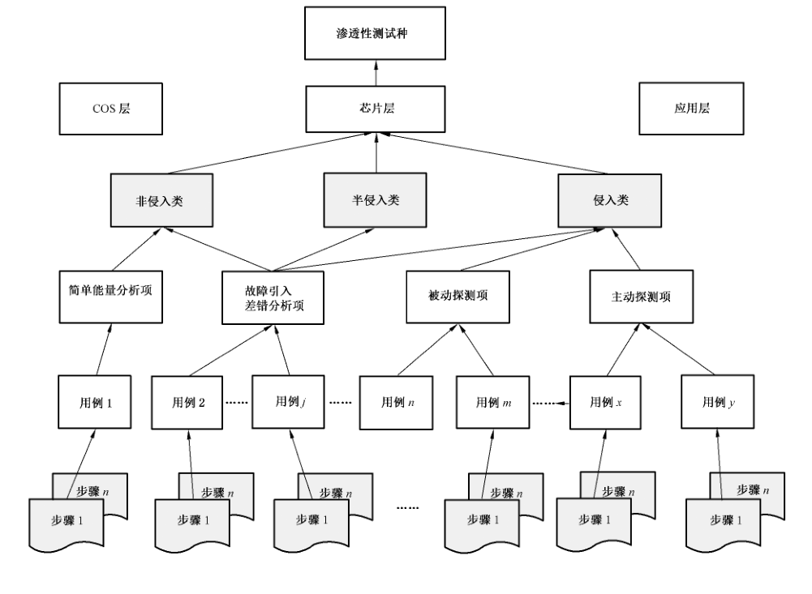

## 附录 D（资料性附录）主题检测大纲文件结构举例

主题检测大纲文件的结构举例示例如下。

### 1 检测对象

（本次检测对象为××型号的××产品）。

### 2 检测对象

（依据某个标准，如 GB/T 18336.2—2010）。

### 3 检测环境

（可参考下图）

| 项目编号 | 硬件环境 | 软件环境 |
| --- | --- | --- |
| 1 |  |  |
| 2 |  |  |
| … | … | … |

### 4 检测框架计划

检测框架计划参见附录C的C.7。

#### 4.1 总体框架图

总体框架图参见图 C.1。

#### 4.2 检测层

检测层参见附录C的C.2。

#### 4.3 检测类

##### 4.3.1 定义

定义参见附录C的C.3。

##### 4.3.2 分类描述

###### 4.3.2.1 侵入式攻击

侵入式攻击要求打开卡片封装，并使芯片表面直接暴露在外。侵入式攻击通常与电路发生直接物理接触，或对硬件电路进行物理修改等。进行侵入式攻击通常需要较先进精密程度较高的设备。

###### 4.3.2.2 半侵入式攻击

半侵入式攻击同样要求打开卡片封装，并使芯片表面直接暴露在外。攻击者可通过使用光操作或对芯片表面电磁场测量等方式实现攻击，通常不与硬件电路发生直接物理接触。半侵入式攻击对设备的要求低于侵入式攻击。

###### 4.3.2.3 非侵入式攻击

非侵入式攻击不要求打开卡片封装，并且卡片能够正常运行。这种攻击通过利用芯片运行过程中产生的旁路信息来实现。非侵入式攻击的主要方法为旁路攻击。

#### 4.4 检测项

##### 4.4.1 检测项定义

检测项定义参见附录C的C.4。

##### 4.4.2 检测项列表

##### 4.4.3 必要性与完备性论证

###### 4.4.3.1 检测依据

依据的标准名。

###### 4.4.3.2 检测项与安全要求的对应关系

#### 4.5 检测用例

##### 4.5.1 检测用例定义

检测用例定义参见附录C的C.5。

##### 4.5.2 实验室 检测用例集合

针对（检测所根据）标准的安全要求和目前已知并掌握的攻击方法，实验室制定了（实际数量）个检测用例。详见本附录第5章中“主题检测用例集合”。

##### 4.5.3 检测步骤

检测步骤参见附录C的C.6。

### 5 主题检测用例集合

#### 5.1 说明

以下用例集合是本实验室根据自身设备、技术、能力与经验针对（检测所根据）标准对芯片层的安全要求和当下已知的攻击方法而制定的。这个集合并非详尽、完备或必备，仅解决方案可选用例。而且，随着攻击技术的不断发展，用例集合也将不断更新。

#### 5.2 检测用例集合

##### 5.2.1 MCC01 芯片准备

MCC01 芯片准备可参考表 1。

示例：

**表 1 MCC01-1 半侵入-芯片准备-1**

| 名称 | 内容 |
| --- | --- |
| 用例 ID | MCC01-1 |
| 用例名称 | 半侵入-芯片准备-1 |
| 检测目标 | 使芯片模表面暴露，可供目测检查或实施各类半侵入攻击，证实是否存在保护措施 |
| 版本 | V1.0 |
| 参考 | Security Guidelines for Smart Card Integrated Circuits |
| 资源需求 | 样本：智能卡 2 张 知识：基本化学和微电子知识 |
| 工时 | 1 人，2 h～16 h |
| 设备 | 显微镜、通风橱、各类化学溶剂、芯片去封装设备、X 光探测仪等 |
| 前提条件 | 无 |
| 基本步骤 | 1）检查智能卡芯片在封装中的位置和大小； 2）综合运用物理方法和化学溶剂去除智能卡封装以及可能存在的保护层（如环氧树脂等）； 3）利用显微镜观察芯片表面，分析图像； 4）插入读卡器，进行读写操作 |
| 预期结果 | 1）确定受测件芯片大小和在封装中的位置； 2）受测件芯片正表面清晰完整暴露出来； 3）确定受测件芯片表面有无可见的保护措施； 4）确定受测件芯片是否仍可以正常运行 |
| 后处理 | 检测记录和评估分析报告（文件名） |

（其他略）

### 6 评分规则

> 注：（假设采取与应用相关的加权评分制）。

#### 6.1 加权评分制

#### 6.2 分值计算公式

#### 6.3 检测用例的评分规则

#### 6.4 类权重

#### 6.5 总分计算

### 7 检测报告

> 注：实验室在完成检测任务后应根据检测和评估的结果写出最终的格式化的检测报告，并提交委托方（见第7章）。

## 附录 E（资料性附录）定制化服务的检测方案模板

### E.1 概述

当某客户有意委托实验室按照自己提出的要求或标准进行安全性检测时，实验室应根据客户的需求和目标为检测活动制定具体的检测方案。并将方案提交予客户，经双方讨论和修改后定稿。实验室在检测活动启动后将严格按照检测方案执行。

### E.2 方案主要内容

#### E.2.1 检测对象信息

检测者应至少记录如下信息：

— 卡片型号；

— 芯片型号；

— COS 型号、版本号；

— 芯片设计商、制造商；

— 卡片制造商；

— 发卡商；

— 样本个数；

— 资料目录；

— 样本编号；

— 特殊要求。

#### E.2.2 检测方基本信息

实验室应在方案中给出本次检测的基本信息：

— 检测目标；

— 检测依据；

— 检测环境；

— 检测时间；

— 检测人员。

#### E.2.3 检测内容

实验室应在方案中给出明确的检测内容计划。实验室应根据委托方的目标和需求，以及对 TOE 的预审中得到的判断，从自己的检测用例集合中选取一个子集制定检测计划。在特殊情况下，可开发新的检测用例。

#### E.2.4 检测方案用例列表

实验室应将有关检测项和检测用例的详细信息制作成表格、文档作为方案附件附在检测方案后。

#### E.2.5 结果评估标准

实验室应将检测方案的明确的结果评估标准或规则列入方案。如果采用打分的方法，则应将量化打分的公式和权重计算公式等量化规则写入方案。

#### E.2.6 对委托方的要求

实验室应在方案中写明为支持检测取得高质量和高效率的结果，委托方应承担的责任和义务。委托方应提供给检测方符合检测要求的样本（质量和数量），以及有关这些样本的详实技术资料。

#### E.2.7 保密声明

检测样本的技术资料可能会涉及开发者或制造者的机密。检测方在方案中应进行保密内容声明。

检测方和委托方还可就此签订专门的保密协议。

#### E.2.8 通报和会商

实验室应根据委托方的要求和检测任务的性质确定在检测过程中与委托方的沟通方案，包括定期或不定期的通报和会商制度。

## 附录 F（资料性附录）实验室准备与启动

### F.1 概述

智能卡安全检测的准备与启动阶段可继续细分为实验室准备阶段、项目准备阶段和任务启动阶段，见图 F.1。

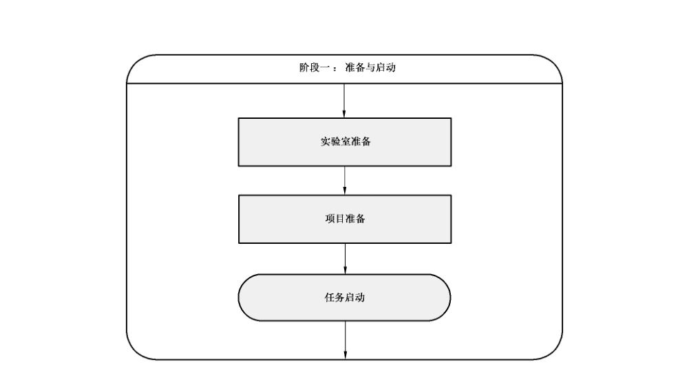

— 实验室准备是检测机构自身建设和发展的过程。实验室准备阶段对于检测机构来说既是一个过程又是一个常备状态。它从检测机构的建设之日开始，之后便成为机构的常态。

— 项目准备是检测机构在实验室准备的基础上，面向客户需求，对自身资源的整合、分配的过程。

在具体检测任务启动之前，安全检测实验室应时刻做着检测项目的准备工作。

— 任务启动是一个具体的检测项目的开始，其的标志是委托方向检测方正式表达了向其委托检测某具体受测件的意愿。

### F.2 实验室准备

#### F.2.1 实验室准备内容

实验室准备的目的是建立适用的检测环境和质量控制体系。见图 F.2。

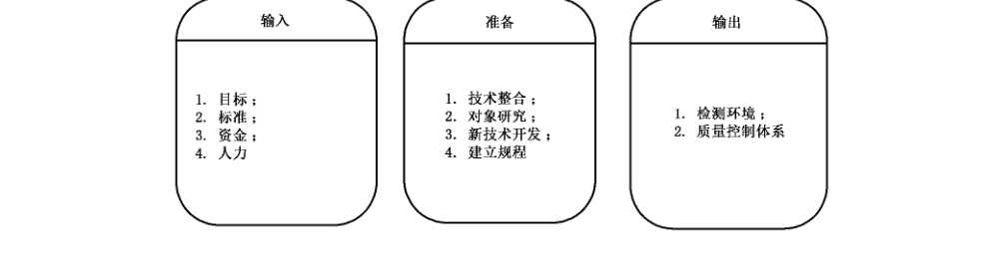

#### F.2.2 实验室准备：输入

实验室准备中输入项是按照实验室自身情况进行自我提高的计划。

输入项如下：

a）目标：实验室的建设目标和发展目标。实验室在规划设计阶段就应确立自身的功能和性能建设目标并在建成运行后不断修正自己的发展方向和升级目标。可参考CCDB-2010-03-001、CCDB-2009-03-003、Joint Interpretation Library-Application of Attack Potential to Smatcard-V.2.7. February 2009。

b） 标准：检测/校准实验室的通用要求，可参考 ISO/IEC 17025；安全检测实验室，可参考 CCDB- 2009-03-003。

c） 资金：实验室的建设资金和后续发展资金。

d） 人力：实验室的人力资源建设，可参考 CCDB-2009-03-003。

#### F.2.3 实验室准备：过程

实验室准备中的过程主要是实验室自身提升的途径。

过程要素如下：

a） 技术整合：实验室将购置或研发的设备、技术和工具整合成专业化的检测平台。

b） 对象研究：实验室对检测对象基础原理、演变历史、当前状态和发展趋势的分析、研究。

c） 建立规程：实验室依据检测对象、检测环境、检测标准而制定的规范化检测操作规程。

#### F.2.4 实验室准备：输出

实验室准备中的输出指输入项按照过程进行实施后的结果。

输出项如下：

a） 检测环境：检测软、硬件平台，工具和实验室的支撑环境。

b） 质量管理体系：包括：实验室质量管理手册、程序文件、作业指导书、质量计划、质量和技术记录、外来文件、档案文件和网络文件等。

### F.3 项目准备

#### F.3.1 项目准备内容

项目准备是对实验室准备输出的进一步归纳和细化，面向需求对检测能力进行整合、分配和管理，建立规范化的作业细则。

检测机构为满足客户需求而制定的项目服务计划可分两种，一种是标准化服务，另一种是定制化服务。标准化服务计划应在项目准备阶段完成，定制化服务计划则要在任务启动阶段完成，见图F.3。

#### F.3.2 项目准备：输入

项目准备的输入可理解为检测机构对项目输出细化的前期调研。

输入项如下：

a） 需求分析：对指定受测件的检测需求。

b） 适用标准：所有可能作为检测依据的标准集合。

c） 资源清单：满足检测需要的设备资源、人力资源和技术资源。

#### F.3.3 项目准备：输出

项目准备中输出项可理解为形成的技术文档等。

输出项如下：

a） 检测小组：执行某一个类别或主题检测的项目组织。

b） 分级检测框架：分级检测框架是提供给用户根据应用系统对产品的不同安全等级要求而选择的分级别检测计划文档。

c） 主题检测大纲：主题检测是根据某一类（如某行业）需求，依据特定标准而制定的以某个主题内容的测试活动。主题检测也是检测机构向社会提供的标准化服务项目。主题检测大纲是主题检测活动纲领性、指导性文件，是对检测操作过程的技术规范，是对检测活动中诸概念的整合。

主题检测大纲的文件结构和内容可参见附录 D。

d） 其他文档：其他根据客户需求而提供的检测定制化服务的文档，如：操作规范、检测指导、模板记录，检测用例集等。

### F.4 任务启动

#### F.4.1 确定框架

工作内容：任务启动阶段对于检测机构提供的定制化服务和标准化服务都是必不可少的，但是工作内容有所不同，本标准对此不做严格区分。

在任务启动阶段，检测（评估）者可与委托者讨论检测（评估）的目的、需求、性质以及所需要的资源，然后确定检测的内容与边界以及一个概括性的检测项目内容列表，形成框架检测方案，见图 F.4。检测方案的格式与内容可参见附录D。

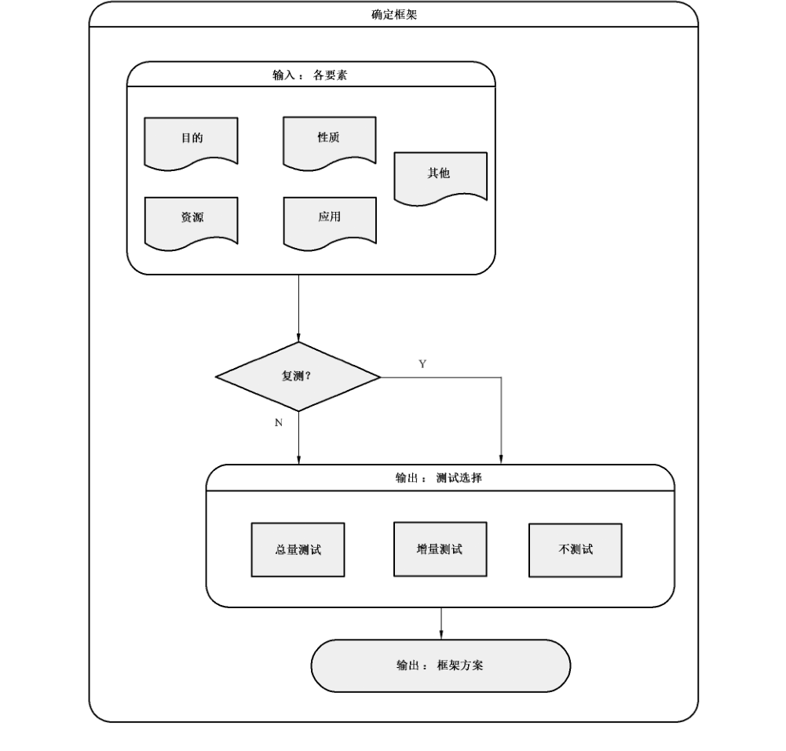

输入项如下：

a） 检测目的：委托方由于不同的需求而产生了不同的检测目的。

委托方的检测需求可有以下几类：

— 获取某个国家标准或行业标准抑或企业标准相关的资质或等级证书；

— 某采购或工程项目的招投标入围或评比检测；

— 委托方是受测件的设计者、开发者，希望增强改进自己产品的设计；

— 出于对检测机构的权威性、公信力或能力的信任或认可而希望得到对自己产品或欲使用产品的安全性鉴定报告；

— 其他。

b） 检测性质：智能卡检测的最基本性质可分为：安全性检测和非安全性检测。非安全性检测的内容不在本标准讨论范围。但这种划分并非绝对不变，例如：协议符合性检测一般被认为是非安全性检测，但在某些情况下，如较低级别的安全检测中，协议符合性检测就是安全性检测。

检测方和委托方需能够辨别受测件的安全功能与其他功能间的区别，并且明确检测的范围应限于与受测件安全性有关的功能。参见附录 A。

c） 资源：资源包括检测方进行检测所需要的软硬件设备、时间、人力、检测人员的技能和知识；还包括委托方所能提供的检测样本、各类技术文档（包括安全功能检测文档）和检测环境。

d） 应用：本标准涉及的与应用有关的智能卡安全性检测的对象限于智能卡芯片、智能卡嵌入式软件和储存在智能卡非易失存储器中的各级应用文件（包括密钥文件）、应用数据（包括各级密钥）及其安全属性配置等；不包括应用系统的其他与安全相关的部分或部件。对智能卡应用系统的整体安全性或除智能卡之外的其他有关部分的安全性的检测评估超出本标准的范围。

在进行与应用有关的智能卡安全性检测评估时，应特别注意研究该应用系统的安全资产与单纯以智能卡芯片、智能卡嵌入式软件受测件时安全资产的关系与区别，以及受测件处于特殊应用环境而面临的安全威胁的不同因而需要检测的范围和项目有所不同。

e） 其他情况：其他情况按以下要求：

— 委托者对检测项目有特殊要求。检测者可根据国家或行业的规定和自己掌握的资源自行判断是否应该接受委托者的特殊要求；如接受，应该向委托者说明可能对最终的评估结论带来的影响，并且在最终报告里明确阐述这些影响；

— 受测件是复合智能卡，但它的芯片或嵌入式软件已单独通过了某安全级别的检测评估；

— 受测件是某应用智能卡，但其所使用的芯片或嵌入式软件已单独通过了某安全级别的检测评估，或使用同样芯片的卡片（复合智能卡）已通过符合本文件规范的检测；

— 受测件被检测过，未获通过，后进行过修改或升级，申请复测；

— 受测件被检测过，并获某级证书，现希望进行更高级别检测。

输出框架方案内容可因输入而有所不同：

a）目的：检测者应根据委托方不同的需求和目的而确定检测对象的范围和检测内容的范围并制定检测计划。

为智能卡芯片和嵌入式软件 EAL4+ 安全等级评估而进行的检测，对象范围分别 GB/T 20276 和 GB/T 22186 中所定义的智能卡芯片和嵌入式软件。

为复合产品智能卡的安全评估而进行的检测可以包括对应用的检测内容。

为某行业应用的智能卡的安全评估而进行的检测则一定要包括应用的安全检测。

b） 其他情况：在 F.4.1.1.1 e）中阐述的几种情况下，评估者应该仔细研究和评价以往的检测项目和/或被测对象的修改对于评估受测件当前安全性的影响，最后得出以下三种结论之一：

1） 完整检测；

2） 增量检测；

3） 不检测。

无论选择何种检测范围，都应在报告中写明理由和依据。

当选择“增量检测”或“不检测”时，以前的检测结果或报告应当被本次的报告所引用并作为评估的证据。

#### F.4.2 受测件接收

##### F.4.2.1 相关标准规定

GB/T 20276 和 GB/T 22186 中规定了开发者协助评估者进行独立性安全功能检测和渗透性检测应尽的职责，包括进行安全功能检测和脆弱性分析，并将结果文档化然后提交给检测者。进行 EAL4+ 等级评估项目的委托者应遵照这两个标准的条款准备检测文档并交付检测者。

其他评估项目的委托者也应参考这些条款为检测者的安全功能检测和渗透性检测做准备，除非有其他标准可以依据。如 EMVCO 等国际行业组织的智能卡芯片检测标准中不要求进行安全功能检测，则依据此类标准所启动的主题检测任务可不要求委托者提供相应信息。

##### F.4.2.2 交付需求

检测方应在准备阶段以主题检测大纲形式或分级检测指南文件形式向公众，或在任务启动时以其他正式文件形式向委托方，表明己方在某种主题检测或分级检测时对于受测件以及各种文档、资料甚至其他资源的明确需求。并在需求列表清单中简短注明需求的原因。

##### F.4.2.3 受测件交付

委托者应提供足够数量的，满足安全功能检测和渗透性检测需求的形式和型号（版本）的受测件样品。

##### F.4.2.4 安全功能检测文档

安全功能检测文档应包括检测计划、检测程序描述、预期的检测结果和实际的检测结果。

检测计划应当标识要测试的安全功能，描述要执行的测试目标；

检测过程描述应当包标识要执行的测试，并描述每个安全功能的测试概况。这些概况包括对于其他测试结果的顺序依赖性；

预期的检测结果应当表明成功测试运行后的期望输出；

实际的检测结果应当论证每个被测试的安全性功能按照规定进行运作。

##### F.4.2.5 其他资源

委托者应向检测者提供其他为进行安全检测所必需或有利于这些检测的资源，如源代码、各层级的安全设计文件、检测软硬件环境和检测脚本等。

##### F.4.2.6 形式审查

检测者应在正式检测和评估前对委托者所交付的受测样品、文档和资源的集合进行审查，判断是否均满足主题检测和评估的需求，并告知委托者。

### F.5 启动结束

任务启动可能在两种情况下结束：一是启动成功，任务进入检测阶段；二是启动失败，任务终止。启动失败的处理不在本标准讨论范围内。

启动成功后，实验室的管理部门或人员将任务分配给检测小组或具体检测人员。

## 附录 G（规范性附录）智能卡安全检测分级方法

### G.1 智能卡安全分级检测的意义

智能卡安全分级检测是检测机构向社会提供的有关智能卡安全性的标准化公共服务。

分级的起因是由于不同的应用对于智能卡具有不同的安全要求，而不同的安全要求应由不同的安全设计所实现，不同的安全设计成功与否则可由不同的安全检测所验证。

智能卡安全分级检测的目标是建立一个可以为不同安全要求的应用筛选出适当智能卡产品的检测体系，由制造商、集成商或应用系统运营商根据自身应用的安全需求选择相适应级别的检测。

智能卡安全分级检测体系的实际建立应该有相适应的安全分级认证体系相配套，但分级认证体系的设计与建立问题不在本标准的讨论范围内。

### G.2 智能卡安全检测分级原理

#### G.2.1 检测分级原理概述

智能卡面临的所有信息安全风险来自于攻击者（人）对卡安全资产的（潜在）攻击，人们对智能卡的安全要求可最终归结为或实现为智能卡对于各类攻击的抵抗力；依照不同安全要求设计并制造出来的卡产品应体现出不同的抗攻击能力；具有不同抵抗力的卡产品适用于安全需求不同的应用系统或环境。

证明或检验智能卡抵抗能力的最科学方法是对其进行全面的试验性质的检测。

安全分级检测则是将智能卡的安全要求划分成不同的抵抗力级别，每个抵抗力级别都明确对应着相应的攻击能力和强度，检测者通过对受测件实施某级别的检测项目集合检验并证明受测件是否达到该级别的抵抗力。

安全分级检测并且对应着智能卡产品生命周期在产业应用链中的不同阶段和环节，因为智能卡安全由其整个生命周期的各个环节的安全措施予以保障。

#### G.2.2 两种安全检测

CC 标准组织有关文件规定应对智能卡进行两种安全性检测：一是安全功能检测；二是渗透性检测。

#### G.2.3 安全功能检测的特性

智能卡的安全功能又可分为两类：

a） 显性安全功能：由各种智能卡技术协议或应用协议和标准中所规定的安全功能。也可称为共性安全功能。

b） 隐性安全功能：设计者根据自己经验或灵感设计出来的，为抵御各类已知攻击而创建的安全功能。也可称个性安全功能。

这两类安全功能都应被检测而证明其存在性和有效性。这类检测是功能符合性检测。检测的依据是 IC 卡的公开标准协议（显性），和设计开发者的 ST 文件或其他设计文件（隐性）。

安全功能检测的特点是按对象（安全功能）所在的层次而展开，对检测结果评估的方法是对照结果与协议具体条目的符合与否。

#### G.2.4 渗透性检测

渗透性检测就是攻击性质的实验性检测。

#### G.2.5 安全检测分级框架定义

考虑作为受测件的智能卡的自然逻辑层面实际对应智能卡产业链的不同环节，与各类攻击手段的性质、特点，对智能卡的安全检测活动建立如下分级框架：智能卡安全检测级别分为 3 个层面 7 个级别，即以 A、B、C 代表芯片、COS 和应用三个层面，A1、A2、A3、B1、B2、C1、C2 共 7 个级别。每一个级别代表着若干安全检测项目的集合，进行并通过了某个级别的检测代表着受测件的抵抗力达到了该级别的要求。每个安全级别的抵抗力亦反映了智能卡的一定的安全功能要求和安全功能强度要求。

各级别定义如下：

a） C1（基本应用级）：

— 抵抗力指标：该级别受测件可以抵御无意的或偶然起意的具有普通公共知识的攻击者的攻击强度。

— 检测项目：智能卡基本技术标准，如 GB/T 20276-2008、GB/T 2218-2008 以及 ISO/IEC 7816 中有关“安全功能部分”的检测项目，参见附录 A 的 A.2.2 规定的安全功能检测，及其对应的渗透性检测。

— 对等级别：CC EAL2。

b） C2（应用安全级）：

— 抵抗力指标：该级别受测件可以抵御具有智能卡应用系统综合专业知识但不具备特殊设备的攻击者的攻击。

— 检测项目：国际和我国各行业应用标准协议应用层面的安全功能检测项目，参见附录 A 的 A.3 规定的安全功能检测以及相应的渗透性检测项目，参见附录 B 中介绍的 JAVA 恶意应用、重放攻击、中间人攻击、随机数发生器攻击等。

— 对等级别：CC EAL3。

c） B1（软件基本安全级）：

— 抵抗力指标：该级别受测件可以抵御具有深层智能卡 COS 专业知识和黑客攻击手段，但不掌握特定受测件详细技术细节的攻击者在软件层面的攻击。

— 检测项目：参见附录 A 中 A.2 介绍的软件安全功能检测；黑盒方式的软件攻击，如附录 B 中 B.4、B.6、B.7、B.9 等节内容。

— 对等级别：CC EAL3+（中级抵抗力 AVA_VLA.3）。

d） B2（软件安全级）：

— 抵抗力指标：该级别受测件可抵御具有黑客攻击手段并掌握受测件机密技术信息但不具备特殊设备的攻击者在软件层面的攻击。

— 检测项目：参见附录 A 中 A.5 介绍的智能卡安全管理功能（安全保障功能）检测、现场检查、源代码审查等；白盒方式的软件攻击。

— 对等级别：GB/T 20276 对智能卡嵌入式软件的安全技术要求。

e） A1（芯片非侵入安全级）：

— 抵抗力指标：本等级要求受测件的芯片具有良好的防止敏感信息泄漏的安全保护措施。

该级别受测件能抵御专业攻击者的各种非侵入攻击。

— 检测项目：参见附录 A 中关于芯片防止敏感信息泄漏的安全功能检测、参见附录 B 中 B.3 介绍的非侵入攻击。

— 对等级别：GB/T 22186 对智能卡芯片的安全技术要求。

f） A2（芯片半侵入安全级）：

— 抵抗力指标：该级别受测件能抵御攻击者的各种半侵入攻击。

— 检测项目：参见附录 A 中相关的安全功能检测、参见附录 B 中 B.2 介绍的各类半侵入攻击。

— 对应级别：暂无。

g） A3（芯片侵入安全级）：

— 抵抗力指标：该级别受测件能抵御攻击者的各种侵入攻击。

— 检测项目：参见附录 A 中相关的安全功能检测、参见附录 B 中 B.1 介绍的各类侵入攻击。

— 对应级别：A1+A2+A3 的渗透性检测项目等同于国际 CC 组织和 EMVCO 组织认可的，满足脆弱性要求（组件 AVA_VLA.5）的智能卡芯片安全评估保障级 EAL4+ 或 EAL5+ 水平。

### G.3 智能卡安全分级检测框架应用原则

#### G.3.1 公共服务

智能卡安全分级检测框架为整个智能卡产业链和应用提供服务。

#### G.3.2 适度检测

避免过度检测，节约智能卡产业链、应用链在安全性检测环节花费的成本和时间。

#### G.3.3 受测方选择

受测方根据自身在产业链的位置和需求，灵活选择某层面中某级别、多级别或多层面多级别的检测。

#### G.3.4 检测方定位

检测机构根据自身能力定位，发展并在获得相应能力认证后向社会提供三个层面，七个级别中某些或所有级别的检测服务。

### G.4 检测评估认证体系

智能卡安全分级检测框架应用的理想环境是作为一个子体系在国家范围的智能卡安全检测评估认证体系下运行。这个体系由一个认证机构、几个专业委员会和若干个可提供不同级别检测评估服务的检测机构所构成。

检测机构需通过认证机构和专业委员会的测评、审核得到某级别或某几个级别的检测评估资质；

认证机构还负责审核、认证检测机构的检测报告，为合格的受测件颁发安全级别证书；

专业委员会则对检测认证实体的运行进行监督、指导，必要时也参与某些事物的审核。

理想的安全检测评估认证体系应导致产业链产生如下局面：芯片商在产品投放市场之际根据自己的目标市场选择分级检测框架芯片层的某（几）个级别进行检测认证；

卡商、COS 商亦根据自己的目标市场选择符合该级别证书的芯片装载自己的COS，并进行某级别的 COS检测认证；

智能卡的应用系统运营商或集成商挑选具有适应自己应用系统安全需求的芯片层某级别安全证书和 COS层某安全级别证书的智能卡产品入围，并可进行相应的应用层安全级检测认证。

## 参考文献

- [1] GB/T 14916—2006 识别卡物理特征

- [2] GB/T 16649 识别卡带触点的集成电路卡

- [3] YD/T 1625—2007 电信智能卡安全技术要求

- [4] ISO/IEC 7816 Indentfication cards—Intergrated circuit(s) cards

- [5] ISO/IEC 10536-2:1995 Identfication cards—Contactless integrated circuit(s) cards—Part 2: Dimensions and location of coupling areas.

- [6] ISO/IEC 14443 Identification cards—Contactless integrated circuit cards—Proximity cards.

- [7] ISO/IEC 17025-2005-5-15 General requirements for the competence of testing and calibration laboratories.

- [8] ISO/IEC 17825:2012 Information technolgy—Security technique—Testing methods for the mtigation of non-invasive attack classes against cryptographic modules.

- [9] ISO/IEC 19790:2012 Information technolgy—security requirements for cryptographic modules.

- [10] CCDB-2007-09-001 Composite product evaluation for Smartcards and similar devices V1.0

- [11] CCDB-2007-09-002 ETR template for composite evaluation of Smart Cards and similar devices V1.0

- [12] CCMB-2007-09-004 Common Methodology for Information Technology Security Evaluation V3.1.

- [13] CCDB-2008-04-001 Application of Attack Potential to Smartcards V.2.5

- [14] CCDB-2009-03-003 Requirements to perform Integrated Circuit Evaluations

- [15] CCDB-2010-03-001 CC support Document Guidance—Smartcard Evaluation—February 2010 Version 2.0

- [16] CCDB-2012-04-004 Security Architecture requirements(ADV_ARC) for smart cards and similardevices—Appendix 1

- [17] BSI-CC-PP-0035-2007 Security IC Platform Protection Profile V1.0

- [18] Visa Chip Security Program—Security Testing Process V1.0

- [19] Joint Interpretation Library—Application of Attack Potential to Smatcard-V.2.7. February 2009

- [20] Visa Chip Security Program Security Testing Process V2.0 2010-10
