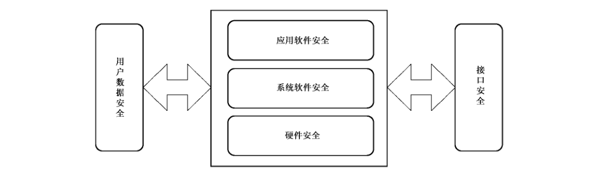

# GB/T 32927-2016 信息安全技术 移动智能终端安全架构

> 来源：[GB/T 32927-2016 国家标准详情](https://openstd.samr.gov.cn/bzgk/std/newGbInfo?hcno=27BFD935D75B74D1FEEB448E7AE9BA73)；发布日期：2016-08-29；实施日期：2017-03-01。
> PDF SHA-256：4a8ec83677f3c13f4899744962cc524ce0f8831a03476a7f96cd3a7d303aa021。
> 转写说明：按页渲染官方 PDF 并进行图像识别，对照全部 11 页原图校正文字、条款和图 1；省略封面、目录、页眉和页脚。正式引用请核对原 PDF。

## 前言

本标准按照GB/T 1.1—2009给出的规则起草。

本标准由全国信息安全标准化技术委员会（SAC/TC 260）提出并归口。

本标准起草单位：工业和信息化部电信研究院、北京邮电大学、中国移动通信集团公司、中国联合网络通信集团有限公司、北京展讯高科通信技术有限公司、百度在线网络技术（北京）有限公司。

本标准主要起草人：潘娟、宁华、梁洪亮、落红卫、杨光华、何申、董慧、师延山、满志勇。

## 引言

随着移动智能终端的广泛应用以及功能的不断扩展，其使用过程中的安全问题被越来越多的用户所关注。近年来，恶意吸费、窃听、用户信息泄露等安全事件频发，使用户对移动智能终端的安全性产生顾虑，进而影响到移动智能终端和移动互联网应用的发展。本标准的制定，旨在通过移动智能终端的安全架构，指导移动智能终端安全标准体系的建设，规范移动智能终端涉及的设计、开发、测试、评估工作，提高移动智能终端的安全水准，降低移动智能终端面临的风险，保护用户个人安全以及国家安全，推动整个互联网的健康发展。

本标准中涉及到的密码应用，依据国家密码管理局规定实施。

本标准给出移动智能终端安全架构，并提出安全需求，为利于创新和发展，对移动智能终端安全架构各部分的具体技术实现方式、方法等不做规定。

## 1 范围

本标准提出了移动智能终端的安全架构，描述了移动智能终端的安全需求。

本标准适用于移动智能终端涉及的设计、开发、测试和评估。

## 2 规范性引用文件

下列文件对于本文件的应用是必不可少的。凡是注日期的引用文件，仅注日期的版本适用于本文件。凡是不注日期的引用文件，其最新版本（包括所有的修改单）适用于本文件。

- GB/T 25069—2010 信息安全技术 术语

## 3 术语和定义、缩略语

### 3.1 术语和定义

GB/T 25069 —2010界定的以及下列术语和定义适用于本文件。

#### 3.1.1 安全机制 security mechanism

实现安全功能，提供安全服务的一组有机组合的基本方法。

#### 3.1.2 安全架构 security architecture

由多个安全的模块构成的一个相互协作的体系结构。

#### 3.1.3 安全审计 security audit

对信息系统的各种事件及行为实行监测、信息采集、分析，并针对特定事件及行为采取相应的动作。

#### 3.1.4 代码签名 code signature

利用数字签名机制，由具有签名权限的实体对全部或部分代码进行签名的机制。

#### 3.1.5 访问控制 access control

一种保证数据处理系统的资源只能由被授权主体按授权方式进行访问的手段。

#### 3.1.6 漏洞 vulnerability

计算机信息系统在需求、设计、实现、配置、运行等过程中，有意或无意产生的缺陷。这些缺陷以不同形式存在于计算机信息系统的各个层次和环节之中，一旦被恶意主体所利用，就会对计算机信息系统的安全造成损害，从而影响计算机信息系统的正常运行。

#### 3.1.7 授权 authorization

在用户身份经过认证后，根据预先设置的安全策略，授予用户相应权限的过程。

#### 3.1.8 数字签名 digital signature

附在数据单元后面的数据，或对数据单元进行密码变换得到的数据。允许数据的接收者验证数据的来源和完整性，保护数据不被篡改、伪造，并保证数据的不可否认性。

#### 3.1.9 移动智能终端 mobile smart terminal

能够接入移动通信网，提供应用软件开发接口，并能够安装和运行应用软件的移动终端。

#### 3.1.10 应用软件 application software

移动智能终端操作系统之上安装的，向用户提供服务功能的软件。

#### 3.1.11 用户 user

使用移动智能终端，与移动智能终端进行交互的对象。

#### 3.1.12 用户数据 user data

由用户产生或为用户服务的数据，包括由用户在本地生成的数据、为用户在本地生成的数据、在用户许可后由外部进入用户数据区的数据等。

### 3.2 缩略语

下列缩略语适用于本文件。

NFC 近距离通信（near field communication）

USB 通用串行总线（universal serial BUS）

WLAN 无线局域网（wireless local area network）

## 4 移动智能终端的安全架构

### 4.1 安全架构概述

移动智能终端由硬件、系统软件、应用软件、接口、用户数据组成。硬件包括处理器、存储芯片、输入输出等部件。系统软件包括操作系统、基础通信协议软件等。应用软件包括预置和安装的第三方应用软件。用户数据包括位置信息、账户信息、通信录、照片等所有由用户产生或为用户服务的数据。接口包括蜂窝网络接口、无线外围接口、有线外围接口、外置存储设备等。

移动智能终端的安全架构包含硬件安全、系统软件安全、应用软件安全、接口安全、用户数据安全五个组成部分。如图1所示。

硬件安全为移动智能终端提供基础的安全保障。

系统软件安全基于硬件安全，提供系统级别的安全保障。

应用软件安全保障业务层面的安全可靠。

用户数据安全为个人信息提供保护。

接口安全保障移动智能终端接口的通信安全。

### 4.2 安全目标

移动智能终端的安全目标是通过提出硬件、系统软件、应用软件、用户数据、接口等方面的安全需求，提高移动智能终端的安全能力，降低移动智能终端所面临的网络攻击、恶意软件等风险，保证移动智能终端的保密性、可用性和完整性。

## 5 移动智能终端的安全需求

### 5.1 硬件安全

#### 5.1.1 标识唯一

移动智能终端硬件具备唯一可识别性，硬件标识区域通常不可被改写；若硬件标识区域可被改写，则该改写是受控的，移动智能终端能够识别改写发生，并采取措施进行控制。

#### 5.1.2 芯片安全

移动智能终端芯片具备完整性和保密性保护机制，或支持通过增加安全芯片来保证完整性和保密性，安全芯片具备抵抗物理攻击、错误注入、旁路攻击等能力。安全芯片的选取应遵循相应的国家密码管理政策。

#### 5.1.3 安全启动

引入安全启动机制，系统启动按照用户设定的方式，建立初始环境，监督安全启动过程。开机时采用开机认证，系统启动后对操作系统装载信息，操作系统内核、硬件配置、关键应用等进行一致性校验，防止加载非授权的系统软件和应用软件，防御绕过操作系统的攻击等。

### 5.2 系统软件安全

#### 5.2.1 认证鉴权

激活或使用移动智能终端需经过用户鉴别。在终端不活动时间达到规定值时系统锁定会话，同时支持由用户发起的会话锁定。终端支持开机时和开机后锁定状态下的鉴别保护，例如：口令、图案、生物特征识别等多种形态的鉴别。其中口令为必选的保护形式，其他形式为可选。

#### 5.2.2 访问控制

移动智能终端提供访问控制机制，限制对移动智能终端应用、数据、进程及接口等的非授权访问。

#### 5.2.3 安全域隔离

移动智能终端对系统资源和各类数据进行安全域隔离，对存储空间进行划分，不同存储空间用于存储不同的数据或代码。不同进程所使用的空间和资源进行逻辑隔离，如采用沙盒或虚拟机等技术。

#### 5.2.4 加密机制

移动智能终端提供加密机制，以保护敏感的文件系统、用户数据和通信。如用户账户信息、用户自定义数据等应被加密存储。加密机制中的密码算法可参考相应的商用密码规范。

密钥在产生、存储、传输、销毁、恢复等过程中均受到安全机制的保护。

#### 5.2.5 安全审计

移动智能终端支持对操作进行细粒度的安全审计。安全审计包括识别、记录、存储和分析与安全相关活动有关的信息。可通过检查审计记录结果判断发生的安全相关活动以及相关负责的用户。

#### 5.2.6 签名机制

移动智能终端提供签名验证机制，能够识别数据和代码的签名状态并提示用户，成功进行签名验证后的应用，可供用户安装和使用。未经过签名验证的应用软件仅当用户进行确认后才能执行下一步操作。应用开发者对移动应用进行代码签名，应用商店对上架的应用进行分发签名，以保证应用的可溯源性。数字签名中的密码算法可参考相应的商用密码规范。

#### 5.2.7 可信机制

建立移动智能终端可信机制，可以引入安全可信模块，建立可信根和信任链，通过信任链的传递，将信任扩展到整个平台甚至网络。或者建立一个可信执行环境，将安全部件的运行与不安全部件的运行分离，安全存储用户的证书以及其他需要避免受到恶意软件和主操作系统攻击的安全数据，使得在主操作系统中执行的攻击或运行的应用无法访问受保护的软件和数据。

#### 5.2.8 内存安全保护

禁止在标记为数据存储的内存区域中执行代码，当尝试运行标记为数据区域中的代码时，会发生异常并禁止执行代码，以防止从受保护的内存位置执行恶意代码。

系统核心组件和应用软件加载时，地址空间的布局需随机化，以防范对已知地址进行恶意攻击，防止缓冲区溢出等攻击代码的执行。

### 5.3 应用软件安全

#### 5.3.1 最小权限原则

在移动智能终端应用软件的开发过程中，需保证其所承载的应用软件自身的安全。在权限声明中，遵循最小权限声明原则。

#### 5.3.2 安全扫描

移动智能终端提供应用软件安装前的病毒和漏洞扫描机制，可以通过调用已实现此功能的安全软件进行扫描。

#### 5.3.3 应用安装

安装应用时，移动智能终端能识别应用的权限、证书等安全信息，供用户进行决策。

#### 5.3.4 安全软件

移动智能终端可安装防火墙、入侵检测系统、防病毒、防间谍等安全软件，以提供安全监测和保护。

### 5.4 用户数据安全

#### 5.4.1 远程保护

在用户手机被盗或遗失等情况下，远程保护机制保障终端中的用户数据不被泄露。远程保护机制包括：远程锁定移动智能终端、远程销毁用户数据、远程启动拍照功能并上传等。移动智能终端提供的远程保护功能具备安全设置，确保远程保护功能仅在达到了用户预设条件的情况下才会启动。

#### 5.4.2 状态提示

应用、蜂窝网络、WLAN、蓝牙、USB、定位、NFC等状态对用户可见。

#### 5.4.3 配置管理

移动智能终端提供安全配置工具，用户可选择适用的安全配置。

#### 5.4.4 用户确认

安装应用或执行敏感操作需由用户确认。

敏感操作包括拨打电话、发送短信、开启/关闭无线接入、开启定位功能、开启照相机、记录语音、对通讯录、通话记录、照片等个人数据进行读、写、修改、删除等。

#### 5.4.5 信息保护

建立通讯录、通话记录、短信、彩信、邮件、浏览记录、账户信息、照片、基站、位置、WLAN等用户数据的安全保护机制，阻止未经许可获取用户的个人信息。

移动智能终端具备用户信息的加密存储、备份、彻底删除等功能，未经授权的任何实体不能从移动智能终端的加密存储区域的数据中还原出用户私密信息的真实内容。

#### 5.4.6 信息收集

建立个人信息的收集规则，规范收集方式，阻止未经用户许可的信息收集行为，用户可以监测信息被收集情况。通过规范被收集信息的用途，确保不被用于用户未授权的用途。

#### 5.4.7 文件分级

建立数据的分类原则，设计文件的安全级别，针对不同级别采用不同的安全机制。如通讯录、短信、通话记录等数据应列为较高的安全级别。通过访问控制、加密等手段，阻止未经授权的访问。

### 5.5 接口安全

#### 5.5.1 网络接入安全

移动智能终端支持网络接入域中安全协议在终端侧的实现，支持接入网络中的鉴权和认证、数据机密性和数据完整性服务等机制，支持移动智能终端侧和网络侧的认证。

#### 5.5.2 话音通信安全

移动智能终端提供对电路域应用软件的访问控制机制，只有授权应用软件才能够在程序运行过程中启动电路域连接。

移动智能终端能够监测所有应用软件的电路域连接尝试，当出现电路域连接尝试时，能够发现该连接尝试并给用户相应的提示。

在电路域连接建立后，移动智能终端能够对电路域的连接进行监控。

#### 5.5.3 数据通信安全

移动智能终端提供对分组域应用软件的访问控制机制，只有授权应用软件才能够在程序运行过程中启动分组域连接。

移动智能终端能够监测所有应用软件的分组域连接尝试，当出现分组域连接尝试时，能够发现该连接尝试并给用户相应的提示。

在分组域连接建立后，移动智能终端能够对分组域传输的数据进行监控，监控的内容包括数据传输的上下行流量，数据连接的对端地址等。

#### 5.5.4 无线外围接口

移动智能终端具备开启或关闭蜂窝网络、WLAN、蓝牙、红外、NFC等无线接入方式的功能。当无线外围接口建立数据连接时，移动智能终端能够发现该连接并给用户相应的状态提示，仅当用户确认建立本次连接时，连接才可建立。用户可以监测数据传输状态，以防止非法连通、非法数据访问和数据传输等。移动智能终端可采用安全协议保障无线外围接口通信的安全。

#### 5.5.5 有线外围接口

对于支持有线外围接口的移动智能终端，当有线外围接口建立数据连接时，移动智能终端给用户相应的提示，仅当授权用户确认本次连接时，连接才可以建立。移动智能终端可采用安全协议保障有线外围接口通信的安全。

#### 5.5.6 外置存储设备

对于支持外置存储设备的移动智能终端，限制非授权应用软件对外置存储设备的访问。授权应用软件存储、移动、复制、转存重要数据至外置存储设备时，移动智能终端应提供加密机制。

## 参考文献

- ［1］ GB/T 18336.1—2008 信息技术 安全技术 信息技术安全性评估准则 第 1 部分：简介和一般模型
- ［2］ GB/T 18336.2—2008 信息技术 安全技术 信息技术安全性评估准则 第 2 部分：安全功能要求
- ［3］ GB/T 18336.3—2008 信息技术 安全技术 信息技术安全性评估准则 第 3 部分：安全保证要求
- ［4］ GB/T 22239—2008 信息系统安全等级保护基本要求
- ［5］ GB/T 28455—2012 信息安全技术 引入可信第三方的实体鉴别及接入架构规范
- ［6］ GB/T 30284—2013 移动通信智能终端操作系统安全技术要求（EAL2 级）
- ［7］ YD/T 1699—2007 移动终端信息安全技术要求
- ［8］ YD/T 1886—2009 移动终端芯片安全技术要求和测试方法
- ［9］ YD/T 2407—2013 移动智能终端安全能力技术要求
- ［10］ YD/T 2408—2013 移动智能终端安全能力测试方法
- ［11］ ISO/IEC 15408-1:2009 Information technology—Security techniques—Evaluation criteria for IT security—Part 1: Introduction and general model
- ［12］ ISO/IEC 15408-2:2008 Information technology—Security techniques—Evaluation criteria for IT security—Part 2: Security functional components
- ［13］ ISO/IEC 15408-3:2008 Information technology—Security techniques—Evaluation criteria for IT security—Part 3: Security assurance components
- ［14］ NIST SP800-124, Guidelines on Cell Phone and PDA Security, 2008, 8.
- ［15］ NIST SP800-124-rev1, Guidelines for Managing and Securing Mobile Devices in the Enterprise, 2012.
- ［16］ US-Cert, cyber_threats_to_mobile_phones, 2013.
- ［17］ US-Cert, Protecting Portable Devices: Data Security, Security Tip ST04-020, 2013.
- ［18］ US-Cert, Protecting Portable Devices: Physical Security, Security Tip ST04-020, 2013.
