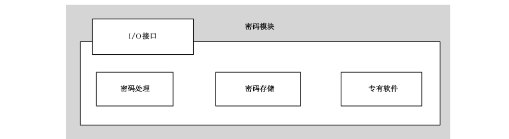
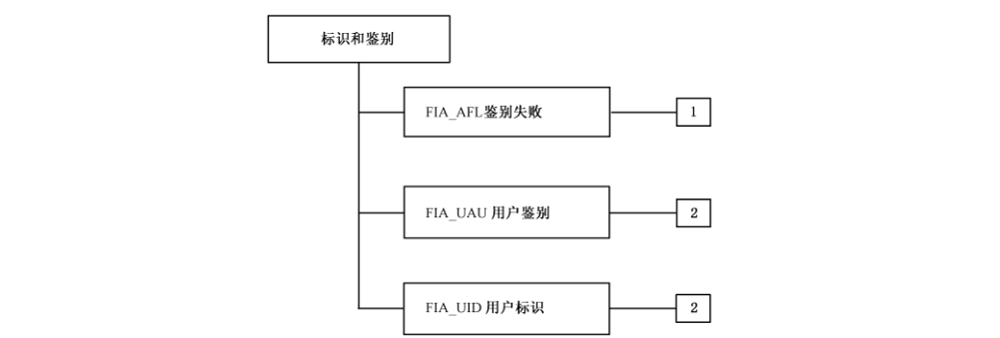
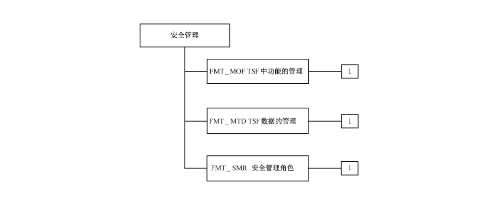

# GB/T 35101-2017 信息安全技术 智能卡读写机具安全技术要求（EAL4增强）

> 来源：[GB/T 35101-2017 国家标准详情](https://openstd.samr.gov.cn/bzgk/std/newGbInfo?hcno=F2BDD09360990E085320011D0BDB12E3)；封面发布日期：2017-11-01；实施日期：2018-05-01。
> 官方 PDF SHA-256：925d4c8a716ade971fd64c5dbc2072c7c86c8f0018a64bc100c0b3c979872d49。
> 转写说明：对照官方 PDF 全部 36 页图像校正文字、跨页表格和图示；省略封面、目录、页眉、页脚和页码，将图 1、图 3、图 7 的文字内容整理为表格，保留其余四幅原图。正式引用请核对原 PDF。
> 原文疑点：表 5 与表 6 对 T_INTERN.05、T_INTERN.06、P_PRODUCT.02 的安全目的对应关系不一致；表 5 出现第 6.2 节未定义的 A_MANUF.03。以下均按各自原页保留。

## 前言

本标准按照 GB/T 1.1—2009 给出的规则起草。

请注意本文件的某些内容可能涉及专利。本文件的发布机构不承担识别这些专利的责任。

本标准由全国信息安全标准化技术委员会（SAC/TC 260）提出并归口。

本标准起草单位：中国信息安全测评中心、工业和信息化部电子工业标准化研究院、北京邮电大学、北京理工大学、浙江工业大学、武汉大学、河南科技大学。

本标准主要起草人：伊胜伟、彭勇、高洋、谢丰、张普含、马洋洋、戴忠华、张舒、杨永生、张翀斌、芦效峰、黄永刚、陈铁明、赵波、孙士保、熊琦、邸丽清、许玉娜、陈冬青、高海辉、霍杏梅、王婷、张亮、向僮、韩雪峰。

## 1 范围

本标准规定了 EAL4增强级智能卡读写机具（以下简称机具）的机具描述、安全环境、安全目的、安全要求及基本原理。本标准中的安全功能组件将满足 EAL4增强级机具的通用安全功能要求，安全保障组件将满足 EAL4增强级机具的通用安全保障要求。

本标准适用于接触式智能卡读写机具的测试和评估，也可用于指导机具的研制、开发和产品采购。

## 2 规范性引用文件

下列文件对于本文件的应用是必不可少的。凡是注日期的引用文件，仅注日期的版本适用于本文件。凡是不注日期的引用文件，其最新版本（包括所有的修改单）适用于本文件。

- GB/T 18336.1—2015 信息技术 安全技术 信息技术安全评估准则 第1部分：简介和一般模型

- GB/T 18336.2—2015 信息技术 安全技术 信息技术安全评估准则 第2部分：安全功能组件

- GB/T 18336.3—2015 信息技术 安全技术 信息技术安全评估准则 第3部分：安全保障组件

- GB/T 25069—2010 信息安全技术 术语

## 3 术语和定义

GB/T 18336.1—2015 和 GB/T 25069—2010界定的以及下列术语和定义适用于本文件。

### 3.1 智能卡 smart card

具有中央处理器（CPU）的集成电路卡，即CPU 卡，是将一个具有中央处理器的集成电路芯片镶嵌于塑料基片中，并封装成卡的形式。

> 注：从数据传输方式上，智能卡可分为接触式和非接触式。

### 3.2 读写机具 card reader

一个与智能卡有交互能力的读写设备，它能有效地获得鉴别信息和用户数据，并将其传给应用软件，生成一个可靠的用户活动。

### 3.3 应用软件 application software

机具软件的一部分，实现机具的应用功能。

### 3.4 系统软件 system software

直接操作机具硬件及嵌入到硬件中的固件和能够与应用软件交互的软件，它是机具中除应用软件外的软件（包括了密码模块中的专有软件）。

## 4 符号和缩略语

### 4.1 符号

下列符号适用于本文件。

A：假设（Assumption）。

A_DESIGN：开发环境假设。

A_MANUF：生产环境假设。

A_APPLI、A_PRIVATE、A_RESP：用户环境假设。

P：安全策略（Policy）。

P_IDENT、P_PRODUCT：组织安全策略。

O：目的（Object）。

O_ENV：环境安全目的。

O_TOE:TOE 安全目的。

T：威胁（Threat）。

T_EXTERN：外部 TOE 资产的威胁。

T_INTERN：内部 TOE 资产的威胁。

### 4.2 缩略语

下列缩略语适用于本文件。

I/O：输入/输出（Input/Output）。

NVM：非易失性存储器（Non-volatile Memory）。

PIN：个人识别码（Personal Identification Number）。

RAM：随机存取存储器（Random-access Memory）。

ST：安全目标（Security Target）。

TOE：评估对象（Target of Evaluation）。

TSF：TOE 安全功能（TOE Security Functions）。

TSP：TOE 安全策略（TOE Security Policy）。

## 5 机具描述

### 5.1 概述

机具是智能卡应用过程中卡与用户间的交互平台，它应在受控环境中使用。机具由硬件组件和软件构成。软件分为系统软件和应用软件两部分。系统软件分嵌入到硬件中的和能远程更改的两部分；应用软件可以下载到机具中用以提供产品预期的功能。

TOE 是一个不含应用的机具产品，因此本标准中描述的安全功能是机具中除应用之外的所有安全功能。

适用于本标准的机具应具有键盘、显示部件，可广泛应用于电信、银行、公安、建设、交通、社保、税务及各种收费、储值、查询等智能卡管理应用系统。

### 5.2 TOE 的组成

一个典型 TOE 应包括：具有安全保护功能的密码模块以及提供服务和交互功能的服务及交互功能模块，其中服务及交互功能模块包括 I/O 接口模块、处理单元、存储器、操作单元四个模块。

一个典型的TOE 具体包括如下五个模块：

a） I/O 接口（键盘、显示部件、打印机、芯片连接部件等）；

b） 一个处理单元；

c） 存储器（RAM、NVM等）；

d） 产品所需的一个或更多的操作单元；

e）物理和逻辑的密码模块。

一个典型 TOE 的组成如图1所示。

**图1 TOE 的组成**

| TOE 组成 | 模块 |
| --- | --- |
| 服务及交互功能模块 | 处理单元、I/O 接口、操作单元、存储器 |
| — | 密码模块 |

I/O 接口是机具用于与外部交互的接口，可以进行数据的输入输出显示等。处理单元能够对数据进行计算处理。存储器用于数据的存储。操作单元可以对数据及相关机具部件进行操作处理。密码模块是 TOE 中极其重要的模块，下面对密码模块进行描述。

密码模块可以包括专有的硬件和软件，专有软件可以嵌入到 NVM 存储器中，也可以被有条件的下载至 NVM 存储器中，或者两者兼备。该密码模块是一个集成了与智能卡处理有关的安全功能的IT（信息技术）组件，它管理有关安全处理功能的密码操作。其内部结构如图2所示。

在后面的章节中，第6章描述了 TOE及其组成的安全环境，第7章描述了 TOE及其组成的安全目的，第8章描述了 TOE 及其组成的安全要求（安全功能组件和安全保障要求）。

### 5.3 机具服务

机具提供已设计的功能。其中一些功能调用了密码模块提供的安全功能。

机具提供的服务有：

a） 与智能卡的安全交互；

b） 有关数据处理的安全服务。

密码模块提供的部分功能包括：

a） 对安全功能所用密钥的密钥管理；

b） 对设备中运行的应用的密钥操作处理，如加密、解密、签名的生成和确认；

c） 对外部环境来说，设备唯一性的标识/鉴别。

### 5.4 机具的生命周期

机具的生命周期描述包括如下几个时期（见表1）：

a） 设计时期：机具硬件、系统软件和应用软件的设计与开发；

b） 制造时期：制造和测试；

c） 个人化时期：为使机具唯一而载入设备的密钥（明确的标识符），以及系统/应用软件签名；

d） 使用前时期：机具包装和交付；

e） 使用时期：系统/应用软件下载，最终用户使用机具，维护人员维护机具；

f） 废弃时期：机具生命周期结束处理。

**表1 机具生命周期**

| 主要时期 | 生命周期阶段 | 过渡事件 | 描述 |
| --- | --- | --- | --- |
| 设计 | 硬件和系统软件的设计与开发 | 完成和测试 | 机具设计者负责机具硬件和系统软件的设计，将机具的预定功能和物理、逻辑特征相结合。系统软件可分为启动程序和可下载的程序 |
| 制造 | 机具制造和测试 | 完成 | 机具制造者负责生产机具 |
| 个人化 | 初始密钥的载入及测试 | 载入 | 机具制造者的安全管理员负责装载实现安全要求的初始密钥 |
| 个人化 | 系统软件的签名 | 签名 | 若组件存在则应保护它的完整性和真实性 |
| 使用前 | 机具的包装和交付 | 安装 | 机具制造者负责包装和运送机具到用户指定的目的地。根据机具的类型，可直接递送给最终用户或专门机构 |
| 使用 | 系统软件和应用软件下载 | 完成 | 最终用户负责从指定的服务器下载相应软件 |
| 废弃 | 机具废弃处理 | — | 机具生命周期结束处理。机具的最终用户将机具废弃处理 |

### 5.5 TOE 的一般功能

为支持机具上运行的应用，TOE 应至少提供以下功能：

a） 依据 TOE外部部件的请求，提供连接智能卡的服务功能；

b） 依据应用请求，提供与智能卡之间的交互功能；

c） 提供密钥管理功能，包括密钥生成、分配、撤销、存储；

d） 为应用提供下列安全服务功能：

- 算术运算；
- 密码运算（加密、数字签名、杂凑）；
- 外部数据处理；
- 格式化、安全化外部交易。

## 6 安全环境

### 6.1 资产

#### 6.1.1 内部 TOE 资产

下面是TOE 的一些典型资产并被当作TSF 数据。它们在生命周期的某些阶段被装载到 TOE中，可能是在开发环境或在制造环境中。资产包括物理和逻辑两方面：

a） 密码模块提供的密码资源（密码功能）和操作它们的密钥处理单元；

b） 密钥和密码模块的密钥存储器；

c） 处理单元和密钥存储器间的连接；

d） 系统软件（启动程序和可下载程序）。

密码资源可以与系统软件以同样的方式下载。它们的下载被看作是系统软件下载的一部分。

在维护阶段，系统软件在下载前被看作是外部 TOE 资产（用户数据）。

#### 6.1.2 外部 TOE资产

外部TOE 资产属于可下载到机具中的应用。它们被看作是用户数据，在用户环境中，它们仅出现在应用下载之后。即使应用数据和密钥是占用 TOE 范围内的存储器的资源，它们也不属于 TOE范围以内。外部TOE 资产如下：

a） TOE 上运行的应用软件；

b） 应用数据和密钥。

应用数据与应用软件以同样的方式下载。它们的下载被看作是应用软件下载的一部分。

### 6.2 假设

#### 6.2.1 开发环境的假设

A_DESIGN.01：设计者颁布和维持了一个描述安全规则的书面程序，并应用于开发环境。

A_DESIGN.02：设计者和安全管理员确保对设计阶段特别是系统软件签名阶段所涉及的密钥进行保护。

#### 6.2.2 生产环境的假设

A_MANUF.01：制造者颁布和维持了一个描述安全规则的书面程序，并应用于生产环境。

A_MANUF.02：制造者和安全管理员确保对个人化阶段特别是系统软件和应用软件签名阶段所涉及的密钥进行保护。

#### 6.2.3 用户环境的假设

A_RESP：用户在使用 TOE时，被告知其责任。

A_PRIVATE：TOE 规定为在受控环境中使用。

A_APPLI.01：TOE 规定为被遵从智能卡相关规范的应用软件所使用。

A_APPLI.02：应用级的安全要求确保系统软件与应用间的相互鉴别和完整性。

### 6.3 威胁

#### 6.3.1 威胁主体

TOE 的威胁主体有：

a） 最终用户：最终用户是指通过授权途径收到产品的人。他可能改变应用的交互数据或伪造应用的正常处理。

b） 设计/制造者安全管理员：有权进行密钥管理、机具初始密钥的安全装载和系统软件签名操作的权利的操作员；他可能伪造初始密钥或者伪造签名以进行非法访问。

c） 应用软件提供者：负责应用软件的设计和开发，他可能通过欺诈的方式改变应用软件；应用软件提供者被看作是威胁主体是因为他有能力在他开发的应用中插入一个特洛伊木马；当他作为一个用户，这个应用可能试图去访问 TOE的内部资产或属于其他应用的外部资产。

d） 应用软件管理员：他负责远程下载到机具中的最新软件的可用性；他可能对机具进行攻击获取更多访问权限。

e） 安全管理员（在个人化阶段）：有权个人化 TOE 而进行密钥管理的操作员，他可能非法越权修改 TOE 的密钥。

f） 入侵者：通过非授权途径获取产品，或者以其他方式非法访问 TOE。他希望直接或通过一个应用去：

- 用伪造的资产替代至少一个 TOE 内部资产；
- 改变 TOE，以通过一个未授权的方式使用它；
- 篡改 TOE，以获取应用数据和密钥。

#### 6.3.2 威胁描述

##### 6.3.2.1 综述

在第5章定义的TOE 应能够抵抗下面描述的威胁。威胁主体企图通过功能性的攻击或者对环境的操纵，或通过特定的硬件操纵或其他的攻击，来滥用资产。

假定攻击（Attack,A）的方式：

a） 渗透（Infiltrate, I），A_I：通过设备的物理穿孔或设备的未授权的打开去获取设备内的敏感信息，例如，密钥。因此，渗透是一种基于设备物理特性的攻击方式。

b）监测（Monitor,Mo）A_M：通过监测电磁辐射去发现设备内的敏感信息，或监视，监听，电子监测进入设备内的秘密数据。因此，监测是一种基于设备物理特性的攻击方式。

c） 操纵（Manipulation,Ma），A_Ma：在非授权状态下向设备发送一串输入指令，以便造成设备敏感信息的泄露或以未授权的方式获取某项服务。例如，造成设备进入其“测试模式”，以便获取敏感信息或者操纵设备的完整性。操纵是一种基于设备逻辑特性的攻击方式。

d） 篡改（Tamper, T），A_T：对设备的逻辑或物理特性进行未授权的篡改和变更。例如，在 PIN 登陆点和 PIN 加密点之间的 PINpad 登录设备上插入一个揭露 PIN 的机制。注意该篡改可能包含渗透，不仅为泄露设备内的信息，而且为了改变设备。对设备中的密钥进行未授权的替换就是一种篡改形式。篡改是一种基于设备逻辑或物理特性的攻击方式。

e） 替换（Substitute,S），A_S：将一个设备未授权的取代另一个设备。这个取代设备可能是一个外形相似的“伪造品”或者是一个仿冒设备，它由全部或部分正确的逻辑特性加上一些未授权的功能组成，例如揭露 PIN的机制。这个取代设备可能是一个曾经合法的设备经过未授权的篡改后来替换其他合法的设备。转移是一种替换的方式，它被用在一个更适合执行渗透和篡改攻击的环境，或作为替换攻击的前奏，设备可能从其操作环境中被取走。当攻击者用更改过的替代品取代目标设备而不是真正地篡改它时，替换可以被看成是篡改的一个特例。替换是一种基于设备的逻辑和物理特性的攻击方式。

##### 6.3.2.2 内部 TOE 资产的威胁

T_INTERN.01：入侵者用某些部件已被篡改（克隆）的相似的设备来替换 TOE。

T_INTERN.02：TOE 的一个或更多的密码资源由于被监测、管理疏忽或程序不当而被制造者安全管理员或安全管理员或入侵者在个人化阶段或之前被更改。

T_INTERN.03：TOE 的一个或更多的密码资源在使用阶段被入侵者更改，入侵者可能通过对内部功能的更改使 TOE 处于一种不安全的状态。

T_INTERN.04：TOE 的一个或更多的密钥由于安全管理员滥用其特权或入侵者入侵而被更改。

T_INTERN.05：TOE 的一个或更多的密钥由于安全管理员滥用其特权或入侵者入侵而被泄露。

T_INTERN.06：用于传输密钥的 TOE 内部连接被入侵者访问。

T_INTERN.07：系统软件被入侵者更改使其可以绕过安全控制。

##### 6.3.2.3 外部 TOE 资产的威胁

T_EXTERN.01：威胁主体可能以某种与安全策略不一致的方式更改或替换应用软件。

T_EXTERN.02：外部资产被暴露在特定的物理上或逻辑上控制不当的环境中，并允许下列威胁主体之一：应用提供者、应用软件管理员或入侵者访问它。

### 6.4 组织安全策略

TOE 应遵守的组织安全策略：

P_PRODUCT.01：TOE 的用户不能破坏属于其他用户的资产的完整性和保密性。

P_PRODUCT.02：密码模块应对 TOE 的处理单元进行保护，以控制对 TOE 外部接口的访问。

P_IDENT：TOE 应能向适当的核验者提供唯一的标识并给出其身份证据。

## 7 安全目的

### 7.1 综述

安全目的主要包括如下四个方面：

a） 只能操作真实可信的资源；

b） 应确保已下载的应用及相关数据的完整性；

c） 应保护内部数据；

d） 应是从外部可证明的。

### 7.2 TOE 安全目的

O_TOE.01：TOE 应确保它所管理的密钥在存储和使用中的保密性。

O_TOE.02：TOE 应确保它所管理的密码资源和密钥在存储和使用中的完整性。

O_TOE.03：TOE 应确保对处理单元和密码模块存储器间连接的保护。

O_TOE.04：TOE 应确保对系统软件或下载到 TOE 中的应用的鉴别。

O_TOE.05：TOE 应确保 TOE 外部资产（包括应用数据和密钥）在存储和使用中的完整性，以及这些数据的其他任何形式（如被电子存储的或被显示到屏幕上的）在存储和使用中的完整性。

O_TOE.06：TOE 应提供针对篡改的自我保护。

O_TOE.07：TOE 应确保它的安全功能持续正常的运行。

O_TOE.08：依照适当的安全策略，TOE应能够为适当的核验者生成它的特定身份的证明。

O_TOE.09:TOE应具备应对内部技术故障的能力。

### 7.3 环境安全目的

与 TOE 环境有关的安全目的：

O_ENV.01：最终用户在使用 TOE 时应被告知他们的责任。

O_ENV.02：TOE 不能偏离它的预定用法。

O_ENV.03：管理和使用TOE 不能危及TOE 管理的资产。

O_ENV.04：在生命周期的每个阶段，对 TOE 负责的实体应颁布和维持一个书面程序并应用于整个阶段。

O_ENV.05：开发环境和生产环境下，当密钥被使用时，对TOE负责的实体应确保对密钥的保护。

O_ENV.06：生产环境下，在更改密钥前应对安全管理员进行鉴别，并且要产生一个该更改的安全审计轨迹。

## 8 安全要求

### 8.1 安全功能组件

#### 8.1.1 综述

根据 GB/T 18336.2—2015 的要求，智能卡读写机具安全技术要求中的安全功能组件如表2所示。

随后对各组件给出了详细的说明。在安全目标中需要定义的赋值及选择用斜体字表示。

**表2 安全功能组件**

| 安全功能类 | 安全功能组件标识 | 组件名称 |
| --- | --- | --- |
| FCS 类：密码支持 | FCS_CKM.1 | 密钥产生 |
| FCS 类：密码支持 | FCS_CKM.2 | 密钥分配 |
| FCS 类：密码支持 | FCS_CKM.4 | 密钥销毁 |
| FCS 类：密码支持 | FCS_COP.1 | 密码运算 |
| FDP 类：用户数据保护 | FDP_DAU.1 | 基本数据鉴别 |
| FIA 类：标识和鉴别 | FIA_AFL.1 | 鉴别失败处理 |
| FIA 类：标识和鉴别 | FIA_UAU.2 | 任何行动前的用户鉴别 |
| FIA 类：标识和鉴别 | FIA_UID.2 | 任何行动前的用户标识 |
| FMT 类：安全管理 | FMT_MOF.1 | 安全功能行为的管理 |
| FMT 类：安全管理 | FMT_MTD.1 | TSF 数据的管理 |
| FMT 类：安全管理 | FMT_SMR.1 | 安全角色 |
| FPT 类：TSF 保护 | FPT_FLS.1 | 带保存安全状态的失败 |
| FPT 类：TSF 保护 | FPT_ITT.1 | 内部 TSF 数据传送的基本保护 |
| FPT 类：TSF 保护 | FPT_PHP.3 | 物理攻击抵抗 |
| FPT 类：TSF 保护 | FPT_RCV.2 | 自动恢复 |
| FPT 类：TSF 保护 | FPT_TST.1 | TSF 检测 |

#### 8.1.2 FCS 类：密码支持

##### 8.1.2.1 FCS 类分解

TOE 安全功能可以利用密码支持功能对智能卡读写机具进行安全保护，可以用于用户身份的标识和鉴别。本类可用硬件、固件和/或软件来实现，在TOE执行密码支持功能时使用。

本类的组件分解如图3所示。

**图3 密码支持类分解**

| 子类 | 组件 |
| --- | --- |
| FCS_CKM 密钥管理 | FCS_CKM.1、FCS_CKM.2、FCS_CKM.4 |
| FCS_COP 密码运算 | FCS_COP.1 |

##### 8.1.2.2 密钥管理（FCS_CKM）

FCS_CKM.1 密钥产生

FCS_CKM.1.1：TSF 应根据符合下面［赋值：*标准列表*］的特定密钥产生算法［赋值：*密钥产生算法*］（应符合国家密码管理局的相关标准）和特定的密钥长度［赋值：*密钥长度*］来产生密钥。

FCS_CKM.2 密钥分配

FCS_CKM.2.1：TSF 应根据符合下面［赋值：*标准列表*］的特定密钥分配方法［赋值：*密钥分配方法*］来分配密钥。

FCS_CKM.4 密钥销毁

FCS_CKM.4.1：TSF 应根据符合下面［赋值：*标准列表*］的特定密钥销毁方法［赋值：*密钥销毁方法*］来销毁密钥。

##### 8.1.2.3 密码运算（FCS_COP）

FCS_COP.1 密码运算

FCS_COP.1.1：TSF 应根据符合下面［赋值：*标准列表*］的特定密码算法［赋值：*密码算法*］（应符合国家密码管理局的相关标准）和特定的密钥长度［赋值：*密钥长度*］来执行［赋值：*密码运算列表*］。

密码运算列表：

- 对等鉴别
- 密钥产生
- 消息摘要计算
- MAC 计算
- 内部密钥保护
- 数字签名产生和验证
- 数据的加密和解密
- 密钥分配

#### 8.1.3 FDP类：用户数据保护

##### 8.1.3.1 FDP 类分解

用户数据保护类是指规定了与保护用户数据相关的TOE 安全功能组件和 TOE 安全功能策略。

本标准中只关注数据鉴别子类。

数据鉴别子类是指允许一个实体承担信息真实性的责任。本子类提供一种方法，以保证特定数据单元的有效性，并进而验证信息内容没有被伪造或者篡改。

本类的组件分解如图4所示。

##### 8.1.3.2 数据鉴别（FDP_DAU）

FDP_DAU.1 基本数据鉴别

FDP_DAU.1.1：TSF 应提供产生保证［赋值：*客体或信息类别列表*］的有效性的证据的能力。

FDP_DAU.1.2：TSF 应为［赋值：*主体列表*］提供能力，以验证指定信息有效性的证据。

#### 8.1.4 FIA 类：标识和鉴别

##### 8.1.4.1 FIA 类分解

标识和鉴别类是指提出建立和验证所声称的用户身份的安全功能组件。

本类的组件分解如图5所示。

##### 8.1.4.2 鉴别失败（FIA_AFL）

FIA_AFL.1 鉴别失败处理

FIA_AFL.1.1：当与［赋值：*鉴别事件列表*］相关的［赋值：*数目*］次数不成功鉴别尝试出现时，TSF 应检测。

数目＝1

鉴别事件列表＝数字签名失败

FIA_AFL.1.2：当达到或超过所定义的不成功鉴别尝试的次数时，TSF 应［赋值：*行动列表*］。

行动列表＝发送一个错误通知或停止

##### 8.1.4.3 用户鉴别（FIA_UAU）

FIA_UAU.2 任何行动前的用户鉴别

FIA_UAU.2.1：在允许任何代表用户的其他 TSF 促成的行动执行前，TSF 应要求该用户已被成功鉴别。

细化 1：鉴别＝校验装载到 TOE 中的用户的数字签名

细化 2：用户＝应用或下载的系统软件

##### 8.1.4.4 用户标识（FIA_UID）

FIA_UID.2 任何行动前的用户标识

FIA_UID.2.1：在允许任何代表用户的其他 TSF 促成的行动执行之前，TSF 应要求用户标识自己。

细化：用户＝应用

#### 8.1.5 FMT类：安全管理

##### 8.1.5.1 FMT 类分解

安全管理类是指规定了 TSF 几个方面的管理：FSF 安全功能、TSF 数据、安全管理角色。

本类的组件分解如图6所示。

##### 8.1.5.2 FMT 类的管理活动

FMT 类中的管理功能应考虑下列管理活动。管理活动与功能要求的对应关系如表3所示。

**表3 管理活动与功能要求的对应关系**

| 功能 | 活动 |
| --- | --- |
| FCS_CKM.1 | 对修改密钥属性的管理 |
| FCS_CKM.2 | 对修改密钥属性的管理 |
| FCS_CKM.4 | 对修改密钥属性的管理 |
| FCS_COP.1 | NM |
| FDP_DAU.1 | 系统中，要对其进行数据鉴别的客体，其赋值和修改应是可配置的 |
| FIA_AFL.1 |  a）管理失败的鉴别尝试； b）管理鉴别失败时将要采取的行动 |
| FIA_UAU.2 | 管理员对鉴别数据的管理 |
| FIA_UID.2 | 用户身份的管理 |
| FMT_MOF.1 | 管理可以与 TSF中的功能相互作用的角色组 |
| FMT_MTD.1 | 管理可以与 TSF中的数据相互作用的角色组 |
| FMT_SMR.1 | NA |
| FPT_FLS.1 | NM |
| FPT_ITT.1 |  a） 管理 TSF 要防止的修改类型； b） 管理用来保护在TSF 不同的部分间传送的数据的保护机制 |
| FPT_PHP.3 | 管理对物理篡改的自动应答 |
| FPT_RCV.2 |  a） 管理者维护模式下谁能够获得恢复能力； b）管理通过自动化过程来处理的失败及服务中断列表 |
| FPT_TST.1 | 管理 TSF 自检产生条件，如初始化启动期间、固定间隔或特定条件 |

注：NM——无管理活动，NA——不适用。

##### 8.1.5.3 TSF 中功能的管理（FMT_MOF）

FMT_MOF.1：安全功能行为的管理

FMT_MOF.1.1：TSF 应仅限于［赋值：*已识别的授权角色*］对功能［赋值：*功能列表*］具有［选择：*确定其行为，禁止，允许，修改其行为*］的能力。

##### 8.1.5.4 TSF 数据的管理（FMT_MTD）

FMT_MTD.1 TSF 数据的管理

FMT_MTD.1.1：TSF 应仅限于［赋值：*已标识的授权角色*］能够对［赋值：*TSF 数据列表*］具有［选择：改变默认值，查询，修改，删除，清空，［赋值：*其他操作*］］。

##### 8.1.5.5 安全管理角色（FMT_SMR）

FMT_SMR.1 安全角色

FMT_SMR.1.1：TSF 应维护角色［赋值：*已标识的授权角色*］。

FMT_SMR.1.2：TSF 应能够把用户和角色关联起来。

细化：用户＝安全管理员

#### 8.1.6 FPT类：TSF 保护

##### 8.1.6.1 FPT类分解

TSF 保护类是指规定了与提供 TSF 的机制的完整性和管理有关、与TSF数据的完整性有关的安全要求。

本类的组件分解如图7所示。

**图7 TSF 保护类分解**

| 子类 | 组件 |
| --- | --- |
| FPT_FLS 失败保护 | FPT_FLS.1 |
| FPT_ITT TOE 内 TSF 数据的传送 | FPT_ITT.1 |
| FPT_PHP TSF 物理保护 | FPT_PHP.3 |
| FPT_RCV 可信恢复 | FPT_RCV.2 |
| FPT_TST TSF 自检 | FPT_TST.1 |

##### 8.1.6.2 失败保护（FPT_FLS）

FPT_FLS.1 带保存安全状态的失败

FPT_FLS.1.1：TSF 在下列失败发生时应保存一个安全状态：［赋值：*TSF 的失败类型列表*］。

##### 8.1.6.3 TOE 内 TSF 数据的传送（FPT_ITT）

FPT_ITT.1 内部 TSF 数据传送的基本保护

FPT_ITT.1.1：TSF 应保护 TSF 数据在 TOE 的分离部分间传送时不被［选择：*泄露，修改*］。

##### 8.1.6.4 TSF 物理保护（FPT_PHP）

FPT_PHP.3 物理攻击抵抗

FPT_PHP.3.1：TSF 应通过自动应答来抵抗对［赋值：*TSF 设备/元件列表*］的［赋值：*各种物理篡改*］，以遵从 TSP。

##### 8.1.6.5 可信恢复（FPT_RCV）

FPT_RCV.2 自动恢复

FPT_RCV.2.1：当不能从失败或服务中断自动恢复时，TSF 应进入维护方式，该方式提供将 TOE 返回到一个安全状态的能力。

FPT_RCV.2.2：对［赋值：*失败/服务中断列表*］，TSF 应确保通过自动化过程使TOE返回到一个安全状态。

##### 8.1.6.6 TSF 自检（FPT_TST）

FPT_TST.1 TSF 检测

FPT_TST.1.1：TSF 应运行一套自检［选择：初始化启动期间，正常工作期间周期性地，授权用户要求，满足［赋值：*产生自检的条件*］］以表明 TSF 操作的正确性。

FPT_TST.1.2：TSF 为授权用户提供对 TSF 数据完整性的验证能力。

FPT_TST.1.3：TSF 为授权用户提供对存储的 TSF 可执行代码完整性的验证能力。

细化：用户＝设备维护者，安全管理员

### 8.2 TOE 安全保障组件

#### 8.2.1 综述

根据 GB/T 18336.3—2015的要求，智能卡读写机具安全技术要求中的TOE 安全保障组件如表4所示，下述各条对各组件给出了详细的说明。

**表4 安全保障组件**

| 安全保障类 | 安全保障组件标识 | 组件名称 |
| --- | --- | --- |
| ADV 类：开发 | ADV_ARC.1 | 安全架构描述 |
| ADV 类：开发 | ADV_FSP.4 | 完备的功能规范 |
| ADV 类：开发 | ADV_IMP.1 | TSF 安全功能实现表示的子集 |
| ADV 类：开发 | ADV_TDS.3 | 基础模块设计 |
| ADV 类：开发 | ADV_INT.1 | 结构合理的 TSF 内部子集 |
| AGD 类：指导性文档 | AGD_OPE.1 | 操作用户指南 |
| AGD 类：指导性文档 | AGD_PRE.1 | 准备程序 |
| ALC 类：生命周期支持 | ALC_CMC.4 | 生产支持和接受程序及其自动化 |
| ALC 类：生命周期支持 | ALC_CMS.4 | 问题跟踪 CM 覆盖 |
| ALC 类：生命周期支持 | ALC_DEL.1 | 交付程序 |
| ALC 类：生命周期支持 | ALC_DVS.1 | 安全措施标识 |
| ALC 类：生命周期支持 | ALC_LCD.1 | 开发者定义的生命周期模型 |
| ALC 类：生命周期支持 | ALC_TAT.1 | 明确定义的开发工具 |
| ASE 类：ST 评估 | ASE_CCL.1 | 符合性声明 |
| ASE 类：ST 评估 | ASE_ECD.1 | 扩展组件定义 |
| ASE 类：ST 评估 | ASE_INT.1 | ST 引言 |
| ASE 类：ST 评估 | ASE_OBJ.2 | 安全目的 |
| ASE 类：ST 评估 | ASE_REQ.2 | 推导出的安全要求 |
| ASE 类：ST 评估 | ASE_SPD.1 | 安全问题定义 |
| ASE 类：ST 评估 | ASE_TSS.1 | TOE 概要规范 |
| ATE 类：测试 | ATE_COV.2 | 覆盖分析 |
| ATE 类：测试 | ATE_DPT.2 | 安全执行模块 |
| ATE 类：测试 | ATE_FUN.1 | 功能测试 |
| ATE 类：测试 | ATE_IND.2 | 独立测试—抽样 |
| AVA 类：脆弱性评定 | AVA_VAN.4 | 系统的脆弱性分析 |

#### 8.2.2 安全架构描述（ADV_ARC.1）

开发者行为元素：

ADV_ARC.1.1D 开发者应设计并实现 TOE，确保 TSF 的安全特性不可旁路。

ADV_ARC.1.2D 开发者应设计并实现 TSF，以防止不可信主体的破坏。

ADV_ARC.1.3D 开发者应提供TSF 安全架构的描述。

证据的内容和形式元素：

ADV_ARC.1.1C 安全架构的描述应与在 TOE 设计文档中对 SFR-执行的抽象描述的级别一致。

ADV_ARC.1.2C 安全架构的描述应描述与安全功能要求一致的TSF 安全域。

ADV_ARC.1.3C 安全架构的描述应描述TSF初始化过程为何是安全的。

ADV_ARC.1.4C 安全架构的描述应证实 TSF 可防止被破坏。

ADV_ARC.1.5C 安全架构的描述应证实 TSF 可防止SFR-执行的功能被旁路。

评估者行为元素：

ADV_ARC.1.1E 评估者应确认所提供的信息满足证据的内容和形式的所有要求。

#### 8.2.3 完备的功能规范（ADV_FSP.4）

开发者行为元素：

ADV_FSP.4.1D 开发者应当提供一个功能规范。

ADV_FSP.4.2D开发者应当提供功能规范到安全功能要求的追溯。

证据的内容和形式元素：

ADV_FSP.4.1C 功能规范应完全描述 TSF。

ADV_FSP.4.2C 功能规范应描述所有的TSFI 的目的和使用方法。

ADV_FSP.4.3C功能规范应识别和描述每个 TSFI 相关的所有参数。

ADV_FSP.4.4C对每个 SFR-执行 TSFI，功能规范应描述TSFI 相关的所有行为。

ADV_FSP.4.5C功能规范应描述可能由每个 TSFI 的调用而引起的所有直接错误消息。

ADV_FSP.4.6C功能规范应证实安全功能要求到 TSFI 的追溯。

评估者行为元素：

ADV_FSP.4.1E 评估者应确认所提供的信息满足证据的内容和形式的所有要求。

ADV_FSP.4.2E 评估者应确定功能规范是 TOE 安全功能要求的一个精确和完备的实例化。

#### 8.2.4 TSF 安全功能实现表示的子集（ADV_IMP.1）

开发者行为元素：

ADV_IMP.1.1D 开发者应当为以下所选的安全功能子集提供实现表示：

a） 与TOE 物理结构相关的子集：

- 结构组成、电气原理图和印制电路板（PCB）图，包括物理防护结构；
- NVM 处理；
- RAM 存取。

b） 与TOE 逻辑结构相关的子集：

- 安全数据的检查和处理；
- 用户数据的检查和处理。

c） 与TOE 提供的调试功能相关的子集：

- 调试功能的锁定；
- 锁定功能的配置。

d） 与TOE 提供的中断和复位功能相关的子集。

ADV_IMP.1.2D 开发者应提供TOE 设计描述与实现表示实例之间的映射。

证据的内容和形式元素：

ADV_IMP.1.1C 实现表示应当无歧义而且详细地定义安全功能TSF，使得无须进一步设计就能生成安全功能 TSF 的程度。

ADV_IMP.1.2C 实现表示应以开发人员使用的形式提供。

ADV_IMP.1.3C TOE 设计描述与实现表示示例之间的映射应能证实它们的一致性。

评估者行为元素：

ADV_IMP.1.1E 对于选取的实现表示示例，评估者应当确认提供的信息满足证据的内容和形式的所有要求。

#### 8.2.5 基础模块设计（ADV_TDS.3）

开发者行为元素：

ADV_TDS.3.1D 开发者应提供 TOE 的设计。

ADV_TDS.3.2D 开发者应提供从功能规范的TSFI 到TOE设计中获取到的最低层分解的映射。

证据的内容和形式元素：

ADV_TDS.3.1C 设计应根据子系统描述 TOE 的结构。

ADV_TDS.3.2C 设计应根据模块描述 TSF。

ADV_TDS.3.3C设计应标识 TSF 的所有子系统。

ADV_TDS.3.4C设计应描述每一个 TSF 子系统。

ADV_TDS.3.5C设计应描述 TSF 所有子系统间的相互作用。

ADV_TDS.3.6C设计应提供 TSF 子系统到 TSF 模块间的映射关系。

ADV_TDS.3.7C设计应描述每一个 SFR-执行模块，包括它的目的及与其他模块间的相互作用。

ADV_TDS.3.8C设计应描述每一个 SFR-执行模块，包括它的安全功能要求相关接口、其他接口的返回值、与其他模块间的相互作用及调用的接口。

ADV_TDS.3.9C设计应描述每一个 SFR-支撑或SFR-无关模块，包括它的目的及与其他模块间的相互作用。

ADV_TDS.3.10C 映射关系应证实 TOE 设计中描述的所有行为能够映射到调用它的 TSFI。

评估者行为元素：

ADV_TDS.3.1E 评估者应确认所提供的信息满足证据的内容和形式的所有要求。

ADV_TDS.3.2E 评估者应确定设计是所有安全功能要求的正确和完全的实例。

#### 8.2.6 结构合理的 TSF 内部子集（ADV_INT.1）

开发者行为元素：

ADV_INT.1.1D 开发者应设计和实现［赋值：*TSF 子集*］，使内部结构合理。

ADV_INT.1.2D 开发者应提供内部描述和论证过程。

证据元素的内容和表示：

ADV_INT.1.1C 论证过程应解释用来判断“结构合理”的含义的特性。

ADV_INT.1.2C TSF 内部描述应证实指定的 TSF 子集结构合理。

评估者行为元素：

ADV_INT.1.1E 评估者应确认所提供的信息满足证据的内容和表示的所有要求。

ADV_INT.1.2E 评估者应执行指定的TSF 子集内部分析。

#### 8.2.7 操作用户指南（AGD_OPE.1）

开发者行为元素：

AGD_OPE.1.1D 开发者应当提供操作用户指南。

证据的内容和形式元素：

AGD_OPE.1.1C 操作用户指南应对每一种用户角色进行描述，在安全处理环境中应被控制的用户可访问的功能和特权，包含适当的警示信息。

AGD_OPE.1.2C操作用户指南应对每一种用户角色进行描述，怎样以安全的方式使用 TOE提供的可用接口。

AGD_OPE.1.3C操作用户指南应对每一种用户角色进行描述，可用功能和接口，尤其是受用户控制的所有安全参数，适当时应指明安全值。

AGD_OPE.1.4C 操作用户指南应对每一种用户角色明确说明，与需要执行的用户可访问功能有关的每一种安全相关事件，包括改变 TSF 所控制实体的安全特性。

AGD_OPE.1.5C 操作用户指南应标识TOE运行的所有可能状态（包括操作导致的失败或操作性错误），它们与维持安全运行之间的因果关系和联系。

AGD_OPE.1.6C操作用户指南应对每一种用户角色进行描述，为了充分实现 ST中描述的运行环境安全目的所应执行的安全策略。

AGD_OPE.1.7C操作用户指南应是明确和合理的。

评估者行为元素：

AGD_OPE.1.1E 评估者应确认所提供的信息满足证据的内容和形式的所有要求。

#### 8.2.8 准备程序（AGD_PRE.1）

开发者行为元素：

AGD_PRE.1.1D 开发者应提供 TOE，包括它的准备程序。

证据的内容和形式元素：

AGD_PRE.1.1C 准备程序应描述与开发者交付程序相一致的安全接收所交付 TOE 必需的所有步骤。

AGD_PRE.1.2C 准备程序应描述安全安装TOE 以及安全准备与ST 中描述的运行环境安全目的一致的运行环境必需的所有步骤。

评估者行为元素：

AGD_PRE.1.1E 评估者应确认所提供的信息满足证据的内容和形式的所有要求。

AGD_PRE.1.2E 评估者应运用准备程序确认 TOE 运行能被安全的准备。

#### 8.2.9 生产支持和接受程序及其自动化（ALC_CMC.4）

开发者行为元素：

ALC_CMC.4.1D开发者应提供TOE 及其参照号。

ALC_CMC.4.2D 开发者应提供CM文档。

ALC_CMC.4.3D开发者应提供CM 系统。

证据的内容和形式元素：

ALC_CMC.4.1C 应给 TOE 标记唯一参照号。

ALC_CMC.4.2C CM文档应描述用于唯一标识配置项的方法。

ALC_CMC.4.3C CM 系统应唯一标识所有配置项。

ALC_CMC.4.4C CM 系统应提供自动化的措施使得只能对配置项进行授权变更。

ALC_CMC.4.5C CM 系统应以自动化的方式支持 TOE 的生产。

ALC_CMC.4.6C CM文档应包括CM计划。

ALC_CMC.4.7C CM 计划应描述 CM 系统是如何应用于 TOE 的开发的。

ALC_CMC.4.8C CM 计划应描述用来接受修改过的或者新创建的作为TOE组成部分的配置项的程序。

ALC_CMC.4.9C证据应证实所有配置项都正在CM 系统下进行维护。

ALC_CMC.4.10C 证据应证实CM 系统的运行与CM 计划是一致的。

评估者行为元素：

ALC_CMC.4.1E 评估者应确认所提供的信息满足证据的内容和形式的所有要求。

#### 8.2.10 问题跟踪 CM 覆盖（ALC_CMS.4）

开发者行为元素：

ALC_CMS.4.1D 开发者应当提供 TOE 配置项列表。

证据的内容和形式元素：

ALC_CMS.4.1C 配置项列表应包括：TOE 本身、安全保障要求的评估证据、TOE 的组成部分、实现表示和安全缺陷报告及其解决状态。

ALC_CMS.4.2C 配置项列表应唯一标识配置项。

ALC_CMS.4.3C对于每一个 TSF 相关的配置项，配置项列表应简要说明该配置项的开发者。

评估者行为元素：

ALC_CMS.4.1E 评估者应确认所提供的信息满足证据的内容和形式的所有要求。

#### 8.2.11 交付程序（ALC_DEL.1）

开发者行为元素：

ALC_DEL.1.1D 开发者应将把 TOE 或其部分交付给消费者的程序文档化。

ALC_DEL.1.2D 开发者应使用交付程序。

证据的内容和形式元素：

ALC_DEL.1.1C 交付文档应描述，在向消费者分发TOE版本时，用以维护安全性所必需的所有程序。

评估者行为元素：

ALC_DEL.1.1E 评估者应确认所提供的信息满足证据的内容和形式的所有要求。

#### 8.2.12 安全措施标识（ALC_DVS.1）

开发者行为元素：

ALC_DVS.1.1D 开发者应当提供开发安全文档。

证据的内容和形式元素：

ALC_DVS.1.1C 开发安全文档应描述在 TOE 的开发环境中，保护 TOE设计和实现的机密性和完整性所必需的所有物理的、程序的、人员的及其他方面的安全措施。

评估者行为元素：

ALC_DVS.1.1E 评估者应确认所提供的信息满足证据的内容和形式的所有要求。

ALC_DVS.1.2E 评估者应确认安全措施正在被使用。

#### 8.2.13 开发者定义的生命周期模型（ALC_LCD.1）

开发者行为元素：

ALC_LCD.1.1D 开发者应当建立一个生命周期模型，用于 TOE的开发和维护。

ALC_LCD.1.2D 开发者应当提供生命周期定义文档。

证据的内容和形式元素：

ALC_LCD.1.1C 生命周期定义文档应描述用于开发和维护 TOE的模型。

ALC_LCD.1.2C 生命周期模型应为 TOE 的开发和维护提供必要的控制。

评估者行为元素：

ALC_LCD.1.1E 评估者应确认所提供的信息满足证据的内容和形式的所有要求。

#### 8.2.14 明确定义的开发工具（ALC_TAT.1）

开发者行为元素：

ALC_TAT.1.1D开发者应标识用于开发 TOE的每一个工具。

ALC_TAT.1.2D 开发者应在文档中描述每个开发工具所选取的实现依赖选项。

证据的内容和形式元素：

ALC_TAT.1.1C 用于实现的每个开发工具都应是明确定义的。

ALC_TAT.1.2C每个开发工具的文档应无歧义地定义所有语句和实现用到的所有协定与命令的含义。

ALC_TAT.1.3C每个开发工具的文档应无歧义地定义所有实现依赖选项的含义。

评估者行为元素：

ALC_TAT.1.1E 评估者应确认所提供的信息满足证据的内容和形式的所有要求。

#### 8.2.15 符合性声明（ASE_CCL.1）

开发者行为元素：

ASE_CCL.1.1D 开发者应提供符合性声明。

ASE_CCL.1.2D 开发者应提供符合性声明的基本原理。

证据的内容和形式元素：

ASE_CCL.1.1C ST 的符合性声明应包含GB/T 18336.1—2015 符合性声明，标识出 ST 和TOE 声明符合性遵从的GB/T 18336.1—2015。

ASE_CCL.1.2C ST 的符合性声明应描述ST 与GB/T 18336.2—2015 的符合性，无论是与GB/T 18336.2—2015 相符或是与GB/T 18336.2—2015 的扩展部分相符。

ASE_CCL.1.3C ST 的符合性声明应描述ST与本标准的符合性，无论是与本标准相符或是与本部分的扩展部分相符。

ASE_CCL.1.4C 符合性声明应与扩展组件定义是相符的。

ASE_CCL.1.5C 符合性声明应标识ST 声明遵从的所有PP 和安全要求包。

ASE_CCL.1.6C符合性声明应描述 ST 和包的符合性，无论是与包的相符或是与扩展包相符。

ASE_CCL.1.7C符合性声明的基本原理应证实 TOE 类型与符合性声明所遵从的PP 中的TOE 类型是相符的。

ASE_CCL.1.8C符合性声明的基本原理应证实安全问题定义的陈述与符合性声明所遵从的PP 中的安全问题定义陈述是相符的。

ASE_CCL.1.9C符合性声明的基本原理应证实安全目的陈述与符合性声明所遵从的PP中的安全目的陈述是相符的。

ASE_CCL.1.10C符合性声明的基本原理应证实安全要求的陈述与符合性声明所遵从的PP中的安全要求的陈述是相符的。

评估者行为元素：

ASE_CCL.1.1E 评估者应确认所提供的信息满足证据的内容和形式的所有要求。

#### 8.2.16 扩展组件定义（ASE_ECD.1）

开发者行为元素：

ASE_ECD.1.1D 开发者应提供安全要求的陈述。

ASE_ECD.1.2D 开发者应提供扩展组件的定义。

证据的内容和形式元素：

ASE_ECD.1.1C 安全要求陈述应标识所有扩展的安全要求。

ASE_ECD.1.2C扩展组件定义应为每一个扩展的安全要求定义一个扩展的组件。

ASE_ECD.1.3C扩展组件定义应描述每个扩展的组件与已有组件、族和类的关联性。

ASE_ECD.1.4C扩展组件定义应使用已有的组件、族、类和方法学作为陈述的模型。

ASE_ECD.1.5C扩展组件应由可测量的和客观的元素组成，以便于证实这些元素之间的符合性或不符合性。

评估者行为元素：

ASE_ECD.1.1E 评估者应确认所提供的信息满足证据的内容和形式的所有要求。

ASE_ECD.1.2E 评估者应确认扩展组件不能利用已经存在的组件明确的表述。

#### 8.2.17 ST 引言（ASE_INT.1）

开发者行为元素：

ASE_INT.1.1D 开发者应提供ST 引言。

证据的内容和形式元素：

ASE_INT.1.1C ST 引言应包含 ST 参照号、TOE 参照号、TOE 概述和 TOE 描述。

ASE_INT.1.2C ST 参照号应唯一标识 ST。

ASE_INT.1.3C TOE 参照号应标识 TOE。

ASE_INT.1.4C TOE 概述应概括 TOE 的用法及其主要安全特性。

ASE_INT.1.5C TOE 概述应标识 TOE类型。

ASE_INT.1.6C TOE 概述应标识任何 TOE 要求的非 TOE 范围内的硬件/软件/固件。

ASE_INT.1.7C TOE 描述应描述 TOE的物理范围。

ASE_INT.1.8C TOE 描述应描述 TOE的逻辑范围。

评估者行为元素：

ASE_INT.1.1E 评估者应确认所提供的信息满足证据的内容和形式的所有要求。

ASE_INT.1.2E 评估者应确认 TOE 参考、TOE 概述和 TOE 描述是相互一致的。

#### 8.2.18 安全目的（ASE_OBJ.2）

开发者行为元素：

ASE_OBJ.2.1D 开发者应提供安全目的的陈述。

ASE_OBJ.2.2D 开发者应提供安全目的的基本原理。

证据的内容和形式元素：

ASE_OBJ.2.1C 安全目的的陈述应描述 TOE 的安全目的和运行环境安全目的。

ASE_OBJ.2.2C 安全目的的基本原理应追溯到TOE 的每一个安全目的，以便于能追溯到安全目的所对抗的威胁及安全目的实施的组织安全策略。

ASE_OBJ.2.3C 安全目的的基本原理应追溯到运行环境的每一个安全目的，以便于能追溯到安全目的所对抗的威胁、安全目的实施的组织安全策略和安全目的支持的假设。

ASE_OBJ.2.4C 安全目的基本原理应证实安全目的能抵抗所有威胁。

ASE_OBJ.2.5C 安全目的基本原理应证实安全目的执行所有组织安全策略。

ASE_OBJ.2.6C 安全目的基本原理应证实运行环境安全目的支持所有的假设。

评估者行为元素：

ASE_OBJ.2.1E 评估者应确认所提供的信息满足证据的内容和形式的所有要求。

#### 8.2.19 推导出的安全要求（ASE_REQ.2）

开发者行为元素：

ASE_REQ.2.1D 开发者应提供安全要求的陈述。

ASE_REQ.2.2D 开发者应提供安全要求的基本原理。

证据的内容和形式元素：

ASE_REQ.2.1C 安全要求的陈述应描述安全功能要求和安全保障要求。

ASE_REQ.2.2C应对安全功能要求和安全保障要求中使用的所有主体、客体、操作、安全属性、外部实体及其他术语进行定义。

ASE_REQ.2.3C安全要求的陈述应对安全要求的所有操作进行标识。

ASE_REQ.2.4C所有操作应被正确地执行。

ASE_REQ.2.5C应满足安全要求间的依赖关系，或者安全要求基本原理应论证不需要满足某个依赖关系。

ASE_REQ.2.6C 安全要求基本原理应描述每一个安全功能要求可追溯至对应的TOE 安全目的。

ASE_REQ.2.7C安全要求基本原理应证实安全功能要求可满足所有的TOE安全目的。

ASE_REQ.2.8C安全要求基本原理应说明选择安全保障要求的理由。

ASE_REQ.2.9C 安全要求的陈述应是内在一致的。

评估者行为元素：

ASE_REQ.2.1E 评估者应确认所提供的信息满足证据的内容和形式的所有要求。

#### 8.2.20 安全问题定义（ASE_SPD.1）

开发者行为元素：

ASE_SPD.1.1D 开发者应提供安全问题定义。

证据的内容和形式元素：

ASE_SPD.1.1C 安全问题定义应描述威胁。

ASE_SPD.1.2C 所有的威胁都应根据威胁主体、资产和敌对行为进行描述。

ASE_SPD.1.3C 安全问题定义应描述组织安全策略。

ASE_SPD.1.4C安全问题定义应描述TOE 运行环境的相关假设。

评估者行为元素：

ASE_SPD.1.1E 评估者应确认所提供的信息满足证据的内容和形式的所有要求。

#### 8.2.21 TOE 概要规范（ASE_TSS.1）

开发者行为元素：

ASE_TSS.1.1D 开发者应提供 TOE 概要规范。

证据的内容和形式元素：

ASE_TSS.1.1C TOE 概要规范应描述 TOE 是如何满足每一项安全功能要求的。

评估者行为元素：

ASE_TSS.1.1E 评估者应确认所提供的信息满足证据的内容和形式的所有要求。

ASE_TSS.1.2E 评估者应确认 TOE 概要规范与TOE 概述、TOE 描述是一致的。

#### 8.2.22 覆盖分析（ATE_COV.2）

开发者行为元素：

ATE_COV.2.1D开发者应提供对测试覆盖的分析。

证据的内容和形式元素：

ATE_COV.2.1C 测试覆盖分析应证实测试文档中的测试与功能规范中 TSF 接口之间的对应性。

ATE_COV.2.2C测试覆盖分析应证实已经对功能规范中的所有 TSF接口都进行了测试。

评估者行为元素：

ATE_COV.2.1E 评估者应确认所提供的信息满足证据的内容和形式的所有要求。

#### 8.2.23 安全执行模块（ATE_DPT.2）

开发者行为元素：

ATE_DPT.2.1D 开发者应提供测试深度分析。

证据的内容和形式元素：

ATE_DPT.2.1C 深度测试分析应证实测试文档中的测试与 TOE 设计中的 TSF 子系统、SFR-执行模块之间的一致性。

ATE_DPT.2.2C测试深度分析应证实 TOE设计中的所有TSF 子系统都已经进行过测试。

ATE_DPT.2.3C测试深度分析应证实 TOE设计中的 SFR-执行模块都已经进行过测试。

评估者行为元素：

ATE_DPT.2.1E 评估者应确认所提供的信息满足证据的内容和形式的所有要求。

#### 8.2.24 功能测试（ATE_FUN.1）

开发者行为元素：

ATE_FUN.1.1D 开发者应测试 TSF，并文档化测试结果。

ATE_FUN.1.2D 开发者应提供测试文档。

证据的内容和形式元素：

ATE_FUN.1.1C 测试文档应包括测试计划、预期的测试结果和实际的测试结果。

ATE_FUN.1.2C测试计划应标识要执行的测试并描述执行每个测试的方案，这些方案应包括对于其他测试结果的任何顺序依赖性。

ATE_FUN.1.3C预期的测试结果应指出测试成功执行后的预期输出。

ATE_FUN.1.4C 实际的测试结果应和预期的测试结果一致。

评估者行为元素：

ATE_FUN.1.1E 评估者应确认所提供的信息满足证据的内容和形式的所有要求。

#### 8.2.25 独立测试—抽样（ATE_IND.2）

开发者行为元素：

ATE_IND.2.1D 开发者应提供用于测试的 TOE。

证据的内容和形式元素：

ATE_IND.2.1C TOE应适合测试。

ATE_IND.2.2C 开发者应提供一组与开发者TSF 功能测试中同等的一系列资源。

评估者行为元素：

ATE_IND.2.1E 评估者应确认所提供的信息满足证据的内容和形式的所有要求。

ATE_IND.2.2E 评估者应执行测试文档中的测试样本，以验证开发者的测试结果。

ATE_IND.2.3E 评估者应测试TSF 的一个子集以确认 TSF按照规定运行。

#### 8.2.26 系统的脆弱性分析（AVA_VAN.4）

开发者行为元素：

AVA_VAN.4.1D开发者应提供用于测试的 TOE。

证据的内容和形式元素：

AVA_VAN.4.1C TOE应适合测试。

分析应考虑以下的一般脆弱性：

a） TOE 可能遭受对内部存储器、数据传送机制、安全功能和测试方法的结构和内容的篡改；

b） 通过监测电路和结构间的互连，TOE 的器件内信息可能受到分析；

c） TOE 可能遭受到运用逻辑命令来产生导致安全脆弱性的响应；

d） TOE 可能遭受到如下分析：通过监测电磁辐射去发现设备内的敏感信息，或监视、监听、电子监测进入设备内的秘密数据；

e） TOE 可能遭受在早期的同类或类似的TOE 中已经标识的脆弱性。

评估者行为元素：

AVA_VAN.4.1E 评估者应确认所提供的信息满足证据的内容和形式的所有要求。

AVA_VAN.4.2E 评估者应执行公共领域的调查以标识 TOE 的潜在脆弱性。

AVA_VAN.4.3E 评估者应针对TOE执行独立的、系统的脆弱性分析去标识 TOE 潜在的脆弱性，在分析过程中使用指导性文档、功能规范、TOE 设计、安全结构描述和实现表示。

AVA_VAN.4.4E 评估者应基于已标识的潜在脆弱性实施穿透性测试，确定TOE能抵抗具有中等攻击潜力的攻击者的攻击。

## 9 基本原理

### 9.1 安全目的基本原理

表 5、表 6、表 7 说明了智能卡读写机具的安全目的能应对所有可能的假设、威胁和组织安全策略，即每一种威胁、假设和组织安全策略都至少有一个或一个以上安全目的与其对应，因此是完备的。没有一个安全目的没有相应的威胁、假设和组织安全策略与之对应，这证明每个安全目的都是必要的；没有多余的安全目的不对应威胁、假设和组织安全策略，因此说明了安全目的是充分的。

**表5 假设、威胁及组织安全策略与安全目的对应关系**

| 序号 | 假设/威胁/组织安全策略标识 | 安全目的标识 | 对应性描述 |
| --- | --- | --- | --- |
| 1 | A_RESP | O_ENV.01、O_ENV.03 | 直接匹配。 使用 TOE 而不危及 TOE 管理的资产，意味着使用者实际上知道使用 TOE 的正确方法。 |
| 2 | A_PRIVATE | O_ENV.02 | 该目的有助于保持 TOE 在受控环境中使用。 |
| 3 | A_APPLI.01 | O_ENV.02 | TOE 的目的是用于与智能卡交互。 |
| 4 | A_APPLI.02 | O_ENV.03 | TOE 鉴别应用程序的下载，并且通过维护完整性的控制保护对密码资源的访问。 |
| 5 | A_DESIGN.01 | O_ENV.03、O_ENV.04 | 假设在开发环境下，有书面程序和安全规则制约着对 TOE 的管理，TOE 的管理就不会危及资产。 直接匹配。 |
| 6 | A_DESIGN.02 | O_ENV.03、O_ENV.05 | 假设在系统软件签名阶段，有书面程序和安全规则制约着对 TOE 的管理，TOE 的管理就不会危及密钥。 直接匹配。 |
| 7 | A_MANUF.01 | O_ENV.03、O_ENV.04 | 假设在生产环境中，有书面程序和安全规则制约着对 TOE 的管理，TOE 的管理就不会危及资产。 直接匹配。 |
| 8 | A_MANUF.02 | O_ENV.03、O_ENV.05、O_ENV.06 | 假设在个人化阶段，有书面程序和安全规则制约着对 TOE 的管理，TOE 的管理就不会危及密钥。 直接匹配。 安全管理员的鉴别和安全审计迹的产生覆盖这个假设。 |
| 9 | A_MANUF.03 | O_ENV.03 | 假设在包装和交付阶段，有书面程序和安全规则制约着对 TOE 的管理，TOE 的管理就不会危及资产。 |
| 10 | T_INTERN.01 | O_TOE.02、O_TOE.04、O_TOE.05、O_TOE.06、O_TOE.08、O_ENV.04、O_ENV.05、O_ENV.06 | 检查 TOE 组件的完整性和真实性，以确保这些组件未被它们的修改版本所替换。 TOE 存储和使用应用程序密钥时，应用程序密钥完整性的检查，不允许对应用程序密钥在不受控制下用其他密钥替换。 TOE 防篡改的自我保护，不允许在没有明显提示的情况下对物理组件作替换和修改，也不允许对已存在的自我保护机制作篡改。 TOE 身份证明的验证确保可检测对设备的任何克隆。 在 TOE 的生命周期，实施的书面程序对 TOE 组件进行保护。这就确保安全管理员在受控方式下访问它们。 在生产环境中，对密钥的所有使用或修改都要由负责 TOE 的实体进行保护。 |
| 11 | T_INTERN.02 | O_TOE.02、O_ENV.04 | TOE 密码资源完整性的检查，确保它们不会在未被检测到的情况下被修改。 在 TOE 的生命周期，实施的书面程序保护 TOE 的密码资源，这就确保安全管理员在受控方式下访问它们。 |
| 12 | T_INTERN.03 | O_TOE.02、O_TOE.07、O_TOE.09、O_ENV.04 | TOE 密码资源完整性的检查，确保它们不会在未被检测到的情况下被修改。 连续正确的操作保证和 TOE 提供的对内部技术上故障的防护可以保护 TOE 的安全功能在使用期间不被更改。 在 TOE 的生命周期，实施的书面程序保护 TOE 的密码资源。这确保安全管理员在受控方式下访问它们。 |
| 13 | T_INTERN.04 | O_TOE.02、O_ENV.05、O_ENV.06 | TOE 密码资源完整性的检查，确保它们在存储期间不会在未被检测到的情况下被修改。 直接匹配，因为在生产环境中，对密钥的使用和更改，由对 TOE 负责的实体进行保护。 |
| 14 | T_INTERN.05 | O_TOE.01、O_ENV.05、O_ENV.06 | 在存储和使用密钥时，密钥的保密性由 TOE 提供。 直接匹配，因为在生产环境中，对密钥的使用和更改，由对 TOE 负责的实体进行保护。 |
| 15 | T_INTERN.06 | O_TOE.01、O_TOE.02、O_TOE.03、O_TOE.06 | 在存储和使用密钥时，密钥的保密性由 TOE 提供。这就意味着它们在内部通信时应被保护。 TOE 密码资源完整性的检查，确保它们在内部通信期间不会在未被检测到的情况下被修改。 处理单元和存储器间连接的保护，TOE 提供对密钥通过内部连接被传输时的保护。 防篡改的自我保护确保任何试图截取处理单元和存储器间连接的尝试都会失败或至少会被检测到。这就保护了通过内部连接传输的密钥。 |
| 16 | T_INTERN.07 | O_TOE.04、O_TOE.06、O_TOE.07 | 系统软件的鉴别有助于防止其被更换。因此，可防止未被检测到的替换。 防篡改的自我保护确保任何试图更改系统软件的尝试都会失败。 TOE 提供的连续正确的操作保证防止系统软件安全功能的行为在它们使用期间被更改。 |
| 17 | T_EXTERN.01 | O_TOE.05 | 直接匹配。 |
| 18 | T_EXTERN.02 | O_TOE.03、O_TOE.05、O_TOE.06、O_ENV.03、O_ENV.04 | TOE 提供对处理单元和存储器间连接防护，保护了外部资产通过内部连接时的传输。 TOE 存储和使用应用程序密钥时，应用程序密钥的完整性检查，不允许在不受控制的情况下对它们作替换或更改。 防篡改的自我保护确保任何试图更改运行在 TOE 中的应用软件或关联的数据和密钥的尝试都会失败。 管理操作以一种安全的方式执行，这种方式不会对 TOE 中运行的应用软件或相关数据和密钥引入不可更改或置换的风险。 在 TOE 的生命周期，实施的书面程序保护 TOE 的外部资产。这确保安全管理员在受控方式下访问它们。 |
| 19 | P_PRODUCT.01 | O_TOE.03、O_TOE.05 | TOE 提供对处理单元和存储器间连接防护，保护了外部资产通过内部连接时的传输。 直接匹配。 |
| 20 | P_PRODUCT.02 | O_TOE.01、O_TOE.02、O_TOE.05、O_TOE.06 | TOE 存储和使用密钥时，确保密钥的保密性意味着当它们在密码模块的内部处理器中被操作时有必要被保护。 要想确保 TOE 的密码资源在没有检测的内部通信时的完整性，需要执行一种控制，这种控制可避免 TOE 外部接口的控制被入侵者更改。 无论何种形式的 TOE 外部资产，在它们被存储和使用时，TOE 都要维护它们的完整性。 防篡改的自我保护要求监测任何试图通过外部接口对运行在 TOE 中的应用软件或关联的数据和密钥的更改尝试。TOE 应该通过对处理器的控制来保证监测。 |
| 21 | P_IDENT | O_TOE.08 | 直接匹配。 |

**表6 假设、威胁及组织安全策略与 TOE 安全目的的相互联系**

| 假设/威胁/组织安全策略标识 | 对应的 TOE 安全目的 |
| --- | --- |
| T_INTERN.01 | O_TOE.02、O_TOE.04、O_TOE.05、O_TOE.06、O_TOE.08 |
| T_INTERN.02 | O_TOE.02 |
| T_INTERN.03 | O_TOE.02、O_TOE.07、O_TOE.09 |
| T_INTERN.04 | O_TOE.02 |
| T_INTERN.05 | O_TOE.01、O_TOE.03 |
| T_INTERN.06 | O_TOE.01、O_TOE.02、O_TOE.06 |
| T_INTERN.07 | O_TOE.04、O_TOE.06、O_TOE.07 |
| T_EXTERN.01 | O_TOE.05 |
| T_EXTERN.02 | O_TOE.03、O_TOE.05、O_TOE.06 |
| P_PRODUCT.01 | O_TOE.03、O_TOE.05 |
| P_PRODUCT.02 | O_TOE.05、O_TOE.06 |
| P_IDENT | O_TOE.08 |

注：原表以“√”标示相互联系；未列出的 TOE 安全目的在该行为空。

**表7 假设、威胁及组织安全策略与环境安全目的的相互联系**

| 假设/威胁/组织安全策略标识 | 对应的环境安全目的 |
| --- | --- |
| A_RESP | O_ENV.01、O_ENV.03 |
| A_PRIVATE | O_ENV.02 |
| A_APPLI.01 | O_ENV.02 |
| A_APPLI.02 | O_ENV.03 |
| A_DESIGN.01 | O_ENV.03、O_ENV.04 |
| A_DESIGN.02 | O_ENV.03、O_ENV.05 |
| A_MANUF.01 | O_ENV.03、O_ENV.04 |
| A_MANUF.02 | O_ENV.03、O_ENV.05、O_ENV.06 |
| A_MANUF.03 | O_ENV.03 |
| T_INTERN.01 | O_ENV.04、O_ENV.05、O_ENV.06 |
| T_INTERN.02 | O_ENV.04 |
| T_INTERN.03 | O_ENV.04 |
| T_INTERN.04 | O_ENV.05、O_ENV.06 |
| T_INTERN.05 | O_ENV.05、O_ENV.06 |
| T_EXTERN.02 | O_ENV.03、O_ENV.04 |

注：原表以“√”标示相互联系；未列出的环境安全目的在该行为空。

### 9.2 安全要求基本原理

表 8、表 9、表 10 说明了安全要求的充分必要性、合理性，即每个安全目的都至少有一个安全要求（包括功能组件和保证组件）组件与其对应，每个安全要求都至少解决了一个安全目的，因此安全要求对安全目的而言是充分和必要的。

**表8 安全目的与安全功能组件的匹配关系**

| 序号 | 安全目的标识 | 安全要求标识 | 对应性描述 |
| --- | --- | --- | --- |
| 1 | O_TOE.01 | FCS_CKM.2 | 密钥分配的算法和密钥长度依照符合的标准，确保了对密钥的管理能保护它们的保密性。 |
| 1 | O_TOE.01 | FMT_MTD.1、FMT_SMR.1 | TSF 数据的管理和安全角色保证了在密钥管理时对密钥的保护。 |
| 1 | O_TOE.01 | FIA_UID.2 | 任何行动前的用户标识确保与密钥有关的行动的控制。 |
| 1 | O_TOE.01 | FPT_ITT.1 | 内部 TSF 数据传送的基本保护，保证密钥在 TOE 各分离部分间的传输时的保护。 |
| 1 | O_TOE.01 | FPT_PHP.3 | 对物理攻击的抵抗有助于保护密钥的保密性。 |
| 2 | O_TOE.02 | FCS_CKM.2 | 密钥分配的算法和密钥长度依照符合的标准，确保了对密钥的管理能保护它们的完整性。 |
| 2 | O_TOE.02 | FMT_MTD.1、FMT_SMR.1 | TSF 数据的管理和安全角色保证了在密码资源管理时对密码资源的保护。 |
| 2 | O_TOE.02 | FIA_UID.2 | 任何行动前的用户标识保证与密钥有关的行动的控制。 |
| 2 | O_TOE.02 | FPT_ITT.1 | 内部 TSF 数据传送的基本保护有助于保护密码资源不被篡改。 |
| 2 | O_TOE.02 | FPT_PHP.3 | 对物理攻击的抵抗有助于在管理和使用密码资源及密钥时保护它们的完整性。 |
| 3 | O_TOE.03 | FPT_ITT.1 | 内部 TSF 数据传送的基本保护，即保护处理单元和存储器间的连接。 |
| 3 | O_TOE.03 | FPT_PHP.3 | 对物理攻击的抵抗有助于保护 TOE 的内部连接。 |
| 4 | O_TOE.04 | FIA_AFL.1 | 基本数据鉴别实现系统软件鉴别。 |
| 4 | O_TOE.04 | FCS_COP.1 | 密码运算有助于提供鉴别。 |
| 4 | O_TOE.04 | FCS_CKM.1 | 依照符合标准的特定的密钥产生算法和特定的密钥长度，密钥生成可提供系统软件鉴别机制的安全保证。 |
| 4 | O_TOE.04 | FCS_CKM.2 | 依照符合标准的密钥分配算法，密钥分配可提供系统软件鉴别密钥的保密性的保证。 |
| 4 | O_TOE.04 | FCS_CKM.4 | 根据符合标准的密钥销毁算法，密钥销毁提供系统软件鉴别密钥（用于系统软件签名）的不可重用的保证。 |
| 4 | O_TOE.04 | FIA_UAU.2 | 用户鉴别保证用户身份不会被篡夺。任何下载伪造的系统软件或应用的企图都会在校验签名时被发现。系统软件或应用的签名能直接鉴别出系统软件的设计者、制造者或应用程序的设计者。 |
| 5 | O_TOE.05 | FCS_COP.1 | 密码运算有助于提供鉴别。 |
| 5 | O_TOE.05 | FCS_CKM.1 | 根据符合标准的特定的密钥产生算法和特定的密钥长度，密钥产生提供应用鉴别和关联的数据与密钥保密性的保证。 |
| 5 | O_TOE.05 | FCS_CKM.2 | 根据符合标准的特定的密钥产生算法和特定的密钥长度，密钥分配提供应用鉴别和相关数据与密钥保密性的保证。 |
| 5 | O_TOE.05 | FCS_CKM.4 | 根据符合标准的密钥销毁算法，密钥销毁提供系统软件鉴别密钥不可重用的保证。 |
| 5 | O_TOE.05 | FDP_DAU.1 | 基本数据鉴别提供在 TOE 上运行的应用软件、数据和密钥的真实性的保证。 |
| 5 | O_TOE.05 | FIA_UID.2 | 任何行动前的用户鉴别保证对在 TOE 上运行的应用软件、相关数据和密钥有影响的行动的控制。 |
| 5 | O_TOE.05 | FPT_PHP.3 | 对物理攻击的抵抗有助于保护 TOE 内的应用软件、数据和密钥。 |
| 6 | O_TOE.06 | FPT_PHP.3 | 对物理攻击的抵抗有助于保护 TOE。 |
| 7 | O_TOE.07 | FMT_MOF.1 | 安全功能行为的管理要求为了保证 TOE 持续正常的运行而实现一种机制。 |
| 7 | O_TOE.07 | FPT_FLS.1 | 带保存安全状态的失败确保 TSF 的持续正常运行。 |
| 7 | O_TOE.07 | FPT_PHP.3 | 物理攻击抵抗保护了 TSF 的行为，并为它们持续正常的运行提供了条件。 |
| 7 | O_TOE.07 | FPT_RCV.2 | 一旦失败，自动恢复提供了一个能复原到服务中断前的初始状态的方法。它允许重启安全功能操作并获得一个正确的行为。 |
| 8 | O_TOE.08 | FCS_COP.1 | 使用密码运算提供识别身份的证据。 |
| 9 | O_TOE.09 | FPT_FLS.1、FPT_RCV.2、FPT_TST.1 | 带保存安全状态的失败、自动恢复和 TSF 自检确保 TOE 不受内部技术故障的影响。 |

**表9 安全目的与安全功能组件的相互关系**

| 安全功能组件 | 对应的 TOE 安全目的 |
| --- | --- |
| FCS_CKM.1 | O_TOE.04、O_TOE.05 |
| FCS_CKM.2 | O_TOE.01、O_TOE.02、O_TOE.04、O_TOE.05 |
| FCS_CKM.4 | O_TOE.04、O_TOE.05 |
| FCS_COP.1 | O_TOE.04、O_TOE.05、O_TOE.08 |
| FDP_DAU.1 | O_TOE.05 |
| FIA_AFL.1 | O_TOE.04 |
| FIA_UAU.2 | O_TOE.04 |
| FIA_UID.2 | O_TOE.01、O_TOE.02、O_TOE.05 |
| FMT_MOF.1 | O_TOE.07 |
| FMT_MTD.1 | O_TOE.01、O_TOE.02 |
| FMT_SMR.1 | O_TOE.01、O_TOE.02 |
| FPT_FLS.1 | O_TOE.07、O_TOE.09 |
| FPT_ITT.1 | O_TOE.01、O_TOE.02、O_TOE.03 |
| FPT_PHP.3 | O_TOE.01、O_TOE.02、O_TOE.03、O_TOE.05、O_TOE.06、O_TOE.07 |
| FPT_RCV.2 | O_TOE.07、O_TOE.09 |
| FPT_TST.1 | O_TOE.09 |

注：原表以“√”标示相互联系；未列出的 TOE 安全目的在该行为空。

### 9.3 安全功能组件的依赖关系

本条论述了包含在本标准内的安全功能组件之间满足的依赖关系，如表10所示。

**表10 功能依赖关系分解**

| 序号 | 组件 | 依赖关系 |
| --- | --- | --- |
| 1 | FCS_CKM.1 | ［FCS_CKM.2 或 FCS_COP.1］，FCS_CKM.4 |
| 2 | FCS_CKM.2 | ［FCS_CKM.1］，FCS_CKM.4 |
| 3 | FCS_CKM.4 | ［FCS_CKM.1］ |
| 4 | FCS_COP.1 | ［FCS_CKM.1］，FCS_CKM.4 |
| 5 | FDP_DAU.1 | 无 |
| 6 | FIA_AFL.1 | FIA_UAU.2 |
| 7 | FIA_UAU.2 | FIA_UID.2 |
| 8 | FIA_UID.2 | 无 |
| 9 | FMT_MOF.1 | FMT_SMR.1 |
| 10 | FMT_MTD.1 | FMT_SMR.1 |
| 11 | FMT_SMR.1 | FIA_UID.2 |
| 12 | FPT_FLS.1 | ADV_SPM.1 |
| 13 | FPT_ITT.1 | 无 |
| 14 | FPT_PHP.3 | 无 |
| 15 | FPT_RCV.2 | FPT_TST.1, AGD_ADM.1, ADV_SPM.1 |
| 16 | FPT_TST.1 | 无 |

## 参考文献

- [1] Smart Card Security User Group Smart Card Protection Profile [R]. Version 3.0, September 9, 2001.
- [2] Transactional Smartcard Reader Protection Profile [R]. Version 2.0, January, 2000.
