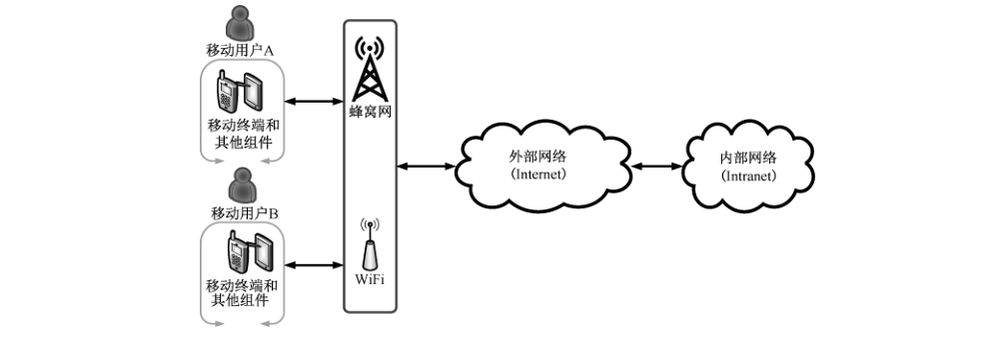

# GB/T 35278-2017 信息安全技术 移动终端安全保护技术要求

> 来源：[GB/T 35278-2017 国家标准详情](https://openstd.samr.gov.cn/bzgk/std/newGbInfo?hcno=CC40CAFA64EDC734FD4481CF6CFCDF0D)；发布日期：2017-12-29；实施日期：2018-07-01。
> PDF SHA-256：efe52b5026eab1f186a5e2f6b9c169d41f4f1eb21da065f9921ce550102e95a9。
> 转写说明：依据官方 PDF 的 30 页图像校核文字和组件编号，重建表格并合并跨页内容，保留两幅原图，省略封面、目录和页眉页脚。正式引用请核对原 PDF。

## 前言

本标准按照 GB/T 1.1—2009给出的规则起草。

请注意本文件的某些内容可能涉及专利。本文件的发布机构不承担识别这些专利的责任。

本标准由全国信息安全标准化技术委员会（SAC/TC 260）提出并归口。

本标准起草单位：中国信息通信研究院（工业和信息化部电信研究院）、北京邮电大学、中国移动通信集团公司、华为技术有限公司。

本标准主要起草人：翟世俊、宁华、潘娟、杨正军、姚一楠、焦四辈、国炜、袁琦、陈泓汲、袁捷、邱勤、黄曦、杨光华、何申、彭华熹、梁洪亮、刘书昌。

## 引言

随着移动互联网技术的迅速发展，移动终端得到了广泛的应用，并且在功能上不断扩展。伴随着移动终端智能化及网络宽带化的趋势，移动互联网业务层出不穷，日益繁荣。与此同时，移动终端也面临着各种安全威胁，如网络窃听、网络攻击、物理访问、恶意应用等，移动终端的安全面临着严峻挑战。本标准根据移动终端面临的安全威胁，依据GB/T 18336 的要求，提出了移动终端的安全目的，规定移动终端的安全功能要求和安全保障要求，为移动终端安全的设计、开发、测试和评估提供指导，有助于提高移动终端的安全水准，降低移动终端面临的风险，保护用户个人安全以及国家安全，防止移动终端对移动互联网安全产生的不利影响，推动整个移动互联网的健康发展。

## 1 范围

本标准规定了移动终端的安全保护技术要求，包括移动终端的安全目的、安全功能要求和安全保障要求。

本标准适用于移动终端的设计、开发、测试和评估。

## 2 规范性引用文件

下列文件对于本文件的应用是必不可少的。凡是注日期的引用文件，仅注日期的版本适用于本文件。凡是不注日期的引用文件，其最新版本（包括所有的修改单）适用于本文件。

GB/T 18336.1—2015 信息技术 安全技术 信息技术安全评估准则 第1部分：简介和一般模型

## 3 术语和定义、缩略语

### 3.1 术语和定义

GB/T 18336.1—2015 界定的以及下列术语和定义适用于本文件。

#### 3.1.1 移动终端 mobile terminal

在移动通信网络中使用的移动计算设备，包括移动智能终端及其他具有类似功能的终端设备等。

#### 3.1.2 移动终端用户 mobile terminal user

使用移动终端，与移动终端进行交互并负责移动终端的物理控制和操作的对象。

#### 3.1.3 用户数据 user data

移动智能终端上存储的用户个人信息，包括由用户在本地生成的数据、为用户在本地生成的数据、在用户许可后由外部进入用户数据区的数据等。

#### 3.1.4 应用软件 application software

移动终端操作系统之上安装的，向用户提供服务功能的软件。

#### 3.1.5 访问控制 access control

一种保证数据处理系统的资源只能由被授权主体按授权方式进行访问的手段。

#### 3.1.6 易失性存储器 volatile memory

当电流关掉后，所储存的资料便会消失的电脑或终端存储介质。

#### 3.1.7 授权 authorization

在用户身份经过认证后，根据预先设置的安全策略，授予用户相应权限的过程。

#### 3.1.8 数字签名 digital signature

附在数据单元后面的数据，或对数据单元进行密码变换得到的数据。允许数据的接收者验证数据的来源和完整性，保护数据不被篡改、伪造，并保证数据的不可否认性。

#### 3.1.9 漏洞 vulnerability

计算机信息系统在需求、设计、实现、配置、运行等过程中，有意或无意产生的缺陷。这些缺陷以不同形式存在于计算机信息系统的各个层次和环节之中，一旦被恶意主体所利用，就会对计算机信息系统的安全造成损害，从而影响计算机信息系统的正常运行。

### 3.2 缩略语

下列缩略语适用于本文件。

ASLR：地址空间布局随机化（Address Space Layout Randomization）

DEK：数据加密密钥（Data Encryption Key）

IPSec：互联网协议安全性（Internet Protocol Security）

KEK：密钥加密密钥（Key Encryption Key）

RBG：随机数产生（Random Bit Generation）

REK：根加密密钥（Root Encryption Key）

ST：安全目标（Security Target）

SSL：安全套接层（Secure Sockets Layer）

TLS：传输层安全协议（Transport Layer Security）

TOE：评估对象（Target of Evaluation）

TSF：TOE 安全功能（TOE Security Functionality）

TSFI：TOE 安全功能接口（TSF Interface）

VPN：虚拟专用网络（Virtual Private Network）

WLAN：无线局域网（Wireless local area network）

## 4 移动终端概述

移动终端可以提供无线连接、安全消息、电子邮件、网络、VPN 连接、VoIP 等软件，用于访问受保护的数据和应用，以及与其他移动终端进行通信。移动终端的网络环境如图1所示。在该标准中，移动终端包括移动智能终端及其他具有类似功能的终端设备。

移动终端的架构如图2所示，包括硬件、系统软件、应用软件、接口、用户数据等，硬件包括处理器、存储芯片、输入输出等部件；系统软件包括操作系统、基础通信协议软件等；应用软件包括预置和安装的第三方应用软件；用户数据包括所有由用户产生或为用户服务的数据；接口包括蜂窝网络接口、无线外围接口、有线外围接口、外置存储设备等。移动终端应提供加密服务、静态数据保护、密钥存储、访问控制、用户认证、软件完整性保护等服务，保证移动终端的保密性、可用性和完整性，降低移动终端所面临的网络攻击、恶意软件等风险，保障用户的移动终端信息安全。

## 5 安全问题

### 5.1 假设

#### 5.1.1 配置（A.CONFIG）

假设正确地配置了移动终端的安全功能，以确保移动终端的所有网络通信都执行了相应的安全策略。

#### 5.1.2 预防措施（A.PRECAUTION）

假设移动用户执行了预防措施，以减少移动终端丢失或失窃后用户信息泄露的风险。

### 5.2 安全威胁

#### 5.2.1 网络窃听（T.EAVESDROP）

攻击者监听或者截获移动终端与另一端点进行交互的数据。

#### 5.2.2 网络攻击（T.NETWORK）

攻击者通过发起和移动终端的通信对其进行攻击，或者通过更改移动终端和其他端点之间的通信对其进行攻击。

#### 5.2.3 物理访问（T.PHYSICAL）

移动终端被盗或者丢失后，攻击者可通过对移动终端的物理接入获得移动终端上的数据。通常的接入方式包括外部硬件接口、用户接口，或者直接进行破坏性接入到移动终端的存储介质。

#### 5.2.4 恶意应用软件（T.FLAWAPP）

在移动终端上，可通过多种形式下载并安装应用软件。除了正规的应用商店外，还有很多第三方应用商店向用户提供应用软件下载，而这些第三方应用商店为恶意应用软件提供了分发渠道，恶意应用软件可盗取移动终端上的数据。恶意应用软件先攻击平台系统软件，获得额外的权限来实施进一步的恶意行为，这些恶意的行为包括控制终端的传感器，如GPS、摄像头、麦克风，以便收集用户的信息，然后将这些信息发送到网络。

#### 5.2.5 持续攻击（T.PERSISTENT）

移动终端被攻击者持续攻击意味着该终端已经失去了完整性。移动终端被攻击者持续访问，对移动终端自身构造了持续的威胁，移动终端及其数据可以被攻击者控制或访问。

## 6 安全目的

### 6.1 TOE 安全目的

#### 6.1.1 通信保护（O.COMMS）

为了应对网络窃听和网络攻击的威胁，在移动终端和远程网络实体之间通过无线方式传输用户数据以及配置数据时，需使用可信的通信路径。移动终端应使用下面标准协议中的一个或多个进行通信：IPsec、DTLS、TLS 或 HTTPS，实施该要求能够在提供互通性的同时应对网络窃听和网络攻击。

#### 6.1.2 存储保护（O.STORAGE）

为了应对移动终端丢失的情况下用户数据保密性损失的问题，移动终端应提供数据保护功能。移动终端应能够对存储在终端上的数据和密钥进行加密，并防止对这些加密数据的非授权访问。

#### 6.1.3 移动终端安全策略配置（O.CONFIG）

移动终端应对其存储或处理的用户数据进行保护，移动终端应提供配置和应用安全策略的功能。

如果移动终端配置了安全策略，应按照用户指定的安全策略的优先级应用这些安全策略。

#### 6.1.4 授权和鉴别（O.AUTH）

为了应对移动终端丢失的情况下丧失用户数据的机密性，在访问受保护的功能和数据之前，用户需要向移动终端发起鉴权申请。一些非敏感功能（如拨打紧急电话、文字提示）可以无需鉴权直接访问。

移动终端应按照用户配置的时间自动锁定，以确保移动终端丢失或被盗情况下的授权访问。通信中，网络节点应经过鉴权建立合法连接，以确保无法建立非授权的网络连接。

#### 6.1.5 移动终端完整性（O.INTEGRITY）

为了确保移动终端的完整性，移动终端应能自检其关键功能、软件、固件和数据的完整性，自检失败的信息应能提示给用户。为应对应用程序漏洞和恶意软件攻击，对软件和固件版本升级也应在安装运行前进行完整性检测。移动终端应限制应用软件仅能访问授权的系统服务和数据。移动终端应对恶意应用软件攻击进行专门保护，防止恶意应用软件获取其非授权访问的数据。

### 6.2 环境安全目的

#### 6.2.1 配置（OE.CONFIG）

移动终端管理员应正确配置移动终端安全功能，以执行预定的安全策略。

#### 6.2.2 预防措施（OE.PRECAUTION）

移动用户应采取预防措施，以减少移动终端丢失或失窃后用户信息泄露的风险。

## 7 安全功能要求

### 7.1 概述

表1列出了移动终端安全功能要求组件，下述各条对各组件给出了详细说明。赋值及选择操作用斜体表示。

**表1 安全功能要求组件**

| 安全功能类 | 安全功能要求组件 | 编号 |
| --- | --- | --- |
| FAU 类：安全审计 | FAU_GEN.1 审计数据产生 | 1 |
| FAU 类：安全审计 | FAU_SAR.1 审计查阅 | 2 |
| FAU 类：安全审计 | FAU_SAR.2 有限审计查阅 | 3 |
| FAU 类：安全审计 | FAU_SAR.3 可选审计查阅 | 4 |
| FAU 类：安全审计 | FAU_SEL.1 选择性审计 | 5 |
| FAU 类：安全审计 | FAU_STG.1 受保护的审计迹存储 | 6 |
| FAU 类：安全审计 | FAU_STG.4 防止审计数据丢失 | 7 |
| FCS 类：密码支持 | FCS_CKM.1.1 密钥生成 | 8 |
| FCS 类：密码支持 | FCS_CKM.2.1 密钥分发 | 9 |
| FCS 类：密码支持 | FCS_CKM_EXT.1 密钥支持 | 10 |
| FCS 类：密码支持 | FCS_CKM_EXT.2 数据加密密钥 | 11 |
| FCS 类：密码支持 | FCS_CKM_EXT.3 密钥加密密钥 | 12 |
| FCS 类：密码支持 | FCS_CKM_EXT.4 密钥销毁 | 13 |
| FCS 类：密码支持 | FCS_CKM_EXT.5 TSF 擦除 | 14 |
| FCS 类：密码支持 | FCS_CKM_EXT.6 盐值生成 | 15 |
| FCS 类：密码支持 | FCS_COP.1 密码运算 | 16 |
| FCS 类：密码支持 | FCS_HTTPS_EXT.1 HTTPS 协议 | 17 |
| FCS 类：密码支持 | FCS_IV_EXT.1 初始向量生成 | 18 |
| FCS 类：密码支持 | FCS_RBG_EXT.1 随机位生成器 | 19 |
| FCS 类：密码支持 | FCS_SRV_EXT.1 密码算法服务 | 20 |
| FCS 类：密码支持 | FCS_STG_EXT.1 密钥存储 | 21 |
| FCS 类：密码支持 | FCS_STG_EXT.2 存储密钥的加密 | 22 |
| FCS 类：密码支持 | FCS_STG_EXT.3 存储密钥的完整性 | 23 |
| FCS 类：密码支持 | FCS_TLSC_EXT.1 EAP-TLS 客户端协议 | 24 |
| FCS 类：密码支持 | FCS_TLSC_EXT.2 TLS 客户端协议 | 25 |
| FDP 类：用户数据保护 | FDP_ACF_EXT.1 访问控制 | 26 |
| FDP 类：用户数据保护 | FDP_DAR_EXT.1 静态数据保护 | 27 |
| FDP 类：用户数据保护 | FDP_IFC_EXT.1 子集信息流控制 | 28 |
| FDP 类：用户数据保护 | FDP_STG_EXT.1 用户数据存储 | 29 |
| FDP 类：用户数据保护 | FDP_UPC_EXT.1 TSF 间用户数据传输保护 | 30 |
| FIA 类：标识和鉴别 | FIA_AFL_EXT.1 鉴别失败处理 | 31 |
| FIA 类：标识和鉴别 | FIA_BLT_EXT.1 蓝牙用户鉴别 | 32 |
| FIA 类：标识和鉴别 | FIA_PMG_EXT.1 口令管理 | 33 |
| FIA 类：标识和鉴别 | FIA_TRT_EXT.1 鉴别限制 | 34 |
| FIA 类：标识和鉴别 | FIA_UAU.7 受保护的鉴别反馈 | 35 |
| FIA 类：标识和鉴别 | FIA_UAU_EXT.1 加密运算的鉴别 | 36 |
| FIA 类：标识和鉴别 | FIA_UAU_EXT.2 鉴别的时机 | 37 |
| FIA 类：标识和鉴别 | FIA_UAU_EXT.3 重鉴别 | 38 |
| FIA 类：标识和鉴别 | FIA_X509_EXT.1 证书验证 | 39 |
| FIA 类：标识和鉴别 | FIA_X509_EXT.2 证书鉴别 | 40 |
| FIA 类：标识和鉴别 | FIA_X509_EXT.3 请求证书验证 | 41 |
| FMT 类：安全管理 | FMT_MOF.1 安全功能行为的管理 | 42 |
| FMT 类：安全管理 | FMT_SMF.1 管理功能规范 | 43 |
| FMT 类：安全管理 | FMT_SMF_EXT.1 补救措施规范 | 44 |
| FPT 类：TSF 保护 | FPT_AEX_EXT.1 地址空间布局随机化 | 45 |
| FPT 类：TSF 保护 | FPT_AEX_EXT.2 存储页权限 | 46 |
| FPT 类：TSF 保护 | FPT_AEX_EXT.3 堆栈溢出保护 | 47 |
| FPT 类：TSF 保护 | FPT_AEX_EXT.4 域隔离 | 48 |
| FPT 类：TSF 保护 | FPT_KST_EXT.1 密钥存储 | 49 |
| FPT 类：TSF 保护 | FPT_KST_EXT.2 密钥传输 | 50 |
| FPT 类：TSF 保护 | FPT_KST_EXT.3 明文密钥导出 | 51 |
| FPT 类：TSF 保护 | FPT_NOT_EXT.1 自检通知 | 52 |
| FPT 类：TSF 保护 | FPT_STM.1 可靠的时间戳 | 53 |
| FPT 类：TSF 保护 | FPT_TST_EXT.1 TSF 加密功能测试 | 54 |
| FPT 类：TSF 保护 | FPT_TST_EXT.2 TSF 完整性测试 | 55 |
| FPT 类：TSF 保护 | FPT_TUD_EXT.1 可信更新：TSF 版本查询 | 56 |
| FPT 类：TSF 保护 | FPT_TUD_EXT.2 可信更新的验证 | 57 |
| FTA 类：TOE 访问 | FTA_SSL_EXT.1 TSF 和用户启动的锁定状态 | 58 |
| FTA 类：TOE 访问 | FTA_WSE_EXT.1 无线网络接入 | 59 |
| FTP 类：可信路径/信道 | FTP_ITC_EXT.1 可信通道通信 | 60 |

### 7.2 FAU类：安全审计

#### 7.2.1 审计数据产生（FAU_GEN.1）

FAU_GEN.1.1 TSF 应能为下述可审计事件产生可审计记录：

a） 审计功能的启动和关闭；

b） 可审计事件的最小集合；

c）［赋值：*其他专门定义的可审计事件*］。

FAU_GEN.1.2 TSF 应在每个审计记录中至少记录如下信息：

a） 事件的日期和事件、事件的类型、事件的主体身份、事件的结果（成功或失败）；

b） 基于安全功能组件中可审计事件定义的［赋值：*其他审计相关信息*］。

#### 7.2.2 审计查阅（FAU_SAR.1）

FAU_SAR.1.1 TSF 应［赋值：*授权用户，审计管理员*］提供从审计记录中读取［赋值：*审计信息列表*］的能力。

FAU_SAR.1.2 TSF 应以便于用户理解的方式提供审计记录。

#### 7.2.3 有限审计查阅（FAU_SAR.2）

FAU_SAR.2.1 除具有明确读访问权限的用户外，TSF 应禁止所有用户对审计记录的访问。

#### 7.2.4 可选审计查阅（FAU_SAR.3）

FAU_SAR.3.1 TSF 应根据［赋值：具有逻辑关系的标准］提供对审计数据进行［赋值：*搜索、分类、排序*］的能力。

#### 7.2.5 选择性审计（FAU_SEL.1）

FAU_SEL.1.1 TSF 应能根据以下属性从审计事件集中包括或排除可审计事件：

a）［选择：*用户身份，事件类型*］；

b）［赋值：*审计选择所依据的附加属性表*］。

#### 7.2.6 受保护的审计迹存储（FAU_STG.1）

FAU_STG.1.1 TSF 应保护所存储的审计记录，以避免未授权的删除。

FAU_STG.1.2 TSF 应能［选择，选取一个：*防止、检测*］对审计迹中所存储审计记录的未授权修改。

#### 7.2.7 防止审计数据丢失（FAU_STG.4）

FAU_STG.4.1 如果审计迹已满，TSF 应［选择，选取一个：*“忽略可审计事件”“阻止可审计事件，除具有特权的授权用户产生的”“涵盖所存储的最早的审计记录”*］和［赋值：*审计存储失效时所采取的其他动作*］。

### 7.3 FCS类：密码支持

#### 7.3.1 密钥生成（FCS_CKM.1.1）

FCS_CKM.1.1 移动终端的安全功能应根据符合下列标准［赋值：*标准列表*］中的特定的密钥生成算法［赋值：*密钥生成算法*］和规定的密钥长度［赋值：*密钥长度*］来生成密钥。

#### 7.3.2 密钥分发（FCS_CKM.2.1）

FCS_CKM.2.1 移动终端的安全功能应根据符合下列标准［赋值：*标准列表*］中的一个特定的密钥分发方法［赋值：*密钥分发方法*］来分发密钥。

#### 7.3.3 密钥支持（FCS_CKM_EXT.1）

FCS_CKM_EXT.1.1 移动终端的安全功能应支持［选择：*硬件隔离，硬件保护*］的密钥大小为［选择：*密钥长度*］的根加密密钥。

FCS_CKM_EXT.1.2 移动终端的安全功能上的系统软件应只能通过密钥请求［选择：*加密/解密，密钥分发*］，不能够读取、导入、导出根加密密钥。

FCS_CKM_EXT.1.3 应按照 FCS_RBG_EXT.1 的随机位生成器来生成根加密密钥。

#### 7.3.4 数据加密密钥（FCS_CKM_EXT.2）

FCS_CKM_EXT.2.1 所有的数据加密密钥应按照［选择：*密钥长度*］的［选择：*密钥生成算法*］的安全强度对应的熵来随机生成。

#### 7.3.5 密钥加密密钥（FCS_CKM_EXT.3）

FCS_CKM_EXT.3.1 所有密钥加密密钥（KEKs）应为［赋值：*密钥长度*］密钥，至少相应于被 KEK加密的密钥的安全强度。

FCS_CKM_EXT.3.2 移动终端的安全功能应使用以下方法［赋值：*方法列表*］，从一个口令授权因子中导出所有密钥加密密钥。

#### 7.3.6 密钥销毁（FCS_CKM_EXT.4）

FCS_CKM_EXT.4.1 移动终端的安全功能应按照规定的密钥销毁方法［选择：*密钥销毁方法*］销毁密钥。

FCS_CKM_EXT.4.2 移动终端的安全功能应销毁所有不再需要的明文密钥材料和关键安全参数。

#### 7.3.7 TSF 擦除（FCS_CKM_EXT.5）

FCS_CKM_EXT.5.1 移动终端的安全功能应在擦除受保护数据时：

a） EEPROM：销毁应进行单向随机数覆盖，覆盖后应进行读取验证；

b） 闪存：销毁应进行单向全零覆盖或块擦除，覆盖或擦除后应进行读取验证；

c） 其他非易失存储器：销毁应进行三次或三次以上随机数覆盖，每次覆盖使用的随机数不同。

FCS_CKM_EXT.5.2 移动终端的安全功能应在擦拭程序结束时重新启动。

#### 7.3.8 盐值生成（FCS_CKM_EXT.6）

FCS_CKM_EXT.6.1 移动终端的安全功能应使用满足 FCS_RBG_EXT.1 的RBG 生成所有的盐值。

#### 7.3.9 密码运算（FCS_COP.1）

FCS_COP.1.1（1）移动终端的安全功能应按照满足下列标准［赋值：*标准列表*］规定的密码算法［赋值：*密码算法*］和密钥长度［赋值：*密钥长度*］执行*加密/解密*。

FCS_COP.1.1（2） 移动终端的安全功能应按照满足下列标准［赋值：*标准列表*］规定的密码算法［赋值：*密码算法*］和密钥长度［赋值：*密钥长度*］来执行［赋值：*密码散列*］。

FCS_COP.1.1（3） 移动终端的安全功能应按照规定的密码算法［赋值：*密码算法*］执行密码签名服务（生成和验证）。

FCS_COP.1.1（4） 移动终端的安全功能应按照满足下列标准［赋值：*标准列表*］规定的密码算法［赋值：*密码算法*］和密钥长度［赋值：*密钥长度*］来执行散列消息鉴别。

FCS_COP.1.1（5） 移动终端的安全功能应按照下列标准［赋值：*标准列表*］规定的密码算法［赋值：*密码算法*］和输出密钥长度［赋值：*密钥长度*］来执行基于口令的密钥导出算法。

#### 7.3.10 HTTPS 协议（FCS_HTTPS_EXT.1）

FCS_HTTPS_EXT.1.1 移动终端的安全功能应执行符合标准的 HTTPS协议。

FCS_HTTPS_EXT.1.2 移动终端的安全功能应执行使用 TLS的 HTTPS协议。

FCS_HTTPS_EXT.1.3 如果对等证书被视为无效，移动终端的安全功能应通知应用程序和［选择：*没有建立连接，请求应用程序授权建立连接，没有其他的动作*］。

#### 7.3.11 初始向量生成（FCS_IV_EXT.1）

FCS_IV_EXT.1.1 移动终端的安全功能应按照规定的加密模式［赋值：*加密模式*］的要求来生成初始向量。

#### 7.3.12 随机位生成器（FCS_RBG.1）

FCS_RBG_EXT.1.1 移动终端的安全功能应产生TSF 密码功能中所使用的所有随机数，随机数产生器应符合国家标准和国家密码管理机构相关标准要求。

#### 7.3.13 密码算法服务（FCS_SRV_EXT.1）

FCS_SRV_EXT.1.1 移动终端的安全功能应向应用提供一种机制来请求移动终端安全功能执行密码运算［赋值：*密码运算列表*］。

#### 7.3.14 密钥存储（FCS_STG_EXT.1）

FCS_STG_EXT.1.1 移动终端的安全功能应为非对称私钥和［选择：*对称密钥，持久秘密，没有其他密钥*］提供［选择：*硬件，硬件隔离，基于软件*］的安全密钥存储。

FCS_STG_EXT.1.2 移动终端的安全功能应能根据［选择：*用户，管理员*］和［选择：*运行在 TSF上的应用，无其他项目*］请求，将密钥/秘密导入到安全密钥存储中。

FCS_STG_EXT.1.3 移动终端的安全功能应能根据［选择：*用户，管理员*］的请求，销毁存储在安全密钥存储中的密钥/秘密。

FCS_STG_EXT.1.4 移动终端的安全功能应只允许导入了密钥/秘密的应用才能使用密钥/秘密。例外的情况只能是被［选择：*用户，管理员，普通应用开发者*］明确授权。

FCS_STG_EXT.1.5 移动终端的安全功能应只允许导入了密钥/秘密的应用才能请求销毁密钥/秘密。例外的情况只能是被［选择：*用户，管理员，普通应用开发者*］明确授权。

#### 7.3.15 存储密钥的加密（FCS_STG_EXT.2）

FCS_STG_EXT.2.1 移动终端的安全功能应通过KEKs加密所有的 DEKs和 KEKs和［选择：*长期信任的信道密钥材料，所有基于软件的密钥存储，没有其他密钥*］，即是［选择：通过 REK 利用［选择：*由 REK 加密，由链接到 REK的 KEK 加密*］来保护，通过 REK 和口令利用［选择：*由 REK 和口令派生的 KEK 加密，由链接到 REK的 KEK 和口令派生 KEK 加密*］来保护］。

FCS_STG_EXT.2.2 应使用下列标准［赋值：*标准列表*］规定的密码算法［赋值：*密码算法*］对DEKs和 KEKs 和［选择：*长期信任的信道密钥材料，所有基于软件的密钥存储，没有其他密钥*］进行加密。

#### 7.3.16 存储密钥的完整性（FCS_STG_EXT.3）

FCS_STG_EXT.3.1 移动终端的安全功能应通过以下方式［赋值：*方式列表*］来保护 DEKs和KEKs和［选择：*长期信任的信道密钥材料，所有基于软件的密钥存储，没有其他密钥*］的完整性。

FCS_STG_EXT.3.2 在使用密钥之前，移动终端的安全功能应验证存储密钥的［选择：*哈希，数字签名，MAC*］的完整性。

#### 7.3.17 EAP-TLS 客户端协议（FCS_TLSC_EXT.1）

FCS_TLSC_EXT.1.1 移动终端的安全功能应实现支持以下套件［赋值：*密码套件列表*］的TLS 1.0和［选择：*TLS 1.1,TLS 1.2，没有其他TLS版本*］。

FCS_TLSC_EXT.1.2 移动终端的安全功能应验证为 EAP-TLS 提供的服务器证书［选择：*链接到指定的 CAs 中的一个，包括可接受的鉴别服务器证书的指定 FQDN*］。

FCS_TLSC_EXT.1.3 如果对方的证书是无效的，移动终端的安全功能应不建立可信信道。

FCS_TLSC_EXT.1.4 移动终端的安全功能应支持使用规定的证书来进行相互验证。

#### 7.3.18 TLS 客户端协议（FCS_TLSC_EXT.2）

FCS_TLSC_EXT.2.1 移动终端的安全功能应实现支持以下密码套件［赋值：*密码套件列表*］的TLS 1.2。

FCS_TLSC_EXT.2.1 移动终端的安全功能应根据标准验证给出的标识与参考标识相匹配。

FCS_TLSC_EXT.2.3 如果对等证书无效，移动终端的安全功能不应建立可信信道。

FCS_TLSC_EXT.2.4 移动终端的安全功能应支持使用规定的证书来进行相互验证。

### 7.4 FDP类：用户数据保护

#### 7.4.1 访问控制（FDP_ACF_EXT.1）

FDP_ACF_EXT.1.1 移动终端的安全功能应提供一种机制来限制应用程序访问系统服务。

FDP_ACF_EXT.1.2 移动终端的安全功能应提供一种访问控制策略来防止［选择：*应用程序，应用程序组*］访问［选择：*应用程序，应用程序组*］存储的［选择：*全部，隐私*］数据。例外的只能是被［选择：*用户，管理员，普通的应用程序开发者*］明确授权用于共享。

#### 7.4.2 静态数据保护（FDP_DAR_EXT.1）

FDP_DAR_EXT.1.1 应加密所有受保护数据。

FDP_DAR_EXT.1.2 应使用密钥长度为［选择：*密钥长度*］，密码算法［赋值：*密码算法*］的DEKs来执行加密。

#### 7.4.3 子集信息流控制（FDP_IFC_EXT.1）

FDP_IFC_EXT.1.2 移动终端的安全功能应提供 VPN 客户端接口，或数据流直接通过VPN客户端的方式传输，如 IPsec VPN 或者 SSL VPN。

#### 7.4.4 用户数据存储（FDP_STG_EXT.1）

FDP_STG_EXT.1.1 移动终端的安全功能应为信任锚数据库提供受保护的存储。

#### 7.4.5 TSF 间用户数据传输保护（FDP_UPC_EXT.1）

FDP_UPC_EXT.1.1 移动终端的安全功能应支持应用 IPsec、DTLS、TLS、HTTPS、蓝牙中至少一种方式进行安全通信。

FDP_UPC_EXT.1.2 移动终端的安全功能应允许非移动终端安全功能应用通过可信信道发起通信。

### 7.5 FIA类：标识和鉴别

#### 7.5.1 鉴别失败处理（FIA_AFL_EXT.1）

FIA_AFL_EXT.1.1 移动终端的安全功能应检测何时发生［赋值：*正整数*］次相对于该用户最后成功鉴别的未成功鉴别尝试。

FIA_AFL_EXT.1.2 当超过所定义的未成功鉴别尝试的次数，移动终端的安全功能应擦除所有受保护的数据。

FIA_AFL_EXT.1.3 移动终端的安全功能应在发生断电后保持不成功的鉴别尝试次数。

#### 7.5.2 蓝牙用户鉴别（FIA_BLT_EXT.1）

FIA_BLT_EXT.1.1 移动终端的安全功能应在与其他蓝牙设备配对前进行用户鉴别。

#### 7.5.3 口令管理（FIA_PMG_EXT.1）

FIA_PMG_EXT.1.1 移动终端安全功能应支持以下功能：

a） 口令应可以由大写英文字母、小写英文字母、数字、特殊字符任意组合而成；

b） 口令长度不低于6位。

#### 7.5.4 鉴别限制（FIA_TRT_EXT.1）

FIA_TRT_EXT.1.1 移动终端的安全功能应通过［选择：*防止通过外部端口鉴别，强制执行不正确鉴别尝试之间的时延*］对自动用户鉴别进行限制。用户认证尝试连续失败次数不超过10次，两次尝试间隔应不小于 500 ms。

#### 7.5.5 受保护的鉴别反馈（FIA_UAU.7）

FIA_UAU.7.1 移动终端鉴别用户时，移动终端的安全功能应向用户提供隐式显示或提示，如显示*号，不允许明文显示和提示。

#### 7.5.6 加密运算鉴别（FIA_UAU_EXT.1）

FIA_UAU_EXT.1.1 在启动时，移动终端的安全功能应要求用户在解密受保护数据和加密 DEKs、KEKs 和［选择：*长效密钥材料，软件密钥存储，无其他密钥*］之前输入身份认证因子口令。

#### 7.5.7 鉴别的时机（FIA_UAU_EXT.2）

FIA_UAU_EXT.2.1 在用户被鉴别之前，移动终端的安全功能应允许执行代表用户的［选择：［赋值：*动作列表*］，无其他动作］。

FIA_UAU_EXT.2.2 在允许执行代表用户的任何其他TSF 介导之前，移动终端的安全功能应要求每个用户都已被成功鉴别。

#### 7.5.8 重鉴别（FIA_UAU_EXT.3）

FIA_UAU_EXT.3.1 当用户更改口令鉴别因子时，移动终端的安全功能应要求用户输入正确的口令鉴别因子，并按照移动终端安全功能和用户发起的锁定过度到解锁状态，和［选择：［赋值：*其他条件*］，无其他条件］。

#### 7.5.9 证书验证（FIA_X509_EXT.1）

FIA_X509_EXT.1.1 TSF 应按照下面的规则验证证书：

a） 国家标准或国际标准规定的证书验证和证书路径验证。

b） 移动终端的安全功能应使用［选择：*规定的在线证书状态协议，规定的证书撤销列表*］来验证证书的吊销状态。

#### 7.5.10 证书鉴别（FIA_X509_EXT.2）

FIA_X509_EXT.2.1 移动终端的安全功能应支持特定的认证来支持 EAP-TLS 交换，以及［选择：*IPsec,TLS, HTTPS,DTLS*］认证，和［选择：系统软件更新代码签名，移动应用代码签名，完整性验证代码签名，［赋值：*其他用途*］，没有其他用途］。

FIA_X509_EXT.2.2 当移动终端的安全功能无法建立连接以确定证书的有效性时，移动终端的安全功能应［选择：*允许管理员在这些情况下选择是否接受证书，允许用户在这些情况下选择是否接受证书，接受证书，不接受证书*］。

#### 7.5.11 请求证书验证（FIA_X509_EXT.2）

FIA_X509_EXT.3.1 移动终端的安全功能应向应用程序提供证书验证服务。

FIA_X509_EXT.3.2 移动终端的安全功能应向请求的应用程序提供验证成功或失败的回应。

### 7.6 FMT 类：安全管理

#### 7.6.1 安全功能行为的管理（FMT_MOF.1）

FMT_MOF.1.1 移动终端的安全功能应限制用户执行表2第3列中功能的能力。

FMT_MOF.1.2 当设备已注册并根据管理员的配置策略，移动终端的安全功能应限制管理员执行表2第5列中功能的能力。

#### 7.6.2 管理功能规范（FMT_SMF_EXT.1）

FMT_SMF_EXT.1.1 移动终端的安全功能应能够执行如下管理功能。

**表2 管理功能**

| 序号 | 管理功能 | FMT_SMF_EXT.1 | FMT_MOF_EXT.1.1 | 管理员 | FMT_MOF_EXT.1.2 |
| --- | --- | --- | --- | --- | --- |
| 1 | 口令配置策略： a）最小口令长度； b）最小口令复杂度； c）最大口令生命周期 | M | — | M | M |
| 2 | 锁定配置策略： a）屏幕锁定开启和关闭； b）屏幕锁定启动时间； c）最大允许解锁口令输入错误数 | M | — | M | M |
| 3 | 开启/关闭 VPN 保护策略： a）基于整个设备进行配置； ［选择： b）基于每个应用进行配置； c）无其他方法］ | M | O | O | O |
| 4 | 开启/关闭［赋值：无线连接列表］ | M | O | O | O |
| 5 | 启用/禁用［赋值：音频或视频采集设备列表］： a）基于整个设备进行配置； ［选择： b）基于每个应用进行配置； c）无其他方法］ | M | — | M | M |
| 6 | 配置安全功能允许连接的特定的无线网络（SSIDs） | M | — | M | O |
| 7 | 为每个无线网络进行安全策略配置： a）指定设备接受 WLAN 认证服务器验证的 CA(s)，或指定可接受 WLAN 认证服务器验证的 FQDN(s)； b）指定安全类型的能力； c）指定认证协议的能力； d）指定认证时客户端凭证 | M | — | M | O |
| 8 | 进入锁定状态的策略 | M | — | M | — |
| 9 | 受保护数据全擦除策略配置 | M | — | M | — |
| 10 | 应用安装策略配置： a）应用来源限制策略； b）应用白名单［赋值：应用属性］； c）拒绝安装应用 | M | — | M | M |
| 11 | 将密钥/凭证导入安全密钥存储策略 | M | O | O | — |
| 12 | 销毁安全密钥存储中密钥/凭证和［选择：无其他密钥/凭证，［赋值：其他类密钥/凭证的列表］］ | M | O | O | — |
| 13 | 将数字证书导入信任锚数据库策略 | M | — | M | O |
| 14 | 删除信任锚数据库中导入的数字证书和［选择：无其他数字证书，［赋值：其他类数字证书的列表］］ | M | O | O | — |
| 15 | 将 TOE 加入管理 | M | M | O | — |
| 16 | 删除应用策略 | M | — | M | O |
| 17 | 系统软件更新策略 | M | — | M | O |
| 18 | 应用安装策略 | M | — | M | O |
| 19 | 删除应用策略 | M | — | M | — |
| 20 | 配置蓝牙可信信道策略： a）开启/关闭发现模式； b）改变蓝牙设备名称； ［选择： c）允许/不允许其他无线技术取代蓝牙； d）开启/关闭广播； e）开启/关闭连接模式； f）开启/关闭设备上可用的蓝牙服务和/或配置； g）为每个配对指定最低的安全水平； h）带外配对的允许方法配置策略］ | M | O | O | O |
| 21 | 锁定状态下提示显示的开启/关闭策略： a）Email 提示； b）日历事件提醒； c）联系人来电提示； d）短消息提示； e）其他应用提示； f）所有提示 | M | O | O | O |
| 22 | 开启/关闭所有通过［赋值：外部可访问硬件端口列表］的数据信令 | O | O | O | O |
| 23 | 开启/关闭［赋值：终端作为服务器的协议列表］ | O | O | O | O |
| 24 | 开启/关闭开发者模式 | O | O | O | O |
| 25 | 启动静态数据保护 | O | O | O | O |
| 26 | 启动可移除媒体的静态数据保护 | O | O | O | O |
| 27 | 开启/关闭本地用户鉴别的绕过 | O | O | O | O |
| 28 | 擦除用户数据 | O | O | O | — |
| 29 | 准许由信任锚数据库中数字证书申请的［选择：导入，移除］ | O | O | O | O |
| 30 | 配置是否建立可信通道，以及在安全功能无法建立用于验证证书合法性的连接时是否不允许建立可信通道 | O | O | O | O |
| 31 | 开启/关闭用于连接蜂窝网基站的蜂窝网协议 | O | O | O | O |
| 32 | 读取由安全功能保存的审计日志 | O | O | O | — |
| 33 | 配置用于验证应用程序的数字签名的［选择：证书，公钥］ | O | O | O | O |
| 34 | 批准例外的被多个应用程序共享使用的密钥/凭证 | O | O | O | O |
| 35 | 批准例外的由没有导入密钥/凭证的应用销毁密钥/凭证 | O | O | O | O |
| 36 | 配置解锁标识 | O | — | O | O |
| 37 | 配置审计项目 | O | — | O | O |
| 38 | 提取 TSF-软件的完整性校验值 | O | O | O | O |
| 39 | 开启/关闭 ［选择： a）USB 大容量存储模式； b）用户身份未验证下 USB 数据传输； c）连接系统身份未验证下的 USB 数据传输］ | O | O | O | O |
| 40 | 开启/关闭备份到［选择：本地连接的系统，远程系统］ | O | O | O | O |
| 41 | 开启/关闭 ［选择： a）通过［选择：预共享密钥，口令，无验证］来认证热点功能； b）通过［选择：预共享密钥，口令，无验证］来认证 USB 绑定］ | O | O | O | O |
| 42 | 批准例外的用于［选择：应用程序，应用程序簇］之间共享数据 | O | O | O | O |
| 43 | 基于［赋值：应用属性］将应用置于应用程序组中 | O | O | O | O |
| 44 | 开启/关闭本地服务： a）基于整个设备进行配置； ［选择： b）基于每个应用进行配置； c）无其他方法］ | M | O | O | O |
| 45 | ［赋值：由安全功能提供的其他管理功能列表］ | O | O | O | O |

注：状态标记：M——强制性的；O——可选的。

#### 7.6.3 补救措施规范（FMT_SMF_EXT.1）

FMT_SMF_EXT.1 TSF 应向非注册的终端提供［选择：擦除受保护数据，擦除敏感数据，提醒管理员，移除应用，［赋值：其他可用补救行动的列表］］以及［选择：［赋值：其他管理员配置的触发器］，没有其他触发器］。

### 7.7 FPT类：TSF 保护

#### 7.7.1 地址空间布局随机化（FPT_AEX_EXT.1）

FPT_AEX_EXT.1.1 移动终端安全保护功能应向应用提供位址空间布局随机化。

FPT_AEX_EXT.1.2任何用户空间映射的基地址将包括至少8个不可预测的位。

#### 7.7.2 内存页权限（FPT_AEX_EXT.2）

FPT_AEX_EXT.2.1 移动终端安全保护功能应具有强制读取、写入和执行每个物理内存页的权限。

#### 7.7.3 堆栈溢出保护（FPT_AEX_EXT.3）

FPT_AEX_EXT.3.1 在应用处理器上的非特权执行域执行的移动终端安全功能进程应执行基于堆栈的缓冲区溢出保护。

#### 7.7.4 域隔离（FPT_AEX_EXT.4）

FPT_AEX_EXT.4.1 移动终端的安全功能应保护自己以免被不可信主体修改。

FPT_AEX_EXT.4.2 移动终端的安全功能应在应用之间执行地址空间隔离。

#### 7.7.5 密钥存储（FPT_KST_EXT.1）

FPT_KST_EXT.1.1 移动终端的安全功能不应将任何明文密钥材料存储在可读非易失性存储器中。

#### 7.7.6 密钥传输（FPT_KST_EXT.2）

FPT_KST_EXT.2.1 移动终端的安全功能不应在评估对象的安全边界外传输任何明文密钥材料。

#### 7.7.7 明文密钥导出（FPT_KST_EXT.3）

FPT_KST_EXT.3.1 移动终端的安全功能应确保评估对象的用户不可能导出明文密钥。

#### 7.7.8 自检通知（FPT_NOT_EXT.1）

FPT_NOT_EXT.1.1 当下述类型的错误发生时，移动终端的安全功能应转换到非操作模式，并且［选择：将错误记录到审计日志中，通知管理员，［赋值：其他行动］，没有其他行动］：

a） 自检错误；

b） 安全功能软件完整性验证错误；

c）［选择：无其他错误，［赋值：*其他错误*］］。

#### 7.7.9 可靠的时间戳（FPT_STM.1）

FPT_STM.1.1 移动终端的安全功能应能够提供可靠的时间戳供它自己使用。

#### 7.7.10 安全功能加密功能测试（FPT_TST_EXT.1）

FPT_TST_EXT.1.1 移动终端的安全功能应在初始启动（启动电源）期间运行一套自我测试，来证明所有加密功能的正确操作。

#### 7.7.11 安全功能完整性测试（FPT_TST_EXT.2）

FPT_TST_EXT.2.1 移动终端的安全功能应通过应用处理器操作系统内核和［选择：存储在可变的介质中的所有的可执行代码，［赋值：*其他执行代码的列表*］，无其他执行代码］来验证引导链的完整性，通过使用［选择：*使用硬件保护的非对称密钥的数字签名，硬件保护的非对称密钥，硬件保护的散列*］来执行。

#### 7.7.12 可信更新：TSF版本查询（FPT_TUD_EXT.1）

FPT_TUD_EXT.1.1 移动终端的安全功能应向授权用户提供查询移动终端固件/软件当前版本的能力。

FPT_TUD_EXT.1.2 移动终端的安全功能应向授权用户提供查询终端硬件模式的当前版本的能力。

FPT_TUD_EXT.1.3 移动终端的安全功能应向授权用户提供查询已安装的移动应用的当前版本的能力。

#### 7.7.13 可信更新的验证（FPT_TUD_EXT.2）

FPT_TUD_EXT.2.1 移动终端的安全功能应在安装这些更新之前使用制造商的数字签名来验证应用处理器系统软件和［选择：［赋值：*其他处理器系统软件*］，无其他处理器系统软件］的更新。

FPT_TUD_EXT.2.2 移动终端的安全功能应［选择：*从不更新，只被验证的软件更新*］安全功能启动的完整性［选择：*密钥，散列*］。

FPT_TUD_EXT.2.3 移动终端的安全功能应验证用于移动终端安全功能更新的数字签名验证密钥［选择：*被验证为信任锚数据库中的公钥，匹配硬件保护的公钥*］。

FPT_TUD_EXT.2.4 移动终端的安全功能应在安装之前使用数字签名机制验证移动应用软件。

### 7.8 FTA类：TOE 访问

#### 7.8.1 TSF 和用户启动的锁定状态（FTA_SSL_EXT.1）

FTA_SSL_EXT.1.1 移动终端的安全功能应在一定时间间隔的不活动状态后，转变为锁定状态。

FTA_SSL_EXT.1.2 移动终端的安全功能应在用户或管理员发起后，转变为锁定状态。

FTA_SSL_EXT.1.3 移动终端的安全功能应在转换到锁定状态时执行以下操作：

a） 清除或覆盖显示终端，遮挡以前的内容；

b）［赋值：*在转换到锁定状态下执行其他动作*］。

#### 7.8.2 无线网络接入（FTA_WSE_EXT.1）

FTA_WSE_EXT.1.1移动终端的安全功能应能够尝试连接到按照在 FMT_SMF_EXT.1 中被管理员配置的指定为可接受网络的无线网络。

### 7.9 FTP 类：可信路径/信道

#### 7.9.1 可信通道通信（FTP_ITC_EXT.1）

FTP_ITC_EXT.1.1 移动终端的安全功能应用 IPSec、TLS、TLS/HTTPS 或者其他安全传输协议提供其与其他受信任的IT 产品间的一个可信安全通信通道。该通道要与其他通信通道逻辑区分，要提供对通道起点和终点的识别，确保通信数据不被泄露，监测数据不被篡改。

FTP_ITC_EXT.1.2 移动终端的安全功能应允许安全功能通过可信信道发起通信。

FTP_ITC_EXT.1.3 移动终端的安全功能应通过可信信道发起通信，用于无线接入点连接，管理通信，配置连接和［选择：*OTA 更新，无其他连接*］。

## 8 安全保障要求

### 8.1 概述

表3列出了安全保障要求组件。下述各条对各组件给出了详细的说明。

**表3 安全保障要求组件**

| 安全保障类 | 安全保障组件 | 编号 |
| --- | --- | --- |
| ADV 类：开发 | ADV_FSP.1 基本功能规范 | 1 |
| AGD 类：指导性文档 | AGD_OPE.1 用户操作指南 | 2 |
| AGD 类：指导性文档 | AGD_PRE.1 准备过程 | 3 |
| ALC 类：生命周期支持 | ALC_CMC.1 TOE 标签 | 4 |
| ALC 类：生命周期支持 | ALC_CMS.1 TOE CM 覆盖 | 5 |
| ALC 类：生命周期支持 | ALC_TSU_EXT 及时的安全更新 | 6 |
| ASE 类：安全目标评估 | ASE_CCL.1 符合性声明 | 7 |
| ASE 类：安全目标评估 | ASE_ECD.1 扩展组件定义 | 8 |
| ASE 类：安全目标评估 | ASE_INT.1 ST 引言 | 9 |
| ASE 类：安全目标评估 | ASE_OBJ.1 安全目的 | 10 |
| ASE 类：安全目标评估 | ASE_REQ.1 安全要求导出 | 11 |
| ASE 类：安全目标评估 | ASE_SPD.1 安全问题定义 | 12 |
| ASE 类：安全目标评估 | ASE_TSS.1 TOE 概要规范 | 13 |
| ATE 类：测试 | ATE_IND.1 独立测试——一致性 | 14 |
| AVA 类：脆弱性评估 | AVA_VAN.1 脆弱性评估 | 15 |

### 8.2 ADV 类：开发

#### 8.2.1 基本功能规范（ADV_FSP.1）

开发者行为元素：

ADV_FSP.1.1D 开发者应提供功能规范。

ADV_FSP.1.2D 开发者应提供功能规范到安全功能要求的追溯。

内容和形式元素：

ADV_FSP.1.1C 功能规范应描述所有TSFI 的目的和使用方法。

ADV_FSP.1.2C 功能规范应标识和描述与每个 TSFI 关联的所有参数。

ADV_FSP.1.3C 功能规范应为作为 SFR 互不干扰接口的隐分类提供基本原理。

ADV_FSP.1.4C 功能规范应论证安全功能要求到 TSFI 的追溯。

评估者行为元素：

ADV_FSP.1.1E 评估者应确认所提供的信息满足证据的内容和形式的所有要求。

ADV_FSP.1.2E 评估者应确定功能规范是安全功能要求的一个准确和完整的具体例证说明。

### 8.3 AGD 类：指导性文档

#### 8.3.1 用户操作指南（AGD_OPE.1）

开发者行为元素：

AGD_OPE.1.1D 开发者应提供用户操作指南。

内容和形式元素：

AGD_OPE.1.1C 用户操作指南应对每个用户角色进行描述，在安全处理环境中应被控制的用户可访问的功能和特权，包含适当的警示信息。

AGD_OPE.1.2C 用户操作指南应对每个用户角色进行描述，怎样以安全的方式使用TOE 提供的可用接口。

AGD_OPE.1.3C 用户操作指南应对每个用户角色进行描述，可用功能和接口，尤其是受用户控制的所有安全参数，适当时应指明安全值。

AGD_OPE.1.4C 用户操作指南应对每一种用户角色明确说明，与需要执行的用户可访问功能有关的每一种安全相关事件，包括改变 TSF 所控制实体的安全特性。

AGD_OPE.1.5C 用户操作指南应标示 TOE运行的所有可能状态（包括操作导致的失败或操作性错误），它们与维持安全运行之间的因果关系和联系。

AGD_OPE.1.6C 用户操作指南应对每一种用户角色进行描述，为了充分实现ST 中描述的运行环境安全目的所必须执行的安全策略。

AGD_OPE.1.7C 用户操作指南应是明确和合理的。

评估者行为元素：

AGD_OPE.1.1E 评估者应确认所提供的信息满足证据的内容和形式的所有要求。

#### 8.3.2 准备程序（AGD_PRE）

开发者行为元素：

AGD_PRE.1.1D 开发者应提供TOE，包括它的准备过程。

内容和形式元素：

AGD_PRE.1.1C 准备过程应描述按照开发者交付程序安全接收 TOE 必要的全部步骤。

AGD_PRE.1.2C 准备过程应描述安全安装 TOE 以及依据ST 中描述的运行环境安全目的安全准备操作环境必要的全部步骤。

评估者行为元素：

AGD_PRE.1.1E 评估者应确认提供的信息满足证据的内容和形式的所有要求。

AGD_PRE.1.2E 评估者应运用准备过程确认 TOE 能为操作做好安全准备。

### 8.4 ALC类：生命周期支持

#### 8.4.1 TOE 标签（ALC_CMC.1）

开发者行为元素：

ALC_CMC.1.1D 开发者应提供 TOE 和 TOE 的参照号。

内容和形式元素：

ALC_CMC.1.1C 应给 TOE 标记唯一的参照号。

评估者行为元素：

ALC_CMC.2.1E 评估者应确认所提供的信息满足证据的内容和形式的所有要求。

#### 8.4.2 TOE 配置管理覆盖部分（ALC_CMS.2）

开发者行为元素：

ALC_CMS.2.1D 开发者应提供TOE 配置列表。

内容和形式元素：

ALC_CMS.2.1C 配置列表应包括下列内容：TOE 本身，安全保障要求所要求的评估证据。

ALC_CMS.2.2C 配置列表应唯一标识配置项。

评估者行为元素：

ALC_CMS.2.1E 评估者应确认所提供的信息满足证据的内容和形式的所有要求。

#### 8.4.3 及时的安全更新（ALC_TSU_EXT）

开发者行为元素：

ALC_TSU_EXT.1.1D 开发者应提供在TSS 中及时安全更新是如何给TOE 的描述。

内容和形式元素：

ALC_TSU_EXT.1.1C 该描述应包括 TOE软件/固件的安全更新的创建和部署过程。

ALC_TSU_EXT.1.2C 该描述应给出漏洞公开披露和 TOE 安全更新公开可用之间的时间窗的时间长度，以天为单位。

ALC_TSU_EXT.1.3C 该描述应包括涉及 TOE 的安全问题报告的公开可用的机制。

评估者行为元素：

ALC_TSU_EXT.2.1E 评估者应确认所提供的信息满足证据的内容和形式的所有要求。

### 8.5 ASE 类：安全目标评估

#### 8.5.1 符合性声明（ASE_CCL.1）

开发者行为元素：

ASE_CCL.1.1D 开发者应提供符合性声明。

ASE_CCL.1.2D 开发者应提供符合性声明的基本原理。

内容和形式元素：

ASE_CCL.1.1C 符合性声明应说明ST及 TOE所遵从的标准。

ASE_CCL.1.2C 符合性声明应论证 TOE类型与其遵从的标准中的 TOE类型是一致的。

ASE_CCL.1.3C 符合性声明应论证安全问题定义与其遵从的标准中安全问题定义是一致的。

ASE_CCL.1.4C 符合性声明应论证安全目的与其遵从的标准中的安全目的是一致的。

ASE_CCL.1.5C 符合性声明应论证其安全要求与其遵从的标准中的安全要求是一致的。

评估者行为元素：

ASE_CCL.1.1E 评估者应能确认所提供的信息满足证据的内容和形式的所有要求。

#### 8.5.2 扩展组件定义（ASE_ECD.1）

开发者行为元素：

ASE_ECD.1.1D 开发者应提供安全要求的陈述。

ASE_ECD.1.2D 开发者应提供扩展组件定义。

内容和形式元素：

ASE_ECD.1.1C 安全要求的陈述应标明所有扩展的安全要求。

ASE_ECD.1.2C 扩展组件定义应为每一个扩展的安全要求定义一个扩展组件。

ASE_ECD.1.3C 扩展组件定义应为描述每一个扩展组件与标准现有组件、族、类的关系。

ASE_ECD.1.4C 扩展组件定义应使用标准现有组件、族、类及方法作表达形式。

ASE_ECD.1.5C 扩展组件应由可度量的和客观的组件组成，以便于论证是否遵从这些组件。

评估者行为元素：

ASE_ECD.1.1E 评估者应能确认所提供的信息满足证据的内容和形式的所有要求。

ASE_ECD.1.2E 评估者应确认已有组件无法明确表示扩展组件。

#### 8.5.3 ST 引言（ASE_INT.1）

开发者行为元素：

ASE_INT.1.1D 开发者应提供 ST引言。

内容和形式元素：

ASE_INT.1.1C ST 引言应包含ST 实例、TOE 实例、TOE 概述及TOE 描述。

ASE_INT.1.2C ST 实例应唯一标识 ST。

ASE_INT.1.3C TOE 实例应唯一标识 TOE。

ASE_INT.1.4C TOE 概述应简述 TOE用途和主要安全特征。

ASE_INT.1.5C TOE 概述应标识 TOE类型。

ASE_INT.1.6C TOE 概述应标识不属于 TOE但TOE需要的任何硬件、软件及固件。

ASE_INT.1.7C TOE 应陈述TOE的物理范围。

ASE_INT.1.8C TOE 的描述应陈述 TOE的逻辑范围。

评估者行为元素：

ASE_INT.1.1E 评估者应能确认所提供的信息满足证据的内容和形式的所有要求。

ASE_INT.1.2E 评估者应确认 TOE 实例、TOE 概述及 TOE 描述之间的一致性。

#### 8.5.4 安全目的（ASE_OBJ.1）

开发者行为元素：

ASE_OBJ.1.1D 开发者应陈述安全目的。

ASE_OBJ.1.2D 开发者应提供安全目的原理。

内容和形式元素：

ASE_OBJ.1.1C 安全目的应描述 TOE 安全目的和操作环境安全目的。

ASE_OBJ.1.2C 安全目的原理应追溯每一个 TOE的安全目的所对应的威胁和要求实施的组织安全策略。

ASE_OBJ.1.3C 安全目的原理应追溯每一个操作环境的安全目的所对应的威胁和要求实施的组织安全策略，及其支持的假设。

ASE_OBJ.1.4C 安全目的的原理应证明安全目的应对了所有的威胁。

ASE_OBJ.1.5C 安全目的原理应证明安全目的实施了所有的组织安全策略。

ASE_OBJ.1.6C 安全目的原理应证明操作环境的安全目的支持了所有的假设。

评估者行为元素：

ASE_OBJ.1.1E 评估者应能确认所提供的信息满足证据的内容和形式的所有要求。

#### 8.5.5 安全要求导出（ASE_REQ.1）

开发者行为元素：

ASE_REQ.1.1D 开发者应陈述安全要求。

ASE_REQ.1.2D 开发者应提供安全要求原理。

内容和形式元素：

ASE_REQ.1.1C 安全要求应描述安全功能要求和安全保障要求。

ASE_REQ.1.2C 应对安全功能要求和安全保障要求中的所有主体、客体、操作、安全属性、外部实体及其他项目进行定义。

ASE_REQ.1.3C 安全要求陈述应标明安全要求的所有操作。

ASE_REQ.1.4C 应正确执行所有操作。

ASE_REQ.1.5C 应满足安全要求见的依赖关系，或者在安全要求原理中说明不满足的理由。

ASE_REQ.1.6C 安全要求原理应追溯每一安全要求到所对应的TOE 的安全目的。

ASE_REQ.1.7C 安全要求原理应论证安全要求组件实现了所有的 TOE 安全目的。

ASE_REQ.1.8C 安全要求原理应解释选择安全保障要求组件的原因。

ASE_REQ.1.9C 安全要求的陈述应是内部一致的。

评估者行为元素：

ASE_REQ.1.1E 评估者应能确认所提供的信息满足证据的内容和形式的所有要求。

#### 8.5.6 安全问题定义（ASE_SPD.1）

开发者行为元素：

ASE_SPD.1.1D 开发者应提供安全问题定义。

内容和形式元素：

ASE_SPD.1.1C 安全问题定义应描述威胁。

ASE_SPD.1.2C 所有威胁应按照威胁主体、资产及攻击行为进行描述。

ASE_SPD.1.3C 安全问题定义应描述组织安全策略。

ASE_SPD.1.4C 安全问题定义应描述有关TOE操作环境的建设。

评估者行为元素：

ASE_SPD.1.1E 评估者应能确认所提供的信息满足证据的内容和形式的所有要求。

#### 8.5.7 TOE 概要规范（ASE_TSS.1）

开发者行为元素：

ASE_TSS.1.1D 开发者应提供 TOE 概要规范。

内容和形式元素：

ASE_TSS.1.1C TOE 概要规范应描述TOE 如何满足每一个安全功能要求。

评估者行为元素：

ASE_TSS.1.1E 评估者应能确认所提供的信息满足证据的内容和形式的所有要求。

ASE_TSS.1.2E 评估者应确认 TOE 概要规范与TOE概述和 TOE描述一致。

### 8.6 ATE类：测试

#### 8.6.1 独立测试——一致性（ATE_IND）

开发者行为元素：

ATE_IND.1.1D 开发者应提供用于测试的TOE。

内容和形式元素：

ATE_IND.1.1C TOE 应适合测试。

评估者行为元素：

ATE_IND.1.1E 评估者应确认所提供的信息满足证据的内容和形式的所有要求。

ATE_IND.1.2E 评估者应测试 TSF 的一个子集以确认 TSF按照规定运行。

### 8.7 AVA类：脆弱性评估

#### 8.7.1 脆弱性评估（AVA_VAN.1）

开发者行为元素：

AVA_VAN.1.1D 开发者应提供用于测试的 TOE。

内容和形式元素：

AVA_VAN.1.1C TOE应适合测试。

评估者行为元素：

AVA_VAN.1.1E 评估者应确认所提供的信息满足证据的内容和形式的所有要求。

AVA_VAN.1.2E 评估者应执行公共领域的调查以标识 TOE 的潜在脆弱性。

AVA_VAN.1.3E 评估者应基于已标识的潜在的脆弱性实施穿透性测试，确认 TOE能抵抗具有基本攻击潜力的攻击者的攻击。

## 9 基本原理

### 9.1 安全目的基本原理

表4描述了移动终端的安全目的能应对所有可能的威胁、假设和组织安全策略。每一种威胁、组织安全策略和假设都至少有一个或一个以上安全目的与其对应，因此是完备的。

**表4 威胁与安全目的**

| 序号 | 威胁或假设 | 安全目的 |
| --- | --- | --- |
| 1 | 配置（A.CONFIG） | 配置（OE.CONFIG） |
| 2 | 预防措施（A.PRECAUTION） | 预防措施（OE.PRECAUTION） |
| 3 | 网络窃听（T.EAVESDROP） | 通信保护（O.COMMS）；移动终端配置（O.CONFIG）；授权和鉴别（O.AUTH） |
| 4 | 网络攻击（T.NETWORK） | 通信保护（O.COMMS）；移动终端配置（O.CONFIG）；授权和鉴别（O.AUTH） |
| 5 | 物理访问（T.PHYSICAL） | 存储保护（O.STORAGE）；授权和鉴别（O.AUTH） |
| 6 | 恶意或有缺陷的应用（T.FLAWAPP） | 通信保护（O.COMMS）；移动终端配置（O.CONFIG）；授权和鉴别（O.AUTH）；移动终端的完整性（O.INTEGRITY） |
| 7 | 持续访问（T.PERSISTENT） | 移动终端的完整性（O.INTEGRITY） |

### 9.2 安全要求基本原理

表5描述了针对每一个安全目的所对应的安全功能要求或安全保障要求，以说明安全目的得到正确实施。

**表5 安全要求原理表**

| 序号 | 安全目的 | 安全功能要求（SFRs） |
| --- | --- | --- |
| 1 | 通信保护（O.COMMS） | 为应对网络窃听和网络攻击的威胁，利用密码支持类（FCS 类）、用户数据保护类（FDP 类）、标识和鉴别类（FIA 类）、TSF 保护类（FPT 类）、TOE 访问类（FTA 类）和可信路径/信道类（FTP 类）相关组件建立可信的通信路径，通过可信路径在移动终端和远程网络实体之间传输用户数据和配置数据。 FCS_CKM.1（\*）、FCS_CKM.2（\*）、FCS_CKM_EXT.7、FCS_COP.1（\*）、FCS_DTLS_EXT.1、FCS_HTTPS_EXT.1、FCS_RBG_EXT.1、FCS_SRV_EXT.1、FCS_TLSC_EXT.1、FCS_TLSC_EXT.2、FDP_BLT_EXT.1、FDP_IFC_EXT.1、FDP_STG_EXT.1、FDP_UPC_EXT.1、FIA_BLT_EXT.1、FIA_BLT_EXT.2、FIA_PAE_EXT.1、FIA_X509_EXT.1、FIA_X509_EXT.2、FIA_X509_EXT.3、FIA_X509_EXT.4、FPT_BLT_EXT.1、FTA_WSE_EXT.1、FTP_ITC_EXT.1 |
| 2 | 存储保护（O.STORAGE） | 移动终端利用密码支持类（FCS 类）、用户数据保护类（FDP 类）、标识和鉴别类（FIA 类）、TSF 保护类（FPT 类）的相关组件对存储在终端上的数据和密钥进行加密，并防止对这些加密数据的非授权访问。 FCS_CKM_EXT.1、FCS_CKM_EXT.2、FCS_CKM_EXT.3、FCS_CKM_EXT.4、FCS_CKM_EXT.5、FCS_CKM_EXT.6、FCS_COP.1（\*）、FCS_IV_EXT.1、FCS_RBG_EXT.1、FCS_STG_EXT.1、FCS_STG_EXT.2、FCS_STG_EXT.3、FDP_DAR_EXT.1、FDP_DAR_EXT.2、FIA_UAU_EXT.1、FPT_KST_EXT.1、FPT_KST_EXT.2、FPT_KST_EXT.3 |
| 3 | 移动终端配置（O.CONFIG） | 移动终端利用安全管理类（FMT 类）组件提供配置和应用被用户和管理者定义的安全策略的能力，确保移动终端对存储或处理的用户数据进行保护。 FMT_MOF_EXT.1.1、FMT_MOF_EXT.1.2、FMT_SMF_EXT.1、FMT_SMF_EXT.2、FTA_TAB.1 |
| 4 | 授权和鉴别（O.AUTH） | 移动终端利用密码支持类（FCS 类）、标识和鉴别类（FIA 类）、TOE 访问类（FTA 类）的相关组件提供授权和鉴别能力，以防止非法用户对受保护的功能和数据的非法访问。 FCS_CKM.2（1）、FIA_AFL_EXT.1、FIA_BLT_EXT.1、FIA_BLT_EXT.2、FIA_PMG_EXT.1、FIA_TRT_EXT.1、FIA_UAU_EXT.1、FIA_UAU_EXT.2、FIA_UAU_EXT.3、FIA_UAU.7、FIA_X509_EXT.2、FIA_X509_EXT.4、FTA_SSL_EXT.1 |
| 5 | 移动终端的完整性（O.INTEGRITY） | 移动终端利用安全审计类（FAU 类）、密码支持类（FCS 类）、用户数据保护类（FDP 类）、TSF 保护类（FPT 类）相关组件提供自测试能力来确保关键功能、软件/固件和数据的完整性。 FAU_GEN.1、FAU_SAR、FAU_SEL.1、FAU_STG.1、FAU_STG.4、FCS_COP.1（2）、FCS_COP.1（3）、FDP_ACF_EXT.1、FPT_AEX_EXT.1、FPT_AEX_EXT.2、FPT_AEX_EXT.3、FPT_AEX_EXT.4、FPT_BBD_EXT.1、FPT_NOT_EXT.1、FPT_STM.1、FPT_TST_EXT.1、FPT_TST_EXT.2、FPT_TUD_EXT.1、FPT_TUD_EXT.2 |

## 参考文献

- ［1］ GB/T 18336.2—2015 信息技术 安全技术 信息技术安全评估准则 第2部分：安全功能组件

- ［2］ GB/T 18336.3—2015 信息技术 安全技术 信息技术安全评估准则 第3部分：安全保障组件

- ［3］ YD/T 1699—2007 移动终端信息安全技术要求

- ［4］ YD/T 1886—2015 移动终端芯片安全技术要求和测试方法

- ［5］ YD/T 2407-2013 移动智能终端安全能力技术要求

- ［6］ YD/T 2408—2013 移动智能终端安全能力测试方法

- ［7］ Protection Profile for Mobile Device Fundamentals, Version 2.0, 17.09.2014
