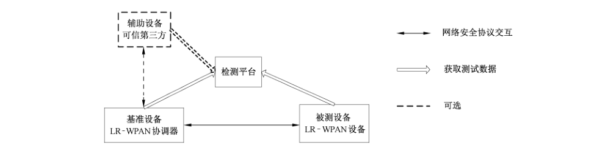
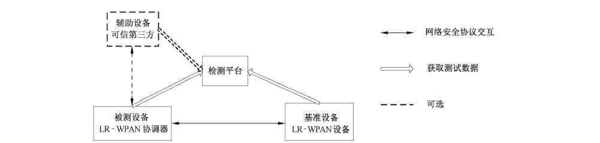

# GB/T 35286-2017 信息安全技术 低速无线个域网空口安全测试规范

> 来源：[GB/T 35286-2017 国家标准详情](https://openstd.samr.gov.cn/bzgk/std/newGbInfo?hcno=5829CAB35FF97165BC27C41349381214)。
> PDF SHA-256：a7e300101ec08d2fdc416e0b2ba204629fbe7fbb51c4d5f30b1bd6ae09285b0b。
> 发布日期：2017-12-29；实施日期：2018-07-01。依据官方公开文本的 15 页图像逐页核对；四张拓扑图保留原图裁切。已去除封面、目录、分页和页眉页脚，正式引用请核对原 PDF。
> 校核说明（非原文）：6.2.2 首段将被测设备写为 LR-WPAN 设备、基准设备写为 LR-WPAN 协调器，与同节后文及图 3 的角色相反，本转写均照原文保留。

## 前言

本标准按照 GB/T 1.1—2009给出的规则起草。

本标准由全国信息安全标准化技术委员会（SAC/TC 260）提出并归口。

本标准主要起草单位：无线网络安全技术国家工程实验室、西安西电捷通无线网络通信股份有限公司、国家无线电监测中心检测中心、中国信息安全认证中心、天津市无线电监测站。

本标准主要起草人：杜志强、李明、李琴、王俊峰、布宁、姜廷学、黄振海、曹军、彭潇、颜湘、潘琪、铁满霞、张变玲、王月辉、吴迪、李楠、李华圣、张国强、童伟刚。

## 1 范围

本标准规定了符合GB/T 15629.15—2010中安全机制 WSAI（WPAN安全接入设施）的设备、协调器和可信第三方的安全协议的符合性检测方法。

本标准适用于符合 GB/T 15629.15—2010的设备中的WSAI 安全机制的符合性测试。

## 2 规范性引用文件

下列文件对于本文件的应用是必不可少的。凡是注日期的引用文件，仅注日期的版本适用于本文件。凡是不注日期的引用文件，其最新版本（包括所有的修改单）适用于本文件。

- GB/T 15629.15—2010 信息技术 系统间远程通信和信息交换 局域网和城域网 特定要求 第15部分：低速无线个域网（WPAN）媒体访问控制和物理层规范
- GB/T 15843.3—2016 信息技术 安全技术 实体鉴别 第3部分：采用数字签名技术的机制
- GB/T 28455—2012 信息安全技术 引入可信第三方的实体鉴别及接入架构规范
- GB/T 32905—2016 信息安全技术 SM3 密码杂凑算法
- GB/T 32907—2016 信息安全技术 SM4 分组密码算法
- GB/T 32918（所有部分）信息安全技术 SM2 椭圆曲线公钥密码算法
- GM/T 0009 SM2 密码算法使用规范
- GM/T 0015 基于 SM2 密码算法的数字证书格式规范
- ISO/IEC 9798-3:1998/Amd.1:2010 信息技术 安全技术 实体鉴别 第3部分：采用数字签名技术的机制 补篇1（Information technology—Security techniques—Entity authentication—Part 3: Mechanisms using digital signature techniques—Amendment 1）

## 3 术语和定义

下列术语和定义适用于本文件。

### 3.1 被测设备 tested equipment

被测的实现 WSAI 安全协议的设备，即被测试对象。

### 3.2 测试平台 test platform

提供 WSAI 安全机制测试的平台，用于收集和分析处理测试数据，按照测试规范的要求对测试数据进行判断，并且对判断结果进行呈现并记录的平台。

### 3.3 辅助设备 auxiliary equipment

一种特殊的基准设备，除进行 WSAI 安全机制交互外，还需要主动提供用于辅助测试的数据给测试平台。

### 3.4 基准设备 standard equipment

对被测设备开展测试时需要同步使用的具有 WSAI 安全机制的设备，和被测设备协同工作执行WSAI 安全机制交互过程。

### 3.5 三元对等密码安全协议 cryptography and security protocol in tri-element peer architecture

符合 ISO/IEC 9798-3:1998/Amd.1:2010 和 GB/T 15843.3—2016、GB/T 28455—2012 的基于三元对等架构的密码安全协议。

## 4 缩略语

下列缩略语适用于本文件。

GTS：保证的时隙（Guaranteed Time Slot）

IPAP：基于 ID 的 WPAN 鉴别协议（Identity-based WPAN Authentication Protocol）

LR-WPAN：低速无线个域网（Low-rate Wireless Personal Area Network）

MAC：媒体访问控制（Medium Access Control）

MIC：消息完整性代码（Message Integrity Code）

PAN：个域网（Personal Area Network）

PAPTED：基于传输加密数据的 WPAN 鉴别协议（WPAN Authentication Protocol Based on the Transportation of Enciphered Data）

PIB：PAN 信息库（PAN Information Base）

PSK：预共享密钥（Pre-shared Key）

SPAP：基于共享密钥的 WPAN 鉴别协议（Shared-key WPAN Authentication Protocol）

TAEP：三元鉴别可扩展协议（Tri-element Authentication Extensible Protocol）

TAEPoL：基于链路的三元鉴别可扩展协议（TAEP Over Link）

TePA：三元对等架构（Tri-element Peer Architecture）

TePA-AC：基于三元对等架构的访问控制（TePA-based Access Control）

WPAN：无线个域网（Wireless Personal Area Networks）

WSAI：WPAN 安全接入基础设施（WPAN Security Access Infrastructure）

## 5 概述

本标准规定的低速无线个域网（LR-WPAN）空口安全测试建立在一个支持 WSAI 安全机制的通信网络基础之上，其中 WSAI 安全机制测试网络结构如图1所示。

在图1中，在GB/T 15629.15—2010中定义的低速无线个域网的 WSAI 安全机制中涉及的实体主要有 LR-WPAN设备、LR-WPAN 协调器和可信第三方。WSAI 安全机制基于三元对等架构（TePA），符合三元对等密码安全协议。低速无线个域网空口安全测试主要针对以上三种无线个域网基本功能实体，规定了各功能实体应满足的技术要求以及测试方法。标准规定的测试要求以及测试方法可应用于低速无线个域网设备互操作系统和对安全有一定要求的行业应用中。本标准中涉及的低速无线个域网设备是符合GB/T 15629.15—2010中5.5.6所定义的设备。本标准所涉密码算法应符合国家密码主管部门相关规定。

## 6 测试环境要求

### 6.1 概述

本标准中对 WSAI 协议的测试满足一般协议符合性测试方法，提供协议符合性测试所需的输入输出消息和各种帧格式，密码算法测试针对国家密码管理主管部门认可的密码算法。测试设备符合GB/T 15629.15—2010中5.5.6所规定的设备的要求，LR-WPAN 空口安全测试中的设备需满足以下条件：

a） 支持 WSAI 的LR-WPAN 设备和LR-WPAN 协调器，可以进行 WSAI 安全接入。

b） LR-WPAN 网络系统，包括 LR-WPAN 设备、LR-WPAN 协调器和可信第三方等设备，且各设备运行正常。

c） 测试平台，应支持对 WSAI 安全协议的分析，也可采用支持 WSAI 安全协议的抓包工具。

WSAI 安全机制测试拓扑中除测试平台外，还有三种测试角色：被测设备、基准设备、辅助设备。

测试过程中所涉及的鉴别套件的测试中的消息类型见 GB/T 15629.15—2010中的附录A，4 种类型帧（信标帧、数据帧、确认帧和 MAC帧）的格式见 GB/T 15629.15—2010中的7.2.2.1。

### 6.2 测试拓扑

#### 6.2.1 LR-WPAN 设备测试拓扑

针对 LR-WPAN 设备的测试可分为有可信第三方参与和无可信第三方参与两类，其中被测设备为LR-WPAN 设备，基准设备为LR-WPAN协调器。

被测 LR-WPAN设备与基准LR-WPAN 协调器连接，由基准设备 LR-WPAN协调器与被测 LR-WPAN设备将收发的数据按要求提供给测试平台，测试平台可通过抓包获取被测设备和基准设备的收发数据。当有可信第三方参与时，可由可信第三方将测试数据按要求提供给测试平台。LR-WPAN设备测试拓扑如图2所示。

#### 6.2.2 LR-WPAN 协调器测试拓扑

针对LR-WPAN 协调器测试可分为有可信第三方参与和无可信第三方参与的鉴别协议的检测，其中被测设备为LR-WPAN设备，基准设备为 LR-WPAN 协调器。

被测设备LR-WPAN协调器与基准LR-WPAN设备连接，由基准LR-WPAN设备与被测设备LR-WPAN 协调器将收发的数据按要求提供给测试平台，测试平台可通过抓包获取被测设备和基准设备的收发数据。当有可信第三方参与时，可由可信第三方将测试数据按要求提供给测试平台。LR-WPAN 协调器测试拓扑如图3所示。

#### 6.2.3 可信第三方测试拓扑

针对可信第三方测试、无基准设备、被测设备为可信第三方。

被测设备可信第三方和测试平台连接，由测试平台模拟LR-WPAN设备和LR-WPAN 协调器与被测可信第三方进行交互，被测可信第三方需将收发的数据按要求提供给测试平台，针对可信第三方测试拓扑如图4所示。

## 7 LR-WPAN设备测试

LR-WPAN设备测试包含了鉴别能力协商测试、鉴别套件测试。其中鉴别能力协商测试包含支持鉴别和不支持鉴别的两种情形。鉴别套件测试包含支持基于预共享密钥、基于ID 和基于传输加密数据的三种情形。

### 7.1 鉴别能力协商

#### 7.1.1 鉴别能力协商——不支持鉴别

测试目的：验证 LR-WPAN设备在不支持鉴别情形下的鉴别能力协商的流程。

测试预置条件：

a） LR-WPAN网络系统各设备运行正常；

b） 存在一个 LR-WPAN 设备，但不支持鉴别；

c） LR-WPAN 设备未接入 LR-WPAN 网络。

测试流程：

a） 获取 LR-WPAN 设备和 LR-WPAN 协调器之间的信标帧；

b）获取 LR-WPAN 设备和 LR-WPAN 协调器之间的关联请求。

预期结果：

a） LR-WPAN 设备能够在发出信标帧后，能收到 LR-WPAN协调器的鉴别请求；

b）在LR-WPAN 设备发出的信标帧中，GTS规范字段中比特3和比特4的值都为0；

c） 在LR-WPAN 设备发出的信标帧中，信标有效负荷字段不包含鉴别套件字段。

在LR-WPAN 协调器发出的关联请求命令帧中，性能信息字段的比特4的值为0。

#### 7.1.2 鉴别能力协商——支持鉴别

测试目的：验证LR-WPAN设备在支持鉴别情形下的鉴别能力协商的流程。

测试预置条件：

a） LR-WPAN 网络系统各设备运行正常；

b） WSAI 接入系统各设备运行正常；

c） 存在一个 LR-WPAN 设备，且支持鉴别；

d） LR-WPAN 设备未鉴别接入 LR-WPAN 网络。

测试流程：

a） 获取 LR-WPAN 设备和 LR-WPAN 协调器之间的信标帧；

b） 获取 LR-WPAN 设备和 LR-WPAN 协调器之间的鉴别请求。

预期结果：

a） LR-WPAN 设备能够在发出信标帧后，能收到 LR-WPAN 协调器的鉴别请求，并成功协调了一个鉴别套件；

b）在LR-WPAN 设备发出的信标帧中，GTS 规范字段中比特3和比特4的值都为1；

c） 在LR-WPAN设备发出的信标帧中，信标有效负荷字段包含鉴别套件字段。

在LR-WPAN 协调器发出的鉴别请求命令帧中，鉴别信息字段包含LR-WPAN 协调器选定的一个鉴别套件的标识。

### 7.2 鉴别套件

#### 7.2.1 基于共享密钥的 WPAN 鉴别协议 SPAP

测试目的：验证 LR-WPAN设备在执行基于预共享密钥方式 SPAP协议时的一致性。

测试预置条件：

a） LR-WPAN 网络系统各设备运行正常；

b） WSAI接入系统各设备运行正常；

c） 存在一个 LR-WPAN 设备，且支持鉴别；

d） LR-WPAN 设备采用SPAP鉴别套件鉴别接入 LR-WPAN 网络。

测试流程：

a） LR-WPAN 协调器发送消息 1（见 GB/T 15629.15—2010中附录 A的 A.1.1.1）给 LR-WPAN设备；

b） LR-WPAN协调器接收 LR-WPAN 设备对消息1的响应；

c） LR-WPAN协调器发送消息3（见 GB/T 15629.15—2010中附录 A的 A.1.1.3）给 LR-WPAN设备。

预期结果：LR-WPAN设备对消息1的响应中：

a） LR-WPAN设备询问字段长度为16 个八位位组；

b） LR-WPAN协调器询问字段长度为16个八位位组；

c） LR-WPAN协调器询问字段与消息1中的LR-WPAN 协调器询问字段相同；

d） 消息鉴别码字段长度为20个八位位组；

e） 消息鉴别码中的类型字段为1个八位位组；

f） 消息鉴别码中的长度字段为2个八位位组；

g） 消息鉴别码中的消息鉴别码算法字段为1个八位位组；取值是否与GB/T 15629.15—2010中规定的相符；

h） 消息鉴别码中的消息鉴别码字段与GB/T 15629.15—2010中规定的相符。

测试平台解析得到密码杂凑算法测试相关的数据字段，并利用这些字段开展密码杂凑算法实现的正确性和一致性测试，其中对 SM3密码杂凑算法的测试见 GB/T 32905—2016。

#### 7.2.2 基于ID 的 WPAN 鉴别协议 IPAP

测试目的：验证 LR-WPAN设备执行基于ID的 WPAN鉴别协议 IPAP的流程。

测试预置条件：

a） WPAN 网络系统各设备运行正常；

b） WSAI接入系统各设备运行正常；

c） 存在一个 LR-WPAN 设备，且支持鉴别；

d） LR-WPAN 设备采用 IPAP 鉴别套件鉴别接入 LR-WPAN 网络。

测试流程：

a） LR-WPAN 协调器发送消息1（见GB/T 15629.15—2010中附录 A的 A.2.1.1）给 LR-WPAN设备；

b） LR-WPAN设备发送消息2（见 GB/T 15629.15—2010中附录A的 A.2.1.2）给LR-WPAN 协调器；

c） LR-WPAN 协调器发送消息3（见GB/T 15629.15—2010中附录A的 A.2.1.3）给可信第三方；

d） 可信第三方发送消息 4（见 GB/T 15629.15—2010中附录 A的 A.2.1.4）给 LR-WPAN 协调器；

e） LR-WPAN 协调器发送消息 5（见 GB/T 15629.15—2010中附录 A的 A.2.1.5）给 LR-WPAN设备。

预期结果：LR-WPAN设备对消息1 的响应中：

a） 标识 FLAG 字段长度为1个八位位组；

b） LR-WPAN 协调器询问字段长度为16个八位位组；

c） LR-WPAN协调器询问字段与消息1中的LR-WPAN 协调器询问字段相同；

d） LR-WPAN设备询问字段长度为16个八位位组；

e） LR-WPAN 设备密钥数据字段中的长度字段为1个八位位组；

f） LR-WPAN设备密钥数据字段中的内容字段的长度与LR-WPAN设备密钥数据字段中的长度字段规定的长度相同；

g） LR-WPAN协调器的身份标识字段长度为2个八位位组；

h） LR-WPAN设备公钥的后两个字段的长度为6个八位位组；

i） LR-WPAN设备公钥的后两个字段中的基于ID 公私钥对的颁发者的身份标识字段的长度为2 个八位位组；

j） LR-WPAN 设备公钥的后两个字段中的 WPAN 标识字段的长度为1个八位位组；

k） LR-WPAN设备公钥的后两个字段中的LR-WPAN 设备身份标识字段的长度为2个八位位组；

l） LR-WPAN 设备公钥的后两个字段中的公钥有效期限字段的长度为1个八位位组；

m） LR-WPAN设备的签名中的类型字段为1个八位位组；

n） LR-WPAN设备的签名中的长度字段为2个八位位组；

o） LR-WPAN 设备的签名中的签名算法字段为1个八位位组，取值与GB/T 15629.15—2010中规定的相符；

p） LR-WPAN 设备的签名中的签名值字段与GB/T 15629.15—2010中规定的相符；

q） 测试平台解析得到非对称密码算法测试相关的数据字段，并利用这些字段开展签名算法实现的正确性和一致性测试，其中对 SM2 数字签名算法的测试见 GB/T 32918、GM/T 0009；

r） 测试平台解析得到数字证书格式测试相关的数据字段，并解析数字证书格式，其中对SM2数字证书格式的测试见GM/T 0015。

#### 7.2.3 基于传输加密数据的 WPAN 鉴别协议 PAPTED

测试目的：验证 LR-WPAN设备执行基于传输加密数据的 WPAN 鉴别协议 PAPTED 的流程。

测试预置条件：

a） LR-WPAN 网络系统各设备运行正常；

b） WSAI 接入系统各设备运行正常；

c） 存在一个 LR-WPAN 设备，且支持鉴别；

d） LR-WPAN 设备采用 PAPTED 鉴别套件鉴别接入 LR-WPAN 网络。

测试流程：

a） LR-WPAN 协调器发送消息1（见 GB/T 15629.15—2010中附录 A的 A.3.2）给 LR-WPAN设备；

b） LR-WPAN设备发送消息2（见 GB/T 15629.15—2010中附录 A的 A.3.3）给 LR-WPAN协调器。

预期结果：设备 A 对消息 1 的响应中：

a） LR-WPAN 设备询问字段长度为16个八位位组；

b） LR-WPAN协调器询问字段长度为16 个八位位组；

c） LR-WPAN 协调器询问字段与消息1中的LR-WPAN 协调器询问字段相同；

d） LR-WPAN 协调器加密 LR-WPAN 协调器询问长度为16 个八位位组；

e） LR-WPAN 设备加密 LR-WPAN 协调器询问长度16个八位位组；

f） 消息鉴别码字段长度为20个八位位组；

g） 消息鉴别码中的类型字段为1个八位位组；

h） 消息鉴别码中的长度字段为2个八位位组；

i） 消息鉴别码中的消息鉴别码算法字段为1个八位位组；取值是否与 GB/T 15629.15—2010中规定的相符；

j） 消息鉴别码中的消息鉴别码字段与GB/T 15629.15—2010中规定的相符。

测试平台解析得到对称密码算法测试相关的数据字段，并利用这些字段开展对称密码算法实现的正确性和一致性测试，其中对 SM4 算法的测试见 GB/T 32907—2016。

## 8 LR-WPAN 协调器测试

### 8.1 鉴别能力协商

#### 8.1.1 鉴别能力协商——不支持鉴别

测试目的：验证 LR-WPAN 协调器在不支持鉴别情形下的鉴别能力协商的流程。

测试预置条件：

a） LR-WPAN 网络系统各设备运行正常；

b） 存在一个 LR-WPAN协调器，但不支持鉴别；

c） LR-WPAN 设备未接入 LR-WPAN 网络。

测试流程：

a） 获取 LR-WPAN设备和 LR-WPAN 协调器之间的信标帧；

b） 获取LR-WPAN设备和LR-WPAN 协调器之间的关联请求。

预期结果：

a） LR-WPAN协调器能够在收到LR-WPAN设备发送的信标帧后，向LR-WPAN设备发送鉴别请求；

b） 在LR-WPAN设备发出的信标帧中，GTS规范字段中比特3和比特4的值都为1；

c） 在LR-WPAN设备发出的信标帧中，信标有效负荷字段不包含鉴别套件字段。

在LR-WPAN 协调器发出的关联请求命令帧中，性能信息字段的比特4的值为0。

#### 8.1.2 鉴别能力协商——支持鉴别

测试目的：验证 LR-WPAN 协调器在支持鉴别情形下的鉴别能力协商的流程。

测试预置条件：

a） LR-WPAN 网络系统各设备运行正常；

b） WSAI 接入系统各设备运行正常；

c） 存在一个 LR-WPAN 设备，且支持鉴别；

d） LR-WPAN 设备未鉴别接入 LR-WPAN 网络。

测试流程：

a） 获取 LR-WPAN 协调器和 LR-WPAN 设备之间的信标帧；

b） 获取 LR-WPAN 协调器和LR-WPAN设备之间的鉴别请求。

预期结果：

a） LR-WPAN协调器能够在收到LR-WPAN 设备发送的信标帧后，向LR-WPAN设备发送鉴别请求，并成功协调了一个鉴别套件；

b） 在LR-WPAN设备发出的信标帧中，GTS规范字段中比特3和比特4的值都为1；

c） 在LR-WPAN设备发出的信标帧中，信标有效负荷字段包含鉴别套件字段。

在LR-WPAN协调器发出的鉴别请求命令帧中，鉴别信息字段包含LR-WPAN协调器选定的一个鉴别套件的标识。

### 8.2 鉴别套件

#### 8.2.1 基于预共享密钥方式 SPAP

测试目的：验证 LR-WPAN协调器执行基于预共享密钥方式 SPAP协议的流程。

测试预置条件：

a） LR-WPAN 网络系统各设备运行正常；

b） WSAI 接入系统各设备运行正常；

c） 存在一个 LR-WPAN 设备，且支持鉴别；

d） LR-WPAN 设备采用 SPAP 鉴别套件鉴别接入 LR-WPAN 网络。

测试流程：

a） LR-WPAN协调器发送消息1给LR-WPAN设备；

b） LR-WPAN设备发送消息2给LR-WPAN 协调器；

c） LR-WPAN 协调器发送消息3给LR-WPAN设备。

预期结果：

a） LR-WPAN协调器发送的消息1中：LR-WPAN 协调器询问字段长度为16个八位位组。

b） LR-WPAN 协调器发送的消息3中：

1） LR-WPAN 设备询问字段长度为16 个八位位组；

2） LR-WPAN设备询问字段与消息2中的LR-WPAN设备询问字段相同；

3） 消息鉴别码中的消息鉴别码算法字段为1个八位位组；取值与GB/T 15629.15—2010中规定的相符。

c） 测试平台解析得到密码杂凑算法测试相关的数据字段，并利用这些字段开展密码杂凑算法实现的正确性和一致性测试，其中对 SM3 密码杂凑算法的测试见 GB/T 32905—2016。

#### 8.2.2 基于ID的 WPAN鉴别协议 IPAP

测试目的：验证 LR-WPAN协调器执行基于ID的WPAN鉴别协议 IPAP协议的流程。

测试预置条件：

a） LR-WPAN 网络系统各设备运行正常；

b） WSAI 接入系统各设备运行正常；

c） 存在一个 LR-WPAN 设备，且支持鉴别；

d） LR-WPAN 设备采用 IPAP 鉴别套件鉴别接入 LR-WPAN 网络。

测试流程：

a） LR-WPAN 协调器发送消息1给 LR-WPAN 设备；

b） LR-WPAN 设备发送消息2给 LR-WPAN 协调器；

c） LR-WPAN 协调器发送消息3给可信第三方；

d） 可信第三方发送消息4给LR-WPAN 协调器；

e） LR-WPAN协调器发送消息5给LR-WPAN 设备。

预期结果：

a） LR-WPAN 协调器发送的消息1中：LR-WPAN 协调器询问字段长度为16 个八位位组。

b） LR-WPAN 协调器发送的消息3中：

1） 标识 FLAG 字段长度为1个八位位组；

2） LR-WPAN设备询问字段长度为16个八位位组；

3） LR-WPAN 协调器询问字段长度为16个八位位组；

4） LR-WPAN设备公钥的后两个字段的长度为3个八位位组；

5） LR-WPAN 设备公钥的后两个字段中的基于ID 公私钥对的颁发者的身份标识字段的长度为2个八位位组；

6） LR-WPAN 设备公钥的后两个字段中的LR-WPAN 标识字段的长度为1个八位位组；

7） LR-WPAN设备公钥的后两个字段中的LR-WPAN设备身份标识字段的长度为2个八位位组；

8） LR-WPAN 设备公钥的后两个字段字段中的公钥有效期限字段的长度为1个八位位组；

9） LR-WPAN 协调器公钥的后两个字段的长度为3个八位位组；

10） LR-WPAN 协调器公钥的后两个字段中的基于ID公私钥对的颁发者的身份标识字段的长度为2个八位位组；

11） LR-WPAN 协调器公钥的后两个字段中的LR-WPAN 标识字段的长度为1个八位位组；

12） LR-WPAN 协调器公钥的后两个字段中的LR-WPAN 设备身份标识字段的长度为2个八位位组；

13） LR-WPAN 协调器公钥的后两个字段中的公钥有效期限字段的长度为1个八位位组。

c） LR-WPAN 协调器发送的消息5中：

1）标识 FLAG 字段长度为1个八位位组；

2） LR-WPAN 设备询问字段长度为16个八位位组，且值与消息2中的LR-WPAN设备询问相同；

3） LR-WPAN 协调器密钥数据字段中的长度字段为1个八位位组；

4） LR-WPAN 协调器密钥数据字段中的内容字段的长度与 LR-WPAN 协调器密钥数据字段中的长度字段规定的长度相同；

5） LR-WPAN 协调器的身份标识字段长度为2个八位位组；

6） LR-WPAN 协调器公钥的后两个字段的长度为6个八位位组；

7） LR-WPAN 协调器公钥的后两个字段中的基于 ID 公私钥对的颁发者的身份标识字段的长度为2个八位位组；

8） LR-WPAN 协调器公钥的后两个字段中的LR-WPAN 标识字段的长度为1个八位位组；

9） LR-WPAN 协调器公钥的后两个字段中的LR-WPAN设备身份标识字段的长度为2个八位位组；

10） LR-WPAN 协调器公钥的后两个字段中的公钥有效期限字段的长度为1个八位位组；

11） LR-WPAN协调器的公钥撤销查询结果字段中的 LR-WPAN设备询问字段的长度为6 个八位位组；

12） LR-WPAN 协调器的公钥撤销查询结果字段中的LR-WPAN 协调器公钥字段的长度为6 个八位位组；

13） LR-WPAN 协调器的公钥撤销查询结果字段中的公钥撤销结果字段的长度为1个八位位组；

14） LR-WPAN 协调器的公钥撤销查询结果字段中的可信第三方签名字段的内容与GB/T 15629.15—2010 中规定的相符；

15） LR-WPAN 协调器的签名中的类型字段为1个八位位组；

16） LR-WPAN 协调器的签名中的长度字段为2个八位位组；

17） LR-WPAN 协调器的签名中的签名算法字段为1个八位位组，取值与 GB/T 15629.15—2010中规定的相符；

18） LR-WPAN 协调器的签名中的签名值字段与 GB/T 15629.15—2010中规定的相符。

d） 测试平台解析得到非对称密码算法测试相关的数据字段，并利用这些字段开展签名算法实现的正确性和一致性测试，其中对 SM2 数字签名算法的测试见 GB/T 32918、GM/T 0009。

e） 测试平台解析得到数字证书格式测试相关的数据字段，并解析数字证书格式，其中对SM2数字证书格式的测试见 GM/T 0015。

#### 8.2.3 基于传输加密数据的 WPAN 鉴别协议 PAPTED

测试目的：验证 LR-WPAN协调器执行基于传输加密数据的 WPAN鉴别协议 PAPTED 的流程。

测试预置条件：

a） LR-WPAN 网络系统各设备运行正常；

b） WSAI接入系统各设备运行正常；

c） 存在一个 LR-WPAN 设备，且支持鉴别；

d） LR-WPAN 设备采用 PAPTED 鉴别套件鉴别接入 LR-WPAN 网络。

测试流程：

a） LR-WPAN 协调器发送消息1给 LR-WPAN设备；

b） LR-WPAN 设备发送消息2给 LR-WPAN 协调器。

预期结果：LR-WPAN设备对消息1的响应中：

a） LR-WPAN设备询问字段长度为16个八位位组；

b） LR-WPAN 协调器询问字段长度为16个八位位组；

c） LR-WPAN 协调器询问字段与消息1中的LR-WPAN 协调器询问字段相同。

测试平台解析得到对称密码算法测试相关的数据字段，并利用这些字段开展对称密码算法实现的正确性和一致性测试，其中对 SM4 算法的测试见 GB/T 32907—2016。

#### 8.2.4 帧安全

本标准所测试的是带有辅助安全头字段的数据帧，具体数据帧格式见 GB/T 15629.15—2010中7.2.2.2。

测试目的：验证带有辅助安全头字段进行安全处理所需要的信息和选取合适的密钥来对帧进行保护。

测试预置条件：LR-WPAN设备间信息交互的各消息都以 GB/T 15629.15—2010中 7.2.2.2中定义的数据帧格式组帧并传递。

测试流程：

a） 通过检测控制台对LR-WPAN 设备和LR-WPAN 协调器之间的交互进行抓包；

b） 检测数据帧中辅助安全头字段的长度是否符合要求；

c） 检测辅助安全头中安全级别（帧如何被保护）是否符合标准要求；

d） 从MAC 安全 PIB 中选取密钥，应符合标准要求；

e）当LR-WPAN设备发送数据帧时，先通过MAC算法和密钥 K、LR-WPAN设备的询问N2（见GB/T 15629.15—2010中附录 A的A.1.1.1）、协调器的询问 N1（见 GB/T 15629.15—2010 中附录A的A.1.1.1）以及发送密码（Scode）进行加密计算，而后发送；

f） 当LR-WPAN 协调器接收到加密的数据帧后，首先通过通用数据帧密文、密钥 K和 MAC算法计算接收密钥（Rcode）。

预期结果：

a） 帧控制字段中，帧类型子字段的数值指示为数据帧；

b） 帧控制字段中，安全使能子字段为1，表示数据需要保护，帧版本子号为1；

c） 安全级别子字段长度为3比特，应符合GB/T 15629.15—2010表89所规定的任意一种安全等级；

d） 选取密钥选取范围应符合 MAC 安全 PIB（见GB/T 15629.15—2010中7.6.1）的安全相关参数列表。

比较两个密钥值 Scode 与Rcode 是否相同，如果相同则证明数据传送过程中没有发生改动，同时也可判定发送者是合法的设备，接受合法的数据帧。否则，丢弃非法的数据帧。

## 9 可信第三方测试

只有在基于ID 鉴别的情形下才具有可信第三方，因此本标准只测试基于ID 的WPAN 鉴别协议一种情形，即基于 WPAN鉴别协议 IPAP。

测试目的：验证 LR-WPAN协调器执行基于ID的WPAN鉴别协议 IPAP的流程。

测试预置条件：

a） LR-WPAN 网络系统各设备运行正常；

b） WSAI 接入系统各设备运行正常；

c） 存在一个可信第三方；

d） LR-WPAN 协调器采用 IPAP 鉴别套件鉴别接入 LR-WPAN 网络的LR-WPAN设备。

测试流程：

a） LR-WPAN 协调器发送消息1给LR-WPAN 设备；

b） LR-WPAN 设备发送消息2给LR-WPAN 协调器；

c） LR-WPAN 协调器发送消息3给可信第三方；

d） 可信第三方发送消息4给LR-WPAN协调器；

e） LR-WPAN协调器发送消息5给LR-WPAN设备。

预期结果：可信第三方发送的消息4中：

a） 标识 FLAG 字段长度为1个八位位组；

b） LR-WPAN 协调器询问字段的长度为16个八位位组，且值与消息3中的 LR-WPAN 协调器询问值相同；

c） LR-WPAN设备的公钥撤销查询结果字段中的LR-WPAN 设备询问字段的长度为6个八位位组；

d） LR-WPAN设备的公钥撤销查询结果字段中的LR-WPAN 协调器公钥字段的长度为6个八位位组；

e） LR-WPAN 设备的公钥撤销查询结果字段中的公钥撤销结果字段的长度为1个八位位组；

f） LR-WPAN 设备的公钥撤销查询结果字段中的可信第三方签名字段的内容与GB/T 15629.15—2010中规定的相符；

g） LR-WPAN 协调器的公钥撤销查询结果字段中的LR-WPAN设备询问字段的长度为6个八位位组；

h） LR-WPAN 协调器的公钥撤销查询结果字段中的LR-WPAN 协调器公钥字段的长度为6个八位位组；

i） LR-WPAN 协调器的公钥撤销查询结果字段中的公钥撤销结果字段的长度为1个八位位组；

j） LR-WPAN 协调器的公钥撤销查询结果字段中的可信第三方签名字段的内容与 GB/T 15629.15—2010中规定的相符；

k） 测试平台解析得到非对称密码算法测试相关的数据字段，并利用这些字段开展签名算法实现的正确性和一致性测试，其中对 SM2 数字签名算法的测试见 GB/T 32918、GM/T 0009。

测试平台解析得到数字证书格式测试相关的数据字段，并解析数字证书格式，其中对SM2数字证书格式的测试见 GM/T 0015。
