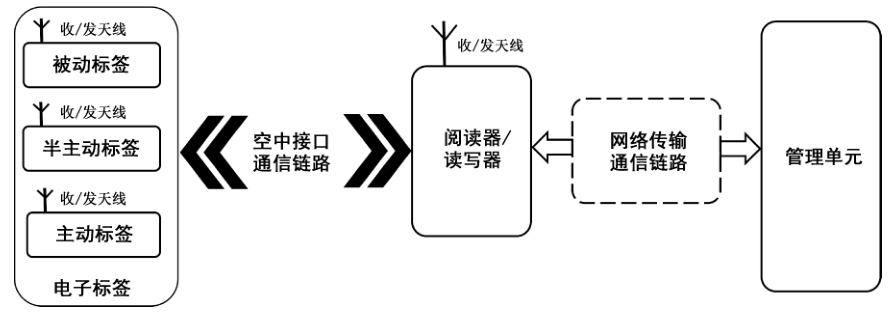

# GB/T 35290-2023 信息安全技术 射频识别（RFID）系统安全技术规范

> 来源：[GB/T 35290-2023 国家标准详情](https://openstd.samr.gov.cn/bzgk/std/newGbInfo?hcno=7F9824A37208D7F7D84A6A8CC4DF9A8B)；封面发布日期：2023-12-28；实施日期：2024-07-01。
> PDF SHA-256：8291c281e9333a05a316b8009b1737f2e1c233d4f9411aca51a2e6d161b6a879。
> 转写说明：按页渲染官方 PDF 并进行图像识别，对照全部 47 张原图校正文字、条款、表格和参考文献；图 1 保留原图裁切。省略封面、目录、页眉、页脚和空白页，合并跨页段落。正式引用请核对原 PDF。

## 前言

本文件按照 GB/T 1.1—2020《标准化工作导则 第1部分：标准化文件的结构和起草规则》的规定起草。

本文件代替 GB/T 35290—2017《信息安全技术 射频识别（RFID）系统通用安全技术要求》，与 GB/T 35290—2017 相比，除结构调整和编辑性改动外，主要技术变化如下：

- 更改了范围（见第 1 章，2017 年版的第 1 章）；
- 增加并更改了术语和定义（见第 3 章，2017 年版的 3.1）；
- 更改了符号和缩略语（见第 4 章，2017 年版的 3.2）；
- 更改了系统组成（见 5.1，2017 年版的 4.1）；
- 增加了系统安全风险（见 5.2）；
- 更改了系统安全分级（见第 6 章，2017 年版的 4.2）；
- 更改了电子标签安全要求的数据校验要求（见 7.1.2.6，2017 年版的 5.1.2.6）；
- 增加了阅读器/读写器安全技术要求的标识唯一性、安全审计和安全审计机密性保护要求（见 7.2.1.1、7.2.1.9、7.2.2.4）；
- 增加了空中接口通信链路安全技术要求的数据完整性要求（见 7.3.2.1）；
- 删除了网络传输通信链路安全技术要求的完整性恢复机制要求（见 2017 年版的 5.4.2.3）；
- 增加了管理单元安全中关于授权的程序装载与更新、恶意代码防范、可信验证、数据备份恢复、安全审计的基本级要求（见 7.5.1.3、7.5.1.7、7.5.1.8、7.5.1.9、7.5.1.10），以及关于访问控制、数据完整性、数据保密、可信验证、入侵防范、恶意代码防范、可恢复性、安全审计的增强级要求（见 7.5.2.1、7.5.2.2、7.5.2.3、7.5.2.4、7.5.2.9、7.5.2.10、7.5.2.11、7.5.2.12），删除了可理解格式的增强级要求（见 2017 年版的 5.5.2.1.3）；
- 增加了测试环境要求（见第 8 章）；
- 增加了测试评价方法（见第 9 章）。

请注意本文件的某些内容可能涉及专利。本文件的发布机构不承担识别专利的责任。

本文件由全国信息安全标准化技术委员会（SAC/TC 260）提出并归口。

本文件起草单位：公安部第三研究所、中国电子技术标准化研究院、北京中科国技信息系统有限公司、上海伊世智能科技有限公司、上海临港电力电子研究有限公司、腾讯云计算（北京）有限责任公司、珠海复旦创新研究院、郑州信大捷安信息技术股份有限公司、上海化工院检测有限公司、长扬科技（北京）有限公司、西安交大捷普网络科技有限公司、中国汽车工程研究院股份有限公司、中国网络安全审查技术与认证中心、广东技安科技有限公司、浙江工业大学。

本文件主要起草人：刘彩霞、顾健、谢芳艺、张艳、刘丹丹、焦志皓、李琳、李哲、戴杰、刘虹、张东举、刘宇澄、李建慧、刘海涛、王俊宇、刘为华、王思怿、赵华、何建锋、刘冲、申永波、何红亮、顾国民。

本文件及其所代替文件的历次版本发布情况为：

- 2017 年首次发布为 GB/T 35290—2017；
- 本次为第一次修订。

## 1 范围

本文件规定了射频识别（RFID）系统安全技术要求，包括电子标签、阅读器/读写器、空中接口通信链路、网络传输通信链路、管理单元等的安全要求，给出了测试条件和测试评价方法。

本文件适用于射频识别（RFID）系统的安全功能设计、开发、使用、测试和评估。

本文件不适用于5.8GHz频段的射频识别（RFID）系统。

> 注：本文件不涉及物理攻击安全风险的安全功能要求或安全性能要求。

## 2 规范性引用文件

下列文件中的内容通过文中的规范性引用而构成本文件必不可少的条款。其中，注日期的引用文件，仅该日期对应的版本适用于本文件；不注日期的引用文件，其最新版本（包括所有的修改单）适用于本文件。

- GB/T 20271 信息安全技术 信息系统通用安全技术要求

- GB/T 28925 信息技术 射频识别 2.45 GHz 空中接口协议

- GB/T 29261.3 信息技术 自动识别和数据采集技术 词汇 第3部分：射频识别

- GB/T 29768 信息技术 射频识别 800/900 MHz 空中接口协议

- GB/T 32915 信息安全技术 二元序列随机性检测方法

- GB/T 33848.3 信息技术 射频识别 第3部分：13.56 MHz 的空中接口通信参数

- GB/T 37033.1—2018 信息安全技术 射频识别系统密码应用技术要求 第 1 部分：密码安全保护框架及安全级别

- GB/T 37033.2—2018 信息安全技术 射频识别系统密码应用技术要求 第 2 部分：电子标签与读写器及其通信密码应用技术要求

- GB/T 37033.3—2018 信息安全技术 射频识别系统密码应用技术要求 第 3 部分：密钥管理技术要求

## 3 术语和定义

GB/T 20271、GB/T 29261.3、GB/T 28925、GB/T 29768、GB/T 37033.1—2018、GB/T 37033.2—2018、GB/T 37033.3—2018 界定的以及下列术语和定义适用于本文件。

### 3.1 射频识别 radio frequency identification; RFID

在频谱的射频部分，利用电磁耦合或感应耦合，通过各种调制和编码方案，与电子标签交互通信读取电子标签唯一身份的技术。

［来源：GB/T 29261.3—2012,05.01.01］

### 3.2 射频识别系统 radio frequency identification system

采用射频识别技术，包含一个或者多个阅读器/读写器、一个或者多个电子标签、阅读器/读写器和电子标签之间的空中接口通信链路、阅读器/读写器和管理单元之间的网络传输通信链路和管理单元的自动识别和数据采集系统。

［来源：GB/T 29261.3—2012,05.04.11，有修改］

### 3.3 电子标签 electronic tag

用于物体或物品标识、具有至少包含唯一标识符的信息存储功能、能接收阅读器/读写器的电磁场调制信号，并返回响应信号的数据载体。

> 注：电子标签又称为射频标签、应答器、机动车标识等，简称标签。

［来源：GB/T 29261.3—2012,05.04.01，有修改］

### 3.4 被动标签 passive tag

自身没有内部供电电源，内部集成电路通过接收到的电磁波进行驱动，用于物体或物品标识、具有信息存储功能，受到阅读器/读写器发出的射频信号激励，能反射并调制从阅读器/读写器接收到的载波信号，并返回响应信号的数据载体。

［来源：GB/T 29261.3—2012,05.04.04，有修改］

### 3.5 半主动标签 semi-active tag

自身带有内部供电电源，仅能供应内部集成电路且不能主动对外发送数据，用于物体或物品标识、具有信息存储功能，受到阅读器/读写器发出的射频信号激励，能反射并调制从阅读器/读写器接收到的载波信号，并返回响应信号的数据载体。

### 3.6 主动标签 active tag

自身带有内部供电电源，既供应内部集成电路所需电源且能主动对外发送数据，用于物体或物品标识、具有信息存储功能且相对较大的存储容量，具有产生无线电信号能力，能接收阅读器/读写器的电磁场调制信号，并返回响应信号的数据载体。

［来源：GB/T 29261.3—2012,05.04.05，有修改］

### 3.7 阅读器 reader

用于从电子标签获取数据但不能向标签写入数据的电子设备。

### 3.8 读写器 reader-writer

用于从电子标签获取数据和向电子标签写入数据的电子设备。

［来源：GB/T 29261.3—2012,05.04.02，有修改］

### 3.9 管理单元 management unit

用于实现管理阅读器/读写器的系统或组成部分。

> 注：管理单元可由中间件、计算机终端、数据库、服务器等组成。

### 3.10 通信链路 communication link

射频识别系统中阅读器/读写器和电子标签之间采用无线通信方式的空中接口通信信道、阅读器/读写器与管理单元之间采用有线通信和/或无线通信方式的网络传输通信信道。

### 3.11 灭活 kill

采用擦除电子标签存储信息等方法，使电子标签不能产生调制信号激活射频场从而失效的操作。

注1：被灭活的电子标签上电即进入灭活状态，并保持灭活状态。

注2：电子标签处于灭活状态时无法通过上电自动进入到准备状态，同时无法通过响应读写器指令进入仲裁、应答、确认、鉴别、开放和安全等其他状态。

## 4 符号和缩略语

下列符号和缩略语适用于本文件。

DDoS：分布式拒绝服务（Distributed Denial of Service）

DoS：拒绝服务（Denial of Service）

HMAC：采用密码杂凑函数生成的消息鉴别码（Hash Message Authentication Code）

ICMP Flood：互联网控制报文协议洪水（Internet Control Message Protocol Flood）

ID：标识符（Identity document）

KTR：传输密钥（Key for Transport）

MAC：消息鉴别码（Message Authentication Code）

SMS：短信服务（Short Message Service）

SNMP Trap：简单网络管理协议陷阱（Simple Network Management Protocol Trap）

SYN Flood：同步洪水（Synchronize Flood）

TID：电子标签标识符（Tag Identifier）

UID：唯一标识符（Unique Identifier）

## 5 概述

### 5.1 系统组成

射频识别系统是由电子标签、阅读器/读写器、通信链路及管理单元等四个部分组成的自动识别系统。其中，电子标签包括被动标签、半主动标签、主动标签，通信链路包括电子标签与阅读器/读写器之间的空中接口通信链路和阅读器/读写器与管理单元之间的网络传输通信链路。通常，阅读器/读写器在一个区域发射电磁场能量，被动标签、半主动标签经过这个区域时感应到阅读器/读写器的信号后使用调制散射方式进行相应的反馈，阅读器/读写器接收被动标签、半主动标签发送的信号，经解码和校验数据的完整性等多个交互流程后，将信息传送给管理单元完成相应的处理工作；主动标签则用自身的射频能量主动给阅读器/读写器发送数据，阅读器/读写器接收主动标签发送的信号，经解码和校验数据的完整性后，将信息传送给管理单元完成相应的处理工作。

射频识别系统的安全防护范围见图1，一般包括电子标签、空中接口通信链路、阅读器/读写器、网络传输通信链路、管理单元。

> 注：网络传输通信链路可能采用有线通信和/或无线通信方式，以虚线表示。

### 5.2 系统安全风险

射频识别系统的开放式设计决定了系统存在自身脆弱性及易受外部攻击的安全风险。其安全风险存在于数据获取、数据传输、数据处理和数据存储等各个环节。

电子标签、阅读器/读写器、管理单元、电子标签和阅读器/读写器之间的空中接口通信链路、阅读器/读写器和管理单元之间的网络传输通信链路等构成射频识别系统的各组成部分均面临安全风险。

具体安全风险见表1。

**表 1 射频识别系统的安全风险**

| 序号 | 风险名称 | 风险描述 |
| --- | --- | --- |
| 1 | RFID 嗅探 | 大部分不具备安全设计的电子标签不能认证射频识别阅读器/读写器的合法性，攻击者使用自己的阅读器/读写器去套取该类电子标签的内容 |
| 2 | RFID 伪造 | 普通不具备安全设计的电子标签不做任何加密操作，攻击者可轻易将信息写入一张空白的电子标签中或者修改一张现有的电子标签，以获取所仿冒电子标签在其对应认证系统中的访问权限 |
| 3 | 窃听 | 普通不具备安全设计的电子标签发送的信号、阅读器/读写器发送的信号可被非法阅读器/读写器或频谱仪等窃听设备在电子标签和阅读器/读写器之间的空中接口通信链路中或阅读器/读写器和管理单元之间的网络传输通信链路中获取，通过其电磁特征来获得标签和阅读器/读写器之间或其他 RFID 通信设备之间的通信数据，并进而跟踪商品流通动态等 |
| 4 | 跟踪 | 通过读取电子标签上的内容，攻击者可跟踪一个对象或人的运动轨迹。当一个电子标签进入到了阅读器/读写器可读取的范围内时，阅读器/读写器可以识别电子标签并记录下电子标签当前的位置 |
| 5 | 拒绝服务攻击 | 当阅读器/读写器收到来自电子标签的认证信息时，它会将认证信息与后端数据库内的信息进行比对。阅读器/读写器和后端数据库都很容易遭受拒绝服务攻击。当出现拒绝服务攻击时，阅读器/读写器将无法完成对电子标签的认证 |
| 6 | 欺骗 | 攻击者把自己伪造成后端数据库管理员等合法用户，进行更改 RFID 标识、拒绝正常服务等操作 |
| 7 | 插入攻击 | 攻击者试图向射频识别系统发送一段系统命令而不是原本正常的数据内容，如将攻击命令插入到电子标签存储的正常数据中等 |
| 8 | 重放攻击 | 攻击者通过截获电子标签与阅读器/读写器之间的通信，记录下电子标签对阅读器/读写器认证请求的回复信息，并在之后将这个信息重放给阅读器/读写器。如攻击者重放电子标签和阅读器/读写器之间用于认证的信息等 |
| 9 | 物理攻击 | 攻击者在物理上接触到电子标签实体并篡改电子标签的信息。物理攻击有多种方式，如去除电子标签的芯片封装，使用微探针读取修改电子标签内容、使用 X 射线或者其他射线破坏电子标签内容、使用电磁干扰破坏电子标签与阅读器之间的通信、利用微处理器的通用通信接口，通过软件扫描标签和响应读写器的探询，删除标签内容或篡改可重写标签内容以及通过干扰广播、阻塞信道或其他手段，产生异常的应用环境，使合法处理器产生故障，进行拒绝服务的攻击等 |
| 10 | 病毒 | 病毒可以破坏或泄露后端数据库中存储的电子标签内容，拒绝或干扰阅读器/读写器与后端数据库之间的通信 |
| 11 | 事件记录失败 | 系统可能未成功记录相关安全事件；攻击者可能通过耗尽审计数据存储空间的方法，从而掩盖其攻击行为 |
| 12 | 非授权访问 | 非授权用户可能试图访问和使用系统电子标签与阅读器/读写器并对其更改以实现其他目的 |
| 13 | 信息泄露 | 恶意用户可能浏览远程授权管理员和系统之间发送的相关信息 |
| 14 | 滥用 | 授权用户可能访问管理单元获取信息后用于商品营销或个人行为偏好收集等不当商业目的；授权用户可能访问管理单元获取信息后披露给未经授权的第三方，用于人员行踪分析或目标跟踪等非法目的 |
| 15 | 状态异常 | 系统可能遭受断电、故障等异常情况，导致受保护的应用无法正常提供服务 |
| 16 | 网络攻击 | 系统可能遭受拒绝服务攻击等网络攻击，导致受保护的应用无法正常提供服务 |

注 1：射频识别系统的实际安全风险包括并不限于本表所列项目。

注 2：本表分析了射频识别系统存在的物理攻击风险。

## 6 系统安全分级

依据射频识别系统组成，本文件将射频识别系统通用安全技术要求按电子标签安全、空中接口通信链路安全、阅读器/读写器安全、网络传输通信链路安全及管理单元安全共5个部分给出，每个部分的安全技术要求分别划分为2个等级：基本级和增强级。射频识别系统应至少满足基本级安全技术要求。

本文件中增强级要求仅列出了除基本级技术要求外的增强级要求和相对基本级安全要求增强的技术要求。增强级等级射频识别系统应在符合基本级安全技术要求的基础上满足增强级安全技术要求。

注1：基本级安全技术要求参照 GB/T 22239—2019中6.1安全通用要求和6.4物联网安全扩展要求的第一级安全保护能力要求；增强级安全技术要求参照 GB/T 22239—2019中7.1安全通用要求和 7.4 物联网安全扩展要求的第二级安全保护能力要求。

注2：电子标签基本级安全技术要求参照 GB/T 37033.1—2018 中的第二级要求、增强级安全技术要求参照GB/T 37033.1—2018中的第三级要求，阅读器/读写器基本级安全技术要求参照 GB/T 37033.1—2018中的第三级要求，增强级安全技术要求参照 GB/T 37033.1—2018中的第四级要求，空中接口通信链路基本级安全技术要求参照 GB/T 37033.1—2018 中的第二级要求、增强级安全技术要求参照 GB/T 37033.1—2018 中的第三级要求，网络传输通信链路基本级安全技术要求参照 GB/T 37033.1—2018 中的第二级要求，增强级安全技术要求参照 GB/T 37033.1—2018中的第三级要求，管理单元基本级安全技术要求参照 GB/T 37033.1—2018中的第三级要求、增强级安全技术要求参照 GB/T 37033.1—2018 中的第四级要求。

## 7 安全技术要求

### 7.1 电子标签安全

#### 7.1.1 基本级要求

##### 7.1.1.1 唯一性标识

电子标签应具有不可更改的唯一标识。

##### 7.1.1.2 灭活

900 MHz频段的电子标签或2.45 GHz频段的电子标签应具有灭活功能。灭活应符合以下要求：

a） 电子标签在接收到包含灭活口令的特殊指令后进入灭活状态；

b） 灭活状态的电子标签不再响应任何外部指令；

c） 灭活口令受灭活密钥控制。

##### 7.1.1.3 基于口令验证的访问控制

基于口令验证的电子标签应具备访问控制。基于口令验证的访问控制应符合以下要求：

a） 仅通过口令验证的阅读器/读写器访问其用户区；

b） 口令具有复杂度策略要求，其中至少包含大写字母、小写字母、数字和特殊字符中的三种，且不少于 8 位字符；

c） 同一电子标签的不同存储区域的访问口令各不相同；

d） 不同电子标签的访问口令各不相同。

##### 7.1.1.4 信息防篡改

电子标签应能防止其存储数据被未经授权的攻击者篡改。

##### 7.1.1.5 防非法指令

电子标签应仅响应协议及制造商规定的指令，对于无法识别的指令应不予响应。

##### 7.1.1.6 随机数产生

电子标签应具备随机数发生器。随机数发生器应能产生长度与密码算法分组长度一致的随机数且随机数二元序列随机性应符合 GB/T 32915 中的符合性结果判定。

##### 7.1.1.7 基于密码技术验证的访问控制

主动标签应仅通过密码技术验证的阅读器/读写器访问其存储区。不同电子标签或同一电子标签的不同存储区域所用的密钥宜各不相同。

> 注：除注明仅适用于主动标签的安全功能要求外，7.1 中的其余安全功能要求同时适用于被动标签、半主动标签和主动标签。

##### 7.1.1.8 片内程序更新的完整性保护

主动标签应具备片内程序更新完整性校验功能。

#### 7.1.2 增强级要求

##### 7.1.2.1 完整性保护

电子标签应具备对其传输的数据提供完整性保护的能力。

##### 7.1.2.2 前向安全性

电子标签应具备前向安全性。当电子标签中的密钥泄露时，前向安全性功能应能使电子标签之前与阅读器/读写器交互的消息仍然安全。

##### 7.1.2.3 基于密码技术的访问控制

基于密码技术的电子标签应仅通过身份鉴别协议验证的阅读器/读写器访问其存储区。不同电子标签或同一电子标签的不同存储区域的密钥宜各不相同。

##### 7.1.2.4 敏感信息保护、销毁和管理

电子标签应具有敏感信息保护、销毁和管理功能。敏感信息保护、销毁和管理应符合以下要求：

a） 支持带校验的敏感信息加密存储；

b） 对可读取的敏感信息，提供安全机制保证敏感信息明文只在电子标签内部进行处理；

c） 清除标签内敏感信息时不透露敏感信息本身。

##### 7.1.2.5 基于密码技术的数据加密

主动标签应对存储在内的敏感信息采用密码技术进行加密保护。密码技术应符合 GB/T 37033.1—2018、GB/T 37033.2—2018 和 GB/T 37033.3—2018 的规定。

##### 7.1.2.6 数据校验

主动标签应对传输的数据进行完整性校验，防止数据被篡改、删除或插入。

##### 7.1.2.7 签名服务

当主动标签作为数据的原发送方时，应能对所发送数据生成数字签名；当电子标签作为阅读器/读写器数据的接收方时，应能验证阅读器/读写器的签名数据。

### 7.2 阅读器/读写器安全

#### 7.2.1 基本级要求

##### 7.2.1.1 标识唯一性

阅读器/读写器应具有不可更改的唯一性标识。

##### 7.2.1.2 基于口令验证的身份鉴别

读写器应采用具有复杂度策略要求的口令验证对读写电子标签信息等操作进行身份鉴别。对不同的操作权限应设置不同的口令。

##### 7.2.1.3 基于密码技术验证的访问控制

读写半主动标签和/或主动标签的读写器应采用密码技术验证对电子标签信息读写、密钥存储、密钥更新等操作设置控制权限。对不同的权限应设置不同的密钥进行访问控制，应阻止非授权的访问。

密码技术应符合 GB/T 37033.1—2018、GB/T 37033.2—2018和 GB/T 37033.3—2018 的规定。

##### 7.2.1.4 授权的程序装载与更新

阅读器/读写器应具有授权的程序装载与更新功能。

##### 7.2.1.5 初始化权限控制

读写器应对电子标签的初始化信息设定控制权限。

##### 7.2.1.6 完整性保护

阅读器/读写器对与电子标签之间传输的数据应进行自校验计算，以发现数据被篡改、删除和插入等情况，确保传输信息的完整性。

##### 7.2.1.7 随机数产生

阅读器/读写器内应具有随机数发生器。随机数发生器应能产生长度与密码算法分组长度一致的随机数且随机数二元序列随机性符合 GB/T 32915中的符合性结果判定。

##### 7.2.1.8 敏感信息保护、销毁和管理

阅读器/读写器应能正确、有效地存储、更新和销毁敏感信息。阅读器/读写器应对敏感信息的访问设置相应权限。

##### 7.2.1.9 安全审计

###### 7.2.1.9.1 审计数据生成

阅读器/读写器应能生成电子标签的读取或写入及管理单元接入情况等审计数据。

###### 7.2.1.9.2 审计内容

阅读器/读写器生成的安全审计应至少包含以下内容：

a） 电子标签的读取或写入日期或时间；

b） 配置管理；

c） 阅读器/读写器的注册、注销；

d） 阅读器/读写器的在线、离线状态；

e） 设备故障；

f） 设备更新；

g） 其他可审计信息。

###### 7.2.1.9.3 授权查阅

阅读器/读写器应设置审计内容查阅权限，确保仅授权人员能对审计内容进行查阅。

###### 7.2.1.9.4 数据完整性保护

阅读器/读写器应具备数据完整性保护机制，确保存储的日志信息不被篡改、伪造和恶意删除。

#### 7.2.2 增强级要求

##### 7.2.2.1 基于密码技术的访问控制

阅读器/读写器应具有基于密码技术的访问控制功能。基于密码技术的访问控制应符合以下要求：

a） 阅读器/读写器采用密码技术对读写标签信息、密钥存储、密钥更新等操作设置控制权限；

b） 对不同的权限设置不同的密钥进行访问控制；

c） 能阻止所有非授权的访问；

d） 密码技术符合 GB/T 37033.1—2018、GB/T 37033.2—2018 和 GB/T 37033.3—2018 的规定。

##### 7.2.2.2 基于密码技术的数据加密

阅读器/读写器应具有基于密码技术的数据加密功能。基于密码技术的数据加密应符合以下要求：

a） 采用密码技术对存储的敏感信息进行加密保护，防止敏感信息非授权泄露；

b） 采用密码技术对传输的敏感信息进行加密保护；

c） 密码技术符合 GB/T 37033.1—2018、GB/T 37033.2—2018 和 GB/T 37033.3—2018的规定。

##### 7.2.2.3 签名服务

阅读器/读写器应具有签名服务功能。签名服务应符合以下要求：

a） 当阅读器/读写器作为信息的原发者时，阅读器/读写器对向电子标签传输的数据产生数字签名；

b） 当阅读器/读写器作为电子标签签名信息的验证主体时，阅读器/读写器能验证电子标签的签名数据。

##### 7.2.2.4 安全审计保密性保护

阅读器/读写器应采用安全的密码技术对存储的安全审计进行加密保护。密码技术应符合GB/T 37033.1—2018、GB/T 37033.2—2018 和 GB/T 37033.3—2018的规定。

### 7.3 空中接口通信链路安全

#### 7.3.1 基本级要求

##### 7.3.1.1 数据完整性

系统应采用数据校验技术保证空中接口通信链路传输过程中的数据完整性。

##### 7.3.1.2 数据源可追溯性

系统应保障空中接口通信链路中传输的数据信息来源可追溯。

#### 7.3.2 增强级要求

##### 7.3.2.1 数据完整性

系统应采用密码算法保证空中接口通信链路传输过程中的数据完整性。

##### 7.3.2.2 数据保密性

系统应对空中接口通信链路中传输的数据信息进行加密保护，采用的密码技术应符合GB/T 37033.1—2018、GB/T 37033.2—2018 和 GB/T 37033.3—2018的规定。

##### 7.3.2.3 数据时效性

系统应具有空中接口通信链路数据时效性。空中接口通信链路数据时效性应符合以下要求：

a） 空中接口通信链路中传输的数据信息包含数据发布的系统时间信息；

b） 采用包含实时时间信息的加密技术或基于时间序列的数据加密技术来实现时间信息的防篡改保护；

c） 实现时间信息防篡改保护的密码技术符合 GB/T 37033.1—2018、GB/T 37033.2—2018 和 GB/T 37033.3—2018 的规定。

##### 7.3.2.4 抗抵赖

系统空中接口通信链路传输的数据应具有抗电子标签抵赖、抗电子标签原发抵赖、抗读写器抵赖功能。

### 7.4 网络传输通信链路安全

#### 7.4.1 基本级要求

##### 7.4.1.1 数据保密性

系统应采用加密方法或其他措施保障网络传输通信链路中传输数据的保密性。

##### 7.4.1.2 数据完整性

系统应具有网络传输通信链路数据完整性。网络传输通信链路数据完整性应符合以下要求：

a） 采用数据校验技术保证空中接口通信链路传输过程中的数据完整性；

b） 系统管理数据、鉴别信息和重要业务数据在网络传输通信链路中的完整性受到破坏时能检测到并发出提示。

#### 7.4.2 增强级要求

##### 7.4.2.1 数据时效性

系统应具有网络传输通信链路数据时效性。网络传输通信链路数据时效性应符合以下要求：

a） 网络传输通信链路中传输的数据信息包含数据发布的系统时间信息；

b） 采用包含实时时间信息的加密技术或基于时间序列的数据加密技术来实现时间信息的防篡改保护；

c） 实现时间信息防篡改保护的密码算法符合国家密码有关标准。

##### 7.4.2.2 数据源可追溯性

系统应具有网络传输通信链路数据源可追溯性。网络传输通信链路数据源可追溯性应符合以下要求：

a） 采用数字签名和校验机制来实现保障网络传输通信链路中传输的数据信息来源可追溯；

b） 数字签名算法符合国家密码有关标准。

##### 7.4.2.3 抗抵赖

系统网络传输通信链路传输的数据应具有抗读写器抵赖功能。

### 7.5 管理单元安全

#### 7.5.1 基本级要求

##### 7.5.1.1 身份鉴别

管理单元应具备身份鉴别功能。身份鉴别应符合以下要求：

a） 采用唯一标识符对每个接入的阅读器/读写器进行身份鉴别，通过身份鉴别的阅读器/读写器才能接入管理单元；

b） 对登录系统管理软件的用户进行身份标识和鉴别，身份标识具有唯一性，身份鉴别信息具有复杂度要求并定期更换；

c） 具有登录失败处理功能，配置并启用结束会话、限制非法登录次数和当登录连接超时自动退出等相关措施。

##### 7.5.1.2 访问控制

管理单元应具有访问控制功能。访问控制应符合以下要求：

a） 通过访问控制列表对登录系统管理软件的用户分配账户和权限，提供明确的访问保障能力和拒绝访问能力；

b） 支持重命名或删除默认账户，修改默认账户的默认口令；

c） 支持及时删除或停用多余的、过期的账户，避免共享账户的存在。

##### 7.5.1.3 授权的程序装载与更新

管理单元应具有授权的程序装载与更新功能。

##### 7.5.1.4 数据完整性保护

管理单元应保护储存于设备中的鉴别数据和访问控制列表等信息不受未授权查阅、修改和破坏。

##### 7.5.1.5 状态监测

管理单元应能监测阅读器/读写器等设备的在线和运行状态。

##### 7.5.1.6 密码算法

管理单元相关功能所使用的密码算法应符合国家密码有关标准。

##### 7.5.1.7 恶意代码防范

管理单元应安装防恶意代码软件或配置具有相应功能的软件，并定期进行升级和更新防恶意代码库。

##### 7.5.1.8 可信验证

管理单元应基于可信根对计算设备的系统引导程序、系统程序等进行可信验证，并在检测到其可信性受到破坏后进行报警。

##### 7.5.1.9 数据备份恢复

管理单元应提供重要数据的本地数据备份与恢复功能。

##### 7.5.1.10 安全审计

###### 7.5.1.10.1 审计数据生成

管理单元应能生成阅读器/读写器的接入操作、运行情况、操作事件、用户行为记录等审计数据。

###### 7.5.1.10.2 审计内容

管理单元生成的安全审计应至少包含以下内容：

a） 事件 ID；

b） 事件主体；

c） 事件客体；

d） 事件发生的日期和时间；

e） 事件的结果；

f） 其他可审计信息。

###### 7.5.1.10.3 授权查阅

管理单元应确保除授权管理员之外，其他用户无权对审计记录进行查阅。

#### 7.5.2 增强级要求

##### 7.5.2.1 访问控制

管理单元应具有访问控制功能。访问控制应符合以下要求：

a） 在网络边界根据访问控制策略设置访问控制规则，默认情况下除可通信外受控接口拒绝所有通信；

b） 删除多余或无效的访问控制规则，优化访问控制列表，并保证访问控制规则数量最小化；

c） 对源地址、目的地址、源端口、目的端口和协议等进行检查，以允许/拒绝数据包进出；

d） 能根据会话状态信息为进出数据流提供明确的允许/拒绝访问的能力。

##### 7.5.2.2 数据完整性

管理单元应采用数据校验技术保证组件之间通信过程中的数据完整性。

##### 7.5.2.3 数据保密

管理单元应通过加密等方式来保护包括组件之间通信数据不被非授权获取。

##### 7.5.2.4 可信验证

管理单元应可基于可信根对通信设备的系统引导程序、系统程序、重要配置参数和通信应用程序等进行可信验证，在检测到其可信性受到破坏后进行报警，并将验证结果形成审计内容送至安全管理中心。

##### 7.5.2.5 数据流控制

管理单元应能执行以下信息流控制功能：

a） 对接入的应用协议信息流进行合规性检查；

b） 对接入的应用协议信息流的协议信令及参数关键字进行过滤；

c） 对接入的应用协议信息流中的内容进行关键字过滤。

##### 7.5.2.6 抗攻击

管理单元应具备 DoS/DDoS 攻击防护功能并识别和防御 SYN Flood、ICMP Flood 等攻击。

##### 7.5.2.7 安全报警

管理单元应能提供入侵等指定事件报警功能，报警信息应至少包括以下内容：

a） 事件主体；

b） 事件客体；

c） 事件发生的日期和时间；

d） 事件描述。

##### 7.5.2.8 报警方式

管理单元应能至少采用以下一种报警方式通知管理员：

a） 弹出窗报警；

b） 发送邮件报警；

c） 发送 SNMP Trap 消息；

d） 发出声光信号；

e） 发送 SMS消息。

##### 7.5.2.9 入侵防范

管理单元应在关键网络节点处监视网络攻击行为。

##### 7.5.2.10 恶意代码防范

管理单元应在关键网络节点处对恶意代码进行检测和清除，并维护恶意代码防护机制的升级和更新。

##### 7.5.2.11 可恢复性

在存储空间耗尽、遭受攻击等异常情况下，管理单元应采取措施保证已存储的审计记录的可恢复性。

##### 7.5.2.12 安全审计

管理单元应具备安全审计功能。安全审计应符合以下要求：

a） 在网络边界、重要网络节点进行安全审计，审计覆盖到每个用户，对重要的用户行为和重要安全事件进行审计；

b）审计内容包括事件的日期和时间、用户、事件类型、事件是否成功及其他与审计相关的信息；

c） 对审计记录进行保护，定期备份，避免受到未预期的删除、修改或覆盖等。

## 8 测试条件

### 8.1 一般要求

射频识别系统安全性测试应遵循以下要求：

a） 测试过程中涉及 13.56 MHz频段射频识别系统的，空中接口协议默认按照 GB/T 33848.3 的要求；

b） 测试过程中涉及900 MHz频段射频识别系统的，空中接口协议默认按照 GB/T 29768的要求；

c） 测试过程中涉及 2.45 GHz频段射频识别系统的，空中接口协议默认按照 GB/T 28925 的要求；

d） 测试前先确认进行安全符合性测试所需的指令和通信参数；

e） 符合国家密码有关标准的密码算法包括但不限于符合 GB/T 37033.1—2018、GB/T 37033.2—2018 和 GB/T37033.3—2018 的射频识别系统密码；

f） 电子标签安全要求测试选择采用标准的通用的可编程读写装置或基准阅读器/读写器作为测试设备；

g） 阅读器/读写器安全要求测试选择采用标准的通用的可编程读写装置或基准电子标签作为测试设备；

h）当f）、g）条件不具备时，采用射频信号发生器向被测电子标签或被测阅读器/读写器发射模拟基准阅读器/读写器或模拟基准电子标签射频信号，采用射频分析仪或频谱分析仪接收被测电子标签或被测阅读器/读写器发射的射频信号方式进行测试。

### 8.2 测试环境条件

#### 8.2.1 气候环境条件

除气候环境适应性试验外，所有试验均在下述环境条件下进行：

- 环境温度：15 °C～35 °C；
- 相对湿度：45%～85%；
- 大气压力：86 kPa～106 kPa。

#### 8.2.2 电磁环境条件

除另有规定外，电子标签、阅读器/读写器测试应在电波暗室中进行。当电波暗室限制了被测件的摆放和测试距离时，测试可在开阔测试环境下进行。开阔测试环境下选择测试位置时应预先排除杂散辐射影响。在测试场地中，所选择的测试位置的噪声电平应符合以下要求：

a） 10kHz测试带宽下，0.5 GHz~2 GHz频率范围内的噪声电平≤-60 dBm；

b） 在 2 MHz 测试带宽下，0.5 GHz～5 GHz 频率范围内的噪声电平≤-60 dBm；

c） 800 MHz~960 MHz 工作频率范围内的噪声电平≤-90 dBm；

d） 2.4 GHz～2.5 GHz 工作频率范围内的噪声电平≤-101 dBm。

### 8.3 通用测试设备

#### 8.3.1 基准阅读器/读写器

基准阅读器/读写器应符合以下要求：

a） 支持对应频段的相关协议及制造商规定的空中接口指令；

b） 支持编辑相关协议及制造商规定的命令序列；

c） 支持相关加密命令以及密钥的输入。

#### 8.3.2 基准电子标签

基准电子标签应符合以下要求：

a） 支持对应频段的相关协议及制造商规定的空中接口指令响应；

b） 支持相关加密命令以及密钥的输入。

#### 8.3.3 射频信号发生器

测试用射频信号发生器应符合以下要求：

a） 能发射至少包括 13.56 MHz 频段、800 MHz~960 MHz 频段、2.4GHz~2.5GHz频段的任意射频信号；

b） 能与频谱分析仪同步；

c） 在接收到触发射频信号时立即发送相应频段射频信号；

d） 相位噪声优于 -95 dBc/Hz（10 kHz 频偏）；

e） 数字量化不低于14位；

f） 谐波和杂散不高于-30 dBc。

#### 8.3.4 射频分析仪

测试用射频分析仪应符合以下要求：

a） 至少内置频谱分析仪、干扰分析仪和天馈线分析仪；

b） 内置频谱分析仪工作频率范围支持 13.56 MHz 频段、800 MHz～960 MHz 频段、2.4 GHz～2.5 GHz 频段，输入频率范围 100 kHz～3 GHz 内的平均噪声电平小于或等于 -10 dBm，分析带宽小于或等于 25 MHz；

c） 内置干扰分析仪可追踪的指定频点覆盖 13.56 MHz 频段、800 MHz～960 MHz 频段、2.4 GHz～2.5 GHz 频段，能定位和识别正常工作的周期性或突发性信号，并给出干扰信号的信号带宽和波形轮廓；

d） 内置天馈线分析仪支持 13.56 MHz 频段、800 MHz~960 MHz 频段、2.4 GHz~2.5 GHz 频段，频率分辨率小于或等于 100kHz，驻波比范围：1 dB~65 dB。

#### 8.3.5 频谱分析仪

测试用频谱分析仪应符合以下要求：

a） 工作频率范围支持 13.56 MHz频段、800 MHz~960 MHz频段、2.4GHz～2.5GHz频段；

b） 支持时域分析和 I/Q 分析模式；

c） 分析带宽小于或等于25 MHz：

d） 采样时间大于 80 ms；

e） 普通攻击持续输出核心（ADC）采样率至少 90 MSa/s，分辨率至少 10 位；

f） 10 MHz~3.6 GHz 频率范围内的平均噪声电平（DANL）≤-120 dBm。

> 注：当频谱分析仪不具备测试所需的信号分析功能时，采用先采样后通过软件分析的方法。

## 9 测试评价方法

### 9.1 电子标签安全测试评价

#### 9.1.1 基本级要求测试评价

##### 9.1.1.1 标识唯一性测试

标识唯一性的测试评价方法如下。

a） 测试方法：

1） 控制基准阅读器/读写器读取被测电子标签 TID 数据；

2） 控制基准阅读器/读写器向被测电子标签写入新 TID 数据；

3） 控制基准阅读器/读写器再次读取被测电子标签 TID 数据。

b） 预期结果：

1） 读取出被测电子标签 TID 数据；

2） 无法往被测电子标签写入新 TID 数据；

3） 再次读取被测电子标签 TID数据与首次读取相同。

c） 结果判定：上述预期结果均满足判定为符合，其他情况判定为不符合。

##### 9.1.1.2 灭活测试

900 MHz频段的电子标签或2.45 GHz频段的电子标签灭活的测试评价方法如下。

a） 测试方法：

1） 控制基准阅读器/读写器读取被测电子标签，确认电子标签工作正常；

2） 输入错误的灭活密钥获取口令，使用所获取的口令控制基准读写器灭活被测电子标签；

3） 输入正确的灭活密钥获取口令，使用所获取的口令控制基准读写器灭活被测电子标签；

4） 控制基准阅读器/读写器读取被测电子标签，确认电子标签是否响应指令。

b） 预期结果：

1） 使用错误灭活密钥获取口令灭活失败；

2） 使用正确灭活密钥获取口令灭活成功；

3） 灭活成功后再次读取被测电子标签，电子标签不响应指令。

d） 结果判定：上述预期结果均满足判定为符合，其他情况判定为不符合。

##### 9.1.1.3 基于口令验证的访问控制测试

基于口令验证的访问控制的测试评价方法如下。

a） 测试方法：

1） 控制基准阅读器/读写器向至少2只被测电子标签各个存储区域写入非0数据；

2） 分别使用正确口令和错误口令擦除，写入和读取存储区域1数据，检验执行结果是否成功或失败；

3） 如果有多个用户存储区域，对其他各个用户存储区域重复步骤1）、2）。

b） 预期结果：

1） 使用正确口令擦除、写入和读取电子标签用户区数据成功；

2） 使用错误口令擦除、写入和读取电子标签用户区数据失败；

3） 使用各不相同的口令才能擦除、写入和读取同一电子标签的不同存储区域；

4） 使用各不相同的口令才能擦除、写入和读取电子标签的用户区数据。

c） 结果判定：上述预期结果均满足判定为符合，其他情况判定为不符合。

##### 9.1.1.4 信息防篡改测试

信息防篡改的测试评价方法如下。

a） 测试方法：

1） 控制基准阅读器/读写器对被测电子标签进行安全鉴别，采用正确口令读取用户区数据备用；

2） 下电-上电或发送休眠-唤醒命令，上电或唤醒前等待时间大于被测电子标签空口协议规定的状态复位时间，如无规定，时间不小于2 s；

3） 控制基准阅读器/读写器命令电子标签进入确认模式或会话模式；

4） 不进行安全鉴别，采用正确口令对用户区数据擦除和写入，检验操作是否失败；

5） 进行安全鉴别，采用正确口令读取用户区数据与步骤1）数据比较是否相同。

b） 预期结果：

1） 不进行安全鉴别对用户区数据擦除、写入失败；

2） 擦除、写入失败后数据信息保持不变。

c） 结果判定：上述预期结果均满足判定为符合，其他情况判定为不符合。

##### 9.1.1.5 防非法指令测试

防非法指令的测试评价方法如下。

a） 测试方法：

1） 向被测电子标签供应商获取空口协议符合性声明，包括是否设计了私有指令集；

2） 控制基准阅读器/读写器向被测电子标签发送不符合 GB/T 33848.3、GB/T 29768、GB/T 28925及私有指令集的非法指令，检验被测电子标签是否响应。

b） 预期结果：被测电子标签对全部非法指令都不响应。

c） 结果判定：上述预期结果均满足判定为符合，其他情况判定为不符合。

##### 9.1.1.6 随机数产生测试

随机数产生的测试评价方法如下。

a） 测试方法：

1） 控制基准阅读器/读写器使用正确口令和身份鉴别协议读取被测电子标签存储区，获取被测电子标签随机数；

2） 重复步骤1）直到采集到至少1000个样本；

3） 检查随机数长度与密码算法分组长度的一致性；

4） 按照 GB/T 32915 检测随机数发生器产生的二元序列的随机性。

b） 预期结果：被测电子标签产生的随机数长度与密码算法分组长度一致且随机数二元序列的随机性符合GB/T 32915中的符合性结果判定。

c） 结果判定：上述预期结果满足判定为符合，其他情况判定为不符合。

##### 9.1.1.7 基于密码技术验证的访问控制测试

主动标签基于密码技术验证的访问控制的测试评价方法如下。

a） 测试方法：

1） 控制基准阅读器/读写器不使用身份鉴别协议读取被测电子标签存储区；

2） 控制基准阅读器/读写器使用身份鉴别协议，使用错误密码读取主动标签存储区；

3） 控制基准阅读器/读写器使用身份鉴别协议，使用正确密码读取主动标签存储区。

b） 预期结果：

1） 不使用身份鉴别协议无法读取电子标签存储区；

2） 使用身份鉴别协议，使用错误密码无法读取主动标签存储区；

3） 使用身份鉴别协议，使用正确密码可以读取主动标签存储区。

c） 结果判定：上述预期结果均满足判定为符合，其他情况判定为不符合。

##### 9.1.1.8 片内程序更新的完整性保护测试

主动标签片内程序更新的完整性保护的测试评价方法如下。

a） 测试方法：

1） 向被测电子标签供应商获取片内程序数据包，修改该数据包内容，可在任意位置修改一个字节；

2） 控制基准阅读器/读写器向被测主动标签发起程序更新，下载修改过的数据包，检验程序更新是否失败；

3） 控制基准阅读器/读写器向被测主动标签发起程序更新，下载原版数据包，检验程序更新是否成功。

b） 预期结果：

1） 下载修改过的数据包，程序更新失败；

2） 下载原版数据包，程序更新成功。

c） 结果判定：上述预期结果均满足判定为符合，其他情况判定为不符合。

#### 9.1.2 增强级要求测试评价

##### 9.1.2.1 完整性保护测试

完整性保护的测试评价方法如下。

a） 测试方法：

1） 控制基准阅读器/读写器向被测电子标签数据区写入测试数据；

2） 遍历被测电子标签读取信息的指令，检验被测电子标签传输回应的校验码和数据是否正确。

b） 预期结果：

1） 每个指令对应的被测电子标签传输回应的数据正确；

2） 被测电子标签传输回应的校验码正确。

c） 结果判定：上述预期结果均满足判定为符合，其他情况判定为不符合。

##### 9.1.2.2 前向安全性测试

前向安全性的测试评价方法如下。

a） 测试方法：

1） 控制基准阅读器/读写器向被测电子标签用户数据区写入测试数据；

2） 读取被测电子标签用户区数据并采集电子标签应答数据包；

3） 控制基准阅读器/读写器向被测电子标签发送下电-上电或休眠-唤醒命令，上电或唤醒前等待时间大于被测电子标签空口协议规定的状态复位时间，如无规定，时间不小于2 s；

4） 再次读取被测电子标签用户区数据并采集被测电子标签应答数据包；

5） 比对两次被测电子标签应答数据包内容，检验是否相同。

b） 预期结果：被测电子标签两次应答返回相同信息数据所对应的物理层数据不同。

c） 结果判定：上述预期结果均满足判定为符合，其他情况判定为不符合。

##### 9.1.2.3 基于密码技术的访问控制测试

基于密码技术的访问控制的测试评价方法如下。

a） 测试方法：

1） 控制基准阅读器/读写器向至少2只被测电子标签各个存储区域写入非0的数据；

2） 进入会话状态后，使用错误的密码技术进行身份鉴别，检验是否鉴别失败；

3） 使用正确密钥和算法进行身份鉴别，建立安全会话，并读取存储区域1 数据，检验是否执行成功、读取数据是否正确，采集分析会话密钥物理层数据；

4） 如果有多个用户存储区域，对其他各个用户存储区域重复步骤1）、2）、3）。

b） 预期结果：

1） 错误密码技术鉴别失败；

2） 正确密码技术鉴别成功；

3） 读取存储区域正确；

4） 会话密钥物理层数据不同。

c） 结果判定：上述预期结果均满足判定为符合，其他情况判定为不符合。

##### 9.1.2.4 敏感信息保护、销毁和管理测试

敏感信息保护、销毁和管理的测试评价方法如下。

a） 测试方法：

1） 控制基准阅读器/读写器向被测电子标签用户区的敏感数据区域写入预先设定的数据，监听记录被测电子标签回应的物理层数据，检验物理层数据是否为明码原始数据；

2） 控制基准阅读器/读写器从被测电子标签读取上一步骤写入的数据，监听记录被测电子标签回应的物理层数据，检验物理层数据是否为明码原始数据；

3） 控制基准阅读器/读写器将被测电子标签上述被检验区域数据删除，监听记录被测电子标签回应的物理层数据，检验物理层数据是否包含明码原始数据；

4） 对被测电子标签中的所有敏感数据区域重复步骤1）、2）、3）。

b） 预期结果：被测电子标签所有敏感数据区域的写入、读取、删除会话中，监听记录被测电子标签回应的物理层数据均不是明码原始数据。

c） 结果判定：上述预期结果均满足判定为符合，其他情况判定为不符合。

##### 9.1.2.5 基于密码技术的数据加密测试

主动标签基于密码技术的数据加密的测试评价方法如下。

a） 测试方法：

1） 向被测主动标签供应商获取基准阅读器/读写器或者和基准阅读器/读写器兼容的密码技术计算装置；

2） 进入安全会话状态后，控制安装密码技术计算装置的合法基准阅读器/读写器读取被测主动标签敏感信息；

3） 修改被测主动标签加密密钥，再控制合法阅读器/读写器读取被测主动标签敏感信息；

4） 控制非合法阅读器/读写器读取被测主动标签敏感信息；

5） 控制射频分析仪或频谱分析仪采集合法基准阅读器/读写器和被测主动标签之间的空中传输数据。

b） 预期结果：

1） 合法基准阅读器/读写器可读取被测主动标签敏感信息；

2） 修改被测主动标签加密密钥后，合法基准阅读器/读写器无法读取被测主动标签敏感信息；

3） 非合法阅读器/读写器无法读取被测电子标签敏感信息；

4） 采集的合法基准阅读器/读写器和被测主动标签之间的空中传输数据经过密码技术加密。

c） 结果判定：上述预期结果均满足判定为符合，其他情况判定为不符合。

##### 9.1.2.6 数据校验测试

主动标签数据校验的测试评价方法如下。

a） 测试方法：

1） 控制基准读写器向被测主动标签用户区写入数据，并读取数据，检验写入和读出指令是否成功，数据是否一致；

2） 控制基准读写器向被测主动标签写入另一组数据，同步用射频信号发生器发送与写入数据包同步的一个干扰脉冲，使得被测主动标签接收到的数据有一个比特误码，用射频分析仪分析应答过程，确认干扰是否有效，被测主动标签是否返回校验失败回应。

b） 预期结果：

1） 基准读写器向被测主动标签写入和读取数据指令成功，数据一致；

2） 干扰有效，被测主动标签返回校验失败回应。

c） 结果判定：上述预期结果均满足判定为符合，其他情况判定为不符合。

##### 9.1.2.7 签名服务测试

主动标签签名服务的测试评价方法如下。

a） 测试方法：

1） 控制基准阅读器/读写器读取被测主动标签；

2） 用射频分析仪分析会话过程，检查被测主动标签接收基准阅读器/读写器的读取指令时，是否验证基准阅读器/读写器的签名数据，并检查被测主动标签回应的原发数据中是否包含数字签名信息；

3） 当主动标签作为数据的原发方时，应能对所发送数据生成数字签名；当主动标签作为阅读器/读写器数据的接收方时，应能验证阅读器/读写器的签名数据。

b） 预期结果：

1） 被测主动标签接收基准阅读器/读写器的读取指令时，验证了基准阅读器/读写器的签名数据；

2） 被测主动标签回应的原发数据中包含数字签名信息；

3） 基准阅读器/读写器和被测主动标签的会话过程包含数字签名发送与验证。

c） 结果判定：上述预期结果均满足判定为符合，其他情况判定为不符合。

### 9.2 阅读器/读写器安全测试评价

#### 9.2.1 基本级要求测试评价

##### 9.2.1.1 标识唯一性测试

标识唯一性的测试评价方法如下。

a） 测试方法：

1） 控制射频识别系统管理软件读取被测阅读器/读写器的设备ID 数据；

2） 确认被测阅读器/读写器设备ID 的存储位置并尝试更改ID 信息；

3） 控制射频识别系统管理软件再次读取被测阅读器/读写器的设备ID数据。

b） 预期结果：

1） 被测阅读器/读写器具备不可更改的唯一标识；

2） 被测阅读器/读写器标识内容更改失败；

3） 前后两次读取的标识完全相同。

c） 结果判定：上述预期结果均满足判定为符合，其他情况判定为不符合。

##### 9.2.1.2 基于口令验证的身份鉴别测试

基于口令验证的身份鉴别的测试评价方法如下。

a） 测试方法：

1） 查阅读写器技术说明书，查看是否提供口令验证的复杂度策略说明；

2） 按照操作手册控制被测读写器进行需要口令授权的会话，分别输入不符合复杂度策略的错误口令和符合复杂度策略的错误口令，检验会话是否被拒绝，输入符合复杂度策略的正确口令，检验会话是否可以正常完成；

3） 对测试委托方声明的所有需口令授权的会话重复步骤1）、2）。

b） 预期结果：

1） 不符合复杂度策略的错误口令被拒绝，且对应读写功能无法正常进行；

2） 符合复杂度策略的错误口令被拒绝，且对应读写功能无法正常进行；

3） 符合复杂度策略的正确口令被接受，且对应读写功能正常进行。

c） 结果判定：上述预期结果均满足判定为符合，其他情况判定为不符合。

##### 9.2.1.3 基于密码技术验证的访问控制测试

读写半主动标签和/或主动标签的读写器基于密码技术验证的访问控制的测试评价方法如下。

a） 测试方法：

1） 确认被测读写器密码算法类型，查询被测读写器存储的密钥，检查被测读写器对查询指令的响应情况及是否对查询设置控制权限；

2） 通过身份鉴别的基准电子标签与被测读写器建立安全会话后，控制被测读写器向基准电子标签写入数据或控制基准电子标签读取；

3） 向被测读写器发送请求读取指令，检查被测读写器对读取指令的响应情况及是否对查询设置控制权限；

4） 修改被测读写器加密密钥，检查被测读写器对指令的响应情况；

5） 控制合法基准电子标签使用原正确口令进行身份鉴别，向被测读写器发送请求读取指令，检查被测读写器对指令的响应情况。

b） 预期结果：

1） 被测读写器第一次响应指令，成功读取基准电子标签数据；

2） 修改密钥后，被测读写器第二次不响应指令，无法读取基准电子标签数据。

c） 结果判定：上述预期结果均满足判定为符合，其他情况判定为不符合。

##### 9.2.1.4 授权的程序装载与更新测试

授权的程序装载与更新的测试评价方法如下。

a） 测试方法：

1） 控制被测阅读器/读写器安装授权的程序；

2） 控制被测阅读器/读写器安装非授权的程序。

b） 预期结果：

1） 授权程序安装成功；

2） 非授权程序安装失败。

c） 结果判定：上述预期结果均满足判定为符合，其他情况判定为不符合。

##### 9.2.1.5 初始化权限控制测试

初始化权限控制的测试评价方法如下。

a） 测试方法：

1） 向被测读写器供应商获取初始化电子标签信息的操作流程；

2） 实施初始化基准电子标签信息操作；

3） 监听记录被测读写器与基准电子标签的空口会话，检验是否进行了权限鉴别。

b） 预期结果：被测读写器在初始化操作中进行了权限鉴别会话。

c） 结果判定：上述预期结果均满足判定为符合，其他情况判定为不符合。

##### 9.2.1.6 完整性保护测试

完整性保护的测试评价方法如下。

a） 测试方法：

1） 控制被测阅读器/读写器向至少3只基准电子标签分别写入数据、读取数据，并在对个别基准电子标签写入数据或读取个别基准电子标签数据时通过射频分析仪捕获会话信号，且触发射频信号发生器对个别基准电子标签发送数据干扰或对被测阅读器/读写器回应数据干扰，使得被测阅读器/读写器向个别基准电子标签写入数据不完整或被测阅读器/读写器读取数据不完整；

2） 控制被测阅读器/读写器读取在写入数据时被干扰的基准电子标签数据，检验被测阅读器/读写器是否报告响应错误；

3） 控制被测阅读器/读写器读取在回应数据时被干扰的基准电子标签数据，检验被测阅读器/读写器是否报告响应错误。

b） 预期结果：

1） 被测阅读器/读写器在无干扰状态下向基准电子标签写入数据和读取基准电子标签数据成功；

2） 被测阅读器/读写器在有干扰状态下向基准电子标签写入数据后，读取基准电子标签数据时返回错误信息；

3） 被测阅读器/读写器向基准电子标签写入数据后，在有干扰状态下读取基准电子标签数据时返回错误信息。

c） 结果判定：上述预期结果均满足判定为符合，其他情况判定为不符合。

##### 9.2.1.7 随机数产生测试

随机数产生的测试评价方法如下。

a） 测试方法：

1） 控制被测阅读器/读写器进行鉴别应答，通过射频识别系统管理软件或者射频分析仪监测安全计算的随机数；

2） 重复步骤1）直到采集到至少1000个样本；

3） 检查随机数长度与密码算法分组长度的一致性；

4） 按照 GB/T 32915 检测随机数发生器产生的二元序列的随机性。

b） 预期结果：被测阅读器/读写器产生的随机数长度与密码算法分组长度一致且随机数二元序列的随机性符合 GB/T 32915中的符合性结果判定。

c） 结果判定：上述预期结果均满足判定为符合，其他情况判定为不符合。

##### 9.2.1.8 敏感信息保护、销毁和管理测试

敏感信息保护、销毁和管理的测试评价方法如下。

a） 测试方法：

1） 向被测阅读器/读写器供应商获取存储、更新和销毁密钥、口令等敏感信息的方式及功能原理；

2） 控制被测阅读器/读写器存储、更新和销毁密钥、口令等敏感信息；

3） 评估敏感信息保护、销毁和管理方式的有效性。

b） 预期结果：敏感信息保护、销毁和管理方式有效，敏感信息能得到安全保护。

c） 结果判定：上述预期结果均满足判定为符合，其他情况判定为不符合。

##### 9.2.1.9 安全审计测试

安全审计的测试评价方法如下。

a） 测试方法：

1） 控制被测阅读器/读写器对基准电子标签进行读取和写入操作；

2） 控制射频识别系统管理单元接入被测阅读器/读写器，反复进行多次注册、注销，同时查看被测阅读器/读写器的在线，离线状态；

3） 在被测阅读器/读写器通电工作时拆卸其任意内部硬件模块，等待30s后重新装回；

4） 控制射频识别系统管理单元对被测阅读器/读写器进行程序升级；

5） 检查被测阅读器/读写器是否生成安全审计；

6） 检查被测阅读器/读写器是否设置有审计内容查阅权限，以授权人员账户查阅被测阅读器/读写器的审计内容，确认审计数据是否包含对基准电子标签的读取或写入日期或时间、配置管理、被测阅读器/读写器的注册、注销、被测阅读器/读写器的在线、离线状态、设备故障、设备更新及其他可审计信息；

7） 以非授权人员账户尝试查阅被测阅读器/读写器的审计内容，确认查阅访问是否能成功；

8） 控制射频识别软件尝试篡改和删除被测阅读器/读写器存储的日志信息，并尝试以伪造日志替代被测阅读器/读写器存储的日志信息。

b） 预期结果：

1） 被测阅读器/读写器生成安全审计；

2） 被测阅读器/读写器生成的审计内容包含步骤1）、2）、3）、4）的全部操作记录并符合 7.5.1.10.2 的要求；

3） 被测阅读器/读写器设置有审计内容查阅权限，能限制未授权用户对审计记录的查阅访问；

4） 被测阅读器/读写器具备数据完整性保护机制，存储的日志信息不能被篡改、伪造和恶意删除。

c） 结果判定：上述预期结果均满足判定为符合，其他情况判定为不符合。

#### 9.2.2 增强级安全要求测试评价

##### 9.2.2.1 基于密码技术的访问控制测试

基于密码技术的访问控制的测试评价方法如下。

a） 测试方法：

1） 向被测阅读器/读写器供应商获取基准电子标签或者和基准阅读器/读写器兼容的密码技术计算装置；

2） 控制被测阅读器/读写器向基准电子标签存储区域写入非0的数据；

3） 被测阅读器/读写器与基准电子标签进入会话状态后，使用错误的密码技术进行身份鉴别，控制被测阅读器/读写器读取基准电子标签，检验是否读取成功；

4） 被测阅读器/读写器与基准电子标签使用正确密钥和算法进行身份鉴别，建立安全会话，并读取存储区域1数据，检验是否执行成功、读取数据是否正确，采集分析会话密钥物理层数据；

5） 控制射频识别系统管理单元接入被测阅读器/读写器，使用错误的密码技术对被测阅读器/读写器进行注册操作，检验是否能注册成功；

6） 控制射频识别系统管理单元接入被测阅读器/读写器，使用正确密钥和密码技术对被测阅读器/读写器进行注册操作，检验是否能注册成功。

b） 预期结果：

1） 使用错误的密码技术进行身份鉴别，被测阅读器/读写器读取基准电子标签失败；

2） 使用正确密钥和算法进行身份鉴别，被测阅读器/读写器读取基准电子标签成功；

3） 使用错误的密码技术对被测阅读器/读写器进行注册操作，注册失败；

4） 使用正确密钥和密码技术对被测阅读器/读写器进行注册操作，注册成功。

c） 结果判定：上述预期结果均满足判定为符合，其他情况判定为不符合。

##### 9.2.2.2 基于密码技术的数据加密测试

基于密码技术的数据加密的测试评价方法如下。

a） 测试方法：

1） 向被测阅读器/读写器供应商获取敏感数据存储管理密码技术计算装置；

2） 控制射频识别系统管理单元接入被测阅读器/读写器；

3） 以授权用户通过敏感数据存储管理密码技术计算得到的正确密钥访问阅读器/读写器存储的敏感数据信息；

4） 以授权用户通过非正确密钥访问阅读器/读写器存储的敏感数据信息；

5） 以非授权用户访问阅读器/读写器存储的敏感数据信息；

6） 控制被测阅读器/读写器发送敏感数据信息；

7） 控制射频分析仪或频谱分析仪采集被测阅读器/读写器发送的敏感数据，检验采集到的是否存在明文数据。

b） 预期结果：

1） 授权用户通过敏感数据存储管理密码技术计算得到的正确密钥成功访问阅读器/读写器存储的敏感数据信息；

2） 授权用户通过非正确密钥访问阅读器/读写器存储的敏感数据信息失败；

3） 非授权用户无法访问阅读器/读写器存储的敏感数据信息或访问后无法得到明文数据；

4） 采集到的被测阅读器/读写器发送敏感数据不包含明文数据。

c） 结果判定：上述预期结果均满足判定为符合，其他情况判定为不符合。

##### 9.2.2.3 签名服务测试

签名服务的测试评价方法如下。

a） 测试方法：

1） 控制被测阅读器/读写器向基准电子标签发送不同前向指令；

2） 控制射频分析仪或频谱分析仪采集被测阅读器/读写器和基准电子标签的通信数据，检验被测阅读器/读写器发送的数据是否具备数字签名；

3） 分别控制合法基准电子标签和非合法基准电子标签向被测阅读器/读写器发送请求读取指令，检验被测阅读器/读写器响应情况及是否成功读取；

4） 控制射频分析仪或频谱分析仪采集被测阅读器/读写器和两只基准电子标签的通信数据，分析被测阅读器/读写器和基准电子标签的会话过程，检验被测阅读器/读写器是否验证了两只基准电子标签的签名数据。

b） 预期结果：

1） 被测阅读器/读写器向基准电子标签发送前向指令时，发送的数据具备数字签名；

2） 合法基准电子标签和非合法基准电子标签向被测阅读器/读写器发送请求读取指令时，被测阅读器/读写器验证了两只基准电子标签的签名数据；

3） 合法基准电子标签向被测阅读器/读写器发送请求读取指令，被测阅读器/读写器响应并成功读取合法基准电子标签数据；

4） 非合法基准电子标签向被测阅读器/读写器发送请求读取指令，被测阅读器/读写器不响应，未成功读取合法基准电子标签数据。

c） 结果判定：上述预期结果均满足判定为符合，其他情况判定为不符合。

##### 9.2.2.4 安全审计机密性保护测试

安全审计机密性保护的测试评价方法如下。

a） 测试方法：

1） 向被测阅读器/读写器供应商获取审计内容管理密码技术计算装置及其安全保护原理；

2） 控制射频识别系统管理单元接入被测阅读器/读写器；

3） 以授权用户通过安全审计管理密码技术计算得到的正确密钥访问阅读器/读写器存储的审计内容；

4） 以授权用户通过不正确密钥访问阅读器/读写器存储的审计内容；

5） 以非授权用户访问阅读器/读写器存储的审计内容；

6） 控制被测阅读器/读写器发送审计内容；

7） 控制射频分析仪或频谱分析仪采集被测阅读器/读写器发送的审计内容，检验采集到的是否存在明文数据。

b） 预期结果：

1） 授权用户通过安全审计管理密码技术计算得到的正确密钥成功访问阅读器/读写器存储的审计内容信息；

2） 授权用户通过非正确密钥访问阅读器/读写器存储的审计内容信息失败；

3） 非授权用户无法访问阅读器/读写器存储的审计内容信息或访问后无法得到明文数据；

4） 采集到的被测阅读器/读写器发送审计内容数据不包含明文数据。

c） 结果判定：上述预期结果均满足判定为符合，其他情况判定为不符合。

### 9.3 空中接口通信链路安全测试评价

#### 9.3.1 基本级要求测试评价

##### 9.3.1.1 数据完整性测试

数据完整性的测试评价方法如下。

a） 测试方法：

1） 控制被测阅读器/读写器向基准电子标签发送敏感信息；

2） 控制射频分析仪或频谱分析仪采集被测阅读器/读写器和基准电子标签之间的通信数据，通过会话内容分析被测阅读器/读写器向基准电子标签发送敏感信息前是否先读取基准电子标签的 UID 并进行了数据校验；

3） 控制被测主动标签向基准阅读器/读写器发送敏感信息；

4） 控制射频分析仪或频谱分析仪采集被测主动标签和基准阅读器/读写器之间的通信数据，通过会话分析被测主动标签向基准阅读器/读写器发送敏感信息前是否发出会话指令并对基准阅读器/读写器回应的校验码进行了数据校验。

b） 预期结果：

1） 会话分析显示被测阅读器/读写器向基准电子标签发送敏感信息前先读取基准电子标签的 UID 并进行了数据校验；

2） 会话分析显示被测主动标签向基准阅读器/读写器发送敏感信息前发出会话指令并对基准阅读器/读写器回应的校验码进行了数据校验。

c） 结果判定：上述预期结果均满足判定为符合，其他情况判定为不符合。

##### 9.3.1.2 数据源可追溯性测试

数据源可追溯性的测试评价方法如下。

a） 测试方法：

1） 控制被测阅读器/读写器向基准电子标签发送指令集中的指令；

2） 控制射频分析仪或频谱分析仪采集被测阅读器/读写器和基准电子标签之间的通信数据，分析会话内容，检验会话日志是否包含发送方信息及发送时间；

3） 控制被测主动标签向基准阅读器/读写器发送指令集中的指令；

4） 控制射频分析仪或频谱分析仪采集被测阅读器/读写器和基准电子标签之间的通信数据，分析会话内容，检验会话日志是否包含发送方信息及发送时间。

b） 预期结果：会话日志包含发送方信息及发送时间。

c） 结果判定：上述预期结果均满足判定为符合，其他情况判定为不符合。

#### 9.3.2 增强级要求测试评价

##### 9.3.2.1 数据完整性测试

数据完整性的测试评价方法如下。

a） 测试方法：

1） 控制被测阅读器/读写器向基准电子标签发送敏感信息；

2） 控制射频分析仪或频谱分析仪采集被测阅读器/读写器和基准电子标签之间的通信数据，通过会话内容分析被测阅读器/读写器是否在发送敏感数据前读取基准电子标签的UID，是否使用该 UID 对根密钥进行分散得到电子标签个性化密钥，并在双方通信过程中使用 MAC方式或 HMAC进行完整性校验；

3） 控制被测主动标签向基准阅读器/读写器发送敏感信息；

4） 控制射频分析仪或频谱分析仪采集被测主动标签和基准阅读器/读写器之间的通信数据，通过会话分析被测主动标签是否在向基准阅读器/读写器发送敏感数据前先发出会话指令使基准阅读器/读写器读取被测电子标签的 UID，是否使用该 UID 对根密钥进行分散得到电子标签个性化密钥，并在双方通信过程中使用 MAC方式或 HMAC 进行完整性校验。

b） 预期结果：

1） 会话分析显示被测阅读器/读写器在向基准电子标签发送敏感数据前读取了基准电子标签的UID，并使用该 UID 对根密钥进行分散得到电子标签个性化密钥，并在双方通信过程中使用 MAC 方式或 HMAC方式进行了完整性校验；

2） 会话分析显示被测主动标签是否在向基准阅读器/读写器发送敏感数据前先发出会话指令使基准阅读器/读写器读取被测电子标签的 UID，基准阅读器/读写器是否使用该 UID对根密钥进行分散得到电子标签个性化密钥，并在双方通信过程中使用 MAC方式或HMAC方式进行完整性校验。

c） 结果判定：上述预期结果均满足判定为符合，其他情况判定为不符合。

##### 9.3.2.2 数据保密性测试

###### 9.3.2.2.1 采用固定密钥加密模式的数据保密性测试

采用固定密钥加密模式的数据保密性的测试评价方法如下。

a） 测试方法：

1） 控制被测阅读器/读写器向基准电子标签发送敏感信息；

2） 控制射频分析仪或频谱分析仪采集被测阅读器/读写器和基准电子标签之间的通信数据，通过会话内容分析被测阅读器/读写器是否在向基准电子标签发送敏感数据前读取基准电子标签的 UID，是否使用该 UID 对根密钥进行分散得到 KTR，并在双方通信过程中使用 KTR作为被测阅读器/读写器与基准电子标签间数据加密传输的工作密钥；

3） 控制被测主动标签向基准阅读器/读写器发送敏感信息；

4） 控制射频分析仪或频谱分析仪采集被测主动标签和基准阅读器/读写器之间的通信数据，通过会话分析被测主动标签是否在向基准阅读器/读写器发送敏感数据前先发出会话指令使基准阅读器/读写器读取被测电子标签的 UID，基准阅读器/读写器是否使用该UID 对根密钥进行分散得到 KTR，被测主动标签是否存储了 KTR，并在双方通信过程中使用KTR作为被测主动标签与基准阅读器/读写器间数据加密传输的工作密钥。

b）预期结果：

1） 被测阅读器/读写器在向基准电子标签发送敏感数据前读取了基准电子标签的UID，使用该UID 对根密钥进行分散得到KTR，并在双方通信过程中使用KTR作为被测阅读器/读写器与基准电子标签间数据加密传输的工作密钥；

2） 被测主动标签在向基准阅读器/读写器发送敏感数据前先发出会话指令使基准阅读器/读写器读取被测主动标签的UID，基准阅读器/读写器使用该 UID 对根密钥进行分散得到KTR，被测主动标签存储了 KTR，并在双方通信过程中使用 KTR作为被测主动标签与基准阅读器/读写器间数据加密传输的工作密钥。

c） 结果判定：上述预期结果均满足判定为符合，其他情况判定为不符合。

###### 9.3.2.2.2 采用协商密钥加密模式的数据保密性测试

采用协商密钥加密模式的数据保密性的测试评价方法如下。

a） 测试方法：

1） 控制被测阅读器/读写器向基准电子标签发送敏感信息；

2） 控制射频分析仪或频谱分析仪采集被测阅读器/读写器和基准电子标签之间的通信数据，通过会话内容分析被测阅读器/读写器在向基准电子标签发送敏感数据前是否采用密码算法与基准电子标签进行了密钥协商，并在双方通信过程中使用协商出的KTR作为被测阅读器/读写器与基准电子标签间数据加密传输的工作密钥；

3） 采用分组密码算法进行密钥协商的，检验是否符合 GB/T 37033.2—2018 中 8.1.1.1a）的要求；

4） 采用非对称密码算法进行密钥协商的，检验是否符合 GB/T 37033.2—2018中 8.1.1.1b）的要求；

5） 控制被测主动标签向基准阅读器/读写器发送敏感信息；

6） 控制射频分析仪或频谱分析仪采集被测主动标签和基准阅读器/读写器之间的通信数据，通过会话分析被测主动标签在向基准阅读器/读写器发送敏感数据前是否采用分组密码算法或非对称密码算法与基准电子标签进行了密钥协商，并在双方通信过程中使用协商出的 KTR 作为被测主动标签与基准阅读器/读写器间数据加密传输的工作密钥；

7）采用分组密码算法进行密钥协商的，检验是否符合 GB/T 37033.2—2018 中 8.1.1.1a）的要求；

8） 采用非对称密码算法进行密钥协商的，检验是否符合 GB/T 37033.2—2018 中 8.1.1.1b）的要求。

b） 预期结果：

1） 被测阅读器/读写器在向基准电子标签发送敏感数据前采用分组密码算法或非对称密码算法与基准电子标签进行了密钥协商，并在双方通信过程中使用协商出的KTR作为被测阅读器/读写器与基准电子标签间数据加密传输的工作密钥。采用分组密码算法进行密钥协商的，符合 GB/T 37033.2—2018中 8.1.1.1a）的要求，采用非对称密码算法进行密钥协商的，符合GB/T 37033.2—2018 中 8.1.1.1b）的要求；

2） 被测主动标签在向基准阅读器/读写器发送敏感数据前采用分组密码算法或非对称密码算法与基准电子标签进行了密钥协商，并在双方通信过程中使用协商出的KTR作为被测主动标签与基准阅读器/读写器间数据加密传输的工作密钥。采用分组密码算法进行密钥协商的，符合 GB/T 37033.2—2018中 8.1.1.1a）的要求，采用非对称密码算法进行密钥协商的，符合 GB/T 37033.2—2018中 8.1.1.1b）的要求。

c） 结果判定：上述预期结果均满足判定为符合，其他情况判定为不符合。

##### 9.3.2.3 数据时效性测试

数据时效性的测试评价方法如下。

a） 测试方法：

1） 向被测阅读器/读写器供应商获取时间信息防篡改保护的密码技术计算装置及其安全保护原理，检验是否采用包含实时时间信息的加密技术或基于时间序列的数据加密技术；

2） 获取感知数据信息中系统时间信息所在指令及字段位置并依据系统时间信息密码技术获取系统时间原文；

3） 控制被测阅读器/读写器向基准电子标签发送指令集中的相关指令，建立完整的具有感知数据信息的通信访问指令过程；

4） 控制射频分析仪或频谱分析仪采集上述完整的被测阅读器/读写器和基准电子标签之间通信过程的全部数据，检查通信过程是否完整涵盖盘存、访问过程以及过程中的交互指令；

5） 依据感知数据信息中系统时间信息所在指令及字段位置，检查采集的空中接口通信链路通信过程数据的相应指令及字段位置是否存在系统时间明文信息；如无系统时间明文信息，截取系统时间密文信息 1；

6） 调用系统时间信息密码技术，将截取系统时间密文信息1转换为系统时间原文1；

7） 比对步骤2）中获取的系统时间原文与截取系统时间密文信息1转换的系统时间原文1，检验其中的系统时间信息是否一致。

b） 预期结果：

1） 采集的空中接口通信链路通信过程数据的相应指令及字段位置不存在系统时间明文信息；

2） 系统时间原文与截取系统时间密文信息1转换的系统时间原文1中的系统时间信息完全一致。

c） 结果判定：上述预期结果均满足判定为符合，其他情况判定为不符合。

##### 9.3.2.4 抗抵赖测试

抗抵赖的测试评价方法如下。

a） 测试方法：

1） 控制被测主动标签向基准阅读器/读写器发送指令集中的相关指令，并控制基准阅读器/读写器向被测主动标签发送指令集中的相关指令；

2） 控制射频分析仪或频谱分析仪采集被测主动标签和基准阅读器/读写器之间的通信数据，分析会话内容，检验通信数据是否包含被测主动标签发送信息的数字签名信息、具体发送时间及响应指令时是否验证了基准阅读器/读写器的数字签名数据、具体响应时间；

3） 系统管理单元接入基准阅读器/读写器，以授权用户查阅基准阅读器/读写器审计内容，查看日志信息是否包含被测主动标签发送信息的数字签名信息、具体发送时间及响应指令时验证的基准阅读器/读写器数字签名数据、具体响应时间；

4） 控制被测阅读器/读写器向基准主动标签发送指令集中的相关指令，并控制基准主动标签向被测基准阅读器/读写器发送指令集中的相关指令；

5） 控制射频分析仪或频谱分析仪采集被测阅读器/读写器和基准电子标签之间的通信数据，分析会话内容，检验通信数据是否包含被测阅读器/读写器发送信息的数字签名信息、具体发送时间及响应指令时是否验证了基准电子标签的数字签名数据、具体响应时间；

6） 系统管理单元接入被测阅读器/读写器，以授权用户查阅被测阅读器/读写器审计内容，查看日志信息是否包含被测阅读器/读写器发送信息的数字签名信息、具体发送时间及响应指令时验证的基准电子标签的数字签名数据、具体响应时间。

b） 预期结果：

1） 空中接口通信链路获取的通信数据包含被测主动标签作为信息的原发者时发送信息的数字签名信息、具体发送时间及作为阅读器/读写器签名信息的验证主体时验证基准阅读器/读写器的数字签名数据、具体响应时间；

2） 基准阅读器/读写器审计内容包含被测主动标签作为信息的原发者时发送信息的数字签名信息、具体发送时间及作为阅读器/读写器签名信息的验证主体时验证基准阅读器/读写器的数字签名数据、具体响应时间；

3） 空中接口通信链路获取的通信数据包含被测阅读器/读写器作为信息的原发者时发送信息的数字签名信息、具体发送时间及作为电子标签的签名信息验证主体时验证基准电子标签的数字签名数据、具体响应时间；

4） 基准阅读器/读写器审计内容包含被测阅读器/读写器作为信息的原发者时发送信息的数字签名信息、具体发送时间及作为电子标签的签名信息验证主体时验证基准电子标签的数字签名数据、具体响应时间。

c） 结果判定：上述预期结果均满足判定为符合，其他情况判定为不符合。

### 9.4 网络传输通信链路安全测试评价

#### 9.4.1 基本级要求测试评价

##### 9.4.1.1 数据保密性测试

数据保密性的测试评价方法如下。

a） 测试方法：

1） 控制射频识别系统管理单元接入被测阅读器/读写器；

2） 将被测阅读器/读写器的数据传输至管理单元，确保正常传输；

3） 在传输过程中采用工具抓包通信链路中的传输数据；

4） 分析传输数据是明文还是密文。

b） 预期结果：通信链路数据传输为密文传输。

c） 结果判定：上述预期结果均满足判定为符合，其他情况判定为不符合。

##### 9.4.1.2 数据完整性测试

数据完整性的测试评价方法如下。

a） 测试方法：

1） 控制射频识别系统管理单元接入被测阅读器/读写器；

2） 将被测阅读器/读写器的数据传输至管理单元，确保正常传输；

3） 在传输过程中采用工具抓包通信链路中的传输数据；

4） 将传输的数据包通过工具计算生成哈希值；

5） 数据传输完成后，将管理单元接收到的同样数据包通过工具计算生成哈希值；

6） 对比先后生成的两组系列校验数据，检验管理单元接收的数据与被测阅读器/读写器所发送数据的一致性。

b） 预期结果：检验管理单元接收的数据与被测阅读器/读写器所发送的数据完全一致。

c） 结果判定：上述预期结果均满足判定为符合，其他情况判定为不符合。

#### 9.4.2 增强级要求测试评价

##### 9.4.2.1 数据时效性测试

数据时效性的测试评价方法如下。

a） 测试方法：

1） 控制射频识别系统管理单元接入被测阅读器/读写器；

2） 将被测阅读器/读写器的数据传输至管理单元，确保正常传输；

3） 在传输过程中采用工具抓包通信链路中的传输数据，检验传输数据是否包含数据发布的系统时间信息；

4） 数据传输完成后，检验管理单元接收到的数据是否包含数据发布的系统时间信息；

5） 对比网络传输通信链路过程中的数据与管理单元接收的数据系统时间信息的一致性，检查时间信息是否出现篡改。

b） 预期结果：网络传输通信链路过程中的数据与管理单元接收的数据系统时间信息一致，无篡改。

c） 结果判定：上述预期结果均满足判定为符合，其他情况判定为不符合。

##### 9.4.2.2 数据源可追溯性测试

数据源可追溯性的测试评价方法如下。

a） 测试方法：

1） 向被测阅读器/读写器供应商获取数字签名的算法计算装置及其安全保护原理，明确其校验机制，检验数字签名算法是否符合国家密码有关标准；

2） 控制射频识别系统管理单元接入被测阅读器/读写器；

3） 将被测阅读器/读写器的数据传输至管理单元，确保正常传输；

4） 在传输过程中采用工具抓包通信链路中的传输数据，检查会话过程，检验会话信息是否包含被测阅读器/读写器的数字签名、发送时间及校验情况；

5） 数据传输完成后，检验管理单元审计内容是否包含被测阅读器/读写器的数字签名、发送时间及校验信息。

b） 预期结果：

1） 网络传输通信链路传输过程中的数据信息包含被测阅读器/读写器的数字签名、发送时间及校验信息；

2） 数据传输完成后，管理单元审计内容包含被测阅读器/读写器的数字签名、发送时间及校验信息；

3） 数字签名算法符合国家密码有关标准。

c） 结果判定：上述预期结果均满足判定为符合，其他情况判定为不符合。

##### 9.4.2.3 抗抵赖测试

抗抵赖的测试评价方法如下。

a） 测试方法：

1） 控制射频识别系统管理单元接入被测阅读器/读写器；

2） 将被测阅读器/读写器的数据传输至管理单元，确保正常传输；

3） 在传输过程中采用工具抓包通信链路中的传输数据，检查会话过程，检验传输数据是否包含被测阅读器/读写器的数字签名信息及具体数据发送时间；

4） 数据传输完成后，以授权用户查阅管理单元审计内容是否包含被测阅读器/读写器的数字签名、发送时间及校验信息，并以授权用户查阅被测阅读器/读写器审计内容，查看日志信息是否包含被测阅读器/读写器发送信息的数字签名信息、具体发送时间及校验信息。

b） 预期结果：

1） 网络传输通信链路传输过程中的数据包含被测阅读器/读写器的数字签名信息及具体数据发送时间；

2） 管理单元审计内容包含被测阅读器/读写器的数字签名、发送时间及校验信息，被测阅读器/读写器审计内容包含被测阅读器/读写器发送信息的数字签名信息、具体发送时间及校验信息。

c） 结果判定：上述预期结果满足判定为符合，其他情况判定为不符合。

### 9.5 管理单元安全测试评价

#### 9.5.1 基本级要求测试评价

##### 9.5.1.1 身份鉴别测试

身份鉴别的测试评价方法如下。

a） 测试方法：

1） 访问被测射频识别系统管理单元的系统管理软件，查看是否对接入阅读器/读写器进行身份标识和鉴别；

2） 尝试新建已注册过的阅读器/读写器身份标识；

3） 分别以授权、非授权用户账户登录被测系统管理软件；

4） 尝试新建已注册过的用户登录账户；

5） 通过被测系统管理软件设置用户登录账户口令复杂度和有效期；新建用户账户并设置口令或修改现有用户账户的口令；

6） 持续以同一非授权用户账户反复登录被测系统管理软件，检验登录失败处理情况；

7） 以授权用户账户登录被测系统管理软件，登录后持续未操作时间超过登录连接超时自动退出限制时间，检验用户账户是否自动退出。

b） 预期结果：

1） 被测管理单元在阅读器/读写器接入过程中采用唯一标识符对阅读器/读写器进行身份鉴别；

2） 系统管理软件不可新建同设备 ID 的阅读器/读写器；

3） 授权用户账户能登录成功，非授权用户账户无法登录成功；

4） 不可新建同名的用户登录账户；

5） 支持设置口令复杂度，有效期或提供默认口令复杂度和有效期策略；新建或修改后的用户口令满足设置的或默认口令复杂度策略要求；

6） 被测系统管理软件具有登录失败处理功能并已启用；当非授权用户登录次数达到限制次数后，系统管理软件依据设置的或默认策略对该账户进行了相应的处理；

7） 被测系统管理软件具有会话超时自动退出功能并已启用，当用户账户登录会话超过设定阈值时，用户账户自动退出。

c） 结果判定：上述预期结果均满足判定为符合，其他情况判定为不符合。

##### 9.5.1.2 访问控制测试

访问控制的测试评价方法如下。

a） 测试方法：

1） 通过被测系统管理软件对不同的用户账户配置不同的权限，并分别以上述用户账户登录后执行操作；

2） 以默认账户登录系统；

3） 登录被测系统管理软件查看用户账户列表，并执行用户登录操作。

b） 预期结果：

1） 系统管理软件提供了访问控制机制，不同的用户具有不同的权限；

2） 系统管理软件的默认账户已重命名或删除，默认口令已修改；

3） 管理员用户账户之间是一一对应，不存在多余的、过期的或共享账户。

c） 结果判定：上述预期结果均满足判定为符合，其他情况判定为不符合。

##### 9.5.1.3 授权的程序装载与更新测试

授权的程序装载与更新测试的测试评价方法如下。

a） 测试方法：

1） 管理员通过被测系统管理软件配置允许安装和更新的程序；

2） 在终端及服务器上尝试安装允许范围内和不在允许范围内的程序文件；

3） 在终端及服务器上尝试更新允许范围内和不在允许范围内的程序文件；

b） 预期结果：

1） 被测系统管理软件能支持管理员配置允许安装和更新的程序；

2） 允许范围内的程序能正常安装和运行，不在允许范围内的程序无法安装，运行；

3） 允许范围内的程序能正常更新和运行，不在允许范围内的程序无法更新、运行。

c） 结果判定：上述预期结果均满足判定为符合，其他情况判定为不符合。

##### 9.5.1.4 数据完整性保护测试

数据完整性保护的测试评价方法如下。

a） 测试方法：

1） 查阅被测管理单元设计文档，是否采取技术措施保证鉴别数据和访问控制列表等重要信息在存储过程中的完整性；

2） 模拟未授权用户分别对储存于设备中的鉴别数据和访问控制列表等信息进行查阅、修改和破坏。

b） 预期结果：

1） 被测管理单元提供了重要数据的存储完整性保护技术措施；

2） 鉴别数据和访问控制列表等信息不受未授权查阅、修改和破坏。

c） 结果判定：上述预期结果均满足判定为符合，其他情况判定为不符合。

##### 9.5.1.5 状态监测测试

状态监测的测试评价方法如下。

a） 测试方法：

1） 查阅被测管理单元设计文档，是否提供了阅读器/读写器等设备在线和运行状态的监测功能；

2） 控制阅读器/读写器接入管理单元，检测管理单元监测模块提供的监测信息是否与接入的阅读器/读写器一致。

b） 预期结果：

1） 管理单元提供了对阅读器/读写器等设备在线和运行状态的监测功能；

2） 管理单元监测并提供的监测信息（如设备的在线状态、运行状态、设备编号）与实际接入的阅读器/读写器一致。

c） 结果判定：上述预期结果均满足判定为符合，其他情况判定为不符合。

##### 9.5.1.6 密码算法测试

密码算法的测试评价方法如下。

a） 测试方法：检查管理单元的相关功能所使用的密码算法的商业密码证书。

b） 预期结果：管理单元的相关功能所使用的密码算法符合国家密码有关标准。

c） 结果判定：上述预期结果满足判定为符合，其他情况判定为不符合。

##### 9.5.1.7 恶意代码防范测试

恶意代码防范的测试评价方法如下。

a） 测试方法：

1） 检查管理单元中安装的防恶意代码软件的版本等信息；

2） 查看防恶意代码软件及特征库的更新策略及最新版本更新日期；

3） 查看防恶意代码软件的日志记录。

b） 预期结果：

1） 管理单元中安装了防恶意代码软件；

2） 防恶意代码软件已升级为最新，恶意代码特征库定期更新，且为最新；

3） 日志中记录了对恶意代码的有效阻断。

c） 结果判定：上述预期结果均满足判定为符合，其他情况判定为不符合。

##### 9.5.1.8 可信验证测试

可信验证的测试评价方法如下。

a） 测试方法：

1） 查阅管理单元中计算设备的技术说明书或可信芯片的相关批文；

2） 检查是否对计算设备的系统引导程序、系统程序等进行可信验证；

3） 检查当检测到计算设备的可信性受到破坏后是否进行报警以及报警的方式。

b） 预期结果：

1） 计算设备预置了可信芯片或采用了其他可信验证方式；

2） 对计算设备的系统引导程序、系统程序等进行了可信验证；

3） 当检测到计算设备的可信性受到破坏后可进行报警。

c） 结果判定：上述预期结果均满足判定为符合，其他情况判定为不符合。

##### 9.5.1.9 数据备份恢复测试

数据备份恢复的测试评价方法如下。

a） 测试方法：

1） 检查是否按照备份策略对重要数据进行了本地备份；

2） 检查备份策略设置是否合理、配置是否正确；

3） 检查备份结果是否与备份策略一致；

4） 检查近期恢复测试记录，是否能进行正常的数据恢复。

b） 预期结果：

1） 按照备份策略对重要数据进行了本地备份；

2） 备份策略设置合理，配置正确；

3） 备份结果与备份策略一致；

4） 能进行正常的数据恢复。

c） 结果判定：上述预期结果均满足判定为符合，其他情况判定为不符合。

##### 9.5.1.10 安全审计测试

安全审计的测试评价方法如下。

a） 测试方法：

1） 查看被测系统管理软件中的审计内容及记录项。

2） 分别以授权管理员、非授权用户尝试查阅审计内容。

b） 预期结果：

1） 审计内容记录涵盖了阅读器/读写器的接入操作、运行记录、操作日志、用户行为记录等；记录项包括了事件 ID、触发事件的主体、事件的客体、事件发生的日期和时间、事件成功或失败等。

2） 仅授权管理员可访问审计记录，未授权用户无法访问审计记录。

c） 结果判定：上述预期结果均满足判定为符合，其他情况判定为不符合。

#### 9.5.2 增强级要求测试评价

##### 9.5.2.1 访问控制测试

访问控制的测试评价方法如下。

a） 测试方法：

1） 检查网络边界或区域之间部署的访问控制设备，并查看访问控制规则；

2） 检查是否存在多余或无效的访问控制规则，核查不同访问控制策略之间的逻辑关系及前后排列顺序是否合理；

3） 对访问控制规则中的源地址、目的地址、源端口、目的端口和协议等相关配置参数进行检查；

4） 检查是否采用会话认证等机制为进出数据流提供明确的允许/拒绝访问的能力。

b） 预期结果：

1） 网络边界或区域之间部署了访问控制设备并设置了访问控制规则，除允许通信外受控接口拒绝所有通信；

2） 无多余或无效的访问控制规则，访问控制列表已优化，实现了访问控制规则数量最小化；

3） 访问控制规则中设置的相关配置参数有效，能允许/拒绝数据包进出；

4） 能根据会话状态信息为进出数据流提供明确的允许/拒绝访问的能力。

c） 结果判定：上述预期结果均满足判定为符合，其他情况判定为不符合。

##### 9.5.2.2 数据完整性测试

数据完整性的测试评价方法如下。

a） 测试方法：

1） 核查管理单元的组件之间进行数据交互采用的通信协议；

2） 利用网络抓包、篡改、重放工具等技术手段，核查通信数据完整性保护的措施。

b） 预期结果：

1） 管理单元的组件之间通信过程中采用了安全的通信协议；

2） 采用了校验技术保证通信数据的完整性。

c） 结果判定：上述预期结果均满足判定为符合，其他情况判定为不符合。

##### 9.5.2.3 数据保密性测试

数据保密性的测试评价方法如下。

a） 测试方法：

1） 核查管理单元的组件之间进行数据交互采用的通信协议；

2） 利用网络抓包工具抓包等技术手段，核查通信数据保密性保护的措施。

b） 预期结果：

1） 管理单元的组件之间通信过程中采用了安全的通信协议；

2） 采用了密码技术保证通信数据的保密性。

c） 结果判定：上述预期结果均满足判定为符合，其他情况判定为不符合。

##### 9.5.2.4 可信验证测试

可信验证的测试评价方法如下。

a） 测试方法：

1） 查阅管理单元中的通信设备的技术说明书或可信芯片的相关批文，查看是否预置可信芯片或采用其他可信验证方式；

2） 检查通信设备的系统引导程序、系统程序、重要配置参数和通信应用程序等进行可信验证的过程；

3） 检查当检测到通信设备的可信性受到破坏后的报警方式；

4） 检查安全管理中心中记录的可信验证结果。

b） 预期结果：

1） 管理单元中的通信设备预置了可信芯片或采用了其他可信验证方式；

2） 对计算设备的系统引导程序、系统程序、重要配置参数和通信应用程序等进行了可信验证；

3） 当检测到计算设备的可信性受到破坏后进行报警；

4） 可信验证结果以审计记录的形式送至安全管理中心。

c） 结果判定：上述预期结果均满足判定为符合，其他情况判定为不符合。

##### 9.5.2.5 数据流控制测试

数据流控制的测试评价方法如下。

a） 测试方法：

1） 设置应用协议安全检查规则，核查管理单元对接入的应用协议信息流的合规检查功能；

2） 设置关键字，核查管理单元对接入的应用协议信息流的协议信令及参数的关键字过滤功能；

3） 设置关键字，核查管理单元对接入的应用协议信息流中的内容的关键字过滤功能。

b） 预期结果：

1） 管理单元能对接入的应用协议信息流进行合规性检查；

2） 管理单元能对接入的应用协议信息流的协议信令及参数关键字进行过滤；

3） 管理单元能接入的应用协议信息流中的内容进行关键字过滤。

c） 结果判定：上述预期结果均满足判定为符合，其他情况判定为不符合。

##### 9.5.2.6 抗攻击测试

抗攻击的测试评价方法如下。

a） 测试方法：使用测试仪表模拟向管理单元中的设备发起 SYN Flood、ICMP Flood 等各种 DoS/DDoS 攻击。

b） 预期结果：当受到 SYN Flood、ICMP Flood 等 DoS/DDoS 攻击时，管理单元能识别和阻断攻击。

c） 结果判定：上述预期结果均满足判定为符合，其他情况判定为不符合。

##### 9.5.2.7 安全报警测试

安全报警的测试评价方法如下。

a） 测试方法：

1） 配置报警策略，使用测试仪表模拟用户对管理单元执行入侵等指定事件，触发管理单元的报警功能；

2） 检查报警信息的及记录项。

b） 预期结果：

1） 管理单元提供了对入侵等指定事件的报警信息；

2） 报警信息包括了事件主体、事件客体、事件发生的日期和时间、事件描述等内容。

c） 结果判定：上述预期结果均满足判定为符合，其他情况判定为不符合。

##### 9.5.2.8 报警方式测试

报警方式的测试评价方法如下。

a） 测试方法：

1） 管理员配置报警策略并设置相应的报警方式；

2） 模拟用户触发报警事件，查看管理单元的报警方式。

b） 预期结果：

1） 管理单元支持管理员在报警策略中设置相应的报警方式；

2） 触发报警时间后，管理单元能支持弹窗、发送邮件、发送 SNMP Trap 消息、发出声光信号、发送 SMS 消息等多种方式中的至少一种报警方式发送报警信息。

c） 结果判定：上述预期结果均满足判定为符合，其他情况判定为不符合。

##### 9.5.2.9 入侵防范测试

入侵防范的测试评价方法如下。

a） 测试方法：

1） 检查管理单元是否部署了入侵保护系统或相关组件；

2） 模拟用户向管理单元的关键网络节点发起端口扫描、拒绝服务攻击各类攻击行为；

3） 检查管理单元的入侵保护系统或设备的规则库版本；

4） 检查管理单元的入侵保护系统或设备的配置信息或安全策略。

b） 预期结果：

1） 管理单元在关键网络节点处部署了入侵保护系统或相关组件；

2） 能检测到向关键网络节点发起的各类攻击行为；

3） 相关入侵保护系统或设备的规则库已更新至最新版本；

4） 相关入侵保护系统或设备的配置信息或安全策略已覆盖管理单元中的所有网络关键节点。

c） 结果判定：上述预期结果均满足判定为符合，其他情况判定为不符合。

##### 9.5.2.10 恶意代码防范测试

恶意代码防范的测试评价方法如下。

a） 测试方法：

1） 检查管理单元在关键网络节点处的防恶意代码措施；

2） 查看恶意代码库的版本和更新日期。

b） 预期结果：

1） 管理单元在关键网络节点处部署防恶意代码产品等技术措施；

2） 管理单元中部署的防恶意代码产品运行正常，恶意代码库已更新到最新。

c） 结果判定：上述预期结果均满足判定为符合，其他情况判定为不符合。

##### 9.5.2.11 可恢复性测试

可恢复性的测试评价方法如下。

a） 测试方法：

1） 检查管理单元的审计记录保护措施；

2） 检查管理单元审计记录的备份策略；

3） 模拟存储空间耗尽、攻击等异常情况，检查已存储的审计记录的可恢复性。

b） 预期结果：

1） 管理单元采取了存储空间阈值告警或审计记录外发至审计管理平台等技术措施对审计记录进行保护；

2） 管理单元设置了对审计记录的定期备份策略；

3） 在存储空间耗尽、遭受攻击等异常情况下，管理单元能保证已存储审计记录的可恢复。

c） 结果判定：上述预期结果均满足判定为符合，其他情况判定为不符合。

##### 9.5.2.12 安全审计测试

安全审计的测试评价方法如下。

a） 测试方法：

1） 检查管理单元安全审计功能的范围及审计内容；

2） 检查安全审计记录信息的完整性；

3） 尝试删除、修改或覆盖审计记录；

4） 查看审计记录的定期备份策略和最小保存期限。

b） 预期结果：

1） 管理单元提供安全审计功能或者专门的安全审计模块，审计内容范围覆盖了每个用户的重要操作以及重要安全事件；

2） 审计记录信息项包括了事件发生的时间和日期、触发事件的主体与客体、事件的类型、事件成功或失败、身份鉴别事件中请求的来源、事件的结果等内容；

3） 通过系统界面无法删除、修改或覆盖审计记录；

4） 审计记录定期备份策略启用并有效；审计记录至少保存6个月。

c） 结果判定：上述预期结果均满足判定为符合，其他情况判定为不符合。

## 参考文献

- ［1］ GB/T 22239—2019 信息安全技术 网络安全等级保护基本要求

- ［2］ GB/T 37024—2018 信息安全技术 物联网感知层网关安全技术要求

- ［3］ GB/T 37025—2018 信息安全技术 物联网数据传输安全技术要求

- ［4］ GB/T 37093—2018 信息安全技术 物联网感知层接入通信网的安全要求

- ［5］ ISO/IEC 18000-3:2010 Information technology—Radio frequency identification for item management—Part 3: Parameters for air interface communications at 13.56 MHz

- ［6］ ISO/IEC 18000-4:2018 Information technology—Radio frequency identification for item management—Part 4: Parameters for air interface communications at 2.45 GHz

- ［7］ ISO/IEC 18000-63:2021 Information technology—Radio frequency identification for item management—Part 63: Parameters for air interface communications at 860 MHz to 960 MHz Type C

- ［8］ ISO/IEC 18047-3:2022 Information technology—Radio frequency identification device conformance test methods—Part 3: Test methods for air interface communications at 13.56 MHz

- ［9］ ISO/IEC TR 18047-4:2004 Information technology—Radio frequency identification device conformance test methods—Part 4: Test methods for air interface communications at 2.45 GHz

- ［10］ ISO/IEC 18047-63:2023 Information technology—Radio frequency identification device conformance test methods—Part 63: Test methods for air interface communications at 860 MHz to 960 MHz

- ［11］ ISO/IEC 21277:2018 Information technology—Radio frequency identification device performance test methods—Crypto suite
