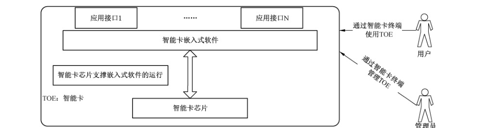

# GB/T 36950-2018 信息安全技术 智能卡安全技术要求（EAL4+）

> 来源：[GB/T 36950-2018 国家标准详情](https://openstd.samr.gov.cn/bzgk/std/newGbInfo?hcno=858B7A539F7AC0EDF719EE5DCA5A8549)；封面发布日期：2018-12-28；实施日期：2019-07-01。
> PDF SHA-256：c75978b1446e5eb3168a2e05aafb4f47461a403aa00d94ad9e9155213b853bed。
> 转写说明：逐页对照官方 PDF 的全部 28 页图像，校正正文、列表、图示和对应关系表；省略封面、目录、页眉、页脚和页码，合并跨页段落。正式引用请核对官方原件。

## 前言

本标准按照 GB/T 1.1—2009给出的规则起草。

请注意本文件的某些内容可能涉及专利。本文件的发布机构不承担识别这些专利的责任。

本标准由全国信息安全标准化技术委员会（SAC/TC 260）提出并归口。

本标准起草单位：住房和城乡建设部 IC 卡应用服务中心、中外建设信息有限责任公司、深圳航信德诚科技有限公司、深圳市华旭科技开发有限公司、深圳市德卡科技股份有限公司、信息产业信息安全测评中心、上海华虹集成电路有限责任公司、恩智浦（中国）管理有限公司、英飞凌集成电路（北京）有限公司、上海复旦微电子集团股份有限公司、中钞信用卡产业发展有限公司、恒宝股份有限公司、捷德（中国）信息科技有限公司、北京亿速码数据处理有限责任公司、上海浦江智能卡系统有限公司、东信和平科技股份有限公司、中山达华智能科技股份有限公司、山东华冠智能卡有限公司、天津环球磁卡股份有限公司、福建索天信息科技股份有限公司、北京智芯微电子科技有限公司、卫士通信息产业股份有限公司、福州数码视讯智能卡有限公司、江西省洪城一卡通投资有限公司。

本标准主要起草人：霍珊珊、张永刚、刘健、董晶晶、尚治宇、王冠华、陈超华、殷骏、杨敬源、陈勇、王晓雨、王宝鸽、梁少峰、方树平、丁晓明、畅江、黄显明、李岳、段宏阳、黄小鹏、娄亚华、刘振禹、纪鸿舜、江斌、付青琴、王会波、陈为明、谈素云。

## 引言

随着智能卡应用范围的不断扩大，应用环境复杂度也在不断提高，进而要求智能卡具有更强的安全保护能力。

本标准的 EAL4+是在 EAL4 的基础上将 AVA_VAN.3 增强为 AVA_VAN.4。

## 1 范围

本标准规定了智能卡安全技术要求，包括智能卡描述、安全问题定义、安全目的、安全要求和基本原理等技术要求。

本标准适用于智能卡产品的测试、评估，也可用于该类产品的研制和开发。

## 2 规范性引用文件

下列文件对于本文件的应用是必不可少的。凡是注日期的引用文件，仅注日期的版本适用于本文件。凡是不注日期的引用文件，其最新版本（包括所有的修改单）适用于本文件。

- GB/T 18336.1—2015 信息技术 安全技术 信息技术安全评估准则 第1部分：简介和一般模型

- GB/T 18336.2—2015 信息技术 安全技术 信息技术安全评估准则 第2部分：安全功能组件

- GB/T 18336.3—2015 信息技术 安全技术 信息技术安全评估准则 第3部分：安全保障组件

- GB/T 22186—2016 信息安全技术 具有中央处理器的IC卡芯片安全技术要求

## 3 术语和定义

GB/T 18336.1—2015 界定的术语和定义适用于本文件。

### 3.1 集成电路 integrated circuit

采用一定工艺，将电阻、电容、晶体管互连，用于执行运算处理或存储功能的电子元器件。

### 3.2 智能卡 smart card

具有中央处理器的集成电路卡。

> 注：从数据传输方式上可分为接触式智能卡和非接触式智能卡。

## 4 缩略语

下列缩略语适用于本文件。

APDU：应用协议数据单元（Application Protocol Data Unit）

COS：芯片操作系统（Chip Operating System）

EAL：评估保障级（Evaluation Assurance Level）

IC：集成电路（Integrated Circuit）

TOE：评估对象（Target of Evaluation）

TSF：评估对象安全功能（TOE Security Function）

USB：通用串行总线（Universal Serial Bus）

## 5 智能卡描述

### 5.1 总体结构

智能卡总体结构及运行环境，如图 1 所示。智能卡的安全性包括芯片、嵌入式软件、应用接口三个层面，芯片安全是物理基础，嵌入式软件安全是充分利用芯片的安全特性，建立完整的安全机制、安全体系，应用接口安全是运用芯片、嵌入式软件构建的安全机制、安全体系，满足特定应用需求，兼顾安全性与便利性。在对智能卡的安全性进行考虑时，除了要求其组成部分芯片和 COS 分别满足相关技术要求外，还应从整体性上综合考虑安全性和防护措施，以保证整个系统的安全。

总体结构说明如下：

a） 具有中央处理单元的 IC 卡芯片：包括中央处理单元、随机存取存储器、非易失性存储器、I/O 接口（接触式、非接触式或其他类型接口，如 USB 接口）、随机数发生器、密码算法协处理器和安全防攻击电路（如用于防止物理探测、环境压力威胁的硬件模块）。

b） 嵌入式软件：管理芯片硬件资源和数据，并实现对应用功能的支持。该软件通常存放在底层芯片硬件的非易失性存储器中，通过芯片的通信接口与智能卡终端设备交换信息，以响应用户发起的数据加密、数据签名及鉴权认证等应用请求。嵌入式软件由负责处理芯片硬件接口，实现文件管理、安全管理、通信处理和应用处理等功能的模块组成，其中安全管理模块提供安全配置、安全事务处理及密码支持等功能，以便为其他模块的安全执行提供支持。

c） 应用接口：运用嵌入式软件提供的功能和安全机制，以实现对特定应用功能的支持。

### 5.2 密码算法

密码算法可由软件或者硬件实现。智能卡中使用的密码算法和密钥管理应遵循智能卡相关国家标准、行业标准和国家密码主管部门的规定。

### 5.3 环境

智能卡即便暴露在非标准环境，也应能够进入到一种安全的运行状态。环境影响因素包括温度、电压、频率或外部能量场等。

## 6 安全问题定义

### 6.1 综述

智能卡是硬件与软件的结合体，其安全性应从硬件及软件、应用三个层面上来考虑，也就是从芯片层面、COS 层面和应用层面来综合考虑。

### 6.2 资产

#### 6.2.1 组成

资产应由 TOE 直接保护的安全相关的信息或资源组成，可分为由用户创建并使用的用户数据以及由 TOE 创建并使用的 TOE 数据。

为保护上述资产，智能卡开发和生产阶段使用的各种信息和工具，也需要保护。

需要保护的资产应包括：

a） 智能卡嵌入式软件；

b） 智能卡存储和处理的用户数据（例如嵌入式软件所使用的数据）；

c） 智能卡存储和处理的安全功能数据（例如安全属性、鉴别数据、访问控制列表、密钥等）；

d） 智能卡的逻辑设计信息、物理设计信息；

e） 特定的安全芯片开发辅助工具（例如掩膜数据生成工具）；

f） 支持嵌入式软件开发的信息（例如开发资料和开发平台）；

g） 与测试和特征有关的数据；

h） 初始化数据与预个人化数据；

i） 其他与特定功能有关的重要资产（例如智能卡产生的随机数）。

#### 6.2.2 用户数据

用户数据应包括：

a） D.APP_CODE： 下载到智能卡内的应用和库的代码，需要受到保护以免遭未经授权的修改；

b） D.APP_C_DATA：应用程序的保密性敏感的数据，如对象包含的数据、包的静态字段、当前执行方法的局部变量、操作数栈的位置，需要受到保护以免遭未经授权的暴露；

c） D.APP_I_DATA：应用程序的完整性敏感的数据，如卡号、交易记录、对象包含的数据、包的静态字段、当前执行方法的局部变量以及操作数栈的位置等，需要受到保护以免遭未经授权的修改；

d） D.PIN：任何终端用户的 PIN，需要受到保护以免遭未经授权的暴露和修改；

e） D.APP_KEYS：应用拥有的密钥，如充值密钥、消费密钥，需要受到保护以免遭未经授权的暴露和修改；

f） D.ISD_KEYS：发行商主密钥、应用提供商密钥、应用维护密钥等，需要受到保护以免遭未经授权的暴露和修改。

#### 6.2.3 系统数据

系统数据应包括：

a） D.CARD_MNGT_DATA：智能卡管理数据，如应用的标识符、特权、生命周期状态、存储资源的限额等，需要受到保护以免遭未经授权的修改；

b） D.ES_CODE：嵌入式软件框架部分的代码，需要受到保护以免遭未经授权的修改；

c） D.ES_DATA：嵌入式软件执行必要的内部运行时的数据区，如栈帧、程序计数器、对象的类、为数据分配的长度以及任何用于链接数据结构的指针等，需要受到保护以免遭未经授权的暴露和修改；

d） D.SEC_DATA：嵌入式软件运行时安全数据，如用于标识已安装的应用程序、当前选择的应用程序、每个对象的拥有者以及执行的当前上下文的 AID，需要受到保护以免遭未经授权的暴露和修改；

e） D.API_DATA：应用编程接口的私有数据，如私有字段的内容，需要受到保护以免遭未经授权的暴露和修改；

f） D.ES_KEYS：当下载文件到智能卡内时使用的密钥，需要受到保护以免遭未经授权的暴露和修改；

g） D.CRYPTO：运行时密码计算使用的密码数据，如生成密钥的种子，需要受到保护以免遭未经授权的暴露和修改。

### 6.3 威胁

#### 6.3.1 智能卡运行相关威胁

##### 6.3.1.1 分类

在智能卡生命周期中，TOE 可能会受到各种各样的攻击。他们中有些是无意识的行为，例如在交易过程中可能出现的一些误操作；有些是蓄意的，例如使用非法智能卡作弊、截取并篡改交易过程中所交换的信息等行为。根据各种攻击所采用的手段和攻击的对象的不同，智能卡大体存在以下五类威胁：

a） 物理威胁；

b） 逻辑威胁；

c） 与访问控制相关的威胁；

d） 有关密码功能的威胁；

e） 各种其他威胁。

##### 6.3.1.2 物理威胁

智能卡运行物理威胁如下：

a） 对智能卡的物理探测（T.P_Probe）攻击者可能对智能卡实施物理探测，以获取智能卡的设计信息和操作内容。

物理探测可能是利用智能卡失效性分析和采用半导体逆向工程技术来从智能卡中获取数据。这种探测可能包括对电气功能的探测，由于这种探测需要直接接触智能卡内部，所以仍把它归为物理探测。

攻击者的目的是获取诸如硬件安全机制、访问控制机制、鉴别系统、数据保护系统、存储器分区，以及密码算法程序等设计细节。弄清软件设计中诸如初始化数据、个人化数据、口令或密钥等也是他们的目标。智能卡可能会在未上电或已上电状态下受到探测攻击并且在遭受这样的攻击后可能会处于无法操作状态。

b） 对智能卡的物理更改（T.P_Alter）攻击者可能对智能卡实施物理更改，以获取智能卡的设计信息和操作内容，或者消弱、旁路安全功能，以及修改安全功能数据，从而非法使用智能卡。

对智能卡的更改可能利用智能卡失效性分析或采用半导体逆向工程技术来实现。攻击者的目的是通过物理更改，识别硬件安全机制，访问控制机制、鉴别系统、数据保护系统、存储器分区，以及密码算法程序等设计细节；识别软设计中诸如初始化数据、个人化数据、口令或密钥等的位置、状态、运行规律也是他们的目标。

更进一步的目标可以是，通过物理更改，消弱或旁路智能卡中的安全机制以获取受保护的敏感信息、修改或操纵调试阶段的锁定操作、初次使用标记、卡使用锁定、锁定功能配置、卡锁定标志、卡终止标志等，以便非法使用、伪造智能卡。

##### 6.3.1.3 逻辑威胁

智能卡运行逻辑威胁如下：

a） 信息泄露（T.INF-LEAK）攻击者可以利用智能卡使用期间泄露的信息暴露安全功能数据，信息泄露可能是正常操作固有的或者是由攻击者导致的。

功耗、电磁辐射、I/O 特性、时钟频率的变化或所需处理时间的变化等都有可能造成信息的泄露。

这可理解为一个隐蔽的传输途径（侧信道），实际上与操作参数的测量密切相关。这些泄漏信息攻击者可通过接触式（如功耗）或非接触式（如电磁辐射和时间变化）的信号测量，得到与正在执行的操作有关的信息，进而采用信号处理和统计分析等技术获得密钥等敏感信息。

b） 缺陷插入（T.Flt_Ins）攻击者可能通过反复地插入选定的数据，并观察相应的输出结果，从而获得智能卡安全功能或用户相关的信息。

这种威胁的特点是有目的选择和控制输入数据，而不是随机选择或控制。通过插入选定的数据并观察输出结果的变化，是对密码设备的一种常见攻击手段，这种手段也可用于对智能卡的攻击。其目的是通过观察智能卡如何对选定的输入做出响应来获取与安全功能或用户相关的信息。这种威胁的特点是有意选择和控制输入数据，而不是随机选择数据或控制输入输出操作中的物理特性。

c） 错误输入（T.Inv_Inp）攻击者可能通过引入无效的输入数据来危及智能卡的安全功能数据的安全。

错误输入操作形式包括错误的格式，索要的信息超过记录范围、试图找到并执行无正式书面文件的命令。这样的输入可能在正常使用过程中的任意时间发生，包括访问授权前。其结果是该攻击可能会危及安全功能，在操作中产生可利用的错误或者泄漏所保护的数据。

d） 未授权程序装载（T.Ua_Load）攻击者可能利用未授权的程序探测或修改智能卡安全功能代码及数据。

每个授权角色都有特定的权限仅用于下载指定的程序。未授权程序可能包括在正常操作期间不希望执行的合法程序，也可能包括用于有意刺探或修改智能卡安全功能的未授权装载程序。

##### 6.3.1.4 与访问控制相关的威胁

智能卡运行中与访问控制相关的威胁如下：

a） 非法访问（T.Access）使用者或攻击者可能在未经信息或资源的拥有者或责任者许可的条件下对信息或资源进行访问。

授权角色都有特定的权限来访问智能卡的信息，如果访问超出规定权限，会导致安全相关信息的暴露。

b） 使用被禁止的生命周期功能（T.Lc_Ftn）攻击者可能会利用相关命令，尤其是测试和调试命令来获取智能卡安全功能数据或敏感的用户数据，这些命令在智能卡生命周期的以往某些阶段是必要的，但在现阶段是被禁止的。

这些命令在操作执行的特殊阶段是不必要的或被禁止的。例如在操作阶段使用测试命令或调试命令来显示内存或执行其他功能。

##### 6.3.1.5 有关密码功能的威胁

智能卡运行有关密码功能的威胁如下：

a） 密码攻击（T.Crypt_Atk）攻击者可能实施密码攻击或穷举攻击危及智能卡的安全功能。

这种攻击可能用到一些加密函数、编码/解码函数或随机数发生器、攻击者的目标是发现密码算法中的脆弱性或通过穷举来发现密钥和输入数据。攻击者的目的在于暴露智能卡的安全功能数据从而危及用户敏感数据的安全。

b） 随机数的缺陷（T.RND）由于被提供的随机数熵值的不足，攻击者可以预测或获取在某些情况下借助的智能卡辅助工具所产生的随机数的信息。

##### 6.3.1.6 各种其他威胁

智能卡运行的其他威胁如下：

a） 环境压力（T.Env_Strs）攻击者可通过将智能卡暴露在被操纵的环境压力下，来达到向安全功能数据引入错误的目的。

将集成电路暴露在超出其使用范围的情况下，将导致其故障或安全临界元素的失败，从而达到允许操纵程序或数据的目的。这种情况可能是正常参数的极值（高或低）如温度、电压、时钟频率，也可能是不正常的环境如外部能量场，如激光、电磁射线等。该攻击的目的在于产生一个直接的错误导致智能卡进入非法工作状态，以一定概率达到非法操纵的目的；或者诱导智能卡产生可用于安全分析（如算法分析）的错误，得到智能卡所保护的敏感信息，从而导致敏感信息泄漏，甚至伪造智能卡。

b） 克隆（T.Clon）攻击者可能克隆部分或全部智能卡的功能以开发进一步的攻击手段。

攻击者可能通过对智能卡本身的详细观察来获取克隆部分或全部智能卡所必需的信息。攻击者通过开发智能卡的物理模型来实验其不同的功能和处理过程，从而实现进一步的攻击以达到成功暴露安全功能数据和敏感用户数据的目的。

#### 6.3.2 智能卡管理相关威胁

智能卡管理的相关威胁如下：

a） 智能卡鉴别重放（T.REPLAY）攻击者通过重新使用授权用户以前完成（或部分完成）的操作可以刺探智能卡的安全。

重放已完成或部分完成的操作企图绕过安全机制或暴露安全相关的信息；例如攻击者可以尝试发送它在先前会话中截获的APDU 命令到智能卡；攻击者也可以使用以前传送到他的身份验证信息以暴露或修改存储在智能卡中被其他应用目前使用的信息；例如攻击者可以利用曾经有效的身份验证信息，但不再有效，如旧的 PIN 值或密钥。

b） 暴力搜索（T.BRUTE-FORCE）攻击者可搜寻整个用户可访问的数据空间以便获得TOE 的相关敏感数据。

可以重复传输（调用）APDU 命令（API 方法）以尝试暴力提取诸如密钥或 PIN秘密。重复使用请求范围有效的命令以暴露尽可能多的数据空间，例如，攻击者可能利用不同形式的输入系统地试验。

### 6.4 组织安全策略

#### 6.4.1 密码管理（P.Crypto_Management）

密码的使用应符合国家标准及行业或组织的信息技术安全标准或规范，并符合下列要求：

a） 私钥由 COS 内部管理，使用COS文件访问指令不得访问到私钥文件，不应以任何形式读取私钥，私钥在任何时刻都不得以任何形式出现在智能卡外部；

b） 签名密钥对生成应由 COS 内部生成，COS 内部不得保留用于生成密钥对的素数。

#### 6.4.2 标识数据管理（P.IdData_Management）

智能卡的生产、测试等过程应具备标识 TOE的能力。

#### 6.4.3 芯片硬件选型（P.Chip_Selection）

TOE 采用的芯片应至少满足 GB/T 22186—2016中EAL4＋级相关要求。

### 6.5 假设

#### 6.5.1 人员（A.Personnel）

假设智能卡使用人员遵循一套安全的流程，严格遵照智能卡用户指南及安全建议的要求使用智能卡的安全规则和安全功能。

智能卡开发、测试、生产等各阶段的操作人员均能按安全的流程进行操作。

智能卡发卡机构的操作人员均能按安全的流程进行发卡操作。

#### 6.5.2 外部数据管理（A.OutData_Management）

假设在智能卡之外的数据和密钥以一种安全的方式进行管理。

关于智能卡设计描述（如芯片结构、设计信息、开发及测试工具、实现代码及相关文档、初始化数据）、个人化数据以及所有者身份等敏感信息将被发行者或其他智能卡之外的数据库存储。

由于使用智能卡可能引入外部的密钥，如共享密钥，假设这些密钥的产生、分发、维护和销毁等都是安全的。

#### 6.5.3 通信信道（A.Comm_Channel）

假定 TOE 与智能卡终端之间的通信信道是安全可靠的。典型的实现方式是通过共享密钥、公/私钥对，或者利用存储的其他密钥来产生会话密钥。假设当这些安全连接建立以后，就可以认为智能卡与智能卡终端之间的通信信道是足够安全的。由于智能卡终端的安全功能失效造成的攻击不在本标准的讨论范围。

#### 6.5.4 应用程序（A.App_Program）

假定在TOE 中安装应用程序的流程符合规范，且合法安装的应用程序不包含恶意代码。

#### 6.5.5 电源和时钟（A.Pwr_Clock）

电源和时钟来自智能卡终端，正常的交易进程中电源和时钟都可能被中断或复位。

## 7 安全目的

### 7.1 智能卡安全目的

#### 7.1.1 标识数据存储（O.IdData_Storage）

智能卡应具备在非易失性存储器中存储初始化数据和预个人化数据的能力。

#### 7.1.2 用户标识（O.User_Identification）

智能卡应明确地标识出可使用各种逻辑接口的用户。

#### 7.1.3 用户鉴别（O.User_Authentication）

用户应通过鉴别过程才可访问或使用智能卡中的用户数据和安全功能数据。

#### 7.1.4 防重放攻击（O.Replay_Prevention）

智能卡应提供安全机制以抵御重放攻击，如采用只可一次性使用的随机因子（需具备一定的信息熵）等措施。

#### 7.1.5 残留信息清除（O.ResidualInfo_Clearance）

智能卡应确保重要的数据在使用完成后会被删除或被安全处理，不会留下可被攻击者利用的残留数据信息。当应用程序被删除时，与其相关的所有敏感数据应一同被删除。

#### 7.1.6 信息泄露防护（O.InfoLeak_Prevention）

智能卡应提供控制或限制信息泄漏的方法，使得通过测量功耗、电磁辐射、时耗等信息的变化情况无法或难以获得用户数据和安全功能数据。

#### 7.1.7 数据访问控制（O.DataAcc_Control）

智能卡应对在系统内部的用户数据和安全功能数据实施访问控制措施，防止在未授权情况下被访问、修改或删除。

文件的创建、修改、删除和访问权限应与需求方的安全策略一致。

#### 7.1.8 状态恢复（O.Status_Recovery）

智能卡在检测到故障后应将工作状态恢复或调整至安全状态，防止攻击者利用故障实施攻击。

#### 7.1.9 生命周期功能控制（O.Lifecycle_Control）

智能卡应对自身安全功能的可用性进行生命周期阶段划分，或进行权限控制，以防止攻击者滥用这些功能进行攻击（如下载模式下的某些功能应在智能卡交付后关闭）。

智能卡应能够抵御这种结合物理攻击和逻辑攻击的联合攻击。

#### 7.1.10 密码安全（O.Crypto）

智能卡应以一个安全的方式支持密码功能，其使用的密码算法应符合国家、行业或组织要求的密码管理相关标准或规范。在任何情况下，密码数据应存储于智能卡的安全保护区域内，使智能卡提供的安全防护等措施发挥作用。当智能卡所使用的密码算法均由芯片实现，则应将此安全目的移至环境安全目的中。

### 7.2 环境安全目的

#### 7.2.1 人员（OE.Personnel）

智能卡的设计、开发，生产和交付等生命周期阶段中涉及的特定人员能严格地遵守安全的操作规程，以保证智能卡在生命周期过程中的安全性。

#### 7.2.2 通信信道（OE.Comm_Channel）

智能卡与智能卡终端之间的通信路径是可信的，能为通信过程提供保密性和完整性保障。

#### 7.2.3 应用程序（OE.App_Program）

安装应用程序到智能卡的流程应规范，且合法安装的应用程序不应包含恶意代码。在应用程序安装到智能卡之前，需要通过相应的卡外实体的检测，以保证应用程序没有被篡改。

#### 7.2.4 智能卡硬件（OE.Smartcard_Hardware）

智能卡硬件能够抵抗物理攻击、环境压力操纵攻击和侧信道攻击等。

#### 7.2.5 外部数据管理（OE.OutData_Management）

应对在智能卡外部存储的相关数据（如智能卡的设计信息、开发及测试工具、实现代码及相关文档、初始化数据、管理性密钥等）进行保密性和完整性处理，并采取安全的管理措施。

## 8 安全要求

### 8.1 安全功能要求

#### 8.1.1 标识与鉴别

标识与鉴别应包括：

a） 用户属性定义（FIA_ATD.1）智能卡安全功能应为每个用户保存其安全属性，如：用户标识、PIN 或密钥、用户角色等。

b） 标识的时机（FIA_UID.1）

1） 在用户被标识之前，智能卡安全功能应允许智能卡代表用户实施安全功能控制的指定动作，如：读取标识信息操作等；

2） 只有在用户已被成功标识后，智能卡才能代表用户执行所有其他受智能卡安全功能控制的动作。

c） 鉴别的时机（FIA_UAU.1）

1） 在用户被鉴别之前，智能卡安全功能应允许智能卡代表用户实施安全功能控制的指定动作，如：读取标识信息操作等；

2） 只有在用户已被成功鉴别后，智能卡才能代表用户执行所有其他受智能卡安全功能控制的动作。

d） 受保护的鉴别反馈在鉴别前和鉴别过程中，智能卡安全功能应不提供任何敏感信息给用户。

e） 鉴别失败处理（FIA_AFL.1）

1） 智能卡安全功能应能够对鉴权事件相关的不成功鉴别尝试进行检测；

2） 当达到或超过规定的不成功鉴别尝试次数时，智能卡安全功能将采取相应动作。

#### 8.1.2 用户数据保护

用户数据保护应包括：

a） 子集访问控制（FDP_ACC.1）智能卡安全功能应对安全功能策略覆盖的主体、客体和它们之间的操作执行用户数据访问控制策略。

b） 基于安全属性的访问控制（FDP_ACF.1）

1） 智能卡安全功能应基于安全属性或确定的安全属性组对客体执行用户数据访问控制策略；

2） 智能卡安全功能应通过对受控客体采取受控操作来管理访问的规则，以决定受控主体与受控客体间的操作是否被允许；

3） 如适用，智能卡安全功能应基于安全属性明确授权主体访问客体的规则明确授权主体访问客体；

4） 如适用，智能卡安全功能应基于安全属性明确拒绝主体访问客体的规则明确拒绝主体对客体的访问。

c） 子集信息流控制（FDP_IFC.1）智能卡安全功能应对包含在安全功能策略中的主体、信息和导致受控信息流入流出受控主体的操作执行信息流控制策略。

d） 子集残余信息保护（FDP_RIP.1）智能卡安全功能应确保至少以下资源的任何先前信息内容，在再次被使用时，其任何先前信息内容已经被清除：

1） APDU 缓冲区；

2） 密码运算缓冲区；

3） 临时对象释放。

#### 8.1.3 密码支持

密码应支持：

a） 密钥生成（FCS_CKM.1）智能卡安全功能所使用的密钥均应是根据符合相关标准的密钥生成算法和特定密钥长度来产生的密钥。

b） 密钥分发（FCS_CKM.2）开发者应根据满足相关标准的特定密钥分发方法来分发密钥。

c） 密钥访问（FCS_CKM.3）智能卡安全功能应根据符合相关标准的特定密钥访问方法来执行密钥访问。

d） 密码运算（FCS_COP.1）智能卡安全功能应根据符合相关标准的密码算法和密钥长度来执行密码运算。

e） 密钥销毁（FCS_CKM.4）开发者应根据满足相关标准的特定密钥销毁方法来销毁密钥。

#### 8.1.4 安全管理

安全管理应包括：

a） 安全功能行为的管理（FMT_MOF.1）智能卡安全功能应仅限于已标识的授权角色对可管理的功能具有确定其行为、禁止，允许，修改其行为的能力。

b） 安全属性的管理（FMT_MSA.1）智能卡安全功能应执行访问控制策略或信息流控制策略，仅限于已标识了的授权角色对安全属性进行改变默认值、查询、修改、删除或其他等操作。

c） 静态属性初始化（FMT_MSA.3）

1） 智能卡安全功能应执行访问控制策略或信息流控制策略，以便用于执行安全功能策略的安全属性提供受限的默认值；

2） 智能卡安全功能应允许已标识了的授权角色为生成的客体或信息规定新的初始值以代替原来的默认值。

d） TSF 数据的管理（FMT_MTD.1）智能卡安全功能应仅限于已标识了的授权角色能够对安全功能数据进行改变默认值、查询、修改、删除、清空或其他操作。

e） TSF 数据限值的管理（FMT_MTD.2）

1） 智能卡安全功能应仅限于已标识了的授权角色对安全功能数据限值进行管理，如：不成功鉴别尝试次数阈值；

2） 当智能卡安全功能数据达到或超过了指明的限值时，安全功能将采取相应的动作。

f） 管理功能规范（FMT_SMF.1）智能卡安全功能应能够执行安全管理功能列表指明的各项管理功能。

g） 安全角色（FMT_SMR.1）

1） 智能卡安全功能应能够对已授权的角色进行维护；

2） 应能够把用户和角色关联起来。

#### 8.1.5 安全功能保护

安全功能保护应包括：

a） 失效即保持安全状态（FPT_FLS.1）智能卡安全功能在失效发生时应保持一种安全状态，如传输数据时掉电、自检失败、存储器空间分配或访问错误等。

b） 功能恢复（FPT_RCV.4）智能卡安全功能应确保涉及恢复、复位、掉电或撤消操作完成之前的情况的安全功能有如下特性，即功能或者成功完成，或者针对指明的失效情景恢复到一个前后一致且安全的状态。

c） 重放检测（FPT_RPL.1）

1） 智能卡安全功能应能够对确定实体的重放攻击进行检测，如重用先前的合法鉴别数据进行认证等；

2） 智能卡安全功能在检测到重放时应执行相应的安全功能。

d） 物理攻击抵抗（FPT_PHP.3）智能卡安全功能应能够通过自动响应以抵抗对智能卡物理元器件的物理篡改和物理探测攻击，如智能卡逆向分析以及其他各种物理侵害，SPA/DPA、高阶 DPA、EMA 攻击、环境压力（故障注入）攻击、测试特性的重激活或利用，以保证智能卡自身的安全功能正常执行。

e） TSF 测试（FPT_TST.1）

1） 智能卡安全功能应在初始化启动期间（每一次上电时），运行一套自检功能以证明TSF 操作的正确性；

2） 智能卡安全功能应为授权用户提供验证TSF 数据完整性的能力；

3） 智能卡安全功能应为授权用户提供验证所存储的 TSF 可执行代码完整性的能力。

### 8.2 安全保障要求

#### 8.2.1 ST 引言（ASE_INT.1）

ST 引言应包括：

a） 开发者行为元素：ASE_INT.1.1D 开发者应提供 ST引言。

b） 内容和形式元素应包括：

1） ASE_INT.1.1C ST 引言应包含 ST 参照号，TOE 参照号，TOE 概述和 TOE 描述；

2） ASE_INT.1.2C ST 参照号应唯一标识 ST；

3） ASE_INT.1.3C TOE 参照号应标识 TOE；

4） ASE_INT.1.4C TOE 概述应概括 TOE 的用法及其主要安全特性；

5） ASE_INT.1.5C TOE 概述应标识 TOE类型；

6） ASE_INT.1.6C TOE 概述应标识任何 TOE 要求的非 TOE 范围内的硬件/软件/固件；

7） ASE_INT.1.7C TOE 描述应描述 TOE 的物理范围；

8） ASE_INT.1.8C TOE 描述应描述 TOE 的逻辑范围。

c） 评估者行为元素应包括：

1） ASE_INT.1.1E 评估者应确认所提供的信息满足证据的内容和形式的所有要求；

2） ASE_INT.1.2E 评估者应确认 TOE 参考、TOE 概述和 TOE描述是相互一致的。

#### 8.2.2 安全目的（ASE_OBJ.2）

安全目的应包括：

a） 开发者行为元素：

1） ASE_OBJ.2.1D 开发者应提供安全目的的陈述；

2） ASE_OBJ.2.2D 开发者应提供安全目的的基本原理。

b） 内容和形式元素：

1） ASE_OBJ.2.1C 安全目的的陈述应描述TOE 的安全目的和运行环境安全目的；

2） ASE_OBJ.2.2C 安全目的基本原理应追溯到 TOE 的每一个安全目的，以便于能追溯到安全目的所对抗的威胁及安全目的实施的组织安全策略；

3） ASE_OBJ.2.3C 安全目的基本原理应追溯到运行环境的每一个安全目的，以便于能追溯到安全目的所对抗的威胁、安全目的实施的组织安全策略和安全目的支持的假设；

4） ASE_OBJ.2.4C 安全目的基本原理应证实安全目的能抵抗所有威胁；

5） ASE_OBJ.2.5C 安全目的基本原理应证实安全目的执行所有组织安全策略；

6） ASE_OBJ.2.6C 安全目的基本原理应证实运行环境安全目的支持所有的假设。

c） 评估者行为元素：ASE_OBJ.2.1E 评估者应确认所提供的信息满足证据的内容和形式的所有要求。

#### 8.2.3 符合性声明（ASE_CCL.1）

符合性声明应包括：

a） 开发者行为元素：

1） ASE_CCL.1.1D 开发者应提供符合性声明；

2） ASE_CCL.1.2D 开发者应提供符合性声明的基本原理。

b） 内容和形式元素：

1） ASE_CCL.1.1C ST 的符合性声明应包含GB/T 18336—2015（所有部分）符合性声明，并应标识出 ST 和TOE声明符合性遵从的GB/T 18336—2015（所有部分）的版本；

2） ASE_CCL.1.2C ST 的符合性声明应描述 ST 和 GB/T 18336.2—2015 的符合性，无论是与 GB/T 18336.2—2015相符或是与GB/T 18336.2—2015 的扩展部分相符；

3） ASE_CCL.1.3C 符合性声明应描述ST 和 GB/T 18336.3—2015 的符合性，无论是与GB/T 18336.3—2015 相符或是与 GB/T 18336.3—2015 的扩展部分相符；

4） ASE_CCL.1.4C 符合性声明应与扩展组件定义是相符的；

5） ASE_CCL.1.5C 符合性声明应标识 ST 声明遵从的所有 PP 和安全要求包；

6） ASE_CCL.1.6C 符合性声明应描述 ST 和包的符合性，无论是与包的相符或是与扩展包相符；

7） ASE_CCL.1.7C 符合性声明的基本原理应证实TOE 类型与符合性声明所遵从的PP中的TOE 类型是相符的；

8） ASE_CCL.1.8C 符合性声明的基本原理应证实安全问题定义的陈述与符合性声明所遵从的PP中的安全问题定义陈述是相符的；

9） ASE_CCL.1.9C符合性声明的基本原理应证实安全目的陈述与符合性声明所遵从的PP中的安全目的陈述是相符的；

10） ASE_CCL.1.10C符合性声明的基本原理应证实安全要求的陈述与符合性声明所遵从的PP中的安全要求的陈述是相符的。

c） 评估者行为元素：ASE_CCL.1.1E 评估者应确认所提供的信息满足证据的内容和形式的所有要求。

#### 8.2.4 扩展组件定义（ASE_ECD.1）

扩展组件定义应包括：

a） 开发者行为元素：

1） ASE_ECD.1.1D 开发者应提供安全要求的陈述；

2） ASE_ECD.1.2D开发者应提供扩展组件的定义。

b） 内容和形式元素：

1） ASE_ECD.1.1C 安全要求陈述应标识所有扩展的安全要求；

2） ASE_ECD.1.2C扩展组件定义应为每一个扩展的安全要求定义一个扩展的组件；

3） ASE_ECD.1.3C扩展组件定义应描述每个扩展的组件与已有组件、族和类的关联性；

4） ASE_ECD.1.4C扩展组件定义应使用已有的组件、族、类和方法学作为陈述的模型；

5） ASE_ECD.1.5C扩展组件应由可测量的和客观的元素组成，以便于证实这些元素之间的符合性或不符合性。

c） 评估者行为元素：

1） ASE_ECD.1.1E 评估者应确认所提供的信息满足证据的内容和形式的所有要求；

2） ASE_ECD.1.2E 评估者应确认扩展组件不能利用已经存在的组件明确的表达。

#### 8.2.5 推导出的安全要求（ASE_REQ.2）

推导出的安全要求应包括：

a） 开发者行为元素：

1） ASE_REQ.2.1D 开发者应提供安全要求的陈述；

2） ASE_REQ.2.2D开发者应提供安全要求的基本原理。

b） 内容和形式元素：

1） ASE_REQ.2.1C 安全要求的陈述应描述安全功能要求和安全保障要求；

2） ASE_REQ.2.2C 应对安全功能要求和安全保障要求中使用的所有主体、客体、操作、安全属性、外部实体及其他术语进行定义；

3） ASE_REQ.2.3C安全要求的陈述应对安全要求的所有操作进行标识；

4） ASE_REQ.2.4C所有操作应被正确地执行；

5） ASE_REQ.2.5C应满足安全要求间的依赖关系，或者安全要求基本原理应证明不需要满足某个依赖关系；

6） ASE_REQ.2.6C安全要求基本原理应描述每一个安全功能要求可追溯至对应的TOE安全目的；

7） ASE_REQ.2.7C 安全要求基本原理应证明安全功能要求可满足所有的 TOE 安全目的；

8） ASE_REQ.2.8C 安全要求基本原理应说明选择安全保障要求的理由；

9） ASE_REQ.2.9C安全要求的陈述应是内在一致的。

c） 评估者行为元素：ASE_REQ.2.1E 评估者应确认所提供的信息满足证据的内容和形式的所有要求。

#### 8.2.6 安全问题定义（ASE_SPD.1）

安全问题定义应包括：

a） 开发者行为元素：ASE_SPD.1.1D 开发者应提供安全问题定义。

b） 内容和形式元素：

1） ASE_SPD.1.1C 安全问题定义应描述威胁；

2） ASE_SPD.1.2C所有的威胁都应根据威胁主体、资产和敌对行为进行描述；

3） ASE_SPD.1.3C 安全问题定义应描述组织安全策略；

4） ASE_SPD.1.4C 安全问题定义应描述TOE运行环境的相关假设。

c） 评估者行为元素：ASE_SPD.1.1E 评估者应确认所提供的信息满足证据的内容和形式的所有要求。

#### 8.2.7 TOE 概要规范（ASE_TSS.1）

TOE 概要规范应包括：

a） 开发者行为元素：ASE_TSS.1.1D 开发者应提供TOE 概要规范。

b） 内容和形式元素：ASE_TSS.1.1C TOE 概要规范应描述TOE 是如何满足每一项安全功能要求的。

c） 评估者行为元素：

1） ASE_TSS.1.1E 评估者应确认所提供的信息满足证据的内容和形式的所有要求；

2） ASE_TSS.1.2E 评估者应确认 TOE 概要规范与 TOE概述、TOE 描述是一致的。

#### 8.2.8 安全架构描述（ADV_ARC.1）

安全架构描述应包括：

a） 开发者行为元素：

1） ADV_ARC.1.1D 开发者应设计并实现 TOE，确保 TSF 的安全特性不可旁路；

2） ADV_ARC.1.2D 开发者应设计并实现TSF，以防止不可信主体的破坏；

3） ADV_ARC.1.3D开发者应提供 TSF 安全架构的描述。

b） 内容和形式元素：

1） ADV_ARC.1.1C 安全架构的描述应与在TOE 设计文档中对SFR-执行的抽象描述的级别一致；

2） ADV_ARC.1.2C 安全架构的描述应描述与安全功能要求一致的 TSF 安全域；

3） ADV_ARC.1.3C 安全架构的描述应描述 TSF 初始化过程是安全的；

4） ADV_ARC.1.4C 安全架构的描述应论证 TSF 可防止被破坏；

5） ADV_ARC.1.5C 安全架构的描述应论证 TSF 可防止 SFR-执行的功能被旁路。

c） 评估者行为元素：ADV_ARC.1.1E 评估者应确认提供的信息符合证据的内容和形式要求。

#### 8.2.9 完备的功能规范（ADV_FSP.4）

完备的功能规范应包括：

a） 开发者行为元素：

1） ADV_FSP.4.1D 开发者应提供一个功能规范；

2） ADV_FSP.4.2D 开发者应提供功能规范到安全功能要求的追溯。

b） 内容和形式元素：

1） ADV_FSP.4.1C 功能规范应完全描述 TSF；

2） ADV_FSP.4.2C功能规范应描述所有的TSFI 的目的和使用方法；

3） ADV_FSP.4.3C 功能规范应识别和描述每个 TSFI 相关的所有参数；

4） ADV_FSP.4.4C对于每个 SFR-执行 TSFI，功能规范应描述TSFI 相关的所有行为；

5） ADV_FSP.4.5C功能规范应描述可能由每个 TSFI 的调用而引起的所有直接错误消息；

6） ADV_FSP.4.6C 功能规范应论证安全功能要求到 TSFI 的追溯。

c） 评估者行为元素：

1） ADV_FSP.4.1E 评估者应确认所提供的信息满足证据的内容和形式的所有要求；

2） ADV_FSP.4.2E 评估者应确定功能规范是安全功能要求的一个准确且完备的实例化。

#### 8.2.10 TSF 实现表示（ADV_IMP.1）

TSF 实现表示应包括：

a） 开发者行为元素：

1） ADV_IMP.1.1D 开发者应为全部 TSF 提供实现表示；

2） ADV_IMP.1.2D 开发者应提供 TOE设计描述与实现表示实例之间的映射。

b） 内容和形式元素：

1） ADV_IMP.1.1C实现表示应按详细级别定义 TSF，且详细程度达到无须进一步设计就能生成 TSF的程度；

2） ADV_IMP.1.2C 实现表示应以开发人员使用的形式提供；

3） ADV_IMP.1.3C TOE 设计描述与实现表示示例之间的映射应能证明它们的一致性。

c） 评估者行为元素：ADV_IMP.1.1E 对于选取的实现表示示例，评估者应确认提供的信息满足证据的内容和形式的所有要求。

#### 8.2.11 基础模块设计（ADV_TDS.3）

基础模块设计应包括：

a） 开发者行为元素：

1） ADV_TDS.3.1D 开发者应提供 TOE的设计；

2） ADV_TDS.3.2D 开发者应提供从功能规范的TSFI 到 TOE 设计中获取到的最低层分解的映射。

b） 内容和形式元素：

1） ADV_TDS.3.1C 设计应根据子系统描述 TOE 的结构；

2） ADV_TDS.3.2C 设计应根据模块描述 TSF；

3） ADV_TDS.3.3C设计应标识 TSF 的所有子系统；

4） ADV_TDS.3.4C设计应描述每一个 TSF 子系统；

5） ADV_TDS.3.5C设计应描述 TSF 所有子系统间的相互作用；

6） ADV_TDS.3.6C设计应提供 TSF 子系统到 TSF 模块间的映射关系；

7） ADV_TDS.3.7C 设计应描述每一个SFR-执行模块，包括它的目的及与其他模块间的相互作用；

8） ADV_TDS.3.8C设计应描述每一个 SFR-执行模块，包括它的安全功能要求相关接口、其他接口的返回值、与其他模块间的相互作用及调用的接口；

9） ADV_TDS.3.9C设计应描述每一个 SFR-支撑或SFR-无关模块，包括它的目的及与其他模块间的相互作用；

10） ADV_TDS.3.10C 映射关系应论证 TOE 设计中描述的所有行为能够映射到调用它的 TSFI。

c） 评估者行为元素：

1） ADV_TDS.3.1E 评估者应确认提供的信息满足证据的内容与形式的所有要求；

2） ADV_TDS.3.2E 评估者应确定设计是所有安全功能要求的正确且完全的实例。

#### 8.2.12 操作用户指南（AGD_OPE.1）

操作用户指南应包括：

a） 开发者行为元素：AGD_OPE.1.1D 开发者应提供操作用户指南。

b） 内容和形式元素：

1） AGD_OPE.1.1C 操作用户指南应对每一种用户角色进行描述，在安全处理环境中应被控制的用户可访问的功能和特权，包含适当的警示信息；

2） AGD_OPE.1.2C 操作用户指南应对每一种用户角色进行描述，怎样以安全的方式使用TOE 提供的可用接口；

3） AGD_OPE.1.3C操作用户指南应对每一种用户角色进行描述，可用功能和接口，尤其是受用户控制的所有安全参数，适当时应指明安全值；

4） AGD_OPE.1.4C操作用户指南应对每一种用户角色明确说明，与需要执行的用户可访问功能有关的每一种安全相关事件，包括改变TSF所控制实体的安全特性；

5） AGD_OPE.1.5C操作用户指南应标识 TOE 运行的所有可能状态（包括操作导致的失败或者操作性错误），他们与维持安全运行之间的因果关系和联系；

6） AGD_OPE.1.6C 操作用户指南应对每一种用户角色进行描述，为了充分实现ST中描述的运行环境安全目的所应执行的安全策略；

7） AGD_OPE.1.7C 操作用户指南应是明确和合理的。

c） 评估者行为元素：AGD_OPE.1.1E 评估者应确认所提供的信息满足证据的内容和形式的所有要求。

#### 8.2.13 准备程序（AGD_PRE.1）

准备程序应包括：

a） 开发者行为元素：AGD_PRE.1.1D 开发者应提供TOE，包括它的准备程序。

b） 内容和形式元素：

1） AGD_PRE.1.1C 准备程序应描述与开发者交付程序相一致的安全接收所交付TOE必需的所有步骤；

2） AGD_PRE.1.2C 准备程序应描述安全安装 TOE 以及安全准备与ST 中描述的运行环境安全目的一致的运行环境必需的所有步骤。

c） 评估者行为元素：

1） AGD_PRE.1.1E 评估者应确认所提供的信息满足证据的内容和形式的所有要求；

2） AGD_PRE.1.2E 评估者应运用准备程序确认 TOE运行能被安全的准备。

#### 8.2.14 生产支持和接受程序及其自动化（ALC_CMC.4）

生产支持和接受程序及其自动化应包括：

a） 开发者行为元素：

1） ALC_CMC.4.1D 开发者应提供 TOE 及其参照号；

2） ALC_CMC.4.2D 开发者应提供CM文档；

3） ALC_CMC.4.3D 开发者应使用CM系统。

b） 内容和形式元素：

1） ALC_CMC.4.1C应给 TOE 标记唯一参照号；

2） ALC_CMC.4.2C CM文档应描述用于唯一标识配置项的方法；

3） ALC_CMC.4.3C CM 系统应唯一标识所有配置项；

4） ALC_CMC.4.4C CM 系统应提供自动化的措施使得只能对配置项进行授权变更；

5） ALC_CMC.4.5C CM 系统应以自动化的方式支持TOE的生产；

6） ALC_CMC.4.6C CM文档应包括CM计划；

7） ALC_CMC.4.7C CM 计划应描述CM系统是如何应用于 TOE 的开发的；

8） ALC_CMC.4.8C CM 计划应描述用来接受修改过的或新创建的作为TOE 组成部分的配置项的程序；

9） ALC_CMC.4.9C 证据应论证所有配置项都正在CM 系统下进行维护；

10） ALC_CMC.4.10C 证据应论证CM 系统的运行与CM计划是一致的。

c） 评估者行为元素：ALC_CMC.4.1E 评估者应确认所提供的信息满足证据的内容和形式的所有要求。

#### 8.2.15 问题跟踪 CM 覆盖（ALC_CMS.4）

问题跟踪CM 覆盖应包括：

a） 开发者行为元素：ALC_CMS.4.1D开发者应提供 TOE 配置项列表。

b） 内容和形式元素：

1） ALC_CMS.4.1C 配置项列表应包括：TOE本身、安全保障要求的评估证据、TOE 的组成部分、实现表示和安全缺陷报告及其解决状态；

2） ALC_CMS.4.2C 配置项列表应唯一标识配置项；

3） ALC_CMS.4.3C对于每一个TSF 相关的配置项，配置项列表应简要说明该配置项的开发者。

c） 评估者行为元素：ALC_CMS.4.1E 评估者应确认所提供的信息满足证据的内容和形式的所有要求。

#### 8.2.16 交付程序（ALC_DEL.1）

交付程序应包括：

a） 开发者行为元素：

1） ALC_DEL.1.1D 开发者应将把TOE 或其部分交付给消费者的程序文档化；

2） ALC_DEL.1.2D 开发者应使用交付程序。

b） 内容和形式元素：ALC_DEL.1.1C交付文档应描述，在向消费者分发 TOE 版本时，用以维护安全性所必需的所有程序。

c） 评估者行为元素：ALC_DEL.1.1E 评估者应确认所提供的信息满足证据的内容和形式的所有要求。

#### 8.2.17 安全措施标识（ALC_DVS.1）

安全措施标识应包括：

a） 开发者行为元素：ALC_DVS.1.1D 开发者应提供开发安全文档。

b） 内容和形式元素：ALC_DVS.1.1C开发安全文档应描述在 TOE 的开发环境中，保护 TOE设计和实现的保密性和完整性所必需的所有物理的、程序的、人员的及其他方面的安全措施。

c） 评估者行为元素：

1） ALC_DVS.1.1E 评估者应确认所提供的信息满足证据的内容和形式的所有要求；

2） ALC_DVS.1.2E 评估者应确认安全措施正在被使用。

#### 8.2.18 开发者定义的生命周期模型（ALC_LCD.1）

开发者定义的生命周期模型应包括：

a） 开发者行为元素：

1） ALC_LCD.1.1D 开发者应建立一个生命周期模型，用于 TOE 的开发和维护；

2） ALC_LCD.1.2D 开发者应提供生命周期定义文档。

b） 内容和形式元素：

1） ALC_LCD.1.1C 生命周期定义文档应描述用于开发和维护TOE的模型；

2） ALC_LCD.1.2C 生命周期模型应为 TOE的开发和维护提供必要的控制。

c） 评估者行为元素：ALC_LCD.1.1E 评估者应确认所提供的信息满足证据的内容和形式的所有要求。

#### 8.2.19 明确定义的开发工具（ALC_TAT.1）

明确定义的开发工具应包括：

a） 开发者行为元素：

1） ALC_TAT.1.1D 开发者应标识用于开发 TOE 的每个工具；

2） ALC_TAT.1.2D开发者应在文档中描述每个开发工具所选取的实现依赖选项。

b） 内容和形式元素：

1） ALC_TAT.1.1C 用于实现的每个开发工具都应是明确定义的；

2） ALC_TAT.1.2C 每个开发工具的文档应无歧义地定义所有语句和实现用到的所有协定与命令的含义；

3） ALC_TAT.1.3C每个开发工具的文档应无歧义地定义所有实现依赖选项的含义。

c） 评估者行为元素：ALC_TAT.1.1E 评估者应确认所提供的信息满足证据的内容和形式的所有要求。

#### 8.2.20 覆盖分析（ATE_COV.2）

覆盖分析应包括：

a） 开发者行为元素：ATE_COV.2.1D 开发者应提供对测试覆盖的分析。

b） 内容和形式元素：

1） ATE_COV.2.1C 测试覆盖分析应论证测试文档中的测试与功能规范中 TSF接口之间的对应性；

2） ATE_COV.2.2C 测试覆盖分析应论证已经对功能规范中的所有 TSF 接口都进行了测试。

c） 评估者行为元素：ATE_COV.2.1E 评估者应确认所提供的信息满足证据内容和形式的所有要求。

#### 8.2.21 测试：安全执行模块（ATE_DPT.2）

测试：安全执行模块应包括：

a） 开发者行为元素：ATE_DPT.2.1D 开发者应提供测试深度分析。

b） 内容和形式元素：

1） ATE_DPT.2.1C 深度测试分析应论证测试文档中的测试与 TOE设计中的TSF 子系统、SFR-执行模块之间的一致性；

2） ATE_DPT.2.2C 测试深度分析应论证 TOE 设计中的所有TSF 子系统都已经进行过测试；

3） ATE_DPT.2.3C 测试深度分析应论证 TOE 设计中的SFR-执行模块都已经进行过测试。

c） 评估者行为元素：ATE_DPT.2.1E 评估者应确认所提供的信息满足证据内容和形式的所有要求。

#### 8.2.22 功能测试（ATE_FUN.1）

功能测试应包括：

a） 开发者行为元素：

1） ATE_FUN.1.1D 开发者应测试 TSF，并文档化测试结果；

2） ATE_FUN.1.2D 开发者应提供测试文档。

b） 内容和形式元素：

1） ATE_FUN.1.1C 测试文档应包括测试计划、预期的测试结果和实际的测试结果；

2） ATE_FUN.1.2C 测试计划应标识要执行的测试并描述执行每个测试的方案，这些方案应包括对于其他测试结果的任何顺序依赖性；

3） ATE_FUN.1.3C 预期的测试结果应指出测试成功执行后的预期输出；

4） ATE_FUN.1.4C 实际的测试结果应和预期的测试结果一致。

c） 评估者行为元素：ATE_FUN.1.1E 评估者应确认所提供的信息满足证据内容和形式的所有要求。

#### 8.2.23 独立测试—抽样（ATE_IND.2）

独立测试—抽样应包括：

a） 开发者行为元素：ATE_IND.2.1D 开发者应提供用于测试的 TOE。

b） 内容和形式元素：

1） ATE_IND.2.1C TOE 应适合测试；

2） ATE_IND.2.2C 开发者应提供一组与开发者 TSF 功能测试中同等的一系列资源。

c） 评估者行为元素：

1） ATE_IND.2.1E 评估者应确认所提供的信息满足证据的内容和形式的所有要求；

2） ATE_IND.2.2E 评估者应执行测试文档中的测试样本，以验证开发者的测试结果；

3） ATE_IND.2.3E 评估者应测试 TSF 的一个子集以确认 TSF 按照规定运行。

#### 8.2.24 系统的脆弱性分析（AVA_VAN.4）

系统的脆弱性分析包括：

a） 开发者行为元素：AVA_VAN.4.1D 开发者应提供用于测试的TOE。

b） 内容和形式元素：AVA_VAN.4.1C TOE 应适合测试。

c） 评估者行为元素：

1） AVA_VAN.4.1E 评估者应确认所提供的信息满足证据的内容和形式的所有要求；

2） AVA_VAN.4.2E 评估者应执行公共领域的调查以标识 TOE 的潜在脆弱性；

3） AVA_VAN.4.3E 评估者应针对TOE执行独立的、系统的脆弱性分析去标识 TOE 潜在的脆弱性，在分析过程中使用指导性文档、功能规范、TOE 设计、安全结构描述和实现表示；

4） AVA_VAN.4.4E 评估者应基于已标识的潜在脆弱性实施穿透性测试，确认 TOE能抵抗具有中等攻击潜力的攻击者的攻击。

## 9 基本原理

### 9.1 安全目的基本原理

表 1 说明了智能卡的安全目的能应对所有可能的威胁、假设和组织安全策略。

**表 1 威胁、组织安全策略、假设与安全目的的对应关系**

| 安全问题定义 | 对应安全目的 |
| --- | --- |
| T.P_Probe | OE.Smartcard_Hardware |
| T.P_Alter | OE.Smartcard_Hardware |
| T.INF-LEAK | O.InfoLeak_Prevention、OE.Smartcard_Hardware |
| T.Flt_Ins | O.Status_Recovery、OE.Smartcard_Hardware |
| T.Inv_Inp | O.Status_Recovery、OE.Smartcard_Hardware |
| T.Ua_Load | O.User_Identification、O.User_Authentication、O.DataAcc_Control、OE.App_Program |
| T.Access | O.User_Authentication |
| T.Lc_Ftn | O.Lifecycle_Control |
| T.Crypt_Atk | O.Crypto |
| T.RND | OE.Comm_Channel |
| T.Env_Strs | O.Status_Recovery |
| T.Clon | O.ResidualInfo_Clearance |
| T.REPLAY | O.Replay_Prevention |
| T.BRUTE-FORCE | O.Replay_Prevention |
| P.Crypto_Management | O.Crypto |
| P.IdData_Management | O.IdData_Storage |
| P.Chip_Selection | OE.Smartcard_Hardware |
| A.Personnel | OE.Personnel |
| A.OutData_Management | OE.OutData_Management |
| A.Comm_Channel | OE.Comm_Channel |
| A.App_Program | OE.App_Program |

具体包括下列要求：

a） T.Ua_Load

为了抵御非法程序攻击，通过 O.User_Identification、O.User_Authentication 确保下载应用程序前，用户应已被明确标识并进行了安全鉴别；O.DataAcc_Control 确保对数据实施了访问控制管理，以防止非法程序绕过访问控制措施读取或修改数据；另外，OE.App_Program 确保应用程序的开发过程不会包含恶意代码且下载过程能以一种安全的规程进行。

b） T.INF-LEAK

针对攻击者利用 TOE 执行过程中泄露的功耗、电磁辐射及时耗等侧信道信息而发起的侧信道等信息泄露攻击，O.InfoLeak_Prevention 要求 TOE 应具有抵抗或缓解此类攻击的能力。OE.Smartcard_Hardware 可确保硬件平台能够抵御侧信道攻击，因而保证由硬件平台实现的密码算法在此攻击下的安全性。

c） T.Flt_Ins、T.Inv_Inp

故障注入攻击可通过分析 TOE 的运行故障以获取敏感数据信息或滥用 TOE 的安全功能，为此，O.Status_Recovery 确保当故障发生时 TOE 工作状态可恢复或调整至安全状态，而不泄露有利于攻击者的故障信息。OE.Smartcard_Hardware 可确保硬件平台能够抵御故障引入攻击，因而保证由硬件平台实现的密码算法在此攻击下的安全性。

d） T.Lc_Ftn

攻击者利用生命周期功能滥用而造成对 TOE 的安全威胁，可通过 O.Lifecycle_Control 控制特定生命周期的特定指令和功能，通过对TOE生命周期各阶段进行管理来防止此类攻击。

e） T.P_Probe、T.P_Alter

物理操纵攻击是攻击者利用芯片失效性分析和半导体逆向工程技术，对芯片实施物理剖片和探测，以获取存储于芯片内的数据信息。OE.Smartcard_Hardware 可确保硬件平台能够抵御物理操纵攻击。

f） T.Access

为了抵御使用者或攻击者可能在未经信息或资源的拥有者或责任者许可的条件下对信息或资源进行访问，通过 O.User_Authentication 确保在访问之前，用户应已被明确标识并进行了安全鉴别。

g） T.REPLAY、T.BRUTE-FORCE

为了抵御攻击者可能刺探或搜索智能卡鉴别数据，通过 O.Replay_Prevention 确保相关鉴别数据不能被重复利用。

h） T.Env_Strs

通过 O.Status_Recovery 对环境状态的检测，来确保可能导致敏感信息泄漏的外部环境操纵攻击。

i） T.Clon

通过 O.ResidualInfo_Clearance 对密钥数据及时进行销毁，防止重要数据资源释放或销毁后再被访问，以确保敏感信息泄露导致克隆的发生。

j） P.Crypto_Management、T.Crypt_Atk

强调了使用国家或行业的密码标准和规范的要求，O.Crypto 直接满足了这一组织安全策略要求，可确保在设计和开发过程中正确使用这些标准。

k） P.IdData_Management

对智能卡嵌入式软件的开发和个人化等过程应具备标识TOE 的能力提出要求，这一策略可直接由 O.IdData_Storage 安全目的来满足。

l） P.Chip_Selection

确立了 TOE 应采用至少通过 EAL4+ 测评的安全芯片，提出 OE.Smartcard_Hardware 确保芯片可抵抗物理攻击、环境干扰攻击、侧信道攻击等，以至少达到 EAL4+ 安全要求。

m） T.RND、A.Comm_Channel

应确保 TOE 与智能卡终端之间的通信信道是安全可靠的，OE.Comm_Channel 提供了环境安全目的，确保通信路径是可信的。

n） A.App_Program

该假设对安装在智能卡嵌入式软件之上的应用程序本身及其安装流程的安全性提出了条件，OE.App_Program 提供了针对性的环境安全目的，可满足该假设条件。

o） A.OutData_Management

该假设对安全功能数据在 TOE外部存储和管理的安全性提出了要求，OE.OutData_Management提供了针对性的环境安全目的，可确保外部存储和管理 TSF 数据的措施是安全的。

p） A.Personnel

该假设对 TOE 用户的使用安全性提出了要求，OE.Personnel 环境要求确保操作人员需要在经过培训后严格地遵守安全的操作规程，因此可以满足这一假设。

### 9.2 安全要求基本原理

表 2 说明了安全要求的充分必要性基本原理，即每个安全目的都至少有一个安全要求（包括功能要求和保障要求）组件与其对应，每个安全要求都至少解决了一个安全目的，因此安全要求对安全目的而言是充分和必要的。

**表 2 安全功能组件与安全目的的对应关系**

| 安全功能组件 | 对应安全目的 |
| --- | --- |
| FCS_CKM.1 | O.User_Authentication、O.Crypto |
| FCS_CKM.2 | O.Crypto |
| FCS_CKM.3 | O.User_Authentication、O.Crypto |
| FCS_CKM.4 | O.ResidualInfo_Clearance |
| FCS_COP.1 | O.User_Authentication、O.Crypto |
| FDP_ACC.1 | O.DataAcc_Control |
| FDP_ACF.1 | O.DataAcc_Control |
| FDP_IFC.1 | O.InfoLeak_Prevention |
| FDP_RIP.1 | O.ResidualInfo_Clearance |
| FIA_AFL.1 | O.User_Authentication |
| FIA_ATD.1 | O.User_Identification、O.User_Authentication |
| FIA_UAU.1 | O.User_Authentication、O.DataAcc_Control、O.Lifecycle_Control |
| FIA_UID.1 | O.User_Identification、O.DataAcc_Control |
| FMT_MOF.1 | O.DataAcc_Control |
| FMT_MSA.1 | O.DataAcc_Control |
| FMT_MSA.3 | O.DataAcc_Control |
| FMT_MTD.1 | O.IdData_Storage、O.DataAcc_Control |
| FMT_MTD.2 | O.DataAcc_Control |
| FMT_SMF.1 | O.Lifecycle_Control |
| FMT_SMR.1 | O.User_Identification、O.User_Authentication、O.Lifecycle_Control |
| FPT_FLS.1 | O.Status_Recovery |
| FPT_RCV.4 | O.Status_Recovery |
| FPT_RPL.1 | O.Replay_Prevention |
| FPT_PHP.3 | O.InfoLeak_Prevention |
| FPT_TST.1 | O.Status_Recovery |

具体包括下列要求：

a） O.IdData_Storage

FMT_MTD.1 可满足对智能卡嵌入式软件初始化及预个人化等数据中的标识信息进行安全存储，并防止在使用阶段被修改的要求。

b） O.User_Identification

安全标识的安全目的可由 FIA_ATD.1、FIA_UID.1 通过维护用户的安全属性及对每个用户身份的成功标识获得满足。

c） O.User_Authentication

通过 FIA_AFL.1、FIA_ATD.1、FIA_UAU.1、FMT_SMR.1 对鉴别机制的实现及与角色的关联进行要求；并通过 FCS_CKM.1、FCS_CKM.3、FCS_COP.1 对安全鉴别实现方式所使用的密码相关机制进行要求。

d） O.Replay_Prevention

通过 FPT_RPL.1 对鉴别数据的重要数据实体防重放进行要求。

e） O.ResidualInfo_Clearance

通过 FCS_CKM.4对密钥数据的销毁进行要求，并通过FDP_RIP.1 对重要数据资源释放或销毁后提出不可再被访问的要求，以满足残余信息清除的目的。

f） O.InfoLeak_Prevention

通过 FDP_IFC.1、FPT_PHP.3 保证用户数据和TSF 数据在计算过程及内部传输过程中不会泄露能被攻击者利用的有效信息，以此来满足 TOE 抵抗侧信道等信息泄露攻击的安全目的。

g） O.DataAcc_Control

通过 FDP_ACC.1、FDP_ACF.1 要求对 TOE 内部的用户数据实施访问控制管理，防止未授权的访问；FIA_UAU.1、FIA_UID.1 要求用户在执行安全功能前需进行正确的标识并通过安全鉴别；FMT_MOF.1、FMT_MSA.1、FMT_MSA.3、FMT_MTD.1 和 FMT_MTD.2 要求对安全属性等安全功能数据及安全功能进行授权管理以防止未授权访问。在上述安全功能要求组件的配合下将可实现数据保护的安全目的。

h） O.Status_Recovery

通过 FPT_FLS.1、FPT_RCV.4 对发生异常后的功能恢复及安全状态保持情况提出要求，FPT_TST.1 要求对安全功能的正确性和相关数据的完整性进行自检，这些组件可满足检测到故障后调整至安全状态的目的。

i） O.Lifecycle_Control

通过 FIA_UAU.1、FMT_SMR.1 要求TOE 用户在不同生命周期阶段中应按角色进行鉴别才能实施相应操作，并通过 FMT_SMF.1 要求对特定生命周期阶段具有特定指令及操作的要求，来共同满足生命周期控制的安全目的。

j） O.Crypto

通过 FCS_CKM.1、FCS_CKM.2、FCS_CKM.3 和 FCS_COP.1 对密码相关操作进行要求可满足密码安全的安全目的。

## 参考文献

- [1] Smart Card Open Platform Protection Profile, Version 2.1, IT Security Certification Center, Korea, 2010. KECS-PP-0097a—2008.

- [2] Security IC Platform Protection Profile, Version 1.0, 15.06.2007 Registered and Certified by Bundesamt für Sicherheit in der Informationstechnik (BSI) under the reference BSI-PP-0035.
