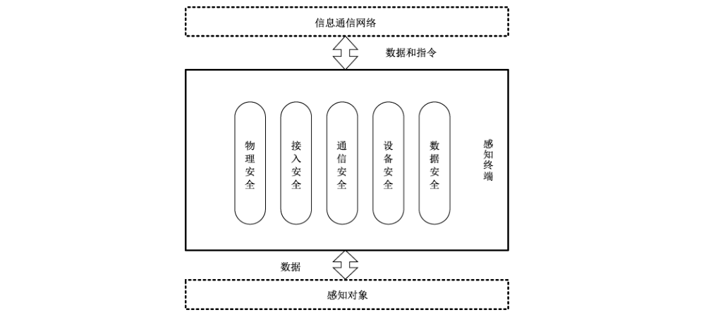
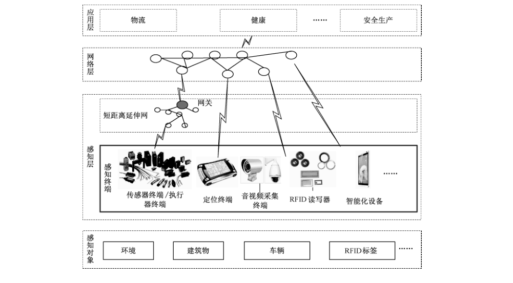

# GB/T 36951-2018 信息安全技术 物联网感知终端应用安全技术要求

> 来源：[GB/T 36951-2018 国家标准详情](https://openstd.samr.gov.cn/bzgk/std/newGbInfo?hcno=8D71779F7E6DB4B0368C22F7BE32FF1D)；发布日期：2018-12-28；实施日期：2019-07-01。
> PDF SHA-256：3021c0726d94104bd7ae9ce9571e045feb48f72121ae6eb97c0478f92dc47a6c。
> 转写说明：将官方 PDF 逐页渲染为图像并进行识别，对照全部 14 页原图校正文字、条款和 2 张图；省略封面、目录及页眉页脚，保留增强要求的黑体强调。正式引用请核对原 PDF。

## 前言

本标准按照 GB/T 1.1—2009 给出的规则起草。

请注意本文件的某些内容可能涉及专利。本文件的发布机构不承担识别这些专利的责任。

本标准由全国信息安全标准化技术委员会（SAC/TC 260）提出并归口。

本标准起草单位：北京信息安全测评中心、中国信息通信研究院、大唐移动通信设备有限公司、北京时代凌宇科技股份有限公司、中国科学院信息工程研究所、威海威高电子工程有限公司。

本标准主要起草人：刘海峰、钱秀槟、赵章界、刘凯俊、武传坤、袁琦、陈宸、李颖、史振国、李晨旸、王亮、赵阳、樊勇、周勇。

## 引言

物联网广泛应用在农业、工业、卫生、城市管理等领域，感知终端是物联网信息系统的重要组成部分，其在应用中安全防护水平参差不齐，直接影响了物联网信息系统的整体安全。

与一般信息系统相比，物联网信息系统中使用的感知终端具有数量众多、种类繁杂、分布区域广、部署环境多样、安全功能受限等特点，这些特点使得感知终端应用面临软硬件故障、物理攻击、通信异常、信息泄露或篡改、非授权访问或恶意控制等安全风险。为了提高物联网信息系统中感知终端应用的安全防护水平，本标准针对感知终端应用提出了通用的安全技术要求。

## 1 范围

本标准规定了物联网信息系统中感知终端应用的物理安全、接入安全、通信安全、设备安全、数据安全等安全技术要求。

本标准适用于物联网信息系统建设运维单位对感知终端进行安全选型、部署、运行和维护。本标准也适用于指导感知终端设计和生产。

## 2 规范性引用文件

下列文件对于本文件的应用是必不可少的。凡是注日期的引用文件，仅注日期的版本适用于本文件。凡是不注日期的引用文件，其最新版本（包括所有的修改单）适用于本文件。

- GB/T 4208—2017 外壳防护等级（IP 代码）

- GB/T 17799.1—2017 电磁兼容 通用标准 居住、商业和轻工业环境中的抗扰度试验

- GB/T 17799.2—2003 电磁兼容 通用标准 工业环境中的抗扰度试验

- GB/T 22240—2008 信息安全技术 信息系统安全等级保护定级指南

- GB/T 25069—2010 信息安全技术 术语

## 3 术语和定义、缩略语

### 3.1 术语和定义

GB/T 25069—2010 界定的以及下列术语和定义适用于本文件。

#### 3.1.1 物联网 internet of things

通过感知终端，按照约定协议，连接物、人、系统和信息资源，实现对物理和虚拟世界的信息进行处理并作出反应的智能服务系统。

#### 3.1.2 感知终端 sensing terminal

能对物或环境进行信息采集和/或执行操作，并能联网进行通信的装置。

#### 3.1.3 传感器 transducer/sensor

能感受被测量并按照一定的规律转换成可用输出信号的器件或装置，通常由敏感元件和转换元件组成。

［GB/T 7665—2005，定义 3.1.1］

> 注：GB/T 7665—2005 定义了传感器的一般分类术语，其中从被测量角度定义了三类传感器，即物理量传感器、化学量传感器和生物量传感器。

#### 3.1.4 数据新鲜性 data freshness

对所接收的历史数据或超出时限的数据进行识别的特性。

### 3.2 缩略语

下列缩略语适用于本文件：

- IoT：物联网（internet of things）
- RFID：射频识别（radio frequency identification）

## 4 总体安全技术要求

### 4.1 安全框架

感知终端应用是指在物联网信息系统中开展感知终端的选型、部署、运行和维护。感知终端在物联网信息系统中应用，成为物联网信息系统的重要组成部分，参见附录 A。

在物联网信息系统中，感知终端处于特定的物理环境中，与该环境中的感知对象交换数据，或对感知对象进行控制；感知终端接入信息通信网络，并通过网络进行通信。感知终端应用的安全包括物理安全、接入安全、通信安全、设备安全和数据安全，如图 1 所示。

感知终端根据是否具有操作系统，可分为具有操作系统的感知终端和不具有操作系统的感知终端。

本标准中的安全技术要求除非特别规定，否则适用于具有操作系统的感知终端和不具有操作系统的感知终端。

### 4.2 安全技术要求级别

物联网信息系统中感知终端应用的安全技术要求分为基本要求和增强要求两类。感知终端应用的安全至少应满足基本要求；处理敏感数据的感知终端，或一旦遭到破坏将对人身安全、环境安全带来严重影响的感知终端，或 GB/T 22240—2008 规定的三级以上物联网信息系统中的感知终端，感知终端应用的安全应满足增强要求。

> 注：相对于基本要求，增强要求新增内容用黑体字表示。

## 5 基本要求

### 5.1 物理安全要求

#### 5.1.1 选型

选用感知终端产品时，感知终端产品：

a） 应取得质量认证证书；

b） 应满足 GB/T 4208—2017 确定的外壳防护等级（IP 代码）要求；

c） 应通过依据 GB/T 17799.1—2017、GB/T 17799.2—2003 或有关的专用产品/产品类电磁兼容抗扰度标准进行的电磁兼容抗扰度试验，且性能满足需求。

#### 5.1.2 选址

物联网信息系统中进行感知终端选址时，感知终端：

a） 应在防盗窃防破坏、防水防潮、防极端温度等方面满足部署的要求；

b） 应在信号防干扰、防屏蔽、防阻挡等方面满足部署环境的要求。

#### 5.1.3 供电

感知终端的供电应稳定可靠。

#### 5.1.4 防盗窃和防破坏

感知终端：

a） 应避免部署在不受控的非安全场所中；

b） 宜采用防盗窃和防破坏的措施。

### 5.2 接入安全要求

#### 5.2.1 网络接入认证

在接入网络时，感知终端：

a） 应在接入网络中具有唯一网络身份标识；

b） 应能向接入网络证明其网络身份，至少支持如下身份鉴别机制之一：

1） 基于网络身份标识的鉴别；

2） 基于 MAC 地址的鉴别；

3） 基于通信协议的鉴别；

4） 基于通信端口的鉴别；

5） 基于对称密码机制的鉴别；

6） 基于非对称密码机制的鉴别。

c） 应能进行鉴别失败处理；

d） 在采用插卡方式进行网络身份鉴别时，应采取措施防止卡片被拔除或替换；

e） 应保证密钥存储和交换安全。

#### 5.2.2 网络访问控制

感知终端：

a） 应禁用业务需求以外的通信端口；

b） 应设置网络访问控制策略，限制对感知终端的网络访问。

### 5.3 通信安全要求

#### 5.3.1 无线电安全

感知终端应按国家规定使用无线电频段和辐射强度。

#### 5.3.2 传输完整性

感知终端：

a） 应具有并启用通信完整性校验机制，实现数据传输的完整性保护；

b） 应具有通信延时和中断的处理机制。

### 5.4 设备安全要求

#### 5.4.1 标识与鉴别

对于具有操作系统的感知终端：

a） 感知终端的操作系统用户应有唯一标识；

b） 应对感知终端的操作系统用户进行身份鉴别。使用用户名和口令鉴别时，口令应由字母、数字及特殊字符组成，且长度不小于 8 位。

#### 5.4.2 访问控制

本项要求包括：

a） 具有操作系统的感知终端应能控制操作系统用户的访问权限；

b） 对于具有操作系统的感知终端，操作系统用户应仅被授予完成任务所需的最小权限；

c） 感知终端应能控制数据的本地或远程访问；

d） 感知终端应提供安全措施控制对其远程配置。

#### 5.4.3 日志审计

具有操作系统的感知终端：

a） 应能为操作系统事件生成审计记录，审计记录应包括日期、时间、操作用户、操作类型等信息；

b） 应能由安全审计员开启和关闭操作系统的审计功能；

c） 应能提供操作系统的审计记录查阅功能。

#### 5.4.4 失效保护

感知终端应能自检出已定义的设备故障并进行告警，确保设备未受故障影响部分的功能正常。

#### 5.4.5 软件安全

具有操作系统的感知终端：

a） 应仅安装经授权的软件；

b） 应按照策略进行软件补丁更新和升级，且保证所更新的数据是来源合法的和完整的；

c） 应安装满足业务安全功能需求的软件并正确配置及使用。

### 5.5 数据安全要求

#### 5.5.1 数据可用性

感知终端在传输其采集到的数据时，应对数据新鲜性做出标识。

#### 5.5.2 数据完整性

感知终端应为其采集的数据生成完整性证据（如校验码、消息摘要、数字签名等）。

## 6 增强要求

### 6.1 物理安全要求

#### 6.1.1 选型

在满足 5.1.1 的基础上：

**物联网中使用的感知终端产品应经过第三方检测机构的信息安全检测。**

#### 6.1.2 选址

应满足 5.1.2 的要求。

#### 6.1.3 供电

在满足 5.1.3 的基础上：

a） **关键感知终端应具有备用电力供应，至少满足在规定的供电时长内保持感知终端正常运行；**

b） **应提供技术和管理手段监测感知终端的供电情况，并能在电力不足时及时报警。**

#### 6.1.4 防盗窃和防破坏

在满足 5.1.4 的基础上：

a） **户外部署的重要感知终端宜设置在视频监控范围内；**

b） **户外部署的关键感知终端应具有定位装置。**

#### 6.1.5 防雷和防静电

**重要感知终端应采取必要的避雷和防静电措施。**

### 6.2 接入安全要求

#### 6.2.1 网络接入认证

在满足 5.2.1 a）、c）、d）、e）的基础上：

**感知终端与其接入网络间应进行双向认证，双方至少支持如下身份鉴别机制之一：**

a） **基于对称密码机制的鉴别；**

b） **基于非对称密码机制的鉴别。**

#### 6.2.2 网络访问控制

应满足 5.2.2 的要求。

### 6.3 通信安全要求

#### 6.3.1 无线电安全

应满足 5.3.1 的要求。

#### 6.3.2 传输完整性

应满足 5.3.2 的要求。

#### 6.3.3 传输保密性

**感知终端传输鉴别信息、隐私数据和重要业务数据等敏感信息时应进行加密保护。加密算法应符合国家密码相关规定。**

### 6.4 设备安全要求

#### 6.4.1 标识与鉴别

在满足 5.4.1 的基础上：

**具有执行能力的感知终端应能鉴别下达执行指令者的身份。**

#### 6.4.2 访问控制

在满足 5.4.2 的基础上：

**感知终端系统访问控制范围应覆盖所有主体、客体以及它们之间的操作。**

#### 6.4.3 日志审计

在满足 5.4.3 的基础上：

**具有操作系统的感知终端应保护已存储的操作系统审计记录，以避免未授权的修改、删除、覆盖等。**

#### 6.4.4 失效保护

在满足 5.4.4 的基础上：

a） **具有操作系统的感知终端应能在操作系统崩溃时重启；**

b） **具有执行能力的感知终端应具有本地手动控制功能，并且手动控制功能优先级高于自动控制功能。**

#### 6.4.5 恶意代码防范

**具有操作系统的感知终端应具有恶意代码防范能力。**

#### 6.4.6 软件安全

在满足 5.4.5 的基础上：

**具有操作系统的感知终端软件补丁更新和升级前应经过安全测试验证。**

#### 6.4.7 物理接口安全

本项要求包括：

a） **应禁用感知终端闲置的外部设备接口；**

b） **应禁用感知终端的外接存储设备自启动功能。**

### 6.5 数据安全要求

#### 6.5.1 数据可用性

在满足 5.5.1 的基础上：

**感知终端应支持通过冗余部署方式采集重要数据。**

#### 6.5.2 数据完整性

在满足 5.5.2 的基础上：

**感知终端应对存储的鉴别信息、隐私数据和重要业务数据等进行完整性检测，并在检测到完整性错误时采取必要的恢复措施。**

#### 6.5.3 数据保密性

**感知终端应对鉴别信息、隐私数据和重要业务数据等敏感信息采用密码算法进行存储和传输加密保护。加密算法应符合国家密码相关规定。**

## 附录 A（资料性附录）物联网感知终端

### A.1 物联网信息系统

物联网信息系统通常由感知层、网络层和应用层组成。物联网信息系统示例见图 A.1。感知层的感知终端采集数据，通过网络传给业务应用系统，业务应用系统对数据处理后再通过网络传给感知终端，或对感知终端下达操作指令。

感知终端是物联网信息系统的重要组成部分，感知终端应用安全贯穿物联网信息系统设计、建设、运维和废止各个环节。在设计阶段，感知终端应进行合理选型，选择满足安全功能要求的感知终端产品；在建设阶段，应保证感知终端安装、部署和配置安全；在运维阶段，应保证感知终端安全使用和维护；在废弃阶段，应安全处理感知终端中存储的数据。

### A.2 感知终端

感知终端通常集成或外接有一个或多个传感器、执行器、定位设备、音视频采集播放终端、条码扫描器或 RFID 读写器、智能化设备等信息采集和/或指令执行功能模块，并集成有中央处理功能模块和网络通信功能模块。

感知终端通过网络通信模块接入物联网中，按照约定协议，连接物、人、系统和信息资源，使得彼此相互通信。

### A.3 感知终端主要分类

感知终端按照是否安装有操作系统，可以分为具有操作系统的感知终端和不具有操作系统的感知终端。具有操作系统的感知终端，如一些 RFID 读写器、摄像头、具有读卡功能的智能手机等，通常具有较强的安全功能，但也为攻击者提供了较多的攻击途径；不具有操作系统的感知终端集成有采集和/或指令执行功能模块、中央处理功能模块和网络通信功能模块，这类感知终端通常安全功能有限，但为攻击者提供的攻击途径也有限。

## 参考文献

- ［1］ GB/T 7665—2005 传感器通用术语

- ［2］ GB/T 33474—2016 物联网 参考体系结构

- ［3］ GB/T 33745—2017 物联网 术语

- ［4］ ISO/IEC 20180:2012 Telecommunications and information exchange between systems—Security framework for ubiquitous sensor networks

- ［5］ IEC 62443-1-1:2009 Industrial communication networks—Network and system security—Part 1-1: Terminology, concepts and models

- ［6］ ITU-T Y.2060: Overview of the Internet of things

- ［7］ 物联网白皮书（2011年）（工业和信息化部电信研究院，2011年5月）
