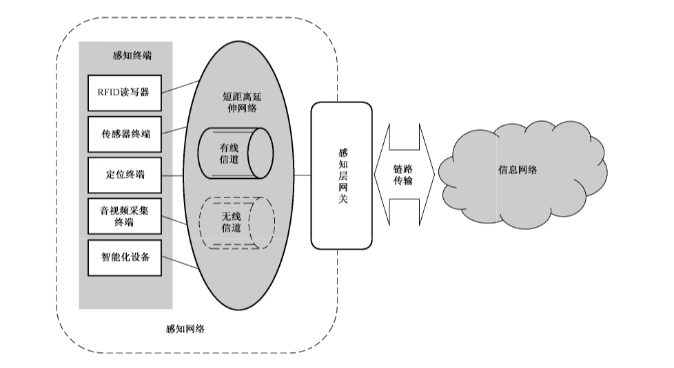
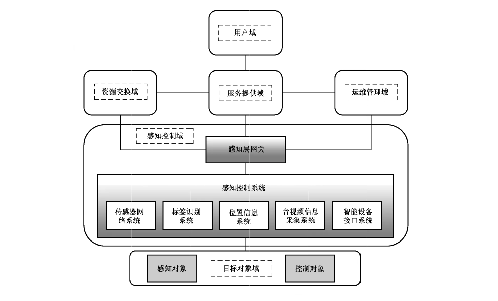

# GB/T 37024-2018 信息安全技术 物联网感知层网关安全技术要求

> 来源：[GB/T 37024-2018 国家标准详情](https://openstd.samr.gov.cn/bzgk/std/newGbInfo?hcno=4B75F5DDD12A3309589DB29565DD79D5)；发布日期：2018-12-28；实施日期：2019-07-01。
> 官方在线预览截图 SHA-256：c5dfa88870285b2f4b4fa74cee80123f6d627fc4bd62d89a94b71a2016396729。
> 转写说明：对官方在线预览全部 15 页截图进行图像识别并逐页校正文字、条款和参考文献；两张图保留原图裁切。省略封面、目录、页眉和页脚，合并跨页段落。原文 6.2.4.4.3 后的编号跳转按原样保留。正式引用请核对官方原页。

## 前言

本标准按照 GB/T 1.1—2009给出的规则起草。

请注意本文件的某些内容可能涉及专利。本文件的发布机构不承担识别这些专利的责任。

本标准由全国信息安全标准化技术委员会（SAC/TC 260）提出并归口。

本标准起草单位：网神信息技术（北京）股份有限公司、北京奇安信科技有限公司、北京工业大学、中国网络安全审查技术与认证中心、中国电子技术标准化研究院、神华信息技术有限公司、北方工业大学、国网网安（北京）科技有限公司、北京威务特技术有限公司。

本标准主要起草人：齐向东、吴云坤、曲晓东、孙凌、纪胜龙、鲍旭华、郑新华、李健、张剑、范科峰、龚洁中、乔思远、王梅、李继军、刘学忠、魏淑华、陈春霖、刘莹、黄敏、刘浩。

## 1 范围

本标准规定了应用在物联网信息系统中感知层网关的安全技术要求，主要包括安全技术要求级别划分及其物理安全、安全功能和安全保障等要求。

本标准适用于物联网信息系统中感知层网关的设计、开发与测试。

## 2 规范性引用文件

下列文件对于本文件的应用是必不可少的。凡是注日期的引用文件，仅注日期的版本适用于本文件。凡是不注日期的引用文件，其最新版本（包括所有的修改单）适用于本文件。

- GB/T 22240—2008 信息安全技术 信息系统安全等级保护定级指南

- GB/T 25069—2010 信息安全技术 术语

- GA/T 681—2007 信息安全技术 网关安全技术要求

## 3 术语和定义

GB/T 25069—2010界定的以及下列术语和定义适用于本文件。

### 3.1 物联网 internet of things

通过感知终端，按照约定协议，连接物、人、系统和信息资源，实现对物理和虚拟世界的信息进行处理并做出反应的智能服务系统。

［GB/T 33745—2017，定义 2.1.1］

### 3.2 感知层网关 gateway in sensing layer

实现感知网络与通信网络、不同类型感知网络之间的协议转换和互联，部署于物联网感知层的网络连接设备。

### 3.3 感知终端 sensor terminal

能对物进行信息采集和/或执行操作，可以连接一个或多个感知网络的设备。

## 4 缩略语

下列缩略语适用于本文件。

ACL：访问控制列表（Access Control List）

## 5 概述

### 5.1 感知层网关描述

感知层网关是物联网信息系统的重要组成部分，参见附录 A。在物联网信息系统中，感知层网关运行于感知网络的边缘，是连接传统信息网络（有线网、移动网等）和感知网络的桥梁，支持一种或多种有线/无线短距离通信协议（蓝牙、Wi-Fi等）与广域网通信协议之间的数据编码和转换功能，如图1所示。

感知层网关通常由软件、硬件两部分构成，所具备的功能与部署环境有较强的相关性，在户外部署时，易受物理环境包括温度、湿度、供电、电磁、人为破坏等因素的影响。

### 5.2 安全威胁

感知层网关可能面临安全威胁主要包括：

a） 攻击者可以窃取或者截获感知层网关数据，可以收集来自于感知终端的源地址、目的地址、数据内容、数据传输时间和协议类型等；

b） 攻击者伪造感知终端，对感知层网关发起拒绝服务攻击和重放攻击；

c） 未授权的用户伪装成已授权的用户试图访问网络资源；

d） 用户超越所授予的权限而访问和修改数据；

e） 存在被盗窃、人为损坏，导致的设备组件的完整性缺失；

f） 供电不足导致设备无法正常运转；

g） 部署环境选择不当，如高温、潮湿、静电、雷击等恶劣环境，会对设备安全构成威胁。

### 5.3 级别划分

安全技术要求分为基础级和增强级两个等级。其中基础级符合GA/T 681—2007 网关安全保护等级划分第二级要求，增强级符合 GA/T 681—2007网关安全保护等级划分第三级要求。

在 GB/T 22240—2008规定的三级以下物联网信息系统中，感知层网关应满足基础级要求；在GB/T 22240—2008规定的三级和三级以上物联网信息系统中，感知层网关应满足增强级要求。

相对于基础级安全技术要求，增强级安全技术要求新增内容用黑体字表示。

## 6 基础级安全技术要求

### 6.1 物理安全要求

感知层网关在物理安全方面，应满足如下要求：

a） 具备基本的防火、防静电的措施；

b） 具备基本的防潮、防水的措施；

c） 主要部件应进行固定，并设置明显的不易除去的标记。

### 6.2 安全功能要求

#### 6.2.1 感知终端接入认证

感知层网关应能够对接入的感知终端进行认证，应满足如下要求：

a） 保证对感知终端标识在感知层网关生命周期内的惟一性。

b） 能够对感知终端进行鉴别，至少支持如下机制之一：

1） 基于网络标识的鉴别；

2） 基于 MAC 地址的鉴别；

3） 基于通信协议的鉴别；

4） 基于通信端口的鉴别；

5） 基于口令鉴别。

c） 保证密钥存储和交换安全。

#### 6.2.2 网络访问控制

感知层网关能够控制接入设备的网络访问，应满足如下要求：

a） 支持访问控制表（ACL）等访问控制策略，防止资源被非法访问和非法使用；

b） 控制相同网络内部的相互访问；

c）控制不同网络之间的跨网访问。

#### 6.2.3 数据保护

##### 6.2.3.1 数据存储保护

感知层网关应满足如下数据存储保护要求：

a） 对感知层网关中存储的重要数据进行保护，避免非授权的访问；

b） 具备对感知层网关存储数据的完整性检测机制，实现鉴别信息、协议转换规则、审计记录等重要数据的完整性检测。

##### 6.2.3.2 数据传输保护

感知层网关应满足如下数据传输保护要求：

a） 保护感知层网关数据在传输过程中不被泄露，采用密码技术对重要数据（指令控制数据、业务数据）实施机密性保护，确保数据传输的保密性；

b） 具备对传输数据完整性校验机制，实现隐私数据、重要业务数据等重要数据的传输完整性保护（如：校验码、消息摘要、数字签名等）；

c） 具有通信延时和中断的处理机制。

#### 6.2.4 系统安全保护

##### 6.2.4.1 时间戳

应具备可靠的时间戳。

##### 6.2.4.2 标识与鉴别

感知层网关能够对于用户进行标识和鉴别，应满足如下要求：

a） 感知层网关的用户应有唯一标识；

b） 对感知层网关用户进行身份鉴别，使用用户名和口令鉴别时，口令由字母、数字及特殊字符组成，长度不小于 8 位。

##### 6.2.4.3 访问控制

感知层网关能够对于用户进行访问控制，应满足如下要求：

a） 能控制感知层网关用户的访问权限，并避免权限的扩散；

b） 仅授予感知层网关用户完成任务所需的最小权限；

c）能控制数据的本地或远程访问；

d） 提供安全措施控制对感知层网关进行远程配置；

e） 控制范围应覆盖所有主体、客体以及它们之间的操作。

##### 6.2.4.4 安全审计

###### 6.2.4.4.1 审计数据生成

应能对下列可审计事件生成审计记录：

a） 审计功能的启动和关闭；

b） 身份鉴别失败，记录用户的身份和所使用的访问设备的标识；

c） 协议转换失败，记录转换数据包的来源和时间；

d）任何读取、修改、破坏审计记录的尝试；

e） 所有对访问授权与拒绝规则覆盖的主体执行操作的请求，以及受影响客体的标识；

f）修改安全属性的所有尝试，以及修改后安全属性的新值；

g） 所有使用安全功能中鉴别数据管理机制的请求；

h）所有访问鉴别数据的请求，以及访问请求的目标；

i） 任何对鉴别机制的使用；

j） 所有使用标识机制的尝试；

k）因鉴别尝试不成功的次数超出了设定的限制。

对于每一个审计记录，安全功能应至少记录以下信息：事件发生的日期和时间，事件的类型和主体身份。

###### 6.2.4.4.2 审计数据查阅

应满足如下审计数据查阅要求：

a） 限制审计记录访问；

b） 能提供审计记录的查阅功能。

###### 6.2.4.4.3 审计数据存储

应能够保护审计记录信息，防止对审计记录的修改。

##### 6.2.4.5 失败保护

应具备保护状态，确保感知层网关断电恢复时安全策略的正确性。

### 6.3 安全保障要求

#### 6.3.1 开发

##### 6.3.1.1 安全架构

开发者应提供产品安全功能的安全架构描述，安全架构描述应满足以下要求：

a） 与产品设计文档中对安全功能实施抽象描述的级别一致；

b） 描述与安全功能要求一致的产品安全功能的安全域；

c） 描述产品安全功能初始化过程为何是安全的；

d） 证实产品安全功能能够防止被破坏；

e）证实产品安全功能能够防止安全特性被旁路。

##### 6.3.1.2 功能规范

开发者应提供完备的功能规范说明，功能规范说明应满足以下要求：

a） 完全描述产品的安全功能；

b） 描述所有安全功能接口的目的与使用方法；

c） 标识和描述每个安全功能接口相关的所有参数；

d） 描述安全功能接口相关的安全功能实施行为；

e） 描述由安全功能实施行为处理而引起的直接错误消息；

f） 证实安全功能要求到安全功能接口的追溯。

##### 6.3.1.3 产品设计

开发者应提供产品设计文档，产品设计文档应满足以下要求：

a） 根据子系统描述产品结构；

b） 标识和描述产品安全功能的所有子系统；

c） 描述安全功能所有子系统间的相互作用；

d） 提供的映射关系能够证实设计中描述的所有行为能够映射到调用它的安全功能接口。

#### 6.3.2 指导性文档

##### 6.3.2.1 操作用户指南

开发者应提供明确和合理的操作用户指南，操作用户指南与为评估而提供的其他所有文档保持一致，对每一种用户角色的描述应满足以下要求：

a） 描述在安全处理环境中被控制的用户可访问的功能和特权，包含适当的警示信息；

b） 描述如何以安全的方式使用产品提供的可用接口；

c） 描述可用功能和接口，尤其是受用户控制的所有安全参数，适当时指明安全值；

d） 明确说明与需要执行的用户可访问功能有关的每一种安全相关事件，包括改变安全功能所控制实体的安全特性；

e） 标识产品运行的所有可能状态（包括操作导致的失败或者操作性错误），以及它们与维持安全运行之间的因果关系和联系；

f） 充分实现安全目的所必需执行的安全策略。

##### 6.3.2.2 准备程序

开发者应提供产品及其准备程序，准备程序描述应满足以下要求：

a） 描述与开发者交付程序相一致的安全接收所交付产品必需的所有步骤；

b） 描述安全安装产品及其运行环境必需的所有步骤。

#### 6.3.3 生命周期支持

##### 6.3.3.1 配置管理能力

开发者的配置管理能力应满足以下要求：

a） 为产品的不同版本提供唯一的标识；

b） 使用配置管理系统对组成产品的所有配置项进行维护，并唯一标识配置项；

c） 提供配置管理文档，配置管理文档描述用于唯一标识配置项的方法。

##### 6.3.3.2 配置管理范围

开发者应提供产品配置项列表，并说明配置项的开发者，配置项列表应包含产品、安全保障要求的评估证据和产品的组成部分的内容。

##### 6.3.3.3 交付程序

开发者应使用一定的交付程序交付产品，并将交付过程文档化。在给用户方交付产品的各版本时，交付文档应描述为维护安全所必需的所有程序。

#### 6.3.4 测试

##### 6.3.4.1 测试覆盖

开发者应提供测试覆盖文档，并表明测试文档中所标识的测试与功能规范中所描述的产品的安全功能间的对应性。

##### 6.3.4.2 功能测试

开发者应测试产品安全功能，将结果文档化，测试文档应包括以下内容：

a） 测试计划，标识要执行的测试，并描述执行每个测试的方案，这些方案包括对于其他测试结果的任何顺序依赖性；

b） 预期的测试结果，表明测试成功后的预期输出；

c） 实际测试结果和预期的一致性。

##### 6.3.4.3 独立测试

开发者应提供一组与其自测安全功能时使用的同等资源，以用于安全功能的抽样测试。

#### 6.3.5 脆弱性评定

基于已标识的潜在脆弱性，产品能够抵抗具有基本攻击潜力的攻击者的攻击。

## 7 增强级安全技术要求

### 7.1 物理安全要求

在满足 6.1 基础上，应满足如下要求：

a） **关键感知层网关具有持久的、稳定的电力供应措施；**

b） **关键感知层网关所在物理环境保证其具有良好的信号收发（尽量避免信道遭遇屏蔽）；**

c） **关键感知层网关具有定位装置。**

### 7.2 安全功能要求

#### 7.2.1 感知终端接入认证

在满足 6.2.1 基础上，应满足如下要求：

a） **对基于口令的鉴别，具备能检测出已失效的或复制的口令数据重放的安全机制；**

b） **限定鉴别失败的次数，当超过设定值后终止感知终端的访问，并在一定的安全时间间隔后才能恢复。**

#### 7.2.2 网络访问控制

在满足 6.2.2 基础上，应满足如下要求：

a） **访问控制的覆盖范围应扩展到访问相关的主体、客体及它们之间的操作；**

b） **支持黑名单、白名单机制；**

c） **能够控制感知终端访问数量。**

#### 7.2.3 数据保护

在满足 6.2.3 基础上，**应具备原发抗抵赖和接受抗抵赖的能力，能够证明感知终端已经发送过或接受过信息。**

#### 7.2.4 系统安全保护

##### 7.2.4.1 时间戳

应满足 6.2.4.1的要求。

##### 7.2.4.2 标识与鉴别

应满足 6.2.4.2 的要求。

##### 7.2.4.3 访问控制

应满足 6.2.4.3的要求。

##### 7.2.4.4 安全审计

###### 7.2.4.4.1 审计数据生成

应满足 6.2.4.4.1 的要求。

###### 7.2.4.4.2 审计数据查阅

应满足 6.2.4.4.2 的要求。

###### 7.2.4.4.3 审计数据存储

在满足 6.2.4.4.3基础上，应满足如下要求：

a） **支持审计数据的备份存储，防止因自然或人为灾害导致的审计数据丢失；**

b） **具备防止审计记录数据丢失的机制，当在审计记录数据存储已满时，可采取如覆盖时间最久的记录的措施，防止审计记录数据的丢失。**

##### 7.2.4.5 失败保护

应满足 6.2.4.5的要求。

##### 7.2.4.6 恶意代码防范

**感知层网关应具有恶意代码防范能力。**

### 7.3 安全保障要求

#### 7.3.1 开发

##### 7.3.1.1 安全架构

应满足 6.3.1.1的要求。

##### 7.3.1.2 功能规范

在满足 6.3.1.2 基础上，应满足如下要求：

a） **描述安全功能实施过程中，与安全功能接口相关的所有行为；**

b） **描述可能由安全功能接口的调用而引起的所有直接错误消息。**

##### 7.3.1.3 实现表示

**开发者应提供全部安全功能的实现表示，实现表示应满足以下要求：**

a） **提供产品设计描述与实现表示实例之间的映射，并证明其一致性；**

b） **按详细级别定义产品安全功能，详细程度达到不用进一步设计就能生成安全功能的程度；**

c） **以开发人员使用的形式提供。**

##### 7.3.1.4 产品设计

在满足 6.3.1.3 基础上，**应根据模块描述安全功能。**

#### 7.3.2 指导性文档

应满足 6.3.2的要求。

#### 7.3.3 生命周期支持

##### 7.3.3.1 配置管理能力

在满足 6.3.3.1 基础上，应满足如下要求：

a） **配置管理系统提供一种自动方式来支持产品的生成，通过该方式确保只能对产品的实现表示进行已授权的改变；**

b） **配置管理文档包括一个配置管理计划，配置管理计划描述如何使用配置管理系统开发产品，实施的配置管理与配置管理计划相一致；**

c） **配置管理计划描述用来接受修改过的或新建的作为产品组成部分的配置项的程序。**

##### 7.3.3.2 配置管理范围

在满足 6.3.3.2 基础上，**应实现表示、安全缺陷报告及其解决状态。**

##### 7.3.3.3 交付程序

应满足 6.3.3.3的要求。

##### 7.3.3.4 开发安全

**开发者应提供开发安全文档。开发安全文档应描述在产品的开发环境中，为保护产品设计和实现的保密性和完整性所必需的所有物理的、程序的、人员的和其他方面的安全措施。**

##### 7.3.3.5 生命周期定义

**开发者应建立一个生命周期模型对产品的开发和维护进行必要的控制，并提供生命周期定义文档描述用于开发和维护产品的模型。**

##### 7.3.3.6 工具和技术

**开发者应明确定义用于开发产品的工具，并提供开发工具使用的文档，该文档应无歧义地定义每个语句的含义和所有选项的含义。**

#### 7.3.4 测试

##### 7.3.4.1 测试覆盖

在满足 6.3.4.1 基础上，**应证实功能规范中的所有安全功能接口都进行了测试。**

##### 7.3.4.2 测试深度

**开发者应提供测试深度的分析，测试深度分析描述应满足以下要求：**

a） **证实测试文档中的测试与产品设计中安全功能和实现模块之间的一致性；**

b） **证实产品设计中的所有安全功能、实现模块都已经进行过测试。**

##### 7.3.4.3 功能测试

应满足 6.3.4.2的要求。

##### 7.3.4.4 独立测试

应满足 6.3.4.3的要求。

#### 7.3.5 脆弱性评定

应满足 6.3.5的要求。

## 附录 A（资料性附录）物联网信息系统

根据物联网信息系统组成部分的功能、定位、分布、服务对象的不同，物联网信息系统通常可以划分为 6 个区域，分别为目标对象域、感知控制域、资源交换域、服务提供域、运维管理域、用户域，见图 A.1。

图A.1中：

a） 用户域是不同类型物联网用户和用户系统的实体集合。物联网用户可通过用户系统及其他域的实体获取物理世界对象的感知和操控服务。

b） 目标对象域是物联网用户期望获取相关信息或执行相关操控的对象实体集合，可包括感知对象和控制对象。感知对象是用户期望获取信息的对象，控制对象是用户期望执行操控的对象。

感知对象和控制对象可与感知控制域中的实体（如传感网系统、标签识别系统、智能设备接口系统等）以非数据通信类接口或数据通信类接口的方式进行关联，实现物理世界和虚拟世界的接口绑定。

c） 感知控制域是各类获取感知对象信息与操控控制对象的软硬件系统的实体集合。感知控制域可实现针对物理世界对象的本地化感知、协同和操控，并为其他域提供远程管理和服务的接口。

d） 服务提供域是实现物联网基础服务和业务服务的软硬件系统的实体集合。服务提供域可实现对感知数据、控制数据及服务关联数据的加工、处理和协同，为物联网用户提供对物理世界对象的感知和操控服务的接口。

e） 运维管理域是实现物联网运行维护和法规符合性监管的软硬件系统的实体集合。运维管理域可保障物联网的设备和系统的安全、可靠、高效运行，以及保障物联网系统中实体及其行为与相关法律规则等的符合性。

f） 资源交换域是实现物联网系统与外部系统间信息资源的共享与交换，以及实现物联网系统信息和服务集中交易的软硬件系统的实体集合。资源交换域可获取物联网服务所需外部信息资源，也可为外部系统提供所需的物联网系统的信息资源，以及为物联网系统的信息流、服务流、资金流的交换提供保障。

## 参考文献

- ［1］ GB 17859—1999 计算机信息系统 安全保护等级划分准则

- ［2］ GB/T 18336.3—2015 信息技术 安全技术 信息技术安全评估准则 第 3 部分：安全保障组件

- ［3］ GB/T 20281—2015 信息安全技术 防火墙安全技术要求和测试评价方法

- ［4］ GB/T 22239—2008 信息安全技术 信息系统安全等级保护基本要求

- ［5］ GB/T 25068.3—2010 信息技术 安全技术 IT 网络安全 第 3 部分：使用安全网关的网间通信安全保护

- ［6］ GB/T 33474—2016 物联网 参考体系结构

- ［7］ GB/T 33745—2017 物联网 术语

- ［8］ GB/T 36951—2018 信息安全技术 物联网感知终端应用安全技术要求

- ［9］ GB/T 37025—2018 信息安全技术 物联网数据传输安全技术要求

- ［10］ GB/T 37044—2018 信息安全技术 物联网安全参考模型及通用要求
