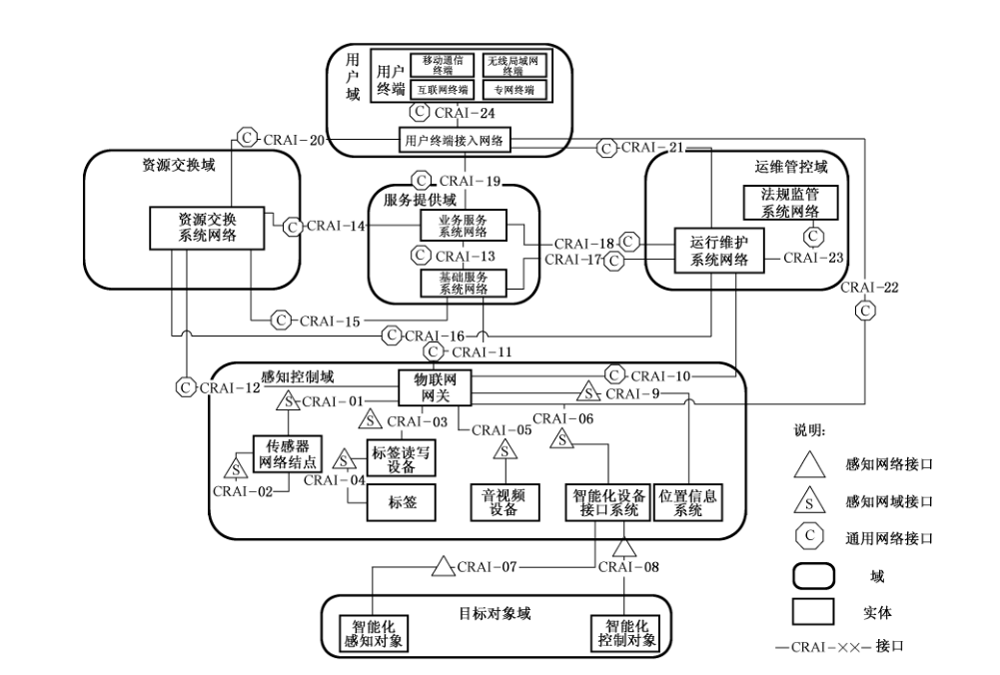
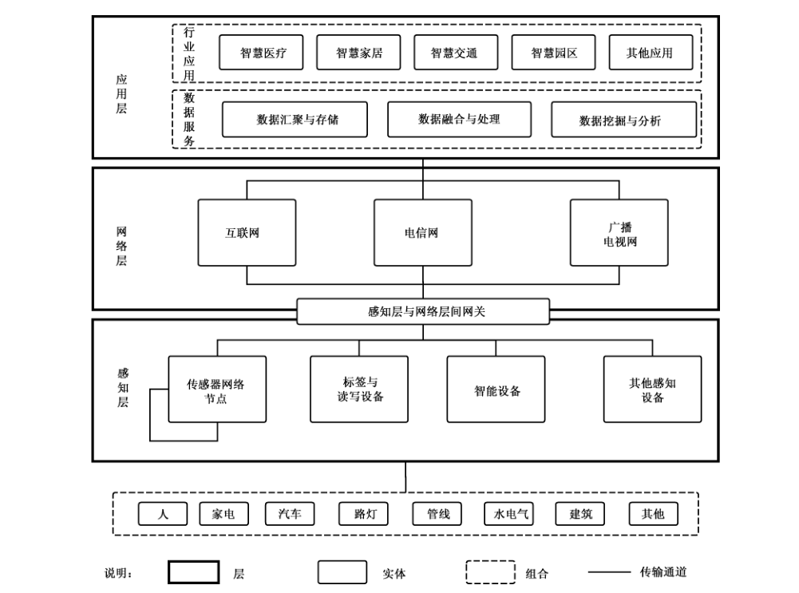
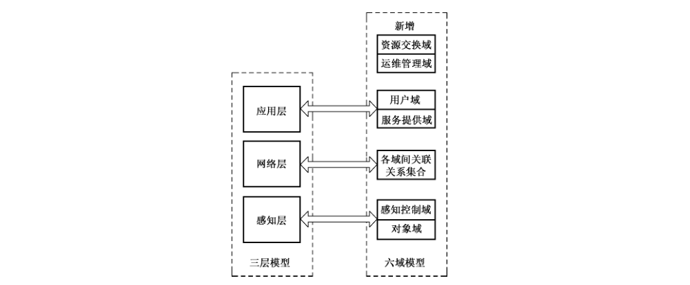
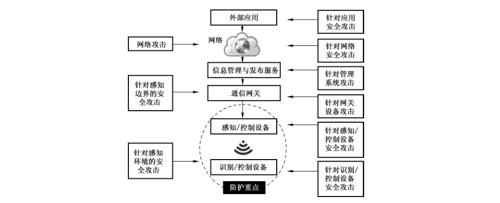
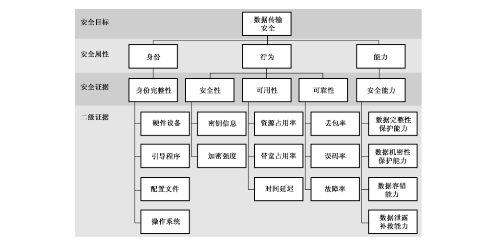

# GB/T 37025-2018 信息安全技术 物联网数据传输安全技术要求

> 来源：[GB/T 37025-2018 国家标准详情](https://openstd.samr.gov.cn/bzgk/std/newGbInfo?hcno=FCA8D0B2F6AD52B15E6D613D6FF1C31B)；发布日期：2018-12-28；实施日期：2019-07-01。
> PDF SHA-256：0e1403c4012faed69aa0b967b6a61970c0e6697424835d2b762d0e2515345435。
> 转写说明：按页渲染官方 PDF 并进行图像识别，对照全部 14 页原图校正文字、条款、表格和参考文献；五张图保留原图裁切。省略封面、目录、页眉和页脚，合并跨页段落。正式引用请核对原 PDF。

## 前言

本标准按照 GB/T 1.1—2009给出的规则起草。

请注意本文件的某些内容可能涉及专利。本文件的发布机构不承担识别这些专利的责任。

本标准由全国信息安全标准化技术委员会（SAC/TC 260）提出并归口。

本标准起草单位：北京工业大学、中国电子技术标准化研究院、北京邮电大学、公安部第三研究所、中央财经大学、中国科学院软件研究所、西安电子科技大学、无锡物联网产业研究院、北京中电普华信息技术有限公司、河南科技大学、重庆三峡学院、中国平安保险（集团）股份有限公司。

本标准主要起草人：杨震、范科峰、丁治明、赖英旭、刘贤刚、黄剑、李健、龚洁中、李琳、李怡德、马占宇、段立娟、秦华、丁丽萍、顾健、齐力、杨明、陈书义、裴庆祺、张志勇、曹占峰、聂祥飞、涂山山、何通海、魏欣、吴亚玺、李童、刘静、蔡伟、邹仕洪。

## 1 范围

本标准规定了物联网（工控终端除外）数据传输安全分级及其基本级和增强级安全技术要求等。

本标准适用于相关方对物联网数据传输安全的规划、建设、运行、管理等。

## 2 规范性引用文件

下列文件对于本文件的应用是必不可少的。凡是注日期的引用文件，仅注日期的版本适用于本文件。凡是不注日期的引用文件，其最新版本（包括所有的修改单）适用于本文件。

- GB/T 33474—2016 物联网 参考体系结构

## 3 术语和定义

下列术语和定义适用于本文件。

### 3.1 物联网 Internet of things

通过感知设备，按照约定协议，连接物、人、系统和信息资源，实现对物理和虚拟世界的信息进行处理并作出反应的智能服务系统。

［GB/T 33745—2017，定义2.1.1］

### 3.2 传感器 transducer/sensor

能感受被测量并按照一定的规律转换成可用输出信号的器件或装置，通常由敏感元件和转换元件组成。

［GB/T 7665—2005，定义3.1.1］

### 3.3 感知设备 sensing device

能够获取对象信息的设备，并提供接入网络的能力。

［GB/T 33745—2017，定义2.1.9］

> 注：具备较高计算能力的感知设备还能对物或环境进行信息采集和/或执行操作。

### 3.4 传输安全 transmission security

保护网络中所传输信息的完整性、保密性、可用性及用户定制等特性。

### 3.5 通信参考体系结构接口 communication reference architecture interface

从物联网实体间互联互通的角度，描述物联网域间及域内实体之间网络通信关系的接口。

> 注：根据物联网不同应用场景，通信可以采用无线或有线通信等接口方式。

### 3.6 通用网络接口 network communication interface

从物联网实体间互联互通的角度，描述物联网用户域、资源交换域、服务提供域、运维管控域等域间及域内实体之间网络通信关系的接口。

### 3.7 感知网域接口 internal communication interface

从物联网实体间互联互通的角度，描述物联网感知控制域内实体之间网络通信关系的接口。

### 3.8 感知网络接口 sensor communication interface

从物联网实体间互联互通的角度，描述物联网感知控制域与目标对象域之间网络通信关系的接口。

### 3.9 隐私 privacy

个人所具有的控制或影响与之相关信息的权限，涉及由谁收集和存储、由谁披露。

［GB/T 25069—2010，定义2.1.63］

> 注：本标准中隐私多指与公共利益、群体利益无关，个人信息等个人生活领域内的不为他人知悉、禁止他人干涉和侵入的私事。

### 3.10 敏感信息 sensitive information

一旦泄露、非法提供或滥用可能危害人身和财产安全，极易导致个人名誉、身心健康受到损害或歧视性待遇等的个人信息。

［GB/T 35273—2017，定义3.2］

### 3.11 信任 trust

两个元素之间的一种关系：元素 x 信任元素 y，当且仅当 x 确信 y 相对于一组活动，元素 y 将以良好定义的方式实施，且不违反安全策略。

［GB/T 25069—2010，定义2.1.51］

## 4 缩略语

下列缩略语适用于本文件。

CRAI：通信参考体系结构接口（Communication Reference Architecture Interface）

IPSec：互联网安全协议（Internet Protocol Security Protocol）

SSH：安全外壳协议（Secure Shell Protocol）

TLS：传输层安全协议（Transport Layer Security Protocol）

## 5 物联网数据传输安全概述

### 5.1 物联网数据传输安全

本标准参考 GB/T 37044—2018 物联网安全参考模型，给出了数据传输安全技术要求。凡涉及采用密码技术解决机密性、完整性、真实性、不可否认性需求的应遵循密码相关国家标准和行业标准。

物联网安全参考模型从物联网系统参考安全区、系统生存周期、基本安全防护措施三个维度共同描述物联网安全保护方法。参考安全区是从物联网系统的逻辑空间维度出发，生存周期则是从物联网系统存续时间维度出发，基本安全防护措施是从相应配合的安全措施维度出发，共同在整体架构和全生命周期层面上为物联网系统提供了一套可参考的安全模型。物联网数据传输指在物联网获取信息及传输信息中使用到的数据传输技术集合，其传输安全涉及基本安全防护措施维度中的网络安全部分，物联网系统功能域维度的全部域间及域内数据传输，以及系统生命周期维度的全过程。

### 5.2 安全防护范围

本标准提出的物联网安全防护范围主要是指在从设备采集数据开始到应用场景过程中，所使用的数据传输技术的集合，其用于向物联网数据传输提供安全保障以及安全性支持。本标准采用GB/T 33474—2016 提出的物联网六域参考模型界定物联网数据传输安全防护范围。除了六域参考模型之外，业界常采用三层模型技术架构，物联网六域参考模型与三层模型的简单对应关系可参见附录 A。

物联网数据传输安全防护范围具体包括：物联网系统功能域内、域间数据传输通信接口的安全保障以及安全性支持，作用于系统全生命周期（规划设计、开发建设、运维管理、废弃退出）。依照GB/T 33474—2016 中定义的通信参考体系结构接口（CRAI-01—CRAI-24），将其分为通用网络接口、感知网域接口、感知网络接口三类。图1给出了物联网数据传输通信接口的具体位置，表1给出了物联网数据传输接口及其分类。

通用网络接口数据传输安全保障应满足通用网络安全要求，也可采纳本标准网络安全要求。

感知网域接口数据传输安全保障宜采纳本标准网络安全要求。

感知网络接口数据传输安全保障应满足本标准网络安全要求。

**表1 物联网数据传输接口及其分类**

| 对象域 | 用户域 | 资源交换域 | 服务提供域 | 运维管控域 | 感知控制域 | 目标对象域 |
| --- | --- | --- | --- | --- | --- | --- |
| 用户域 | CRAI-24 | / | / | / | / | / |
| 资源交换域 | CRAI-20 | — | / | / | / | / |
| 服务提供域 | CRAI-19 | CRAI-14 CRAI-15 | CRAI-13 | / | / | / |
| 运维管控域 | CRAI-21 | CRAI-16 | CRAI-17 CRAI-18 | CRAI-23 | / | / |
| 感知控制域 | CRAI-22 | CRAI-12 | CRAI-11 | CRAI-10 | CRAI-01a CRAI-02a CRAI-03a CRAI-04a CRAI-05a CRAI-06a CRAI-09a | / |
| 目标对象域 | — | — | — | — | CRAI-07b CRAI-08b | — |

注1：“—”表示对象域间无接口；“/”表示该对象域间接口与对称框格相同。

注2：其他无脚注的表示通用网络接口。

a 表示感知网域接口。

b 表示感知网络接口。

### 5.3 安全分级原则

物联网数据传输安全技术要求分为基本级和增强级两类。处理一般性数据传输应满足基本级安全技术要求。基本级主要针对一般性数据传输场景中，非加密环境下物联网数据传输安全问题提出的基本技术要求。处理重要数据、敏感数据，涉及重大安全问题的数据传输应满足增强级安全技术要求，或参考等级保护或其他相关标准中安全等级划分内容。同时为了方便用户进行快速自查，用户可以参考附录B进行数据传输安全等级评估，自查结果仅作为与基本级、增强级要求进行快速对照，不作为评定数据传输是否符合基本级及增强级安全技术要求相应条款的依据。

相对于基本级安全技术要求，增强级安全技术要求新增内容用黑体字表示。

## 6 基本级安全技术要求

### 6.1 数据传输完整性

数据传输应遵循如下共性要求：

a） 传输时支持信息完整性校验机制，实现管理数据、鉴别信息、敏感信息、重要业务数据等重要数据的传输完整性保护（如：校验码、消息摘要、数字签名等）；

b） 具有通信延时和中断处理功能，配合终端进行完整性保证。

### 6.2 数据传输可用性

数据传输时应保障数据的新鲜性、准确性。具体包括：

a） 新鲜性：对所接收的历史数据或超出时限的数据进行识别的特性。具体包括数据来源与系统采用统一时间分配/矫正机制，数据中宜包含时间标识等；

b） 准确性：在数据存在可接受的误差时，建立容错机制保障系统正常运行。

### 6.3 数据传输隐私

进行数据传输时，宜告知用户可能的隐私暴露环节，告知可能的隐私收集与存储部分，保护用户隐私。

a） 对于敏感数据，例如用户口令、生物特征、私钥、对称密钥等，不能以明文的形式显示或存储；

b） 需要时，对数据传输双方身份进行隐私保护。可采用数据脱敏算法等进行敏感信息保护。用户应能选择安全协议（例如SSH、IPSec、TLS 等）对传输的数据进行保护。

### 6.4 数据传输信任

保证对身份的信任，即在交互之前保证主体对客体的身份信任，建立可信传输路径：

a） 在数据端到端传输之间提供一条通信传输路径，此路径在逻辑上与其他通信传输路径隔离，以保护通信数据免遭修改或泄露；

b） 对于涉及管理、鉴别等敏感信息的传输，应要求使用可信传输路径。

### 6.5 信息传输策略和程序

应建立正式的传输策略、程序和控制措施，以保护通过通信设施传输的所有类型信息的安全，并且满足：

a） 明确可明文传输的信息类别和范围；

b）对于敏感数据，例如用户口令、生物特征、私钥、对称密钥等，需采用加密传输策略和程序。

### 6.6 信息传输协议

协议应解决内部、外部间业务信息的安全传递，应支持符合 6.1，6.2,6.5 的实施，并且满足：数据摘要、签名、鉴别等密码算法应采用国家规定或国家强制标准要求的摘要、签名、鉴别等密码算法及其组合。

### 6.7 传输协议的审定与更新

应定期审定、更新数据传输的保密协议，使该协议应反映对于数据传输安全保护的要求，并且满足：

a） 每年需对传输安全协议进行审定，确保该协议应反映对于数据传输安全保护的要求；

b）新业务上线、现有业务发生变更，需对传输安全协议进行审定，必要时进行更新。

## 7 增强级安全技术要求

### 7.1 数据传输完整性

在满足 6.1 基础上，应满足如下要求：

a） **对于重要数据，使用密码技术保证数据传输完整性；**

b） **在检测到完整性遭到破坏时采取措施来恢复或重新获取数据。**

### 7.2 数据传输可用性

对于重要数据，在满足6.2 基础上，应满足如下要求：

a） **新鲜性：时间标识为加密字段；**

b） **准确性：在数据出现较大不可接受误差时，有重载机制保证数据正常获取；**

c） **对于重要数据，应使用部署的冗余感知终端通过专用传输通道进行采集，保证数据可用性。**

### 7.3 数据传输隐私

在满足6.3 基础上，应满足如下要求：**当需要时，允许用户进行隐私设置，按照用户自定义隐私，对其认为的隐私部分进行保护。**

### 7.4 数据传输信任

在满足6.4 基础上，应满足如下要求：**对于重要环节，保证对行为的相对信任，即在交互过程中判断客体行为，保证主体对客体行为的相对信任。**

### 7.5 信息传输策略和程序

在满足 6.5 基础上，应满足如下要求：

a） **策略和程序宜具有监控策略，监视非法连接；**

b） **策略和程序宜具有被管理员禁止的功能；**

c） **策略和程序应能够控制传输速率。**

### 7.6 信息传输协议

在满足6.6 基础上，应满足如下要求：

a） **协议应保证传输的保密性和完整性；**

b） **对于重要数据，协议应支持密码保护措施；**

c） **对于重要数据，使用隐蔽、随机化的传输协议。**

### 7.7 传输协议的审定与更新

在满足6.7 基础上，应满足如下要求：**对于重要数据、鉴别信息和重要业务数据应采用定制的协议保护信息，并且满足：**

a） **采用数据传输的保密协议需要强于基本级安全机制，如增强的加密、鉴别算法，增长的密钥、摘要长度等；**

b） **需对传输安全协议进行审定，确保该协议应反映对于数据传输安全保护的要求。**

### 7.8 数据传输保密性

**对于重要数据，应满足如下要求：**

a） **对于重要数据、鉴别信息和重要业务数据应采用有一定强度的加密算法或其他有效措施对信息进行加密；**

b） **对发送方和接收方进行身份鉴别，在建立连接前，利用密码技术进行初始化会话验证；**

c） **必要时采用专用传输协议或安全传输协议服务，避免来自基于协议的攻击破坏保密性。**

### 7.9 日志与审计

**传输系统应对以下安全失效事件记录日志和进行审计，日志内容应至少包含日期/时间、事件类型、事件主体、事件描述，成功/失败的信息，并满足以下要求：**

a） **数据传输建立成功与失败；**

b） **传输设备在线监测异常与告警事件；**

c） **恶意程序入侵警报事件；**

d） **管理员/非管理员造成的配置修改操作。**

## 附录 A（资料性附录）物联网三层参考模型下数据传输安全问题分析

### A.1 物联网域模型与层模型的比较

5.2 基于 GB/T 33474—2016 提出的物联网六域参考模型界定了物联网数据传输安全防护范围：物联网系统功能域内、域间数据传输通信接口的安全保障以及安全性支持，作用于系统全生命周期（规划设计、开发建设、运维管理、废弃退出）。

除了六域参考模型之外，业界常采用三层模型技术架构，即感知层、网络层和应用层来描述物联网。

三层模型的一般结构如图 A.1所示。三层分别对应于物联网的三个特点，即全面感知、可靠传递以及智能处理。感知层由各种传感器以及传感器网关构成，包含各种传感器、无线射频识别系统、视觉系统、信息扫描元件以及其他信息采集元件，是物联网识别物体、采集信息的来源；网络层由互联网、各种专用网络、有线和无线通信网及网络管理系统等组成，负责传递和处理感知层获取的信息；而应用层是物联网面对用户需求、行业需求的软件平台，以实现各种智能应用。

物联网六域模型与三层模型的简单对应关系如图 A.2所示。

### A.2 层模型下物联网数据传输安全问题

基于三层模型可以同样界定物联网数据传输安全防护范围：物联网各层内、层间数据传输接口安全保障以及安全性支持，作用于系统全生命周期（规划设计、开发建设、运维管理、废弃退出）。可初步分为感知层的数据传输安全威胁，网络层的数据传输安全威胁，以及针对感知边界的安全攻击。感知层的数据传输安全威胁是指利用任何手段能够使感知环境的信息传输遭到破坏的情况。网络层的数据传输威胁与传统网络攻击相对应。对感知边界的安全攻击主要是针对边界网关发起的攻击。具体安全威胁类型如图 A.3 所示。

## 附录 B（资料性附录）数据传输安全能力要求与自查表

### B.1 数据传输安全能力要求

为实现基本级安全技术要求，需符合 6.1～6.7，以及为实现增强级安全要求需符合 6.1～6.7 及 7.1～7.9。测评过程可委托专业测评机构进行。同时为了方便用户进行快速自查，可以根据身份、行为、能力三个属性做出数据传输安全等级评估。请注意自查评估仅方便使用者与基本级、增强级要求进行快速对照，不作为评定数据传输是否符合基本级及增强级安全技术要求相应条款的依据。

如图 B.1 所示，身份、行为、能力三个属性的定义如下：

- 身份属性明确传输主体身份，依据为身份完整性，具体包括硬件设备、引导程序、配置文件、操作系统等不被篡改。
- 行为属性明确传输行为特性，依据为安全性（密钥信息、加密强度）、可用性（资源占用率、带宽占用率、时间延迟）、可靠性（丢包率、误码率、故障率）等。
- 能力属性明确传输能力等级，依据为安全能力，包括数据完整性保护能力、数据保密性能力、数据容错能力、数据泄露补救能力等。

### B.2 数据传输安全能力自查表

表 B.1 给出了数据安全能力自查表。表中安全能力要求可以依据图 B.1 给出的二级证据进行评估，同时可以扩展用户自定义的其他属性。

**表 B.1 数据传输安全能力要求与自查表**

| 类 | 序号 | 安全能力要求 | 具体要求 | 基本级 | 增强级 |
| --- | --- | --- | --- | --- | --- |
| 身份 | 1 | 完整性 | 硬件设备未被破坏、替换 | ● | ● |
| 身份 | 2 | 完整性 | 引导程序完整未被篡改 | ● | ● |
| 身份 | 3 | 完整性 | 配置文件完整未被篡改 | ● | ● |
| 身份 | 4 | 完整性 | 操作系统完整未被篡改 | ● | ● |
| 行为 | 1 | 安全性 | 密钥信息 | ● | ● |
| 行为 | 2 | 安全性 | 加密强度 | ○ | ● |
| 行为 | 3 | 可用性 | 资源占用率 | ○ | ● |
| 行为 | 4 | 可用性 | 带宽占用率 | ○ | ● |
| 行为 | 5 | 可用性 | 时间延迟 | ○ | ● |
| 行为 | 6 | 可靠性 | 丢包率 | ○ | ● |
| 行为 | 7 | 可靠性 | 误码率 | ○ | ● |
| 行为 | 8 | 可靠性 | 故障率 | ○ | ● |
| 能力 | 1 | 安全能力 | 数据完整性保护能力 | ● | ● |
| 能力 | 2 | 安全能力 | 数据机密性保护能力 | ● | ● |
| 能力 | 3 | 安全能力 | 数据容错能力 | ○ | ● |
| 能力 | 4 | 安全能力 | 数据泄露补救能力 | ○ | ● |
| 综合评价 |  |  |  |  |  |

注：“●”表示必选的功能项目；“○”表示可选的功能项目。

## 参考文献

- ［1］ GB/T 7665—2005 传感器通用术语

- ［2］ GB/T 20271—2006 信息安全技术 信息系统通用安全技术要求

- ［3］ GB/T 25069—2010 信息安全技术 术语

- ［4］ GB/T 33745—2017 物联网 术语

- ［5］ GB/T 35273—2017 信息安全技术 个人信息安全规范

- ［6］ GB/T 37044—2018 信息安全技术 物联网安全参考模型及通用要求
