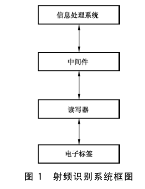
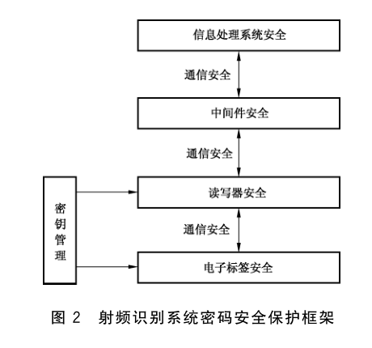
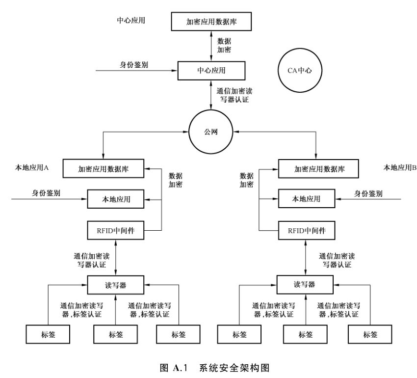
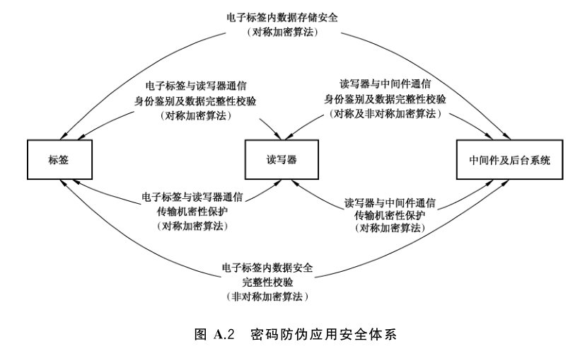
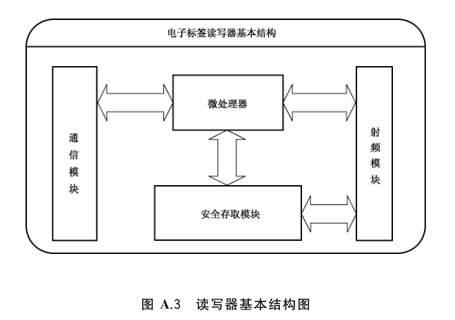
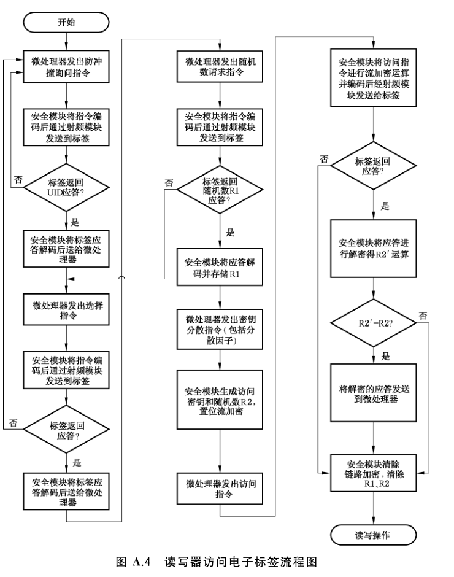
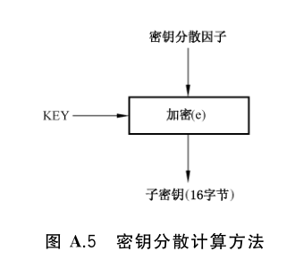

# GB/T 37033.1-2018 信息安全技术 射频识别系统密码应用技术要求 第1部分：密码安全保护框架及安全级别

> 来源：[GB/T 37033.1-2018 国家标准详情](https://openstd.samr.gov.cn/bzgk/std/newGbInfo?hcno=0D93EEADA67E414D7EB8A01557683362)；发布日期：2018-12-28；实施日期：2019-07-01。
> 官方 PDF SHA-256：006d648c6804a9fcf7d2f76420ff1e22e730bed8da4f5d770ec79b26a633f5ef。
> 转写说明：对官方 PDF 的全部 18 页图像逐页识别并校正文字、条款和图示位置；7 幅图保留原页裁切，省略封面、目录、页眉和页脚，合并跨页段落。正式引用请核对原 PDF。

## 前言

GB/T 37033《信息安全技术 射频识别系统密码应用技术要求》分为 3 个部分：

- 第 1 部分：密码安全保护框架及安全级别；
- 第 2 部分：电子标签与读写器及其通信密码应用技术要求；
- 第 3 部分：密钥管理技术要求。

本部分为 GB/T 37033 的第 1 部分。

本部分按照 GB/T 1.1—2009 给出的规则起草。

请注意本文件的某些内容可能涉及专利。本文件的发布机构不承担识别这些专利的责任。

本部分由全国信息安全标准化技术委员会（SAC/TC 260）提出并归口。

本部分起草单位：上海华申智能卡应用系统有限公司、上海复旦微电子集团股份有限公司、北京中电华大电子设计有限责任公司、北京同方微电子有限公司、复旦大学、兴唐通信科技有限公司、上海华虹集成电路有限责任公司、航天信息股份有限公司、北京华大智宝电子系统有限公司、华大半导体有限公司。

本部分主要起草人：顾震、董浩然、王俊宇、谢文录、王云松、梁少峰、俞军、吴行军、王俊峰、周建锁、徐树民、陈跃、柳逊。

## 1 范围

GB/T 37033 的本部分规定了射频识别系统密码安全保护框架、安全级别划分、不同级别密码安全技术要求和密码算法配用要求。

本部分适用于射频识别系统密码安全的设计、实现、测评与应用。

## 2 规范性引用文件

下列文件对于本文件的应用是必不可少的。凡是注日期的引用文件，仅注日期的版本适用于本文件。凡是不注日期的引用文件，其最新版本（包括所有的修改单）适用于本文件。

- GB/T 25069—2010 信息安全技术 术语
- GB/T 29261.3—2012 信息技术 自动识别和数据采集技术 词汇 第 3 部分：射频识别
- GB/T 32905—2016 信息安全技术 SM3 密码杂凑算法
- GB/T 32907—2016 信息安全技术 SM4 分组密码算法
- GB/T 32918—2016 信息安全技术 SM2 椭圆曲线公钥密码算法
- GB/T 37033.2—2018 信息安全技术 射频识别系统密码应用技术要求 第 2 部分：电子标签与读写器及其通信密码应用技术要求
- GB/T 37033.3—2018 信息安全技术 射频识别系统密码应用技术要求 第 3 部分：密钥管理技术要求

## 3 术语和定义

GB/T 25069—2010、GB/T 29261.3—2012 中界定的以及下列术语和定义适用于本文件。

### 3.1 安全存取模块 secure access module

嵌入在读写器内的密码安全模块，为读写器提供安全服务。

### 3.2 对称密码算法 symmetric cryptographic algorithm

加密和解密使用相同密钥的密码算法。

### 3.3 非对称密码算法 asymmetric cryptographic algorithm

公钥密码算法 public key cryptographic algorithm

加密和解密使用不同密钥的密码算法。其中一个密钥（公钥）可以公开，另一个密钥（私钥）必须保密，且由公钥求解私钥是计算不可行的。

### 3.4 会话密钥 session key

在一次会话中使用的数据加密密钥。

### 3.5 抗电子标签原发抵赖 non-repudiation of tag original sender

电子标签信息的原发者（读写器或第三方）对写入电子标签内的数据进行数字签名操作，确保产生该数据的原发者不能成功地否认曾经生成过该数据。

### 3.6 密码模块 cryptographic module

实现密码运算功能的、相对独立的软件、硬件、固件或其组合。

### 3.7 密码协议 cryptography protocol

两个或两个以上参与者使用密码算法，按照约定的规则，为达到某种特定目的而采取的一系列步骤。

### 3.8 密码杂凑算法 cryptographic hash algorithm

杂凑算法；密码散列算法；哈希算法。

将一个任意长的比特串映射到一个固定长的比特串，且满足下列 3 个特性：

a）为一个给定的输出找出能映射到该输出的一个输入是计算上困难的；

b）为一个给定的输入找出能映射到同一个输出的另一个输入是计算上困难的；

c）要发现不同的输入映射到同一输出是计算上困难的。

### 3.9 身份鉴别 authentication

实体鉴别 entity authentication

确认一个实体所声称身份的过程。

### 3.10 唯一标识符 unique identifier

由电子标签芯片制造商固化在电子标签芯片内的唯一标识标签芯片的代码，包含芯片生产序列号、经注册的厂商代码等唯一性信息。

### 3.11 主体 subject

引起信息在客体之间流动的人、进程或设备等。

## 4 符号和缩略语

下列符号和缩略语适用于本文件。

- CA：电子商务认证授权机构（Certificate Authority）
- CRC：即循环冗余校验（Cyclic Redundancy Check）
- MAC：消息鉴别码（Message Authentication Code）
- PKI：公钥基础设施（Public Key Infrastructure）
- RFID：射频识别（Radio Frequency IDentification）
- RNG：随机数发生器（Random Number Generator）
- SAM：安全存取模块（Secure Access Module）
- SM1：SM1 算法（SM1 algorithm）
- SM2：SM2 算法（SM2 algorithm）（见 GB/T 32918—2016）
- SM3：SM3 算法（SM3 algorithm）（见 GB/T 32905—2016）
- SM4：SM4 算法（SM4 algorithm）（见 GB/T 32907—2016）
- SM7：SM7 算法（SM7 algorithm）
- SSL：安全套接层（Secure Sockets Layer）
- UID：唯一标识符（Unique IDentifier）
- `||`：数据连接符，将信息串联，表示左侧和右侧数据拼接在一起形成一个新的数据

## 5 射频识别系统密码安全保护框架

### 5.1 射频识别系统概述

射频识别系统是由电子标签、读写器、中间件、信息处理系统及通信链路组成的自动识别系统，如图 1 所示。

附录 A 给出了一个电子标签防伪应用密码安全解决方案。

### 5.2 射频识别系统密码安全保护框架

射频识别系统密码安全保护框架由电子标签安全、电子标签与读写器通信安全、读写器安全、读写器与中间件通信安全、中间件安全、中间件与信息处理系统通信安全、信息处理系统安全、密钥管理等构成，如图 2 所示。

射频识别系统密码安全保护要素由存储信息和传输信息的保密性、存储信息和传输信息的完整性、抗抵赖、身份鉴别、访问控制、安全审计、密码配置和密钥管理等构成。

读写器与中间件通信安全、中间件安全、中间件与信息处理系统通信安全、信息处理系统安全属于通用的网络安全范畴，不在本部分规定的范围之内。

## 6 射频识别系统安全级别划分及技术要求

### 6.1 级别划分

根据射频识别系统密码应用安全需求的不同，将射频识别系统密码安全划分为四个级别。不同的安全级别规定了应达到的最低密码安全技术要求。安全强度逐级提高，第四级是最高安全级别。用户可以根据不同的安全需求进行级别选择。

第一级适用于一些对安全性要求不高的应用，至少应采用身份鉴别安全机制，如物流、普通门禁、电子门票等应用系统。

第二级适用于一些对安全性具有一定要求的应用，至少应采用身份鉴别和访问控制安全机制，如重要门禁、物品防伪、公交一卡通等应用系统。

第三级适用于一些对安全性具有较高要求的应用，至少应采用保密性、完整性、抗抵赖、身份鉴别和访问控制安全机制，如金融支付、贵重物品防伪、电子护照等应用系统。

第四级适用于一些对安全性具有很高要求的应用，至少应采用保密性、完整性、抗抵赖、身份鉴别、访问控制和审计等安全机制。

以下内容在密码安全级别划分中不予考虑：

a）行政管理的安全措施；

b）物理方面的安全措施；

c）密码算法的质量评价。

### 6.2 各级别密码安全技术要求

#### 6.2.1 第一级

##### 6.2.1.1 身份鉴别

应采用唯一标识符鉴别技术实现对电子标签的唯一性身份鉴别，具体要求见 GB/T 37033.2—2018。

##### 6.2.1.2 密码配置

###### 6.2.1.2.1 密码算法

射频识别系统中配置的密码算法应选择对称密码算法 SM4（或 SM1、SM7）。

###### 6.2.1.2.2 密钥管理

遵照国家密码管理部门颁布的有关规范和技术标准，实行自主管理。密钥管理应包括密钥生成、密钥注入、密钥存储、密钥分散、密钥使用和密钥销毁等，具体要求见 GB/T 37033.3—2018。

#### 6.2.2 第二级

##### 6.2.2.1 身份鉴别

应支持读写器对电子标签的挑战响应鉴别，以确定电子标签身份的真实性。

##### 6.2.2.2 访问控制

应支持访问控制机制，使其能采用密码验证机制实现系统中授权用户对客体访问权限的定义和控制，阻止非授权用户对敏感信息的访问。

##### 6.2.2.3 密码配置

###### 6.2.2.3.1 密码算法

见 6.2.1.2.1。

###### 6.2.2.3.2 密钥管理

见 6.2.1.2.2。

#### 6.2.3 第三级

##### 6.2.3.1 保密性

应支持存储信息保密性保护功能，使其能对存储在电子标签内的敏感信息进行加密保护。

应支持读写器与电子标签之间传输信息保密性保护功能，使其能对读写器与电子标签之间的通信信息进行加密保护，确保信息在传输过程中不被泄漏或窃取。

##### 6.2.3.2 完整性

应支持存储信息完整性保护，使其能采用密码技术对存储在射频识别系统内的敏感信息进行校验，以发现信息被篡改、删除或插入等情况。

应支持传输信息完整性保护，使其能采用密码技术对电子标签和读写器之间传输的敏感信息进行校验，以发现信息被篡改、删除或插入等情况。

##### 6.2.3.3 抗抵赖

应支持抗电子标签原发抵赖功能，使其能确保电子标签信息原发者不能成功地否认曾经生成过该信息，接收电子标签信息的主体能获得证明电子标签信息原发者的证据，而且该证据可由该主体或第三方验证。

应支持抗读写器抵赖功能，使其能确保读写器不能成功地否认曾经生成过该信息，接收读写器信息的主体能获得证明读写器信息原发的证据，而且该证据可由该主体或第三方等其他主体验证。

##### 6.2.3.4 身份鉴别

应支持读写器对电子标签的挑战响应鉴别，见 6.2.2.1。

应支持电子标签对读写器的挑战响应鉴别，以确定读写器身份的真实性。

##### 6.2.3.5 访问控制

见 6.2.2.2。

##### 6.2.3.6 密码配置

###### 6.2.3.6.1 密码算法

射频识别系统中配置的密码算法应选择对称密码算法 SM4（或 SM1、SM7）、非对称密码算法 SM2 和密码杂凑算法 SM3。

###### 6.2.3.6.2 密钥管理

见 6.2.1.2.2。

#### 6.2.4 第四级

##### 6.2.4.1 保密性

见 6.2.3.1。

##### 6.2.4.2 完整性

见 6.2.3.2。

##### 6.2.4.3 抗抵赖

应支持抗电子标签原发抵赖功能，见 6.2.3.3。

应支持抗读写器抵赖功能，见 6.2.3.3。

应支持抗电子标签抵赖功能，即电子标签能对其生成的信息产生数字签名，确保电子标签不能成功地否认曾经生成过该信息，接收电子标签信息的主体能获得证明电子标签信息原发的证据，而且该证据可由该主体或第三方验证。

##### 6.2.4.4 身份鉴别

见 6.2.3.4。

##### 6.2.4.5 访问控制

见 6.2.2.2。

##### 6.2.4.6 审计

电子标签、读写器都应具备安全审计功能，使其能对涉及应用系统安全的数据及相关操作（潜在的安全侵害）情况进行记录，内容至少包括使用主体、使用时间、执行的操作等，并采取有效措施保证记录信息的安全，以便追溯并评估所储存数据和操作的安全性。

##### 6.2.4.7 密码配置

###### 6.2.4.7.1 密码算法

见 6.2.3.6.1。

###### 6.2.4.7.2 密钥管理

见 6.2.1.2.2。

## 7 密码算法配用

在射频识别系统中应选择 SM2、SM3 和 SM4（或 SM1、SM7）等商用密码算法。使用要求如下：

a）对称密码算法 SM4（或 SM1、SM7），用于身份鉴别、访问控制、保密性保护、完整性保护、密钥协商和密钥分散；

b）非对称密码算法 SM2，用于抗抵赖、身份鉴别、保密性保护、完整性保护、密钥协商和密钥交换；

c）密码杂凑算法 SM3，用于产生数据摘要信息，进行完整性校验。

## 附录 A（资料性附录）电子标签防伪应用密码安全解决方案

### A.1 方案概述

本附录给出了一个符合 RFID 应用系统安全级别的第二级安全要求的电子标签防伪应用安全解决方案，本方案涉及的内容对包括电子标签、读写器、中间件信息安全在内的防伪应用系统。

> 转写注：上句“内容对包括”按原页保留。

电子标签应用系统面临的安全威胁有：非法访问、跟踪、窃听、伪造、物理攻击、恶意破坏等方面。使用密码技术实现防伪安全应用系统的数据完整性、合法性验证，数据访问权限控制，标签通信信道安全，并根据应用系统各组成列出部分的安全需求及密码技术解决措施，提炼出整个应用系统的密码安全解决方案，以保证整个应用系统的信息安全。

典型电子标签防伪应用系统安全架构图如图 A.1 所示。

防伪应用系统安全解决方案涉及电子标签芯片密码安全技术及其实现、读写器密码安全技术及其实现、中间件密码安全技术、电子标签与读写器通信安全技术和读写器与中间件通信安全，其密码技术的安全体系如图 A.2 所示。

### A.2 电子标签芯片密码安全技术及其实现

#### A.2.1 电子标签安全需求

防伪用电子标签主要面临的安全威胁有：对标签的非法访问、伪造、数据篡改、物理攻击、恶意破坏等。其对应的安全需求有：标签的身份鉴别、信息存储安全、访问控制安全、标签管理安全等。其中标签管理安全不涉及密码技术，本方案不作规定。

#### A.2.2 电子标签身份鉴别

采用对称密码算法 SM7 对标签进行身份鉴别，从而保证标签身份的合法性。身份鉴别采用的密钥通过电子标签 UID 对根密钥分散获得。

具体身份鉴别过程见 GB/T 37033.2—2018。

#### A.2.3 电子标签信息存储安全

对存储在标签内的敏感信息采用对称密码算法 SM1 或 SM4 加密，并用杂凑算法 SM3 生成摘要信息实现对存储信息的完整性校验，以保证标签内存储的敏感信息在面临数据篡改、物理攻击等安全威胁时，攻击者得不到明文数据，同时在数据被篡改后也能被及时发现，从而保证敏感信息的存储安全。

信息加密采用的密钥可通过 UID 对信息加密根密钥分散获得，解密方通过授权获得此密钥。具体过程参见 A.5.3。

#### A.2.4 电子标签访问控制安全

对不同的信息通过不同的密钥设置访问控制权限，以保证电子标签及其存储信息面临非法访问、数据篡改、恶意破坏等威胁时，攻击者不能进行相关读、写、修改、创建、删除等操作，从而保证敏感信息及电子标签的安全。

具体密钥设置参见 A.5.2。

#### A.2.5 安全实现

##### A.2.5.1 概述

采用将 CA 认证和数字签名与电子标签相结合的技术，实现电子标签数据加密和信息认证。

在电子标签芯片初始化处理过程中，系统将完成基本信息和合法身份鉴别信息向芯片内的写入。

##### A.2.5.2 随机数发生器

标签内具有随机数发生器（RNG），随机数的产生不依赖于通电场、链路速率和存储在标签内的数据（包括 UID、CRC 等）。标签采用 RNG 生成的随机数（长度由链路加密的总长度决定），完成一次链路加密后，随机数应予以丢弃，下一次链路通信应生成新的随机数。

##### A.2.5.3 电子标签身份信息数据写入

将电子标签的 UID 等特征信息串联（如 UID||特征信息 1||特征信息 2），通过杂凑算法 SM3 计算生成特征码，即“消息摘要”，采用信息写入者的私钥对“消息摘要”进行数字签名，数字签名可以确定电子标签信息的实际身份和使用许可的真实性、合法性。

##### A.2.5.4 标签信息数据写入

读写器对电子标签操作前通过与电子标签之间的双向身份鉴别，并获得相应应用分区的操作密钥，将基本信息加密后写入标签的基本信息应用分区，通过杂凑算法 SM3 将该基本特征信息与电子标签芯片 UID 码进行运算生成该电子标签的消息摘要，将消息摘要用信息写入者的私钥进行数字签名并写入标签签名区。

##### A.2.5.5 访问权限

数据存储区中数据块的访问权限由密钥权限区中的密钥决定，对应数据块的权限被设置以后，加密链路也同时生效。

密钥权限区本身没有权限控制，当主密钥（MASTER KEY）被设置了之后，访问密钥权限区的加密链路也同时生效，对密钥区的访问以只写（不能读）方式进行。

##### A.2.5.6 标签数据解密及签名验证

读写器对电子标签操作前通过双向鉴别获得相应应用分区的操作密钥，访问标签基本信息区，读取标签芯片序列号以及标签基本特征信息，通过杂凑算法 SM3 生成该标签的消息摘要；同时访问标签的数字签名区，读取标签身份数字签名信息，通过信息写入者公钥验证数字签名。

##### A.2.5.7 KILL 指令（可选）

当主密钥被设置后，KILL 指令生效且应以链路加密的方式发送指令。当读写器发送了有效的 KILL 指令后，标签将不应答来自于读写器的任何请求指令。

### A.3 电子标签读写器密码安全技术及安全实现

#### A.3.1 读写器安全需求

防伪用电子标签读写器主要面对的安全威胁有：对读写器的非法访问、伪造、数据篡改、物理攻击、恶意破坏等。其安全需求有：读写器的身份鉴别、信息存储安全、访问控制安全、读写器管理安全等部分组成。其中读写器管理安全不涉及密码技术，本方案不作规定。

#### A.3.2 读写器身份鉴别

防伪用读写器与标签间的双向身份鉴别采用对称密码算法 SM7 加密的三重身份鉴别机制，与中间件间的双向身份鉴别采用基于 PKI 的 SSL 协议身份鉴别机制，以保证读写器在面临伪造等安全威胁时，攻击者无法通过身份鉴别，从而保证读写器身份的合法性。

具体密钥设置参见 A.5.2。

#### A.3.3 读写器信息存储安全

对将要存储在读写器内的敏感信息采用对称密码算法 SM1 或 SM4 加密，并用杂凑算法 SM3 生成摘要信息进行存储数据完整性校验，以保证读写器内存储的敏感信息在面临数据篡改、物理攻击等安全威胁时，攻击者得不到明文数据，同时在数据被篡改后也能被及时发现，从而保证敏感信息存储安全。

具体密钥设置参见 A.5.3。

#### A.3.4 读写器访问控制安全

对不同信息通过不同的密钥设置访问控制权限，使具有不同密钥的中间件及应用系统具有对读写器不同信息读取区域及不同的相关读、写、修改、创建、删除等操作权限，以保证读写器及其存储信息在面临非法访问、数据篡改、恶意破坏等安全威胁时，攻击者不能进行相关读、写、修改、创建、删除等操作，从而保证敏感信息安全。

具体密钥设置参见 A.5.2。

#### A.3.5 读写器抗抵赖

读写器生成信息时加入代表其身份的数字签名，确保读写器不能否认曾经生成过该信息，接收信息的主体也能获得信息原发的证据，而且该证据可被该主体或第三方主体验证。

具体方法参见 A.5.4。

#### A.3.6 读写器审计

对涉及应用系统安全的数据及相关操作（潜在的安全侵害）情况进行记录，内容至少包括：使用主体、使用时间、执行的操作等，追溯并评估所记录数据和操作的安全性，并采取有效措施保证记录的安全。

#### A.3.7 安全实现

读写器安全实现从基本结构、安全存取模块和访问流程 3 个方面来阐述。

##### A.3.7.1 基本结构

读写器的基本结构包括：通信模块、射频模块、安全存取模块和微处理器。基本结构如图 A.3 所示。

通信模块负责读写器与系统之间的物理层接口；射频模块负责读写器与标签之间的物理层接口；安全存取模块负责读写器与标签之间通信链路的加/解密和指令的编/解码；微处理器负责对来自于标签或系统的指令解析、处理和数据转发功能。

##### A.3.7.2 安全存取模块

读写器中的安全存取模块包括：随机数发生器、存储器、对称算法处理单元和数据编/解码单元。

随机数发生器用于产生在密钥分散和流加密过程中使用的随机数；存储器用于保存在加密过程中使用的过程密钥、随机数、数据流等；对称算法处理单元用于产生在流加密过程中所要使用的密钥；数据编码单元用于产生对二进制位流进行编码后供射频模块调制发送的数字基带；数据解码单元用于产生对射频模块解调后的数字基带进行解码后供流加密运算的二进制位流。

##### A.3.7.3 访问流程

读写器对电子标签的访问流程如图 A.4 所示。

### A.4 电子标签与读写器通信安全技术

#### A.4.1 电子标签与读写器通信安全需求

电子标签与读写器通信主要面对的安全威胁有：对标签、读写器的非法访问、伪造、跟踪、窃听、数据篡改等。其安全需求有：电子标签与读写器之间的双向身份鉴别、电子标签与读写器之间数据双向传输加密、数据传输安全鉴别等。

#### A.4.2 电子标签与读写器之间的双向身份鉴别

读写器与标签间的双向身份鉴别采用对称密码算法 SM7 加密的三重身份鉴别机制，以保证标签与读写器在面临非法访问、伪造、跟踪等安全威胁时，攻击者无法通过身份鉴别，从而保证标签与读写器身份的合法性。

具体密钥设置参见 A.5.2。

#### A.4.3 电子标签与读写器之间数据双向传输加密

电子标签与读写器之间数据双向传输信息采用对称密码算法 SM1 或 SM4 进行链路加密，以保证传输信息面临窃听等安全威胁时，攻击者得不到明文数据，从而保证信息传输安全。

具体密钥设置参见 A.5.3。

#### A.4.4 电子标签与读写器之间数据传输安全鉴别

在电子标签与读写器之间传输的数据后加入代表传输数据特征的数字签名，以保证传输信息在面临数据篡改等安全威胁时，能及时发现数据被篡改，从而保证信息传输安全。

具体密钥设置参见 A.5.4。

### A.5 密码算法及密钥管理

#### A.5.1 密钥管理系统

密钥管理系统的作用是规划、产生、保管、分散、传递、管理以及销毁应用系统的密钥，保证应用系统的安全运行。密钥管理系统采用国家指定的密码算法，原则上采用硬件设备产生各级根密钥，并通过采用国家密码管理部门指定的密码算法按应用环节的需要将所需密钥下载或分散至安全存储模块中（SAM 卡）。在各个应用环节，安全存储模块完成密钥分散、密钥认证、传输数据的 MAC 计算以及应用数据的加密等功能。同时，各个应用的安全存储模块所装载的密钥根据应用需要而有所不同，保证各个应用的安全独立性。

#### A.5.2 对称密码算法 SM7 及密钥管理

该算法用于防伪标签与读写器间数据传输加密和完整性校验，由电子标签芯片和读写器的硬件实现，电子标签内的密钥保存在电子标签芯片中密钥存储区的相应位置；读写器所需的密钥以根密钥的形式保存在安全存取模块（SAM）的安全文件中，在读写器获得电子标签应用标识、UID 等分散因子后，由 SAM 卡将根密钥用标签分散因子进行分散，获得对应的标签密钥。

#### A.5.3 对称密码算法 SM1 或 SM4 及密钥管理

##### A.5.3.1 功能描述

该算法用于防伪标签、读写器和中间件数据存贮加密，标签与读写器、读写器与中间件间的传输加密，由读写器及应用系统硬件实现。该算法加解密双方使用同一个密钥，密钥的产生、保管和分发过程应在受控的安全环境下进行，使用环节的算法和密钥应保存在通过安全认证的硬件设备（如标签芯片和 SAM 卡）中，加解密运算同样也在此硬件设备中进行，以保证运算过程和中间结果不被泄露，运算结果只能在需要时传输到设备以外。SAM 卡所需的密钥以根密钥的形式保存在 SAM 卡的安全文件中，在读写器获得标签应用标识、UID 等分散因子后，由 SAM 卡将根密钥对标签分散因子进行分散，获得对应的标签密钥保存在 SAM 卡内的临时密钥区，进行后续的加密、解密和鉴别运算。

##### A.5.3.2 根密钥产生

用于对称密钥体系某一应用的根密钥，应使用硬件随机数发生器产生。

##### A.5.3.3 子密钥分散

子密钥分散方法如图 A.5 所示，密钥长度及密钥分散因子长度均为 16 字节。将密钥分散因子作为输入数据，采用对称密码算法 SM4（或 SM1）进行加密计算，产生的 16 字节的结果作为子密钥。

为保证应用独立和数据安全，对于同一个应用的密钥，针对不同应用范围，采用的密钥值应不一样。

为保证不同标签之间的数据安全，对于同一个应用子密钥，针对不同的标签芯片，采用的密钥值也不一样，对称密钥体系按照不同标签芯片的唯一序列号（UID）生成分散因子，使用密钥分散算法通过应用子密钥对其进行计算获取特定标签芯片使用的密钥值。

#### A.5.4 非对称密码算法 SM2 及密钥管理

##### A.5.4.1 功能描述

该算法用于数字签名和完整性校验，由读写器及应用系统硬件实现。非对称算法密钥的产生、保管和分发过程应在受控的安全环境下进行。使用环节的算法和私钥应保存在通过安全认证的安全存取模块（USB Key 和 SAM 卡）中，公钥在通信时可以向外发布。

该系统使用自主建立的 CA 中心并在应用系统和电子标签安全中间件内预置此 CA 中心的根证书，在终端的 SAM 卡和服务器的 USB Key 内保存 CA 中心颁发的通信加密证书和私钥，并保留临时证书下载区装载通信对方的数字证书用于通信加密和签名验证；标签本身不涉及非对称密钥和算法，只用于保存由标签信息写入者对信息的数字签名。

##### A.5.4.2 密钥对产生

非对称加密所需的密钥只能在通过认证的安全设备（已加载 SM2 算法的 SAM 卡或 USB Key）产生和保存，私有密钥一经产生只能保存在设备中用于运算而不可导出，公开密钥用于加密运算以及导出用于申请数字证书和向外发布。

##### A.5.4.3 数字证书产生

数字证书就是通信中标志通信各方身份信息的一系列数据，它由权威机构发行。最简单的证书包含一个公开密钥、名称以及证书认证中心的数字签名。一般情况下证书中还包括密钥的有效时间、发证机关（证书认证中心）名称、该证书的序列号等信息。

##### A.5.4.4 数字签名

发送方用自己的私钥对发送信息的摘要进行数字签名。该方式用于标签、读写器及中间件的源鉴别、完整性服务及不可否认服务。

##### A.5.4.5 数字信封

标签与读写器以及读写器与中间件的数据传输中，采用数字信封技术，即采用非对称算法 SM2 加密对称算法 SM1 或 SM4 的密钥，采用对称算法 SM1 或 SM4 加密传输数据。
