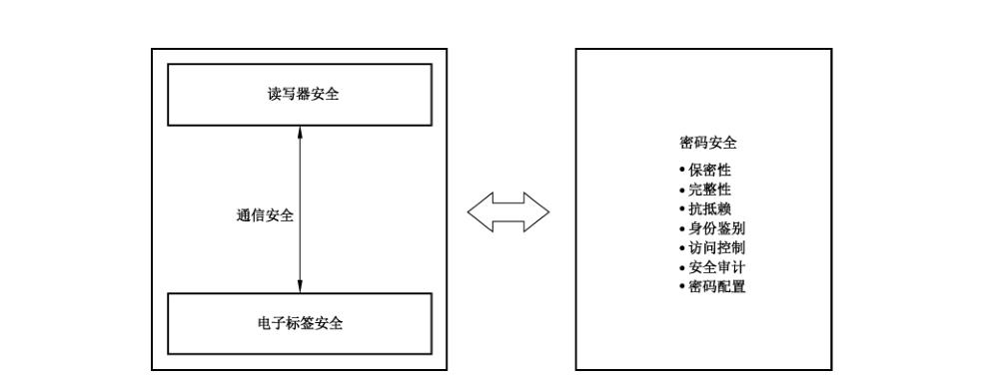
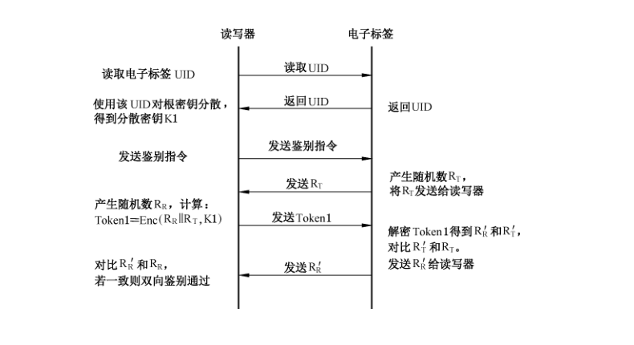
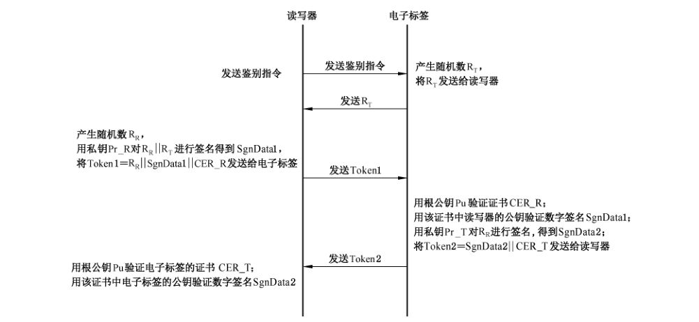
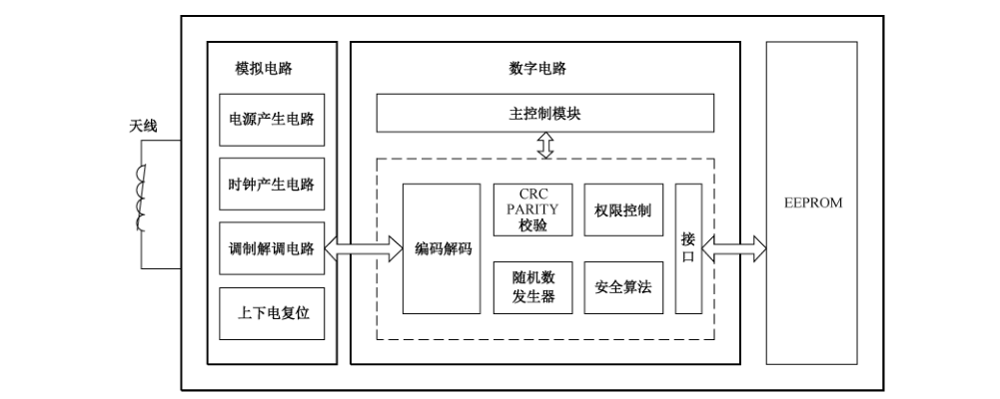
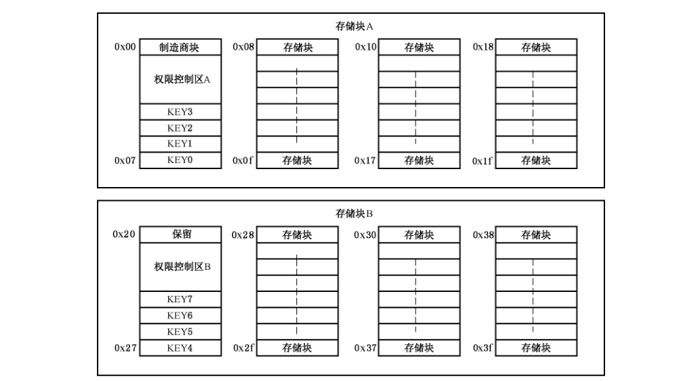
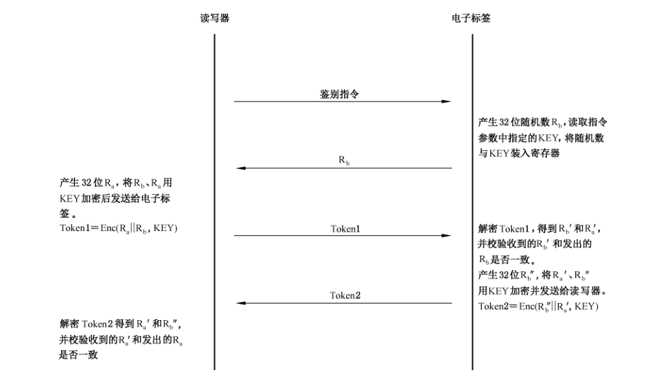
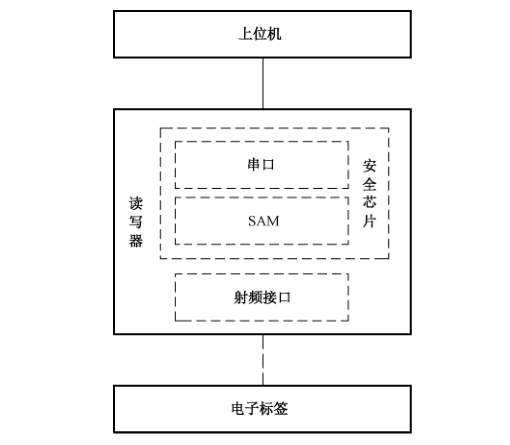
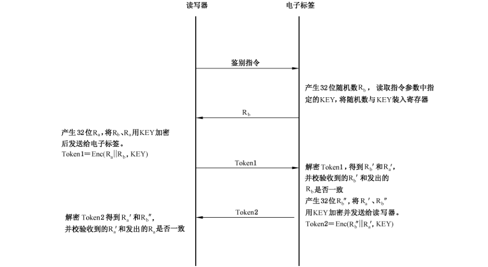
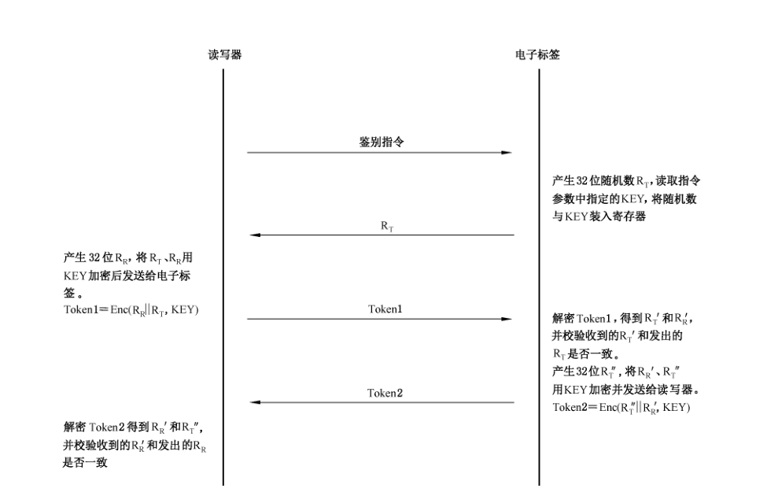

# GB/T 37033.2-2018 信息安全技术 射频识别系统密码应用技术要求 第 2 部分：电子标签与读写器及其通信密码应用技术要求

> 来源：[GB/T 37033.2-2018 国家标准详情](https://openstd.samr.gov.cn/bzgk/std/newGbInfo?hcno=B3048FF86D7D6D8FA4E40395BA6A8491)；发布日期：2018-12-28；实施日期：2019-07-01。
> 官方 PDF SHA-256：c61414544aa5366c597a3a98616534a031a56eac701acdf200e923abdcd4e33d。
> 转写说明：依据官方 PDF 的全部 34 页图像转写；图示保留原页裁切，表格以可检索的 Markdown 重建，省略封面、目录、页眉和页脚，合并跨页段落。正式引用请核对原 PDF。

## 前言

GB/T 37033《信息安全技术 射频识别系统密码应用技术要求》分为 3 个部分：

- 第 1 部分：密码安全保护框架及安全级别；
- 第 2 部分：电子标签与读写器及其通信密码应用技术要求；
- 第 3 部分：密钥管理技术要求。

本部分为 GB/T 37033 的第 2 部分。

本部分按照 GB/T 1.1—2009 给出的规则起草。

请注意本文件的某些内容可能涉及专利。本文件的发布机构不承担识别这些专利的责任。

本部分由全国信息安全标准化技术委员会（SAC/TC 260）提出并归口。

本部分起草单位：上海复旦微电子集团股份有限公司、北京中电华大电子设计有限责任公司、北京同方微电子有限公司、复旦大学、兴唐通信科技有限公司、上海华申智能卡应用系统有限公司、上海华虹集成电路有限责任公司、航天信息股份有限公司、北京华大智宝电子系统有限公司、华大半导体有限公司。

本部分主要起草人：董浩然、俞军、周建锁、吴行军、顾震、柳逊、王俊宇、王俊峰、陈跃、谢文录、王云松、刘丽娜、姚爽、梁少峰、徐树民、沈红伟。

## 1 范围

GB/T 37033 的本部分规定了采用密码技术的电子标签和读写器及其通信的密码安全要素，规定了不同安全级别的射频识别系统对电子标签和读写器及其通信的密码安全技术要求，并规定了电子标签与读写器之间通信的密码安全实现方式。

本部分适用于采用密码安全技术的电子标签和读写器的设计、实现、生产制造、测评和应用，以及射频识别系统中电子标签与读写器间通信的设计、实现、测评和应用。

## 2 规范性引用文件

下列文件对于本文件的应用是必不可少的。凡是注日期的引用文件，仅注日期的版本适用于本文件。凡是不注日期的引用文件，其最新版本（包括所有的修改单）适用于本文件。

- GB/T 37033.1—2018 信息安全技术 射频识别系统密码应用技术要求 第 1 部分：密码安全保护框架及安全级别
- GB/T 37033.3—2018 信息安全技术 射频识别系统密码应用技术要求 第 3 部分：密钥管理技术要求
- GM/T 0008—2012 安全芯片密码检测准则
- GM/T 0040—2015 射频识别标签模块密码检测准则

## 3 术语和定义

GB/T 37033.1—2018中界定的术语和定义适用于本文件。

## 4 符号和缩略语

下列符号和缩略语适用于本文件。

CBC-MAC：采用对称算法密码块链接模式生成的消息鉴别码（Cipher Block Chaining Message Authentication Code）

CRC：即循环冗余校验（Cyclic Redundancy Check）

Dec（X，K）：解密运算符，用密钥 K 对 X 进行解密运算

Enc（X，K）：加密运算符，用密钥 K 对 X 进行加密运算

HMAC：采用密码杂凑函数生成的消息鉴别码（Hash Message Authentication Code）

MAC：消息鉴别码（Message Authentication Code）

OFB：输出反馈工作模式（Output Feedback Operation Mode）

RFID：射频识别（Radio Frequency IDentification）

SAM：安全存取模块（Secure Access Module）

SM1：SM1 算法（SM1 algorithm）

SM2：SM2 算法（SM2 algorithm）

SM3：SM3 算法（SM3 algorithm）

SM4：SM4 算法（SM4 algorithm）

SM7：SM7 算法（SM7 algorithm）

UID：唯一标识符（Unique IDentifier）

||：数据连接符，将信息串联，表示左侧和右侧数据拼接在一起形成一个新的数据

⊕：比特异或

## 5 概述

射频识别系统密码安全由保密性、完整性、抗抵赖、身份鉴别、访问控制、安全审计和密码配置等安全要素构成。根据射频识别系统密码应用安全级别，电子标签和读写器及其通信应满足相应的安全要素及技术要求，如图1所示。

附录A给出了一个电子标签芯片设计实例。

附录B给出了一种读卡器密码安全应用实例。

附录C给出了采用对称分组密码算法的双向身份鉴别与流加密应用实例。

附录D给出了采用非对称密码算法的双向身份鉴别和密钥协商应用实例。

## 6 密码安全要素

### 6.1 电子标签密码安全要素

#### 6.1.1 保密性

##### 6.1.1.1 存储信息的保密性

电子标签对存储在电子标签内的敏感信息应采用密码算法进行加密保护，确保除合法读写器外，其余任何读写器不能获得该数据。

存储信息的保密性保护应采用密码算法加密完成。

##### 6.1.1.2 传输信息的保密性

电子标签与读写器通信时，电子标签对传输的敏感信息应采用密码算法进行加密保护，用于保证该传输数据在被截获后无法得到明文数据，达到数据传输的保密性要求。

传输信息保密性保护应通过对传输的明文数据进行加密完成，采用序列密码加密或分组加密的方式进行。

传输信息保密性的实现过程见8.1。

#### 6.1.2 完整性

##### 6.1.2.1 存储信息的完整性

电子标签应采用密码算法对存储在电子标签内的敏感信息进行校验计算，确保存储数据的完整性。

存储信息完整性保护应采用密码算法，通过对存储的数据加校验码的方式进行。具体方式是在存储数据的同时存储该数据相关的校验码。

采用对称密码算法或密码杂凑函数计算校验码时，实现方式见8.2。

采用非对称密码算法产生的数字签名可用于数据完整性校验。

##### 6.1.2.2 传输信息的完整性

电子标签与读写器通信时，电子标签应采用密码算法对传输的数据进行校验计算，以发现数据被篡改、删除和插入等情况，达到传输过程中的数据完整性要求。

传输信息的完整性实现方式见8.2。

#### 6.1.3 抗抵赖

##### 6.1.3.1 抗电子标签原发抵赖

抗电子标签原发抵赖是指标签信息的原发者（读写器或第三方）应采用密码算法对写入电子标签内的数据进行数字签名操作，确保产生该数字签名的原发者不能成功地否认曾经生成过该数据。

电子标签应通过存储标签信息原发者产生的数字签名来实现抗电子标签原发抵赖功能。

##### 6.1.3.2 抗电子标签抵赖

支持抗电子标签抵赖时，电子标签应具有产生数字签名功能。

##### 6.1.3.3 抗读写器抵赖

电子标签具有抗读写器抵赖功能时，电子标签应能够对读写器产生的数字签名进行验证，达到抗读写器抵赖的要求。

#### 6.1.4 身份鉴别

##### 6.1.4.1 唯一标识符鉴别

唯一标识符鉴别应采用与电子标签唯一标识符相关的验证码鉴别方式。

唯一标识符鉴别需要在电子标签中存储 UID 以及消息鉴别码（MAC），该 MAC 是由 UID 与相关应用信息关联后应采用密码算法计算产生，并在发行电子标签时写入。

唯一标识符鉴别的实现方式见 8.3.1。

##### 6.1.4.2 电子标签对读写器的挑战响应鉴别

电子标签对读写器的挑战响应鉴别的实现方式见8.3.2.1。

##### 6.1.4.3 读写器对电子标签的挑战响应鉴别

读写器对电子标签的挑战响应鉴别的实现方式见8.3.2.2。

#### 6.1.5 访问控制

电子标签数据访问控制应采用密码算法对数据读写、密钥存储、密钥更新以及数值化数据的增减等操作设置控制权限。对不同的权限应设置不同的密钥进行访问控制，阻止非授权的访问。

在用户应用时，读写器只能按照电子标签发行时所设置的访问控制权限对电子标签进行相关操作。

#### 6.1.6 安全审计

电子标签对涉及安全的数据及相关操作进行记录并存储，内容至少包括使用主体、使用时间、执行的操作等，用于应用系统审计所记录数据和操作的安全性。

#### 6.1.7 密码配置

##### 6.1.7.1 密码算法

电子标签的密码算法配用要求见 GB/T 37033.1—2018。

##### 6.1.7.2 密钥管理

电子标签密钥管理涉及密钥注入、密钥存储和密钥使用，相关要求见 GB/T 37033.3—2018。

#### 6.1.8 其他安全措施

电子标签应设计有抗功耗分析、抗电磁分析、抗故障分析、抗物理攻击等安全防护措施，以保护敏感信息的安全。检测标准应遵循GM/T 0008—2012及GM/T 0040—2015。同时，电子标签在产品的稳定性和可靠性方面也应满足应用需求。

### 6.2 读写器密码安全要素

#### 6.2.1 保密性

##### 6.2.1.1 存储信息的保密性

读写器对存储在读写器内的敏感信息应采用密码算法进行加密保护，使得读写器的任何部分损坏或失效，以及非授权访问等都不会导致敏感信息的泄露，以保证读写器数据存储的保密性。

存储信息的保密性保护应采用密码算法加密完成。

##### 6.2.1.2 传输信息的保密性

读写器与电子标签通信时，读写器对传输的敏感信息应采用密码算法进行加密保护，保证该传输数据在被截获后无法得到明文数据，达到传输信息的保密性要求。

传输信息保密性保护须通过对传输的明文数据进行加密完成，采用流加密或分组加密的方式进行。

传输信息保密性的实现过程见8.1。

#### 6.2.2 完整性

##### 6.2.2.1 存储信息的完整性

读写器采用密码算法对存储在读写器内的敏感信息应进行校验计算，以发现数据被篡改、删除和插入等情况，确保存储信息的完整性。

存储信息完整性保护应采用密码算法，通过对存储的数据加校验码的方式进行。具体方式是在存储数据的同时存储该数据相关的校验码。

采用对称密码算法或密码杂凑函数计算检验码时，计算过程见 8.2。

采用非对称密码算法产生的数字签名可用于数据完整性校验。

##### 6.2.2.2 传输信息的完整性

读写器与电子标签通信时，读写器应采用密码算法对传输的信息进行校验计算，以发现数据被篡改、删除和插入等情况，达到传输过程中的信息完整性要求。

传输信息的完整性实现方式见8.2。

#### 6.2.3 抗抵赖

##### 6.2.3.1 抗电子标签原发抵赖

抗电子标签原发抵赖是指标签信息的原发者（读写器或第三方）应采用密码算法对写入电子标签内的数据进行数字签名操作，确保产生该数字签名的原发者不能成功地否认曾经生成过该数据。

当读写器作为信息的原发者时，读写器应采用密码算法对电子标签数据（含电子标签的身份特征）产生数字签名，将签名后的数据传输到电子标签芯片，电子标签存储该签名数据，以支持电子标签具有抗电子标签原发抵赖的功能。

当读写器作为电子标签签名信息的验证主体时，读写器应能够验证电子标签存储的签名数据，以鉴别签名信息原发者的真实性。

##### 6.2.3.2 抗电子标签抵赖

读写器具有抗电子标签抵赖功能时，读写器应能够对电子标签产生的数字签名进行验证，达到抗电子标签抵赖的要求。

##### 6.2.3.3 抗读写器抵赖

支持抗读写器抵赖时，读写器应具有产生数字签名功能。

#### 6.2.4 身份鉴别

##### 6.2.4.1 唯一标识符鉴别

唯一标识符鉴别采用与电子标签唯一标识符相关的验证码鉴别方式。

唯一标识符鉴别的实现方式见8.3.1。

##### 6.2.4.2 读写器对电子标签的挑战响应身份鉴别

读写器对电子标签的挑战响应鉴别的实现方式见 8.3.2.2。

读写器应设定不成功鉴别的尝试次数，当达到或超过规定的次数时，读写器应停止再次尝试挑战响应鉴别操作。

##### 6.2.4.3 电子标签对读写器的挑战响应身份鉴别

电子标签对读写器的挑战响应鉴别的实现方式见 8.3.2.1。

#### 6.2.5 访问控制

读写器数据访问控制应采用密码算法对敏感数据读写、密钥存储、密钥更新等操作设置控制权限。

对不同的权限应设置不同的密钥进行访问控制，阻止非授权的访问。

对读写器的访问只能按照读写器发行时所设置的访问控制权限对读写器进行相关操作。对读写器进行访问的主体可能是中间件、后台信息系统等。

#### 6.2.6 安全审计

读写器对涉及应用系统安全的数据及相关操作（潜在的安全侵害）应进行记录并存储，记录内容至少包括使用主体、使用时间、执行的操作等，用于应用系统审计所记录数据和操作的安全性。

对于敏感数据的记录，如果不能在SAM 内存储，需要由SAM产生信息校验码进行完整性保护后存储。

#### 6.2.7 密码配置

##### 6.2.7.1 密码算法

读写器的密码算法配用要求见 GB/T 37033.1—2018。

##### 6.2.7.2 密钥管理

读写器密钥管理涉及密钥注入、密钥存储、密钥分散和密钥使用等，密钥应存储在读写器安全存取模块（SAM）内。相关要求见 GB/T 37033.3—2018。

#### 6.2.8 其他安全措施

读写器内部各处理模块之间（如SAM 和处理器模块之间）传输敏感数据时，应采取措施保证敏感数据的安全，如打开读写器外壳时销毁密钥的防护措施，防止发生敏感数据泄漏、篡改或丢失。

在满足本标准规定的读写器密码安全技术要求之外，读写器也应根据系统安全需求决定是否支持与中间件或后台信息系统之间的通信安全和安全认证等安全机制，比如具有传输信息的保密性和完整性、挑战响应身份鉴别、抗抵赖、访问控制、安全审计等安全功能。

### 6.3 电子标签与读写器通信密码安全要素

#### 6.3.1 传输信息的保密性

电子标签与读写器通信时，电子标签和读写器对相互之间传输的敏感信息采用密码算法进行加密保护，保证该传输数据在被截获后无法得到明文数据，达到传输信息的保密性要求。

传输信息保密性保护须通过对传输的明文数据进行加密完成，采用流加密或分组加密的方式进行。

传输信息保密性的实现方式见8.1。

#### 6.3.2 传输信息的完整性

电子标签与读写器通信时，电子标签和读写器对相互之间传输的信息采用密码算法进行校验计算，以发现信息被篡改、删除和插入等情况，达到传输过程中的信息完整性要求。

传输信息的完整性的实现方式见 8.2。

#### 6.3.3 身份鉴别

##### 6.3.3.1 唯一标识符鉴别

唯一标识符鉴别采用与电子标签唯一标识符相关的验证码鉴别方式。

唯一标识符鉴别的实现方式见8.3.1。

##### 6.3.3.2 读写器对电子标签的挑战响应鉴别

读写器采用挑战响应鉴别方式对电子标签身份的真实性进行鉴别。

读写器对电子标签的挑战响应鉴别的实现方式见 8.3.2.2 和 8.3.3。

##### 6.3.3.3 电子标签对读写器的挑战响应鉴别

电子标签采用挑战响应鉴别方式对读写器身份的真实性进行鉴别。

电子标签对读写器的挑战响应鉴别的实现方式见 8.3.2.1 和 8.3.3。

## 7 密码安全技术要求

### 7.1 电子标签密码安全技术要求

不同安全级别的射频识别系统对电子标签密码安全技术的要求不同，电子标签密码安全技术要求应符合表1的规定。

**表 1 电子标签密码安全技术要求**

| 类别 | 密码安全要素 | 1 级 | 2 级 | 3 级 | 4 级 |
| --- | --- | :---: | :---: | :---: | :---: |
| 保密性 | 存储信息的保密性 |  |  | √ | √ |
| 保密性 | 传输信息的保密性 |  |  | √ | √ |
| 完整性 | 存储信息的完整性 |  |  | √ | √ |
| 完整性 | 传输信息的完整性 |  |  | √ | √ |
| 抗抵赖 | 抗电子标签原发抵赖 |  |  | √ | √ |
| 抗抵赖 | 抗电子标签抵赖 |  |  |  | √ |
| 抗抵赖 | 抗读写器抵赖 |  |  |  | √ |
| 身份鉴别 | 唯一标识符鉴别 | √ |  |  |  |
| 身份鉴别 | 电子标签对读写器的挑战响应鉴别 |  |  | √ | √ |
| 身份鉴别 | 读写器对电子标签的挑战响应鉴别 |  | √ | √ | √ |
| 访问控制 | 访问控制 |  | √ | √ | √ |
| 安全审计 | 安全审计 |  |  |  | √ |
| 密码配置·密码算法 | 对称算法 |  | √ | √ | √ |
| 密码配置·密码算法 | 非对称算法 |  |  |  | √ |
| 密码配置·密码算法 | 密码杂凑函数 |  |  |  | √ |
| 密码配置·密钥管理 | 密钥注入 |  | √ | √ | √ |
| 密码配置·密钥管理 | 密钥存储 |  | √ | √ | √ |
| 密码配置·密钥管理 | 密钥分散 |  |  |  |  |
| 密码配置·密钥管理 | 密钥使用 |  | √ | √ | √ |
| 密码配置·密钥管理 | 密钥销毁 |  |  |  |  |

注 1：“√”表示不同安全级别的射频识别系统中采用的电子标签应具备的密码安全要素。注 2：表中规定的是射频识别系统各安全级别对电子标签芯片的最低安全要求。

### 7.2 读写器密码安全技术要求

不同安全级别的射频识别系统对读写器密码安全技术的要求不同，读写器密码安全技术要求应符合表2的规定。

**表 2 读写器密码安全技术要求**

| 类别 | 密码安全要素 | 1 级 | 2 级 | 3 级 | 4 级 |
| --- | --- | :---: | :---: | :---: | :---: |
| 保密性 | 存储信息的保密性 |  | √ | √ | √ |
| 保密性 | 传输信息的保密性 |  |  | √ | √ |
| 完整性 | 存储信息的完整性 |  | √ | √ | √ |
| 完整性 | 传输信息的完整性 |  |  | √ | √ |
| 抗抵赖 | 抗电子标签原发抵赖 |  |  | √ | √ |
| 抗抵赖 | 抗电子标签抵赖 |  |  |  | √ |
| 抗抵赖 | 抗读写器抵赖 |  |  | √ | √ |
| 身份鉴别 | 唯一标识符身份鉴别 | √ |  |  |  |
| 身份鉴别 | 读写器对电子标签的挑战响应身份鉴别 |  | √ | √ | √ |
| 身份鉴别 | 电子标签对读写器的挑战响应身份鉴别 |  |  | √ | √ |
| 访问控制 | 访问控制 |  | √ | √ | √ |
| 安全审计 | 安全审计 |  |  | √ | √ |
| 密码配置·密码算法 | 对称算法 | √ | √ | √ | √ |
| 密码配置·密码算法 | 非对称算法 |  |  | √ | √ |
| 密码配置·密码算法 | 密码杂凑函数 |  |  | √ | √ |
| 密码配置·密钥管理 | 密钥注入 | √ | √ | √ | √ |
| 密码配置·密钥管理 | 密钥存储 | √ | √ | √ | √ |
| 密码配置·密钥管理 | 密钥分散 | √ | √ | √ | √ |
| 密码配置·密钥管理 | 密钥使用 | √ | √ | √ | √ |
| 密码配置·密钥管理 | 密钥销毁 |  |  |  | √ |

注 1：“√”表示不同安全级别的射频识别系统中采用的读写器应具备的密码安全要素。注 2：表中规定的是射频识别系统各安全级别对读写器的最低安全要求。

### 7.3 电子标签与读写器通信密码安全技术要求

射频识别系统不同安全级别对电子标签与读写器通信的密码安全技术要求不同，电子标签与读写器通信密码安全技术要求应符合表3的规定。

**表 3 电子标签与读写器通信密码安全技术要求**

| 类别 | 密码安全要素 | 1 级 | 2 级 | 3 级 | 4 级 |
| --- | --- | :---: | :---: | :---: | :---: |
| 保密性 | 传输信息的保密性 |  |  | √ | √ |
| 完整性 | 传输信息的完整性 |  |  | √ | √ |
| 身份鉴别 | 唯一标识符鉴别 | √ |  |  |  |
| 身份鉴别 | 读写器对电子标签的挑战响应鉴别 |  | √ | √ | √ |
| 身份鉴别 | 电子标签对读写器的挑战响应鉴别 |  |  | √ | √ |

注 1：“√”表示不同安全级别的射频识别系统中采用的电子标签与读写器通信密码安全要素。注 2：表中规定的是射频识别系统各安全级别对电子标签与读写器通信的最低安全要求。

## 8 通信密码安全实现方式

### 8.1 传输信息的保密性

#### 8.1.1 传输密钥

##### 8.1.1.1 协商密钥模式

协商密钥的模式有：

a） 采用分组密码算法的密钥协商

读写器和电子标签之间进行数据加密传输之前，先采用分组密码算法进行密钥协商。

电子标签产生随机数 RT（长度与密码算法分组长度一样），用发行时注入的密钥 K1 加密得到工作密钥 KTR = Enc（RT，K1），电子标签将 RT 发送给读写器，并保证传输过程中 RT 的完整性。

读写器用电子标签个性化密钥 K1 加密 RT 得到 KTR = Enc（RT，K1），并将 KTR 作为协商出的工作密钥。

b） 采用非对称算法的密钥协商

读写器和电子标签之间进行数据加密传输之前，先采用非对称密码算法进行密钥协商。

读写器产生随机数（长度与密码算法密钥长度一样），作为协商的工作密钥 KTR，用电子标签提供的公钥加密得到 KTR′，将 KTR′ 发送给电子标签，并保证传输过程中 KTR′ 的完整性。

电子标签用自己的私钥解密 KTR′ 得到 KTR，作为协商出的工作密钥。

##### 8.1.1.2 固定密钥加密模式

电子标签内存储传输密钥 KTR。读写器与电子标签之间进行数据加密传输前，读写器读取电子标签的 UID，使用该 UID 进行密钥分散得到传输密钥 KTR，作为读写器与电子标签数据加密传输的工作密钥。

#### 8.1.2 实现方法

读写器和电子标签双方交换数据时均使用对称密码算法加密。

采用分组加密方式时，发送方先采用得到的电子标签的传输密钥 KTR 和对称密码算法对待传输数据 M 进行加密运算得到密文数据 C = Enc（M，KTR），然后将密文 C 发送给对方。对方接收到密文 C 后，采用电子标签的传输密钥 KTR 和对称密码算法对 C 进行解密运算恢复明文数据 M = Dec（C，KTR）。

采用流加密方式时，数据发送方和接收方具有共同的密码流产生器，该密码流产生器应由传输加密密钥 KTR、双方产生的随机数 RR 和 RT 等初始化。采用 OFB 模式产生密码流，且顺序使用密码流，不作丢弃。发送方采用密码流对明文数据逐位进行线性操作（如位异或操作），产生传输的密文数据。接收方在接收到该密文数据后，采用与发送方相同的线性操作逐位还原出原始明文数据。

### 8.2 传输信息的完整性

#### 8.2.1 采用 CBC-MAC 的完整性校验方法

电子标签和读写器通信过程中，发送方发送敏感信息前，读写器读取电子标签的 UID，使用该 UID对根密钥进行分散得到电子标签个性化密钥 K1。双方通信过程中，使用 MAC 方式进行完整性校验，具体过程如下：

a） 发送方用个性化密钥 K1 计算待发送信息 M 的 MAC 值：MAC1 = MAC（M，K1），并将 MAC1 附加至信息 M 后，将 Token1 =（M || MAC1）发送给接收方。

b） 接收方收到 Token1 后，用个性化密钥 K1 计算收到的信息 M 的 MAC 值：MAC2 = MAC（M，K1），比较 MAC1 和 MAC2，如相等则通过完整性校验。

MAC 的计算过程如下：

a） 将信息 M 分成长度为 n 比特的数据分组 M1、M2、⋯、Mj。若 Mj 的长度不够，在后面补足，补足方式由具体应用规定；若 Mj 的长度刚好为 n 比特，则在其后补一个数据分组。

b） 计算 C1=Enc（M1，K1）。

c） 当 j＞1 时，计算 Ci = Enc（Mi ⊕ Ci-1，K1），其中 i = 2，3，⋯，j。

d） MAC=Cj。

#### 8.2.2 采用 HMAC 的完整性校验方法

电子标签和读写器通信过程中，发送方发送敏感信息前，读写器读取电子标签的 UID，使用该 UID对根密钥进行分散得到电子标签个性化密钥 K1。双方通信过程中，使用 HMAC 的方式进行完整性校验。

选择一个密码杂凑函数 H，其输入数据块的字节长度为 B（B=64），输出数据块字节长度为 L（L 为所选密码杂凑算法的输出长度）。鉴别密钥 K1 的长度应是小于或等于 B，但大于或等于 L 的任何正整数值。

定义两个固定且不同的字符串 ipad 和 opad：

- ipad = 字节“0x36”重复 B 次；
- opad = 字节“0x5C”重复 B 次。

计算信息 M 的 HMAC：HMAC（M）= H（（K1 ⊕ opad），H（（K1 ⊕ ipad），M））。

具体计算过程说明如下：

a） 若密钥 K1 长度小于 B，在密钥 K1 后面添加 0 来创建一个字长为 B 的字符串 K；若 K1 长度大于 B，返回密钥长度错误。（例如，如果 K1 的字长是 20 字节，B=64 字节，则 K1 后会加入 44 个字节 0x00）。

b） 计算 Si = K ⊕ ipad。

c） 将输入信息 M 附加在 Si 之后。使用密码杂凑函数 H（Si，M）计算其杂凑值。

d） 计算 So = K ⊕ opad。

e） 将 c）得到的 H（Si，M）附加在 So 后面，并用密码杂凑函数 H（So，H（Si，M））计算其杂凑值。

f） 以上e）得到密码杂凑函数的输出即为最终的 HMAC值。

### 8.3 身份鉴别

#### 8.3.1 唯一标识符鉴别

唯一标识符鉴别需要在电子标签中存储UID 以及验证码（MAC），该 MAC 是由 UID 与相关应用信息关联后采用密码算法计算产生，并在发行电子标签时写入。鉴别时，读写器获取电子标签的 UID、应用信息和 MAC，并根据相应的密码算法重新计算产生验证码（MAC’），通过比对MAC与 MAC’是否一致来鉴别电子标签的身份。

#### 8.3.2 单向身份鉴别

##### 8.3.2.1 电子标签对读写器的挑战响应鉴别

电子标签对读写器身份的真实性进行鉴别。

鉴别前，读写器读取电子标签的 UID，使用该 UID（或其他具有唯一性的参数）对根密钥分散得到与该电子标签存储的个性化密钥一致的分散密钥 K1。分散密钥的产生过程见 GB/T 37033.3—2018。

鉴别过程如下：

a） 读写器发送“身份鉴别”的命令给电子标签，电子标签中产生一随机数 RT，并发送给读写器。

电子标签使用密钥 K1 对随机数 RT 进行加密，计算出 RT′ = Enc（RT，K1）。

b） 读写器使用密钥 K1 对随机数 RT 进行加密，计算出 RT″ = Enc（RT，K1），并将 RT″ 发送给电子标签。

c） 电子标签将收到的 RT″ 与 RT′ 进行比较。如果 RT′ = RT″，则通过对读写器的鉴别。

##### 8.3.2.2 读写器对电子标签的挑战响应鉴别

读写器对电子标签身份的真实性进行鉴别。

鉴别前，读写器读取电子标签的 UID，使用该 UID（或其他具有唯一性的参数）对根密钥分散得到与该电子标签存储的个性化密钥一致的分散密钥 K1。分散密钥的产生过程见 GB/T 37033.3—2018。

鉴别过程如下：

a） 读写器生成随机数 RR，发送给电子标签。读写器采用密钥 K1 对 RR 进行加密，计算出 RR′ = Enc（RR，K1）。

b） 电子标签使用密钥 K1 对 RR 进行加密，计算出 RR″ = Enc（RR，K1），并将 RR″ 发送给读写器。

c） 读写器比较 RR′ 和 RR″。若 RR″ = RR′，则通过对电子标签的鉴别。

#### 8.3.3 双向身份鉴别

##### 8.3.3.1 对称密码算法鉴别

采用分组密码算法实现双向身份鉴别。

双向鉴别前，读写器读取电子标签的 UID，使用该 UID（或其他具有唯一性的参数）对根密钥分散得到与该电子标签存储的个性化密钥一致的分散密钥 K1。分散密钥的产生过程见 GB/T 37033.3—2018。

鉴别过程如图2所示。

描述如下：

a） 读写器向电子标签发送鉴别指令。

b） 电子标签接收到鉴别指令后，产生随机数 RT（随机数长度为密码算法分组长度的一半），发送给读写器。

c） 读写器产生随机数 RR（随机数长度为密码算法分组长度的一半），用电子标签的个性化密钥 K1 对 RR 和 RT 进行加密得到 Token1 = Enc（RR || RT，K1）；读写器将 Token1 发送给电子标签。

d） 电子标签用个性化密钥 K1 解密 Token1 得到 RR′ 和 RT′。比较 RT′ 和 RT，若 RT′ = RT，则电子标签将 RR′ 发送给读写器。

e） 读写器比较 RR′ 和 RR，若 RR′ = RR，则双向鉴别通过。

也可对上述鉴别过程进行适当变化，参见附录D。

##### 8.3.3.2 非对称密码算法鉴别

采用非对称密码算法实现双向身份鉴别。

电子标签初始化或发行时，存储根公钥 Pu、电子标签的私钥 Pr_T 和用根私钥签发的证书 CER_T。

读写器存储根公钥 Pu、读写器的私钥 Pr_R 和用根私钥签发的证书 CER_R。

鉴别过程如图3所示。

描述如下：

a） 读写器向电子标签发送鉴别请求命令。

b） 电子标签产生随机数 RT，发送给读写器。

c） 读写器产生随机数 RR，用自己的私钥 Pr_R 对 RR || RT 直接进行签名得到 SgnData1，并将数据块 Token1 = RR || SgnData1 || CER_R 发送给电子标签。

d） 电子标签用根公钥 Pu 验证证书 CER_R。如验证通过，用该证书中读写器的公钥验证数字签名 SgnData1。如果验证通过，则完成对读写器的身份鉴别。

e） 电子标签用自己的私钥 Pr_T 对 RR 直接进行签名得到 SgnData2，并将 Token2 = SgnData2 || CER_T 发送给读写器。

读写器用根公钥Pu验证电子标签的证书CER_T。如果验证通过，用该证书中电子标签的公钥验证数字签名 SgnData2，如果验证通过，则完成对电子标签的身份鉴别，双向鉴别通过。

也可对上述鉴别过程进行适当变化，参见附录 D。

## 附录 A（资料性附录）电子标签芯片设计实例

### A.1 电子标签分类

#### A.1.1 标识类

具有可读取的信息，并以此识别出该标签唯一性的电子标签。该类电子标签不具备密码技术保护功能，可用于物流跟踪和物品识别等应用。通常，该类标签适用于安全级别为第一级的射频识别系统。

#### A.1.2 防伪类

具备标识类电子标签功能，并采用密码技术防止被复制和标签存储信息被篡改等防伪特性的电子标签，可用于电子门票和物品防伪等应用。通常，该类标签适用于安全级别为第二级的射频识别系统。

#### A.1.3 证件类

具备防伪类电子标签基本安全功能，并具有存储信息的保密性和完整性、传输信息的保密性和完整性的电子标签，可用于电子证件等应用。通常，该类标签适用于安全级别为第三级的射频识别系统。

#### A.1.4 其他类

不属于上述三种类型的其他种类电子标签。

### A.2 防伪类电子标签芯片实例

本芯片为支持国产密码算法的电子标签芯片，适用于安全级别为第二级的射频识别系统，可用作防伪类电子标签。

功能特性：

a） 工作频率：13.56 MHz；

b） 通信速率：106 kbit/s；

c） 工作距离：0cm~10 cm（与读写器相关）；

d） 数据通信完整性：数据帧16位CRC，数据字节奇偶校验，位编码，位记数；

e） 存储器容量：1 024×8 bit EEPROM；

f） 通讯协议：ISO 14443 Type A。

安全特性：

a） 支持国产密码算法 SM7；

b） 双向身份鉴别。

功能框图：芯片整体功能如图 A.1所示。

### A.3 数据存储结构

存储器为 1k Byte，分为存储区 A 和存储区 B。每个存储区大小为 512 Byte，每个存储区分为 32 个块，每个块为 16 Byte。块定义如图 A.2 所示。

### A.4 唯一标识符说明

制造商块地址是 0x00，如表 A.1 所示。它包含 IC 制造商信息、唯一标识符（UID）。由于安全和系统需要，当 IC 制造商在生产过程中编程以后，这个块是写保护的，即不可改写，符合本技术要求中对电子标签唯一标识符的要求。

**表 A.1 制造商块字节编码（地址：0x00h）**

| 字节 | 0 | 1 | 2 | 3 | 4 | 5～15 |
| --- | --- | --- | --- | --- | --- | --- |
| 内容 | 唯一标识符（UID） | 唯一标识符（UID） | 唯一标识符（UID） | 唯一标识符（UID） | BCC | 制造商信息 |

其中 BCC 为唯一标识符（UID）校验字节，Byte4 = Byte0 ⊕ Byte1 ⊕ Byte2 ⊕ Byte3。

### A.5 数据访问控制权限说明

权限区 A 的块地址从 0x01h～0x03h，占用三个存储块。字节 A0～A23 分别对应存储块 0x08h～0x1fh 共 24 块的控制权限，如表 A.2、表 A.3、表 A.4 所示。权限区 B 的块地址从 0x21h～0x23h，占用三个存储块。字节 A24～A47 分别对应存储块 0x28h～0x3fh 共 24 块的控制权限，如表 A.5、表 A.6、表 A.7 所示。表 A.2、表 A.3、表 A.4、表 A.5、表 A.6、表 A.7 中 /A0～/A47 为 A0～A47 的取反值。

**表 A.2 数据访问控制权限 A（地址：0x01h）**

| 字节 | 0 | 1 | 2 | 3 | 4 | 5 | 6 | 7 |
| --- | --- | --- | --- | --- | --- | --- | --- | --- |
| 内容 | A0 | /A0 | A1 | /A1 | A2 | /A2 | A3 | /A3 |
| 字节 | 8 | 9 | 10 | 11 | 12 | 13 | 14 | 15 |
| 内容 | A4 | /A4 | A5 | /A5 | A6 | /A6 | A7 | /A7 |

**表 A.3 数据访问控制权限 A（地址：0x02h）**

| 字节 | 0 | 1 | 2 | 3 | 4 | 5 | 6 | 7 |
| --- | --- | --- | --- | --- | --- | --- | --- | --- |
| 内容 | A8 | /A8 | A9 | /A9 | A10 | /A10 | A11 | /A11 |
| 字节 | 8 | 9 | 10 | 11 | 12 | 13 | 14 | 15 |
| 内容 | A12 | /A12 | A13 | /A13 | A14 | /A14 | A15 | /A15 |

**表 A.4 数据访问控制权限 A（地址：0x03h）**

| 字节 | 0 | 1 | 2 | 3 | 4 | 5 | 6 | 7 |
| --- | --- | --- | --- | --- | --- | --- | --- | --- |
| 内容 | A16 | /A16 | A17 | /A17 | A18 | /A18 | A19 | /A19 |
| 字节 | 8 | 9 | 10 | 11 | 12 | 13 | 14 | 15 |
| 内容 | A20 | /A20 | A21 | /A21 | A22 | /A22 | A23 | /A23 |

**表 A.5 数据访问控制权限 B（地址：0x21h）**

| 字节 | 0 | 1 | 2 | 3 | 4 | 5 | 6 | 7 |
| --- | --- | --- | --- | --- | --- | --- | --- | --- |
| 内容 | A24 | /A24 | A25 | /A25 | A26 | /A26 | A27 | /A27 |
| 字节 | 8 | 9 | 10 | 11 | 12 | 13 | 14 | 15 |
| 内容 | A28 | /A28 | A29 | /A29 | A30 | /A30 | A31 | /A31 |

**表 A.6 数据访问控制权限 B（地址：0x22h）**

| 字节 | 0 | 1 | 2 | 3 | 4 | 5 | 6 | 7 |
| --- | --- | --- | --- | --- | --- | --- | --- | --- |
| 内容 | A32 | /A32 | A33 | /A33 | A34 | /A34 | A35 | /A35 |
| 字节 | 8 | 9 | 10 | 11 | 12 | 13 | 14 | 15 |
| 内容 | A36 | /A36 | A37 | /A37 | A38 | /A38 | A39 | /A39 |

**表 A.7 数据访问控制权限 B（地址：0x23h）**

| 字节 | 0 | 1 | 2 | 3 | 4 | 5 | 6 | 7 |
| --- | --- | --- | --- | --- | --- | --- | --- | --- |
| 内容 | A40 | /A40 | A41 | /A41 | A42 | /A42 | A43 | /A43 |
| 字节 | 8 | 9 | 10 | 11 | 12 | 13 | 14 | 15 |
| 内容 | A44 | /A44 | A45 | /A45 | A46 | /A46 | A47 | /A47 |

如表 A.8 所示，每个存储块的权限由 1 个字节组成（另外一个字节对其取反后作为备份）。b7 位的设置决定数据块的数据类型；b5、b6 决定采用哪个密钥作为该数据块的读操作（或减值操作）访问密钥；b3、b4 决定采用哪个密钥作为该数据块的写操作（或加/减值操作）访问密钥；b2 作为校验位，为 b7～b3 的异或；b1 是 b2 的取反；b0 是密钥区选择位。

**表 A.8 权限控制字节定义**

| 位 | 说明 |
| --- | --- |
| b7 | 0：数据；1：数值 |
| b[6:5] | 数据型：读密钥地址；数值型：读/减值/存储/传输密钥地址。00：key0 或 key4；01：key1 或 key5；10：key2 或 key6；11：key3 或 key7 |
| b[4:3] | 数据型：读/写密钥地址；数值型：读/加/减值/存储/传输密钥地址。00：key0 或 key4；01：key1 或 key5；10：key2 或 key6；11：key3 或 key7 |
| b2 | 校验位，b7～b3 的异或 |
| b1 | 校验位，b2 取反 |
| b0 | 密钥区选择位。0：选取 A 区密钥 key0～key3；1：选取 B 区密钥 key4～key7 |

注 1：b2 = b3 ⊕ b4 ⊕ b5 ⊕ b6 ⊕ b7；b1 = /b2。注 2：制造商块只有读权限。注 3：key0 为主控密钥，只有通过 key0 进行身份鉴别通过后才能对密钥区与权限区执行写操作。注 4：b0 是低位，b7 是高位。

### A.6 密码算法说明

电子标签应采用 SM7 密码算法，用于电子标签和读写器的双向鉴别和数据通信中的加解密操作。

### A.7 身份鉴别和数据通信加密说明

#### A.7.1 身份鉴别和数据通信加密规定

电子标签应采用 8.3.3 规定的双向身份鉴别和用分组密码算法的密钥协商，并对过程进行适当合并。

#### A.7.2 双向身份鉴别

芯片被读写器选中后（REQA、ANTI、SELECT），应进行双向身份鉴别，通过鉴别后，才能对鉴别密钥对应的块进行相应控制权限的访问。鉴别的技术要求如下：

- 电子标签和读写器应采用 SM7 国产密码算法。
- 电子标签和读写器应使用相同的密钥 KEY。
- 电子标签和读写器应分别使用各自的随机数发生器。

鉴别过程具体流程如下（见图 A.3）：

a） 读写器发送鉴别指令以及指令参数（密钥块地址）。

b） 电子标签接收指令后发送由随机数发生器产生的 32 位 Rb。

c） 读写器收到 Rb 后，由随机数发生器产生 32 位随机数 Ra，并以 128 位 KEY 为密钥进行加密，加密的明文为 Ra || Rb。加密结束，发送 64 位密文 Token1（低位先发）。

d） 电子标签接收到 Token1 之后对其进行解密，解密后得到的明文为 Ra′ || Rb′，将 Rb′ 与之前产生的 Rb 比较。

e） 电子标签比较 Rb′ 正确后，加密生成 Token2。加密的明文为 Rb″ || Ra′，其中 Rb″ 是电子标签新产生的 32 位随机数（Rb″ 用于密钥协商），Ra′ 由步骤 d）中解密 Token1 得到，Token2 为加密后得到的 64 位密文。如果 Rb′ 与 Rb 不同，则电子标签无响应并返回到空闲/挂起状态。

f） 电子标签加密完成后，发送 Token2（低位先发）。在发送完信息后，电子标签等待读写器发送的后续命令。

g） 读写器接收到 Token2 后，解密并比较所得到的 Ra′ 与原先发送的 Ra，如果 Ra′ 比较正确，鉴别通过，否则鉴别失败。

鉴别指令应通过参数选择 key0~key7进行认证。某一密钥的鉴别通过后，所有该密钥对应的访问权限全部打开。

#### A.7.3 通信数据的加密传输

对通信数据的加密应采用基于 SM7 算法的流加密方式，数据发送端应通过 OFB 模式循环产生密码流，并将通信明文数据与密码流异或后发出；数据接收端应通过相同方法产生相同的密码流，将接收到的加密数据与密码流异或后得到数据明文。

在图A.3描述的双向身份鉴别过程结束后，电子标签与读写器都应继续使用当次身份鉴别过程所使用的密钥 KEY，将身份鉴别过程中产生的Token2 作为初始向量，通过SM7算法的OFB 模式运算，所产生的加密结果用作流加密的密码流，与通信数据明文（密文）异或后得到通信数据密文（明文）。

### A.8 密钥管理

#### A.8.1 密钥注入

电子标签芯片中的密钥在电子标签初始化过程中注入。密钥注入完成后，应通过使用注入的密钥进行身份鉴别来确认注入的密钥是否正确。

#### A.8.2 密钥存储

密钥存储在芯片密钥区，密钥区信息任何时候都不能被读出。key0 为主控密钥，只有通过 key0 进行身份鉴别通过后才能对密钥区执行写操作。

#### A.8.3 密钥使用

密钥用于身份鉴别与访问控制。使用任何一个密钥进行身份鉴别通过后，读写器可以获得与该密钥权限相对应的存储块的访问权限。

### A.9 全部指令集说明

电子标签芯片的指令集如表 A.9 所示。

**表 A.9 电子标签芯片指令集**

| 指令名称 | 指令代码（16 进制） | 说明 |
| --- | --- | --- |
| request std | 26 | 复位应答指令。寻找未被置成暂停状态的电子标签 |
| request all | 52 | 复位应答指令。寻找所有在操作区域内的电子标签 |
| Anti-collision | 93 | 防冲突指令。如果操作区域内有一张或多张电子标签，本指令将用来从这些电子标签中选出一张电子标签 |
| Select Tag | 93 | 选择电子标签指令。在防冲突指令后建立起与选中电子标签的通信 |
| Authentication | 70 | 身份鉴别指令。鉴别电子标签和读写器的合法性 |
| Read | 30 | 读块指令。读出电子标签中某一块的 16 个字节 |
| Write | A0 | 写块指令。将数据写入电子标签中的某一块 |
| Increment | C1 | 加法指令。将电子标签中的数值块加上某一数值，并把结果存于电子标签内的寄存器 |
| Decrement | C0 | 减法指令。将卡中的数值块减去某一数值并把结果存于电子标签内的寄存器 |
| Restore | C2 | 存储指令。将电子标签内数值块的内容读到电子标签内的寄存器 |
| Transfer | B0 | 传输指令。将电子标签内寄存器中的内容写入块中 |
| Halt | 50 | 挂起指令。将电子标签置于暂停状态 |

## 附录 B（资料性附录）读写器密码安全应用实例

### B.1 读写器基本结构

读写器的基本结构包括通信模块、安全存取模块（SAM）、处理器模块和射频模块。读写器结构框图如图 B.1 所示。

通信模块是读写器与系统之间的通信接口；射频模块是读写器与电子标签之间的物理接口；安全存取模块负责读写器的安全保护；处理器模块负责对来自于电子标签或系统的指令解析、数据处理和数据转发。

### B.2 读写器密码安全需求

#### B.2.1 系统描述

图 B.2 给出了用于某大型赛事电子门票的射频识别系统框图。

电子门票系统由电子标签、读写器和上位机构成。其中，读写器采用射频接口芯片和安全芯片来实现。

采用的安全芯片具有如下特性：

a） CPU：32 位 RISC 处理器；

b） 32KB EEPROM：用于数据和程序的存储；

c） 256KB FLASH：用于程序、函数库和数据的存储；

d） MMU：存储器管理单元，支持四种工作模式；

e） 随机数发生器；

f） 安全探测：高低频率检测、高低电压检测；

g） UART 接口；

h） 支持 SM1\SM4、SM2、SM3、SM7 密码算法。

#### B.2.2 安全级别

射频识别系统的安全级别为第二级。

电子标签功能参见附录 A，支持国产 SM7密码算法。

#### B.2.3 读写器密码安全需求

根据系统的安全需求，读写器支持如下安全要素：

a） 存储信息的保密性；

b） 存储信息的完整性；

c） 与电子标签传输信息的保密性；

d） 抗电子标签原发抵赖；

e） 读写器与电子标签双向挑战响应身份鉴别；

f） 访问控制。

此外，读写器应支持与上位机之间的传输信息的保密性和完整性、身份鉴别、访问控制、抗抵赖等安全要素。

### B.3 SAM 命令集

SAM 支持的命令集说明如表 B.1 所示。

**表B.1 SAM命令集说明**

| 编号 | 命令 | 功能描述 |
| --- | --- | --- |
| 1 | READ BINARY | 读透明文件 |
| 2 | READ RECORD | 读记录 |
| 3 | UPDATE BINARY | 修改透明文件内容 |
| 4 | UPDATE RECORD | 修改记录 |
| 5 | APPEND RECORD | 添加记录 |
| 6 | VERIFY PIN | 验证个人密码 |
| 7 | EXTERNAL AUTHENTICATE | 外部认证 |
| 8 | GET CHALLENGE | 取随机数 |
| 9 | INTERNAL AUTHENTICATE | 内部认证 |
| 10 | SELECT FILE | 选择文件或应用 |
| 11 | GET RESPONSE | 取响应 |
| 12 | CREATE FILE | 建立文件 |
| 13 | RELOAD PIN | 重装个人密码 |
| 14 | CHANGE PIN | 修改个人密码 |
| 15 | PIN CHANGE/UNBLOCK | 更改/解锁个人密码 |
| 16 | WRITE KEY | 重装/解锁密钥 |
| 17 | CARD BLOCK | 环境锁定 |
| 18 | APPLICATION BLOCK | 应用锁定 |
| 19 | APPLICATION UNBLOCK | 应用解锁 |
| 20 | FREEZE MF | 冻结 MF |
| 21 | GET INFO | 取卡的特征信息 |
| 22 | CLEAR DF | 清除 DF 文件体 |
| 23 | GENERATE SM2 KEY | 产生 SM2 密钥对 |
| 24 | STORE SM2 KEY | 安装 SM2密钥 |
| 25 | GET SM2 KEY | 读出 SM2密钥 |
| 26 | SM2 SIGNATURE | SM2 签名 |
| 27 | SIGNATURE VERIFY | SM2签名认证 |
| 28 | SM2 ENCRYPT | SM2 加密 |
| 29 | SM2 DECRYPT | SM2 解密 |
| 30 | GENERATE ENVELOP | 产生数字信封 |
| 31 | OPEN ENVELOP | 打开数字信封 |
| 32 | SM3 COMPRESS | 安全哈希算法压缩数据 |
| 33 | DECRYPT/ENCRYPT | 对称算法加解密 |
| 34 | DELIVERY KEY | 密钥分散 |
| 35 | CIPHER DATA | 对称算法加解密，计算 MAC |

### B.4 密钥管理

#### B.4.1 密码算法配用

读写器配用 SM1/SM4、SM2、SM3、SM7 密码算法，功能如下：

a） 对称密码算法 SM7：用于读写器与电子标签之间的挑战响应身份鉴别和数据传输加密；

b） 对称密码算法 SM1/SM4：用于密钥分散、读写器数据存储加密，以及与上位机的身份鉴别；

c） 非对称密码算法 SM2：用于产生电子标签内受保护数据的数字签名，以及对数字签名进行验证；

d） 密码杂凑函数 SM3：用于产生摘要信息。

#### B.4.2 密钥

系统中用到的密钥如表 B.2 所示。

**表B.2 系统中用到的密钥**

| 密钥 | 算法 | 用途 | 产生 | 保存 | 生命周期 | 备份 |
| --- | --- | --- | --- | --- | --- | --- |
| KA | SM1/SM4 | 分散出密钥 KE | 密码机 | 密码机 | 整个赛事 | 密码机 |
| KB | SM1/SM4 | 分散出密钥 KF | 密码机 | 密码机、验票读写器 | 整个赛事 | 密码机 |
| KC | SM1/SM4 | 外部认证密钥 | 密码机 | 密码机、验票读写器 | 整个赛事 | 密码机 |
| KD | SM2 | 签名和验证签名 | 密码机 | 私钥：密码机；公钥：密码机和验票读写器 | 整个赛事 | 密码机 |
| KE | SM7 | 门票的主密钥 | 由密钥 KA 分散出 | 门票 | 发票时：分散得到并写入门票；门票中：整个赛事 | 不备份 |
| KF | SM7 | 门票的验票密钥 | 由密钥 KB 分散出 | 门票 | 发票时：分散得到并写入门票；验票读写器中：分散得到一直到验证密钥结束；门票中：整个赛事 | 不备份 |

注：表中，密码机是指在密钥生成、门票签发，以及上位机与读写器通信安全保护时上位机中采用的密码设备。

#### B.4.3 密钥注入

读写器密钥的分发和注入在密钥管理中心进行，根据读写器的不同应用，向读写器内注入不同的密钥，本应用中向验票读写器中注入 3 个密钥，包括用于分散得到验票密钥的 SM1/SM4 密钥 KB、用于与上位机身份鉴别用的 SM1/SM4 密钥 KC 和 SM2 密钥 KD 的公钥。

密钥的完整性检验利用 SM3算法，在密钥分发前计算密钥的验证码，并将验证码随密钥一同分发，读写器在接收到密钥后要对验证码进行验证。

#### B.4.4 密钥存储

私钥：SAM 模块不提供能够导出保存在其中的非对称密钥对中私钥的接口，也就是说一旦使用 SAM 模块产生了密钥对并保存起来，那么只有 SAM 自身拥有私钥。

SM1/SM4密钥：SM1/SM4分组密码算法的密钥不能通过任何接口读出，只能在满足安全条件下参与运算或被修改。

SM7密钥：在读写器SAM 内通过密钥分散产生，用于与电子标签的身份鉴别和访问控制，在SAM内不存储。

#### B.4.5 密钥分散

密钥分散方法如图 B.3 所示，密钥长度及密钥分散因子长度均为 16 字节。将密钥分散因子作为输入数据，用 SM1/SM4 算法做加密运算，产生的 16 字节数据作为子密钥。

#### B.4.6 密钥使用

读写器内的 SM1/SM4 密钥 KB 用于分散出 SM7 算法使用的验票密钥。

读写器内的SM1/SM4密钥 KC用于读写器与上位机之间的身份鉴别，以及SAM 内敏感信息加密。

读写器内的 SM2密钥对 KD 中的公钥用于验证数字签名。

SM7密钥由 KB 分散得到，其参与的加解密操作在 SAM 模块内部完成，用于读写器与电子标签挑战响应身份鉴别，以及传输加密的密钥协商。

### B.5 访问控制

#### B.5.1 文件系统

所有密钥和其他数据都存储在文件系统中，安全的文件系统是 SAM 模块的安全基础。读写器 SAM 文件系统结构及权限说明如表 B.3 所示。

**表B.3 SAM 文件结构及权限说明**

| 文件名称 | 标识符 | 权限 | 密钥 | 说明 |
| --- | --- | --- | --- | --- |
| 根目录 MF | 3F00 | 全局权限 | 主控密钥 KC，标识为 0000 的外部认证密钥 | 成功认证后可获得主控密钥权限，可建立文件、目录等相应权限操作 |
| 环境目录 DDF | 除 0000、3F00、FFFF 外其他值 | 全局权限 | 主控密钥 KC | 成功认证后可获得主控密钥权限，可建立文件、目录等相应权限操作 |
| 应用目录 ADF | 除 0000、3F00、FFFF 外其他值 | 局部权限 | 主控密钥 KC | 成功认证后可获得主控密钥权限，可建立文件等相应权限操作 |
| 透明文件 | 除 0000、3F00、FFFF 外其他值 | 读写权限设置，可设置 1 级～15 级权限 | 主控密钥 KC 或传输密钥 | 读写该文件时，若需要计算密文和校验码，则使用读/写密钥短标识对应的密钥值进行计算 |
| 记录文件 | 除 0000、3F00、FFFF 外其他值 | 读写权限设置，可设置 1 级～15 级权限 | 主控密钥 KC 或传输密钥 | 读写该文件时，若需要计算密文和校验码，则使用读/写密钥短标识对应的密钥值进行计算 |
| 安全文件 | 取值范围 0001～00FF | 只能写入或修改，不能从 SAM 中读出。更新密钥可设置 1 级～15 级权限；密钥使用可设置 1 级～15 级权限 | 主控密钥 KC 或传输密钥 | 存放 SM1 密钥 KA 和 KB。在更新密钥时，若需要计算密文和校验码，则使用更新密钥短标识对应的密钥值进行计算 |
| SM2 公钥文件 | 除 0000、3F00、FFFF 外其他值 | 公钥使用可设置 1 级～15 级权限，以保护加密和验证签名操作；公钥读写可设置 1 级～15 级权限，以保护导入/导出 | 主控密钥 KC 或传输密钥 | 存放 SM2 公钥数据。在导出/导入公钥时，若需要计算密文和校验码，则使用读/写密钥标识对应的密钥值进行计算 |
| SM2 私钥文件 | 除 0000、3F00、FFFF 外其他值 | 私钥使用可设置 1 级～15 级权限，以保护解密和签名操作；私钥写可设置 1 级～15 级权限，以保护私钥导入 | 主控密钥 KC 或传输密钥 | 存放 SM2 私钥数据。在导入私钥时，若需要计算密文和校验码，则使用写密钥标识对应的密钥值进行计算 |

标识符为 0000 的 SM1 密钥 KC 特指为主控密钥。一个目录（MF/DDF/ADF）下只能有一个主控密钥。主控密钥的建立是随目录一起建立的，可通过 WRITE KEY 命令更新主控密钥值。

#### B.5.2 访问控制策略

安全管理系统支持为特定文件设定访问权限。应用应通过外部认证等方式取得相应权限后才能访问特定文件。

访问权限用 2 个字节表示，高字节对应全局权限，低字节对应局部权限。每个字节的高 4 位表示权限的下限，每个字节的低 4 位表示权限的上限。假设权限的高字节为“XY”，若“X”≤“Y”，表示文件的全局权限在“X”～“Y”内；若“X”＞“Y”，表示文件被禁止访问；若为“0Y”，表示没有权限限制。权限的低字节说明与高字节相同。

### B.6 读写器与电子标签的双向身份鉴别

采用双向挑战响应身份鉴别方式，鉴别流程如图 B.4 所示。

电子标签芯片被读写器选中后（REQA、ANTI、SELECT 指令操作），应进行双向挑战响应身份鉴别，通过身份鉴别后，才能对认证密钥对应的块进行相应控制权限的访问。

认证前的准备：

a） 电子标签和读写器使用相同的密码算法 SM7。

b） 电子标签和读写器使用相同的密钥。

c） 电子标签和读写器使用各自的随机数发生器。

认证过程：

a） 读写器发送鉴别指令以及指令参数（密钥块地址）。

b） 电子标签接收指令后发送由随机数发生器产生的 32 位 Rb。

c） 读写器收到 Rb 后，由随机数发生器产生 32 位随机数 Ra，并以 128 位 KEY 为密钥进行加密，加密的明文为 Ra（左半部分）和 Rb（右半部分）。加密结束，发送 64 位密文 Token1（低位先发）。

d） 电子标签接收到 Token1 之后对其进行解密，解密后得到的明文右半部分 Rb′ 与之前产生的 Rb 比较。

e） 电子标签比较 Rb′ 正确后，加密生成 Token2，加密的明文为电子标签新产生的 32 位随机数 Rb″（左半部分，Rb″ 用于密钥协商）和解密 Token1 得到的 Ra′（右半部分），得到的 64 位密文为 Token2。如果 Rb′ 与 Rb 不同，则电子标签无响应并返回到空闲/挂起状态。

f） 电子标签加密完成后，发送 Token2（低位先发）。在发送完信息后，电子标签等待读写器发送的后续命令。

g） 读写器接收到 Token2 后，解密并比较所得到的 Ra′ 与原先发送的 Ra，如果 Ra′ 比较正确，鉴别通过，否则鉴别失败。

某一密钥的鉴别通过后，所有该密钥对应的访问权限全部打开。

### B.7 保密性和完整性

#### B.7.1 存储信息的保密性和完整性

读写器 SAM 内存储的敏感信息经过 SM1/SM4 密码算法加密后存储，保证存储信息的保密性。

读写器 SAM 内存储的敏感信息经过SM3密码杂凑函数计算产生摘要信息，并存储摘要信息，用于完整性校验。

#### B.7.2 与电子标签传输信息的保密性

对通信数据的加密采用基于 SM7 算法的流加密方式，数据发送端通过 OFB 模式循环产生密码流，并将通信明文数据与密码流异或后发出；数据接收端通过相同方法产生相同的密码流，将接收到的加密数据与密码流异或后得到数据明文。

在图B.4描述的双向身份鉴别过程结束后，电子标签与读写器都继续使用当次身份鉴别过程所使用的密钥 KEY，将身份鉴别过程中产生的Token2 作为初始向量，通过SM7算法的OFB模式运算，所产生的加密结果用作流加密的密码流，与通信数据明文（密文）异或后得到通信数据密文（明文）。

### B.8 抗抵赖

读写器抗电子标签原发抵赖，过程如下：

a） 电子标签发行阶段：

1） 读写器通过杂凑算法 SM3将电子标签需要签名的数据原文生成数字摘要。

2） 读写器用私钥对数字摘要进行数字签名。

3） 读写器将签名数据原文、数字签名、公钥证书一起进行封装，形成签名结果发送给电子标签，并存储在电子标签存储器内。

b） 应用阶段：

1） 读写器读取电子标签内存储的签名数据原文、数字签名和公钥证书。

2） 读写器通过密码杂凑函数SM3将电子标签的签名数据原文生成数字摘要。

3） 读写器验证从电子标签内读取的公钥证书，获得电子标签信息原发者的公钥，利用该公钥对从电子标签内读取的数字签名进行解密，获得电子标签信息原发者生成的数字摘要。

4） 读写器将两个摘要信息进行比较，结果一致则电子标签的真实性验证成功。

### B.9 读写器与上位机通信安全

采用 SM1/SM4 密码算法实现读写器与上位机的双向身份鉴别。

采用 SM1/SM4 密码算法对数据加密并计算校验值（CBC-MAC），以实现读写器与上位机之间传输信息的保密性和完整性。

## 附录 C（资料性附录）采用对称分组密码算法的双向身份鉴别与流加密应用

### C.1 概述

本附录给出了一种采用 SM7 对称分组密码算法的双向身份鉴别方式，双向身份鉴别过程中产生用于流加密密码流生成的初始向量。

### C.2 采用 SM7 对称分组密码算法的双向身份鉴别

进行双向身份鉴别前，读写器读取电子标签的 UID，使用该 UID 对根密钥分散得到电子标签个性化密钥 KEY。

双向身份鉴别和密钥协商过程如下：

a） 读写器发送鉴别指令。

b） 电子标签接收指令后发送由随机数发生器产生的 32 位 RT。

c） 读写器收到 RT 后，由随机数发生器产生 32 位随机数 RR，并以 128 位 KEY 为密钥进行加密，加密的明文为 RR（左半部分）和 RT（右半部分）。加密结束，发送 64 位密文 Token1（低位先发）。

d） 电子标签接收到 Token1 之后对其进行解密，解密后得到的明文右半部分 RT′ 与之前产生的 RT 比较。

e） 电子标签比较 RT′ 正确后，加密生成 Token2，加密的明文为电子标签新产生的 32 位随机数 RT″（左半部分，RT″ 用于密钥协商）和解密 Token1 得到的 RR′（右半部分），得到的 64 位密文为 Token2。如果 RT′ 与 RT 不同，则电子标签无响应并返回到空闲/挂起状态。

f） 电子标签加密完成后，发送 Token2（低位先发）。在发送完信息后，电子标签等待读写器发送的后续命令。

g） 读写器接收到 Token2 后，解密并比较所得到的 RR′ 与原先发送的 RR，如果 RR′ 比较正确，鉴别通过，否则鉴别失败。

双向身份鉴别过程见图 C.1。

### C.3 流加密应用

对通信数据的加密采用基于 SM7 算法的流加密方式，数据发送端通过 OFB 模式循环产生密码流，并将通信明文数据与密码流异或后发出；数据接收端通过相同方法产生相同的密码流，将接收到的加密数据与密码流异或后得到数据明文。

在图C.1描述的双向身份鉴别过程结束后，电子标签与读写器都继续使用当次身份鉴别过程所使用的密钥 KEY，将身份鉴别过程中产生的Token2作初始向量，通过SM7算法的OFB模式运算，所产生的加密结果用作流加密的密码流，与通信数据明文（密文）异或后得到通信数据密文（明文）。

## 附录 D（资料性附录）采用非对称密码算法的双向身份鉴别和密钥协商

采用非对称密码算法实现双向身份鉴别和密钥协商，即在身份鉴别的同时协商出工作密钥。

电子标签初始化或发行时，存储根公钥 Pu、电子标签的私钥 Pr_T 和用根私钥签发的证书 CER_T。

读写器存储根公钥 Pu、读写器的私钥 Pr_R 和用根私钥签发的证书 CER_R。双向身份鉴别和密钥协商过程如下：

a） 读写器向电子标签发送密钥协商请求命令。

b） 电子标签产生随机数 RT，并将 RT || CER_T 发送给读写器。

c） 读写器用根公钥 Pu 验证电子标签的证书 CER_T。读写器产生随机数 RR，用自己的私钥 Pr_R 对 RR || RT 进行签名得到 SgnData1。读写器生成密钥 KTR，并用证书 CER_T 中的电子标签公钥对 KTR 进行加密得到 KTR′，并将 Token1 = RR || SgnData1 || CER_R || KTR′ 发送给电子标签。

d） 电子标签用根公钥 Pu 验证读写器的证书 CER_R。如 CER_R 验证通过，用读写器公钥验证数字签名 SgnData1。如 SgnData1 验证通过，用自己的私钥 Pr_T 解密 KTR′ 得到 KTR。

e） 电子标签用自己的私钥 Pr_T 对 RR 进行签名得到 SgnData2，用证书 CER_R 中的读写器公钥对 KTR 加密得到 KTR″，并将 Token2 = SgnData2 || KTR″ 发送给读写器。

读写器用 CER_T 中的公钥验证数字签名 SgnData2。如验证通过，读写器用自己的私钥 Pr_R 解密 KTR″，并将结果与 KTR 比较，如 KTR″ = KTR，则 KTR 为本次协商的工作密钥。
