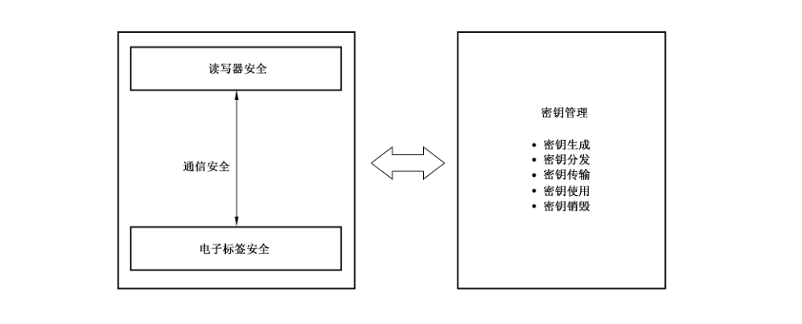
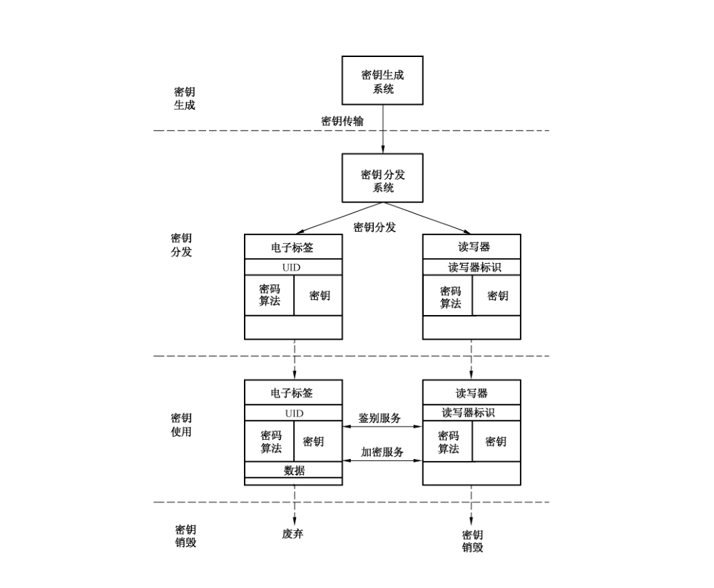
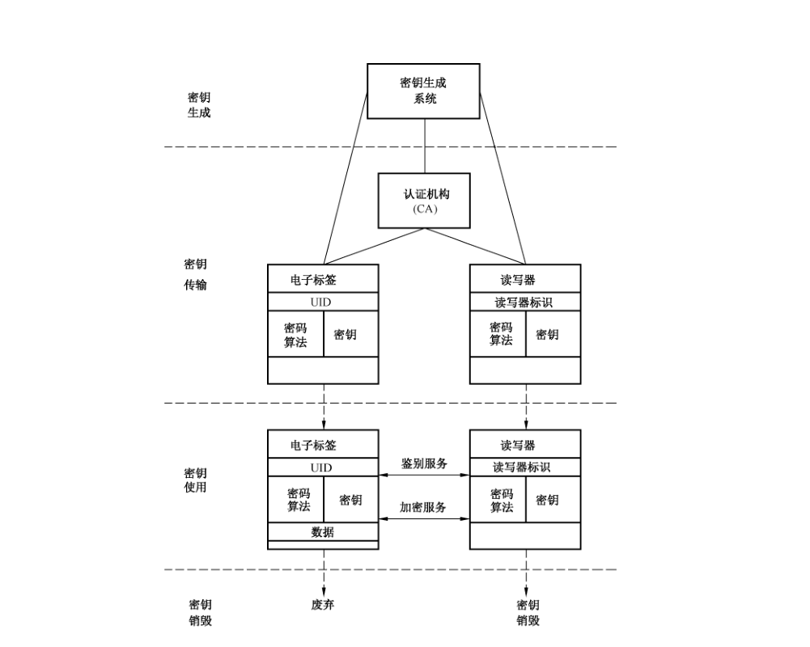

# GB/T 37033.3-2018 信息安全技术 射频识别系统密码应用技术要求 第 3 部分：密钥管理技术要求

> 来源：[GB/T 37033.3-2018 国家标准详情](https://openstd.samr.gov.cn/bzgk/std/newGbInfo?hcno=EBAFA0A5BC6F77F90D5B18E16A8CEC67)；发布日期：2018-12-28；实施日期：2019-07-01。
> 官方 PDF SHA-256：708e33d145053cc12c17ab8a226cafebb8be21f9d85d8df860f70128598b81fd。
> 转写说明：对官方 PDF 的全部 15 页图像逐页识别并校正文字、公式、表格和图示位置；4 幅图保留原页裁切，省略封面、目录、页眉和页脚，合并跨页段落。正式引用请核对原 PDF。

## 前言

GB/T 37033《信息安全技术 射频识别系统密码应用技术要求》分为 3 个部分：

- 第 1 部分：密码安全保护框架及安全级别；
- 第 2 部分：电子标签与读写器及其通信密码应用技术要求；
- 第 3 部分：密钥管理技术要求。

本部分为 GB/T 37033 的第3部分。

本部分按照 GB/T 1.1—2009 给出的规则起草。

请注意本文件的某些内容可能涉及专利。本文件的发布机构不承担识别这些专利的责任。

本部分由全国信息安全标准化技术委员会（SAC/TC 260）提出并归口。

本部分起草单位：北京中电华大电子设计有限责任公司、兴唐通信科技有限公司、上海华申智能卡应用系统有限公司、上海复旦微电子集团股份有限公司、北京同方微电子有限公司、复旦大学、航天信息股份有限公司、上海华虹集成电路有限责任公司、北京华大智宝电子系统有限公司、华大半导体有限公司。

本部分主要起草人：王俊峰、董浩然、陈跃、顾震、周建锁、刘丽娜、俞军、吴行军、王云松、徐树民、谢文录、梁少峰、王俊宇、柳逊。

## 1 范围

GB/T 37033的本部分规定了射频识别系统在采用密码机制时电子标签、读写器及其通信相关的密钥管理要求。

本部分适用于射频识别系统密钥管理的设计、实现、测评和应用。

## 2 规范性引用文件

下列文件对于本文件的应用是必不可少的。凡是注日期的引用文件，仅注日期的版本适用于本文件。凡是不注日期的引用文件，其最新版本（包括所有的修改单）适用于本文件。

- GB/T 37033.1—2018 信息安全技术 射频识别系统密码应用技术要求 第 1 部分：密码安全保护框架及安全级别

## 3 术语和定义

GB/T 37033.1—2018中界定的以及下列术语和定义适用于本文件。

### 3.1 安全密码设备 secure cryptographic device

为诸如密钥这样的秘密信息提供安全存储，以及基于这些秘密信息提供安全服务的设备。

### 3.2 密钥分割 split knowledge

两个或更多的实体分别地拥有密钥片段，仅通过单个密钥片段不能合成密钥信息。

### 3.3 密钥组件 key component

至少两个随机或伪随机过程产生的参数中的一个，它们能与一个或多个其他参数结合形成一个密钥。

### 3.4 双重控制 dual control

利用两个或更多的独立实体（通常是人），协同操作以保护敏感功能和信息的过程。

> 注：单独的实体不能存取和使用这些功能或信息（例如密钥）。

## 4 符号和缩略语

下列符号和缩略语适用于本文件。

CA：证书认证机构（Certification Authority）

Enc（X，K）：加密运算符，用密钥 K 对 X 进行加密运算

SAM：安全存取模块（Secure Access Module）

SM1：SM1 算法（SM1 algorithm）

SM2：SM2 算法（SM2 algorithm）

SM3：SM3 算法（SM3 algorithm）

SM4：SM4 算法（SM4 algorithm）

SM7：SM7 算法（SM7 algorithm）

UID：唯一标识符（Unique IDentifier）

## 5 概述

射频识别系统密钥管理涉及密钥生成、密钥分发、密钥传输、密钥使用和密钥销毁等要素，如图1所示。

射频识别系统的密钥管理采用对称密码体制和非对称密码体制。对称密码体制适用于电子标签与读写器之间的身份鉴别、访问控制、机密性及完整性的安全保护。非对称密码体制适用于电子标签和读写器之间业务行为涉及的抗抵赖、身份鉴别、完整性及机密性的安全保护。

附录A 给出了一个射频识别系统的密钥管理示例。

## 6 密钥管理模型

### 6.1 对称密钥管理模型

在射频识别系统中，对称密钥管理模型如图2所示。

射频识别系统对称密钥管理模型包含了密钥生命周期中的密钥生成、密钥分发、密钥使用和密钥销毁4个主要过程。

按照 GB/T 37033.1—2018中所规定的标准适用范围，射频识别系统对称密钥管理模型包括了电子标签和读写器等密码设备的密钥管理。

图2中，密钥生成系统完成射频识别系统中密钥的生成和密钥的分散，密钥分发系统完成对电子标签和读写器的密钥分发与注入；密钥在安全密码设备中使用，安全密码设备包括读写器 SAM 和电子标签。

通过对称密码体制可进行鉴别服务和加密服务。鉴别服务包括身份鉴别、访问控制、数据完整性保护等。加密服务用于对信息进行加解密等机密性保护。

当密钥不再需要时，应将其销毁，在销毁之后将不再有任何信息可用来恢复已销毁的密钥。

### 6.2 非对称密钥管理模型

在射频识别系统中，非对称密钥管理的基本模型如图3所示。

图3中的实体为逻辑实体，可对逻辑实体进行合并，例如当电子标签和读写器自己产生非对称密钥对时，它们和密钥生成系统可合并，或者如果CA 为电子标签和读写器产生非对称密钥对时，可将密钥生成系统和 CA 合并。

当电子标签和读写器请求密钥生成系统产生一个非对称密钥对时，密钥生成系统产生公私钥对并将它传给电子标签和读写器，传输应以鉴别和保密的方式进行，应保证在传输过程中任何第三方既不能篡改密钥对，也不能读取密钥对。

CA为电子标签和读写器签发公钥证书，并将公钥证书传回给电子标签或读写器。若电子标签或读写器需要将公钥信息提交给CA，则应保证其真实性和完整性，CA应对提交的公钥信息进行验证。

电子标签和读写器之间可通过非对称密码体制进行鉴别服务和加密服务，鉴别服务包括身份鉴别、数据原发鉴别、数据完整性和抗抵赖，可通过数字签名实现。加密服务用于对信息进行加解密等机密性保护。

当密钥不再需要时，应将其销毁。在销毁之后将不再有任何信息可用来恢复已销毁的密钥。

## 7 密钥管理通用要求

### 7.1 对称密钥管理通用要求

#### 7.1.1 对称密钥的生成

按照射频识别系统中对称密钥产生方式的要求不同，可将对称密钥分为根密钥、分散密钥和传输保护密钥，密钥类别及产生方式见表1。

**表1 密钥类别与产生方式**

| 密钥类别 | 产生方式 |
| --- | --- |
| 根密钥 | 由密钥生成系统通过随机数发生器生成 |
| 分散密钥 | 由根密钥经密钥分散因子分散产生 |
| 传输保护密钥 | 在电子标签与读写器进行信息传输前临时协商产生，用于信息传输的加密保护 |

其中，分散密钥由根密钥和16字节的密钥分散因子经符合国家密码管理部门指定的密码算法运算产生，应保证分散密钥被泄露不会导致根密钥和其他分散密钥的泄露。

分散密钥产生过程见图4。

密钥可进行多级分散，每一级分散所选择的密钥分散因子应采用能唯一标识该级内应用对象（如厂商编号等）的信息获得。该信息的长度应不大于 16 字节、且不小于4字节；信息长度不足16字节时，应在右边填0x00补齐。

#### 7.1.2 对称密钥的分发与存储

对电子标签和读写器上的密钥分发和存储过程中，不应泄漏任何密钥。

电子标签内仅存储最后一级的分散密钥，在进行最后一级密钥分散时，应以能标识电子标签唯一性的信息（如 UID）作为密钥分散因子。

读写器具根据应用需要存储根密钥或某一级的分散密钥，但不应存储最后一级的分散密钥。

#### 7.1.3 对称密钥的使用

密钥应按用途使用。在同一级内，不同用途的密钥应由上一级不同的密钥分散产生。

### 7.2 非对称密钥管理通用要求

#### 7.2.1 非对称密钥对的生成

电子标签和读写器中非对称密钥对的生成应由密钥对的所有者（如电子标签、读写器SAM）、认证机构（CA）、电子标签发行者或授权第三方完成。应使用随机过程以保证生成不重复的密钥对。应保证私钥的机密性以及公钥的完整性。

如果非对称密钥对由不使用该密钥对的系统生成，则：

a） 在确认传输已经完成后，密钥对和所有相关的机密元素应被立即删除，有明确需要保留的情况除外；

b） 应确保私钥的完整性。

#### 7.2.2 非对称密钥对的传输

非对称密钥对的传输是将密钥对和公钥证书传递给该密钥对的使用者的过程。

非对称密钥对应通过以下两种形式之一进行传输：

a） 密钥组件；

b） 加密的密钥。

传输和加载密钥的通用要求为：

a） 密钥的传输过程不应泄漏明文密钥或密钥组件的任何部分；

b） 密钥的传输与加载过程应按照双重控制、密钥分割的原则进行；

c） 只有确信电子标签和读写器在使用前没有受到任何可能导致传输的密钥或敏感数据泄露的篡改时，才可将密钥加载到安全密码设备中；

d） 只有确信安全设备接口处没有可能导致传输的密钥的任何元素泄露的窃取装置时，才可在安全密码设备之间进行密钥的传输；

e） 当使用一个设备在生成密钥的密码设备和使用密钥的密码设备之间传输密钥时，此设备应是安全密码设备。将密钥加载到目标设备后，密钥传输设备不应保留任何可能泄露该密钥的信息。

加密的非对称密钥对可通过通信信道以电子方式自动传输和加载。其加密过程应在安全密码设备中进行。

#### 7.2.3 非对称密钥对的存储

电子标签和读写器上的密钥存储过程中，应防止密钥非授权的泄露和替换。

私钥的存储应保证机密性和完整性。应当使用如下所述的技术之一来存储私钥：

a） 明文私钥：存储在电子标签和读写器SAM内。

b） 密钥组件：包含至少两个组件，其设计保证即使知晓除一个组件以外的其他所有组件，也不能对密钥造成攻击。各密钥组件应当分离存储并被不同的实体所控制。

c） 加密的私钥：由密钥加密密钥进行加密。由于私钥的长度通常大于块的大小，因此应使用密码块链模式。

公钥的存储应保证真实性和完整性。一种方法是采取与私钥相同的技术，另外一种方法是将此公钥存储在公钥证书中，并允许在使用前对公钥的完整性与真实性进行验证。

#### 7.2.4 非对称密钥对的使用

电子标签和读写器的私钥用于解密密钥或产生数字签名；公钥用于加密密钥或验证签名。应实施物理控制和逻辑控制来防止密钥的非授权使用。

应保护私钥的机密性，私钥不应在电子标签、读写器SAM外使用。

电子标签的公钥通常由电子标签维护，并且在需要时提供给读写器，读写器在使用前应对电子标签的公钥证书进行验证；读写器的公钥通常由读写器SAM 维护，并且在需要时提供给电子标签，电子标签在使用前应对读写器的公钥证书进行验证。

## 8 密钥管理应用要求

### 8.1 对称密钥管理应用要求

#### 8.1.1 身份鉴别

##### 8.1.1.1 唯一标识符鉴别

电子标签需存储由电子标签唯一标识符以及与相关应用信息结合建立的验证码，读写器需存储产生这一验证码的密钥。

##### 8.1.1.2 挑战响应鉴别

用于挑战响应鉴别的密钥应具有唯一性。

电子标签存储的用于挑战响应鉴别的密钥应由相应根密钥与电子标签 UID 分散产生。

读写器应存储用于挑战响应鉴别的根密钥，并应能通过读取电子标签 UID 分散产生与该电子标签内存储的用于挑战响应鉴别的密钥一致的密钥。

#### 8.1.2 访问控制

用于访问控制的密钥应具有唯一性。

电子标签存储的用于访问控制的密钥应由相应根密钥与电子标签 UID 分散产生；对具有多个存储区，且对存储区具有不同访问权限（读/写）控制的电子标签，应在电子标签内存储多个密钥分别用于不同权限的访问控制，即不同的权限采用不同的密钥进行控制。

根据对电子标签的访问权限，读写器应只存储用于相应权限访问控制的根密钥，并应能通过读取电子标签 UID 分散产生与该电子标签内存储的与访问权限相对应的密钥一致的密钥。

#### 8.1.3 机密性

##### 8.1.3.1 存储加密

信息的存储加密应设置存储加密密钥，对自身存储数据的加密密钥应由随机数发生器产生，并在密码设备内安全存储，不能导出。

##### 8.1.3.2 传输加密

传输加密密钥用于电子标签与读写器之间进行数据传输时的加密保护。

用于传输保护的加密密钥，可为存储在电子标签和读写器内的固定密钥；也可由电子标签与读写器在进行数据传输前临时协商产生，在通信完成后，废弃该密钥。

#### 8.1.4 完整性

用于存储完整性保护的密钥的使用要求见8.1.3.1 中的存储加密要求。

用于传输完整性保护的密钥的使用要求见8.1.3.2中的传输加密要求。

### 8.2 非对称密钥管理应用要求

#### 8.2.1 鉴别服务

电子标签和读写器之间可通过数字签名实现身份鉴别、数据原发鉴别和抗抵赖等鉴别服务。

> 注：如果非对称密钥对不是由随后使用该私钥来创建数字签名的设备产生的，则系统可能不能提供抗抵赖服务。

私钥用于产生数字签名，应保护私钥的机密性。因此，私钥不应在安全密码设备（如电子标签、SAM等）外使用。

公钥用于验证签名，在每次使用前，验证方应验证公钥的真实性和完整性，或者在使用过程中应以能确保公钥完整性和真实性的方式进行公钥的维护。

应实施物理控制和逻辑控制来防止密钥的非授权使用，要求：

a） 一个密钥只能用于一个功能；

b） 一个密钥只能在预期的位置用于预期的功能；

c） 私钥应存于保持系统有效运行的最少位置上；

d） 在使用周期结束或者已知或怀疑私钥已经泄露时，应停止密钥对的使用。

为防止信息重放，应使用序列号或时间戳。

#### 8.2.2 机密性

电子标签和读写器之间数据传输可通过加解密来实现数据的机密性保护。

如果数据明文由任何可访问到公钥的实体进行加密，则产生的密文只能由对应该公钥的私钥的持有者进行解密来恢复明文。非对称加密具有单向性，即一个密钥对只在单一通信方向上提供机密性服务。如果需要两个方向上的机密性，则两个进行通信的实体各自需要拥有一个密钥对。

因加密密钥是公开的，所以收到的密文不能提供任何关于消息来源的可靠信息。因此，采用非对称密码算法的加密本身不能提供身份鉴别服务。

#### 8.2.3 完整性

电子标签和读写器之间数据传输可通过数字签名来实现数据的完整性保护，密钥使用要求见 8.2.1。

## 附录 A（资料性附录）射频识别系统的密钥管理示例

### A.1 概述

本附录描述了一个密钥管理示例，该示例适用于安全级别为三级的射频识别系统。

### A.2 系统的应用要求

此应用的密钥管理要求基于以下基本条件：

a） 系统涉及多个电子标签发行者（指电子标签信息的原发者），每个发行者有一个唯一编码以示区别（厂商 ID）。

b） 每个电子标签出厂时都具有唯一标识符（芯片 UID）。

c） 对电子标签中划分的两个信息存储区（用标签信息区1和标签信息区2加以区别）进行安全访问控制，每个信息存储区需要有独立的访问控制权限，并对读写加以区分。

d） 电子标签具有专用的密钥存储区，对密钥存储区一次性写入且不能改写。

e） 电子标签的信息存储区中保存的数据使用专用密钥进行加密。

f） 读写器中的算法有：

1） 对称密码算法 SM7，用于与电子标签进行双向身份鉴别、访问控制及传输过程中的信息加密；

2） 对称密码算法 SM1/SM4，用于信息存储加密和密钥分散；

3） 非对称密码算法 SM2，用于产生信息的数字签名及对签名进行验证；

4） 密码杂凑函数 SM3，用于产生信息摘要。

g） 标签中的算法是对称密码算法 SM7，用于与读写器进行双向身份鉴别、访问控制及传输过程中的信息加密。

h） 读写器可生成自己的公私钥对。

i） 仅电子标签的发行者具有对电子标签信息的写入权限，且具有写权限的发行者应具有读取权限。

j） 电子标签的使用者只具有对电子标签信息区 1 和信息区 2 的读取权限，不具有写入权限。并可根据电子标签使用目的限定使用者对电子标签信息区的读取权限（如只允许读取电子标签信息区 1 或只允许读取电子标签信息区 2）。

k） 读写器与电子标签之间传输的信息需要进行加密保护。

l） 读写器具有抗电子标签原发抵赖功能。

### A.3 密钥管理设计实现

#### A.3.1 密钥生成

需针对该应用系统建立密钥管理中心，除各读写器的公私钥对外，系统其他密钥在密钥管理中心的密钥生成设备中产生，要保证密钥管理中心的物理环境安全，在密钥生成、存储时不会泄露密钥，且生成过程需记录审计信息。

在密钥管理中心生成的密钥包括：

a） 电子标签信息区 1 的读取根密钥 KR1；

b） 电子标签信息区 1 的写入根密钥 KW1；

c） 电子标签信息区 2 的读取根密钥 KR2；

d） 电子标签信息区 2 的写入根密钥 KW2；

e） 电子标签数据存储加密根密钥 KD；

f） 根公私密钥对，根公钥以证书（PubCert）的形式存储。

在读写器中生成的密钥包括：读写器自身的公私钥对（PKi 和 SKi）。此密钥对在读写器中生成，生成后私钥在读写器中安全存储，公钥上传给密钥管理中心的密码设备，由根私钥签名得到其公钥证书，再注入到读写器中，即读写器的公钥以证书（PubCerti）的形式存储。

#### A.3.2 密钥分散

采用密钥分散方法产生注入电子标签中的全部密钥和注入读写器中的部分密钥（具有写权限的密钥）。

由于 KW1 和 KW2 分别具有对电子标签信息区 1 和信息区 2 的写入权限，且对于写入权限的使用仅限于各标签的发行者，因此需要对这两个密钥进行两级分散。第一级分散在密钥管理中心进行，利用厂商 ID 对根密钥进行分散，并将分散后的密钥派发给各电子标签发行者。第二级分散在各标签发行者向电子标签内写入密钥时进行，利用芯片 UID 对第一级分散后的密钥再次分散产生电子标签的个性化密钥，并写入电子标签的密钥区。

由于使用者可读取任意标签发行者所发行电子标签的信息，因此，对于 KR1、KR2 和 KD 可只利用芯片 UID 对根密钥进行一次分散即可。

采用 SM1/SM4 密码算法进行密钥分散。

一次分散的方法如下：

- K′W1 = Enc（厂商 ID，KW1）；
- K′W2 = Enc（厂商 ID，KW2）；
- K′R1 = Enc（标签 UID，KR1）；
- K′R2 = Enc（标签 UID，KR2）；
- K′D = Enc（标签 UID，KD）。

对 K′W1 和 K′W2 还需进行二次分散，方法如下：

- K″W1 = Enc（标签 UID，K′W1）；
- K″W2 = Enc（标签 UID，K′W2）。

其中，用以区分各发行厂商或芯片的唯一标识的厂商 ID 或芯片 UID 作为分散因子，长度固定 16 字节。对长度不足或超过 16 字节的厂商 ID 或芯片 UID，应采用以下方式进行处理：

a） 长度不足 16 字节时，通过在右边填充 0x00 补齐到 16 字节；

b） 长度超过 16 字节时，截取其中变化率最大的 16 字节作为分散因子，所截取部分应能保证唯一性。

#### A.3.3 密钥分发和注入

密钥的分发和注入包括对读写器的密钥分发注入和对电子标签的密钥分发注入。

在分发和注入前应先检验密钥的完整性，在确保密钥未被篡改后，直接从安全密码设备中将密钥注入到读写器和电子标签中：

a） 读写器的密钥分发与注入

读写器密钥的分发和注入在密钥管理中心进行。首先读写器生成自身的公私钥对，私钥安全存储在读写器中，公钥上传给密钥管理中心的密码设备，由密钥管理中心的密码设备使用根私钥为其签名，得到读写器的公钥证书，然后根据读写器的不同应用，向读写器内注入不同的对称密钥、根公钥证书和读写器的公钥证书。密钥的完整性检验利用 SM3 算法，在密钥分发前计算对所有要注入的密钥一并计算验证码，并将验证码随密钥一同分发，读写器在接收到密钥后要对验证码进行验证。

依据读写器的使用功能，各读写器使用的密钥见表 A.1。

**表 A.1 不同功能读写器的密钥列表**

| 读写器 | K′W1 | K′W2 | KR1 | KR2 | KD | PubCert | PubCerti | SKi |
| --- | :---: | :---: | :---: | :---: | :---: | :---: | :---: | :---: |
| 具有电子标签密钥写入功能 | △ | △ | √ | √ | √ |  |  |  |
| 具有电子标签信息写入功能 | △ | △ |  |  | √ | √ | * | * |
| 具有电子标签信息区 1 读功能 |  |  | √ |  | √ | √ | √ |  |
| 具有电子标签信息区 2 读功能 |  |  |  | √ | √ | √ | √ |  |

注：“√”表示在该功能的读写器内注入此密钥。“△”表示各电子标签发行者所使用的读写器内只注入各自的写密钥。“*”表示此密钥的公私钥对由读写器自己产生，私钥由该读写器安全存储，读写器的公钥证书由密钥管理中心签发。

b） 电子标签的密钥分发与注入

对于电子标签，先由密钥管理中心将密钥分发给用于密钥写入的读写器，再由读写器根据芯片 UID 对密钥进行分散后注入到电子标签内。

对注入电子标签的密钥的正确性验证，采用已经注入的密钥逐一进行身份鉴别的方式进行。

如果身份鉴别通过，则对应的密钥注入正确。

注入到标签中的密钥有：K″W1、K′R1、K″W2、K′R2。

#### A.3.4 密钥存储

密钥管理中心的密钥采用加密的密钥组件的方式保存，使用密钥分割技术把密钥分割成至少两个部分。每一部分采用不同的密钥加密密钥进行加密，密钥加密密钥由不同的人保存。应在两人同时操作的情况下才能解密得到密钥明文，并且该明文只能出现在安全密码设备中，断电即消失。

读写器中的对称密钥和读写器的私钥安全存储在读写器的SAM 内，并确保不能以任何方式导出，根公钥和读写器公钥均以证书的形式存储。

电子标签上安全存储经电子标签 UID 分散后的密钥，并确保不能以任何方式导出。

#### A.3.5 根密钥备份

密钥管理中心生成的根密钥的副本采用以下两种方式之一脱机保存：

a） 加密保存在光盘、IC 卡或磁带上，密钥密文和其密钥加密密钥由两个人员分别保存，实现双重控制；

b） 采用密钥分割的方式，将密钥分成几个部分，每个有关人员保管一个部分，缺少任何一部分都不能正确恢复出密钥。

#### A.3.6 密钥验证

存储和备份的密钥定期检验。不管是采用了加密存储或密钥组件存储，每个密钥或组件都需要有验证码同时存储。每次检验时，应通过检查此验证码校验密钥完整性。

#### A.3.7 密钥更新与销毁

如果根密钥被泄露，重新生成新的根密钥，并将所有读写器的密钥更新，此后发行的电子标签也应注入更新后的密钥。

对于只具有读功能的读写器，需保留原有的读根密钥，以便支持对更新前的电子标签进行操作。

密钥更新后，旧的密钥应被归档，以备必要时验证以前交易的合法性。

#### A.3.8 密钥的使用

在读写器与电子标签采用对称密钥进行身份鉴别、访问控制等操作时，读写器应先采用 SM1/SM4 密码算法，根据读取的电子标签的 UID 对相应操作权限的根密钥（如 KR1）进行分散，以获得与电子标签共享的对称密钥。

采用抗读写器抵赖功能时，先由读写器利用自己的私钥对写入电子标签的信息进行签名，并将电子标签信息、数字签名连同产生签名的读写器的信息一同写入电子标签。在读取验证时，验证的读写器先利用根公钥验证产生签名的读写器的公钥证书，再用产生签名的读写器的公钥验证数字签名。

其中，验证读写器在密钥管理中心下载密钥时已经下载了根公钥证书，对产生签名的读写器的公钥证书的获取，根据系统的具体应用情况，可采用以下的方式：

a） 若读写器可实时与后台管理系统连接，可根据从电子标签内读取的产生签名的读写器信息从后台系统实时的获得相应读写器的公钥证书；

b） 若读写器不能实时与后台管理系统连接，根据系统规模大小，可在读写器内存储系统内所有公钥证书（必要时可定期更新）；

c） 若电子标签存储空间允许，可将产生数字签名的读写器的公钥证书在写入数字签名的同时写入电子标签，当需要进行数字签名验证时，可直接由读写器从电子标签内读取获得该公钥证书。
