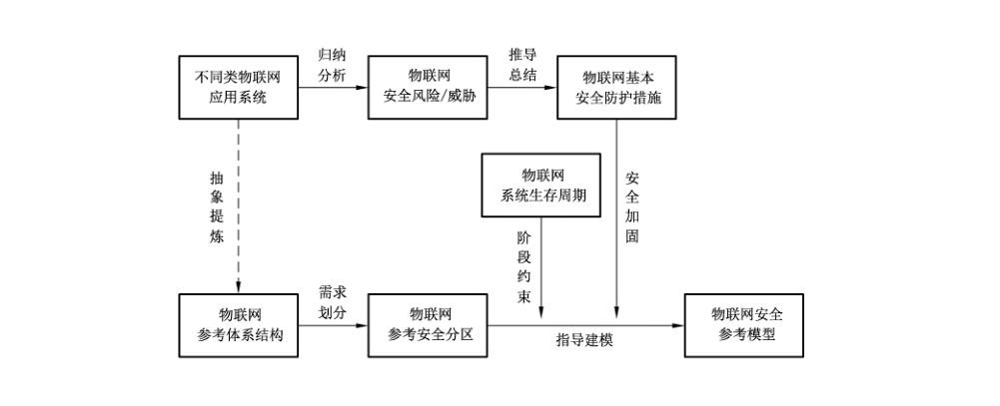
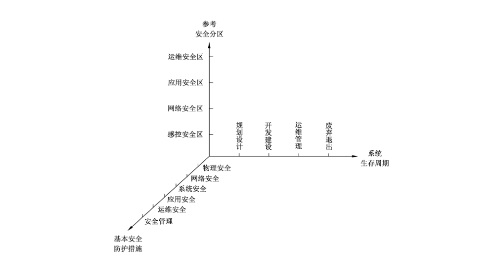
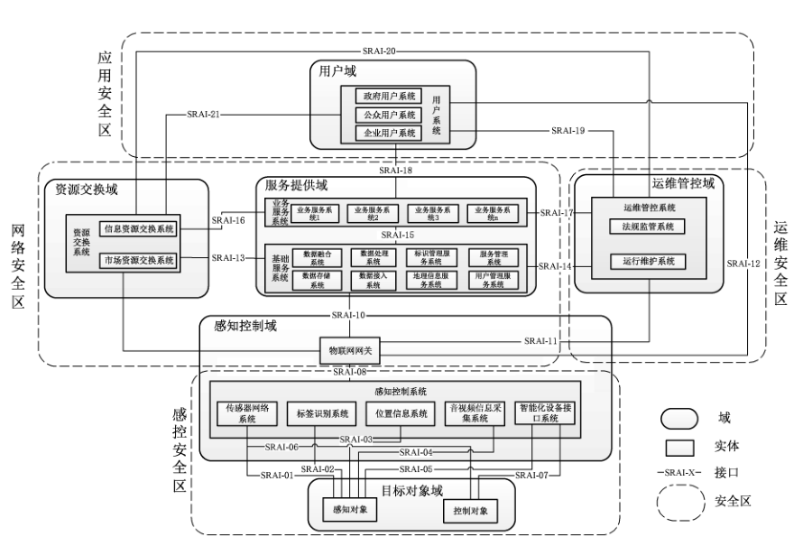

# GB/T 37044-2018 信息安全技术 物联网安全参考模型及通用要求

> 来源：[GB/T 37044-2018 国家标准详情](https://openstd.samr.gov.cn/bzgk/std/newGbInfo?hcno=BBE3572A88B87C3D92AF6DE2C424E0BB)；发布日期：2018-12-28；实施日期：2019-07-01。
> PDF SHA-256：3beb34b8e2294dec2986c3a730d2c7abaaf9b920e48edd80d0840318ef051338。
> 转写说明：按页渲染官方 PDF 并进行图像识别，对照全部 11 页原图校正文字、条款、表格和参考文献；三张图保留原图裁切。省略封面、目录、页眉和页脚，合并跨页段落。表 1 中的条款引用及参考文献中的“开发系统互连”按原文保留。正式引用请核对原 PDF。

## 前言

本标准按照 GB/T 1.1—2009 给出的规则起草。

请注意本文件的某些内容可能涉及专利。本文件的发布机构不承担识别这些专利的责任。

本标准由全国信息安全标准化技术委员会（SAC/TC 260）提出并归口。

本标准主要起草单位：中国电子技术标准化研究院、北京工业大学、国家信息技术安全研究中心、厦门市物联网产业研究院有限公司、公安部第三研究所（国家网络与信息系统安全产品质量监督检验中心）、无锡物联网产业研究院、北京邮电大学、桂林电子科技大学、上海交通大学、北京中电普华信息技术有限公司。

本标准主要起草人：龚洁中、李琳、范科峰、杨震、李京春、姚相振、周睿康、周松奕、刘军明、蒋昊、顾健、齐力、杨明、陈书义、马占宇、常亮、王勇、陶晓玲、谷大武、陈恭亮、曹占峰。

## 1 范围

本标准给出了物联网安全参考模型，包括物联网安全对象及各对象的安全责任，并规定了物联网系统的安全通用要求。

本标准适用于各应用领域物联网系统的规划设计、开发建设、运维管理、废弃退出等整个生存周期，也可为各组织定制自身的物联网安全标准提供基线参考。

## 2 规范性引用文件

下列文件对于本文件的应用是必不可少的。凡是注日期的引用文件，仅注日期的版本适用于本文件。凡是不注日期的引用文件，其最新版本（包括所有的修改单）适用于本文件。

- GB/T 7665—2005 传感器通用术语

- GB/T 25069—2010 信息安全技术 术语

- GB/T 33474—2016 物联网 参考体系结构

## 3 术语和定义

GB/T 7665—2005、GB/T 25069—2010 及 GB/T 33474—2016 中界定的以及下列术语和定义适用于本文件。

### 3.1 安全区 security zone

若干特定功能域或子域所对应的信息安全需求的集合，每一安全区因所包含的域或子域的功能目标不同而会有不同的信息安全防护需求侧重。

### 3.2 感知终端 perception terminal

能对物或环境进行信息采集和/或执行操作，并能联网进行通信的装置。

### 3.3 传感器 transducer/sensor

能感受被测量并按照一定的规律转换成可用输出信号的器件或装置，通常由敏感元件和转换元件组成。

［GB/T 7665—2005，定义 3.1.1］

> 注：GB/T 7665—2005 定义了传感器的一般分类术语，其中从被测量角度定义了三类传感器，即物理量传感器、化学量传感器和生物量传感器。

## 4 概述

物联网参考安全分区是在物联网参考体系结构的基础上，对不同域及其子域的安全需求进行分析，并结合实际应用后得出的结果，是指导设计物联网安全参考模型的一个重要逻辑空间维度。对于各个域的划分及功能说明见 GB/T 33474—2016。

本标准定义的物联网系统生存周期的四个生存阶段，是指导设计物联网安全参考模型的时间维度。

物联网基本安全防护措施是以传统互联网信息安全防护为基础，综合考虑物联网系统的特殊安全风险与威胁，推导总结出了针对物联网的相应安全防护措施，适用于对物联网参考安全分区的具体安全加固实现。

物联网安全参考模型是由物联网参考体系结构经过分区抽象，结合系统生存周期及基本安全防护措施共同建立而成，能够为设计和实施物联网系统信息安全防护提供参考。

物联网参考体系结构、参考安全分区、系统生存周期、基本安全防护措施与安全参考模型之间的关系如图1所示。

## 5 物联网安全参考模型

### 5.1 安全参考模型概述

物联网安全参考模型由物联网系统参考安全分区、系统生存周期、基本安全防护措施3个维度共同描述组成。参考安全分区是从物联网系统的逻辑空间维度出发，生存周期则是从物联网系统存续时间维度出发，配合相应的基本安全防护措施，在整体架构和生存周期层面上为物联网系统提供了一套安全模型，如图2所示，各类相应的安全标准均可以在此模型基础上进行再开发。

### 5.2 物联网参考安全分区

#### 5.2.1 概述

物联网参考安全分区是基于物联网参考体系结构，依据每一个域及其子域的主要安全风险和威胁，总结出相应的信息安全防护需求，并进行分类整理后而形成的安全责任逻辑分区，见图3。

> 注：图中的用户域、资源交换域、服务提供域、运维管控域、感知控制域及目标对象域，以及 SRAI-X 接口的具体意义见 GB/T 33474—2016。

#### 5.2.2 感控安全区

该安全区主要是需要满足感知对象、控制对象（以下合并简称感知终端）及相应感知控制系统的信息安全需求。由于感知终端的特殊性，在信息安全需求上该安全区与传统互联网差异较大，主要原因表现在感知对象计算资源的有限性、组网方式的多样性、物理终端实体的易接触性等方面。

#### 5.2.3 网络安全区

该安全区主要是需要满足物联网网关、资源交换域及服务提供域的信息安全需求，其安全要求不应低于一般通信网络的安全要求，主要保障数据汇集和预处理的真实性及有效性、网络传输的机密性及可靠性、信息交换共享的隐私性及可认证性。

#### 5.2.4 应用安全区

该安全区主要是需要满足用户域的信息安全需求，负责满足系统用户的身份认证、访问权限控制以及配合必要的运维管理等方面的安全要求，同时需要具备一定的主动防攻击能力，充分保障系统的可靠性。

#### 5.2.5 运维安全区

该安全区主要是需要满足运维管控域的信息安全需求，除了满足基本运行维护所必要的安全管理保障外，更多的是需要符合相关法律法规监管所要求的安全保障功能。

### 5.3 系统生存周期

#### 5.3.1 概述

物联网系统的一个完整生存周期大致可以分为以下4个阶段：规划设计、开发建设、运维管理、废弃退出。每一个阶段均有不同的任务目标和相应信息安全防护需求。

> 注：本标准在参考了 GB/T 22032—2008 后，结合物联网系统一般特性，将物联网系统生存周期归纳为4个阶段。

#### 5.3.2 规划设计

不同的物联网应用系统的部署环境差异较大，因此在规划设计阶段既需要考虑到周围的环境对于感知终端的安全性影响，采用适当的安全措施将降低此类风险；同时还需要考虑到上层用户系统对底层感知终端的访问权限问题，避免非法操控行为。

#### 5.3.3 开发建设

在该阶段，相关人员需要部署实现所有安全防护功能的相应机制和具体措施，包括保障系统中数据的保密性、完整性和可用性，身份认证及访问控制机制、用户隐私保护、密钥协商机制、防重放攻击、抗 DDoS 攻击等，以保障物联网系统的整体信息安全保护能力。

#### 5.3.4 运维管理

物联网应用系统最终是需要在现实环境中开展运营服务的，运维管理阶段的信息安全保障水平直接关系到整个系统的效率，因此该阶段的信息安全保护能力要求不仅包括系统安全监控，更多的在于信息安全管理，在有健全的安全管理制度的同时，还需要有配套的控制落实措施。

#### 5.3.5 废弃退出

物联网应用系统到期废弃后，需要对原来采集的数据、访问日志等信息进行及时的备份或销毁处理，部分设备在复用之前需要进行必要的初始化状态重置、缓存数据清理等操作，避免原系统信息的泄露。

### 5.4 基本安全防护措施

#### 5.4.1 物理安全

物联网感知延伸层、网络/业务层和应用层由传感器等各类感知终端、路由器、交换机、计算机等物理设备组成，其物理安全是物联网安全的重要方面。其安全要求主要包括但不限于：

a） 应制定物理设备的物理访问授权、控制等制度；

b） 应具备可靠稳定的供电要求；

c） 应具备防火、防盗、防潮、防雷和电磁防护等物理防护措施；

d） 对有防止人为接触需求的感知终端设备（例如视频监控设备），其部署地应选择需要借助辅助工具（例如架设楼梯、开锁）才能接触到的位置或装置内。

#### 5.4.2 网络安全

##### 5.4.2.1 接入安全

接入安全要求包括但不限于：

a） 各类感知终端和接入设备在接入网络时应具备唯一标识；

b） 对各类感知终端接入行为应具有身份鉴别机制；

c） 对于网络的安全接入应采取禁用闲置端口、设置访问控制策略等防护手段；

d） 对于网关、防火墙等网络边界设备，应具备安全策略配置、口令管理和访问控制等安全功能；

##### 5.4.2.2 通信安全

通信安全要求包括但不限于：

a） 物联网中的数据传输协议应有数据校验功能以确保数据传输的完整性；

b） 应采用标准化时间戳机制等技术确保数据传输的可用性；

c） 应采用技术手段对数据传输的隐私性进行保护；

d） 在网络数据交互前，应采用认证等方式为交互双方身份的可信性提供证明；

e） 应采用国家法律法规允许的加密算法对网络传输数据进行加密，确保信息的保密性；

f） 物联网系统应具备防伪基站攻击、防中间人攻击的能力。

#### 5.4.3 系统安全

##### 5.4.3.1 传统主机节点及系统安全

对于物联网中存在的资源（例如计算、能源、存储等资源）充足的主机及系统，其安全要求包括但不限于：

a） 应对登录物联网中各系统的用户进行身份标识和鉴别；

b） 应启用访问控制功能并制定相应安全策略；

c） 应限制默认账户的访问权限并及时更改默认账户及口令等身份验证信息；

d） 应对系统中多余、过期的账户，制定定期删除等管理制度；

e） 物联网中的操作系统，应遵循最小特权原则；

f） 及时更新补丁程序，应安装防恶意代码软件，并及时更新防恶意代码软件版本和恶意代码库；

g） 在使用中间件技术时，应有相应措施确保其安全性。

##### 5.4.3.2 资源受限节点及系统安全

对于物联网中存在的资源（例如计算、能源、存储等资源）受限的节点及系统，其安全要求包括但不限于：

a） 应及时更新默认账户口令等身份验证信息；

b） 应对系统中多余、过期的账户，定期进行删除等清理工作；

c） 应不定期及时更新补丁程序。

#### 5.4.4 应用安全

物联网在实际应用中需要大量应用软件，采集大量数据，其安全要求包括但不限于：

a） 应提供数据有效性检验功能，保证通过人机交互输入或通信接口输入的数据格式或长度符合系统设定要求；

b） 应对涉及国家安全、社会公共秩序、公民个人隐私等的重要数据进行异地备份，以确保其安全；

c） 应保证所使用的软件不得在未经系统运营方许可的情况下对外传输数据。

#### 5.4.5 运维安全

物联网是由多个子系统组成的复杂系统，其运行和维护通常由不同责任方负责开展，其安全要求包括但不限于：

a） 物联网中不同责任方应根据其职责，在物联网系统在招标时，对物联网设备、系统和服务的采购部署作出规定，如规定设备、系统和服务提供方的资质要求、可信赖性等，提供系统文档的详细程度，供应链的安全要求等；

b） 对于物联网系统运行维护中的相关参与人员，应提出人员资质、身份审核、可信证明、诚信承诺等要求，以确保其在物联网系统维护过程中的安全可信；

c） 应对物联网系统运维的时效性、维护工具等提出安全要求，对于远程维护设备的，应对远程维护制定安全规范。

#### 5.4.6 安全管理

安全管理要求包括但不限于：

a） 物联网系统在运行过程中，各子系统责任方应结合自身要求，制定安全管理策略规程；

b） 应明确物联网系统各设备责任人（或责任组织）的安全职责及其行为准则；

c） 应根据实际情况制定应急响应计划和配置管理策略；

d） 应对物联网系统定期开展安全评估等工作。

## 6 物联网安全通用要求

根据安全参考模型，物联网系统的每一个参考安全区及每一个生存周期阶段都面临相应的信息安全风险，需要提供针对性的保护措施，但并非每一个参考安全分区在每一个生存周期阶段都需要进行安全防护考虑。通用要求是对所有物联网系统应该达到的信息安全保障能力的基线要求，是指导一般物联网系统在“何处何时”需要进行基本的安全防护（见表1），具有较强的通用性，具体物联网系统可以根据不同需求在此基础上进行安全增强。

**表1 物联网安全通用要求归纳**

| 参考安全分区/生存周期 | 规划设计 | 开发建设 | 运维管理 | 废弃退出 |
| --- | --- | --- | --- | --- |
| 感控安全区 | 应满足 5.4.1 a）～d）、5.4.2.1 a）b）、5.4.3 f）的安全设计 | 应满足 5.4.1 a）～d）、5.4.2.1 a）b）、5.4.3 f）g）的安全要求 | 应满足 5.4.5 a）、5.4.6 a）～d）的安全要求 | — |
| 网络安全区 | — | 应满足 5.4.2.1 c）d）、5.4.2.2 a）～f）、5.4.3 a）f）g）的安全要求 | 应满足 5.4.5 a）、5.4.6 a）～d）的安全要求 | — |
| 应用安全区 | 应满足 5.4.3.1 a）～g）、5.4.3.2 a）～c）、5.4.4 a）～c）的安全设计 | 应满足 5.4.3.1 a）～g）、5.4.3.2 a）～c）、5.4.4 a）～c）的安全要求 | 应满足 5.4.5 a）、5.4.6 a）～d）的安全要求 | 应满足： a） 应对所有用户系统中存储的历史数据进行安全存档处理； b） 应安全擦除掉所有用户系统中的缓存数据； c） 应对部分高敏感数据的存储介质采取物理销毁的方式进行销毁 |
| 运维安全区 | — | 应满足 5.4.3.1 a）d）f）g）、5.4.3.2 a）～c）的安全要求 | 应满足 5.4.3.1 a）d）f）g）、5.4.3.2 a）～c）、5.4.5 a）～c）、5.4.6 a）～d）的安全要求 | — |

## 参考文献

- ［1］ GB/T 9387.2—1995 信息处理系统 开发系统互连 基本参考模型 第2部分：安全体系结构

- ［2］ GB/T 22032—2008 系统工程 系统生存周期过程

- ［3］ NIST SP 800-53 Security and Privacy Controls for Federal Information Systems and Organizations
