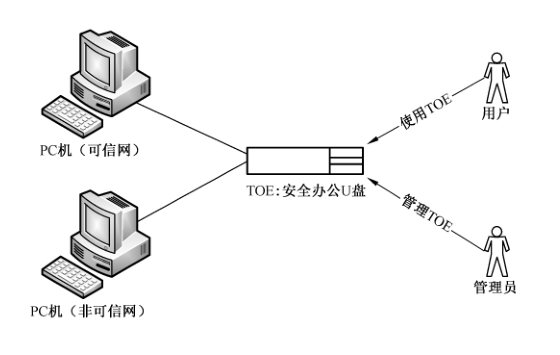
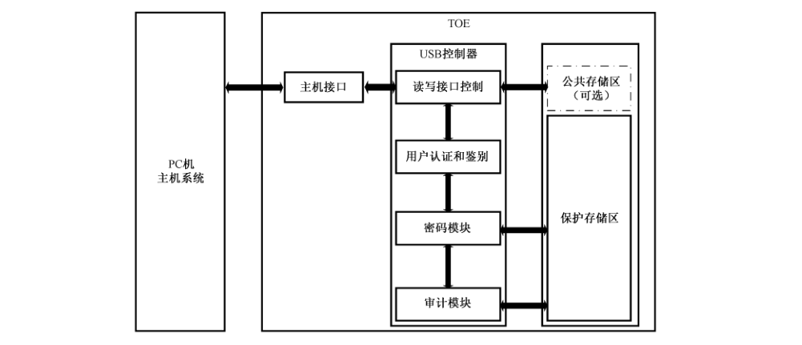

# GB/T 37091-2018 信息安全技术 安全办公U盘安全技术要求

> 来源：[GB/T 37091-2018 国家标准详情](https://openstd.samr.gov.cn/bzgk/std/newGbInfo?hcno=2C0C130422A53F287DCDB288B9C206B9)。
> PDF SHA-256：ee030f6c6689330d69a277e2616de4a5b1c9edca1c0ff92f53bb9afd378298b9。
> 转写说明：对照官方 PDF 全部 32 页图像整理；省略封面、目录、页眉、页脚和页码，合并跨页续表，两张图保留原图裁切。正式引用请核对官方 PDF。

## 前言

本标准按照 GB/T 1.1—2009给出的规则起草。

请注意本文件的某些内容可能涉及专利。本文件的发布机构不承担识别这些专利的责任。

本标准由全国信息安全标准化技术委员会（SAC/TC 260）提出并归口。

本标准起草单位：中国信息安全测评中心、中铁信安（北京）信息安全技术有限公司、北京北信源软件股份有限公司、网神信息技术（北京）股份有限公司。

本标准主要起草人：张宝峰、邓辉、张翀斌、张骁、李风娟、吴毓书、许源、毛军捷、饶华一、唐三平、何悦、李继勇、毕永东、郭颖、张强。

## 1 范围

本标准规定了对 EAL2 级和 EAL3 级的安全办公 U 盘进行安全保护所需要的安全功能要求和安全保障要求。

本标准适用于安全办公 U 盘的测试、评估，也可用于指导该类产品的研制和开发。

## 2 规范性引用文件

下列文件对于本文件的应用是必不可少的。凡是注日期的引用文件，仅注日期的版本适用于本文件。凡是不注日期的引用文件，其最新版本（包括所有的修改单）适用于本文件。

- GB/T 18336—2015（所有部分）信息技术 安全技术 信息技术安全评估准则

- GB/T 20984—2007 信息安全技术 信息安全风险评估规范

- GB/T 25069—2010 信息安全技术 术语

- GB/T 28458—2012 信息安全技术 安全漏洞标识与描述规范

## 3 术语、定义和缩略语

### 3.1 术语和定义

GB/T 18336—2015、GB/T 20984—2007、GB/T 25069—2010 和 GB/T 28458—2012 界定的以及下列术语和定义适用于本文件。

#### 3.1.1 安全办公U盘 security office USB disk

一种基于 USB接口建立用户与可信网或非可信网中PC机之间的连接，实现应用功能及安全功能的移动存储介质。如用户与PC机之间的信息交换、用户认证、安全审计、信息加密、信息存储等。

### 3.2 缩略语

下列缩略语适用于本文件。

CM：配置管理（Configuration Management）

EAL：评估保障级（Evaluation Assurance Level）

PIN：个人识别码（Personal Identification Number）

SF：安全功能（Security Function）

SFP：安全功能策略（Security Function Policy）

ST：安全目标（Security Target）

TOE：评估对象（Target of Evaluation）

TSF：TOE 安全功能（TOE Security Functionality）

## 4 评估对象描述

安全办公 U 盘用于实现用户与 PC 机之间的信息交换、用户认证、安全审计、信息加密、信息存储等功能。运行过程中，管理员对安全办公 U 盘实施管理，确保其数据的可用性、完整性及保密性。运行环境如图 1 所示。

安全办公U 盘包括主机接口、USB控制器、存储区三大部分，目的在于满足一定程度办公要求的前提下防止信息泄露，其整体内部逻辑结构描述如图2所示。

其中，各部分的功能包括：

a） 主机接口：提供安全办公 U盘与PC机建立连接的接口。

b） USB 控制器：

1） 提供读写接口控制模块：此模块作用一是当用户试图建立安全办公U盘与PC机之间的连接时，USB 控制器中的读写接口控制模块首先得到响应，对安全办公U盘身份及用户需求进行识别。作用二是当识别结束后，建立用户与不同存储区之间的连接。

2） 提供用户认证与鉴别模块：当读写模块对安全办公U 盘识别成功后，如用户需要对保护存储区进行操作，则U 盘中的用户认证和鉴别模块得到响应，提供认证和初始化服务，对用户身份进行识别。

3） 提供密码模块：此模块作用一是在身份识别过程中，提供相关密码机制以认证用户权限，最终赋予合法用户使用安全办公 U 盘的能力，获取权限的用户通过读写接口控制模块和加密模块对存储区进行操作。作用二在于对保护存储区中的数据进行加密保护。

4） 提供审计模块：此模块作用是将TOE运行过程中与安全功能相关的信息进行审计，并将其存储在加密存储区。

c） 存储区：存储需被TSF 保护的数据，此区域应在取得合法用户认证的情况下，方可使用。

1） 公共存储区域：存储办公程序（如 office、adobe 等）。

2） 保护存储区：存储用户数据、TSF 数据。

## 5 安全问题定义

### 5.1 资产

需要保护的资产：

——TSF 数据（保护存储区中的数据，如 TOE 中的访问控制列表、审计日志、安全配置数据、密钥等信息）；

——用户数据（公共存储区中的数据，如用户的加密信息、非加密信息、办公软件等信息）。

> 注：ST编写者根据具体的应用情况细化对资产的描述。

### 5.2 威胁

#### 5.2.1 仿冒欺骗（T.Spoof）

攻击者通过伪装成为合法的用户或实体，来试图旁路安全办公U盘的安全控制策略。

#### 5.2.2 故障利用（T.Failure_Exploitation）

攻击者可通过分析 TOE 的运行故障以获取 TSF 数据、用户数据或滥用 TOE的安全功能。

这些故障可能是通过改变 TOE的运行环境而触发的，也可能是由于TOE 本身的设计缺陷而自发产生的，这些故障可能导致TOE 的代码、系统数据或执行过程发生错误，使TOE 在故障下运行，从而导致敏感数据泄露。

#### 5.2.3 数据残留（T.Data_Residue）

攻击者可利用未被删除或安全处理的TOE运行记录对TOE进行非法操作。

#### 5.2.4 重复猜测（T.Repeat_Guess）

攻击者使用反复猜测鉴别数据的方法，并利用所获信息，对安全办公 U 盘实施攻击。例如：攻击者可能对 PIN 码进行重复猜测以获取各种权限。

#### 5.2.5 程序破坏（T.Program_Damage）

攻击者读取、修改或破坏重要的安全办公 U 盘自身程序安全，例如攻击者可能通过逆向分析、驱动加载、线程注入、进程挂钩等技术可能破坏程序的正常运行，也可能删除某些重要程序。

#### 5.2.6 重放攻击（T.Replay_Attack）

攻击者利用所截获的有效标识和鉴别数据，访问和使用由安全办公U 盘提供的功能。例如：攻击者可能通过嗅探等方式截获有效用户的鉴别数据，并可能使用这些鉴别数据以访问敏感内容等。

#### 5.2.7 非授权访问（T. Unauthorized_Access）

攻击者试图通过旁路安全办公 U 盘安全机制的方法，访问和使用各种安全功能。例如：攻击者可能绕过 PIN 码身份验证访问文件保险箱、绕过认证服务器的访问控制策略。

#### 5.2.8 数据泄露（T.Data_Leak）

攻击者（例如某未授权用户）通过各种技术手段获取到本地存储、传输过程中的敏感业务数据，造成数据泄露。例如攻击者可能通过解密手段获取数据，造成数据泄露。

#### 5.2.9 审计逃避（T.Audit_Escape）

由于未生成审计记录或审计记录不完备而未被查阅，因此攻击者可能不需对其操作的行为负责，并可能导致某些攻击者逃避检测。例如攻击者尝试进行的破坏行为未被记录，管理员无法审计这些行为。

#### 5.2.10 不安全状态（T.Unsecure_State）

攻击者通过有效的攻击方式使安全办公 U 盘进入不安全状态。

### 5.3 组织安全策略

#### 5.3.1 密码管理（P.Cryptography_Management）

密码的使用应符合国家制定的相关信息技术安全标准。

#### 5.3.2 硬件选型（P.Hardware_Selection）

TOE 应采用至少通过EAL4＋测评的芯片。

### 5.4 假设

#### 5.4.1 人员（A.Personnel）

假定授权管理员是可信的、无恶意的，并且能够依据管理员指南规范其操作，例如发放安全办公 U 盘的管理员应可信、无恶意。

假定使用TOE的人员已具备基本的安全防护知识并具有良好的使用习惯，且以规定的方式使用TOE。

#### 5.4.2 硬件（A.Chip_Hardware）

假定TOE运行所依赖的硬件具备足以保障TOE 安全运行所需的物理安全防护能力。

#### 5.4.3 办公程序（A.Office_Program）

假设安全办公 U 盘中预安装的办公程序（如 office、adobe 等）不存在明显影响安全办公U盘安全的脆弱性。

## 6 安全目的

### 6.1 TOE 安全目的

#### 6.1.1 用户认证（O.User_Identification）

TOE 应对操作实体进行用户认证，防止对TOE 中用户数据和安全功能数据的未授权访问和使用。

#### 6.1.2 状态校验（O.State_Check）

TOE 应能校验自身状态，防止不安全状态。在检测到故障后应将工作状态恢复或调整至安全状态，防止攻击者利用故障实施攻击。

#### 6.1.3 残留信息清除（O.ResidualInfomation_Clearance）

TOE 应确保重要的数据在使用完成后会被删除或被安全处理，不会留下可被攻击者利用的残留数据信息。

#### 6.1.4 PIN 码保护（O.PIN_Protection）

TOE 应对用户 PIN 码提供保护，防止攻击者的反复猜解等暴力破解。

#### 6.1.5 数据加密（O.Data_Encryption）

TOE 应对其保护的数据采取加密措施，如用户数据、安全功能数据等。

#### 6.1.6 密码安全（O.Cryptogram_Security）

TOE 应以一个安全的方式支持密码功能，其使用的密码算法应符合国家、行业或组织要求的密码管理相关标准或规范。

> 注：如果 TOE所使用的密码算法均由芯片实现，则将此安全目的移至ST 的环境安全目的中。

#### 6.1.7 办公程序安全防护（O.OfficeProgram_Prevention）

TOE 应对程序破坏、逆向分析等行为进行防护。

#### 6.1.8 抗重放攻击（O.Replay_Prevention）

TOE 应采取安全机制对抗可能的重放攻击。

#### 6.1.9 安全审计（O.Security_Audit）

TOE 应对违反策略的行为进行审计。

### 6.2 环境安全目的

#### 6.2.1 人员（OE.Personnel）

TOE 开发、初始化和个人化等生命周期阶段中涉及的特定人员应能严格地遵守安全的操作规程，以保障TOE 在生命周期过程中的安全性。

#### 6.2.2 应用程序（OE.Application_Program）

安装应用程序到 TOE 的流程应规范，且合法安装的应用程序不应包含恶意代码。

#### 6.2.3 芯片硬件（OE.Chip_Hardware）

TOE 的底层芯片应能够抵抗物理攻击、环境干扰攻击和侧信道攻击等。

## 7 安全要求

### 7.1 安全功能要求

#### 7.1.1 概述

表 1 列出了安全办公 U 盘安全功能要求组件，其详细内容将在下面分条描述。在描述过程中，方头括号【】中的斜体字内容表示还需要在安全目标（ST）中确定的赋值及选择项。

**表1 安全功能要求组件**

| 组件分类 | 安全功能要求组件 | 序号 |
| --- | --- | --- |
|  | FAU_ARP.1 安全告警 | 1 |
| FAU类：安全审计 | FAU_GEN.1 审计数据产生 | 2 |
|  | FAU_SAA.1 潜在侵害分析 | 3 |
|  | FCS_CKM.1 密钥生成 | 4 |
| FCS类：密码支持 | FCS_CKM.4 密钥销毁 | 5 |
|  | FCS_COP.1 密码运算 | 6 |
|  | FDP_ACC.1 子集访问控制 | 7 |
|  | FDP_ACF.1 基于安全属性的访问控制 | 8 |
| FDP 类：用户数据保护 | FDP_ITC.1 不带安全属性的用户数据输入 | 9 |
|  | FDP_IFC.1 子集信息流控制 | 10 |
|  | FDP_IFF.1 简单安全属性 | 11 |
|  | FIA_AFL.1 鉴别失败处理 | 12 |
|  | FIA_ATD.1 用户属性定义 | 13 |
|  | FIA_UAU.1 鉴别的时机 | 14 |
| FIA 类：标识和鉴别 | FIA_UAU.2 任何动作前的用户鉴别 | 15 |
|  | FIA_UAU.3 不可伪造的鉴别 | 16 |
|  | FIA_UID.1 标识的时机 | 17 |
|  | FIA_UID.2 任何动作前的用户标识 | 18 |
|  | FMT_MOF.1 安全功能行为的管理 | 19 |
|  | FMT_MSA.1 安全属性的管理 | 20 |
|  | FMT_MSA.3 静态属性初始化 | 21 |
| FMT 类：安全管理 | FMT_MTD.1 TSF 数据的管理 | 22 |
|  | FMT_MTD.2 TSF 数据限值的管理 | 23 |
|  | FMT_SMR.1 安全角色 | 24 |
|  | FMT_SMF.1 管理功能规范 | 25 |
|  | FPT_RCV.4 功能恢复 | 26 |
| FPT 类：TSF 保护 | FPT_RPL.1 重放检测 | 27 |
|  | FPT_STM.1 可靠的时间戳 | 28 |
| FTA类：TOE 访问 | FTA_SSL.2 用户原发会话锁定 | 29 |

#### 7.1.2 安全审计（FAU 类）

##### 7.1.2.1 安全告警（FAU_ARP.1）

FAU_ARP.1.1 TSF 应允许对非正常操作进行告警配置。当检测到潜在的安全侵害时，TSF 应进行【以记录日志方式来安全告警】。

##### 7.1.2.2 审计数据产生（FAU_GEN.1）

FAU_GEN.1.1 TSF 应能为下述可审计事件产生审计记录：

a） 审计功能的开启和关闭；

b） 有关【最小级】审计级别的所有可审计事件；

c）【表2中列出的事件】。

**表2 审计事件**

| 要求 | 审计事件 |
| --- | --- |
| FCS_CKM.1 密钥生成 | 操作的成功和失败 |
| FCS_CKM.4 密钥销毁 | 操作的成功和失败 |
| FCS_COP.1 密钥运算 | 操作的成功和失败，以及密码运算的类型 |
| FDP_ACF.1 基于安全属性的访问控制 | 对SFP涵盖的客体执行某个操作的成功请求 |
| FDP_ITC.1 不带安全属性的用户数据输入 | 用户数据的成功输入，包括任何安全属性 |
| FDP_IFF.1简单安全属性 | 允许请求的信息流动的决定 |
| FIA_UAU.5 多重鉴别机制 | 校验码一次性鉴别和用户口令鉴别 |
| FIA_AFL.1 鉴别失败处理 | 未成功鉴别尝试达到阈值、达到阈值后所采取的动作（如使终端无效），及后来（适当时）还原到正常状态（如重新使终端有效） |
| FIA_UAU.1 任何动作前的用户鉴别 | 鉴别机制的未成功使用 |
| FIA_UAU.3 不可伪造的鉴别 | 对欺骗性鉴别数据的检测 |
| FIA_UID.1 标识的时机 | 未成功用户标识机制的使用，包括所提供的用户身份 |
| FIA_UID.2 任何动作前的用户标识 | 未成功用户标识机制的使用，包括所提供的用户身份 |
| FPT_RCV.4 功能恢复 | 如有可能，TOE 安全功能失效后，不能返回到安全状态的可能性 |
| FPT_RPL.1 重放检测 | 检测到的重放攻击 |
| FPT_STM.1 可靠的时间戳 | 时间的改变 |
| FTA_SSL.2 用户原发会话锁定 | 利用会话锁定机制对交互式会话的锁定 |

FAU_GEN.1.2 TSF 应在每个审计记录中至少记录下列信息：

a） 事件的日期和时间、事件类型、主体身份（如果适用）、事件的结果（成功或失效）；

b） 对每种审计事件类型，基于 ST 中功能组件的可审计事件的定义，【赋值：其他审计相关信息】。

##### 7.1.2.3 潜在侵害分析（FAU_SAA.1）

FAU_SAA.1.1 TSF 应能使用一组规则去监测审计事件，并根据这些规则指示出对实施SFR的潜在侵害。

FAU_SAA.1.2 TSF 应执行下列规则监测审计事件：

a） 已知的用来指示潜在安全侵害的【赋值：已定义的可审计事件的子集】的累积或组合；

b）【赋值：任何其他规则】。

#### 7.1.3 密码支持（FCS类）

##### 7.1.3.1 密钥生成（FCS_CKM.1）

FCS_CKM.1.1 TSF 应根据符合下列标准【赋值：标准列表】的一个特定的密钥生成算法【赋值：密钥生成算法】和规定的密钥长度【赋值：密钥长度】来生成密钥。

注1：该组件仅适用于密钥生成功能由 TOE 本身完成的情况，此时 ST编写者根据密码算法的具体情况，赋值国家主管部门认可的相关标准及参数。

注2：若密钥由外部环境生成，则可以不选择此组件。

##### 7.1.3.2 密钥销毁（FCS_CKM.4）

FCS_CKM.4.1 TSF 应根据符合下列标准【赋值：标准列表】的一个特定的密钥销毁方法【赋值：密钥销毁方法】来销毁密钥。

> 注：ST编写者根据密码算法的具体情况赋值国家主管部门认可的相关标准及密钥销毁方法。

##### 7.1.3.3 密码运算（FCS_COP.1）

FCS_COP.1.1 TSF 应根据符合下列标准【赋值：标准列表】的特定的密码算法【赋值：密码算法】和密钥长度【赋值：密钥长度】来执行【赋值：密码运算列表】。

> 注：ST编写者根据密码算法的具体情况赋值国家主管部门认可的相关标准及参数。

#### 7.1.4 用户数据保护（FDP 类）

##### 7.1.4.1 子集访问控制（FDP_ACC.1）

FDP_ACC.1.1 TSF 应对【用户，赋值：其他主体列表】【选择：删除、修改、读取、使用，赋值：其他具体操作列表】【用户数据，赋值：其他客体列表】执行【赋值：访问控制策略】。

##### 7.1.4.2 基于安全属性的访问控制（FDP_ACF.1）

FDP_ACF.1.1 TSF 应基于【赋值：指定 SFP 控制下的主体和客体列表，以及每个与 SFP的相关安全属性或与 SFP 相关的已命名安全属性组】对客体执行【赋值：访问控制 SFP】。

FDP_ACF.1.2 TSF 应执行以下规则，以确定在受控主体与受控客体间的一个操作是否被允许：【赋值：在受控主体和受控客体间，通过对受控客体采取受控操作来管理访问的一些规则】。

FDP_ACF.1.3 TSF 应基于以下附加规则：【赋值：基于安全属性的，明确授权主体访问客体的规则】，明确授权主体访问客体。

FDP_ACF.1.4 TSF 应基于【赋值：基于安全属性的，明确拒绝主体访问客体的规则】明确拒绝主体访问客体。

##### 7.1.4.3 不带安全属性的用户数据输入（FDP_ITC.1）

FDP_ITC.1.1 在 SFP控制下从 TOE之外输入用户数据时，TSF 应执行【赋值：访问控制 SFP和（/或）信息流控制SFP】。

FDP_ITC.1.2 从TOE 外部输入用户数据时，TSF 应忽略任何与用户数据相关的安全属性。

FDP_ITC.1.3 在 SFP 控制下从 TOE 之外输入用户数据时，TSF 应执行下面的规则：【赋值：附加的输入控制规则】。

##### 7.1.4.4 子集信息流控制（FDP_IFC.1）

FDP_IFC.1.1 TSF 应对【赋值：主体、信息及 SFP所覆盖的导致受控信息流入、流出受控主体的操作列表】执行【赋值：信息流控制 SFP】。

##### 7.1.4.5 简单安全属性（FDP_IFF.1）

FDP_IFF.1.1 TSF 应基于下列类型主体和信息的安全属性：【赋值：指定 SFP 控制下的主体和信息列表，以及每个对应的安全属性】执行【赋值：信息流控制 SFP】。

FDP_IFF.1.2 如果支持下列规则：【赋值：对每一个操作，应在主体和信息的安全属性之间成立的基于安全属性的关系】，TSF 应允许信息在受控主体和受控信息之间经由受控操作流动。

FDP_IFF.1.3 TSF 应执行【赋值：附加的信息流控制SFP规则】。

FDP_IFF.1.4 TSF 应根据下列规则：【赋值：基于安全属性，明确批准信息流的规则】明确批准一个信息流。

FDP_IFF.1.5 TSF 应根据下列规则：【赋值：基于安全属性，明确拒绝信息流的规则】明确拒绝一个信息流。

#### 7.1.5 标识和鉴别（FIA 类）

##### 7.1.5.1 鉴别失败处理（FIA_AFL.1）

FIA_AFL.1.1 TSF 应检测当【选择：【赋值：正整数】，管理员可设置的【赋值：可接受数值范围】内的一个正整数】时，与【赋值：鉴别事件列表】相关的未成功鉴别尝试。

FIA_AFL.1.2 当【选择：达到、超过】所定义的未成功鉴别尝试次数时，TSF 应采取的【赋值：动作列表】。

##### 7.1.5.2 用户属性定义（FIA_ATD.1）

FIA_ATD.1.1 TSF 应维护属于单个用户的下列安全属性列表：【选择：用户标识、PIN和密钥等鉴别数据、用户角色、【赋值：其他安全属性】】。

##### 7.1.5.3 鉴别的时机（FIA_UAU.1）

FIA_UAU.1.1 在用户被鉴别前，TSF 应允许执行代表用户的【赋值：由 TSF 促成的动作列表】。

FIA_UAU.1.2 在允许执行代表该用户的任何其他由TSF 促成的动作前，TSF 应要求每个用户都已被成功鉴别。

##### 7.1.5.4 任何动作前的用户鉴别（FIA_UAU.2）

FIA_UAU.2.1 在允许执行代表该用户的任何其他TSF 促成的动作前，TSF 应要求每个用户都已被成功鉴别。

##### 7.1.5.5 不可伪造的鉴别（FIA_UAU.3）

FIA_UAU.3.1 TSF 应【选择：检测、防止】由任何 TSF 用户伪造的鉴别数据的使用。

FIA_UAU.3.2 TSF 应【选择：检测、防止】从任何其他的 TSF 用户处拷贝的鉴别数据的使用。

##### 7.1.5.6 标识的时机（FIA_UID.1）

FIA_UID.1.1 在用户被识别之前，TSF 应允许执行代表用户的【赋值：TSF 促成的动作列表】。

FIA_UID.1.2 在允许执行代表该用户的任何其他 TSF 仲裁动作之前，TSF 应要求每个用户身份都已被成功识别。

##### 7.1.5.7 任何动作前的用户标识（FIA_UID.2）

FIA_UID.2.1 在允许执行代表该用户的任何其他TSF 促成的动作前，TSF 应要求每个用户被识别。

#### 7.1.6 安全管理（FMT 类）

##### 7.1.6.1 安全功能行为的管理（FMT_MOF.1）

FMT_MOF.1.1 TSF 应仅限于【管理员】对功能【赋值：功能列表】具有【选择：确定其行为，终止、激活、修改其行为】的能力。

##### 7.1.6.2 安全属性的管理（FMT_MSA.1）

FMT_MSA.1.1 TSF 应执行【用户数据访问控制策略】，以仅限于【管理员】能够对安全属性【赋值：安全属性列表】进行【重置，选择：改变默认值、查询、修改、删除、【赋值：其他操作】】。

##### 7.1.6.3 静态属性初始化（FMT_MSA.3）

FMT_MSA.3.1 TSF 应执行【访问控制SFP】，以便为用于执行 SFP 的安全属性提供【许可的】默认值。

FMT_MSA.3.2 TSF 应允许【管理员】在创建客体或信息时指定替换性的初始值以代替原来的默认值。

##### 7.1.6.4 TSF 数据的管理（FMT_MTD.1）

FMT_MTD.1.1 TSF 应仅限于【管理员】能够对【TOE 版本信息、激活时间等标识数据，赋值：其他安全功能数据列表】进行【选择：改变默认值、查询、修改、删除、清除、【赋值：其他操作】】。

##### 7.1.6.5 TSF 数据限值的管理（FMT_MTD.2）

FMT_MTD.2.1 TSF 能应仅限于【管理员】规定【连续鉴别失败尝试次数，赋值：其他 TSF 数据列表】的限值。

FMT_MTD.2.2 如果TSF数据达到或超过了设定的限值，TSF 应采取下面的动作：【赋值：要采取的动作，如锁定所有安全功能】。

##### 7.1.6.6 安全角色（FMT_SMR.1）

FMT_SMR.1.1 TSF 应维护角色【赋值：已标识的授权角色】。

FMT_SMR.1.2 TSF 应能够把用户和角色关联起来。

##### 7.1.6.7 管理功能规范（FMT_SMF.1）

FMT_SMF.1.1 TSF 应能够执行如下管理功能：【赋值：TSF 提供的安全管理功能列表】。

#### 7.1.7 TSF 保护（FPT类）

##### 7.1.7.1 功能恢复（FPT_RCV.4）

FPT_RCV.4.1 TSF 应确保在【赋值：其他功能和失效情景列表】时有如下特性，即SF 或者成功完成，或者针对指明的失效情景恢复到一个前后一致的且安全的状态。

##### 7.1.7.2 重放检测（FPT_RPL.1）

FPT_RPL.1.2 检测到重放时，TSF 应执行【赋值：具体操作列表，如锁定所有安全功能】。

##### 7.1.7.3 可靠的时间戳（FPT_STM.1）

FPT_STM.1.1 TSF 应能为它自己的使用提供可靠的时间戳。

#### 7.1.8 TOE访问（FTA类）——用户原发会话锁定（FTA_SSL.2）

FTA_SSL.2.1 TSF 应在达到【用户规定的不活动时间间隔】后，通过以下方法终止一个交互式会话：

a） 清除或覆写显示设备，使当前的内容不可读；

b） 除了会话解锁活动之外，终止用户数据存取/显示设备的任何活动。

FTA_SSL.2.2 TSF 应要求在恢复会话之前发生以下事件：【用户被重新鉴别】。

### 7.2 安全保障要求

#### 7.2.1 安全保障级别

安全办公 U 盘的安全保障级别选择 EAL2 和 EAL3，EAL2 和 EAL3 级别应包含的保障组件在表 3 中列出。

**表3 保障组件**

| 保障类 | 保障组件 | 序号 | EAL2 | EAL3 |
| --- | --- | --- | --- | --- |
| ADV：开发 | ADV_ARC.1 安全架构描述 | 1 | √ | √ |
| ADV：开发 | ADV_FSP.2 安全执行功能规范 | 2 | √ | N/A |
| ADV：开发 | ADV_FSP.3 带完整摘要的功能规范 | 3 | N/A | √ |
| ADV：开发 | ADV_TDS.1 基础设计 | 4 | √ | N/A |
| ADV：开发 | ADV_TDS.2 结构化设计 | 5 | N/A | √ |
| AGD：指导性文档 | AGD_OPE.1 操作用户指南 | 6 | √ | √ |
| AGD：指导性文档 | AGD_PRE.1 准备程序 | 7 | √ | √ |
| ALC：生命周期支持 | ALC_CMC.2 CM 系统的使用 | 8 | √ | N/A |
| ALC：生命周期支持 | ALC_CMC.3 授权控制 | 9 | N/A | √ |
| ALC：生命周期支持 | ALC_CMS.2 部分 TOE CM 覆盖 | 10 | √ | N/A |
| ALC：生命周期支持 | ALC_CMS.3 实现表示 CM 覆盖 | 11 | N/A | √ |
| ALC：生命周期支持 | ALC_DEL.1 交付程序 | 12 | √ | √ |
| ALC：生命周期支持 | ALC_DVS.1 安全措施标识 | 13 | N/A | √ |
| ALC：生命周期支持 | ALC_LCD.1 开发者定义的生命周期模型 | 14 | N/A | √ |
| ASE：ST 评估 | ASE_CCL.1 符合性声明 | 15 | √ | √ |
| ASE：ST 评估 | ASE_ECD.1 扩展组件的定义 | 16 | √ | √ |
| ASE：ST 评估 | ASE_INT.1 ST 引言 | 17 | √ | √ |
| ASE：ST 评估 | ASE_OBJ.2 安全目的 | 18 | √ | √ |
| ASE：ST 评估 | ASE_REQ.1 陈述性的安全要求 | 19 | √ | N/A |
| ASE：ST 评估 | ASE_REQ.2 安全要求导出 | 20 | N/A | √ |
| ASE：ST 评估 | ASE_SPD.1 安全问题定义 | 21 | √ | √ |
| ASE：ST 评估 | ASE_TSS.1 TOE 概要规范 | 22 | √ | √ |
| ATE：测试 | ATE_COV.1 覆盖证据 | 23 | √ | N/A |
| ATE：测试 | ATE_COV.2 覆盖分析 | 24 | N/A | √ |
| ATE：测试 | ATE_DPT.1 测试：基本设计 | 25 | N/A | √ |
| ATE：测试 | ATE_FUN.1 功能测试 | 26 | √ | √ |
| ATE：测试 | ATE_IND.2 独立测试——抽样 | 27 | √ | √ |
| AVA：脆弱性评定 | AVA_VAN.2 脆弱性分析 | 28 | √ | √ |

注：√ 代表在该保障级下，选择该组件。N/A 代表在该保障级下，该组件不适用。

#### 7.2.2 开发（ADV类）

##### 7.2.2.1 安全架构描述（ADV_ARC.1）

开发者行为元素：ADV_ARC.1.1D开发者应设计并实现 TOE，确保 TSF 的安全特性不可旁路。

ADV_ARC.1.2D开发者应设计并实现 TSF，以防止不可信任主体的破坏。

ADV_ARC.1.3D开发者应提供 TSF 安全架构的描述。

内容和形式元素：ADV-ARC.1.1C安全架构的描述应与在TOE 设计文档中对 SFR-执行的抽象描述的级别一致。

ADV_ARC.1.2C 安全架构的描述应描述与安全功能要求一致的 TSF 安全域。

ADV_ARC.1.3C安全架构的描述应描述TSF 初始化过程为何是安全的。

ADV_ARC.1.4C安全架构的描述应证实 TSF 可防止被破坏。

ADV_ARC.1.5C安全架构的描述应证实 TSF 可防止 SFR一执行的功能被旁路。

评估者行为元素：ADV_ARC.1.1E 评估者应确认提供的信息符合证据的内容和形式要求。

##### 7.2.2.2 安全执行功能规范（ADV_FSP.2）

开发者行元素：ADV_FSP.2.1D 开发者应提供一个功能规范。

ADV_FSP.2.2D 开发者应提供功能规范到安全功能要求的追溯关系。

内容和形式元素：ADV_FSP.2.1C 功能规范应完整描述TSF。

ADV_FSP.2.2C 功能规范应描述所有的TSFI 的目的和使用方法。

ADV_FSP.2.3C功能规范应识别和描述每个 TSFI 相关的所有参数。

ADV_FSP.2.4C 对于每个 SFR-执行 TSFI，功能规范应描述 TSFI 相关的SFR-执行行为。

ADV_FSP.2.5C 对于SFR-执行TSFI，功能规范应描述由SFR-执行行为相关处理而引起的直接错误消息。

ADV_FSP.2.6C 功能规范应证实安全功能要求到 TSFI 的追溯。

评估者行为元素：ADV_FSP.2.1E 评估者应确认所提供的信息满足证据的内容和形式的所有要求。

ADV_FSP.2.2E 评估者应决定功能规范是TOE 安全功能要求的一个准确且完备的实例化。

##### 7.2.2.3 带完整摘要的功能规范（ADV_FSP.3）

开发者行为元素：ADV_FSP.3.1D 开发者应提供一个功能规范。

ADV_FSP.3.2D 开发者应提供功能规范到安全功能要求的追溯。

内容和形式元素：ADV_FSP.3.1C 功能规范应完全描述 TSF。

ADV_FSP.3.2C 功能规范应描述所有的TSFI 的目的和使用方法。

ADV_FSP.3.3C功能规范应识别和描述每个 TSFI 相关的所有参数。

ADV_FSP.3.4C 对于每个 SFR-执行TSFI，功能规范应描述 TSFI 相关的SFR-执行行为。

ADV_FSP.3.5C 对于每个 SFR-执行 TSFI，功能规范应描述与 TSFI 的调用相关的安全实施行为和异常而引起的直接错误消息。

ADV_FSP.3.6C 功能规范需总结与每个 TSFI 相关的SFR-支撑和 SFR-无关的行为。

ADV_FSP.3.7C 功能规范应证实安全功能要求到 TSFI 的追溯。

评估者行为元素：ADV_FSP.3.1E 评估者应确认所提供的信息满足证据的内容和形式的所有要求。

ADV_FSP.3.2E 评估者应决定功能规范是TOE 安全功能要求的一个准确且完备的实例化。

##### 7.2.2.4 基础设计（ADV_TDS.1）

开发者行为元素：ADV_TDS.1.1D 开发者应提供 TOE 的设计。

ADV_TDS.1.2D开发者应提供从功能规范的TSFI 到TOE 设计中获取到的最低层分解的映射。

内容和形式元素：ADV_TDS.1.1C 设计应根据子系统描述 TOE 的结构。

ADV_TDS.1.2C 设计应标识 TSF 的所有子系统。

ADV_TDS.1.3C设计应对每一个 SFR-支撑或 SFR-无关的子系统的行为进行足够详细的描述，以确定它不是 SFR-执行。

ADV_TDS.1.4C设计应概括 SFR-执行子系统的 SFR-执行行为。

ADV_TDS.1.5C设计应描述TSF 的 SFR-执行子系统间的相互作用和 TSF 的SFR-执行子系统与其他 TSF 子系统间的相互作用。

ADV_TDS.1.6C 映射关系应证实 TOE 设计中描述的所有行为能够映射到调用它的 TSFI。

评估者行为元素：ADV_TDS.1.1E 评估者应确认提供的信息满足证据的内容与形式的所有要求。

ADV_TDS.1.2E 评估者应确定设计是所有安全功能要求的正确且完备的实例。

##### 7.2.2.5 结构化设计（ADV_TDS.2）

开发者行为元素：ADV_TDS.2.1D 开发者应提供 TOE的设计。

ADV_TDS.2.2D开发者应提供从功能规范的TSFI 到TOE设计中获取到的最低层分解的映射。

内容和形式元素：ADV_TDS.2.1C 设计应根据子系统描述 TOE 的结构。

ADV_TDS.2.2C 设计应标识 TSF 的所有子系统。

ADV_TDS.2.3C设计应对每一个TSF 的SFR-无关子系统的行为进行足够详细的描述，以确定它是SFR-无关。

ADV_TDS.2.4C设计应描述SFR-执行子系统的 SFR-执行行为。

ADV_TDS.2.5C设计应概括 SFR-执行子系统的SFR-支撑和SFR-无关行为。

ADV_TDS.2.6C 设计应概括SFR-支撑子系统的行为。

ADV_TDS.2.7C设计应描述TSF 所有子系统间的相互作用。

ADV_TDS.2.8C 映射关系应证明 TOE 设计中描述的所有行为能够映射到调用它的 TSFI。

评估者行 元素：ADV_TDS.2.1E 评估者应确认提供的信息满足证据的内容与形式的所有要求。

ADV_TDS.2.2E 评估者应确定设计是所有安全功能要求的正确且完全的实例。

#### 7.2.3 指导性文档（AGD类）

##### 7.2.3.1 操作用户指南（AGD_OPE.1）

开发者行元素：AGD_OPE.1.1D开发者应提供操作用户指南。

内容和形式元素：AGD_OPE.1.1C 操作用户指南应对每一种用户角色进行描述，在安全处理环境中应被控制的用户可访问的功能和特权，包含适当的警示信息。

AGD_OPE.1.2C操作用户指南应对每一种用户角色进行描述，怎样以安全的方式使用TOE提供的可用接口。

AGD_OPE.1.3C操作用户指南应对每一种用户角色进行描述，可用功能和接口，尤其是受用户控制的所有安全参数，适当时应指明安全值。

AGD_OPE.1.4C操作用户指南应对每一种用户角色明确说明，与需要执行的用户可访问功能有关的每一种安全相关事件，包括改变 TSF 所控制实体的安全特性。

AGD_OPE.1.5C操作用户指南应标识 TOE运行的所有可能状态（包括操作导致的失败或者操作性错误），它们与维持安全运行之间的因果关系和联系。

AGD_OPE.1.6C操作用户指南应对每一种用户角色进行描述，为了充分实现ST 中描述的运行环境安全目的所必须执行的安全策略。

AGD_OPE.1.7C 操作用户指南应是明确和合理的。

评估行为元素：AGD_OPE.1.1E 评估者应确认所提供的信息满足证据的内容和形式的所有要求。

##### 7.2.3.2 准备程序（AGD_PRE.1）

开发者行为元素：AGD_PRE.1.1D 开发者应提供 TOE，包括它的准备程序。

内容和形式元素：AGD_PRE.1.1C 准备程序应描述与开发者交付程序相一致的安全接收所交付 TOE 必需的所有步骤。

AGD_PRE.1.2C 准备程序应描述安全安装TOE 以及安全准备与ST 中描述的运行环境安全目的一致的运行环境必需的所有步骤。

评估者行为元素：AGD_PRE.1.1E 评估者应确认所提供的信息满足证据的内容和形式的所有要求。

AGD_PRE.1.2E 评估者应运用准备程序确认 TOE运行能被安全地准备。

#### 7.2.4 生命周期支持（ALC类）

##### 7.2.4.1 CM 系统的使用（ALC_CMC.2）

开发者行为元素：ALC_CMC.2.1D 开发者应提供 TOE及其参照号。

ALC_CMC.2.2D 开发者应提供CM 文档。

ALC_CMC.2.3D 开发者应提供CM系统。

内容和形式元素：ALC_CMC.2.1C 应给TOE 标注唯一参照号。

ALC_CMC.2.2CCM文档应描述用于唯一标识配置项的方法。

ALC_CMC.2.3C CM 系统应唯一标识所有配置项。

评估者行为元素：ALC_CMC.2.1E 评估者应确认所提供的信息满足证据的内容和形式的所有要求。

##### 7.2.4.2 授权控制（ALC_CMC.3）

开发者行为元素：ALC_CMC.3.1D 开发者应提供 TOE及其参照号。

ALC_CMC.3.2D 开发者应提供CM文档。

ALC_CMC.3.3D 开发者应使用CM系统。

内容和形式元素：ALC_CMC.3.1C 应给TOE 标注唯一参照号。

ALC_CMC.3.2C CM 文档应描述用于唯一标识配置项的方法。

ALC_CMC.3.3CCM 系统应唯一标识所有配置项。

ALC_CMC.3.4C CM 系统应提供措施使得只能对配置项进行授权变更。

ALC_CMC.3.5C CM文档应包括一个CM 计划。

ALC_CMC.3.6C CM 计划应描述CM 系统是如何应用于 TOE 的开发过程。

ALC_CMC.3.7C 证据应证实所有配置项都正在CM 系统下进行维护。

ALC_CMC.3.8C 证据应证实CM系统的运行与CM计划是一致的。

评估者行元素：ALC_CMC.3.1E 评估者应确认所提供的信息满足证据的内容和形式的所有要求。

##### 7.2.4.3 部分 TOE CM 覆盖（ALC_CMS.2）

开发者行为元素：ALC_CMS.2.1D 开发者应提供TOE 配置项列表。

ALC_CMS.2.1D 开发者应提供 TOE 配置项列表。

内容和形式元素：ALC_CMS.2.1C 配置项列表应包括：TOE 本身、安全保障要求的评估证据、TOE 的组成部分。

ALC_CMS.2.2C 配置项列表应唯一标识配置项。

ALC_CMS.2.3C对于每一个 TSF 相关的配置项，配置项列表应简要说明该配置项的开发者。

评估者行为元素：ALC_CMS.2.1E 评估者应确认所提供的信息满足证据的内容和形式的所有要求。

##### 7.2.4.4 实现表示 CM 覆盖（ALC_CMS.3）

开发者行为元素：ALC_CMS.3.1D 开发者应提供 TOE 配置项列表。

内容和形式元素：ALC_CMS.3.1C 配置项列表应包括：TOE 本身、安全保障要求的评估证据、TOE 的组成部分和实现表示。

ALC_CMS.3.2C 配置项列表应唯一标识配置项。

ALC_CMS.3.3C对于每一个 TSF 相关的配置项，配置项列表应简要说明该配置项的开发者。

评估者行为元素：ALC_CMS.3.1E 评估者应确认所提供的信息满足证据的内容和形式的所有要求。

##### 7.2.4.5 交付程序（ALC_DEL.1）

开发者行 元素：ALC_DEL.1.1D 开发者应将 TOE 或其部分交付给消费者的程序文档化。

ALC_DEL.1.2D 开发者应使用交付程序。

内容和形式元素：ALC_DEL.1.1C 交付文档应描述，在向消费者分发 TOE 版本时，用以维护安全性所必需的所有程序。

评估者行为元素：ALC_DEL.1.1E 评估者应确认所提供的信息满足证据的内容和形式的所有要求。

##### 7.2.4.6 安全措施标识（ALC_DVS.1）

开发者行为元素：ALC_DVS.1.1D 开发者应提供开发安全文档。

内容和形式元素：ALC_DVS.1.1C 开发安全文档应描述在 TOE 的开发环境中，保护 TOE 设计和实现的保密性和完整性所必需的所有物理的、程序的、人员的及其他方面的安全措施。

评估者行为元素：ALC_DVS.1.1E 评估者应确认所提供的信息满足证据的内容和形式的所有要求。

ALC_DVS.1.2E 评估者应确认安全措施正在被使用。

##### 7.2.4.7 开发者定义的生命周期模型（ALC_LCD.1）

开发者行为元素：ALC_LCD.1.1D开发者应建立一个生命周期模型，用于 TOE的开发和维护。

ALC_LCD.1.2D 开发者应提供生命周期定义文档。

内容和形式元素：ALC_LCD.1.1C 生命周期定义文档应描述用于开发和维护 TOE的模型。

ALC_LCD.1.2C生命周期模型应为TOE 的开发和维护提供必要的控制。

评估者行为元素：ALC_LCD.1.1E 评估者应确认所提供的信息满足证据的内容和形式的所有要求。

#### 7.2.5 ST 评估（ASE类）

##### 7.2.5.1 符合性声明（ASE_CCL.1）

开发者行为元素：ASE_CCL.1.1D 开发者应提供符合性声明。

ASE_CCL.1.2D 开发者应提供符合性声明的基本原理。

内容和形式元素：ASE_CCL.1.1C ST 应声明其与 GB/T 18336 符合性，标识出 ST 和 TOE 的符合性遵从的 GB/T 18336 的版本。

ASE_CCL.1.2C 符合性声明应描述 ST 与GB/T 18336.2 的符合性，无论是与 GB/T 18336.2 相符或还是对 GB/T 18336.2的扩展。

ASE_CCL.1.3C 符合性声明应描述 ST 与GB/T 18336.3 的符合性，无论是与 GB/T 18336.3 相符还是对 GB/T 18336.3 的扩展。

ASE_CCL.1.4C符合性声明应与扩展组件定义是相符的。

ASE_CCL.1.5C符合性声明应标识 ST 声明遵从的所有 PP 和安全要求包。

ASE_CCL.1.6C符合性声明应描述 ST 和包的符合性，无论是与包的相符或是与扩展包相符。

ASE_CCL.1.7C 符合性声明的基本原理应证实 TOE类型与符合性声明所遵从的PP 中的TOE类型是相符的。

ASE_CCL.1.8C 符合性声明的基本原理应证实安全问题定义的陈述与符合性声明所遵从的PP中的安全问题定义陈述是相符的。

ASE_CCL.1.9C符合性声明的基本原理应证实安全目的陈述与符合性声明所遵从的PP 中的安全目的陈述是相符的。

ASE_CCL.1.10C符合性声明的基本原理应证实安全要求的陈述与符合性声明所遵从的PP中的安全要求的陈述是相符的。

评估者行元素：ASE_CCL.1.1E 评估者应确认所提供的信息满足证据的内容和形式的所有要求。

##### 7.2.5.2 扩展组件定义（ASE_ECD.1）

开发者行为元素：ASE_ECD.1.1D开发者应提供安全要求的陈述。

ASE_ECD.1.2D 开发者应提供扩展组件的定义。

内容和形式元素：ASE_ECD.1.1C 安全要求陈述应标识所有扩展的安全要求。

ASE_ECD.1.2C 扩展组件定义应为每一个扩展的安全要求定义一个扩展的组件。

ASE_ECD.1.3C扩展组件定义应描述每个扩展的组件与已有组件、族和类的关联性。

ASE_ECD.1.4C扩展组件定义应使用已有的组件、族、类和方法学作为陈述的模型。

ASE_ECD.1.5C 扩展组件应由可测量的和客观的元素组成，以便于证实这些元素之间的符合性或不符合性。

评估者行 元素：ASE_ECD.1.1E 评估者应确认所提供的信息满足证据的内容和形式的所有要求。

ASE_ECD.1.2E 评估者应确认扩展组件不能利用已经存在的组件明确地表达。

##### 7.2.5.3 ST 引言（ASE_INT.1）

开发者行元素：ASE_INT.1.1D 开发者应提供ST 引言。

内容和形式元素：ASE_INT.1.1C ST 引言应包含 ST 参照号、TOE 参照号、TOE 概述和 TOE 描述。

ASE_INT.1.2C ST 参照号应唯一标识 ST。

ASE_INT.1.3C TOE 参照号应标识 TOE。

ASE_INT.1.4C TOE 概述应概括 TOE 的用法及其主要安全特性。

ASE_INT.1.5C TOE 概述应标识 TOE 类型。

ASE_INT.1.6C TOE 概述应标识任何 TOE 要求的非 TOE 范围内的硬件/软件/固件。

ASE_INT.1.7C TOE 描述应描述TOE 的物理范围。

ASE_INT.1.8C TOE 描述应描述 TOE 的逻辑范围。

评估者行为元素：ASE_INT.1.1E 评估者应确认所提供的信息满足证据的内容和形式的所有要求。

ASE_INT.1.2E 评估者应确认 TOE 参考、TOE 概述和 TOE 描述是相互一致的。

##### 7.2.5.4 安全目的（ASE_OBJ.2）

开发者行为元素：ASE_OBJ.2.1D 开发者应提供安全目的的陈述。

ASE_OBJ.2.2D 开发者应提供安全目的的基本原理。

内容和形式元素：ASE_OBJ.2.1C 安全目的的陈述应描述TOE的安全目的和运行环境安全目的。

ASE_OBJ.2.2C 安全目的基本原理应追溯到TOE的每一个安全目的，以便于能追溯到安全目的所对抗的威胁及安全目的实施的组织安全策略。

ASE_OBJ.2.3C安全目的基本原理应追溯到运行环境的每一个安全目的，以便于能追溯到安全目的所对抗的威胁、安全目的实施的组织安全策略和安全目的支持的假设。

ASE_OBJ.2.4C安全目的基本原理应证实安全目的能抵抗所有威胁。

ASE_OBJ.2.5C安全目的基本原理应证实安全目的执行所有组织安全策略。

ASE_OBJ.2.6C安全目的基本原理应证实运行环境安全目的支持所有的假设。

评估者行为元素：ASE_OBJ.2.1E 评估者应确认所提供的信息满足证据的内容和形式的所有要求。

##### 7.2.5.5 陈述性的安全要求（ASE_REQ.1）

开发者行为元素：ASE_REQ.1.1D 开发者应提供安全要求的陈述。

ASE_REQ.1.2D 开发者应提供安全要求的基本原理。

内容和形式元素：ASE_REQ.1.1C 安全要求的陈述应描述安全功能要求和安全保障要求。

ASE_REQ.1.2C应对安全功能要求和安全保障要求中使用的所有主体、客体、操作、安全属性、外部实体及其他术语进行定义。

ASE_REQ.1.3C安全要求的陈述应对安全要求的所有操作进行标识。

ASE_REQ.1.4C 所有操作应被正确地执行。

ASE_REQ.1.5C应满足安全要求间的依赖关系，或者安全要求基本原理应证明不需要满足某个依赖关系。

ASE_REQ.1.6C 安全要求的陈述应是内在一致的。

评估者行为元素：ASE_REQ.1.1E 评估者应确认所提供的信息满足证据的内容和形式的所有要求。

##### 7.2.5.6 推导出的安全要求（ASE_REQ.2）

开发者行为元素：ASE_REQ.2.1D 开发者应提供安全要求的陈述。

ASE_REQ.2.2D 开发者应提供安全要求的基本原理。

内容和形式元素：ASE_REQ.2.1C安全要求的陈述应描述安全功能要求和安全保障要求。

ASE_REQ.2.2C应对安全功能要求和安全保障要求中使用的所有主体、客体、操作、安全属性、外部实体及其他术语进行定义。

ASE_REQ.2.3C安全要求的陈述应对安全要求的所有操作进行标识。

ASE_REQ.2.4C 所有操作应被正确地执行。

ASE_REQ.2.5C 应满足安全要求间的依赖关系，或者安全要求基本原理应证明不需要满足某个依赖关系。

ASE_REQ.2.6C 安全要求基本原理应描述每一个安全功能要求可追溯至对应的TOE安全目的。

ASE_REQ.2.7C 安全要求基本原理应证实安全功能要求可满足所有的TOE安全目的。

ASE_REQ.2.8C安全要求基本原理应说明选择安全保障要求的理由。

ASE_REQ.2.9C 安全要求的陈述应是内在一致的。

评估者行为元素：ASE_REQ.2.1E 评估者应确认所提供的信息满足证据的内容和形式的所有要求。

##### 7.2.5.7 安全问题定义（ASE_SPD.1）

开发者行元素：ASE_SPD.1.1D 开发者应提供安全问题定义。

内容和形式元素：ASE_SPD.1.1C 安全问题定义应描述威胁。

ASE_SPD.1.2C所有的威胁都应根据威胁主体、资产和敌对行为进行描述。

ASE_SPD.1.3C 安全问题定义应描述组织安全策略。

ASE_SPD.1.4C 安全问题定义应描述有关TOE运行环境的相关假设。

评估者行为元素：ASE_SPD.1.1E 评估者应确认所提供的信息满足证据的内容和形式的所有要求。

##### 7.2.5.8 TOE 概要规范（ASE_TSS.1）

开发者行为元素：ASE_TSS.1.1D开发者应提供 TOE 概要规范。

内容和形式元素：ASE_TSS.1.1C TOE 概要规范应描述TOE 是如何满足每一项安全功能要求的。

评估者行为元素：ASE_TSS.1.1E 评估者应确认所提供的信息满足证据的内容和形式的所有要求。

ASE_TSS.1.2E 评估者应确认 TOE 概要规范与TOE概述、TOE 描述是一致的。

#### 7.2.6 测试（ATE类）

##### 7.2.6.1 覆盖证据（ATE_COV.1）

开发者行为元素：ATE_COV.1.1D 开发者应提供测试覆盖的证据。

内容和形式元素：ATE_COV.1.1C 测试覆盖的证据应表明测试文档中的测试与功能规范中的TSF 接口之间的对应性。

评估者行为元素：ATE_COV.1.1E 评估者应确认提供的信息满足证据的内容和形式的要求。

##### 7.2.6.2 覆盖分析（ATE_COV.2）

开发者行为元素：ATE_COV.2.1D 开发者应提供对测试覆盖的分析。

内容和形式元素：ATE_COV.2.1C 测试覆盖分析应论证测试文档中的测试和功能规范中描述的网络交换机安全功能间的对应性。

ATE_COV.2.2C测试覆盖分析应论证已经对功能规范中所有安全功能接口都进行了测试。

评估者行为元素：ATE_COV.2.1E 评估者应确认提供的信息满足证据的内容和形式的要求。

##### 7.2.6.3 测试：基本设计（ATE_DPT.1）

开发者行为元素：ATE_DPT.1.1D 开发者应提供测试深度分析。

内容和形式元素：ATE_DPT.1.1C 测试深度分析应证实测试文档中的测试与 TOE设计中 TSF 子系统之间的对应性。

ATE_DPT.1.2C 测试深度分析应证实 TOE 设计中所有 TSF 子系统都已经进行过测试。

评估者行为元素：ATE_DPT.1.1E 评估者应当确认提供的信息满足证据的内容和形式的要求。

##### 7.2.6.4 功能测试（ATE_FUN.1）

开发者行为元素：ATE_FUN.1.1D 开发者应当测试 TSF，并文档化测试结果。

ATE_FUN.1.2D开发者应提供测试文档。

内容和形式元素：ATE_FUN.1.1C测试文档应当包括测试计划、预期的测试结果和实际的测试结果。

ATE_FUN.1.2C测试计划应当标识要执行的测试并描述执行每个测试的方案，这些方案应包括对于其他测试结果的任何顺序依赖性。

ATE_FUN.1.3C 预期的测试结果应指出测试成功执行后的预期输出。

ATE_FUN.1.4C 实际的测试结果应和预期的测试结果一致。

评估者行为元素：ATE_FUN.1.1E 评估者应当确认所提供的信息满足证据的内容和形式的所有要求。

##### 7.2.6.5 独立测试——抽样（ATE_IND.2）

开发者行为元素：ATE_IND.2.1D 开发者应提供用于测试的TOE。

证据的内容和形式元素：ATE_IND.2.1C TOE 应适合测试。

ATE_IND.2.2C 开发者应提供一组与开发者 TSF 功能测试中同等的一系列资源。

评估者行为元素：ATE_IND.2.1E 评估者应确认所提供的信息满足证据的内容和形式的所有要求。

ATE_IND.2.2E 评估者应执行测试文档里的测试样本，以验证开发者测试的结果。

ATE_IND.2.3E 评估者应测试TSF 的一个子集以确认 TSF 按照规范运行。

#### 7.2.7 脆弱性评定（AVA 类）——脆弱性分析（AVA_VAN.2）

开发者行为元素：AVA_VAN.2.1D 开发者应提供用于测试的TOE。

内容和形式元素：AVA_VAN.2.1C TOE 应适合测试。

评估者行为元素：AVA_VAN.2.1E 评估者应确认所提供的信息满足证据的内容和形式的所有要求。

AVA_VAN.2.2E 评估者应执行公共领域的调查以标识 TOE 的潜在脆弱性。

AVA_VAN.2.3E 评估者应执行独立的TOE脆弱性分析去标识TOE 潜在的脆弱性，在分析过程中使用指导性文档、功能规范、TOE 设计和安全结构描述。

AVA_VAN.2.4E 评估者应基于已标识的潜在脆弱性实施穿透性测试，判定 TOE 能抵抗具有基本攻击潜力的攻击者的攻击。

## 8 基本原理

### 8.1 安全目的的基本原理

表 4 说明了安全办公 U 盘的安全目的能应对所有可能的威胁、假设和组织安全策略。

**表4 安全目的与威胁、组织安全策略、假设的对应关系**

| 序号 | 安全目的 | 对应的威胁、组织安全策略和假设 |
| --- | --- | --- |
| 1 | O.User_Identification | T.Spoof，T.Unauthorized_Access，T.Data_Leak |
| 2 | O.State_Check | T.Failure_Exploitation，T.Unsafe_State，P.Hardware_Selection |
| 3 | O.ResidualInfomation_Clearance | T.Failure_Exploitation，T.Data_Residue，T.Data_Leak |
| 4 | O.PIN_Protection | T.Failure_Exploitation，T.Replay_Guess，T.Data_Leak，P.Crytogram_Management |
| 5 | O.Data_Encryption | T.Failure_Exploitation，T.Replay_Guess，T.Data_Leak，P.Crytogram_Management |
| 6 | O.Cryptogram_Security | T.Failure_Exploitation，T.Replay_Guess，T.Data_Leak，P.Crytogram_Management |
| 7 | O.OfficeProgram_Prevention | T.Failure_Exploitation，T.Program_Damage |
| 8 | O.Replay_Prevention | T.Replay_Attack |
| 9 | O.Security_Audit | T.Replay_Guess，T.Audit_Escape |
| 10 | OE.Personnel | T.Spoof，T.Unauthorized_Access，T.Audit_Escape，A.Personnel |
| 11 | OE.Application_Program | T.Program_Damage，A.Office_Program |
| 12 | OE.Chip_Hardware | T.Failure_Exploitation，P.Hardware_Selection，A.Chip_Hardware |

以下每一种威胁、组织安全策略和假设都至少有一个或一个以上安全目的与其对应，因此是完备的。

T.Spoof

为了避免攻击者通过伪装成合法的用户或实体，来试图旁路安全办公 U 盘的安全控制策略，O.User_Identification 会对操作实体进行用户认证，防止对 TOE 中用户数据和安全功能数据的未授权访问和使用；OE.Personnel 会对人员的合法性进行定义。

T.Failure_Exploitation

为了避免攻击者通过分析 TOE 的运行故障以获取 TSF 数据、用户数据或滥用 TOE 安全功能，O.State_Check 会对 TOE 运行是否正常进行校验；O.ResidualInfomation_Clearance 会对 U 盘使用后的数据进行清除，防止故障利用；O.Pin_Protection、O.Data_Encryption 以及 O.Cryptogram_Pevention 会对 TSF 数据进行防护；O.OfficeProgram_Prevention 对办公程序进行防护；OE.Chip_Hardware 会对硬件安全性进行定义。

T.Data_Residue

为了避免攻击者利用未被删除或安全处理的 TOE 运行记录对 TOE 进行非法操作，O.ResidualInfomation_Clearance 会对 U 盘使用后的数据进行清除，防止故障利用。

T.Repeat_Guess

为了避免攻击者对 TOE 使用反复猜测鉴别数据的方法，并利用所获信息实施攻击，O.Pin_Protection、O.Data_Encryption 以及 O.Cryptogram_Pevention 会对鉴别数据进行防护；O.Security_Audit 会对违反策略的行为进行审计，及时发现不合法猜测行为。

T.Program_Damage

为了避免攻击者读取、修改或破坏重要的安全办公 U 盘自身程序安全，O.OfficeProgram_Prevention、OE.Application_Program 会对程序破坏、逆向分析等行为进行防护。

T.Replay_Attack

为了避免攻击者利用所截获的有效标识和鉴别数据，访问和使用由安全办公 U 盘提供的相关功能，O.Replay_Prevation 会提供安全机制抵御重放攻击。

T.Unauthorized_Access

为了避免攻击者试图旁路安全办公 U 盘安全机制的方法，访问和使用各种安全功能，O.User_Identification、OE.Personnel 会对使用者的合法性进行认证。

T.Data_Leak

为了避免攻击者通过各种技术手段获取到本地存储、传输过程中的敏感业务数据，造成数据泄露，O.Pin_Protection 会对用户 PIN 码提供保护；O.User_Identification 会对操作实体进行用户认证，防止对 TOE 中用户数据和安全功能数据的未授权访问和使用；O.Data_Encryption 会对其保护的数据采取加密措施，如用户数据、安全功能数据等；O.ResidualInfomation_Clearance 会对 U 盘使用后的数据进行清除，防止故障利用；O.Cryptogram_Security 会以符合国家、行业或组织要求的密码管理相关标准或规范的密码算法确保 TOE 密码安全。

T.Audit_Escape

由于未生成审计记录或审计记录不完备而未被查阅，因此攻击者可能不需对其操作的行为负责，并可能导致某些攻击者逃避检测。为防止此不安全行为发生，O.Secuity_Audit、OE.Personnel 会对违反策略的行为进行审计。

T.Unsafe_State

为了避免攻击者通过有效的攻击方式使安全办公 U 盘进入不安全状态，O.State_Check 会对 U 盘状态进行校验，防止不安全状态的发生。

P.Crytogram_Management

为了避免攻击者利用密码算法安全问题，O.Pin_Protection、O.Data_Encryption 以及 O.Cryptogram_Pevention 会对密码使用过程进行安全判断。

P.Hardware_Selection

为避免芯片硬件引入安全问题，O.State_Check、OE.Chip_Hardware 会对 TOE 是否采用至少通过安全测评的安全芯片进行校验。

A.Personnel

该假设要求授权管理员能够依据管理员指南规范其操作，使用 TOE 的人员已具备基本的安全防护知识并具有良好的使用习惯，且以规定的方式使用 TOE。为了达到这样的目的，OE.Personnel 要求 TOE 开发、初始化和个人化等生命周期阶段中涉及的特定人员应能严格地遵守安全的操作规程，以保障 TOE 在生命周期过程中的安全性。

A.Chip_Hardware

该假设要求 TOE 运行所依赖的硬件具备足以保障 TOE 安全运行所需的物理安全防护能力。为了达到这样的目的，OE.Chip_Hardware 要求 TOE 的底层芯片应能够抵抗物理攻击、环境干扰攻击和侧信道攻击等。

A.Office_Program

该假设要求安全办公 U 盘中预安装的办公程序不存在明显影响安全办公 U 盘安全的脆弱性。为了达到这样的目的，OE.Application_Program 要求安装应用程序到 TOE 的流程应规范，且合法安装的应用程序不应包含恶意代码。

### 8.2 安全要求的基本原理

表 5 说明了安全要求的充分必要性基本原理，即每个安全目的都至少有一个安全要求（包括功能要求和保障要求）组件与其对应，每个安全要求都至少解决了一个 TOE 安全目的，因此安全要求对安全目的而言是充分和必要的。

**表5 安全要求与安全目的的对应关系**

| 序号 | 安全要求 | 对应的安全目的 |
| --- | --- | --- |
| 1 | FAU_ARP.1 | O.User_Identification，O.OfficeProgram_Prevention，O.Replay_Prevention |
| 2 | FAU_GEN.1 | O.Security_Audit |
| 3 | FAU_SAA.1 | O.Security_Audit |
| 4 | FCS_CKM.1 | O.User_Identification，O.PIN_Protection，O.Data_Encryption，O.Cryptogram_Security |
| 5 | FCS_CKM.4 | O.ResidualInfomation_Clearance，O.Cryptogram_Security |
| 6 | FCS_COP.1 | O.User_Identification，O.Data_Encryption，O.Cryptogram_Security |
| 7 | FDP_ACC.1 | O.User_Identification |
| 8 | FDP_ACF.1 | O.User_Identification |
| 9 | FDP_ITC.1 | O.User_Identification，O.Cryptogram_Security |
| 10 | FDP_IFC.1 | O.User_Identification |
| 11 | FDP_IFF.1 | O.User_Identification |
| 12 | FIA_AFL.1 | O.User_Identification |
| 13 | FIA_ATD.1 | O.User_Identification |
| 14 | FIA_UAU.1 | O.User_Identification，O.ResidualInfomation_Clearance，O.OfficeProgram_Prevention |
| 15 | FIA_UAU.2 | O.User_Identification |
| 16 | FIA_UAU.3 | O.User_Identification |
| 17 | FIA_UID.1 | O.User_Identification |
| 18 | FIA_UID.2 | O.User_Identification |
| 19 | FMT_MOF.1 | O.User_Identification |
| 20 | FMT_MSA.1 | O.User_Identification |
| 21 | FMT_MSA.3 | O.User_Identification |
| 22 | FMT_MTD.1 | O.User_Identification |
| 23 | FMT_MTD.2 | O.User_Identification |
| 24 | FMT_SMR.1 | O.User_Identification |
| 25 | FMT_SMF.1 | O.User_Identification |
| 26 | FPT_RCV.4 | O.State_Check |
| 27 | FPT_RPL.1 | O.Replay_Prevention |
| 28 | FPT_STM.1 | O.State_Check |
| 29 | FTA_SSL.2 | O.ResidualInfomation_Clearance，O.OfficeProgram_Prevention |

O.User_Identification

通过 FAU_ARP.1 对不合法认证活动进行安全告警；通过 FCS_CKM.1 和 FCS_COP.1 要求用户认证过程中正确的密码生成和运算；通过 FDP_ACC.1、FDP_ACF.1、FDP_ITC.1、FDP_IFC.1、FDP_IFF.1、FIA_AFL.1、FIA_ATD.1、FIA_UAU.1、FIA_UAU.2、FIA_UAU.3、FIA_UID.1、FIA_UID.2、FMT_MOF.1、FMT_MSA.1、FMT_MSA.3、FMT_MTD.1、FMT_MTD.2、FMT_SMR.1、FMT_SMF.1 对用户身份的相关管理机制进行要求。

O.State_Check

通过 FPT_RCV.4 要求 TOE 在检测到故障后将工作状态恢复至安全状态；通过 FPT_STM.1 要求 TOE 提供可靠的时间戳为状态校验服务。

O.ResidualInfomation_Clearance

FCS_CKM.4 要求对 TOE 使用过程中的密钥信息进行销毁；通过 FTA_SSL.2 和 FIA_UAU.1 终止一个交互式会话后，对 U 盘中残留信息进行清除，确保 U 盘安全。

O.PIN_Protection

通过 FCS_CKM.1 生成密钥保护 PIN 码。

O.Data_Encryption

通过 FCS_CKM.1 和 FCS_COP.1 对数据加密过程中的密码生成和运算进行要求。

O.Cryptogram_Security

通过 FCS_CKM.1、FCS_CKM.4 和 FCS_COP.1 对数据加密过程中的密码生成、销毁和运算进行要求，确保密码安全。

O.OfficeProgram_Prevention

通过 FAU_ARP.1 对办公程序的使用过程进行安全告警；在达到用户规定的不活动时间间隔后，通过 FTA_SSL.2 和 FIA_UAU.1 终止一个交互式会话，确保办公程序安全。

O.Replay_Prevention

通过 FAU_ARP.1 对重放攻击进行安全告警；通过 FPT_RPL.1 对重放行为进行检测。

O.Security_Audit

通过 FAU_GEN.1 和 FAU_SAA.1 对安全审计过程中的数据产生进行要求，并进行潜在侵害分析。

### 8.3 组件依赖关系

在选取安全要求组件时，应满足所选组件之间的相互依赖关系，表6和表7分别列出了所选安全功能要求组件和安全保障要求组件的内部依赖关系。

**表6 安全功能组件依赖关系表**

| 序号 | 安全功能组件 | 依赖关系 |
| --- | --- | --- |
| 1 | FAU_ARP.1 | FAU_SAA.1 |
| 2 | FAU_GEN.1 | FPT_STM.1 |
| 3 | FAU_SAA.1 | FAU_GEN.1 |
| 4 | FCS_CKM.1 | FCS_CKM.2 或 FCS_COP.1；FCS_CKM.4 |
| 5 | FCS_CKM.4 | FDP_ITC.1 或 FDP_ITC.2 或 FCS_CKM.1 |
| 6 | FCS_COP.1 | FDP_ITC.1 或 FDP_ITC.2 或 FCS_CKM.1；FCS_CKM.4 |
| 7 | FDP_ACC.1 | FDP_ACF.1 |
| 8 | FDP_ACF.1 | FDP_ACC.1；FMT_MSA.3 |
| 9 | FDP_ITC.1 | FDP_ACC.1 或 FDP_ACF.1；FMT_MSA.3 |
| 10 | FDP_IFC.1 | FDP_IFF.1 |
| 11 | FDP_IFF.1 | FDP_IFC.1；FMT_MSA.3 |
| 12 | FIA_AFL.1 | FIA_UAU.1 |
| 13 | FIA_ATD.1 | 无 |
| 14 | FIA_UAU.1 | FIA_UID.1 |
| 15 | FIA_UAU.2 | FIA_UID.1 |
| 16 | FIA_UAU.3 | 无 |
| 17 | FIA_UID.1 | 无 |
| 18 | FIA_UID.2 | 无 |
| 19 | FMT_MOF.1 | FMT_SMR.1；FMT_SMF.1 |
| 20 | FMT_MSA.1 | FDP_ACC.1 或 FDP_IFC.1；FMT_SMR.1；FMT_SMF.1 |
| 21 | FMT_MSA.3 | FMT_MSA.1；FMT_SMR.1 |
| 22 | FMT_MTD.1 | FMT_SMR.1；FMT_SMF.1 |
| 23 | FMT_MTD.2 | FMT_MTD.1；FMT_SMR.1 |
| 24 | FMT_SMR.1 | FIA_UID.1 |
| 25 | FMT_SMF.1 | 无 |
| 26 | FPT_RCV.4 | 无 |
| 27 | FPT_RPL.1 | 无 |
| 28 | FPT_STM.1 | 无 |
| 29 | FTA_SSL.2 | FIA_UAU.1 |

**表7 安全保障组件依赖关系表**

| 序号 | 安全保障组件 | 依赖关系 |
| --- | --- | --- |
| 1 | ADV_ARC.1 | ADV_FSP.1；ADV_TDS.1 |
| 2 | ADV_FSP.2 | ADV_TDS.1 |
| 3 | ADV_FSP.3 | ADV_TDS.1 |
| 4 | ADV_TDS.1 | ADV_FSP.2 |
| 5 | ADV_TDS.2 | ADV_FSP.3 |
| 6 | AGD_OPE.1 | ADV_FSP.1 |
| 7 | AGD_PRE.1 | 无 |
| 8 | ALC_CMC.2 | ADV_FSP.1 |
| 9 | ALC_CMC.3 | 无 |
| 10 | ALC_CMS.2 | 无 |
| 11 | ALC_CMS.3 | 无 |
| 12 | ALC_DEL.1 | 无 |
| 13 | ALC_DVS.1 | 无 |
| 14 | ALC_LCD.1 | 无 |
| 15 | ASE_CCL.1 | ASE_INT.1；ASE_ECD.1；ASE_REQ.1 |
| 16 | ASE_ECD.1 | 无 |
| 17 | ASE_INT.1 | 无 |
| 18 | ASE_OBJ.1 | 无 |
| 19 | ASE_REQ.1 | ASE_ECD.1 |
| 20 | ASE_REQ.2 | ASE_OBJ.2；ASE_ECD.1 |
| 21 | ASE_SPD.1 | 无 |
| 22 | ASE_TSS.1 | ASE_INT.1；ASE_REQ.1；ADV_FSP.1 |
| 23 | ATE_COV.1 | ADV_FSP.2；ATE_FUN.1 |
| 24 | ATE_COV.2 | ADV_FSP.2；ATE_FUN.1 |
| 25 | ATE_DPT.1 | ADV_ARC.1；ADV_TDS.2；ATE_FUN.1 |
| 26 | ATE_FUN.1 | ATE_COV.1 |
| 27 | ATE_IND.2 | ADV_FSP.2；AGD_OPE.1；AGD_PRE.1；ATE_COV.1；ATE_FUN.1 |
| 28 | AVA_VAN.2 | ADV_ARC.1；ADV_FSP.2；ADV_TDS.1；AGD_OPE.1；AGD_PRE.1 |

## 参考文献

- ［1］ Protection Profile for Network Devices,08 June,2012
