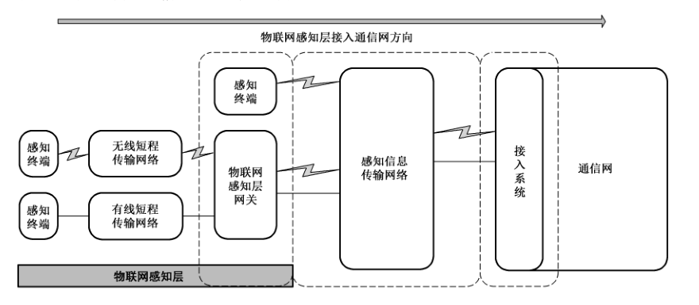
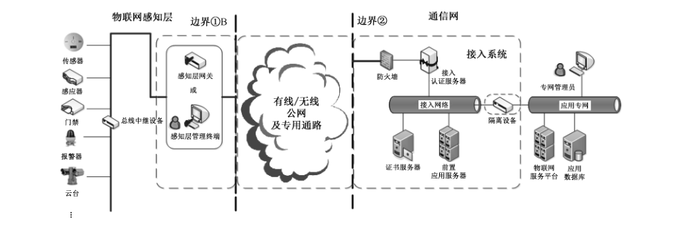
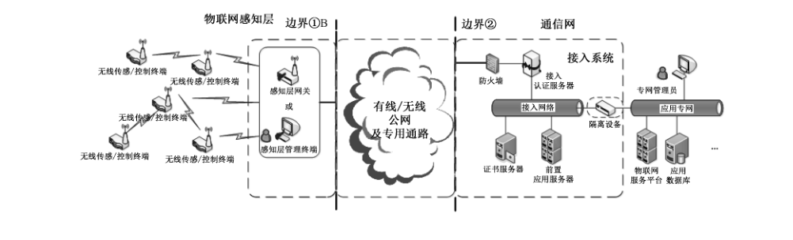
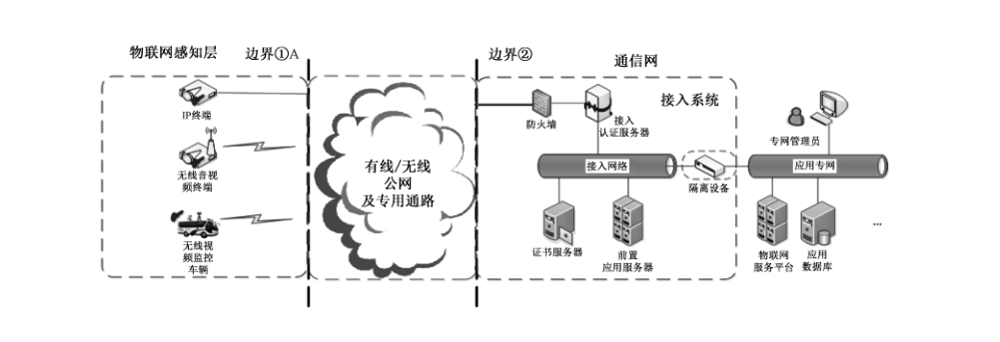
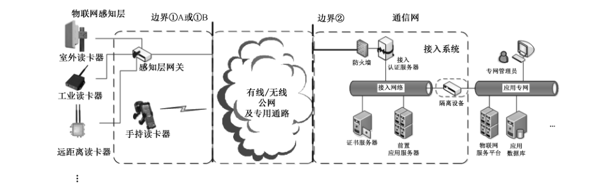
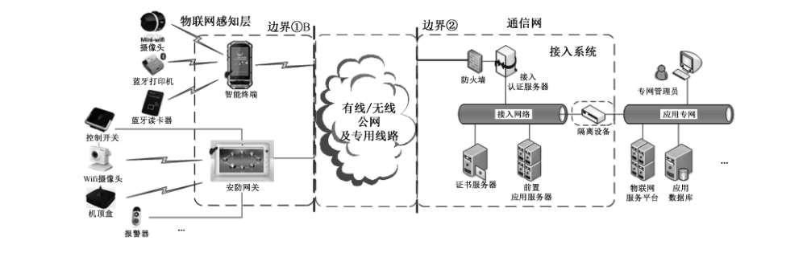

# GB/T 37093-2018 信息安全技术 物联网感知层接入通信网的安全要求

> 来源：[GB/T 37093-2018 国家标准详情](https://openstd.samr.gov.cn/bzgk/std/newGbInfo?hcno=7BA4C865E23244F2B12B744974F8FB0C)；发布日期：2018-12-28；实施日期：2019-07-01。
> PDF SHA-256：99f0f3babbe08b91e35c06b40ea6312f3ca659f9a1eddd592d9c3ae5f71b77d2。
> 转写说明：按页渲染官方 PDF 并进行图像识别，对照全部 16 页原图校正文字、条款和参考文献；六张图保留原图裁切，其中图 1 由原页重新裁切。省略封面、目录、页眉和页脚，合并跨页段落。正式引用请核对原 PDF。

## 前言

本标准按照 GB/T 1.1—2009给出的规则起草。

请注意本文件的某些内容可能涉及专利。本文件的发布机构不承担识别这些专利的责任。

本标准由全国信息安全标准化技术委员会（SAC/TC 260）提出并归口。

本标准起草单位：公安部第三研究所、中兴通讯股份有限公司、中国联合网络通信股份有限公司、北京天融信网络安全技术有限公司、无锡物联网产业研究院、中国电子技术标准化研究院。

本标准主要起草人：胡传平、杨明、齐力、唐前进、张艳、陶源、刘泽坤、刘继顺、高峰、夏俊杰、李建清、陈书义、龚洁中。

## 1 范围

本标准规定了物联网感知层接入通信网的结构，提出了通信网接入系统、感知信息传输网络及感知层接入的安全技术要求。

本标准适用于物联网系统工程中感知层接入实体的信息安全设计、选型和系统集成。

## 2 规范性引用文件

下列文件对于本文件的应用是必不可少的。凡是注日期的引用文件，仅注日期的版本适用于本文件。凡是不注日期的引用文件，其最新版本（包括所有的修改单）适用于本文件。

- GB/T 18794.2—2002 信息技术 开放系统互连 开放系统安全框架 第2部分：鉴别框架

- GB/T 25069—2010 信息安全技术 术语

- GB/T 30269.601—2016 信息技术 传感器网络 第601 部分：信息安全：通用技术规范

- GB/T 33745 物联网 术语

## 3 术语和定义

GB/T 18794.2—2002、GB/T 25069—2010、GB/T 30269.601—2016 和 GB/T 33745 界定的以及下列术语和定义适用于本文件。

### 3.1 物联网感知层 sensing layer of IoT

物联网感知控制域，即各类获取感知对象信息与操控控制对象的软硬件系统的实体集合。

### 3.2 通信网 communication network

收集、融合和处理物联网感知信息数据，并形成物联网应用的计算机设备和网络。

### 3.3 感知终端 sensing terminal

能对物或环境进行信息采集和/或执行操作，并能联网进行通信的装置。

### 3.4 物联网感知层网关 sensing layer gateway of IoT

支撑感知层与通信网互联，并实现感知层本地管理的实体。

### 3.5 感知层接入实体 access entity of sensing layer

处于物联网感知层中，接入通信网进行数据通信的设备。

> 注：常见的感知层接入实体包括感知终端、感知层网关等用于采集感知对象信息或实现本地管理的联网通信设备。

### 3.6 接入系统 access system

部署在物联网系统中的通信网边界，并对感知层接入实体连接通信网进行接入管理的软硬件系统的实体集合。

## 4 缩略语

下列缩略语适用于本文件。

ACL：访问控制列表（Access Control List）

ID：身份标识（Identity）

IoT：物联网（Internet of Things）

IP：互联网协议（Internet Protocol）

MAC：媒体访问控制（Media Access Control）

VPN：虚拟专用网络（Virtual Private Network）

## 5 概述

### 5.1 物联网感知层接入通信网结构

本标准规范的对象是物联网感知层接入实体通过传输网络连接到通信网来进行数据通信的过程，其网络连接结构如图1所示，包括图1虚线框内的以下实体对象：

a） 感知终端（仅指不通过感知层网关接入通信网的终端）；

b） 物联网感知层网关；

> 注：当物联网感知终端或网络因本身电能、性能、传输能力弱，无法满足安全要求时，采用物联网（感知层）网关来连接通信网。

c） 感知信息传输网络（有线或无线）；

d）通信网接入系统（以下简称“接入系统”）。

物联网感知层接入通信网的示例参见附录 A。

> 注：虚线框中的部分是感知层接入通信网的实体及类型；折线表示无线连接方式，直线表示有线连接方式。

保障以上实体互联形成的感知层接入通信网的安全，应满足以下三个部分的技术要求：

a） 感知层接入实体安全技术要求；

b） 感知信息传输网络安全技术要求；

c） 通信网接入系统安全技术要求。

### 5.2 安全技术要求分级与密码算法说明

本标准按照感知层接入通信网的安全功能强度，划分为基本级和增强级两个等级的要求。本标准凡涉及密码算法的相关内容，按国家有关法规实施，凡涉及采用密码技术解决保密性、完整性、真实性、不可否认性需求的应遵循密码相关国家标准和行业标准。

> 注：相对于基本要求，增强要求新增内容用黑体字表示。

## 6 通信网接入系统安全技术要求

### 6.1 基本级要求

#### 6.1.1 设备标识

接入系统中的设备应具有可用于物联网系统中通信识别的唯一标识。

示例：设备 ID、序列号、MAC地址等。

#### 6.1.2 鉴别

##### 6.1.2.1 接入鉴别机制

接入系统应对接入通信网的感知层接入实体进行鉴别，并至少支持以下方式中的一种：

a） 基于感知层接入实体标识和接入口令的单向认证；

b） 基于预共享密钥的单向或双向认证。

> 注：预共享密钥，是物联网实体设备之间进行保密通信的初始密钥。

##### 6.1.2.2 鉴别失败处理

接入系统应具备接入鉴别失败的处理能力，并满足以下要求：

a） 当鉴别应答超过规定时限时，接入系统应能终止与待接入的感知层接入实体之间的当前会话；

b） 在经过一定次数的鉴别失败以后，接入系统应能终止由该感知层接入实体发起的建立会话的尝试，并在一定的时间间隔后才能允许继续接入。

#### 6.1.3 访问控制

接入系统应支持感知层接入实体对通信网的访问控制机制和安全策略，并满足以下要求：

a） 通过 ACL 方式控制感知层接入实体对通信网的访问；

b） 支持制定和执行访问控制策略的功能，访问控制策略可以是基于 IP 地址、用户/用户组、读/写等操作的一种或多种的组合；

c） 支持黑名单制，阻断相关感知层接入实体对通信网的访问。

#### 6.1.4 数据传输安全

接入系统应保障感知层接入实体与通信网的数据传输安全，并满足以下要求：

a） 数据保密性，应对数据进行保密性保护，保障数据不被泄露；

b） 数据完整性，应对数据进行完整性校验，保障数据不被篡改；

> 注：音视频数据除外。

c） 数据新鲜性，应支持包含时间序列的数据信息，并保障时间序列不被篡改。

#### 6.1.5 密钥管理

接入系统应具备对与感知层接入实体通信的密钥管理功能，并满足以下要求：

a） 支持创建、存储、更新和删除接入会话密钥及密钥材料等操作；

b） 提供密钥预分配保护，将预共享密钥和密钥材料分配至感知层接入实体。

> 注：密钥预分配保护，是一种用来保障基于预共享密钥通信安全的技术。如：离线分发、旁路分发。

#### 6.1.6 入侵防护

接入系统应具备对感知层接入实体的接入防护能力，支持应用指定的通信协议和数据内容格式检查的数据包过滤，并丢弃不符合过滤要求的数据包。

#### 6.1.7 日志审计

接入系统应对以下感知层接入实体的接入安全事件进行日志审计，日志内容应至少包含日期/时间、事件类型、事件主体、事件描述，成功/失败的信息：

a） 感知层接入实体的接入鉴别超时和失败；

b）感知层接入实体的在线监测数据异常。

### 6.2 增强级要求

#### 6.2.1 设备标识

接入系统中的设备应具备可用于物联网系统中通信识别的唯一标识，**并且该标识应具备防篡改保护。**

#### 6.2.2 鉴别

##### 6.2.2.1 接入鉴别机制

接入系统应对接入通信网的感知层接入实体进行鉴别，**鉴别方式至少包括感知层接入实体标识和接入口令的单向认证，以及以下方式中的一种的组合：**

a） **基于预共享密钥的双向认证；**

b） **基于公钥基础设施的接入鉴别。**

##### 6.2.2.2 鉴别失败处理

接入系统应具备接入鉴别失败的处理能力，并满足以下要求：

a） 当鉴别应答超过规定时限时，接入系统应能终止与待接入感知层接入实体之间的当前会话；

b） 在经过一定次数的鉴别失败以后，接入系统应能终止由该感知层接入实体发起的建立会话的尝试，并在一定的安全时间间隔后才能恢复。

#### 6.2.3 访问控制

接入系统应支持感知层接入实体对通信网的访问控制机制和安全策略，并满足以下要求：

a） 通过ACL 方式控制感知层接入实体对通信网的访问；

b） 支持制定和执行访问控制策略的功能，访问控制策略由基于 IP 地址及**端口**、用户/用户组、读/写等操作、**有效时间周期、敏感标记等的两种及以上构成的组合**；

c） **支持白名单制，限制感知层接入实体对通信网的访问。**

#### 6.2.4 数据传输安全

接入系统应保障感知层接入实体与通信网的数据传输安全，并满足以下要求：

a） 数据保密性，**应采用密码算法对数据进行保密性保护；**

b） 数据完整性，**应采用密码杂凑、数字签名等密码算法或组合算法保障数据的完整性；**

c） **数据源鉴别，应采用数字签名等密码算法或组合算法保障数据的来源可鉴别；**

d） 数据新鲜性，应支持包含时间序列的数据信息及**信息验证，应采用加密技术保护数据信息中的时间序列。**

#### 6.2.5 密钥管理

接入系统应具备对与感知层接入实体通信的密钥管理功能，并满足以下要求：

a） 支持创建、存储、更新和删除接入会话密钥及密钥材料等操作，**密钥存储应具备访问控制和密码的保护；**

b） 接入系统**应采用离线分发方式**将预共享密钥和密钥材料分配至感知层接入实体；

c） **密钥管理支持多级生成和更新机制，主密钥的管理应支持密钥更新和注销安全策略。**

> 注：多级密钥指的是包含由一种密钥生成另一种密钥的安全机制，如：主密钥-会话密钥-临时密钥之间可由一个生成另一个。

#### 6.2.6 隔离防护

**接入系统应具备感知层接入实体与通信网之间的隔离防护功能，应支持逻辑隔离或物理隔离，并采用网闸设备对位于高等级安全域的网络进行防护。**

#### 6.2.7 入侵防护

接入系统应具备对感知层接入实体的接入防护能力，并满足以下要求：

a） 支持应用指定的通信协议和数据内容格式等检查的数据包过滤，并丢弃不符合过滤要求的数据包；

b） **支持对恶意攻击和异常行为的检测，并具备入侵报警功能；**

c） **支持病毒或木马程序等的防护功能。**

#### 6.2.8 日志审计

接入系统应对以下感知层接入实体的接入安全事件进行日志审计，日志内容应至少包含日期/时间、事件类型、事件主体、事件描述，成功/失败的信息：

a） 感知层接入实体的接入鉴别的超时和失败；

b） 感知层接入实体的在线监测数据异常；

c） **恶意攻击、异常行为、病毒/木马程序等的入侵报警信息记录。**

## 7 感知信息传输网络安全技术要求

### 7.1 基本级要求

感知信息传输网络应满足以下安全要求：

a） 使用有线连接的传输网络时，采用网络逻辑隔离技术或专用通道；

b） 使用无线连接的传输网络时，采用信道安全保护技术（包括：专用通信频段、专用通信方式等）。

### 7.2 增强级要求

感知信息传输网络应满足以下安全要求：

a） 使用有线连接的传输网络时，**采用 VPN 信道加密技术或专用通道；**

b） 使用无线连接的传输网络时，**采用信道加密等信道保护技术。**

## 8 感知层接入实体安全技术要求

### 8.1 基本级要求

#### 8.1.1 感知层接入实体标识

感知层接入实体应具备可用于通信识别的物联网系统中的唯一标识，标识存放于感知终端或感知层网关上。

#### 8.1.2 接入鉴别支持功能

感知层接入实体接入通信网采用的鉴别机制应与6.1.2.1要求的通信网接入系统的鉴别机制一一对应，并支持实体标识、接入口令等的存储和管理功能以及 6.1.2.2要求的鉴别失败处理。

#### 8.1.3 感知层接入实体访问控制

感知层接入实体应具备访问控制机制，并满足以下要求：

a） 支持 ACL 列表实现访问控制；

b） 支持基于感知层接入实体的用户/用户组的访问控制，并部署用户访问控制策略。

#### 8.1.4 感知数据传输安全支持

感知层接入实体应支持6.1.4 要求的感知数据传输安全功能。

#### 8.1.5 密钥管理

当感知层接入实体采用加密方式支持接入通信网的鉴别和数据传输时，应支持密钥管理安全机制，并满足以下要求：

a） 支持对接入密钥、会话密钥及其相关密钥材料的生成、存储和更新；

b） 支持存储、更新预共享密钥和其相关密钥材料的功能，并支持密钥离线接收或旁路接收。

#### 8.1.6 感知层入侵防护

感知层接入实体应具备接入通信网的入侵防护功能，并满足以下要求：

a） 仅开放应用相关的通信端口；

b） 拒绝和丢弃不可鉴别的通信网通信数据。

#### 8.1.7 感知层接入实体日志审计

感知层接入实体应对以下接入通信网的安全事件进行日志审计，日志内容应至少包含日期/时间、事件类型、事件主体、事件描述，成功/失败的信息：

a） 感知层接入实体的接入鉴别失败；

b） 感知层接入实体的访问用户登录失败。

### 8.2 增强级要求

#### 8.2.1 感知层接入实体标识

感知层接入实体应具备可用于通信识别的物联网系统中的唯一标识，标识存放于感知层终端或感知层网关上，**并且该标识应具备防篡改保护。**

#### 8.2.2 接入鉴别支持功能

感知层接入实体接入通信网采用的鉴别机制应与6.2.2.1要求的通信网接入系统的鉴别机制一一对应，并支持实体标识、接入口令等的存储和管理功能以及6.2.2.2要求的鉴别失败处理。

#### 8.2.3 感知层接入实体访问控制

感知层接入实体应具备访问控制机制，并满足以下要求：

a） 支持 ACL 列表实现访问控制；

b） 支持基于感知层接入实体用户/用户组的访问控制，并部署用户访问控制策略。

#### 8.2.4 感知数据传输安全支持

感知层接入实体**应支持6.2.4要求**的感知数据传输安全功能。

#### 8.2.5 密钥管理

感知层接入实体应支持接入通信网的密钥管理安全机制，并满足以下要求：

a） 支持对接入密钥、会话密钥及其相关密钥材料的生成、存储和更新；

b） 支持存储、更新预共享密钥和其相关密钥材料的功能，并支持密钥离线接收；

c） **支持动态密钥的生成和更新安全机制，主密钥的管理应支持密钥更新和注销安全策略；**

d） **应采用访问控制技术保护密钥的存储。**

#### 8.2.6 感知层入侵防护

感知层接入实体应具备接入通信网的入侵防护功能，并满足以下要求：

a） 仅开放应用相关的通信端口；

b） 拒绝和丢弃不可鉴别的通信网通信数据；

c） **支持应用指定的通信协议和数据内容格式检查的数据包过滤，丢弃不符合过滤要求的数据包；**

d） **支持对感知层接入实体的恶意攻击、病毒/木马入侵等的检测，并具备报警功能；**

e） **支持物理拆卸的网络报警功能。**

#### 8.2.7 感知层接入实体日志审计

感知层接入实体应对以下接入通信网的安全事件进行日志审计，日志内容应至少包含日期/时间、事件类型、事件主体、事件描述，成功/失败的信息：

a） 感知层接入实体的接入鉴别失败；

b） 感知层接入实体的访问用户登录失败；

c） **对感知层接入实体的入侵、拆卸等报警的信息记录。**

## 附录 A（资料性附录）典型应用示例

### A.1 有线网络接入类应用案例

#### A.1.1 概述

有线网络接入类应用是指物联网感知层网络主要以有线总线方式连接传感器终端或控制设备，再由感知层网关或管理计算机接入通信网的应用模式。其典型系统图如图 A.1 所示。

有线总线接入类的典型应用包括：安防系统 485总线控制的各类安防传感器，工业总线控制的各种机械自动化系统传感器应用等。这些总线控制类感知层网络大多处于较长距离总线或环路内，远程应用系统通过IP 网络和连接总线的物联网网关或计算机（控制总线的设备），获取终端感知信息或执行控制。

总线连接的感知层网络，一般使用特定的数据传输/控制协议与终端设备进行通信，由于入侵设备可以通过挂载/接入总线的方式探测总线数据，并对其他设备进行控制和干扰，所以存在感知层安全问题；又由于其物联网应用主要通过IP 网络来远程控制总线终端的工作模式存在接入安全问题。其接入通信网的安全性保障应遵循本标准进行设计和管理。

#### A.1.2 安全接入应用模式

总线类感知应用系统的安全接入，分别在边界①和边界②的物联网网关和通信网接入系统上部署实现，边界①部署满足第 8 章要求的感知层接入实体的支持功能，边界②部署满足第 6 章要求的安全接入系统安全功能。

实际应用中可以根据基本级或增强级要求，通过分别在边界①部署物联网网关或感知层管理计算机，边界②中部署包含防火墙、接入鉴别服务器、证书服务器、前置应用服务器、隔离设备等，并在增强级要求时在两个边界的中间采用二层公网专用通道，如：VPDN、APN 等实现感知层与通信网的安全接入。

### A.2 短程无线网络类应用案例

#### A.2.1 概述

短程无线网络类应用是指物联网感知层网络主要以短程无线通信方式互联形成自组织传感/控制网络，再由感知层网关接入通信网的应用模式。其典型系统图如图 A.2 所示。

短程无线通信类的典型应用包括：用于监测、监控的无线传感网，无线工业自动化传感和控制、无线抄表等。这些应用的感知层环境都属于开放式的，在通信网内可以利用远程应用系统通过IP 网络和感知层数据汇聚网关，获取终端感知信息或执行控制。

短程无线通信类感知层网络，一般使用自组织的无线组网和通信协议，入侵设备可以通过开放式的无线环境进行窃听、伪造数据，劫持终端等攻击方式来威胁基础设施的运行安全。其接入通信网的安全性保障应遵循本标准进行设计和管理。一方面保障通信网内应用系统的安全，另一方面保障感知层网络的通信安全。

#### A.2.2 安全接入应用模式

短程无线通信类应用系统的安全接入，分别在边界①和边界②的物联网网关和通信网接入系统上部署实现，边界①部署满足第 8 章要求的感知层接入实体的支持功能，边界②部署满足第 6 章要求的安全接入系统安全功能。

实际应用中可以根据基本级或增强级要求，通过分别在边界①部署物联网网关或感知层管理计算机，边界②中部署包含防火墙、接入鉴别服务器、证书服务器、前置应用服务器、隔离设备等，并在增强级要求时在两个边界的中间采用二层公网专用通道，如：VPDN、APN 等实现感知层与通信网的安全接入。

### A.3 有线/无线宽带接入类应用案例

#### A.3.1 概述

有线/无线宽带接入类应用是指物联网感知层终端主要通过互联网、宽带移动互联网、特定频段无线专网等接入通信网的应用模式。其典型系统图如图 A.3 所示。

有线/无线宽带接入类典型应用包括：有线/无线音视频监控、现场事件应急反馈、车联网信息交互、区域安防等。利用有线/无线公网或专用宽带网络是展开这些应用的基础，在通信网内一般利用远程应用系统通过有线/无线公网或专用网络直接访问感知层终端，从而获取感知数据信息或进行通信和控制。

有线/无线宽带接入类应用网络，一般使用有线/无线公网，应用系统容易受到来自公网的威胁，从而使得敏感数据信息泄露。其接入通信网的安全性保障应遵循本标准进行设计和管理，保障通信网应用系统的安全和感知终端的应用安全。

#### A.3.2 安全接入应用模式

有线/无线宽带接入类应用系统的安全接入，分别在边界①和边界②的感知终端和通信网接入系统上部署实现，边界①部署满足第 8 章要求的感知层接入实体的支持功能，边界②部署满足第 6 章要求的安全接入系统安全功能。

实际应用中可以根据基本级或增强级要求，通过分别在边界①部署物联网网关或感知层管理计算机，边界②中部署包含防火墙、接入鉴别服务器、证书服务器、前置应用服务器、隔离设备等，并在增强级要求时在两个边界的中间采用二层公网专用通道，如：VPDN、APN 等实现感知层与通信网的安全接入。

### A.4 RFID 通信接入类应用案例

#### A.4.1 概述

RFID 通信类接入应用是指由 RFID 读卡设备通过感知层网关接入通信网或（移动）终端式读写设备直接接入通信网的应用模式。其典型系统图如图 A.4 所示。

RFID 通信类的典型应用包括：票证查询、物资管理、电子车牌，小区巡更等。这些应用分为两种感知层接入通信网的模式，一种是读写终端通过连接到感知层网关接入通信网，另一种是读卡终端直接接入通信网。RFID 读写终端的数据可靠性将影响整个应用系统的安全性，RFID 读写终端在感知层开放网络中容易被控制或假冒。其接入通信网的安全性保障应遵循本标准进行设计和管理。

#### A.4.2 安全接入应用模式

RFID 通信接入类应用系统的安全接入，分别在边界①和边界②的物联网网关和通信网接入系统上部署实现，边界①部署满足第 8 章要求的感知层接入实体的支持功能，边界②部署满足第 6 章要求的安全接入系统安全功能。

实际应用中可以根据基本级或增强级要求，通过分别在边界①部署物联网网关或感知层管理计算机，边界②中部署包含防火墙、接入鉴别服务器、证书服务器、前置应用服务器、隔离设备等，并在增强级要求时在两个边界的中间采用二层公网专用通道，如：VPDN、APN 等实现感知层与通信网的安全接入。

### A.5 个域网/终端接入类应用案例

#### A.5.1 概述

个域网/终端接入类应用是指是由个人智能终端为代表的通信网接入应用模式。其中个人智能终端是接入的主要终端设备，而其连接的有线/无线读卡器、打印机、摄像头、传感器等是感知/控制终端。

其典型系统图如图 A.5所示。

个域网终端接入的典型应用包括：数字化单兵/单警系统、智能家居系统等。其个域网网关或终端是系统应用安全接入的关键点，容易被仿冒、伪造及受到未授权的远程控制，从而造成严重的应用系统安全威胁。其接入通信网的安全性保障应遵循本标准进行设计和管理。

#### A.5.2 安全接入应用模式

个域网终端的安全接入，分别在边界①和边界②的物联网网关和通信网接入系统上部署实现，边界①部署满足第 8 章要求的感知层接入实体的支持功能，边界②部署满足第 6 章要求的安全接入系统安全功能。

实际应用中可以根据基本级或增强级要求，通过分别在边界①部署物联网网关或感知层管理计算机，边界②中部署包含防火墙、接入鉴别服务器、证书服务器、前置应用服务器、隔离设备等，并在增强级要求时在两个边界的中间采用二层公网专用通道，如：VPDN、APN 等实现感知层与通信网的安全接入。

## 参考文献

- ［1］ GB/T 20269—2006 信息安全技术 信息系统安全管理要求

- ［2］ GB/T 20271—2006 信息安全技术 信息系统通用安全技术要求

- ［3］ GB/T 22239—2008 信息安全技术 信息系统安全等级保护基本要求

- ［4］ GB/T 22240—2008 信息安全技术 信息系统安全等级保护定级指南

- ［5］ GB/T 25068.1—2012 信息技术 安全技术 IT 网络安全 第1部分：网络安全管理

- ［6］ GB/T 25068.2—2012 信息技术 安全技术 IT 网络安全 第2部分：网络安全体系结构

- ［7］ GB/T 25068.3—2010 信息技术 安全技术 IT 网络安全 第 3 部分：使用安全网关的网间通信安全保护

- ［8］ GB/T 25068.4—2010 信息技术 安全技术 IT 网络安全 第 4 部分：远程接入的安全保护

- ［9］ GB/T 25068.5—2010 信息技术 安全技术 IT 网络安全 第 5 部分：使用虚拟专用网的跨网通信安全保护

- ［10］ GB/T 29240—2012 信息安全技术 终端计算机通用安全技术要求与测试评价方法

- ［11］ GB/T 33474—2016 物联网 参考体系结构

- ［12］ 商用密码产品使用管理规定 国家密码管理局（第8号公告）【2007】
