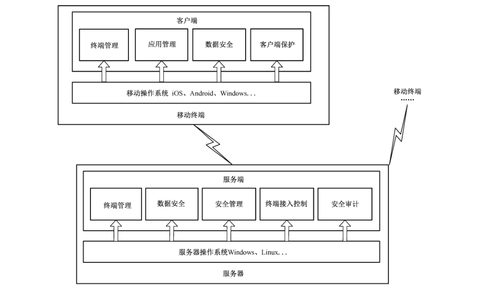

# GB/T 37952-2019 信息安全技术 移动终端安全管理平台技术要求

> 来源：[GB/T 37952-2019 国家标准详情](https://openstd.samr.gov.cn/bzgk/std/newGbInfo?hcno=5647D2B0E5A2E26A55F6A1A75EFDEB2A)；封面发布日期：2019-08-30；实施日期：2020-03-01。
> PDF SHA-256：2f8f45a433e90ec463519eb80c11487dca550c0ced8d1e68a09150ad9d6e306e。
> 转写说明：按官方 PDF 全部 20 页的页面图像核对正文、表 A.1、表 A.2 和图 B.1；省略封面、目录、页眉、页脚及页码，合并跨页内容。正式引用请核对原 PDF。

## 前言

本标准按照 GB/T 1.1—2009给出的规则起草。

请注意本文件的某些内容可能涉及专利。本文件的发布机构不承担识别这些专利的责任。

本标准由全国信息安全标准化技术委员会（SAC/TC 260）提出并归口。

本标准起草单位：中国信息安全研究院有限公司、公安部第三研究所、中国电子技术标准化研究院、国家工业信息安全发展研究中心、国家信息技术安全研究中心、中国信息安全测评中心、中国网络安全审查技术与认证中心、国家信息中心、国家计算机病毒应急处理中心、上海理想信息产业（集团）有限公司、北京北信源软件股份有限公司、上海工业控制安全创新科技有限公司、北京中科智咨数据科技有限公司、华东师范大学、北京时代新威信息技术有限公司、中电智能信息科技（深圳）有限公司、西安电子科技大学、北京航空航天大学、中国传媒大学、重庆邮电大学、安徽科技学院、北京明朝万达科技股份有限公司、北京洋浦伟业科技发展有限公司。

本标准主要起草人：杨晨、张艳、张弛、王惠莅、左晓栋、张格、陆臻、顾键、茹宗光、刘贤刚、范科峰、梁露露、魏方方、王嘉捷、王石、王新杰、毛剑、马文平、肖菜、钟力、丁富强、贾雪飞、杜振华、张哲宇、崔占华、王麟嘉、黄一斌、周亚超、胡亚兰、黄永洪、刘虹、伍前红、姜正涛、陈晓峰、底兴本、曹浩、何道敬、刘雨桁、卢佐华、喻波、崔春霞、刘明君、毕强。

## 1 范围

本标准规定了移动终端安全管理平台的技术要求，包括安全功能要求和安全保障要求。

本标准适用于移动终端安全管理平台产品的设计、开发与检测，为组织或机构（以下简称“组织”）实施移动互联应用的安全防护提供参考。

## 2 规范性引用文件

下列文件对于本文件的应用是必不可少的。凡是注日期的引用文件，仅注日期的版本适用于本文件。凡是不注日期的引用文件，其最新版本（包括所有的修改单）适用于本文件。

- GB/T 18336.3—2015 信息技术 安全技术 信息技术安全评估准则 第3部分：安全保障组件

- GB/T 25069—2010 信息安全技术 术语

## 3 术语和定义

GB/T 18336.3—2015 和 GB/T 25069—2010界定的以及下列术语和定义适用于本文件。

### 3.1 移动终端 mobile terminal

接入公众移动通信网络、具有操作系统、可由用户自行安装和卸载应用软件的移动通信终端产品。

### 3.2 移动终端安全管理平台 mobile terminal security management platform

为增强移动终端的安全性和可控性，通过定制安全策略对移动终端设备、应用等进行统一管理和安全接入控制的产品。

## 4 缩略语

下列缩略语适用于本文件。

SD 卡：安全数据存储卡（Secure Digital Card）

WiFi：无线局域网接入（Wireless Fidelity）

## 5 产品描述

本标准按照 GB/T 18336.3—2015 安全保障要求级别划分的原则，依据移动终端安全管理平台的安全功能要求和安全保障要求的强弱，将安全等级分为基本级和增强级。基本级可对应支撑等级保护三级以下要求。增强级对应支撑等级保护三级（含）以上要求。等级划分参见附录A。在增强级中新增的要求会通过黑体标识。

本标准从安全功能要求和安全保障要求两个方面，规范了移动终端安全管理平台的安全技术要求，典型应用场景参见附录 B。安全功能要求包括终端管理、应用管理、数据安全、终端接入控制、安全管理、客户端保护和安全审计等七个方面，安全保障要求则主要包括开发、指导性文档、生命周期支持和测试等方面。

## 6 安全技术要求

### 6.1 基本级安全技术要求

#### 6.1.1 安全功能要求

##### 6.1.1.1 终端管理

###### 6.1.1.1.1 终端注册

应提供对移动终端的注册功能，注册信息包括注册日期、硬件型号、设备序列号、系统软件版本、所属部门等。

###### 6.1.1.1.2 远程管理

应支持以下远程管理功能：

a） 远程锁定移动终端；

b） 远程擦除移动终端存储的敏感业务数据；

c） 远程备份移动终端存储的敏感业务数据；

d） 授权人员远程设置功能限制策略，至少应包括禁用摄像头、禁止截屏、禁用 WiFi、限制SD卡读写权限等。

###### 6.1.1.1.3 存储介质管理

应支持对移动终端外接存储介质的管理、监测等功能，对违规使用行为进行告警和阻断。

###### 6.1.1.1.4 安全监测

应支持以下监测功能：

a） 监测移动终端中恶意程序检测软件的安装、运行情况等；

b） 监测移动终端位置信息、运行服务、设备性能、软件版本（至少应包括操作系统等）等信息。

###### 6.1.1.1.5 口令或生物特征鉴别策略

应支持以下功能：

a） 远程设置终端开机口令策略，阻断未设置口令的终端接入，支持生物特征鉴别功能；

b） 监测是否设置用户账户口令，阻断未设置用户口令的终端接入；

c） 远程设置用户口令策略，至少应包括口令类型、定期更换策略、失败次数限制等。

##### 6.1.1.2 应用管理

应支持授权人员设置应用程序白名单、黑名单的功能，并能够根据白名单、黑名单执行相应的操作。

##### 6.1.1.3 数据安全

###### 6.1.1.3.1 数据安全传输

应采用加密、数据完整性保护等安全机制，保障终端数据安全可靠传输。

###### 6.1.1.3.2 数据安全存储

应支持以下安全存储功能：

a） 对服务端中的敏感数据进行加密存储和完整性保护；

b） 对服务端中敏感数据实现基于角色或属性等的授权访问控制；

c） 对移动终端、外置存储设备存储的敏感数据应进行加密处理，并能擦除未加密的敏感数据；

d） 对移动终端、外置存储设备存储的敏感数据进行完整性保护。

###### 6.1.1.3.3 数据防泄露

应支持敏感数据防泄露安全策略配置，对终端中业务系统数据进行实时监测，支持数据内容的扫描、过滤和敏感数据外传阻断等功能。

###### 6.1.1.3.4 个人信息保护

应采取必要的措施，确保移动终端和服务端存储的个人信息安全，防止信息泄露、毁损、丢失等。

##### 6.1.1.4 终端接入控制

###### 6.1.1.4.1 接入鉴别

应支持仅允许经服务端注册的移动终端接入组织业务系统的功能。

###### 6.1.1.4.2 访问控制策略

应支持以下访问控制策略配置功能：

a） 针对不同终端制定不同的应用资源访问控制策略。

b） 提供以下访问限制能力：

- 仅允许授权终端对应用资源进行访问；

- 授权终端对应用资源进行访问的内容不能超出预定义的范围；

- 授权终端对应用资源进行访问的操作（如对文件、文件夹进行读、写、复制、下载等操作）不能超出预定义的范围（有则适用）；

- 授权终端对应用资源进行访问的时间不能超出预定义的范围（有则适用）；

- 授权终端通过网络对应用资源进行访问时，该终端所使用的移动终端的序列号/地址不能超出预定义的范围（有则适用）；

- 授权终端对应用资源进行访问的次数不能超出预定义的范围（有则适用）。

c） 移动终端对应用资源的接入应受访问控制策略的约束。

##### 6.1.1.5 安全管理

###### 6.1.1.5.1 管理员属性初始化

应支持对授权管理员的账户、口令等属性进行初始化的功能。

###### 6.1.1.5.2 管理员唯一性标识

应支持授权管理员唯一身份标识功能，并将授权管理员的身份标识与其所有可审计事件进行关联。

###### 6.1.1.5.3 管理员属性修改

应支持授权管理员属性（至少包括管理员口令）修改功能。

###### 6.1.1.5.4 管理员身份鉴别

应在登录和执行重要安全功能操作时，对声称履行授权管理员职责的用户进行身份鉴别，并支持鉴别失败处理功能，当身份鉴别失败的次数达到指定阈值后，应能阻断鉴别请求。

###### 6.1.1.5.5 配置管理能力

应支持授权管理员对平台进行安全配置和管理的功能，至少包括：

a） 增加、删除和修改接入控制等相关策略；

b） 查看当前接入控制策略配置；

c） 查看和管理审计记录。

###### 6.1.1.5.6 管理角色

应支持基于角色、属性等的授权管理等机制，实现对系统管理、审计管理、安全管理等管理角色的划分。

###### 6.1.1.5.7 终端统一管理

应支持终端统一管理功能，包括：

a） 移动终端客户端软件统一安装；

b） 移动终端应用程序白名单统一下发；

c） 移动终端操作系统、应用软件、客户端软件等的统一升级。

##### 6.1.1.6 客户端保护

应支持对安装在移动终端上的客户端程序进行安全保护的功能，对非授权人员的以下操作行为进行监控和告警：

a） 强行终止客户端软件运行；

b） 强制取消客户端软件在系统启动时自动加载；

c） 强行卸载、删除或修改客户端软件。

##### 6.1.1.7 安全审计

###### 6.1.1.7.1 审计记录生成

审计记录包括事件发生的日期和时间、事件主体身份、事件描述、成功或失败的标志等，应能对下列事件生成审计记录：

a） 授权管理员鉴别成功和失败；

b） 终端鉴别成功和失败事件；

c） 授权管理员鉴别失败尝试次数超出了设定的限制导致会话连接终止；

d） 终端鉴别失败尝试次数超出了设定的限制导致会话连接终止；

e） 授权管理员的重要操作，如增加和删除管理员、终端用户管理、远程备份移动终端的业务数据、远程锁定移动终端及远程擦除移动终端的业务数据等；

f） 终端对应用资源接入的所有请求，包括成功和失败的请求。

###### 6.1.1.7.2 审计记录存储

审计记录应存储在掉电非易失性存储介质中，当存储空间达到阈值时，应自动向授权管理员告警。

###### 6.1.1.7.3 审计记录管理

应支持以下审计记录管理功能：

a） 仅允许授权管理员访问审计记录；

b）按日期、时间、终端标识等对审计记录进行组合查询；

c） 对审计记录进行备份。

#### 6.1.2 安全保障要求

##### 6.1.2.1 开发

###### 6.1.2.1.1 安全架构

开发者应向评估方提供产品安全功能的安全架构描述，安全架构描述应满足以下要求：

a） 与产品设计文档中对安全功能实施抽象描述的级别一致；

b） 描述与安全功能要求一致的产品安全功能的安全域；

c） 描述产品安全功能初始化过程为何是安全的；

d） 证实产品安全功能能够防止被破坏；

e） 证实产品安全功能能够防止安全特性被旁路。

###### 6.1.2.1.2 功能规范

开发者应向评估方提供完备的功能规范说明，功能规范说明应满足以下要求：

a） 完全描述产品的安全功能；

b） 描述所有安全功能接口的目的与使用方法；

c） 标识和描述每个安全功能接口相关的所有参数；

d） 描述安全功能接口相关的安全功能实施行为；

e） 描述由安全功能实施行为处理而引起的直接错误消息；

f） 证实安全功能要求到安全功能接口的追溯。

###### 6.1.2.1.3 产品设计

开发者应向评估方提供产品设计文档，产品设计文档应满足以下要求：

a） 根据子系统描述产品结构；

b） 标识和描述产品安全功能的所有子系统；

c） 描述安全功能所有子系统间的相互作用；

d） 提供的映射关系能够证实设计中描述的所有行为能够映射到调用它的安全功能接口。

##### 6.1.2.2 指导性文档

###### 6.1.2.2.1 操作用户指南

开发者应向评估方提供明确、合理的操作用户指南，操作用户指南与为评估而提供的其他所有文档保持一致，对每一种用户角色的描述应满足以下要求：

a） 描述在安全处理环境中被控制的用户可访问的功能和特权，包含适当的警示信息；

b） 描述如何以安全的方式使用产品提供的可用接口；

c） 描述可用功能和接口，尤其是受用户控制的所有安全参数，适当时指明安全值；

d） 明确说明与需要执行的用户可访问功能有关的每一种安全相关事件，包括改变安全功能所控制实体的安全特性；

e） 标识产品运行的所有可能状态（包括操作导致的失败或者操作性错误），以及它们与维持安全运行之间的因果关系和联系；

f） 包含充分实现安全目标的安全策略；

g） 遵循合法、正当、必要的原则，不得利用该软件收集与其提供的服务无关的个人信息。

###### 6.1.2.2.2 准备程序

开发者应向评估方提供产品及其准备程序，准备程序描述应满足以下要求：

a） 描述与开发者交付程序相一致的安全接收所交付产品必需的所有步骤；

b） 描述安全安装产品及其运行环境必需的所有步骤。

##### 6.1.2.3 生命周期支持

###### 6.1.2.3.1 配置管理能力

开发者的配置管理能力应满足以下要求：

a） 为产品的不同版本提供唯一的标识；

b） 使用配置管理系统对组成产品的所有配置项进行维护，并唯一标识配置项；

c） 提供配置管理文档，配置管理文档描述用于唯一标识配置项的方法。

###### 6.1.2.3.2 配置管理范围

开发者应向评估方提供包含产品、安全保障要求评估证据和产品组成部分的产品配置项列表，并说明配置项的开发者。

###### 6.1.2.3.3 交付程序

开发者应使用一定的交付程序交付产品，并将交付过程文档化。在给用户方交付产品的各版本时，交付文档应描述为维护安全所必需的所有程序。

##### 6.1.2.4 测试

###### 6.1.2.4.1 覆盖

开发者应向评估方提供测试覆盖文档，表明测试文档中所标识的测试与功能规范中所描述的产品的安全功能间的对应性。

###### 6.1.2.4.2 功能测试

开发者应测试产品安全功能，将结果文档化并向评估方提供测试文档。测试文档应包括以下内容：

a） 测试计划，标识要执行的测试，并描述执行每个测试的方案，这些方案包括对于其他测试结果的任何顺序依赖性；

b） 预期的测试结果，表明测试成功后的预期输出；

c） 实际测试结果和预期的测试结果一致。

###### 6.1.2.4.3 独立测试

开发者应向评估方提供一组与其自测安全功能时使用的同等资源，以用于安全功能的抽样测试。

###### 6.1.2.4.4 脆弱性评定

开发者应标识潜在脆弱性，并进行安全性测试。基于标识的潜在脆弱性，验证产品能够抵抗具有基本攻击潜力的攻击者的攻击。

### 6.2 增强级安全技术要求

#### 6.2.1 安全功能要求

##### 6.2.1.1 终端管理

###### 6.2.1.1.1 终端注册

应提供对移动终端的注册功能，注册信息包括注册日期、硬件型号、设备序列号、系统软件版本、所属部门等。

###### 6.2.1.1.2 系统权限控制状态检测

**应支持检测移动终端系统权限控制状态的功能。**

###### 6.2.1.1.3 远程管理

应支持以下远程管理功能：

a） 远程锁定移动终端；

b） 远程擦除移动终端存储的敏感业务数据；

c） 远程备份移动终端存储的敏感业务数据；

d） 授权人员远程设置功能限制策略，至少应包括禁用摄像头、禁止截屏、禁用 WiFi、限制SD卡读写权限等；

e） **远程卸载移动终端安装的违规应用软件。**

> 注：违规应用软件是指6.1.2 中黑名单列出的违规应用软件。

###### 6.2.1.1.4 存储介质管理

应支持对移动终端外接存储介质的管理、监测等功能，对违规使用行为进行告警和阻断。

###### 6.2.1.1.5 安全监测

应支持以下监测功能：

a） 监测移动终端中恶意程序检测软件的安装、运行情况等；

b） 监测移动终端位置信息、运行服务、设备性能、软件版本（至少应包括操作系统等）等信息。

###### 6.2.1.1.6 口令或生物特征鉴别策略

应支持以下功能：

a） 远程设置终端开机口令策略，阻断未设置口令的终端接入，支持生物特征鉴别功能；

b） 监测是否设置用户账户口令，阻断未设置用户口令的终端接入；

c） 远程设置用户口令策略，至少应包括口令类型、定期更换策略、失败次数限制等。

##### 6.2.1.2 应用管理

应支持授权人员设置应用白名单、黑名单的功能，并支持根据白名单、黑名单执行相应的操作。

##### 6.2.1.3 数据安全

###### 6.2.1.3.1 数据安全传输

应采用加密、数据完整性保护等安全机制，保障终端数据安全可靠传输。

###### 6.2.1.3.2 数据安全存储

应支持以下安全存储功能：

a） 对服务端中的敏感数据进行加密存储和完整性保护；

b） 对服务端中敏感数据实现基于角色或属性等的授权访问控制；

c） 对移动终端、外置存储设备等存储的敏感数据应进行加密处理，并能擦除未加密的敏感数据；

d） 对移动终端、外置存储设备等存储的敏感数据进行完整性保护。

###### 6.2.1.3.3 数据防泄露

应支持敏感数据防泄露安全策略配置，对终端中业务系统数据进行实时监测，支持数据内容的扫描、过滤和敏感数据外传阻断等功能。

###### 6.2.1.3.4 个人信息保护

应采取必要的措施，确保终端和服务端存储的个人信息安全，防止信息泄露、毁损、丢失等。

##### 6.2.1.4 终端接入控制

###### 6.2.1.4.1 终端用户鉴别管理

###### 6.2.1.4.1.1 接入鉴别

应支持仅允许注册的移动终端接入组织业务系统的功能。

###### 6.2.1.4.1.2 鉴别失败处理

**应能为用户身份鉴别设定一个鉴别尝试次数阈值，当用户的身份鉴别不成功次数超过阈值时，应阻止鉴别请求。**

###### 6.2.1.4.1.3 鉴别信息保密性

**在用户身份鉴别过程中，鉴别信息通过网络传输时，应保障其保密性。**

###### 6.2.1.4.1.4 告警功能

**应支持以下功能：**

a） **移动终端系统权限控制被突破时，自动向授权管理员告警；**

b） **根据策略配置，若移动终端接入地理位置限制被突破，自动向授权管理员告警。**

###### 6.2.1.4.2 访问控制策略

应支持以下访问控制策略配置功能：

a） 针对不同终端制定不同的应用资源访问控制策略。

b） 提供以下访问限制能力：

- 仅允许授权终端对应用资源进行访问；

- 授权终端对应用资源进行访问的内容不能超出预定义的范围；

- 授权终端对应用资源进行访问的操作（如对文件、文件夹进行读、写、复制、下载等操作）不能超出预定义的范围（有则适用）；

- 授权终端对应用资源进行访问的时间不能超出预定义的范围（有则适用）；

- 授权终端通过网络对应用资源进行访问时，该终端所使用的移动终端的序列号/地址不能超出预定义的范围（有则适用）；

- 授权终端对应用资源进行访问的次数不能超出预定义的范围（有则适用）。

c） 移动终端对应用资源的接入应受访问控制策略的约束。

##### 6.2.1.5 安全管理

###### 6.2.1.5.1 管理员属性初始化

应支持对授权管理员的账户、口令等属性进行初始化功能。

###### 6.2.1.5.2 管理员唯一性标识

应支持授权管理员唯一身份标识功能，能够将授权管理员的身份标识与其所有可审计事件进行关联。

###### 6.2.1.5.3 管理员属性修改

应支持授权管理员属性（至少包括管理员口令）修改功能。

###### 6.2.1.5.4 管理员身份鉴别

应在登录和执行重要安全功能操作时，对声称履行授权管理员职责的人员进行身份鉴别，并支持鉴别失败限制功能，当身份鉴别失败的次数达到指定阈值后，应能阻断鉴别请求。

###### 6.2.1.5.5 配置管理能力

应支持授权管理员对产品进行安全配置和管理的功能，至少包括：

a） 增加、删除和修改接入控制等相关策略；

b） 查看当前接入控制策略配置；

c） 查看和管理审计记录。

###### 6.2.1.5.6 管理角色

应支持基于角色、属性等的授权管理机制，实现对系统管理、审计管理、安全管理等管理角色的划分。

###### 6.2.1.5.7 终端统一管理

应支持终端统一管理功能：

a） 移动终端客户端软件统一安装；

b） 移动终端应用程序白名单统一下发；

c） 移动终端操作系统、应用软件、客户端软件等的统一升级。

##### 6.2.1.6 客户端保护

应支持对安装在移动终端上的客户端软件进行安全保护的功能，对非授权人员的以下操作行为进行监控和告警：

a） 强行终止客户端软件运行；

b） 强制取消客户端软件在系统启动时自动加载；

c） 强行卸载、删除或修改客户端软件。

##### 6.2.1.7 安全审计

###### 6.2.1.7.1 审计记录生成

审计记录包括事件发生的日期和时间、事件主体身份、事件描述，成功或失败的标志等，应能对下列事件生成审计记录：

a） 授权管理员鉴别的成功和失败；

b） 终端鉴别的成功和失败事件；

c） 授权管理员鉴别尝试不成功的次数超出了设定的限制导致会话连接终止；

d） 终端鉴别尝试不成功的次数超出了设定的限制导致会话连接终止；

e） 授权管理员的重要操作，如增加和删除管理员、终端用户管理、远程备份移动终端的业务数据、远程锁定移动终端及远程擦除移动终端的业务数据等；

f） 终端对应用资源接入的所有请求，包括成功和失败。

###### 6.2.1.7.2 审计记录存储

审计记录应存储在掉电非易失性存储介质中，当存储空间达到阈值时，应自动向授权管理员告警。

###### 6.2.1.7.3 审计记录管理

应支持以下审计记录管理功能：

a） 仅允许授权管理员访问审计记录；

b） 按日期、时间、终端标识等对审计记录进行组合查询；

c） 对审计记录进行备份。

#### 6.2.2 安全保障要求

##### 6.2.2.1 开发

###### 6.2.2.1.1 安全架构

开发者应向评估方提供产品安全功能的安全架构描述，安全架构描述应满足以下要求：

a） 与产品设计文档中对安全功能实施抽象描述的级别一致；

b） 描述与安全功能要求一致的产品安全功能的安全域；

c） 描述产品安全功能初始化过程为何是安全的；

d） 证实产品安全功能能够防止被破坏；

e） 证实产品安全功能能够防止安全特性被旁路。

###### 6.2.2.1.2 功能规范

开发者应向评估方提供完备的功能规范说明，功能规范说明应满足以下要求：

a） 完全描述产品的安全功能；

b） 描述所有安全功能接口的目的与使用方法；

c） 标识和描述每个安全功能接口相关的所有参数；

d） 描述安全功能接口相关的安全功能实施行为；

e） 描述由安全功能实施行为处理而引起的直接错误消息；

f） 证实安全功能要求到安全功能接口的追溯；

g） **描述安全功能实施过程中，与安全功能接口相关的所有行为；**

h） **描述可能由安全功能接口的调用而引起的所有直接错误消息。**

###### 6.2.2.1.3 实现表示

**开发者应向评估方提供全部安全功能的实现表示，实现表示应满足以下要求：**

a） **提供产品设计描述与实现表示实例之间的映射，并证明其一致性；**

b） **按详细级别定义产品安全功能，详细程度达到无须进一步设计就能生成安全功能的程度；**

c） **以开发人员使用的形式提供。**

###### 6.2.2.1.4 产品设计

开发者应向评估方提供产品设计文档，产品设计文档应满足以下要求：

a） 根据子系统描述产品结构；

b） 标识和描述产品安全功能的所有子系统；

c） 描述安全功能所有子系统间的相互作用；

d） 提供的映射关系能够证实设计中描述的所有行为能够映射到调用它的安全功能接口；

e） **根据模块描述安全功能；**

f） **提供安全功能子系统到模块间的映射关系；**

g） **描述所有安全功能实现模块，包括其目的及与其他模块间的相互作用；**

h） **描述所有实现模块的安全功能要求相关接口、其他接口的返回值、与其他模块间的相互作用及调用的接口；**

i） **描述所有安全功能的支撑或相关模块，包括其目的及与其他模块间的相互作用。**

##### 6.2.2.2 指导性文档

###### 6.2.2.2.1 操作用户指南

开发者应向评估方提供明确、合理的操作用户指南，操作用户指南与为评估而提供的其他所有文档保持一致，对每一种用户角色的描述应满足以下要求：

a） 描述在安全处理环境中被控制的用户可访问的功能和特权，包含适当的警示信息；

b） 描述如何以安全的方式使用产品提供的可用接口；

c） 描述可用功能和接口，尤其是受用户控制的所有安全参数，适当时指明安全值；

d） 明确说明与需要执行的用户可访问功能有关的每一种安全相关事件，包括改变安全功能所控制实体的安全特性；

e） 标识产品运行的所有可能状态（包括操作导致的失败或者操作性错误），以及它们与维持安全运行之间的因果关系和联系；

f） 包含充分实现安全目标的安全策略；

g） 遵循合法、正当、必要的原则，不得利用该软件收集与其提供的服务无关的个人信息。

###### 6.2.2.2.2 准备程序

开发者应向评估方提供产品及其准备程序，准备程序描述应满足以下要求：

a） 描述与开发者交付程序相一致的安全接收所交付产品必需的所有步骤；

b） 描述安全安装产品及其运行环境必需的所有步骤。

##### 6.2.2.3 生命周期支持

###### 6.2.2.3.1 配置管理能力

开发者的配置管理能力应满足以下要求：

a） 为产品的不同版本提供唯一的标识。

b） 使用配置管理系统对组成产品的所有配置项进行维护，并唯一标识配置项。

c） 提供配置管理文档，配置管理文档描述用于唯一标识配置项的方法。

d） **配置管理系统提供一种自动方式来支持产品的生成，通过该方式确保只能对产品的实现表示进行已授权的改变。**

e） **配置管理文档包括一个配置管理计划，配置管理计划描述如何使用配置管理系统开发产品。**

**实施的配置管理与配置管理计划相一致。**

f） **配置管理计划描述用来接受修改过的或新建的作为产品组成部分的配置项的程序。**

###### 6.2.2.3.2 配置管理范围

开发者应向评估方提供产品配置项列表，并说明配置项的开发者。配置项列表应包含以下内容：

a） 产品、安全保障要求的评估证据和产品的组成部分；

b） **实现表示、安全缺陷报告及其解决状态。**

###### 6.2.2.3.3 交付程序

开发者应使用一定的交付程序交付产品，并将交付过程文档化。在给用户方交付产品的各版本时，交付文档应描述为维护安全所必需的所有程序。

###### 6.2.2.3.4 开发安全

**开发者应向评估方提供开发安全文档。开发安全文档应描述在产品的开发环境中，为保护产品设计和实现的保密性和完整性所必需的所有物理的、程序的、人员的和其他方面的安全措施。**

###### 6.2.2.3.5 生命周期定义

**开发者应建立一个生命周期模型对产品的开发和维护进行必要的控制，并向评估方提供生命周期定义文档描述用于开发和维护产品的模型。**

###### 6.2.2.3.6 工具和技术

**开发者应明确定义用于开发产品的工具，并向评估方提供开发工具文档无歧义地定义实现中每个语句的含义和所有依赖于实现的选项的含义。**

##### 6.2.2.4 测试

###### 6.2.2.4.1 覆盖

开发者应向评估方提供测试覆盖文档，测试覆盖描述应满足以下要求：

a） 表明测试文档中所标识的测试与功能规范中所描述的产品的安全功能间的对应性；

b） **表明上述对应性是完备的，并证实功能规范中的所有安全功能接口都进行了测试。**

###### 6.2.2.4.2 深度

**开发者应向评估方提供测试深度的分析。测试深度分析描述应满足以下要求：**

a） **证实测试文档中的测试与产品设计中的安全功能子系统和实现模块之间的一致性；**

b） **证实产品设计中的所有安全功能子系统、实现模块都已经进行过测试。**

###### 6.2.2.4.3 功能测试

开发者应测试产品安全功能，将结果文档化并向评估方提供测试文档。测试文档应包括以下内容：

a） 测试计划，标识要执行的测试，并描述执行每个测试的方案，这些方案包括对于其他测试结果的任何顺序依赖性；

b） 预期的测试结果，表明测试成功后的预期输出；

c） 实际测试结果和预期的测试结果一致。

###### 6.2.2.4.4 独立测试

开发者应向评估方提供一组与其自测安全功能时使用的同等资源，以用于安全功能的抽样测试。

###### 6.2.2.4.5 脆弱性评定

开发者应标识潜在脆弱性，并进行安全性测试。基于标识的潜在脆弱性，验证产品能够抵抗以下攻击行为：

a） 具有基本攻击潜力的攻击者的攻击；

b） **具有增强型基本攻击潜力的攻击者的攻击。**

## 附录 A（资料性附录）等级划分要求

### A.1 安全功能要求等级划分

移动终端安全管理平台的安全功能要求等级划分如表 A.1 所示。

**表A.1 移动终端安全管理平台安全功能要求等级划分表**

| 类别 | 安全功能要求 | 基本级 | 增强级 |
| --- | --- | --- | --- |
| 终端管理 | 终端注册 | 6.1.1.1.1 | 6.2.1.1.1 |
| 终端管理 | 系统权限控制状态检测 | — | 6.2.1.1.2 |
| 终端管理 | 远程管理 | 6.1.1.1.2 | 6.2.1.1.3 |
| 终端管理 | 存储介质管理 | 6.1.1.1.3 | 6.2.1.1.4 |
| 终端管理 | 安全监测 | 6.1.1.1.4 | 6.2.1.1.5 |
| 终端管理 | 口令或生物特征鉴别策略 | 6.1.1.1.5 | 6.2.1.1.6 |
| 应用管理 |  | 6.1.1.2 | 6.2.1.2 |
| 数据安全 | 数据安全传输 | 6.1.1.3.1 | 6.2.1.3.1 |
| 数据安全 | 数据安全存储 | 6.1.1.3.2 | 6.2.1.3.2 |
| 数据安全 | 数据防泄露 | 6.1.1.3.3 | 6.2.1.3.3 |
| 数据安全 | 个人信息保护 | 6.1.1.3.4 | 6.2.1.3.4 |
| 终端接入控制 | 终端用户鉴别管理：接入鉴别 | 6.1.1.4.1 | 6.2.1.4.1.1 |
| 终端接入控制 | 终端用户鉴别管理：鉴别失败处理 | — | 6.2.1.4.1.2 |
| 终端接入控制 | 终端用户鉴别管理：鉴别信息保密性 | — | 6.2.1.4.1.3 |
| 终端接入控制 | 终端用户鉴别管理：告警功能 | — | 6.2.1.4.1.4 |
| 终端接入控制 | 访问控制策略 | 6.1.1.4.2 | 6.2.1.4.2 |
| 安全管理 | 管理员属性初始化 | 6.1.1.5.1 | 6.2.1.5.1 |
| 安全管理 | 管理员唯一性标识 | 6.1.1.5.2 | 6.2.1.5.2 |
| 安全管理 | 管理员属性修改 | 6.1.1.5.3 | 6.2.1.5.3 |
| 安全管理 | 管理员身份鉴别 | 6.1.1.5.4 | 6.2.1.5.4 |
| 安全管理 | 配置管理能力 | 6.1.1.5.5 | 6.2.1.5.5 |
| 安全管理 | 管理角色 | 6.1.1.5.6 | 6.2.1.5.6 |
| 安全管理 | 终端统一管理 | 6.1.1.5.7 | 6.2.1.5.7 |
| 客户端保护 |  | 6.1.1.6 | 6.2.1.6 |
| 安全审计 | 审计记录生成 | 6.1.1.7.1 | 6.2.1.7.1 |
| 安全审计 | 审计记录存储 | 6.1.1.7.2 | 6.2.1.7.2 |
| 安全审计 | 审计记录管理 | 6.1.1.7.3 | 6.2.1.7.3 |

### A.2 安全保障要求等级划分

移动终端安全管理平台的安全保障要求等级划分如表 A.2 所示。

**表A.2 移动终端安全管理平台安全保障要求等级划分表**

| 类别 | 安全保障要求 | 基本级 | 增强级 |
| --- | --- | --- | --- |
| 开发 | 安全架构 | 6.1.2.1.1 | 6.2.2.1.1 |
| 开发 | 功能规范 | 6.1.2.1.2 | 6.2.2.1.2 |
| 开发 | 实现表示 | — | 6.2.2.1.3 |
| 开发 | 产品设计 | 6.1.2.1.3 | 6.2.2.1.4 |
| 指导性文档 | 操作用户指南 | 6.1.2.2.1 | 6.2.2.2.1 |
| 指导性文档 | 准备程序 | 6.1.2.2.2 | 6.2.2.2.2 |
| 生命周期支持 | 配置管理能力 | 6.1.2.3.1 | 6.2.2.3.1 |
| 生命周期支持 | 配置管理范围 | 6.1.2.3.2 | 6.2.2.3.2 |
| 生命周期支持 | 交付程序 | 6.1.2.3.3 | 6.2.2.3.3 |
| 生命周期支持 | 开发安全 | — | 6.2.2.3.4 |
| 生命周期支持 | 生命周期定义 | — | 6.2.2.3.5 |
| 生命周期支持 | 工具和技术 | — | 6.2.2.3.6 |
| 测试 | 覆盖 | 6.1.2.4.1 | 6.2.2.4.1 |
| 测试 | 深度 | — | 6.2.2.4.2 |
| 测试 | 功能测试 | 6.1.2.4.2 | 6.2.2.4.3 |
| 测试 | 独立测试 | 6.1.2.4.3 | 6.2.2.4.4 |
| 测试 | 脆弱性评定 | 6.1.2.4.4 | 6.2.2.4.5 |

## 附录 B（资料性附录）典型应用场景

移动终端安全管理平台主要针对组织的移动应用、数据等进行安全保护，保障组织人员对移动终端的使用符合安全管理规范。平台部署方式通常采用客户端/服务器架构（安全功能架构见图 B.1），其客户端驻留在组织人员的移动终端上，执行对移动终端的安全防护及监管等一体化的安全管理；服务端安装在专用服务器上，用于制定和分发安全管理策略，对分布式部署的客户端进行集中管控。

## 参考文献

- ［1］ GB/T 18336.1—2015 信息技术 安全技术 信息技术安全评估准则 第1部分：简介和一般模型

- ［2］ GB/T 18336.2—2015 信息技术 安全技术 信息技术安全评估准则 第2部分：安全功能组件
