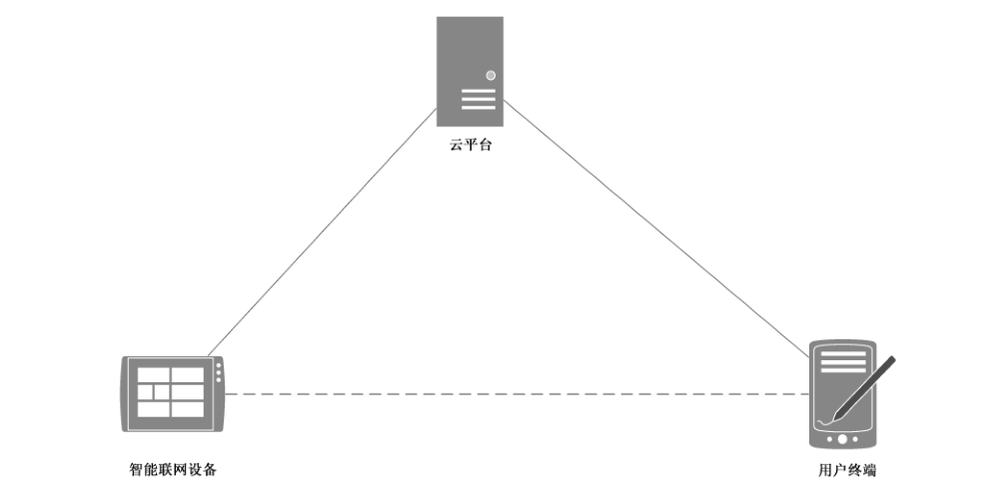

# GB/T 38626-2020 信息安全技术 智能联网设备口令保护指南

> 来源：[GB/T 38626-2020 国家标准详情](https://openstd.samr.gov.cn/bzgk/std/newGbInfo?hcno=1C7E6B699CC32335D9E3EA2A288F968F)；发布日期：2020-04-28；实施日期：2020-11-01。
> PDF SHA-256：d244c1446918e597b25771753f8d354aebfb3329535f5262c0d96f71230b57c2。
> 转写说明：按页渲染 PDF 并用 macOS Vision 进行图像识别，对照全部原页校正文字；附录图保留原页裁切，省略封面、目录、页眉和页脚。正式引用请核对原 PDF。

## 前言

本标准按照 GB/T 1.1—2009 给出的规则起草。

请注意本文件的某些内容可能涉及专利。本文件的发布机构不承担识别这些专利的责任。

本标准由全国信息安全标准化技术委员会（SAC/TC 260）提出并归口。

本标准起草单位：杭州海康威视数字技术股份有限公司、中国电子技术标准化研究院、北京信息安全测评中心、中国信息安全测评中心、公安部第一研究所、公安部第三研究所、中国科学院信息工程研究所、浙江大学、国家工业信息安全发展研究中心、国网浙江省电力有限公司、大华技术股份有限公司、阿里巴巴网络技术有限公司、华为技术有限公司、深圳联想懂的通信有限公司、海尔集团、美的智慧家居科技有限公司、北京洋浦伟业科技发展有限公司、杭州安恒信息技术有限公司、北京未来安全信息技术有限公司、北京天融信网络安全技术有限公司、江苏省电力公司电力科学研究院。

本标准主要起草人：王滨、刘贤刚、许东阳、赵章界、陈学明、范科峰、成金爱、邸丽清、韩煜、刘继顺、闫兆腾、徐文渊、王冲华、姚一杨、万里、王星、张军昌、刘大鹏、黄敏、倪晓林、茹昭、张军、刘明君、陈兆全、王英键、李娜、姚楠。

## 1 范围

本标准给出了智能联网设备的账号和口令在生成、管理和使用等方面的安全技术指南。

本标准适用于指导智能联网设备生产制造商安全设计和实现口令保护功能，也适用于智能联网设备的口令安全使用的监督、检查。

## 2 规范性引用文件

下列文件对于本文件的应用是必不可少的。凡是注日期的引用文件，仅注日期的版本适用于本文件。凡是不注日期的引用文件，其最新版本（包括所有的修改单）适用于本文件。

- GB/T 25069—2010 信息安全技术 术语

## 3 术语和定义

GB/T 25069—2010 界定的以及下列术语和定义适用于本文件。为了便于使用，以下重复列出了 GB/T 25069—2010 中的某些术语和定义。

### 3.1 智能联网设备 intelligent connected device

具有接入网络进行通信、数据感知、数据存储、数据处理和人机交互能力的设备。

> 注：主要是指物联网中的端设备，包括网络摄像头、智能家电、网络机顶盒、智能投影仪、家用路由器等，不包括计算机、手机等通用计算设备。

### 3.2 口令 password

用于身份鉴别的秘密的字、短语、数或字符序列。

> 注：改写 GB/T 25069—2010，定义 2.2.2.76。

### 3.3 口令鉴别 password authentication

使用口令来验证用户所声称身份的过程。

### 3.4 弱口令 weak password

容易被别人猜测或被破解工具暴力破解的口令。

### 3.5 初始口令 initial password

设备出厂时厂商预置于设备中，用于在初始设置或恢复默认设置状态下访问设备的口令。

### 3.6 随机性 randomness

具有某一概率的事件集合中各个事件所表现出来的不可预测性。

### 3.7 账号 account

在特定上下文中，可以唯一标识主体身份的一段信息。

> 注：也称为用户名。

### 3.8 添加变量 salt

作为单向函数或加密函数的二次输入而加入的随机变量，可用于计算口令鉴别数据。

[GB/T 25069—2010，定义 2.2.2.186]

## 4 缩略语

下列缩略语适用于本文件。

- API：应用程序编程接口（Application Programming Interface）
- ID：身份标识号（IDentity）
- IP：互联网协议（Internet Protocol）

## 5 概述

由于智能联网设备接入网络模式的不同，口令鉴别的实现方式可分为两种：

- 设备鉴别，口令鉴别过程在智能联网设备中进行。
- 非设备本地鉴别，口令鉴别的过程不在智能联网设备中进行，包括但不限于用户终端通过云平台进行用户口令鉴别。详细情况参见附录 A。

非设备本地鉴别在本质上是平台代替智能联网设备执行了口令鉴别。因此，本标准中对于账号和口令的安全技术要求在两种情况下都适用。

口令作为鉴别凭证与作为用户身份标识的账号相关联，账号安全是口令鉴别保护中非常重要的一个环节。本标准从账号安全和口令安全两个方面来提出保护的规则和要求，并且提出用户安全的使用和管理账号口令的指导。

本标准凡涉及采用密码技术解决保密性、完整性、真实性、不可否认性需求的应遵循密码相关国家标准和行业标准。

## 6 账号安全

### 6.1 账号生成

关注的事项包括：

a）设备中账号具有唯一性；

b）在新建或修改账号时，提供命名规则检查功能，包括但不限于特殊字符限制。

### 6.2 账号使用

关注的事项包括：

a）所有账号都需要向设备管理员公开，设备或者平台厂商不能隐藏后门账号；

b）禁用或删除设备中集成的第三方或开源软件中不使用的账号。

### 6.3 账号管理

关注的事项包括：

a）对于具备设备管理员角色的智能联网设备，为设备管理员提供账号添加、删除、修改、查询等功能；

b）提供可配置的账号锁定策略，包括但不限于账号到期锁定，连续多次输入错误口令锁定；

c）所有账号仅限于被设备管理员管理。

### 6.4 日志

所有用户对账号的所有操作均需要记录日志，日志内容包括用户 ID、IP 地址、操作时间、操作内容、操作结果等信息。

## 7 口令安全

### 7.1 口令生成

关注的事项包括：

a）自动生成的口令具有随机性，且长度不少于 6 个字符。

b）用户设置的口令符合的基本策略内容如下：

1）口令长度不少于 8 个字符；

2）口令允许的最大长度不少于 64 个字符；

3）口令至少包含数字、小写字母、大写字母以及特殊字符中的两类字符。

c）对于出厂配置时采用激活机制的智能联网设备，用户第一次访问设备时，需通过为设备设置口令来激活设备，未激活的设备拒绝除激活以外的其他操作。

> 注：“激活”是指设备第一次使用时由用户设置符合口令复杂度要求的口令。

d）对于出厂配置时采用初始口令的智能联网设备，为每个设备随机生成初始口令，每次登录时提醒用户修改口令，直到修改初始口令为止。

### 7.2 口令使用

关注的事项包括：

a）口令传输采用安全传输通道或者加密后传输；

b）默认对输入框中的口令进行掩盖显示；

c）禁止口令从输入框中复制的功能；

d）用户登录成功后无法查看自己的口令；

e）对口令的鉴别过程具备防暴力破解功能，如果错误登录尝试超过设定次数后锁定操作账号或者操作 IP 一段时间。

### 7.3 口令管理

关注的事项包括：

a）所有口令都可修改，不能使用硬编码口令；

b）用户修改口令前，提供验证旧口令以及对新口令再次确认的功能；

c）存储口令时需加密；

d）存储的口令具有防破解机制，包括但不限于添加变量；

e）限制对口令文件的访问和修改，包括但不限于使用操作系统的访问控制功能；

f）不能通过用户操作界面或 API 读取口令明文；

g）提供在忘记账号或者口令的情况下，通过物理按键或者其他的安全方式将设备恢复到出厂状态的功能；

h）口令复杂度策略可配置，支持管理员根据应用场景配置强化的口令复杂度策略；

i）具备显示口令安全强度的能力。

### 7.4 日志

所有用户对口令的所有操作均记录日志，日志内容包括用户 ID、IP 地址、操作时间、操作内容、操作结果等信息。

## 8 用户安全

关注的事项包括：

a）用户宜及时修改设备的初始口令。

b）用户宜为不同的设备设置不同的口令。

c）用户不能使用已知过去曾被泄露的口令。

d）用户不能使用弱口令，常见的弱口令包括但不限于：

1）不符合复杂度策略的口令；

2）字典中的单词；

3）重复或顺序的字符（例如，“aaaaaaaa”“1234abcd”）；

4）上下文相关的字眼，包括但不限于服务名称、用户名或其派生物。

e）用户宜妥善保管所使用的账号和口令。

f）用户宜定期对口令进行修改。

## 附录 A（资料性附录）非设备本地鉴别方式

通过云平台进行口令鉴别是一种典型的非本地鉴别方式。云平台的典型部署模式如图 A.1 所示。

在云平台部署模式下口令鉴别在用户终端和云平台之间完成，云平台和智能联网设备通过其他安全协议进行认证，如基于数字证书的账号认证等，并且通过设备的唯一标识与用户终端登录的账号进行绑定。

在通过口令鉴别后，用户终端和智能联网设备之间的通信可以采用以下两种方式：

a）用户终端和智能联网设备之间的通信由云平台转发；

b）云平台建立一条用户终端和智能联网设备之间的直接的路由。

## 参考文献

- [1] GB/T 22239—2019 信息安全技术 网络安全等级保护基本要求
- [2] GB/T 32399—2015 信息技术 云计算 参考架构
- [3] GB/T 32400—2015 信息技术 云计算 概览与词汇
- [4] GB/T 33474—2016 物联网 参考体系结构
- [5] GB/T 33745—2017 物联网 术语
- [6] 工业和信息化部电信研究院，物联网白皮书（2011 年），2011 年 5 月。
- [7] ISO/IEC 20180:2012 Telecommunications and information exchange between systems—Security framework for ubiquitous sensor networks
- [8] IEC 62443-1-1:2009 Industrial communication networks—Network and system security—Part 1-1: Terminology, concepts and models
- [9] ITU-T Y.2060: Overview of the Internet of things
- [10] NIST Special Publication 800-63B, Digital Identity Guidelines: Authentication and Lifecycle Management, June 2017.
- [11] SB 327, Jackson. Information privacy: connected devices
