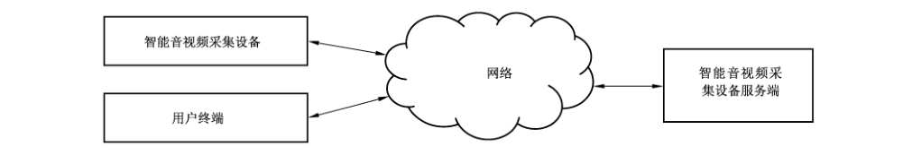

# GB/T 38632-2020 信息安全技术 智能音视频采集设备应用安全要求

> 来源：[GB/T 38632-2020 国家标准详情](https://openstd.samr.gov.cn/bzgk/std/newGbInfo?hcno=5B801BCFC9369430E26582B17087BFB3)。
> PDF SHA-256：19267c1df5eb98185470e0654ea47b58bab63d95b1d40ab34d017dcad8fd3717。
> 发布日期：2020-04-28；实施日期：2020-11-01。依据官方公开 PDF 的 13 页图像逐页核对；图 A.1 保留原图裁切。已去除封面、目录、分页和页眉页脚，正式引用请核对原 PDF。

## 前言

本标准按照 GB/T 1.1—2009给出的规则起草。

请注意本文件的某些内容可能涉及专利。本文件的发布机构不承担识别这些专利的责任。

本标准由全国信息安全标准化技术委员会（SAC/TC 260）提出并归口。

本标准起草单位：深圳数字电视国家工程实验室股份有限公司、中国电子技术标准化研究院、联想（北京）有限公司、深圳创维-RGB电子有限公司、康佳集团股份有限公司、深圳国实检测技术有限公司、杭州海康威视数字技术股份有限公司、青岛海信电器股份有限公司、华为技术有限公司、公安部第一研究所、中国信息安全测评中心、国家信息技术安全研究中心、深圳市视美泰技术股份有限公司、中国信息通信研究院、北京奇虎科技有限公司。

本标准主要起草人：范科峰、李新国、许东阳、李汝鑫、马亚飞、刘天宇、潘晟、王滨、李永吉、樊洞阳、韩煜、谢丰、贾嘉、张泓、石悦、崔涛、张亚群、郑广瑞、陈验方。

## 1 范围

本标准规定了智能音视频采集设备的安全技术要求和安全管理要求。

本标准适用于用户对部署在重点场所中的智能音视频采集设备进行应用安全管理，可用于指导设备和服务供应商进行产品的信息安全设计生产，也可作为相关部门对智能音视频采集设备的安全性进行监督、检查和指导的依据。

## 2 规范性引用文件

下列文件对于本文件的应用是必不可少的。凡是注日期的引用文件，仅注日期的版本适用于本文件。凡是不注日期的引用文件，其最新版本（包括所有的修改单）适用于本文件。

- GB/T 25069—2010 信息安全技术 术语

## 3 术语和定义

GB/T 25069—2010界定的以及下列术语和定义适用于本文件。

### 3.1 智能音视频采集设备 intelligent audio-video recording device

能够进行音频或视频信息采集和处理，并能够通过网络与服务端联动实现自动或互动功能的电子设备。

注1：主要包括网络摄像机、音视频会议设备、具有音视频采集功能的智能电视和智能音箱等。

注2：智能移动终端、个人计算机、智能可穿戴设备等具备音视频采集功能的设备不在本标准范围内。

### 3.2 智能音视频采集设备服务端 server of intelligent audio-video recording device

通过网络与智能音视频采集设备连接，为智能音视频采集设备应用业务提供设备管理、用户管理、权限管理、数据存储、数据转发等服务功能的软硬件设备或系统。

> 注：通常包含应用服务器、Web 服务器、流媒体服务器、数据存储服务器等组件。

### 3.3 恶意代码 malicious code

经过专门设计的、带有恶意用途的代码，其拥有的特征和能力能够对用户及其计算机系统带来直接或间接的危害。

> 注：主要包括病毒、蠕虫、木马、勒索病毒、逻辑炸弹、流氓软件等。

### 3.4 预置软件 pre-installed software

设备交付给用户时已经预先安装的软件。

注1：主要包括固件、系统软件和应用软件。

注2：如果设备软件在交付时与原始设备制造商的版本不同，则视交付时刻的终端软件为预置软件。

### 3.5 原始设备制造商 original device manufacturer

按照一定技术规格制造设备，并以特定品牌和型号销售设备的企业。

> 注：当用户采购的设备不直接来自原始设备制造商时，其功能有可能在中间流通环节被改动。

### 3.6 供应商 supplier

提供智能音视频产品或服务的组织。

> 注：改写 GB/T 36637—2018，定义3.2。

### 3.7 用户数据 user data

由用户产生或为用户服务的数据，包括由用户在本地生成的数据、为用户在本地生成的数据、在用户许可后由外部进入用户数据区的数据等。

［GB/T 32927—2016，定义3.1.12］

## 4 缩略语

下列缩略语适用于本文件。

DoS：拒绝服务（Denial of Service）

DTMB：地面数字多媒体广播（Digital Terrestrial Multimedia Broadcast）

DVB-T：地面数字视频广播（Digital Video Broadcasting-Terrestrial）

SD：安全数字存储卡（Secure Digital memory card）

USB：通用串行总线（Universal Serial Bus）

WLAN：无线局域网（Wireless Local Area Network）

## 5 概述

本标准针对部署在重点场所中的智能音视频采集设备，提出安全技术要求和安全管理要求。附录A 给出了由智能音视频采集设备及其服务端所组成的系统架构。附录B给出了智能音视频采集设备面临的典型信息安全威胁，包括未经用户同意采集和访问用户音视频数据、通过植入恶意代码攻击公众网络等。

本标准凡涉及采用密码技术解决保密性、完整性、真实性、不可否认性需求的应遵循密码相关国家标准和行业标准。

## 6 安全技术要求

### 6.1 设备安全技术要求

#### 6.1.1 设备身份标识与鉴别

智能音视频采集设备应：

a） 具备唯一的识别码作为设备的身份标识，对识别码进行保护，防止被篡改；

b） 具备用于鉴别设备身份的机制，对相关鉴别信息进行保护，防止鉴别信息泄露。

#### 6.1.2 访问控制

智能音视频采集设备应：

a） 支持对网络、存储、文件等重要资源配置访问控制策略；

b）具备防止对摄像头、麦克风等传感器非授权访问和使用的机制，例如提示对话框、状态指示灯、物理开关等；

c） 明确远程访问的实施条件，具备安全的远程访问机制。

#### 6.1.3 网络连接与端口

智能音视频采集设备应：

a） 具备开启、关闭、禁用或者监控设备的WLAN、蓝牙、移动通信、USB、SD、DVB-T 等无线或有线接口的机制；

b）具备关闭、禁止或限制使用设备上与实际应用无关的端口、协议和服务的机制。

#### 6.1.4 数据安全

智能音视频采集设备应：

a） 通过数据加密等技术对通信过程中重要用户数据（例如用户的账号、口令、位置、文档、图片、音频、视频等）的完整性和保密性进行保护；

b） 通过数据加密等技术对设备存储的重要用户数据的完整性和保密性进行保护；

c） 未取得用户同意，不得采集、修改用户数据。

#### 6.1.5 软件安装

智能音视频采集设备应：

a） 具备开启或者禁止用户自行安装第三方软件的机制；

b） 未经用户同意，不得自行安装第三方软件；

c） 在用户自行安装第三方软件时，对软件来源和完整性进行验证；当识别出不明来源或完整性遭到破坏的软件时，提醒用户处理。

#### 6.1.6 预置软件安全

智能音视频采集设备应：

a） 预置软件不得包含功能清单之外的其他功能；

b） 具备针对预置软件的安全升级机制，且在软件升级时取得用户的同意；

c） 对固件的完整性进行保护，防止通过供应商及授权第三方之外的途径对固件进行修改。

#### 6.1.7 安全审计

智能音视频采集设备应：

a） 能够对开关机、创建用户、更改配置、安装与卸载软件、软件升级、修改口令、登陆失败、特权用户登录等事件进行记录，审计记录应包括事件类型、事件发生时间、触发事件的主体、事件处理结果等信息；

b） 对审计信息进行保护，防止非授权的访问、修改和删除；

c） 支持服务端获取本地相关审计信息的功能。

#### 6.1.8 供应链安全

智能音视频采集设备：

a） 所使用的关键芯片、关键模组、操作系统等组件应具有明确的生产商、产地、供货商等供应链信息；

b） 在产品交付用户时，不应存在已被公开的存在高风险安全缺陷和漏洞的芯片、模组、软件等组件。

#### 6.1.9 服务保障安全

智能音视频采集设备应：

a） 在交付用户之前，经过充分的安全性测试，尽可能修复已发现的安全缺陷，确保高风险缺陷得到修复；对于未能在开发阶段修复的安全缺陷和漏洞，实施在用户侧进行紧急修复的安全管理流程；

b） 在交付用户之后，建立持续性安全保障机制，当出现信息安全缺陷时，及时通知用户，并提供修复方法或者应急处置方案。

### 6.2 服务端安全技术要求

#### 6.2.1 身份鉴别

智能音视频采集设备服务端应：

a） 支持对不同用户的标识和鉴别，用户标识应具有唯一性；

b） 支持对智能音视频采集设备的身份鉴别；

c） 在采用用户名/口令鉴别机制时，确保口令的生成、管理和使用符合国家相关标准的要求；

d） 对用户和设备鉴别信息进行保密性和完整性保护；

e） 在进行远程管理时使用安全协议，宜采用数字证书或多因素认证等鉴别机制。

#### 6.2.2 访问控制

智能音视频采集设备服务端应：

a） 在用户身份鉴别的基础上，对用户进行授权管理和访问控制；

b） 对使用特殊访问权限设置期限；

c） 控制其他应用的访问权限。

#### 6.2.3 数据安全

智能音视频采集设备服务端：

a） 应采用数据加密等技术保护重要用户数据在传输过程中的完整性和保密性；

b） 宜采用数据加密等技术保护重要用户数据在存储过程中的完整性和保密性；

c） 应具备容灾备份功能，以保证系统的可用性；

d） 应能够对应用数据、系统数据、配置数据及审计日志等重要数据进行备份。

#### 6.2.4 安全审计

智能音视频采集设备服务端应：

a） 具备安全审计功能，对重要的用户行为和重要安全事件进行记录；

b） 在审计记录中包括事件的日期、用户、事件类型以及事件是否成功等信息；

c） 由服务端系统唯一确定的时钟产生审计记录的时间；

d） 对审计记录进行保护，防止非授权的访问、修改和删除；

e） 具备获取智能音视频采集设备相关审计信息的功能。

## 7 安全管理要求

### 7.1 安全管理制度

用户在应用智能音视频采集设备和服务端产品的过程中应：

a） 将相关产品纳入到日常信息安全管理制度中；

b） 制定相应的安全策略，以及用于规范采购、交付、运维、报废等行为的安全管理制度；

c） 明确每件产品的安全负责人。

### 7.2 采购管理

用户在采购智能音视频采集设备和服务端产品时：

a） 应根据功能最小化原则选择满足实际需要的产品；

b） 宜采购通过国家相关部门授权的第三方测试机构信息安全检测的产品；

c） 应要求供应商提供产品功能清单及功能说明；

d） 应要求供应商对产品的信息安全设计进行说明；

e） 应要求供应商对产品在使用过程中可能遇到的信息安全风险以及相应的规避方法进行说明；

f） 应区分设备供应商、原始设备制造商和服务供应商，明确各自的信息安全责任和义务。

### 7.3 安装调试管理

用户在进行智能音视频采集设备和服务端产品安装调试时应：

a） 由供应商安排专业人员或授权具有相关资质的从业人员进行；

b） 严格按照供应商提供的安全配置手册进行安装和配置；

c） 对每台设备应设置不同的口令，不得设置弱口令或使用默认用户名口令；

d） 指定专人对整个安装调试过程进行监督；

e） 指定专人进行验收，记录各项指标是否达到要求，形成验收测试报告，并要求参与安装调试人员共同确认；

f） 要求供应商对服务端的网络部署情况进行说明。

### 7.4 运维管理

用户在对智能音视频采集设备和服务端产品运行维护时应：

a） 按照供应商提供的操作规范或说明书建立安全使用指南，并根据安全使用指南对设备进行操作和维护，避免过度或不正确使用设备；

b） 对运维管理人员进行必要的安全培训；

c） 按照最小功能原则关闭不必要的端口、协议和服务，关闭或者禁用不必要的无线和有线接口；

d） 在网络环境、人员、系统配置等要素发生变化时，重新检查和更新访问控制策略；

e） 对系统运行状态和终端设备运行状态进行监控；

f） 在重要节点和设备上部署入侵检测及防护系统，实时检测各种网络攻击并做出响应；

g） 在网络出入口以及系统主机上实施恶意代码防护机制，并及时更新恶意代码防护软件；

h） 根据供应商提供的软件升级版本对产品进行更新，并在更新前对现有重要文件进行备份；

i） 针对第三方软件安装建立评估、审核机制；

j） 定期对产品进行安全检查、安全审计和安全评估；

k） 建立信息安全事件响应机制，及时评估事态影响、分析原因并收集证据；

l） 将设备及应用环境纳入本组织的风险评估范围。

### 7.5 报废停用管理

用户在对智能音视频采集设备和服务端产品进行报废或者停用处理时应：

a） 首先对所使用设备中存储的信息进行归档，然后彻底清除所有与用户相关的信息；

b） 如果智能音视频采集设备服务端由第三方以云服务方式提供，则应要求云服务提供者移交并清除所有与用户相关的信息。

## 附录 A（资料性附录）系统概述

智能音视频采集设备、用户终端、智能音视频采集设备服务端通过网络连接构成一个应用系统，如图 A.1 所示。

智能音视频采集设备主要负责音频或视频信息的采集和处理，并通过网络与服务端进行业务数据交换，典型的智能音视频采集设备包括网络摄像机、视频会议终端、具有音视频采集功能的智能电视和智能音箱等。

用户通过用户终端实现对智能音视频采集设备及服务端资源的访问，典型的用户终端包括 PC和智能手机，在智能电视、视频会议应用中，智能音视频采集设备本身也是用户终端。

智能音视频采集设备服务端是为智能音视频采集设备应用业务提供设备管理、用户管理、权限管理、数据存储、数据转发等服务功能的软硬件设备及系统，通常包含应用服务器、Web 服务器、流媒体服务器、数据库服务器等组件。

根据不同的应用场景，智能音视频采集设备服务端的实现方式可以是单台设备（例如小型的视频安防系统中，一台数字录像设备就可以作为服务端实现对多台视频采集设备的管理），可以是多个服务端独立并存（例如智能电视设备，可以通过安装客户端软件的方式连接地面广播、互联网点播、体感游戏、在线音乐等多个不同的服务端），也可以采用多个服务端级联并存的结构（例如大型的视频安防系统中，服务端可以分为两级或者三级，各级服务端之间根据职责不同被赋予不同的权限），还可以采用云服务的方式。

## 附录 B（资料性附录）典型信息安全威胁

### B.1 概述

智能音视频采集设备应用过程中需要对所收集、存储或处理的重要用户信息进行保护，否则信息的保密性、完整性和可用性就可能遭到损害。需要保护的信息主要包括：在工作环境中进行拍照、录音等所获取的信息；工作人员的身份、位置、工作内容等信息；设备采集到的周边人员、车辆、事件等信息；通过网络进行传输的重要用户数据；遗失、报废的设备中存储的用户信息等。

导致上述信息安全风险的威胁可能来自恶意代码、非授权访问、拒绝服务攻击等技术层面，也可能来自用户日常操作层面。

### B.2 恶意代码

智能音视频采集设备可能通过各种途径感染恶意代码，包括但不限于：

a） 预置软件中存在恶意代码；

b） 用户自行安装或运维人员安装的软件中存在恶意代码；

c） 不安全的软件升级过程引入恶意代码；

d）通过非受控 WLAN、蓝牙、移动通信等链路访问外部设备和网络，感染恶意代码；

e） 通过接收 DVB-T、DTMB 等无线广播信号感染恶意代码。

### B.3 非授权访问

智能音视频采集设备及其服务端可能存在以下非授权访问威胁，包括但不限于：

a） 非授权用户通过物理手段或者网络手段访问智能音视频采集设备和服务端；

b） 智能音视频采集设备非授权访问其他网络或其他设备；

c） 非授权智能音视频采集设备访问服务端。

### B.4 拒绝服务攻击

智能音视频采集设备及其服务端：

a） 当遭受 DoS 攻击时，会给本系统数据和服务的可用性带来威胁；

b） 当遭到恶意利用或非法控制时，可对其他系统的设备发起 DoS 攻击。

### B.5 用户因素

用户在使用智能音视频采集设备过程中，不规范的操作所产生的安全威胁，包括但不限于：

a） 未制定有效的安全管理制度；

b） 未定期对智能音视频采集设备所带来的信息安全风险进行评估；

c） 未按照既定的规程要求对设备及其服务端进行采购和安装；

d） 未按照既定的规程对设备及其服务端进行配置管理、变更管理、软件更新、安全审计等；

e） 未按照既定的规程对设备及其服务端进行报废或者停用处理等。

## 参考文献

- ［1］ GB/T 16676—2010 银行安全防范报警监控联网系统技术要求

- ［2］ GB/T 20269—2006 信息安全技术 信息系统安全管理要求

- ［3］ GB 20815—2006 视频安防监控数字录像设备

- ［4］ GB/T 28181—2016 公共安全视频监控联网系统信息传输、交换、控制技术要求

- ［5］ GB/T 31168—2014 信息安全技术 云计算服务安全能力要求

- ［6］ GB/T 32927—2016 信息安全技术 移动智能终端安全架构

- ［7］ GB 35114—2017 公共安全视频监控联网信息安全技术要求

- ［8］ GB/T 36637—2018 信息安全技术 ICT 供应链安全风险管理指南

- ［9］ GA/T 1127—2013 安全防范视频监控摄像机通用技术要求

- ［10］ ISO/IEC 27034 Information technology—Security techniques—Application security

- ［11］ NIST SP 800-53 Security and Privacy Controls for Federal Information Systems and Organizations, 2013

- ［12］ NIST SP 800-124 Guidelines for Managing the Security of Mobile Devices in the Enterprise, 2013
