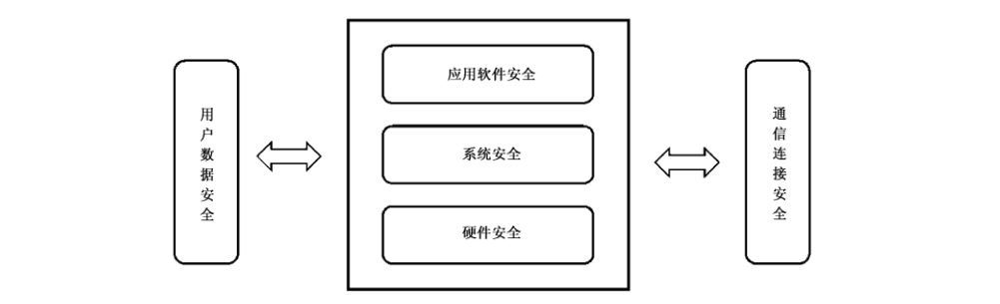

# GB/T 39720-2020 信息安全技术 移动智能终端安全技术要求及测试评价方法

> 来源：[GB/T 39720-2020 国家标准详情](https://openstd.samr.gov.cn/bzgk/std/newGbInfo?hcno=17F20359ACEE14EE9C60B014C13F7BD7)。
> PDF SHA-256：abdebb86d6e5395740217d33e05cc003392529e362626280315eb8fc67eeb773。
> 发布日期：2020-12-14；实施日期：2021-07-01。依据官方 PDF 的 18 页渲染图像逐页核对，保留图 1。已去除封面、目录、分页和页眉页脚，正式引用请核对官方原文。

## 前言

本文件按照 GB/T 1.1—2020《标准化工作导则 第1部分：标准化文件的结构和起草规则》的规定起草。

请注意本文件的某些内容可能涉及专利。本文件的发布机构不承担识别专利的责任。

本文件由全国信息安全标准化技术委员会（SAC/TC 260）提出并归口。

本文件起草单位：深圳信息通信研究院、中国信息通信研究院、OPPO广东移动通信有限公司、中国科学院信息工程研究所、北京邮电大学、北京三星通信技术研究有限公司、维沃移动通信有限公司、华为技术有限公司、北京奇虎科技有限公司、武汉安天信息技术有限责任公司、南昌黑鲨科技有限公司。

本文件主要起草人：宁华、张博钧、姚一楠、刘陶、王艳红、路晔绵、王宇晓、张彦、魏凡星、董霁、傅山、周飞、杜云、苏章凯、翟世俊、徐震、梁洪亮、刘臻、李腾、王江胜、吴春雨、常新苗、衣强、潘宣辰、罗成、张屹、贾科、汪国平。

## 1 范围

本文件规定了移动智能终端安全技术要求及测试评价方法，包括硬件安全、系统安全、应用软件安全、通信连接安全、用户数据安全。

本文件适用于移动智能终端的设计、开发、测试和评估。

## 2 规范性引用文件

下列文件中的内容通过文中的规范性引用而构成本文件必不可少的条款。其中，注日期的引用文件，仅该日期对应的版本适用于本文件；不注日期的引用文件，其最新版本（包括所有的修改单）适用于本文件。

- GB/T 25069 信息安全技术 术语

- GB/T 32927 信息安全技术 移动智能终端安全架构

- GB/T 35273 信息安全技术 个人信息安全规范

## 3 术语和定义

GB/T 25069、GB/T 32927、GB/T 35273 界定的以及下列术语和定义适用于本文件。

### 3.1 移动智能终端 smart mobile terminal

具有能够提供应用程序开发接口的开放系统，并能够安装和运行第三方应用软件的移动终端。

［来源：GB/T 32927—2016,3.1.9.有修改］

### 3.2 用户 user

使用移动智能终端，与移动智能终端进行交互的对象。

［来源：GB/T 32927—2016,3.1.11］

### 3.3 用户数据 user data

由用户产生或为用户服务的数据，包括由用户在本地生成的数据、为用户在本地生成的数据、在用户许可后由外部进入用户数据区的数据等。

［来源：GB/T 32927—2016,3.1.12］

### 3.4 移动应用软件 mobile application

移动智能终端系统之上安装的、向用户提供服务功能的应用软件。

### 3.5 访问控制 access control

一种保证数据处理系统的资源只能由被授权主体按授权方式进行访问的手段。

［来源：GB/T 32927—2016,3.1.5］

### 3.6 授权 authorization

根据预先认可的安全策略，赋予主体可实施相应行为权限的过程。

［来源：GB/T 32927—2016,3.1.7，有修改］

### 3.7 数字签名 digital signature

附加在数据单元上的数据，或是对数据单元所做的密码变换，这种数据或变换允许数据单元的接收者用以证明数据单元的来源和完整性，并保护数据单元的发送者和接收者以防止数据被第三方伪造，保护发送者以防止被接收者伪造。

［来源：ISO/IEC 11770-3:2015,3.7］

## 4 缩略语

下列缩略语适用于本文件。

API：应用程序编程接口（Application Programming Interface）

NFC：近场通信（Near Field Communication）

SD：安全数字存储卡（Secure Digital memory card）

USB：通用串行总线（Universal Serial Bus）

WLAN：无线局域网（Wireless Local Area Network）

## 5 概述

移动智能终端安全架构主要包括5个部分：硬件安全、系统安全、移动应用软件（以下简称“应用软件”）安全、通信连接安全和用户数据安全。硬件主要包括基础硬件模块、硬件接口和外设；系统主要包括硬件驱动、软件系统内核、各种函数库、基础服务等；应用软件主要包括运行在移动智能终端系统上的各种本地及 Web 应用，包括消费类应用、行业应用等各类别应用软件；通信连接主要包括网络接入、通信过程、外围接口；用户数据包括移动智能终端上的用户数据及应用软件产生的用户数据。如图1所示。

本文件凡涉及采用密码技术解决保密性、完整性、真实性、不可否认性需求的，应遵循密码相关国家标准和行业标准。

## 6 安全技术要求

### 6.1 硬件安全

在用户不知情的情况下，芯片不应存在可访问芯片内存或更改芯片功能的隐藏接口，包括在芯片设计验证阶段使用的调试接口。

### 6.2 系统安全

#### 6.2.1 签名校验机制

系统应具备数字签名（以下简称“签名”）的校验机制，未经签名的应用软件尝试安装时，系统应拒绝安装；当未经签名认证的应用软件尝试安装时，系统应给用户安全风险提示。

#### 6.2.2 标识与鉴别

系统应支持用户和应用软件的标识与鉴别，具体技术要求如下：

a） 系统用户应具有唯一标识，仅允许具有标识的用户访问系统安全功能和敏感数据；

b） 安装后的应用软件应具有唯一标识，仅允许具有标识的应用软件访问系统安全功能和敏感数据；

c） 在用户执行任何与系统安全功能相关操作之前应对用户进行鉴别，鉴别手段应至少支持口令、图案、生物识别等机制中的一种；

d） 系统应提供受保护的鉴别反馈；

e） 当用户对鉴别信息进行修改操作前，应确认用户具备对鉴别信息的修改权限。

#### 6.2.3 访问控制

系统应对用户和应用软件实施访问控制，具体技术要求如下：

a） 系统应预置访问控制策略，并可由授权用户更改，更改前应进行身份鉴别；

b） 允许授权用户及应用软件以访问控制策略规定方式访问应用软件、系统数据等资源，阻止非授权用户及应用软件访问。主体的访问控制属性应至少包括读、写、执行、删除等；客体的访问控制属性应包含可分配给主体的读、写、执行、删除等。

#### 6.2.4 权限管控

系统应具备权限管控机制，授权用户可管控应用软件访问与电话、短信、通讯录、通话记录、日历、定位、麦克风、拍照、摄像、传感器、设备信息、应用软件列表、媒体影音数据、蜂窝网络、WLAN、蓝牙等相关的敏感API，管控策略应至少包括允许、拒绝，且用户可更改。

#### 6.2.5 安全隔离

系统应对资源及数据按照敏感程度和对移动智能终端影响程度进行安全域划分，不同安全域之间应有相应的隔离策略，安全域之间的安全策略应通过对应的访问控制实现，具体技术要求如下：

a） 应对应用软件采用隔离机制，未获得相应访问授权的应用软件不应访问超出其访问控制范围内的应用软件资源及系统资源；

b） 支持多用户机制的移动智能终端，应提供多用户之间的安全隔离机制；

c） 预置多系统的移动智能终端，应提供多系统之间的安全隔离机制。

#### 6.2.6 审计日志

系统应具备审计日志生成能力，具体技术要求如下：

a） 应对系统运行记录、报警记录、操作日志、应用软件运行日志、配置信息等安全事件生成审计日志；

b） 审计日志内容应包括事件发生的时间、主体、对象、事件描述和结果等。

#### 6.2.7 升级更新

系统应支持升级更新，具体技术要求如下：

a） 应能对更新来源进行鉴别，当移动智能终端不能保证安全更新时，应在更新前或使用说明中明示安全风险；

b） 应具有原始数据备份能力，升级后安全属性（安全防护机制）应与升级前保持一致；

c） 应避免更新失败导致系统失效。

#### 6.2.8 恶意代码防范

系统应提供安全保护机制防范恶意代码攻击。系统应能检测识别非授权访问、权限异常变化、恶意软件安装等恶意行为，给予用户警告，并采取相应安全措施（如拒绝访问、数据隔离等）防止恶意攻击发生。

### 6.3 应用软件安全

#### 6.3.1 软件签名认证

应用软件应采用签名认证机制，具体技术要求如下：

a） 应用软件应使用数字证书对其进行签名，保证应用软件开发者或提供者所使用的数字证书信息真实、唯一、不可否认；

b） 应用软件中应包含签名信息，且签名信息真实可信。

#### 6.3.2 通信功能调用

应用软件调用通信功能时，应满足的具体技术要求如下：

a） 应用软件应在用户同意后调用移动智能终端通信功能，防止出现应用在未向用户明示且未经用户同意，调用移动智能终端通信功能的行为；

b） 应用软件应在用户同意后通过移动通信网络数据连接、WLAN 网络连接、无线外围接口传送数据；

c） 应用软件应在用户同意后拨打电话、发送短信、发送彩信、开启移动通信网络连接并收发数据。

#### 6.3.3 应用软件代码安全

应用软件应具备必要的安全机制以保障代码安全，具体技术要求如下：

a） 应用软件应防止软件被逆向分析；

b） 应用软件宜采取代码混淆等机制实现反编译保护。

#### 6.3.4 最小化权限

应用软件应基于最小化原则申请与电话、短信、通讯录、通话记录、日历、定位、麦克风、拍照、摄像、传感器、设备信息、应用软件列表、媒体影音数据、蜂窝网络、WLAN、蓝牙等相关的权限，所申请权限、申请时机、访问资源应与当前服务场景密切相关。无正当理由，不应因用户未授权而拒绝提供相关服务或功能。

### 6.4 通信连接安全

#### 6.4.1 网络接入安全

移动智能终端应支持安全协议在移动智能终端侧的实现。支持接入网络中的认证和鉴权、完整性校验、加密传输等安全扩展功能，协议安全性应符合相应国家及行业标准要求。

#### 6.4.2 外围接口安全

外围接口分为有线外围接口和无线外围接口。有线外围接口包括 USB 接口、SD接口等，无线外围接口包括蓝牙接口、WLAN接口和 NFC接口等。移动智能终端具备外围接口时，应满足的具体技术要求如下：

a） 具备外围接口（包括但不限于 WLAN、蓝牙、NFC、USB、SD）的移动智能终端应具备开关，可开启/关闭相应的外围接口；

b） 当应用软件调用开启外围接口时，移动智能终端应给用户相应的提示，当用户确认后连接方可开启；

c） 当通过蓝牙与不同设备进行第一次连接时，移动智能终端能发现该连接并给用户相应的提示，当用户确认建立连接时，连接才可建立；

d） 当移动智能终端的蓝牙或 NFC已开启或建立数据连接，移动智能终端宜在用户主界面上给用户相应的状态提示。

#### 6.4.3 数据传输安全

移动智能终端通信数据应采用完整性检验机制，保证数据传输完整性，且具有通信时延和中断处理机制。

### 6.5 用户数据安全

#### 6.5.1 用户数据收集

移动智能终端收集用户数据应满足的具体技术要求如下：

a） 移动智能终端若出于业务需要收集用户数据，应在收集前明示收集的目的、范围、频次、发生时机及对应业务使用场景，并且只有在用户同意的情况下方可继续，且应为用户提供可关闭数据收集功能的选项；

b） 移动智能终端应在用户同意后开启通话录音、本地录音、后台截屏、拍照、摄像、收发短信和定位等功能；

c） 移动智能终端应在用户同意后读取用户本机号码、通讯录、通话记录、短信数据、上网记录、日程表数据、定位信息等。

#### 6.5.2 用户数据存储

当用户数据存储在移动智能终端内部时，应为用户数据文件提供访问控制机制，防止未授权访问，用户敏感数据应在授权访问的基础上加密或脱敏后存储。

#### 6.5.3 用户数据加工

移动智能终端加工用户数据应满足的具体技术要求如下：

a） 移动智能终端加工用户数据前，应明示加工数据的目的、方式和范围，不应有未向用户明示且未经用户同意，擅自修改用户数据的行为，包括在用户无确认情况下删除或修改用户通讯录、通话记录、短信数据、日程表数据等的行为；

b） 移动智能终端及应用软件应提供访问控制机制，对数据设置适当操作权限，防止未经授权的访问和操作；

c） 移动智能终端及应用软件应对用户敏感数据采取适当的脱敏措施加工，避免存储其明文原始数据。

#### 6.5.4 用户数据转移

移动智能终端转移用户数据应满足的具体技术要求如下：

a） 移动智能终端进行用户数据转移应按照约定目的和用途进行，传输数据之前应对双方进行身份认证和授权，应在用户同意后读取并传输用户数据，防止出现未向用户明示且未经用户同意，传输用户数据的行为；

b） 移动智能终端应在用户同意后读取并传送用户本机号码、通讯录、通话记录、短信数据、上网记录、日程表数据、多媒体数据、定位等信息；

c） 移动智能终端转移的用户敏感数据应加密后转移。

#### 6.5.5 用户数据删除

移动智能终端对收集、加工、转移阶段所产生的用户数据及其缓存数据，应提供自动删除或者授权用户手动删除的功能，数据删除后不影响移动智能终端正常使用。

## 7 测试评价方法

### 7.1 硬件安全

硬件安全的测试方法、预期结果和结果判定如下。

<ol className="standard-subclauses">
<li>a） 测试方法
<ol className="standard-subclauses">
<li>1） 审查厂商提交的文档，查看被测移动智能终端硬件芯片接口设计；
</li>
<li>2） 验证被测移动智能终端是否可以通过调试接口发送、接收调试命令；
</li>
<li>3） 验证被测移动智能终端是否可以通过接口读取或改写内存。
</li></ol>
</li>
<li>b） 预期结果
<ol className="standard-subclauses">
<li>1） 移动智能终端不存在隐蔽调用接口，且访问接口需要经过用户授权；
</li>
<li>2） 无法通过接口读取或改写内存。
</li></ol>
</li>
<li>c） 结果判定
上述预期结果均满足判定为符合，其他情况判定为不符合。

</li></ol>

### 7.2 系统安全

#### 7.2.1 签名校验机制

签名校验机制的测试方法、预期结果和结果判定如下。
<ol className="standard-subclauses">
<li>a） 测试方法
<ol className="standard-subclauses">
<li>1） 审查厂商提交的文档，检查签名校验机制；
</li>
<li>2） 审阅签名机制所用相关加密算法、密钥管理等策略；
</li>
<li>3） 将未经签名的应用软件安装到移动智能终端上，检查是否拒绝安装；
</li>
<li>4） 将使用合法签名应用软件安装到移动智能终端上，检查是否可以安装；
</li>
<li>5） 将使用非签名认证应用软件安装到移动智能终端上，检查是否提示风险。
</li></ol>
</li>
<li>b） 预期结果
未经签名的应用软件安装到移动智能终端上时，移动智能终端拒绝应用安装；经过签名校验的应用软件可以安装到被测移动智能终端上，未经签名认证的应用软件安装时，移动智能终端可识别软件状态，向用户提示安全风险。

</li>
<li>c） 结果判定
上述预期结果均满足判定为符合，其他情况判定为不符合。

</li></ol>

#### 7.2.2 标识与鉴别

标识与鉴别的测试方法、预期结果和结果判定如下。
<ol className="standard-subclauses">
<li>a） 测试方法
<ol className="standard-subclauses">
<li>1） 查看移动智能终端系统是否有用户标识机制。
</li>
<li>2） 进行用户注册和登录操作，检查标识是否唯一。
</li>
<li>3） 在移动智能终端上安装多个应用软件，查看系统是否为每个应用软件设置唯一的标识符。
</li>
<li>4） 审查系统方案，查看是否在用户或应用软件访问系统安全功能和敏感数据时检测其标识，并拒绝没有标识的用户或应用软件的访问请求。
</li>
<li>5） 使用系统中某个用户的身份执行与系统安全功能或访问敏感数据的相关的操作，查看系统是否采用下述方式中至少一种方式对用户进行鉴别：
<ul>
<li>弹出界面请求用户输入口令，审查是否显示口令原始数据；
</li>
<li>弹出界面请求用户输入图案密码，审查是否显示输入的图案；
</li>
<li>请求验证用户的指纹、虹膜、人脸等生物特征信息，审查是否显示获取的生物特征信息；
</li>
<li>若使用其他可以鉴别用户身份的方式，审查鉴别过程是否对用户数据进行受保护的鉴别反馈。
</li></ul>
</li>
<li>6） 修改用户鉴别信息，查看系统是否在修改操作前对用户修改鉴别信息的权限重新确认。
</li></ol>
</li>
<li>b） 预期结果
<ol className="standard-subclauses">
<li>1） 系统为其上安装的每个应用软件和每个用户设置了唯一的标识符；
</li>
<li>2） 系统在用户或应用软件访问系统安全功能等敏感数据时会检测其标识，并拒绝没有标识的用户或应用软件的访问请求；
</li>
<li>3） 系统在用户执行任何与系统安全功能相关操作之前，至少采用口令、图案、生物识别等机制中的一种对用户进行身份鉴别，且提供受到保护的鉴别反馈，即在进行鉴别信息反馈时不泄露信息内容；
</li>
<li>4） 当用户对鉴别信息进行修改前，系统会对用户修改鉴别信息的权限重新确认。
</li></ol>
</li>
<li>c） 结果判定
上述预期结果均满足判定为符合，其他情况判定为不符合。

</li></ol>

#### 7.2.3 访问控制

访问控制的测试方法、预期结果和结果判定如下。
<ol className="standard-subclauses">
<li>a） 测试方法
<ol className="standard-subclauses">
<li>1） 审查厂商提交的文档，检查访问控制策略、访问控制属性设置；
</li>
<li>2） 尝试使用非授权用户修改访问控制策略；
</li>
<li>3） 根据访问控制策略内容，使用授权用户和应用软件以策略规定方式访问策略所允许访问的资源，查看是否可被访问；
</li>
<li>4） 根据访问控制策略内容，使用用户和应用软件访问策略所不允许访问的资源，查看系统是否拒绝非授权访问。
</li></ol>
</li>
<li>b） 预期结果
<ol className="standard-subclauses">
<li>1） 移动智能终端系统预置有访问控制策略；
</li>
<li>2） 访问控制策略中，主体的访问属性至少包括读、写、执行、删除等，客体的访问控制属性包含可分配给主体的读、写、执行、删除等权限；
</li>
<li>3） 系统允许授权用户及应用软件以访问控制策略规定方式访问移动智能终端应用软件、系统数据等资源，阻止非授权的访问。
</li></ol>
</li>
<li>c） 结果判定
上述预期结果均满足判定为符合，其他情况判定为不符合。

</li></ol>

#### 7.2.4 权限管控

权限管控的测试方法、预期结果和结果判定如下。
<ol className="standard-subclauses">
<li>a） 测试方法
<ol className="standard-subclauses">
<li>1） 审查厂商提交的文档，检查是否可安装第三方应用软件，敏感API 是否可以被正常调用；
</li>
<li>2） 开发一款软件安装至被测移动智能终端，尝试调用与电话、短信、通讯录、通话记录、日历、定位、麦克风、拍照、摄像、传感器、设备信息、应用软件列表、媒体影音数据、蜂窝网络、WLAN、蓝牙等相关的敏感 API（包括但不限于拨打电话、发送短信、读取或删除通讯录、访问通话记录、读写日历、定位、拍照、录音等）；
</li>
<li>3） 授权用户尝试依次更改管控策略。
</li></ol>
</li>
<li>b） 预期结果
无授权情况下，移动智能终端无法安装第三方应用软件；或移动智能终端可安装第三方应用软件，且提供权限管控策略，管控策略包括允许和拒绝，用户可正常更改管控策略。

</li>
<li>c） 结果判定
上述预期结果均满足判定为符合，其他情况判定为不符合。

</li></ol>

#### 7.2.5 安全隔离

安全隔离的测试方法、预期结果和结果判定如下。
<ol className="standard-subclauses">
<li>a） 测试方法
<ol className="standard-subclauses">
<li>1） 审查厂商提交的文档，查看移动智能终端是否对进程、线程、应用软件等系统资源及数据按照敏感程度以及对移动智能终端的影响程度进行安全域划分，不同安全域之间是否设置隔离策略，安全域之间的访问是否设置安全策略进行访问控制；
</li>
<li>2） 根据系统为应用软件设置的权限机制，尝试使用未获得相应授权的应用访问超出其访问权限的其他应用软件资源及系统资源，测试访问请求是否被拒绝；
</li>
<li>3） 若移动智能终端支持多用户机制，尝试通过一个用户访问另一个用户的资源，测试移动智能终端是否在不同用户之间设置安全隔离机制；
</li>
<li>4） 若移动智能终端预置多个系统，将应用软件在移动智能终端任意系统下运行，并尝试调用另一系统接口或获取数据，测试移动智能终端是否在多系统之间设置安全隔离机制。
</li></ol>
</li>
<li>b） 预期结果
<ol className="standard-subclauses">
<li>1） 移动智能终端对系统资源及数据按照敏感程度、对移动智能终端影响程度进行安全域划分；
</li>
<li>2） 不同安全域之间有相应的隔离策略，安全域之间的安全策略通过对应的访问控制实现；
</li>
<li>3） 移动智能终端对应用软件采用隔离机制，拒绝未获得相应权限的应用软件访问其他应用软件资源及系统资源；
</li>
<li>4） 支持多用户机制的移动智能终端，提供多用户之间的安全隔离机制，拒绝一个用户访问另一个用户的资源；
</li>
<li>5） 预置多个系统的移动智能终端，提供多系统之间的安全隔离机制。
</li></ol>
</li>
<li>c） 结果判定
上述预期结果均满足判定为符合，其他情况判定为不符合。

</li></ol>

#### 7.2.6 审计日志

审计日志的测试方法、预期结果和结果判定如下。
<ol className="standard-subclauses">
<li>a） 测试方法
<ol className="standard-subclauses">
<li>1） 模拟用户对移动智能终端进行连续鉴别、存储耗尽、参数设置、网络访问等操作，查看是否生成审计日志；
</li>
<li>2） 审查移动智能终端生成的日志，查看其中是否记录系统运行记录、报警记录、操作日志、应用软件运行日志、配置信息等安全事件；
</li>
<li>3） 查看日志内容是否包含事件发生时间、主体、对象、事件描述和结果等。
</li></ol>
</li>
<li>b） 预期结果
<ol className="standard-subclauses">
<li>1） 移动智能终端对系统运行记录、报警记录、操作日志、应用软件运行日志、配置信息等安全事件生成了审计日志；
</li>
<li>2） 审计日志内容包括事件发生的时间、主体、对象、事件描述和结果等。
</li></ol>
</li>
<li>c） 结果判定
上述预期结果均满足判定为符合，其他情况判定为不符合。

</li></ol>

#### 7.2.7 升级更新

升级更新的测试方法、预期结果和结果判定如下。
<ol className="standard-subclauses">
<li>a） 测试方法
<ol className="standard-subclauses">
<li>1） 查看使用说明和终端功能选项，检查系统是否具有升级更新功能，检查是否明示安全风险；
</li>
<li>2） 若具有升级更新功能，使用非授权的系统进行更新，并检查移动智能终端状态；
</li>
<li>3） 若具有升级更新功能，使用授权系统进行更新，检查是否明示安全风险，检查移动智能终端状态及更新后安全属性状态。
</li></ol>
</li>
<li>b） 预期结果
<ol className="standard-subclauses">
<li>1） 终端具备升级更新功能，且明示安全风险；
</li>
<li>2） 移动智能终端可鉴别系统更新来源，使用非授权系统无法正常更新，系统不会出现异常现象；
</li>
<li>3） 使用授权系统可正常进行更新，且系统更新后数据不会丢失，安全属性与升级前一致。
</li></ol>
</li>
<li>c） 结果判定
上述预期结果均满足判定为符合，其他情况判定为不符合。

</li></ol>

#### 7.2.8 恶意代码防范

恶意代码防范的测试方法、预期结果和结果判定如下。
<ol className="standard-subclauses">
<li>a） 测试方法
<ol className="standard-subclauses">
<li>1） 对移动智能终端实施不限于以下恶意行为：
<ul>
<li>对移动智能终端进行非授权访问；
</li>
<li>在移动智能终端上安装具有恶意行为的应用软件；
</li>
<li>尝试修改测试软件的权限。
</li></ul>
</li>
<li>2） 查看移动智能终端是否给予用户警告，并采取拒绝访问、数据隔离等安全措施。
</li></ol>
</li>
<li>b） 预期结果
移动智能终端可检测识别非授权访问、权限异常变化、恶意软件安装等恶意行为，给予用户警告，并采取拒绝访问、数据隔离等安全措施。

</li>
<li>c） 结果判定
上述预期结果均满足判定为符合，其他情况判定为不符合。

</li></ol>

### 7.3 应用软件安全

#### 7.3.1 软件签名认证

软件签名认证的测试方法、预期结果和结果判定如下。
<ol className="standard-subclauses">
<li>a） 测试方法
<ol className="standard-subclauses">
<li>1） 检查应用软件是否包含开发者或提供者的签名信息和软件属性信息；
</li>
<li>2） 评估应用软件签名信息的真实性、唯一性和规范性。
</li></ol>
</li>
<li>b） 预期结果
应用软件包含签名信息和软件属性信息，且签名真实可信。

</li>
<li>c） 结果判定
上述预期结果均满足判定为符合，其他情况判定为不符合。

</li></ol>

#### 7.3.2 通信功能调用

通信功能调用的测试方法、预期结果和结果判定如下。
<ol className="standard-subclauses">
<li>a） 测试方法
<ol className="standard-subclauses">
<li>1） 检查应用软件是否具备调用移动智能终端通信功能的功能；
</li>
<li>2） 如果应用软件具有通过移动通信网络数据连接、WLAN 网络连接、无线外围接口传送数据的功能，运行应用软件，检查软件是否明示并经用户同意后传送数据；
</li>
<li>3） 如果应用软件具有拨打电话、发送短信、发送彩信、开启移动通信网络连接并收发数据，运行应用软件，检查软件是否明示并经用户同意后调用以上移动智能终端通信功能。
</li></ol>
</li>
<li>b） 预期结果
应用软件若调用移动智能终端通信功能，在明示用户且在用户同意后可调用功能，收发或传送数据。

</li>
<li>c） 结果判定
上述预期结果均满足判定为符合，其他情况判定为不符合。

</li></ol>

#### 7.3.3 应用软件代码安全

应用软件代码安全的测试方法、预期结果和结果判定如下。
<ol className="standard-subclauses">
<li>a） 测试方法
<ol className="standard-subclauses">
<li>1） 逆向分析应用软件，审查代码逻辑，尝试进行反编译等行为；
</li>
<li>2） 反编译应用软件后，查看其代码是否混淆。
</li></ol>
</li>
<li>b） 预期结果
无法逆向分析应用软件，或应用软件支持代码混淆等安全机制。

</li>
<li>c） 结果判定
上述预期结果均满足判定为符合，其他情况判定为不符合。

</li></ol>

#### 7.3.4 最小化权限

最小化权限的测试方法、预期结果和结果判定如下。
<ol className="standard-subclauses">
<li>a） 测试方法
<ol className="standard-subclauses">
<li>1） 审查应用软件申请的权限，或可访问的系统资源，包括但不限于用户数据、多媒体数据、系统数据等；
</li>
<li>2） 运行应用软件遍历软件功能，检查应用软件在实际使用过程中申请权限和访问系统资源的时机和场景；
</li>
<li>3） 审查应用软件业务设计方案，遍历应用软件业务功能，查看是否存在申请权限和访问系统资源的时机和场景与当前服务场景及业务设计无关，是否存在拒绝权限申请和访问系统资源而导致应用无法使用其他无关功能。
</li></ol>
</li>
<li>b） 预期结果
应用软件所申请权限及访问系统资源的时机和场景与当前服务场景密切相关，均在软件合理业务范围内，不存在滥用行为；不存在因拒绝权限申请及访问系统资源而导致无法使用其他无关功能。

</li>
<li>c） 结果判定
上述预期结果均满足判定为符合，其他情况判定为不符合。

</li></ol>

### 7.4 通信连接安全

#### 7.4.1 网络接入安全

网络接入安全的测试方法、预期结果和结果判定如下。
<ol className="standard-subclauses">
<li>a） 测试方法

审查厂商提供的文档，查看被测移动智能终端中是否支持安全协议在移动智能终端侧的实现，协议中是否支持接入网络中的认证和鉴权、完整性校验、加密传输等安全扩展功能，查看协议安全性是否符合相应国家及行业标准要求。

</li>
<li>b） 预期结果
移动智能终端中支持安全协议在移动智能终端侧的实现，协议中支持接入网络中的认证和鉴权、完整性校验、加密传输等安全扩展功能，协议安全性符合相应国家及行业标准要求。

</li>
<li>c） 结果判定
上述预期结果均满足判定为符合，其他情况判定为不符合。

</li></ol>

#### 7.4.2 外围接口安全

外围接口安全的测试方法、预期结果和结果判定如下。
<ol className="standard-subclauses">
<li>a） 测试方法
<ol className="standard-subclauses">
<li>1） 检查移动智能终端是否支持 WLAN、蓝牙、NFC、USB、SD 等外围接口，若支持查看是否具备开启/关闭的功能选项；
</li>
<li>2） 将应用软件安装到移动智能终端上，遍历各个外围接口和物理端口，尝试建立数据连接，查看是否具有提示，是否经用户确认后建立连接；
</li>
<li>3） 尝试接入自启动移动智能终端外接存储设备，查看是否具有提示和用户确认功能。
</li></ol>
</li>
<li>b） 预期结果
<ol className="standard-subclauses">
<li>1） WLAN、蓝牙、NFC、USB、SD 等外围接口具备开关选项；
</li>
<li>2） 应用软件开启外围接口时，给予相应的提示，用户确认后开启连接；
</li>
<li>3） 蓝牙与不同设备的第一次连接，在向用户提示并经用户确认后建立；
</li>
<li>4） NFC 和蓝牙在开启或数据连接的状态下，在主界面具有状态提示；
</li>
<li>5） 移动智能终端能够提示用户连接状态，建立数据连接和数据传输前需要用户确认才进行，外接存储设备无法自启动。
</li></ol>
</li>
<li>c） 结果判定
上述预期结果均满足判定为符合，其他情况判定为不符合。

</li></ol>

#### 7.4.3 数据传输安全

数据传输安全的测试方法、预期结果和结果判定如下。
<ol className="standard-subclauses">
<li>a） 测试方法
<ol className="standard-subclauses">
<li>1） 审查厂商提交的文档，检查数据通信过程是否采用完整性保护，移动智能终端采用的异常处理方法；
</li>
<li>2） 被测移动智能终端连接测试平台，模拟传输信息数据，通信中断等过程。
</li></ol>
</li>
<li>b） 预期结果
<ol className="standard-subclauses">
<li>1） 移动智能终端采用完整性校验机制，信息无法篡改或经过篡改的信息无法传输；
</li>
<li>2） 移动智能终端具有中断、时延处理机制。
</li></ol>
</li>
<li>c） 结果判定
上述预期结果均满足判定为符合，其他情况判定为不符合。

</li></ol>

### 7.5 用户数据安全

#### 7.5.1 用户数据收集

用户数据收集的测试方法、预期结果和结果判定如下。
<ol className="standard-subclauses">
<li>a） 测试方法
<ol className="standard-subclauses">
<li>1） 审查移动智能终端业务是否存在收集用户数据的行为；
</li>
<li>2） 若存在收集用户数据的行为，则判断其是否向用户明示收集的目的、范围、频次、发生时机及对应业务使用场景，且征得了用户同意；
</li>
<li>3） 检查移动智能终端是否提供用户数据收集的关闭功能。
</li></ol>
</li>
<li>b） 预期结果
<ol className="standard-subclauses">
<li>1） 移动智能终端不存在收集用户数据的行为；或移动智能终端存在收集用户数据的行为，但收集前向用户明示了收集的目的、范围、频次、发生时机及对应业务使用场景，并在收集前经过了用户同意；
</li>
<li>2） 移动智能终端提供用户数据收集关闭功能。
</li></ol>
</li>
<li>c） 结果判定
上述预期结果均满足判定为符合，其他情况判定为不符合。

</li></ol>

#### 7.5.2 用户数据存储

用户数据存储的测试方法、预期结果和结果判定如下。
<ol className="standard-subclauses">
<li>a） 测试方法
<ol className="standard-subclauses">
<li>1） 审查移动智能终端是否存在本地存储用户数据的行为；
</li>
<li>2） 若移动智能终端存储用户数据，则尝试读取移动智能终端用户数据，查看是否有访问控制机制；
</li>
<li>3） 采用授权的方式提取本地存储的用户数据，若包含用户敏感数据如生物识别信息、金融账户信息等，查看是否加密或脱敏后存储。
</li></ol>
</li>
<li>b） 预期结果
<ol className="standard-subclauses">
<li>1） 移动智能终端未在本地存储用户数据；或移动智能终端在本地存储用户数据，且提供了权限校验，用户鉴别等访问控制机制，未授权用户无法读取用户数据；
</li>
<li>2） 授权用户可访问的用户敏感数据如生物识别信息、金融账户信息等，加密存储或脱敏后存储无法提取，无法还原原始数据。
</li></ol>
</li>
<li>c） 结果判定
上述预期结果均满足判定为符合，其他情况判定不符合。

</li></ol>

#### 7.5.3 用户数据加工

用户数据加工的测试方法、预期结果和结果判定如下。
<ol className="standard-subclauses">
<li>a） 测试方法
<ol className="standard-subclauses">
<li>1） 审查移动智能终端是否可以修改存储的用户数据；
</li>
<li>2） 若移动智能终端可以修改用户数据，尝试修改移动智能终端用户数据，查看是否明示了用户数据的加工目的、方式和范围；
</li>
<li>3） 采用授权的方式修改用户数据；
</li>
<li>4） 采用非授权的方式修改用户数据；
</li>
<li>5） 查看移动智能终端加工的生物识别、金融账户、传感采集等用户敏感数据，审查是否采用了脱敏处理。
</li></ol>
</li>
<li>b） 预期结果
<ol className="standard-subclauses">
<li>1） 移动智能终端不可修改存储的用户数据；或移动智能终端可以修改用户数据，且在加工前明示了用户数据加工目的、方式和范围，与实际情况相符，且未授权用户不可修改用户数据；
</li>
<li>2） 移动智能终端若加工用户敏感数据，则对用户敏感数据采用抑制、隐藏、泛化、随机化等技术手段进行脱敏处理。
</li></ol>
</li>
<li>c） 结果判定
上述预期结果均满足判定为符合，其他情况判定为不符合。

</li></ol>

#### 7.5.4 用户数据转移

用户数据转移的测试方法、预期结果和结果判定如下。
<ol className="standard-subclauses">
<li>a） 测试方法
<ol className="standard-subclauses">
<li>1） 审查移动智能终端是否存在转移用户数据的行为；
</li>
<li>2） 若移动智能终端可以转移用户数据，则尝试转移移动智能终端用户数据，查看是否与移动智能终端约定目的和用途相同，传输前是否经过双向验证过程；
</li>
<li>3） 若移动智能终端存在通过公共网络传输用户数据的功能时，则试用传输用户数据的功能，模拟用户数据传输行为；
</li>
<li>4） 查看网络传输数据，检查是否加密后转移。
</li></ol>
</li>
<li>b） 预期结果
<ol className="standard-subclauses">
<li>1） 移动智能终端不能够转移用户数据；或移动智能终端能够转移用户数据，且在转移前明示了用户数据转移目的和范围，与实际情况相符，且转移数据前经过了身份认证和授权；
</li>
<li>2） 移动智能终端转移的用户敏感数据为密文形式。
</li></ol>
</li>
<li>c） 结果判定
上述预期结果均满足判定为符合，其他情况判定为不符合。

</li></ol>

#### 7.5.5 用户数据删除

用户数据删除的测试方法、预期结果和结果判定如下。
<ol className="standard-subclauses">
<li>a） 测试方法
<ol className="standard-subclauses">
<li>1） 审查移动智能终端是否提供自动删除和手动删除选项，可删除用户数据及其缓存数据；
</li>
<li>2） 尝试使用自动删除功能和授权用户手动删除功能，删除用户数据及其缓存数据，并检查删除后移动智能终端状态。
</li></ol>
</li>
<li>b） 预期结果
<ol className="standard-subclauses">
<li>1） 移动智能终端具备自动删除或授权用户手动删除的功能；
</li>
<li>2） 移动智能终端授权用户可删除用户数据及其缓存数据，且删除后移动智能终端状态正常。
</li></ol>
</li>
<li>c） 结果判定
上述预期结果均满足判定为符合，其他情况判定为不符合。

</li></ol>

## 参考文献

[1] ISO/IEC 11770-3:2015 Information technology—Security techniques—Key management—Part 3:Mechanisms using asymmetric techniques
