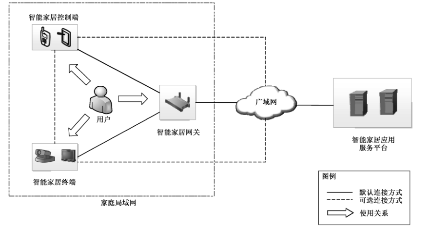
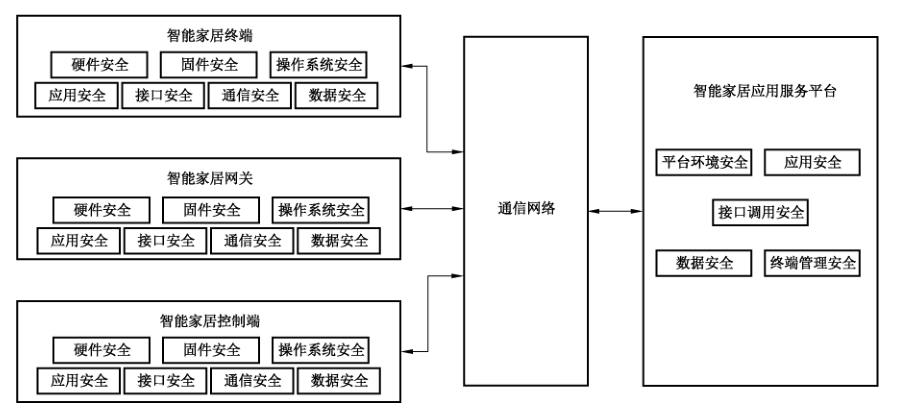
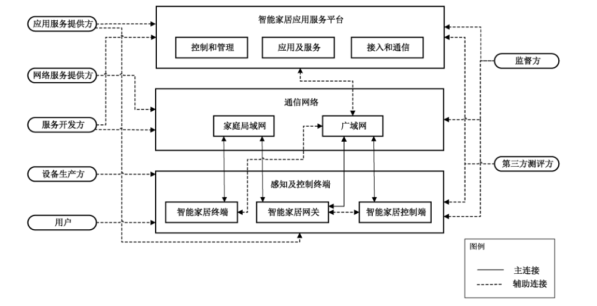

# GB/T 41387-2022 信息安全技术 智能家居通用安全规范

> 来源：[GB/T 41387-2022 国家标准详情](https://openstd.samr.gov.cn/bzgk/std/newGbInfo?hcno=B1C14E854C0BA30D1C29FC376299761A)。
> PDF SHA-256：9f8d1205207fe08cff7d3c548915c5842c4cdffa9bd3fa7bea11e1e0975d09d4。
> 发布日期：2022-04-15；实施日期：2022-11-01。依据官方 PDF 的 35 页图像逐页核对，恢复附录 A 层级，保留 3 幅图示，并去除封面、目录、分页和页眉页脚。正式引用请核对官方原文。

## 前言

本文件按照 GB/T 1.1—2020《标准化工作导则 第1部分：标准化文件的结构和起草规则》的规定起草。

请注意本文件的某些内容可能涉及专利。本文件的发布机构不承担识别专利的责任。

本文件由全国信息安全标准化技术委员会（SAC/TC 260）提出并归口。

本文件起草单位：中移（杭州）信息技术有限公司、中国移动通信集团有限公司、中国信息通信研究院、公安部第三研究所、国家计算机网络应急技术处理协调中心、中国电子技术标准化研究院、中国软件评测中心（工业和信息化部软件与集成电路促进中心）、中国网络安全审查技术与认证中心、北京京东尚科信息技术有限公司、联想（北京）有限公司、北京百度网讯科技有限公司、阿里巴巴（北京）软件服务有限公司、海信集团控股股份有限公司、青岛海尔科技有限公司、三六零科技集团有限公司、北京奇虎科技有限公司、深圳市优点科技有限公司、OPPO 广东移动通信有限公司、华为技术有限公司、北京小米移动软件有限公司、中国信息通信科技集团有限公司、杭州安恒信息技术股份有限公司、深圳市腾讯计算机系统有限公司。

本文件主要起草人：路晓明、张锦卫、邱勤、智绪龙、严寒冰、蔡一鸣、宁华、贾倩、王华景、程晋雪、鲁青、董靖宇、张峰、乔喆、刘陶、王艳红、吴怡、杜云、武林娜、顾健、张艳、刘继顺、郭晶、何清林、王晖、李世斌、申永波、孙科、李汝鑫、李笑如、包沉浮、黄天宁、高雪松、董征、井皓、刘建国、张屹、姚一楠、王宇、李腾、茹昭、衣强、李明菊、吴国燕、王辉、徐永太、李硕。

## 1 范围

本文件规定了智能家居安全通用技术要求和对应测试评价方法。

本文件适用于智能家居产品的安全设计和实现，智能家居的安全测试和管理也可参照使用。

## 2 规范性引用文件

下列文件中的内容通过文中的规范性引用而构成本文件必不可少的条款。其中，注日期的引用文件，仅该日期对应的版本适用于本文件。不注日期的引用文件，其最新版本（包括所有的修改单）适用于本文件。

- GB/T 25069 信息安全技术 术语

- GB/T 29234—2012 基于公用电信网的宽带客户网络安全技术要求

- GB/T 31168—2014 信息安全技术 云计算服务安全能力要求

- GB/T 35273—2020 信息安全技术 个人信息安全规范

- GB/T 36633—2018 信息安全技术 网络用户身份鉴别技术指南

- GB/T 39579—2020 公众电信网 智能家居应用技术要求

- GB/T 41388—2022 信息安全技术 可信执行环境 基本安全规范

- ISO/IEC 27033-6 信息技术 安全技术 网络安全 第 6 部分：无线 IP 网络接入安全保护（Information technology—Security techniques—Network security—Part 6: Securing wireless IP network access）

## 3 术语和定义

GB/T 25069、GB/T 39579—2020 和 GB/T 41388—2022界定的以及下列术语和定义适用于本文件。

### 3.1 智能家居系统 smart home system

利用家庭网络技术将家庭中各种通信设备、家用电器、家庭安保等装置连接到家庭智能化系统上进行集中的通信、监视、控制和家庭事务管理，以给智能家居用户提供便利舒适、安全、高效、环保的家庭生活的设备、网络、平台、应用的总称。

［来源：GB/T 39579—2020,3.1］

### 3.2 智能家居终端 smart home terminal

连接到家庭网络的、协同提供智能家居业务的各种终端设备。

> 注：包括提供安防、测量、控制、娱乐等业务的相关设备。

［来源：GB/T 39579—2020,3.4］

### 3.3 智能家居应用服务平台 application service platform of smart home

支持智能家居服务的软硬件基础设施，通过与智能家居终端、智能家居控制端协同，实现智能家居的应用服务。

### 3.4 智能家居控制端 smart home controller

与智能家居的用户交互，根据接收的用户指令或预先配置的任务，通过智能家居应用服务平台或智能家居网关向智能家居终端发出指令，实现智能家居应用服务的设备。

### 3.5 智能家居网关 smart home gateway

在智能家居中实现外部广域通信网络和内部家庭局域网络连通，为智能家居终端分配通信地址，并实现智能家居终端、智能家居应用服务平台和智能家居控制端的网络连接的设备。

### 3.6 安全元件 secure element

在智能家居设备中，通过安全芯片和芯片操作系统（COS）实现数据安全存储、加解密运算等功能的安全模块。

### 3.7 关键安全信息 critical security information

与安全相关的信息，其被泄露或被修改后会危及智能家居安全性。

> 注：例如后台系统管理员鉴别信息、操作系统登录鉴别信息、网络设备鉴别信息等。

### 3.8 可信执行环境 trusted execution environment

基于硬件级隔离及安全启动机制，确保安全敏感应用相关数据和代码的机密性、完整性、真实性和不可否认性目标构建的一种软件运行环境。其中，硬件级隔离是指基于硬件安全扩展机制，通过对计算资源的固定划分或动态共享，保证隔离资源不被富执行环境访问的一种安全机制。

［来源：GB/T 41388—2022,3.3］

## 4 缩略语

下列缩略语适用于本文件。

API：应用编程接口（Application Programming Interface）

Bin：二进制文件（Binary File）

CNNVD：国家信息安全漏洞库（China National Vulnerability Database of Information Security）

CNVD：国家信息安全漏洞共享平台（China National Vulnerability Database）

FTP：文件传输协议（File Transfer Protocol）

ID：身份标识（Identification）

IP：网络之间互联的协议（Internet Protocol）

MAC：媒体存取控制位址（Media Access Control Address）

NFC：近场通信（Near Field Communication）

SSH：安全外壳协议（Secure Shell）

URL：统一资源定位符（Uniform Resource Locator）

Web：全球广域网（World Wide Web）

## 5 智能家居系统组成及安全框架

### 5.1 智能家居系统组成

智能家居快速发展，出现大量应用场景（典型应用场景见附录 A中的A.1）。智能家居系统主要由智能家居用户、智能家居终端、智能家居控制端、智能家居网关、通信网络和智能家居应用服务平台组成，智能家居系统组成如图1所示，其中：

a） 智能家居用户即实际使用智能家居服务的终端用户；

b） 智能家居终端是实现智能家居应用具体功能的设备，为智能家居用户提供感知、数据采集及控制服务；

c） 智能家居控制端提供与智能家居用户交互的界面，实现对智能家居终端的控制和管理，进而实现智能家居应用；

d） 智能家居网关为智能家居环境提供网络连接，并提供本地场景化服务和设备管理功能；

e） 通信网络分为家庭局域网和广域网，为智能家居提供数据通信连接能力；

f） 智能家居应用服务平台是智能家居服务承载的功能实体，通过与智能家居终端、智能家居控制端协同，实现智能家居的应用服务。

> 注：“默认连接方式”表示采用有线或无线利用网关实现网络连接交互的方式，“可选连接方式”表示采用移动网络或通过蓝牙、紫蜂协议（ZigBee）、NFC 等技术实现网络连接交互的方式。

### 5.2 智能家居安全框架

在系统性分析智能家居系统各个环节安全风险基础上，本文件对智能家居安全框架进行了抽象，如图2所示（具体分析见 A.2 和 A.3）。凡涉及采用密码技术解决机密性、完整性、真实性、不可否认性需求的应遵循密码相关国家标准和行业标准。本文件主要考虑智能家居终端安全、智能家居网关安全、智能家居控制端安全和智能家居应用服务平台安全。

> 注：“通信网络”包含家庭局域网和广域网。双箭头连线表示智能家居终端、智能家居网关、智能家居控制端和智能家居应用服务平台相互之间通过通信网络进行通信的逻辑关系。

## 6 智能家居终端安全要求

### 6.1 硬件安全

#### 6.1.1 物理安全

对于物理安全要求包括：

a） 宜具备数据的物理保护机制，防止攻击者通过去除芯片表面封装层而获取存储器数据；

b） 宜具备在受到暴力移除或拆卸时的防护预警机制，如将预警信息上传至智能家居应用服务平台等方式。

#### 6.1.2 芯片安全

对于芯片安全要求包括：

a） 对于具备安全元件的芯片，应具备固件芯片的物理写保护的功能，防止固件被篡改；

b） 宜具备安全域隔离功能，提供可信执行环境；

c） 芯片宜使用拆卸存迹硬质涂层，防止直接观察和探测芯片内容以及在拆卸或移动芯片后留下证据；

d） 对于具备安全元件的芯片，宜具备侧信道攻击防护机制；

e） 宜具备安全启动硬件保护机制；

f） 宜具有硬件随机数发生器、密钥生成和加解密运算技术，加解密运算宜仅在可信执行环境内部处理；

g） 宜具备只有在可信执行环境内可访问安全存储区的功能。

### 6.2 固件安全

对于固件安全要求包括：

a） 应具备固件更新机制，且更新前宜向用户进行确认；

b） 应对远程下载的固件更新文件的来源进行校验；

c） 应确保固件下载传输通道可信，防止中间人劫持或者嗅探；

d） 应具备对固件升级文件完整性校验机制；

e） 应确保固件升级失败后固件的可用性；

f） 应确保固件不能通过物理接口提取出来，如串口读取等；

g） 应具备对固件中的关键代码及重要数据进行防逆向、防调试和防篡改的功能；

h） 不应将登录用户名、口令等登录凭证明文存储在设备固件中。

### 6.3 操作系统安全

#### 6.3.1 操作系统集成安全

对于具备操作系统的智能家居终端在进行操作系统集成时，要求包括：

a） 操作系统进行服务裁剪时，应符合模块最小化原则，仅保留必须的模块；

b）操作系统宜进行安全加固，具备防逆向、防调试和防篡改的功能。

#### 6.3.2 操作系统权限控制

对于具备操作系统的智能家居终端要求包括：

a） 对于支持多个用户账号的系统，用户权限分配应遵循最小权限原则，普通用户只拥有系统赋予的最小权限，禁止越权操作；

b） 系统应具备远程控制请求的身份鉴别机制，避免非法用户或应用控制系统；

c） 系统在安装应用时需要获得用户授权，应拒绝安装被用户拒绝的应用；应用安装时，权限分配采取授权最小化原则，系统应能禁止所有未被允许权限的使用；

d） 系统应对不同的应用进程及数据之间实施适当的访问控制管理措施，不同应用程序的进程及数据不能非授权访问；

e） 系统不应预留任何未公开账号，所有账号应可被操作系统管理；

f） 不应存在绕过正常鉴别机制直接进入到系统的隐秘通道，如：特定接口、特定客户端、特殊 URL 等。

#### 6.3.3 操作系统安全启动

对于具备操作系统的智能家居终端，在进行操作系统启动时，宜提供安全启动机制进行系统的真实性和完整性验证，当安全验证通过后，系统方能正常启动。

#### 6.3.4 操作系统更新安全

对于具备操作系统的智能家居终端要求包括：

a） 应具备操作系统更新机制，且更新前宜得到用户确认；

b） 更新时，应对更新文件的来源和完整性进行校验；

c） 更新失败时，应保证系统的可用性并给予用户相应的提示，且安全属性与升级前一致；

d） 应具备通过补丁或软件升级的方式消除安全漏洞的功能。

#### 6.3.5 操作系统配置安全

对于具备调试功能的智能家居终端，在进行操作系统配置时，应限制调试进程在操作系统中的访问权限和操作权限，防止权限设置过高导致权限滥用。

#### 6.3.6 服务配置安全

对于具备操作系统的智能家居终端要求包括：

a） 对于能够安装外部应用的系统，应提供对系统 API 的访问控制功能机制，防止应用对系统接口的非授权调用；

b） 对于可配置服务的操作系统，应具备修改默认配置的功能，具体功能要求包含但不限于修改默认身份和鉴别信息、服务启用和禁用、应用访问限制和应用后台刷新、数据上传、数据下载限制及监控；

c） 登录口令宜具有一定复杂度要求，字符长度应不少于八位，且应由大小写字母、数字和特殊符号中两种或两种以上类型组成；

d） 宜提供数据通信连接状态的标志；

e） 对于支持远程连接的设备，其操作系统应使用安全的通信协议保障通道安全，包括具备建立通道时的身份鉴别和传输数据的机密性与完整性保护机制；

f） 对于通过Web 进行远程管理的设备，对其进行管理和配置的行为应经过登录身份鉴别，其登录和退出过程需有日志记录；记录内容应至少包括登录使用的账号、登录是否成功、登录时间以及远程登录发起方的IP地址等信息。

#### 6.3.7 操作系统安全审计

对于具备操作系统的智能家居终端要求包括：

a） 应具备记录用户对设备操作的功能，记录包括但不限于用户对设备操作时所使用的账号、操作时间、操作内容以及操作结果；

b）宜自动将设备异常关机、重启、文件系统损坏等异常状态下产生的告警信息记入日志；

c） 对于具备文件系统的操作系统，应具备按账号分配日志文件读取的功能，防止日志文件被非法读取，且对于日志文件的删除操作仅允许管理员账号进行处理；

d） 应具备在日志分配的存储空间耗尽时，能够按照操作系统的设置采取措施的功能。例如，报警并丢弃未记录的信息、暂停日志录入、覆盖以前的日志等。

### 6.4 应用安全

智能家居终端上的应用安全要求包括：

a） 应具备防伪冒、防篡改、防逆向和防调试的功能；

b） 应具备防范越权操控和身份伪冒的功能；

c） 对设备密码、设备鉴别信息等关键安全信息进行加密处理，不应在日志和配置文件中明文记录关键安全信息；

d） 如需与智能家居应用服务平台或其他终端应用进行数据交互，则在传输之前应进行双向鉴别，并且应通过安全的网络传输协议进行通信，保护通信内容的机密性和完整性；

e） 应具备防止对身份验证数据进行暴力攻击破解的功能；

f） 应具备对输入数据格式的检验过滤机制；

g） 宜支持设备一机一密配置，密钥与设备唯一标识绑定，防止设备伪造；

h） 对于使用传统 Bin 应用编译宜在编译过程采用安全编译选项，降低内存攻击漏洞的影响；

i） 应确保应用不使用包含CNVD、CNNVD已公布90d以上的高危及以上等级未处置漏洞的第三方库和开源组件，并应具备根据新曝光漏洞自动或手动安装升级补丁的功能；

j） 宜具备应用安全事件的实时监测和应用审计机制。

### 6.5 接口安全

#### 6.5.1 硬件接口安全

对于硬件接口安全要求包括：

a） 对于具有 console 接口的设备，应配置用户名、口令等方式进行鉴别，禁止直接登录，口令字符长度应不少于八位，且应由大小写字母、数字、特殊符号中的两种或两种以上类型组成；

b） 对于使用无线和有线外围接口的设备，宜通过指示灯或显示屏等方式，提供数据传输状态的监控功能，不同的传输状态应有所差异；

c） 具有调试功能的接口，应在出厂时设置为默认关闭；

d） 宜具备防暴力破解的功能；

e） 宜支持一机一密鉴别机制。

#### 6.5.2 端口安全

对于端口安全要求包括：

a）端口开放应遵循最小化原则，默认关闭非必须使用的端口，如远程登录协议（Telnet）、SSH 等服务端口；对于必须使用的端口，使用后应关闭；

b） 系统应提示用户所有开放的端口，并告知对业务影响，用户可自主选择对服务端口开放或关闭的配置功能，避免存在用户未知且无法关闭的服务端口；

c） 宜具备防暴力破解的功能；

d） 宜支持一机一密鉴别机制。

### 6.6 通信安全

对于通信安全要求包括：

a） 对于使用无线接入网络技术的智能家居终端，通信安全应符合 ISO/IEC 27033-6中的规定；

b） 对于使用有线网络技术的智能家居终端，通信安全应符合 GB/T 29234—2012中的规定；

c） 通信配对时应对密钥进行加密传输，防止密钥泄露。

### 6.7 数据安全

对于数据安全要求包括：

a） 数据传输时，应用或系统应具备对数据机密性和完整性保护机制，且用于传输加密的密钥不应硬编码在代码中；

b） 应具备存储过程中对关键安全信息的机密性和完整性保护机制；

c） 对于能够安装第三方应用的系统，应具备对第三方应用软件访问数据权限的控制功能，能够发现或记录非授权应用访问数据；

d） 智能家居终端的个人信息安全，应符合 GB/T 35273—2020中第5章～第8章的要求。

## 7 智能家居网关安全要求

### 7.1 硬件安全

智能家居网关应符合6.1 硬件安全要求。

### 7.2 固件安全

智能家居网关应符合6.2固件安全要求。

### 7.3 操作系统安全

智能家居网关应符合6.3 操作系统安全要求。

### 7.4 应用安全

智能家居网关应用安全要求包括：

a） 应符合6.4应用安全的要求；

b） 对于支持本地 Web 管理功能的网关，其Web 管理应用应具备防护外部攻击功能，支持启动安全策略，如限制连续的非法登录尝试次数；

c） 应对安装包的完整性和来源的真实性进行校验，不应自动安装第三方应用软件。

### 7.5 接口安全

智能家居网关应符合6.5接口安全要求。

### 7.6 通信安全

#### 7.6.1 接入安全

对于智能家居网关接入安全，应符合6.6通信安全的要求。

#### 7.6.2 智能家居终端接入控制

智能家居终端连接智能家居网关时，对智能家庭网关要求包括：

a） 宜具备对接入的智能家居终端通过MAC地址等方式进行标记和过滤的功能；

b） 宜具备对接入的智能家居终端进行网络接入权限控制的功能，包括黑白名单控制、限速控制等；

c） 宜具备通过频段、信道划分等安全域划分方式对接入的智能家居终端进行安全隔离的功能。

#### 7.6.3 通信传输安全

智能家居网关应支持安全传输通道功能。

#### 7.6.4 网络攻击防护

智能家居网关的网络攻击防护要求包括：

a） 智能家居网关宜能够对接入的智能家居终端开放端口进行识别，对其中存在风险服务具备告警和屏蔽功能，如 Telnet、SSH 等服务；

b） 智能家居网关应具备对智能家居终端接收到的Telnet 等异常外部请求行为的检测、告警及连接阻断的功能；

c） 智能家居网关宜具备防止用户伪造源的组播的功能；

d） 智能家居网关应具备拒绝服务攻击源流量处置机制；

e） 智能家居网关应具备防火墙功能，能够根据策略对特定连接做阻断、限速，能够通过远程的方式进行防火墙配置及防护策略下发；

f） 智能家居网关宜具备对通过其传输的流量进行恶意 URL/IP 和僵尸、木马和蠕虫等病毒文件的检测、告警和拦截功能。

### 7.7 数据安全

智能家居网关应符合6.7数据安全的要求。

## 8 智能家居控制端安全要求

### 8.1 硬件安全

对于使用专用硬件设备的智能家居控制端，其硬件安全应符合6.1硬件安全的要求。

### 8.2 固件安全

对于使用专用硬件设备，且具备固件的智能家居控制端，其固件安全应符合6.2固件安全要求。

### 8.3 操作系统安全

对于使用专用硬件设备，且具备操作系统的智能家居控制端，其操作系统安全应符合6.3操作系统安全要求。

### 8.4 应用安全

智能家居控制端上的应用安全要求包括：

a） 应具备防伪冒、防篡改、防逆向和防调试的功能；

b） 应具备防范越权操控和身份伪冒的功能；

c） 在日志和配置文件中的用户鉴别信息等关键安全信息应进行加密处理；

d） 与智能家居终端进行数据交互，应通过安全网络协议传输；

e） 与智能家居应用服务平台进行数据交互，应通过安全网络协议进行传输，且在传输之前应进行双向鉴别；

f） 应具备防止对身份验证数据进行暴力攻击破解的功能；

g） 应具备在卸载应用时能够删除安装和使用过程中产生的资源文件、配置文件、用户数据和其他临时文件的功能；

h） 控制端应用应确保不使用包含CNVD、CNNVD已公布90d以上的高危及以上等级未处置漏洞的第三方库和开源组件，并应具备根据新曝光漏洞自动或手动安装升级补丁的功能。

### 8.5 接口安全

对于智能家居控制端的接口安全，应符合6.5 接口安全要求。

### 8.6 通信安全

对于智能家居控制端的通信安全，应符合6.6 通信安全要求。

### 8.7 数据安全

对于智能家居控制端的数据安全，应符合6.7 数据安全要求。

## 9 智能家居应用服务平台安全要求

### 9.1 平台环境安全

对于智能家居应用服务平台环境安全，应符合 GB/T 31168—2014中的规定。

### 9.2 应用安全

#### 9.2.1 身份鉴别

智能家居应用服务平台的身份鉴别要求包括：

a） 应对使用智能家居应用服务平台应用的用户进行身份鉴别，并应符合 GB/T 36633—2018 中的安全要求。

b） 应对应用服务平台的应用进行身份鉴别，应符合如下安全要求：

1） 构建应用标识体系，为每个应用分配唯一的身份标识；

2） 应对接入平台的应用进行身份鉴别，只有通过身份鉴别的应用才能接入应用服务平台执行后续的业务调用；

3） 应为不同的应用分配不同的密钥，并支持密钥的生成、分发、存储、更新等密钥管理功能；

4） 对接口的调用都应经过鉴权，限定可操作的资源范围、操作权限。

c） 应对接入应用服务平台的设备进行身份鉴别，应符合如下安全要求：

1） 应构建设备标识体系，为每个智能家居终端分配唯一的身份标识，并与设备信息进行关联，如设备厂商、设备类型、型号等信息；

2） 应通过预置密钥、密钥协商等方式，为每个设备分配唯一的设备密钥，并支持密钥的生成、分发、存储、更新等密钥管理功能；

3） 应对接入平台的设备进行身份鉴别，只有通过身份鉴别的设备才能接入应用服务平台进行后续应用操作，身份鉴别的方式包括验证 PIN 码等有效验证用户身份的信息；

4） 设备鉴别过程如需使用随机数机制，应使用系统真随机生成，如 /dev/urandom、/dev/random 等随机算法，确保不可预测，不应使用 srand 等伪随机算法（时间做种子）；

5） 对于支持应用账号绑定的设备，宜通过对原账号解绑后才可进行重新绑定，不宜通过设备重置方式进行账号重新绑定。

d） 应具备对访问应用服务平台的平台管理人员进行身份鉴别的功能，其宜采用两种或两种以上多因素身份鉴别技术进行身份鉴别，其中至少一种鉴别技术应使用密码技术来实现。

#### 9.2.2 权限控制

智能家居应用服务平台的权限控制要求包括：

a） 应支持用户分级分组，并根据不同用户等级、分组授予不同的业务访问权限，只允许获得授权的用户访问指定的数据及内容、执行相应应用操作；

b） 应根据不同的应用等级授予不同的应用访问权限，只允许获得授权的应用，调用指定的应用能力、执行对应的操作；

c） 应根据不同的设备类型或等级授予不同的应用访问权限，只允许获得授权的设备，访问指定的数据及信息、执行对应的操作。

### 9.3 接口调用安全

对于智能家居服务平台间的接口调用安全要求包括：

a） 应具备平台与平台之间的合法性校验机制，防止应用服务平台冒用和越权访问；

b） 被调用应用服务平台应具备针对源IP地址范围进行授权的功能，调用该平台时除提供静态口令外还需要对IP 地址范围进行授权；

c） 被调用平台应具备对所调用资源记录完整操作日志的功能；

d）对于用户访问权限有要求的接口，应具备访问控制（例如，黑/白名单）机制，以便对非法用户访问进行拦截；

e） 应具备恶意攻击的识别与阻断功能。

### 9.4 数据安全

#### 9.4.1 数据传输安全

智能家居应用服务平台之间的数据传输要求包括：

a） 应具备与智能家居终端、智能家居控制端、其他平台之间的数据传输机密性保护机制；

b） 应具备与智能家居终端、智能家居控制端、其他平台之间的数据完整性保护机制，如使用哈希算法、时间戳、计数器等，防止未授权的第三方对数据进行修改、破坏和消息重放等。

#### 9.4.2 数据访问控制

智能家居应用服务平台的数据访问控制要求包括：

a） 应具备权限控制功能，如在虚拟化系统上对于数据库设置不同的访问策略，保证用户仅能对该系统对应的数据库进行权限以内的相关操作，不能访问其他未被授权的系统数据；

b） 应具备对涉及关键安全信息的文件进行权限控制的功能，只允许具有相应权限的用户访问；

c） 对数据的上传下载操作，应具备限制用户向上跨目录访问的功能，只允许其访问指定目录下的文件。

#### 9.4.3 数据存储安全

智能家居应用服务平台的数据存储安全要求包括：

a） 应具备密钥安全存储功能，如将密钥存储在加密机或特定代理内部，保证密钥不被泄露；

b） 应具备数据完整性保护功能，对关键安全信息进行完整性检测，确保关键安全信息在损坏和丢失时能够及时发现；

c） 应具备完备的数据备份和恢复功能，一旦发生数据丢失或破坏，可以利用备份恢复数据，保证数据在故障发生后不会丢失；

d） 应具备对各类数据和文件进行归档和对临时数据及文件进行定期自动清理的功能；

e） 当数据删除后系统内的文件、目录和数据库等资源所在存储空间被释放或重新分配时，应具备数据的完全清除和不可恢复的功能。

#### 9.4.4 个人信息安全

智能家居应用服务平台的个人信息安全，应符合GB/T 35273—2020中第5章～第10章的要求。

### 9.5 终端管理安全

对于智能家居应用服务平台终端管理安全要求包括：

a） 应具备设备的信息安全上报和指令安全下发功能，保证上报信息和下发指令的完整性和机密性；

b） 应具备固件安全升级功能，确保固件升级文件的完整性和机密性，并应支持对升级后的固件来源的真实性进行验证。

## 10 智能家居安全通用测试方法

### 10.1 总体说明

测试方法与技术要求一一对应，在技术要求中，每条技术要求对应的测试评价由检测方法、预期结果和结果判定组成。

### 10.2 智能家居终端安全测试方法

#### 10.2.1 硬件安全

##### 10.2.1.1 物理安全

物理安全的测试方法、预期结果和结果判定如下。

a） 检测方法：

1） 核查芯片内是否设置光敏检测电路、温度检测电路、电压电路检测、温度检测电路以及频率检测电路等模块，对芯片工作环境进行监控，当攻击者通过去除芯片表面封装层而试图获取存储器数据时，检测模块是否会产生警告信息；或者核查是否对芯片内部总线以及存储器等重要敏感电路部分添加物理保护层；或者核查是否具有抗功耗分析攻击的能力；

2） 通过暴力移除或者拆卸操作，验证智能家居终端是否具有防护预警机制，如将预警信息上传至智能家居应用服务平台等方式。

b） 预期结果：

1） 芯片具备数据的物理保护机制，防止攻击者通过去除芯片表面封装层而获取存储器数据；

2） 智能家居终端具备在受到暴力移除或拆卸时的防护预警机制，如将预警信息上传至智能家居应用服务平台等方式。

c） 结果判定：若智能家居终端满足以上预期结果，则该项目测评结果为“符合要求”，否则为“不符合要求”，测评结束。

##### 10.2.1.2 芯片安全

芯片安全的测试方法、预期结果和结果判定如下。

a） 检测方法：

1） 对于具备安全元件的芯片，尝试篡改芯片内部固件数据，验证固件芯片是否具有物理写保护的功能；

2） 审查厂商提交的文档，查看芯片是否具有安全域隔离功能，提供可信执行环境；

3） 审查厂商提交的文档，查看芯片是否使用拆卸存迹硬质涂层，可以防止直接观察和探测芯片内容以及拆卸或移动芯片后留下证据；

4） 审查厂商提交的文档，查看出厂前是否擦除主控芯片表面的型号、厂商等信息，增加破解难度；

5） 审查厂商提交的文档，查看是否具备安全启动硬件保护机制；

6） 审查厂商提交的文档，查看是否具有硬件真随机数、硬件加密密钥和加解密技术，硬件加密密钥只在可信执行环境内部处理；

7） 审查厂商提交的文档，查看是否具备只有可信执行环境可访问安全存储区的功能。

b） 预期结果：

1） 具备安全元件的芯片，固件芯片具有物理写保护的功能，防止固件被篡改；

2） 芯片具有安全域隔离功能，提供可信执行环境；

3） 芯片使用拆卸存迹硬质涂层，防止直接观察和探测芯片内容，以及拆卸或移动芯片后留下证据；

4） 出厂前擦除主控芯片表面的型号、厂商等信息，增加破解难度；

5） 具备安全启动硬件保护机制；

6） 具备硬件真随机数、硬件加密密钥和加解密技术，硬件加密密钥只在可信执行环境内部处理；

7） 具备只有可信执行环境可访问安全存储区的功能。

c） 结果判定：若智能家居终端满足以上预期结果，则该项目测评结果为“符合要求”，否则为“不符合要求”，测评结束。

#### 10.2.2 固件安全

固件安全的测试方法、预期结果和结果判定如下。

a） 检测方法：

1） 审查厂商提交的文档，查看是否具备固件更新机制，尝试进行固件更新，检查是否具备向用户进行确认的功能；

2） 在升级服务器中添加用于测试的新版本固件，启动固件升级，检查固件升级前是否对固件升级包验证来源的真实性；

3） 审查厂商提交的文档，查看固件下载链路是否可防止中间人劫持或者嗅探；

4） 修改固件升级文件的内容，在授权的条件下，进行系统更新，检查是否可以通过完整性校验，完成更新；

5） 尝试推送不正确的固件给设备，使升级失败，验证设备是否可以恢复到可用的版本；

6） 通过设备上各类物理接口连接到设备，并尝试进行固件读取，检测固件是否能通过物理接口读取的手段提取出来；

7） 检查固件的安全设计文档，确认固件中的关键代码及重要数据是否具备防逆向、防调试和防篡改等功能；

8） 检查固件的安全设计文档，查看其是否存在将登录用户名、口令等登录凭证明文存储在设备固件中的情况。

b） 预期结果：

1） 具备固件更新机制，且更新前向用户进行确认；

2） 固件升级前对固件升级包来源的真实性进行验证；

3） 固件下载链路可以确保可信，能够防止中间人劫持或者嗅探；

4） 修改固件升级文件的内容，在授权的条件下，进行系统更新，不能通过完整性校验，更新失败；

5） 推送不正确的固件给设备，使升级失败，设备可以恢复到可用的版本；

6） 固件不能通过物理接口等手段提取出来；

7） 固件中的关键代码及重要数据具备防逆向、防调试和防篡改等功能；

8） 不存在将登录用户名、口令等登录凭证明文存储在设备固件中的情况。

c） 结果判定：若智能家居终端满足以上预期结果，则该项目测评结果为“符合要求”，否则为“不符合要求”，测评结束。

#### 10.2.3 操作系统安全

##### 10.2.3.1 操作系统集成安全

操作系统集成安全的测试方法、预期结果和结果判定如下。

a） 检测方法：

1） 审查厂商提交的文档，查看操作系统进行服务裁剪时，是否满足模块最小化原则，且仅保留必要的模块；

2） 核查操作系统是否进行安全加固，是否具有防逆向、防调试和防篡改的功能。

b） 预期结果：

1） 操作系统进行服务裁剪时，满足模块最小化原则，仅保留必须的模块；

2） 操作系统进行安全加固，具备防逆向、防调试和防篡改的功能。

c） 结果判定：若智能家居终端满足以上预期结果，则该项目测评结果为“符合要求”，否则“不符合要求”，测评结束。

##### 10.2.3.2 操作系统权限控制

操作系统权限控制的测试方法、预期结果和结果判定如下。

a） 检测方法：

1） 创建多个用户账户，验证用户权限分配是否遵循最小权限原则，普通用户是否只拥有系统赋予的最小权限，尝试越权操作，该越权操作是否被禁止；

2） 申请远程控制，验证系统是否具有身份鉴别机制，是否可以禁止非法用户或应用控制系统；

3） 在系统上申请安装应用，验证是否需要获得用户授权才能安装；如果用户拒绝安装该应用，系统是否拒绝安装应用；在应用安装时，验证权限分配是否采取授权最小化原则，系统是否禁止所有未被允许权限的使用；

4） 当不同的应用进程或数据之间进行访问时，验证系统是否具有访问控制机制，不同应用程序的进程及数据是否禁止随意互访；

5） 审查厂商提交的文档，查看系统是否禁止预留任何的未公开账号，所有账号都必须可被操作系统管理；

6） 审查厂商提交的文档，查看是否禁止存在绕过正常鉴别机制直接进入到系统的隐秘通道，如：特定接口、特定客户端、特殊 URL等。

b） 预期结果：

1） 对于支持多个用户账户的系统，用户权限分配遵循最小权限原则，普通用户只拥有系统赋予的最小权限，禁止越权操作；

2） 申请远程控制，系统对远程控制的请求进行身份鉴别，可以防止非法用户或应用控制系统；

3） 系统在应用安装时需要获得用户授权，且系统拒绝安装被用户拒绝的应用；应用安装时，权限分配采取授权最小化原则，系统可以禁止所有未被允许权限的使用；

4） 系统对不同的应用进程及数据之间实施适当的访问控制管理，不同应用程序的进程及数据不能随意互访；

5） 系统禁止预留任何的未公开账号，所有账号都必须可被操作系统管理；

6） 禁止存在绕过正常鉴别机制直接进入到系统的隐秘通道，如：特定接口、特定客户端、特殊 URL 等。

c） 结果判定：若智能家居终端满足以上预期结果，则该项目测评结果为“符合要求”，否则“不符合要求”，测评结束。

##### 10.2.3.3 操作系统安全启动

操作系统安全启动的测试方法、预期结果和结果判定如下。

a） 检测方法：审查厂商提交的文档，查看智能家居终端设备是否具有安全启动机制；在非授权的条件下修改启动分区，重新启动操作系统；检查修改的代码是否可以通过真实性和完整性验证。

b） 预期结果：智能家居终端设备具有安全启动机制，在非授权的条件下修改启动分区，重新启动操作系统，修改后的代码不能通过真实性和完整性验证，系统无法正常启动。满足为“符合”，其他情况为“不符合”。

c） 结果判定：若智能家居终端满足以上预期结果，则该项目测评结果“符合要求”，否则为“不符合要求”，测评结束。

##### 10.2.3.4 操作系统更新安全机制

操作系统更新安全机制的测试方法、预期结果和结果判定如下。

a） 检测方法：

1） 审查厂商提交的文档，查看是否具备操作系统更新机制，尝试进行操作系统更新，检查是否具备向用户进行确认的功能；

2） 修改更新文件的来源，在授权的条件下，进行系统更新，检查是否可以通过校验，完成更新；修改更新文件的内容，在授权的条件下，进行系统更新，检查是否可以通过完整性校验，完成更新；

3） 尝试推送不正确的操作系统，使升级失败，验证是否可以恢复到可用的版本；

4） 审查厂商提交的文档，查看操作系统是否具备通过补丁或软件升级的方式消除高危及以上等级安全漏洞的功能。

b） 预期结果：

1） 具备操作系统更新机制，且更新前宜得到用户确认；

2） 修改更新文件的来源，在授权的条件下，进行系统更新，未通过校验，更新失败；修改更新文件的内容，在授权的条件下，进行系统更新，未通过校验，更新失败；

3） 推送不正确的操作系统，使升级失败，设备可以恢复到可用的版本；

4） 操作系统具备通过补丁或软件升级的方式消除高危及以上等级安全漏洞的功能。

c） 结果判定：若智能家居终端满足以上预期结果，则该项目测评结果为“符合要求”，否则为“不符合要求”，测评结束。

##### 10.2.3.5 操作系统配置安全

操作系统配置安全的测试方法、预期结果和结果判定如下。

a） 检测方法：审查厂商提交的文档，查看具备调试功能的设备，是否限制调试进程在操作系统中的访问权限和操作权限；使用调试进程，进行非授权的访问，检查是否可以访问成功；使用调试进程，进行非授权操作，检查是否操作成功。

b） 预期结果：对具备调试功能的设备，限制调试进程在操作系统中的访问权限和操作权限；使用调试进程，进行非授权访问，访问失败；使用调试进程，进行非授权操作，操作失败。

c） 结果判定：若智能家居终端满足以上预期结果，则该项目测评结果为“符合要求”，否则为“不符合要求”，测评结束。

##### 10.2.3.6 服务配置安全

服务配置安全的测试方法、预期结果和结果判定如下。

a） 检测方法：

1） 审查厂商提交的文档，查看对于能够安装外部应用的系统，是否提供对系统API 的访问控制机制，防止应用对系统接口的非授权调用；

2） 审查厂商提交的文档，查看对于可配置服务的系统，是否具备修改默认配置的功能，具体功能要求包含但不限于修改默认身份和鉴别信息、服务启用和禁用、应用访问限制和应用后台刷新、数据上传、数据下载限制及监控；尝试修改服务的默认配置，是否包含修改默认身份和鉴别信息、服务启用和禁用、应用访问限制和应用后台刷新、数据上传、数据下载限制及监控，但不限于这些功能；

3） 将少于八位的弱口令设置系统登录口令，验证是否设置成功；检查登录口令是否由大小写字母、数字和特殊符号中两种或两种以上类型组成；

4） 进行数据通信时，检查是否有标志显示连接状态；

5） 对于支持远程连接的设备，验证系统所使用通信协议是否可保障鉴别信息、用户个人信息等敏感数据传输的保密性和完整性，且是否未使用 SSL 2.0.0、SSL 3.0 和 TLS 1.0 等已曝存在高危漏洞风险的协议版本；在建立通道时，是否进行身份鉴别；在传输数据时，是否对数据进行机密性与完整性的验证；

6） 通过 Web 进行远程管理的设备，对其进行管理和配置时，是否经过身份鉴别；在登录和退出的过程，是否有日志记录，记录内容是否至少包括登录使用的账号、登录是否成功、登录时间以及远程登录发起方的IP 地址等信息。

b） 预期结果：

1） 对于能够安装外部应用的系统，提供对系统 API 的访问控制机制；

2） 对于可配置服务的系统，具备修改默认配置的功能，具体功能要求包含但不限于修改默认身份鉴别信息、服务启用和禁用、应用访问限制和应用后台刷新、数据上传、数据下载限制及监控；

3） 将少于八位的弱口令设置系统登录口令，设置不成功；登录口令由大小写字母、数字和特殊符号中两种或两种以上类型组成；

4） 进行数据通信时，有标志显示连接状态；

5） 对支持远程连接的设备，系统使用安全的通信协议保障通道安全；在建立通道时，应进行身份鉴别；在传输数据时，对数据进行机密性与完整性的验证；

6） 通过 Web 进行远程管理的设备，对其进行管理和配置时，应经过身份鉴别；日志记录登录/退出的过程，记录内容至少包括登录使用的账号、登录是否成功、登录时间以及远程登录发起方的IP地址等信息。

c） 结果判定：若智能家居终端满足以上预期结果，则该项目测评结果为“符合要求”，否则为“不符合要求”，测评结束。

##### 10.2.3.7 操作系统安全审计

操作系统安全审计的测试方法、预期结果和结果判定如下。

a） 检测方法：

1） 当用户对设备进行操作时，检查是否进行了日志记录，记录内容是否至少包含用户对设备操作时所使用的账号、操作时间、操作内容以及操作结果；

2） 检查设备在异常关机、重启、文件系统损坏时产生的告警信息，是否自动记入日志；

3） 对于具备文件系统的系统，检查是否具备按账号分配日志文件读取的功能，尝试使用其他合法账户读取现在账户的日志文件，检查是否可以读取；使用非超级管理员账户对日志文件进行删除操作，检查是否删除成功；

4） 检查设备当日志分配的存储空间耗尽时，是否按操作系统的设置决定采取的措施，例如，报警并丢弃未记录的信息、暂停日志录入、覆盖以前的日志等。

b） 预期结果：

1） 当用户对设备进行操作时，设备对其进行了日志记录，记录内容至少包含用户对设备操作时所使用的账号、操作时间、操作内容以及操作结果；

2） 设备在异常关机、重启、文件系统损坏时产生的告警信息，自动记入日志；

3） 对于具备文件系统的系统，具备按账号分配日志文件读取的功能，使用其他合法账户读取现在账户的日志文件，读取失败；使用非超级管理员账户对日志文件进行删除操作，删除失败；

4） 当为日志分配的存储空间耗尽时，可按操作系统用户的设置采取措施，包括报警并丢弃未记录的信息、暂停日志录入、覆盖以前的日志等。

c） 结果判定：若智能家居终端满足以上预期结果，则该项目测评结果为“符合要求”，否则为“不符合要求”，测评结束。

#### 10.2.4 应用安全

应用安全的检测方法、预期结果和结果判定如下。

a） 检测方法：

1） 使用交互式反汇编软件等反编译工具，检测应用是否具备防伪冒、防篡改、防逆向和防调试的功能；

2） 尝试越权操作，检查是否可以操作；尝试非法身份操作，检查是否可以操作；

3） 检查在日志和配置文件中，是否明文记录设备密码、设备鉴别信息等关键安全信息；

4） 与智能家居应用服务平台进行数据交互时，检查在传输之前是否进行双向鉴别，并且在通信时是否采用安全网络协议；

5） 检查是否具有防止身份验证数据被暴力攻击的功能；

6） 检查是否具备对输入数据格式的检验机制，输入不安全的数据，是否会进行过滤处理；

7） 审查厂商提交的文档，查看是否支持设备一机一密配置，密钥与设备唯一标识绑定，防止设备伪造；

8） 检测使用传统 Bin应用编译在编译过程中是否采用安全编译选项，以降低内存攻击漏洞的影响；

9） 检查应用是否使用包含CNVD、CNNVD已公布90d 以上的高危及以上等级未处置漏洞的第三方库和开源组件，验证其是否具备根据新曝光漏洞自动或手动安装升级补丁的功能；

10） 审查厂商提交的文档，查看是否具备应用安全事件的实时监测和应用审计机制。

b） 预期结果：

1） 应用具备防伪冒、防篡改、防逆向和防调试的功能；

2） 对应用进行越权操作，操作失败；使用非法身份操作，操作失败；

3） 在日志和配置文件中，对设备密码、设备鉴别信息等关键安全信息进行加密存储；

4） 与智能家居应用服务平台进行数据交互时，在传输之前进行双向鉴别，并且在通信时采用安全网络协议；

5） 具备防止身份验证数据被暴力攻击的功能；

6） 具备对输入数据格式的检验机制，输入不安全的数据，会进行过滤处理；

7） 支持设备一机一密配置，密钥与设备唯一标识绑定，防止设备伪造；

8） 对于使用传统 Bin 应用编译宜在编译过程采用安全编译选项，降低内存攻击漏洞的影响；

9） 应用未使用包含CNVD、CNNVD 已公布90d以上的高危及以上等级未处置漏洞的第三方库和开源组件，并具备根据新曝光漏洞自动或手动安装升级补丁的功能；

10） 具备应用安全事件的实时监测和应用审计机制。

c） 结果判定：若智能家居终端满足以上预期结果，则该项目测评结果为“符合要求”，否则为“不符合要求”，测评结束。

#### 10.2.5 接口安全

##### 10.2.5.1 硬件接口安全

硬件接口安全的测试方法、预期结果和结果判定如下。

a） 检测方法：

1） 对于具有 console 接口的设备，检查用户是否需要配置用户名、口令等方式鉴别才能进行登录，是否已禁止直接登录；口令是否符合长度不少于八位，并使用大小写字母、数字、特殊符号等方式两种或两种以上组成的复杂口令；

2） 使用无线和有线外围接口传输数据，验证是否具有通过指示灯或显示屏等方式监控数据传输状态的功能，在不同的传输状态，监控显示是否有差异；

3） 检查具备调试功能的接口，在出厂时是否设置为默认关闭；

4） 使用暴力破解工具对硬件接口进行暴力破解，检测其是否具备防暴力破解的功能；

5） 审查厂商提交的文档，查看硬件接口是否支持一机一密鉴别机制。

b） 预期结果：

1） 对于具有 console 接口的设备，用户需要配置用户名、口令等方式得到鉴别授权，才能进行登录，已禁止直接登录；口令使用大小写字母、数字、特殊符号等方式两种或两种以上组成的复杂口令；

2） 对于使用无线和有线外围接口的设备，通过指示灯或显示屏等方式，提供数据传输状态的监控功能，不同的传输状态有所差异；

3） 具备调试功能的接口，在出厂时设置为默认关闭；

4） 硬件接口具备防暴力破解的功能；

5） 硬件接口支持一机一密鉴别机制。

c） 结果判定：若智能家居终端满足以上预期结果，则该项目测评结果为“符合要求”，否则为“不符合要求”，测评结束。

##### 10.2.5.2 端口安全

端口安全的测试方法、预期结果和结果判定如下。

a） 检测方法：

1） 审查厂商提交的文档，查看系统服务授权是否遵循最小化原则，是否默认关闭 Telnet 和 SSH 服务端口；在授权的条件下，调用 Telnet 接口，检查是否可以调用；在授权条件下，调用 SSH 接口，检查是否可以调用；

2） 检查系统是否提示用户所有开放的端口，并告知对业务影响，检查用户是否可自主选择对服务端口开放或关闭的配置功能；

3） 使用暴力破解工具对端口进行暴力破解，检测其是否具备防暴力破解的功能；

4） 审查厂商提交的文档，查看端口是否支持一机一密鉴别机制。

b） 预期结果：

1） 系统服务授权遵循最小化原则，默认关闭Telnet 和 SSH 服务端口；在授权的条件下，调用 Telnet 接口，调用失败；在授权条件下，调用SSH 接口，调用失败；

2） 系统应提示用户所有开放的端口，并告知对业务影响，用户可自主选择对服务端口开放或关闭的配置功能，避免存在用户未知且无法关闭的服务端口。

3） 端口具备防暴力破解的功能；

4） 端口支持一机一密鉴别机制。

c） 结果判定：若智能家居终端满足以上预期结果，则该项目测评结果为“符合要求”，否则为“不符合要求”，测评结束。

#### 10.2.6 通信安全

通信安全的检测方法、预期结果和结果判定如下。

a） 检测方法：

1） 对于使用无线接入网络技术的智能家居终端，查看客户是否能提供 ISO/IEC 27033-6 中对于无线IP 网络接入对应项的符合性证明；

2） 对于使用有线网络技术的智能家居终端，查看客户是否提供 GB/T 29234—2012 中对于有线网络接入对应项的符合性证明；

3） 检查智能家居终端在通信配对时是否对密钥进行有效的加密传输。

b） 预期结果：

1） 对于使用无线接入网络技术的智能家居终端，客户提供的证明，符合 ISO/IEC 27033-6 中对于无线 IP 网络接入的安全要求；

2） 对于使用有线网络技术的智能家居终端，客户提供的证明，符合 GB/T 29234—2012 中对于有线网络接入的安全要求；

3） 在通信配对时对密钥进行加密传输。

c） 结果判定：若智能家居终端满足以上预期结果，则该项目测评结果为“符合要求”，否则为“不符合要求”，测评结束。

#### 10.2.7 数据安全

数据安全的测试方法、预期结果和结果判定如下。

a） 检测方法：

1） 审查厂商提交的文档，查看在数据传输时，应用或系统是否具备对敏感数据进行保护的功能，保障关键安全信息的机密性、完整性和有效性，用于传输加密的密钥不是硬编码在代码中；扫描设备的通信端口，检查是否能获取敏感信息；

2） 对于数据库连接密码、FTP服务口令、登录口令、外部系统接口鉴别口令等关键安全信息，检查是否具备机密性和完整性保护机制；

3） 对于能够安装第三方应用的系统，检查是否具备对第三方应用软件访问数据权限的控制功能，进行非授权访问数据，是否能够发现或记录该操作；

4） 查看厂商是否能提供 GB/T 35273—2020中第5章～第8章对应项的符合性证明。

b） 预期结果：

1） 在数据传输时，应用或系统具备对敏感数据进行保护的功能，保障关键安全信息的机密性、完整性和有效性，用于传输加密的密钥不是硬编码在代码中；扫描设备的通信端口，不能获取敏感信息；

2） 对于数据库连接密码、FTP 服务口令、登录口令、外部系统接口鉴别口令等关键安全信息，具备机密性和完整性保护机制；

3） 对于能够安装第三方应用的系统，具备对第三方应用软件访问数据权限的控制功能，进行非授权访问数据，能够发现或记录该操作；

4） 厂商提供的证明，符合 GB/T 35273—2020中第5章～第8章对应项的要求。

c） 结果判定：若智能家居终端满足以上预期结果，则该项目测评结果为“符合要求”，否则为“不符合要求”，测评结束。

### 10.3 智能家居网关安全测试方法

#### 10.3.1 硬件安全

硬件安全的测试方法、预期结果和结果判定参照 10.2.1。

#### 10.3.2 固件安全

固件安全的测试方法、预期结果和结果判定参照 10.2.2。

#### 10.3.3 操作系统安全

操作系统安全的测试方法、预期结果和结果判定参照 10.2.3。

#### 10.3.4 应用安全

应用安全的测试方法、预期结果和结果判定如下。

a） 检测方法：

1） 检测方法参照 10.2.4；

2） 审查厂商提交的文档，查看对于支持本地 Web 管理网关的应用，是否满足登录错误次数限制等安全要求；尝试错误登录，达到规定错误次数时，验证设备是否采取相应安全措施；

3） 检查是否对安装包的完整性和来源的真实性进行校验，以及是否存在自动安装第三方应用软件。

b） 预期结果：

1） 预期结果参考 10.2.4；

2） 对于支持本地 Web 管理网关的应用，满足登录错误次数限制等安全要求；

3） 对安装包的完整性和来源的真实性进行校验，且不存在自动安装第三方应用软件。

c） 结果判定：若智能家居网关满足以上预期结果，则该项目测评结果为“符合要求”，否则为“不符合要求”，测评结束。

#### 10.3.5 接口安全

接口安全的测试方法、预期结果和结果判定参照10.2.5。

#### 10.3.6 通信安全

##### 10.3.6.1 接入安全

接入安全的测试方法、预期结果和结果判定如下。

a） 测试方法：

1） 对于使用无线接入网络技术的智能家居网关，通信安全应符合 ISO/IEC 27033-6 中对于无线 IP 网络接入的安全要求；

2） 对于使用有线网络技术的智能家居网关，通信安全应符合 GB/T 29234—2012 中对于宽带有线网络接入的安全要求；

3） 检查智能家居网关在通信配对时是否对配对产生的密钥进行有效的加密传输。

b） 预期结果：

1） 对于使用无线接入网络技术的智能家居网关，客户提供的证明，符合 ISO/IEC 27033-6 中对于无线 IP 网络接入的安全要求；

2） 对于使用有线网络技术的智能家居网关，客户提供的证明，符合 GB/T 29234—2012 中对于宽带有线网络接入的安全要求；

3） 在通信配对时对配对产生的密钥进行加密传输。

c） 结果判定：若智能家居网关满足以上预期结果，则该项目测评结果为“符合要求”，否则为“不符合要求”，测评结束。

##### 10.3.6.2 智能家居终端接入控制

智能家居终端接入控制的测试方法、预期结果和结果判定如下。

a） 测试方法：

1） 审查厂商提交的文档，查看是否具备通过MAC地址等方式进行智能家居终端绑定标记和过滤的功能；

2） 审查厂商提交的文档，查看是否支持对接入的智能家居终端进行网络接入权限控制，包括黑白名单控制、限速控制、访问时长控制等；尝试设置黑白名单控制、限速控制、访问时长控制等；

3） 审查厂商提交的文档，查看是否支持通过安全域划分、频段、信道划分等安全域划分方式对接入的智能家居终端进行安全隔离。

b） 预期结果：

1） 具备通过 MAC地址等方式进行智能家居终端绑定标记和过滤的功能；

2） 支持对接入的智能家居终端进行网络接入权限控制，包括黑白名单控制、限速控制、访问时长控制等；可以设置黑白名单控制、限速控制、访问时长控制等；

3） 支持通过安全域划分、频段、信道划分等安全域划分方式对接入的智能家居终端进行安全隔离。

c） 结果判定：若智能家居网关满足以上预期结果，则该项目测评结果为“符合要求”，否则为“不符合要求”，测评结束。

##### 10.3.6.3 通信传输安全

通信传输安全的测试方法、预期结果和结果判定如下。

a） 测试方法：审查厂商提交的文档，查看智能家居网关是否支持安全传输通道能力。

b） 预期结果：智能家居网关支持安全传输通道能力。

c） 结果判定：若智能家居网关满足以上预期结果，则该项目测评结果为“符合要求”，否则为“不符合要求”，测评结束。

##### 10.3.6.4 网络攻击防护

网络攻击防护的测试方法、预期结果和结果判定如下。

a） 测试方法：

1） 尝试在智能家居网关中，接入非法终端，验证其是否可以识别存在风险的服务，并告警和屏蔽，如 Telnet、SSH 等服务；

2） 尝试对家庭设备 Telnet 请求，验证智能家居网关是否可以检测到这种异常行为并进行告警及连接阻断；

3） 尝试进行用户伪造源的组播，验证智能家居网关是否可以阻止这种行为；

4） 审查厂商提交的文档，查看智能家居网关是否具备拒绝服务攻击源流量清洗功能，并对内部输出的异常流量进行检测和处置；

5） 审查厂商提交的文档，查看智能家居网关是否支持防火墙功能，能够根据策略对特定连接做阻断、限速，能够通过远程的方式进行防火墙配置及防护策略下发；

6） 尝试对通过智能家居网关传输的流量进行恶意 URL/IP、僵尸、木马和蠕虫等病毒文件攻击，验证其是否可以检测、告警和拦截。

b） 预期结果：

1） 在智能家居网关中，接入非法终端，其可以识别存在风险的服务，并告警和屏蔽，如Telnet、SSH 等服务；

2） 对家庭设备 Telnet 请求，智能家居网关可以检测到这种异常行为并进行告警及连接阻断；

3） 进行用户伪造源的组播，智能家居网关可以阻止这种行为；

4） 智能家居网关具备拒绝服务攻击源流量清洗功能，并对内部输出的异常流量进行检测和处置；

5） 智能家居网关支持防火墙功能，能够根据策略对特定连接做阻断、限速，能够通过远程的方式进行防火墙配置及防护策略下发；

6） 对通过智能家居网关传输的流量进行恶意 URL/IP、僵尸、木马和蠕虫等病毒文件攻击，其可以检测、告警和拦截。

c） 结果判定：若智能家居网关满足以上预期结果，则该项目测评结果为“符合要求”，否则为“不符合要求”，测评结束。

#### 10.3.7 数据安全

数据安全的测试方法、预期结果和结果判定参照 10.2.7。

### 10.4 智能家居控制端安全测试方法

#### 10.4.1 不包含应用安全的安全

智能家居控制端硬件安全、固件安全、操作系统安全、接口安全、通信安全、数据安全的测试方法、预期结果和结果判定参照 10.2.1、10.2.2、10.2.3、10.2.5、10.2.6、10.2.7测试方法。

#### 10.4.2 应用安全

控制端应用安全的测试方法、预期结果和结果判定如下。

a） 测试方法：

1） 使用交互式反汇编软件等反编译工具，检测应用是否具备防伪冒、防篡改、防逆向和防调试的功能；

2） 尝试越权操作，检查是否可以操作；尝试非法身份操作，检查是否可以操作；

3） 检查在日志和配置文件中，是否明文记录用户密码、用户鉴别信息；

4） 检查与智能家居终端之间通信数据是否通过安全网络协议传输；

5） 与智能家居应用服务平台进行数据交互时，检查其是否采用安全网络协议传输，且在传输之前是否进行双向鉴别；

6） 检查是否具有防止身份验证数据被暴力破解的功能；

7） 卸载应用，检查是否删除安装和使用过程中产生的资源文件、配置文件、用户数据和其他临时文件；

8） 检查控制端应用是否使用包含CNVD、CNNVD 已公布90d以上的高危及以上等级未处置漏洞的第三方库和开源组件，验证其是否具备根据新曝光漏洞自动或手动安装升级补丁的功能。

b） 预期结果：

1） 控制端应用具备防伪冒、防篡改、防逆向和防调试的功能；

2） 越权操作，不可以被执行；非法身份操作，不可以被执行；

3） 在日志和配置文件中，不存在明文记录设备密码、设备鉴别信息；

4） 与智能家居终端进行数据交互，通过安全网络协议传输；

5） 与智能家居应用服务平台进行数据交互时，其通过安全网络协议传输，且在传输之前进行双向鉴别；

6） 具有防止身份验证数据被暴力破解的功能；

7） 卸载应用时，应用会删除安装和使用过程中产生的资源文件、配置文件、用户数据和其他临时文件；

8） 控制端应用未使用包含 CNVD、CNNVD已公布90d 以上的高危及以上等级未处置漏洞的第三方库和开源组件，并具备根据新曝光漏洞自动或手动安装升级补丁的功能。

c） 结果判定：若智能家居控制端满足以上预期结果，则该项目测评结果为“符合要求”，否则为“不符合要求”，测评结束。

### 10.5 智能家居应用服务平台安全测试方法

#### 10.5.1 平台环境安全

平台环境安全的测试方法、预期结果和结果判定如下。

a） 检测方法：查看客户是否能提供GB/T 31168—2014中对应项的符合性证明。

b） 预期结果：客户提供的证明，符合GB/T 31168—2014中的要求。

c） 结果判定：若智能家居应用服务平台满足以上预期结果，则该项目测评结果为“符合要求”，否则为“不符合要求”，测评结束。

#### 10.5.2 应用安全

##### 10.5.2.1 身份鉴别

身份鉴别的测试方法、预期结果和结果判定如下。

a） 检测方法：

1） 查看客户是否能提供GB/T 36633—2018中对应项的符合性证明。

2） 应用服务平台的应用进行身份鉴别，检测方法如下：

i） 审查厂商提交的文档，查看是否构建应用标识体系，为每个应用分配唯一的身份标识；

ii） 尝试将非法应用接入到平台，检查平台是否进行身份鉴别，是否只有通过身份鉴别的应用才能接入应用服务平台执行后续的业务调用；

iii） 审查厂商提交的文档，查看是否为不同的应用分配不同的密钥，并支持密钥的生成、分发、存储、更新等密钥管理功能；

iv） 审查厂商提交的文档，查看对接口的调用是否都要经过鉴权，限定可操作的资源范围、操作权限。

3） 接入应用服务的设备进行身份鉴别，检测方法如下：

i） 审查厂商提交的文档，查看是否构建设备标识体系，为每个智能家居终端分配唯一的身份标识，并与设备信息进行关联，如设备厂商、设备类型、型号等信息；

ii） 审查厂商提交的文档，查看是否通过预置密钥、密钥个人化协商等方式，为每个设备分配唯一的设备密钥，并支持密钥的生成、分发、存储、更新等密钥管理功能；

iii） 尝试将设备接入平台，检查平台是否对其进行身份鉴别，是否只有通过身份鉴别的设备才能接入应用服务平台进行后续应用操作；

iv） 审查厂商提交的文档，查看设备鉴别过程中如需使用随机数机制，是否使用系统真随机生成，如 /dev/urandom、/dev/random，确保不可预测；

v）对于支持应用账号绑定的设备，尝试通过设备重置方式进行账号重新绑定，检查是否原账号解绑后才可进行重新绑定。

4） 审查厂商提交的文档，查看对访问应用服务平台的平台管理人员是否进行身份鉴别，是否采用两种或两种以上组合身份鉴别技术进行身份鉴别，其中至少一种鉴别技术使用密码技术来实现；尝试平台管理员访问应用服务平台，检查是否进行身份鉴别。

b） 预期结果：

1） 客户提供的证明，符合 GB/T 36633—2018中的要求。

2） 应用服务平台的应用进行身份鉴别，预期结果如下：

i） 构建应用标识体系，每个应用分配唯一的身份标识；

ii） 将非法应用，接入到平台，平台进行应用身份鉴别，只有通过身份鉴别的应用才能接入应用服务平台执行后续的业务调用；

iii） 为不同的应用分配不同的密钥，并支持密钥的生成、分发、存储、更新等密钥管理功能；

iv） 对接口的调用都要经过鉴权，限定可操作的资源范围、操作权限。

3） 接入应用服务的设备进行身份鉴别，预期结果如下：

i） 构建设备标识体系，为每个智能家居终端分配唯一的身份标识，并与设备信息进行关联，如设备厂商、设备类型、型号等信息；

ii） 通过预置密钥、密钥个人化协商等方式，为每个设备分配唯一的设备密钥，并支持密钥的生成、分发、存储、更新等密钥管理功能；

iii） 将设备接入平台，检查平台对其进行身份鉴别，只有通过身份鉴别的设备才能接入应用服务平台进行后续应用操作；

iv） 设备鉴别过程中如需使用随机数机制，使用系统真随机生成，如 /dev/urandom、/dev/random；

v） 对于支持应用账号绑定的设备，通过设备重置方式进行账号重新绑定，原账号解绑后才可进行重新绑定。

4） 对访问应用服务平台的平台管理人员进行身份鉴别，采用两种或两种以上组合身份鉴别技术进行身份鉴别，其中至少一种鉴别技术使用密码技术来实现别。

c） 结果判定：若智能家居应用服务平台满足以上预期结果，则该项目测评结果为“符合要求”，否则为“不符合要求”，测评结束。

##### 10.5.2.2 权限控制

权限控制的测试方法、预期结果和结果判定如下。

a） 检测方法：

1） 审查厂商提交的文档，查看是否支持用户分级分组，并根据不同用户等级、分组授予不同的业务访问权限，是否只允许获得授权的用户，访问指定的数据及内容、执行相应应用操作；验证是否只允许获得授权的用户，访问指定的数据及内容、执行相应应用操作；

2） 审查厂商提交的文档，查看是否根据不同的应用等级授予不同的应用访问权限，只允许获得授权的应用，调用指定的应用能力、执行对应的操作，验证是否根据不同的应用等级授予不同的应用访问权限，只允许获得授权的应用，调用指定的应用能力、执行对应的操作；

3） 审查厂商提交的文档，查看是否根据不同的设备类型或等级授予不同的应用访问权限，只允许获得授权的设备，访问指定的数据及信息、执行对应的操作，验证是否根据不同的设备类型或等级授予不同的应用访问权限，只允许获得授权的应用，访问指定的数据及信息、执行对应的操作。

b） 预期结果：

1） 支持用户分级分组，并根据不同用户等级、分组授予不同的业务访问权限，只允许获得授权的用户，访问指定的数据及内容、执行相应应用操作；

2） 根据不同的应用等级授予不同的应用访问权限，只允许获得授权的应用，调用指定的应用能力、执行对应的操作；

3） 根据不同的设备类型或等级授予不同的应用访问权限，只允许获得授权的设备，访问指定的数据及信息、执行对应的操作。

c） 结果判定：若智能家居应用服务平台满足以上预期结果，则该项目测评结果为“符合要求”，否则为“不符合要求”，测评结束。

#### 10.5.3 接口调用安全

接口调用安全的测试方法、预期结果和结果判定如下。

a） 检测方法：

1） 审查厂商提交的文档，查看是否具备平台与平台之间的合法性校验功能，防止应用服务平台冒用和越权访问；尝试使用非法应用服务平台，查看是否可以访问合法平台；

2） 查看被调用应用服务平台应是否具备针对源IP 地址范围进行授权的功能，验证调用该平台时，验证是否除提供静态口令外还需要对IP地址范围进行授权；

3） 尝试合法平台调用另一合法平台的资源，查看被调用平台是否具备对调用平台所调用的资源记录完整操作日志的功能；

4） 审查厂商提交的文档，查看对于用户访问权限有要求的接口，是否具备访问控制（如，黑/白名单）机制，以便对非法用户访问进行拦截；尝试非法用户访问接口，查看是否被拦截；

5） 审查厂商提交的文档，是否具备恶意攻击的识别与阻断功能。

b） 预期结果：

1） 具备平台与平台之间的合法性校验功能；使用非法应用服务平台，不可以访问合法平台；

2） 被调用应用服务平台应具备针对源IP地址范围进行授权的功能；

3） 合法平台调用另一合法平台的资源，被调用平台具备对调用平台所调用的资源记录完整操作日志的功能；

4） 对于用户访问权限有要求的接口，具备访问控制（如，黑/白名单）机制，对非法用户访问进行拦截；

5） 具备恶意攻击的识别与阻断功能。

c） 结果判定：若智能家居应用服务平台满足以上预期结果，则该项目测评结果为“符合要求”，否则为“不符合要求”，测评结束。

#### 10.5.4 数据安全

##### 10.5.4.1 数据传输安全

数据传输安全的测试方法、预期结果和结果判定如下。

a） 检测方法：

1） 验证智能家居应用服务平台与智能家居终端、智能家居控制端、其他平台之间的关键安全信息是否进行加密保护；

2） 验证智能家居应用服务平台与智能家居终端、智能家居控制端、其他平台之间的关键安全信息传输是否进行完整性校验。

b） 预期结果：

1） 对智能家居应用服务平台与智能家居终端、智能家居控制端、其他平台之间的关键安全信息进行加密保护；

2） 对智能家居应用服务平台与智能家居终端、智能家居控制端、其他平台之间的关键安全信息传输时进行完整性校验。

c） 结果判定：若智能家居应用服务平台满足以上预期结果，则该项目测评结果为“符合要求”，否则为“不符合要求”，测评结束。

##### 10.5.4.2 数据访问控制

数据访问控制的测试方法、预期结果和结果判定如下。

a） 检测方法：

1） 检查是否支持权限控制功能，在虚拟化系统上对于数据库设置不同的访问策略，尝试用户对该系统对应的数据库进行权限以外的相关操作，检查是否可以访问其他未被授权的系统数据；

2） 验证包含关键安全信息的文件是否有权限控制，是否只允许具有相应权限的用户访问；

3） 数据的上传下载操作时，验证是否具备限制用户向上跨目录访问的功能，是否只允许其访问指定目录下的文件。

b） 预期结果：

1） 具备权限控制功能，在虚拟化系统上对于数据库设置不同的访问策略，用户对该系统对应的数据库进行权限以外的相关操作，不可以访问其他未被授权的系统数据；

2） 包含关键安全信息的文件有权限控制，只能被相应权限的用户访问；

3） 对数据的上传下载操作时，限制用户向上跨目录访问，且只允许其访问指定目录下的文件。

c） 结果判定：若智能家居应用服务平台满足以上预期结果，则该项目测评结果为“符合要求”，否则为“不符合要求”，测评结束。

##### 10.5.4.3 数据存储安全

数据存储安全的测试方法、预期结果和结果判定如下。

a） 检测方法：

1） 审查厂商提交的文档，查看是否支持密钥安全存储；检查是否将密钥存储在加密机或特定代理内部，保证密钥不被泄露；

2） 审查厂商提交的文档，查看是否支持数据完整性保护，对关键安全信息提供完整性检测机制，关键安全信息损坏和丢失时能够及时发现，检查对用户名、账号是否采用完整性校验；

3） 审查厂商提交的文档，查看是否具备完备的数据备份和恢复功能，一旦发生数据丢失或破坏，可以利用备份恢复数据，保证数据在故障发生后不会丢失；

4） 审查厂商提交的文档，查看是否具备对各类数据和文件进行归档和对临时数据及文件进行定期自动清理的功能；

5） 审查厂商提交的文档，查看在数据删除后系统内的文件、目录和数据库等资源所在存储空间被释放或重新分配时，是否能够完全清除，不可恢复。

b） 预期结果：

1） 支持密钥安全存储；将密钥存储在加密机或特定代理内部，保证密钥不被泄露；

2） 支持数据完整性保护，对关键安全信息提供完整性检测机制，关键安全信息损坏和丢失时能够及时发现，对用户名、账号采用完整性校验；

3） 具备完备的数据备份和恢复功能，一旦发生数据丢失或破坏，可以利用备份恢复数据，保证数据在故障发生后不会丢失；

4） 具备对各类数据和文件进行归档和对临时数据及文件进行定期自动清理的功能；

5） 在数据删除后系统内的文件、目录和数据库等资源所在存储空间被释放或重新分配时，能够完全清除，不可恢复。

c） 结果判定：若智能家居应用服务平台满足以上预期结果，则该项目测评结果为“符合要求”，否则为“不符合要求”，测评结束。

##### 10.5.4.4 个人信息安全

个人信息安全的测试方法、预期结果和结果判定如下。

a） 检测方法：查看厂商是否能提供GB/T 35273—2020中第5章～第10章对应项的符合性证明。

b） 预期结果：厂商提供的证明，符合 GB/T 35273—2020中第5章～第10章对应项的要求。

c） 结果判定：若智能家居应用服务平台满足以上预期结果，则该项目测评结果为“符合要求”，否则为“不符合要求”，测评结束。

#### 10.5.5 终端管理安全

终端管理安全的测试方法、预期结果和结果判定如下。

a） 检测方法：

1） 审查厂商提交的文档，查看是否支持设备信息安全上报和指令安全下发，验证上报信息和下发指令是否进行完整性校验，是否进行加密处理；

2） 审查厂商提交的文档，查看是否支持固件安全升级，确保固件升级文件的完整性和机密性，并对固件来源的真实性进行验证。

b） 预期结果：

1） 支持设备信息安全上报和指令安全下发，上报信息和下发指令进行完整性校验，进行加密处理；

2） 支持固件安全升级，确保固件升级文件的完整性和机密性，并对固件来源的真实性进行验证。

c） 结果判定：若智能家居应用服务平台满足以上预期结果，则该项目测评结果“符合要求”，否则“不符合要求”，测评结束。

## 附录 A（资料性）智能家居典型场景及安全风险分析

### A.1 智能家居典型应用场景

#### A.1.1 家庭娱乐场景

家庭娱乐系统由智能电视、智能投影仪、AR（Augmented Reality）设备、音响等设备组成，通过设备间的联动，为家庭成员提供基于交互的多媒体娱乐环境。

#### A.1.2 设备远程控制

智能家居终端，如智能灯泡、智能电饭煲、智能冰箱等产品，可通过设备 App、智能音箱等控制端，实现家庭用户对设备的远程控制，包括设备开启/关闭等功能。

#### A.1.3 家庭安防

智能摄像头、烟感、雾感传感器、智能门磁、智能门锁等家庭安防设备，为家庭用户提供家庭监控、火灾报警等安防功能，保障家庭财产安全。

#### A.1.4 家庭健康

智能心率监测仪、智能血压仪等家庭健康类设备，通过监测用户健康信息并上报云平台的方式，为家庭用户提供实时的安全监护功能。

### A.2 智能家居安全风险

在智能家居安全链条中，存在设备生产商、解决方案提供商、业务运营方、网络运营商、用户等多种角色，所对应的安全利益关注点及安全风险点均不相同。通过对智能家居安全风险分类及利益相关者分析，存在的安全风险如下：

a） 智能家居终端安全风险：智能家居终端存在固件逆向、固件刷写、升级更新校验绕过的风险；设备系统存在密钥硬编码、弱口令等风险，以及系统配置不完善、越权访问风险；旁路攻击、物理渗透及芯片攻击的风险；

b） 智能家居网关安全风险：智能家居网关面临着与智能家居终端同样的安全风险；网关面临网络接入带来的入侵风险；网络恶意流量带来的安全风险；

c） 网络安全风险：数据传输过程中数据泄露、篡改风险；对于智能家居设备发起的大规模分布式拒绝服务攻击（Distributed Denial of Service, DDoS），使得运营商网络面临网络瘫痪风险；智能家居终端病毒木马在网络环境的传播，为设备、网络及平台带来了攻击风险；

d） 智能家居应用服务平台安全风险：智能家居应用服务平台存在越权操控、身份伪冒的风险；云平台数据存在被拖库、数据泄露风险；云基础设施存在运维安全风险。

### A.3 智能家居参与方

智能家居涉及七类参与方：设备生产方、服务开发方、应用服务提供方、网络服务提供方、监管方、第三方测评方和用户，各参与方的作用描述和基本关系如图 A.1 所示：

a） 设备生产方：提供设备的外观模型生产、硬件生产及组装；

b） 服务开发方：为智能家居设备提供应用服务平台、设备应用及软件开发；

c） 应用服务提供方：为智能设备提供产品规划、业务定义，并提供面向最终用户的业务整体运营；

d） 网络服务提供方：面向最终用户及业务运营方进行网络服务的提供商；

e） 监管方：对智能家居行业具有监督管理职责的国家管理机构；

f） 第三方测评方：独立于智能家居行业买卖双方，以公正、权威的非当事人身份，根据有关法律、标准或合同所进行的智能家居设备或系统的测评方；

g） 用户：智能家居设备业务服务使用方。

## 参考文献

[1] ISO/IEC 9798 Information technology—Security techniques—Entity authentication

[2] ISO/IEC 27030 Guidelines for security and privacy in Internet of Things (IoT)

[3] ISO/IEC 27033 Information technology—Security techniques—Network security

[4] ISO/IEC 27034 Information technology—Security techniques—Application security

[5] NIST SP800-183 Network of “Things”
