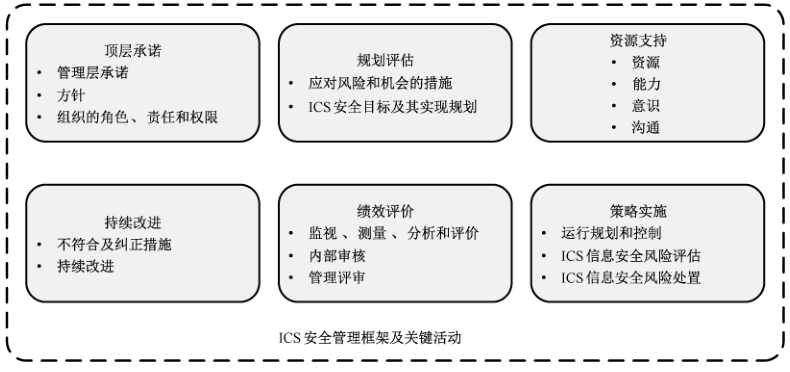

# GB/T 36323-2018 信息安全技术 工业控制系统安全管理基本要求

> 来源：[GB/T 36323-2018 国家标准详情](https://openstd.samr.gov.cn/bzgk/std/newGbInfo?hcno=E00719A57053B5264CF7A77E2FCAA637)；发布日期：2018-06-07；实施日期：2019-01-01。
> 官方 PDF SHA-256：b41f38d15f5c39f76d398e80b3c7fc8de8da28957b9e0ac7eb3b3b4768c45db7。
> 依据官方 PDF 全部 49 页的页面图像转写与校核；合并跨页表格和印刷折行，省略封面、目录、页眉、页脚和分页；图 1 保留原页图像。正式引用请核对原 PDF。
> 原件校核提示：6.8.4 正文仅列 a），表 A.1 第四级却标注 a）～d）；两处均依原件保留。

## 前言

本标准按照 GB/T 1.1—2009给出的规则起草。

请注意本文件的某些内容可能涉及专利。本文件的发布机构不承担识别这些专利的责任。

本标准由全国信息安全标准化技术委员会（SAC/TC 260）提出并归口。

本标准起草单位：中国电子技术标准化研究院、国家信息技术安全研究中心、公安部第三研究所、华东师范大学、中国电子科技集团公司第三十研究所、中国信息安全研究院有限公司、上海三零卫士信息安全有限公司、北京神州绿盟信息安全科技股份有限公司、启明星辰信息技术有限公司、烽台科技（北京）有限公司、浙江浙能台州第二发电有限责任公司、北京工业大学、国网浙江省电力公司电力科学研究院、华能国际电力股份有限公司长兴电厂、桂林电子科技大学、西安电子科技大学、浙江大学、中国科学院沈阳自动化研究所、和利时集团、全球能源互联网研究院有限公司、沈机（上海）智能系统研发设计有限公司、深圳赛西信息技术有限公司、广州数控设备有限公司、北京江南天安科技有限公司、中京天裕科技（北京）有限公司、北京匡恩网络科技有限责任公司。

本标准主要起草人：范科峰、刘贤刚、李琳、姚相振、周睿康、李冰、顾健、上官晓丽、许东阳、龚洁中、王惠莅、刘鸿运、何道敬、龚亮华、尚文利、杨晨、蔡磊、仵大奎、刘硕、张建军、王晓鹏、徐克超、周慎学、尹峰、陈胜军、阮伟、杨震、高昆仑、赖英旭、沈玉龙、裴庆祺、许川佩、陈冠直、梁潇、王勇、黄云鹰、杨堂勇、晏培。

## 引言

随着计算机和网络技术的发展，特别是信息化与工业化深度融合以及物联网的快速发展，工业控制系统，包括分布式控制系统（DCS）、监控与数据采集（SCADA）系统和可编程逻辑控制器（PLC）等产品广泛应用于核设施、航空航天、先进制造、石油石化、油气管网、电力系统、交通运输、水利枢纽、城市设施等国家重要领域。工业控制系统（ICS）由单机走向互联、从封闭走向开放、从自动化走向智能化进程的加快，使得工业控制系统的信息安全问题日益突出，工业控制系统一旦遭受攻击，将严重威胁人民生命财产安全和国家政权稳定。对此，全国信息安全标准化技术委员会（SAC/TC 260）立项研制了工业控制系统信息安全分级、管理要求、控制应用指南等多项标准。

本标准针对各行业工业控制系统的安全管理活动的共性特点，提出了工业控制系统安全管理基本框架，从领导、规划、支持、运行、绩效评价和持续改进等方面为工业控制系统安全管理活动提出了规范性要求，并给出了为实现该安全管理基本框架所需的安全管理基本控制措施和各级工业控制系统安全管理基本控制措施对应表，以满足组织对各级工业控制系统的安全管理需求，为实现对工业控制系统适度、有效的安全管理控制提供参考。

## 1 范围

本标准规定了工业控制系统安全管理基本框架及该框架包含的各关键活动，并提出为实现该安全管理基本框架所需的工业控制系统安全管理基本控制措施，在此基础上，给出了各级工业控制系统安全管理基本控制措施对应表（参见附录A），用于对各级工业控制系统安全管理提出安全管理基本控制要求。

本标准适用于非涉及国家秘密的工业控制系统建设、运行、使用、管理等相关方进行工业控制系统安全管理的规划和落实，也可供工业控制系统安全测评与安全检查工作作为参考依据。

## 2 规范性引用文件

下列文件对于本文件的应用是必不可少的。凡是注日期的引用文件，仅注日期的版本适用于本文件。凡是不注日期的引用文件，其最新版本（包括所有的修改单）适用于本文件。

- GB/T 25069—2010 信息安全技术 术语

- GB/T 22080—2016 信息技术 安全技术 信息安全管理体系 要求

- GB/T 22081—2016 信息技术 安全技术 信息安全控制实践指南

- GB/T 32919—2016 信息安全技术 工业控制系统安全控制应用指南

## 3 术语和定义

GB/T 22080—2016、GB/T 22081—2016、GB/T 25069—2010 界定的以及下列术语和定义适用于本文件。

### 3.1 工业控制系统 industrial control system;ICS

工业生产中使用的控制系统，包括监控和数据采集系统（SCADA），分布式控制系统（DCS），和其他较小的控制系统，如可编程逻辑控制器（PLC）等。

### 3.2 分布式控制系统 distributed control system; DCS

以计算机为基础，在系统内部（单位内部）对生产过程进行分布控制、集中管理的系统。

> 注：DCS 系统一般包括现场控制级、控制管理级两个层次，现场控制级主要是对单个子过程进行控制，控制管理级主要是对多个分散的子过程进行数据采集、集中显示、统一调度和管理。

### 3.3 监控和数据采集系统 supervisory control and data acquisition system

工业生产控制过程中，对大规模远距离地理分布的资产和设备在广域网环境下进行集中式数据采集与监控管理的控制系统。

> 注：它以计算机为基础，对远程分布运行设备进行监控调度，其主要功能包括数据采集、参数测量和调节、信号报警等。SCADA 系统一般由设在控制中心的主终端控制单元（MTU）、通信线路和设备、远程终端单位（RTU）等组成。

### 3.4 可编程逻辑控制器 programmable logic controller;PLC

采用可编程存储器，通过数字运算操作对工业生产装备进行控制的电子设备。

> 注：PLC 主要执行各类运算、顺序控制、定时等指令，用于控制工业生产装备的动作，是工业控制系统的基础单元。

### 3.5 安全控制基线 security control baseline

安全控制选择过程的起始点和选择基点。

> 注：安全控制基线是为帮助组织选择满足安全需求的、最具成本效益的、适当的安全控制集而制定的最低安全基准线。

## 4 缩略语

下列缩略语适用于本文件。

- AC：访问控制（Access Control）
- AT：意识和培训（Awareness and Training）
- AU：审计和可核查性（Audit and Accountability）
- CA：安全评估和授权（Security Assessment and Authorization）
- CM：配置管理（Configuration Management）
- CP：应急规划（Contingency Planning）
- DCS：分布式控制系统（Distributed Control System）
- IA：标识和鉴别（Identification and Authentication）
- ICS：工业控制系统（Industrial Control System）
- IR：事件响应（Incident Response）
- MA：维护（Maintenance）
- MP：介质保护（Media Protection）
- PE：物理和环境安全（Physical and Environmental Protection）
- PL：规划（Planning）
- PLC：可编程逻辑控制器（Programmable Logic Controller）
- PS：人员安全（Personnel Security）
- RA：风险评估（Risk Assessment）
- SA：系统和服务获取（System and Services Acquisition）
- SCADA：数据监控与数据采集系统（Supervisory Control and Data Acquisition）
- SI：系统和信息完整性（System and Information Integrity）

## 5 ICS 安全管理基本框架及关键活动

### 5.1 ICS 安全管理基本框架

工业控制系统（ICS）与传统的信息技术（IT）系统存在的诸多重要差异决定了应在规划和管理ICS信息安全过程中考虑ICS自身的特点。参考传统信息安全管理体系，结合ICS自身特点，将安全性需求整合到ICS中，形成了ICS安全管理基本框架（如图1所示）。该框架在确定ICS 安全管理具体意图，理解需求期望并明确ICS 体系范围的基础上，将ICS安全管理活动分为顶层承诺、规划评估、资源支持、策略实施、绩效评价、持续改进六个方面。其中，顶层承诺方面需要组织获得管理层的承诺，确定ICS安全管理的方针，明确组织各相关成员在ICS管理活动中的角色和权责；规划评估中组织应确定规划总则，开展ICS安全风险评估和处置，明确目标和实现规划；在资源支持部分组织应保障ICS 安全所需的资源，提供能力和意识培训，确定沟通机制并建立文档化制度；策略实施方面组织应规划、实现和控制满足ICS安全管理活动要求的具体过程，定期开展ICS安全风险评估和处置工作；在绩效评价阶段，组织对ICS开展监视、测量、分析和评价，定期开展内部审核和管理评审；持续改进阶段组织应对ICS的安全开展持续监控，在发生ICS安全异常等情况下，开展纠正措施并持续改进。

为具体实现ICS 安全管理基本框架各阶段的安全功能，本标准在第6章给出了ICS安全管理基本框架各阶段所需的基本控制措施，并在附录 A中给出了针对不同级别的工业控制系统安全管理要求对应表，用以指导组织根据自身工业控制系统的不同安全级别选择安全管理基本控制措施，并根据工业控制系统安全控制应用指南、安全分级等相关标准，对所选安全管理基本控制措施进行剪裁、选择等操作。

### 5.2 顶层承诺

#### 5.2.1 管理层承诺

组织应依据 GB/T 22080—2016的5.1 作出针对ICS安全的承诺。

#### 5.2.2 方针

组织应依据 GB/T 22080—2016的5.2 制定适用于ICS安全的方针，此外，还应制定相应的将ICS安全的方针与组织信息安全整体方针保持一致，并作为其有机组成部分。

#### 5.2.3 成立ICS 安全联合管理团队

为确保ICS 安全的实施落实，组织应：

a） 建立跨部门、跨职能的ICS 安全联合管理团队；

b） 该管理团队应至少包括 IT 人员、控制工程师、控制系统操作员、网络和信息系统安全专家、管理层代表，以及物理安全部门代表；

c） 最高管理层应确保该团队开展 ICS安全管理活动的权利和责任，并提供相应承诺。

#### 5.2.4 组织的角色、责任和权限

最高管理层应确保与ICS信息安全相关角色的责任和权限得到分配和沟通。

最高管理层应分配责任和权限，以便达到以下目标：

a） 确保ICS安全管理基本框架符合本标准的要求；

b） 向最高管理者报告ICS 安全管理基本框架绩效；

c） 接受联合管理团队的定期汇报。

### 5.3 规划评估

#### 5.3.1 应对风险和机会的措施

##### 5.3.1.1 总则

组织应依据GB/T 22080—2016中6.1.1 作出针对ICS总则，同时还应在总则中加入对于ICS安全运行和维护的期望。

##### 5.3.1.2 ICS 信息安全风险评估

组织应依据GB/T 22080—2016中6.1.2定义并应用针对ICS的风险评估过程，同时还应充分论证风险评估过程对ICS的可用性和稳定性产生的后果，以确保工业生产活动的正常开展。

##### 5.3.1.3 ICS 信息安全风险处置

组织应依据 GB/T 22080—2016中6.1.3定义并应用ICS信息安全风险处置过程。

#### 5.3.2 ICS信息安全目标及其实现规划

组织应依据GB/T 22080—2016中6.2建立针对ICS 信息安全的目标及其实现规划。

### 5.4 资源支持

#### 5.4.1 资源

组织应确定并提供建立、实现、维护和持续改进ICS信息安全管理体系所需的资源。

#### 5.4.2 能力

见 GB/T 22080—2016 中7.2。

#### 5.4.3 意识

应定期开展教育培训，并确保在组织控制下工作的人员了解：

a） ICS 信息安全方针；

b） 其对ICS 安全管理基本框架有效性的贡献，包括改进ICS 信息安全绩效带来的益处；

c） 不符合ICS安全管理基本框架要求带来的影响。

#### 5.4.4 沟通

见GB/T 22080—2016中7.4。

### 5.5 策略实施

#### 5.5.1 运行规划和控制

组织应依据GB/T 22080—2016中8.1 开展针对ICS信息安全的运行规划和控制工作，同时还应：

a） 在针对ICS实施安全控制措施前，详细评估该安全控制对ICS 可能造成的危害；

b） 在具体实施安全控制措施前，应获得安全控制措施授权。

#### 5.5.2 ICS 信息安全风险评估

组织应依据 GB/T 22080—2016中8.1开展针对ICS信息安全的风险评估工作。在风险评估过程中，依据 GB/T 32919—2016附录A中的内容，充分考虑ICS与传统信息系统的差异性。

#### 5.5.3 ICS 信息安全风险处置

见GB/T 22080—2016中8.3，并依据 ICS特点开展风险处置。

### 5.6 绩效评价

#### 5.6.1 监视、测量、分析和评价

见 GB/T 22080—2016 中9.1，同时还应持续监控已实施的安全控制措施，识别安全违规事件，检测ICS 中的安全异常事件的发生。

#### 5.6.2 内部审核

见GB/T 22080—2016 中9.2，并依据ICS特点开展内部审核。

#### 5.6.3 管理评审

见 GB/T 22080—2016中 9.3，并依据ICS特点开展管理评审。

### 5.7 持续改进

#### 5.7.1 不符合及纠正措施

见 GB/T 22080—2016中 10.1，并依据ICS特点采取纠正措施。

#### 5.7.2 持续改进

组织应持续改进ICS 安全管理基本框架的适宜性、充分性和有效性，并在ICS 生产业务或系统安全防护发生重大变更时向联合管理团队和最高管理层汇报。

## 6 ICS 安全管理基本控制措施

### 6.1 安全控制措施分类

本标准从管理制度、运维管理和技术管理三方面给出安全控制，共十六个安全控制族，其对照关系如表1所示：

**表1 安全控制分类表**

| 族标识符 | 安全控制族 | 安全控制类 |
| --- | --- | --- |
| CA | 安全评估和授权（Security Assessment and Authorization） | 管理制度 |
| SA | 系统和服务获取（System and Services Acquisition） | 管理制度 |
| PL | 规划（Planning） | 管理制度 |
| RA | 风险评估（Risk Assessment） | 管理制度 |
| PS | 人员安全（Personnel Security） | 运维管理 |
| CP | 应急规划（Contingency Planning） | 运维管理 |
| PE | 物理和环境安全（Physical and Environmental Protection） | 运维管理 |
| CM | 配置管理（Configuration Management） | 运维管理 |
| SI | 系统和信息完整性（System and Information Integrity） | 运维管理 |
| MP | 介质保护（Media Protection） | 运维管理 |
| IR | 事件响应（Incident Response） | 运维管理 |
| AT | 意识和培训（Awareness and Training） | 运维管理 |
| MA | 维护（Maintenance） | 运维管理 |
| AC | 访问控制（Access Control） | 技术管理 |
| AU | 审计和可核查性（Audit and Accountability） | 技术管理 |
| IA | 标识和鉴别（Identification and Authentication） | 技术管理 |

### 6.2 安全评估和授权（CA）

#### 6.2.1 安全评估和授权方针策略及规程（CA-1）

本项要求包括：

a） 应制定并发布安全评估和授权策略及规程方针策略，内容至少应包括：目的、范围、角色、责任、管理层承诺、相关部门间的协调和合规性；

b） 应制定并发布安全评估和授权方针策略及规程，以推动安全评估和授权策略及与相关安全控制的实施；

c） 应定期对安全评估与授权策略和规程进行评审和更新。

#### 6.2.2 安全评估（CA-2）

本项要求包括：

a） 应制定安全评估计划，该评估计划应包括：应评估的安全控制措施；判定安全措施有效性的评估流程；评估环境、队伍、角色及责任；

b） 应定期对ICS采取的安全措施实施的正确性、有效性进行评估，并判断是否满足相关安全需求；

c） 应根据评估结果生成评估报告，并向相关人员报告评估结果；

d） 应授权独立且具有评审资质的机构进行评估，并确保评估不干扰ICS运行和功能；

e） 应确保评估人员充分了解信息安全相关方针策略和规程，ICS 的安全方针策略和规程，以及特定的设备和/或工艺相关的具体的安全、环境风险；

f） 对于不能直接采取在线评估的ICS，应采取离线评估或在复制系统中进行。

#### 6.2.3 ICS 连接管理（CA-3）

本项要求包括：

a） 应制定ICS互联安全规定，授权 ICS 与外部其他信息系统进行连接；

b）应对ICS与外部其他工业控制系统连接的接口特征、安全要求、通信信息特性等内容进行记录；

c） 应定期评审ICS 与外部的连接情况，以验证 ICS 连接是否符合规定要求；

d） 应阻止把未分保密等级的国家安全系统直接连接到外部网络；

e） 应阻止把具有保密等级的国家安全系统直接连接到外部网络。

#### 6.2.4 行动计划与时间节点（CA-4）

本项要求包括：

a） 制定行动计划和时间节点，在其中记录下拟采取的整改行动，以改正在安全控制措施评估中发现的弱点和不足，减少或消除系统中的已知漏洞；

b） 根据安全评估、后果分析和持续监控的情况，每季度至少更新一次现有的行动计划和时间节点；

c） 组织应使用有助于实施计划准确、适时和到时可用的自动化机制。

#### 6.2.5 安全授权（CA-5）

本项要求包括：

a） 应指定一位高层管理人员作为ICS的授权责任人；

b） ICS 未经授权责任人正式授权，不得投入运行；

c） 应对 ICS 定期或发生重大变更时，重新进行安全授权；

d） 应识别并定期评审反应组织机构信息保护需要的保密性或不泄露协议的要求；

e） 开发、测试和运行设施应分离，以减少未授权访问或改变运行系统的风险。

#### 6.2.6 持续监控（CA-6）

本项要求包括：

a） 应制定持续的监控策略，并实施持续的监控计划，计划内容包括：被监控的目标、监控的频率、以及对监控进行评估的频率；

b） 应使用独立评估人员或评估组织，在持续的基础上来监视工业控制系统的安全控制；

c） 组织应定期规划、安排并进行评估，公开或不公开该评估信息，以便确保符合所有脆弱性缓解过程；

d） 应根据组织的连续监控策略，实施安全控制评估；

e） 应根据组织的连续监控战略，对组织已确定的度量指标，进行安全状态监控；

f） 应对评估和监控产生的安全相关信息进行关联和分析，并根据分析结果，采取相应的响应措施；

g） 应定期向相关人员报告信息系统安全状态。

#### 6.2.7 渗透测试（CA-7）

本项要求包括：

a） 应定期对ICS 进行渗透测试，要明确渗透测试的频率与目标；

b） 组织应聘请专业的第三方渗透组织或团队对ICS 开展渗透测试；

c） 对ICS系统渗透测试，应在ICS 系统非在线状态或在复制系统中进行。

#### 6.2.8 内部系统的连接（CA-8）

本项要求包括：

a） 应授权组织定义的ICS 系统或组件连接到内部信息系统；

b） 应为每个内部连接建立文件，包括连接的接口特性，安全性要求和传输信息的性质；

c） 在建立内部连接前，在ICS 系统或组件上执行安全合规性检查。

### 6.3 系统和服务获取（SA）

#### 6.3.1 系统及服务获取的方针策略及规程（SA-1）

本项要求包括：

a） 应制定并发布系统服务及获取的方针策略，内容至少应包括：目的、范围、角色、责任、管理层承诺、相关部门的协调及合规性；

b） 应制定并发布系统服务及获取的规程，以推动系统服务及获取的方针策略及与相关安全控制的实施；

c） 应定期对系统服务及获取的方针策略及规程进行评审和更新。

#### 6.3.2 资源配置（SA-2）

本项要求包括：

a） 应在业务过程规划中明确提出ICS或系统服务的安全需求；

b） 应明确、配置保护信息系统及相关服务所需的资源，形成相关文档并将其作为资本计划和投资管理过程的组成部分；

c） 应在组织的工作计划和预算文件中考虑信息安全。

#### 6.3.3 系统开发生命周期（SA-3）

本项要求包括：

a） 应在ICS 的开发生命周期内实施全生命周期的安全管理，并将信息安全风险管理过程集成到ICS的开发生命周期活动中；

b） 应明确ICS 开发生命周期内的信息安全角色及责任，并明确相应的责任人；

c） 应在ICS开发的各阶段应用安全工程原则。

#### 6.3.4 采购过程（SA-4）

本项要求包括：

a） 在ICS采购合同中，应明确描述系统的预期运行环境、开发环境及验收标准，并提出系统的安全功能、安全增强、安全保障及安全文档需求；

b） 采购合同内容应遵守相关的法律、法规、规章、标准或指南；

c） 组织应要求供应商或合同方在文档中提供描述该ICS及其部件和服务中所使用的那些安全控制的功能特性信息，而这些信息应是相当详细的，以至于可对安全控制进行分析和测试；

d） 组织应要求供应商或合同方在文档中提供描述该ICS及其部件和服务中所使用的那些安全控制的设计和实现的详细信息，以至于可对安全控制进行分析和测试；

e） 组织应要求软件供应商或制造方证实他们的软件开发过程使用了安全的工程方法、质量控制过程和确认技术，使软件弱点和恶意最小化；

f） 组织应选取市场上已通过国家安全相关部门评估的、具有安全能力的信息技术产品，并在获取前对其进行评估和确认；

g） 组织应确保所获取的每一个部件显式地分配给一个 ICS，并且系统拥有者承认该分配；

h）组织应要求获取文档中的ICS部件，以安全和规定的配置方式予以交付，并且该安全配置对任何软件重新安装或调整均是默认的配置；

i） 组织应有限制地获取市场上现成信息技术产品，这些产品应是那些已通过国家安全相关部门评估的产品和技术；

j） 为了保护公共发布的信息免遭恶意的干扰或破坏，并确保它的可用性，组织应确保使用了市场上具有基本的信息保障能力的信息技术产品；

k）当信息向公共网传输时，或当信息对那些未被授权访问ICS中所有信息的个体是可访问的时候，为了保护受控的非机密信息，组织应确保使用市场上基本信息保障能力的信息技术产品；

l） 当使用的网络在比该网络较低的机密层上来传输该信息时，为了保护国家机密的安全信息，仅使用市场上高信息安全保障能力的信息技术产品；确保高信息安全保障能力的信息技术产品已通过国家安全相关部门的评估和确认。

#### 6.3.5 ICS 信息系统文档（SA-5）

本项要求包括：

a） 应提供描述系统、组件或服务的管理员文档，文档应包括：系统、组件、服务及安全功能的安装、配置、使用、管理及运行维护信息以及系统管理员功能相关的脆弱性；

b） 应提供描述系统、组件或服务的用户文档，文档应包括：用户可访问的安全功能描述及其有效使用方法；用户对系统、组件或服务的安全使用方法及安全维护责任；

c） 当文档不可用时或不存在时，记录应获得的ICS 文档；

d） 当需要时，获取并保护描述ICS中所使用的安全控制的功能特性的文档，该文档具有充分的详细程度，允许对其中功能特性进行分析和测试，从而使文档对授权人员、供应商、制造者是可用的；

e） 当需要时，获取并保护描述了ICS与安全有关的外部接口文档，该文档应充分详细，允许对其中外部接口进行分析和测试，从而使文档对授权人员、供应商、制造者是可用的；

f） 当需要时，获取并保护以子系统以及安全控制的实现细节来描述ICS 高层设计的文档，并具有充分的详细程度，允许对其中的子系统和实现细节进行分析和测试，从而使文档对授权人员、供应商、制造者是可用的；

g） 当需要时，获取并保护描述了ICS 与安全有关外部接口的文档，该文档具有充分的详细程度，允许对其中外部接口进行分析和测试，从而使文档对授权人员、供应商、制造者是可用的；

h） 当需要时，获取和保护ICS的源码，并对授权人员是可用的，允许进行分析和测试；

i） 应基于风险管理策略要求对ICS文档进行保护；

j） ICS 文档应分发到指定的角色或个人。

#### 6.3.6 外部 ICS 服务（SA-6）

本项要求包括：

a） 外部ICS服务的提供商应遵从组织的信息安全策略要求、采用组织规定的安全控制措施，并遵守相关的法律、法规、规章、标准和指南；

b） 明确与外部ICS服务相关的安全角色和责任，并形成文档；

c） 应采用规定的过程、方法和技术，对外部服务提供商所提供的安全控制措施的合规性进行持续监控；

d） 在获取指定的ICS安全服务前，进行组织层面上的风险评估；

e） 确保获取的指定ICS安全服务，得到高层领导的批准；

f） 应管理服务提供的变更，包括保持和改进现有的ICS 信息安全策略、规程和控制措施，并考虑到业务系统和涉及过程的关键程度及风险的再评估。

#### 6.3.7 开发者配置管理（SA-7）

本项要求信息系统、系统组件及系统服务的开发者：

a）应在系统、组件或服务的设计、开发、实现和运行的过程中实施配置、变更管理，并形成相关文档；

b） 信息系统的变更应经过批准，考虑系统、组件及服务变更的安全影响并形成文档；

c） 应跟踪系统、组件及服务的安全缺陷及应对措施；

d） 组织要求ICS开发人员和集成人员提供软件的完整性检测，以便在软件交付后，支持组织进行软件完整性验证；

e） 在开发人员和集成人员指定的配置管理项缺少的情况下，组织为相关人员提供可选的配置管理过程。

#### 6.3.8 开发者安全测评（SA-8）

本项要求信息系统、系统组件及系统服务的开发者：

a） 应制定并实施安全评估计划，针对相关的功能属性、外部可见接口、顶层设计、底层设计、系统硬件、源代码等进行安全测评；

b）应对ICS、系统组件及系统服务实施测试与评估（单元、集成、系统或回归测试），形成安全测评报告；

c） 应对安全测评过程中发现的系统漏洞进行更正；

d） 组织应要求系统开发人员和集成人员使用代码分析工具检查软件中的公共漏洞，并建立分析结果文档；

e） 组织应要求系统开发人员和集成人员执行脆弱性分析，建立脆弱性、利用可能性以及风险缓解文档；

f） 组织应要求ICS开发人员和集成人员依据独立验证和确认代理的证据，创建并实现一个安全测试和评估计划。

#### 6.3.9 供应链保护（SA-9）

本项要求包括：

a） 应将供应链安全作为综合信息安全防护战略的组成部分，以防ICS、系统组件与ICS服务遭受供应链安全所造成威胁；

b） 组织应使用匿名的获取过程；

c） 组织应购置初始获取中所有ICS 部件以及相关附件；

d） 对要获取的硬件、软件、固件或服务，在编入合同协议之前，组织应对供应方进行认真的评审；

e） 有关ICS、ICS部件以及信息技术产品，组织应使用可信的运输途径；

f） 组织应使用多种多样的ICS、ICS部件、信息技术产品和ICS服务的供应方；

g） 组织应使用标准配置的ICS、ICS部件、信息技术产品；

h）组织应使 ICS、ICS部件、信息技术产品的购置决策和交付之间的时间最短；

i） 组织对交付的ICS、ICS 构件、信息技术产品进行独立分析和渗透测试；

j） 应建立供应链的安全评估规程；

k）应采用指定的安全措施来保障ICS 关键组件的供应；

l） 应将危害性分析作为供应链风险管理的关键原则，确定供应链活动的优先级。在系统开发生命周期中的指定决策点对ICS、系统组件或系统服务进行危害性分析，以识别关键的ICS 模块或功能。

#### 6.3.10 开发过程、标准及工具（SA-10）

本项要求包括：

a） ICS、系统组件或系统服务的开发人员应遵循软件工程的开发流程；

b） 应明确安全需求、开发过程中需遵循的标准及可使用的工具，并记录工具的配置信息与特殊选项；

c） 应对开发过程中的工具与变更进行管理；

d） 应定期对开发过程、标准、工具及配置文件进行审核。

#### 6.3.11 网络服务安全（SA-11）

本项要求包括：

a） 安全特性、服务级别以及所有网络服务的管理要求应予以确定并包括在所有网络服务协议中。无论这些服务是由内部提供的还是外包的。

### 6.4 人员安全（PS）

#### 6.4.1 人员安全的方针策略及规程（PS-1）

本项要求包括：

a） 应制定并发布人员安全的方针策略，内容至少应包括：目的、范围、角色、责任、管理层承诺、相关部门的协调、合规性；

b） 应制定并发布人员安全的规程，以推动人员安全的方针策略及与相关安全控制的实施；

c） 应定期对人员安全的方针策略及规程进行评审和更新。

#### 6.4.2 岗位风险（PS-2）

本项要求包括：

a） 应建立ICS岗位分类机制；

b） 应评估 ICS 所有岗位的风险；

c） 应建立人员审查制度，尤其对控制和管理ICS的关键岗位的人员进行审查；

d） 应定期对岗位风险进行评审和更新。

#### 6.4.3 人员审查（PS-3）

本项要求包括：

a） 应在授权访问ICS之前进行人员审查；

b） 应在人员离职或岗位调动时对其进行审查；

c） 组织应确保每个访问涉及组织秘密信息处理、存储或传输ICS的用户，按该ICS 最高信息秘密等级进行人员审查，并对访问人员进行了相应的保密教育；

d） 组织确保每个访问涉及敏感信息处理、存储或传输ICS的用户，按该系统敏感信息的最高秘密等级进行人员审查，并对访问人员进行了相应的保密教育。

#### 6.4.4 人员离职（PS-4）

本项要求包括：

a） 应终止离职人员对ICS系统的访问权限；

b） 应删除与离职人员相关的任何身份鉴别信息；

c） 应与离职人员签订安全保密协议；

d） 应收回离职人员所有与安全相关的系统的相关所有权；

e） 应确保离职人员移交信息和ICS的可用性。

#### 6.4.5 人员调动（PS-5）

本项要求包括：

a）应在人员调动至其他岗位时，评审该人员对ICS的逻辑和物理访问权限并根据评审结果调整访问权限。

#### 6.4.6 访问协议（PS-6）

本项要求包括：

a） 应制定 ICS的访问协议并形成文件。

b） 应定期评审并更新访问协议。

c） 应确保在人员授权访问ICS之前与其签订访问协议，并在访问协议更新或到期后重新签订。

d） 组织应确保特殊保护措施ICS 的访问，仅授权给：

1） 具有有效访问授权的人；

2） 满足相关人员安全准则的人。

e） 组织应确保特殊保护措施的秘密信息的访问，仅授权给：

1） 具有有效访问授权的人；

2） 满足相关的、符合可用的法律的人员安全准则的人；

3）已阅读、理解已签署保密协议的人。

#### 6.4.7 第三方人员安全（PS-7）

本项要求包括：

a） 应为第三方提供商建立包含安全角色和责任的人员安全要求，并形成文件；

b） 第三方提供商应遵守已制定的人员安全方针策略和规程；

c） 应要求第三方提供商在任何人员调动或离职时予以告知；

d） 应监视第三方提供商的合规性。

#### 6.4.8 人员处罚（PS-8）

本项要求包括：

a） 应对违反信息安全方针策略和规程的人员建立违规处罚制度。

### 6.5 规划（PL）

#### 6.5.1 安全规划策略及规程（PL-1）

本项要求包括：

a） 应制定并发布安全规划的策略，内容至少应包括：目的、范围、角色、责任、管理层承诺、相关部门的协调、合规性；

b） 应制定并发布安全规划规程，以推动安全规划的策略及与相关安全控制的实施；

c） 应定期对安全规划的策略及规程进行评审和更新。

#### 6.5.2 系统安全规划（PL-2）

本项要求包括：

a） 应结合当前信息系统安全的实践经验，并考虑信息系统与工业控制系统间的关键差异，制定系统的安全规划，并获得管理者的审核批准；

b）在安全规划中应明确定义ICS系统的授权边界、描述系统使命与业务流程的相关性、提供系统的安全分类、描述系统的运营环境及与其他系统的关联关系、提供系统安全需求的概要描述及针对这些安全需求的安全控制等；

c） 应定期对ICS系统安全规划进行评审和更新；

d） 当ICS 系统或运行环境发生变化，或者在系统安全规划实施或评估过程中发现问题时，应及时更新系统安全规划；

e） 向指定的角色或个人分发系统安全规划，并针对安全规划的后续变化进行沟通；

f） 应对ICS系统安全规划的内容进行保护，以防止泄露或未授权更改；

g） 对影响ICS系统安全的活动，在其实施前应进行规划及人员协调，以减少对其他系统的影响。

#### 6.5.3 行为规则（PL-3）

本项要求包括：

a） 应建立用户对ICS进行访问的行为规则，明确其职责及其对信息系统的预期使用方式；

b）应签订用户协议，确保用户在授权访问信息及ICS之前，已清晰理解并同意遵守行为规则的约束；

c） 在行为规则中，组织应显式限制对社会网站的使用，限制在商业网站上邮送信息，限制共享系统的账户信息；

d） 应定期对用户信息系统的访问行为规则进行更新与评审。

#### 6.5.4 信息安全架构（PL-4）

本项要求包括：

a） 应基于纵深防御的思想制定ICS的信息安全架构，描述信息安全保护的需求、方法及有关外部服务的安全假设或依赖关系；

b）应考虑ICS 信息安全体系的变更对安全规划、系统采购过程的影响；

c） 应定期审核并更新ICS 信息安全架构；

d） 应在预定义的位置和架构层部署特定的安全防护以获得全面的安全保障。

#### 6.5.5 安全活动规划（PL-5）

本项要求包括：

a） 对于可影响ICS的安全活动，在进行前，组织应规划并协调，以便减少对组织运行、组织资产和个体的影响。

### 6.6 风险评估（RA）

#### 6.6.1 风险评估方针策略与规程（RA-1）

本项要求包括：

a） 应制定并发布风险评估的方针策略，内容至少应包括：目的、范围、角色、责任、管理层承诺、相关部门的协调、合规性；

b） 应制定并发布风险评估规程，以推动风险评估的方针策略及与相关安全控制的实施；

c） 应定期对风险评估的方针策略及规程进行评审和更新。

#### 6.6.2 安全分类（RA-2）

本项要求包括：

a） 应依据适用的法律、法规、规章及相关标准，对ICS 进行安全分类；

b） 应在ICS安全规划文件中包含ICS的安全分类及分类依据；

c） 安全分类应通过主管部门的审查和批准。

#### 6.6.3 安全风险评估（RA-3）

本项要求包括：

a） 应制定ICS及相关信息系统的安全风险评估计划，明确风险评估的对象、内容及评估流程；

b） 应按安全风险评估计划在系统上线前或系统维修期间对指定系统实施风险评估，并形成风险评估报告；

c） 应将风险评估结果向相关人员通报，并定期对风险评估的结果进行评审；

d） 当系统或其运行环境发生重大变更（包括发现新的威胁和漏洞），或出现其他可能影响系统安全状态的条件时，应重新进行风险评估。

#### 6.6.4 漏洞扫描（RA-4）

本项要求包括：

a） 应在ICS系统上线前、系统维修期间或非业务高峰期对指定系统及相关应用程序进行脆弱性扫描分析，标识并报告可影响该系统或应用的新漏洞；

b） 推荐在规定的响应时间内对漏洞进行修复，修复用的补丁应经过充分的验证，修复后需重新对ICS 系统进行风险评估；

c） 应在指定的人员及受限范围内共享脆弱性扫描及安全评估过程中发现的漏洞信息，以便消除其他ICS 系统中的类似漏洞；

d） 组织使用的扫描工具，应具有容易调整扫描配置能力，并通过实际验证；

e） 组织定期或当标识和报告新的漏洞或者脆弱性时，调整已扫描的ICS 扫描计划；

f） 组织应明确ICS 中的何种信息需要保密；

g） 为支持更全面的扫描活动，对组织标识的ICS组件，应被赋予特定的访问授权；

h） 组织应评审历史审计日志，确定所标识的脆弱性是否存在可被利用的可能性；

i） 组织应进行ICS 的脆弱性分析，基于脆弱性分析，执行ICS上的渗透测试，以便确定所标识的脆弱性的可利用性；

j） 应规定漏洞扫描工具更新的频率，并在漏洞扫描之前验证工具的有效性；

k）应专门针对老旧设备制定漏洞扫描策略，明确规定漏洞扫描工具的版本、适用设备型号等内容；

l） 应根据ICS 系统脆弱性扫描结果及报告，度量漏洞的影响并进行安全风险评估；

m）应根据漏洞的影响程度对漏洞进行分级，并按照漏洞等级进行扫描；

n） 应规定对ICS 进行漏洞扫描的时间频率，并明确进行漏洞扫描的责任人。

### 6.7 应急规划（CP）

#### 6.7.1 应急规划方针策略与规程（CP-1）

本项要求包括：

a） 应制定并发布应急规划方针策略，内容至少应包括：目的、范围、角色、责任、管理层承诺、相关部门的协调、合规性；

b） 应制定并发布应急规划规程，以推动应急规划方针策略及与相关安全控制的实施；

c） 应定期对应急规划方针策略及规程进行评审和更新。

#### 6.7.2 应急计划（CP-2）

本项要求包括：

a） 应制定ICS应急计划并获得管理层批准。计划中应识别ICS业务应急需求、规定系统恢复优先级与目标、明确责任人；

b）应制定ICS灾难恢复计划并获得管理层批准。灾难恢复计划应包含：启动灾难恢复计划的事件；由自动运行变更手动运行规程；由远程控制变更为就地控制规程；响应者的角色和职责；备份及存储的规程；逻辑网络图；授权对ICS进行物理和逻辑访问的人员清单；联系信息（包括ICS厂商、网络管理员、ICS支持人员等）；当前配置信息；部件更换要求；

c） 应按已确定的应急计划角色设置，将应急计划分发下去；

d） 应定期评审和更新应急计划，以反映组织、ICS或运行环境的变更；

e） 组织应协调应急计划与其他计划间的一致性；

f） 组织应规划应急处理时的信息处理、通信和环境等支撑能力；

g） 组织应维护应急计划，保障基本业务功能在规定的时间内保持正常运行；

h）组织应维护硬件计划，保障异地运行时基本业务功能不受影响或很少受影响；

i） 组织应维护应急计划，保障全部业务功能在规定的时间内保持正常运行；

j） 组织应维护硬件计划，保障异地运行时全部业务功能不受影响或很少受影响；

k） 应协调处理应急规划活动与事件处理活动；

l） 应急计划变更时，应告知相关方；

m）对应急计划进行安全管理，以防泄露和未授权更改；

n）应制定ICS 故障的应急预案，以便在ICS发生故障时，可及时启动应急预案。

#### 6.7.3 应急培训（CP-3）

本项要求包括：

a） 应制定应急培训计划，并向具有相应角色和职责的ICS用户提供应急培训；

b） 应定期或在ICS变更时，对相应人员进行应急培训；

c） 模拟事件以配合应急培训，使得人员在危难时刻具备高效的应对能力；

d） 使用自动化机制提供更加全面、真实的培训环境。

#### 6.7.4 应急计划的测试和演练（CP-4）

本项要求包括：

a） 应测试和演练ICS的应急计划；有备用处理场所的应在备用处理场所进行测试和演练；尽量采用自动机制进行；

b） 测试和演练时，应与负责相关计划的组织内各部门之间协调；

c） 测试和演练后，应将ICS完整恢复和重建到已知状态；

d） 应评审应急计划的测试结果；如有不合格项应启动纠正措施；

e） 应定期或应急计划变更时，进行应急计划的测试和演练；

f） 组织协调应急计划与其他相关计划相一致的测试和演练；

g） 组织可在备用系统上测试、演练应急计划，并评估备用系统的应急处理能力；

h）组织应设计一套完整的工业控制系统的恢复和再构造，以便了解持续性计划测试部分的安全状态；

i） 组织应采用自动化机制，更彻底、有效地测试和演练应急计划。

#### 6.7.5 备用存储场所（CP-5）

本项要求包括：

a） 应建立备用存储场所，包括许可存储和恢复ICS备份信息的必要协议；

b） 应确保备用存储场所的信息安全防护措施与主存储场所相同；

c） 备用存储设备与主存储设备实施物理隔离，以防止受到同样灾难的破坏；

d） 对备用存储设备进行配置，保证其进行及时有效的恢复操作；

e） 明确当发生区域性破坏或灾难时，备用存储设备潜在的问题，并明确补救措施。

#### 6.7.6 备用处理场所（CP-6）

本项要求包括：

a） 应建立备用处理场所；并规定ICS 迁移至备用处理场所并重启运行的时间要求；

b） 应确保迁移和恢复运行所需要的设备和供给在备用场所可用；

c） 应确保备用处理场所的信息安全防护措施与主处理场所相同；

d） 备用处理设备与主处理设备实施物理隔离，以防止受到同样灾难的破坏；

e） 组织应明确灾难发生时的迁移行动，并保障灾难发生时备用处理设备可用；

f） 组织应按业务可用性需求，开发备用设备的替代服务优先级；

g） 组织应配置备用设备为就绪状态，准备支持基本的业务功能；

h）组织应确认备用设备提供的安全功能与主设备一致。

#### 6.7.7 电信服务（CP-7）

本项要求包括：

a） 应建立备用电信服务，并规定ICS 切换到备用电信服务的时间要求；

b） 组织应根据本组织的可用性要求，开发包含优先服务条款的主、备用电信服务协议；

c） 组织在选择备用电信服务时，应考虑降低单点故障，尽可能选择不同的服务商；

d） 组织应要求主、备电信服务商均提供应急响应计划。

#### 6.7.8 系统备份（CP-8）

本项要求包括：

a） 应制定ICS 备份策略。备份策略应包括：备份方式、备份频率、备份内容、备份介质等；

b） 应按照已制定的ICS备份策略对用户级信息、系统级信息及ICS文档进行备份，增量备份应每天一次，全量备份应每周一次；

c） 应采取安全防护措施，保护备份信息的保密性、完整性和可用性；

d） 采用合适的机制（如数字签名、加密散列）对ICS备份信息进行完整性保护；

e） 按预定的频率对备份信息进行测试以确保介质的可靠性和信息的完整性，保证备份信息的可用性；

f） 作为应急计划测试和演练的一部分，在恢复ICS功能时有选择的使用备份信息；

g） 将操作系统和其他重要ICS软件的备份副本存储在隔离设备上或者没有配置操作软件的存储器中；

h） 建立异地灾备中心，利用通信网络将信息实时备份到异地灾备中心；

i） 建设备份系统，实现ICS 数据的自动备份。

#### 6.7.9 ICS 恢复和重建（CP-9）

本项要求包括：

a） 应在ICS中断、受损或失败后将其恢复和重建到一个已知状态；

b） 应将系统状态变量作为恢复指标之一，并将其作为系统重建的一个部分；

c） 组织提供一套补偿的安全控制，定期将系统恢复到确定的状态；

d） 组织提供一套在规定的时间间隔内，将ICS组件恢复到安全和运行状态；

e）按组织规定的时间内，配置实时或准实时的失败恢复能力；

f） 组织应对备份/恢复所用的硬件、软件和固件实施保护；

g） 应定期测试恢复信息，以验证可靠性和信息完整性。

### 6.8 物理和环境安全（PE）

#### 6.8.1 物理和环境保护方针策略与规程（PE-1）

本项要求包括：

a） 应制定并发布物理和环境保护方针策略，内容至少应包括：目的、范围、角色、责任、管理层承诺、相关部门的协调、合规性；

b） 应制定并发布物理和环境保护规程，以推动物理和环境保护方针策略及与相关安全控制的实施；

c） 应定期对物理和环境保护方针策略及规程进行评审和更新。

#### 6.8.2 物理访问授权（PE-2）

本项要求包括：

a） 应制定和维护对ICS设施具有访问权限的人员名单；

b） 应定期对授权访问人员名单进行评审和批准；

c） 应根据职位、角色对ICS设施进行物理访问授权。

#### 6.8.3 物理访问控制（PE-3）

本项要求包括：

a） 应加强对所有ICS设施指定进出口的物理访问控制；

b） 应在指定进出口采用如围墙、门禁卡、门卫等物理访问控制措施，具有物理访问授权不代表对该区域ICS组件有逻辑访问权；

c） 应在访问ICS设施前对人员的访问权限进行验证；

d） 应维护物理访问记录；

e） 应制定公共访问区访问控制策略；

f） 应在需要对访客进行陪同和监视的环境下对访问者的行为进行陪同和监视；

g） 组织应控制对ICS的物理访问，这些控制应独立于对设施的物理访问控制；

h） 应对较容易进入且拥有可移动介质驱动器的计算机采取带锁、卸载或禁用等手段提高安全性；

i） 应将服务器放置在带锁的区域并采用认证保护机制；

j） 应将ICS 网络设备放置在只能由授权人员访问的符合环境。

#### 6.8.4 传输介质的访问控制（PE-4）

本项要求包括：

a） 应采用安全防护措施对ICS设施内的传输线路进行物理访问控制。

#### 6.8.5 输出设备的访问控制（PE-5）

本项要求包括：

a） 应对ICS 输出设备进行物理访问控制以防止非授权人员获得输出信息；

b） 控制对输出设备的物理访问；

c） 确保只有授权人员收到来自设备的输出信息；

d） 组织应对输出设备进行标记，标明该标记的输出设备可输出的信息。

#### 6.8.6 物理访问监控（PE-6）

本项要求包括：

a） 应监视 ICS 物理访问以检测物理安全事件，并对其作出响应；

b） 组织应设置防盗报警系统，识别潜在入侵、实时入侵报警并发起适当的响应行为；

c） 组织应采用自动化设备识别入侵，并实施自动响应动作；

d） 组织应采用视频监控，并保留视频记录；

e） 应定期对物理访问日志进行审查；

f） 应在发生事件或发现事件迹象的情况下对物理访问日志进行审查。

#### 6.8.7 访问记录（PE-7）

本项要求包括：

a） 应维护ICS设施的访问记录；

b） 应定期对访问记录进行评审；

c） 组织使用自动化的机制促进访问日志的维护和回顾；

d） 组织维护所有物理访问的记录，包括访客和授权用户。

#### 6.8.8 电源设备与电缆（PE-8）

本项要求包括：

a） 应保护 ICS的电源设备与电缆免遭损害和破坏；

b） 应依据安全需求和风险，采用禁用或对电源进行物理保护的手段来防止系统的非授权的使用；

c） 组织应使用冗余的电力设备和电缆；

d）组织应对关键ICS部件，使用自动化灾难备份等安全控制措施。

#### 6.8.9 紧急断电（PE-9）

本项要求包括：

a） 应确保在紧急情况下能够切断ICS 电源或个别组件电源；

b） 应在指定位置设置安全易用的紧急断电开关或设备；

c） 应保护紧急断电装置设备，以防止非授权操作。

#### 6.8.10 应急电源（PE-10）

本项要求包括：

a） 应为ICS 配备应急 UPS电源，并计算其续航时间；

b） 应提供短期不间断电源，以便在主电源失效的情况下正常关闭ICS；

c） 应提供长期备份电源，以便主电源失效时在规定时间内保持ICS 功能；

d） 组织提供给ICS备用电力供应系统，ICS能够在主电源长期丧失的事故中有能力维持ICS所必须的最小的运行能力；

e） 组织提供ICS长期的备用电力供应系统，该系统是独立运行而不依赖外部电源的。

#### 6.8.11 应急照明（PE-11）

本项要求包括：

a） 应为ICS部署应急照明并进行维护，确保其在断电情况下的可用性；

b） 应在应急照明设施中包含紧急通道和疏散通道指示牌。

#### 6.8.12 消防（PE-12）

本项要求包括：

a） 应为ICS 部署火灾检测和消防系统或设备，并维护该设备；

b） 应为消防系统或设备配备独立电源；

c） 应使用防火设备或系统，该设备或系统在火灾事故中会自动激活并通知组织和紧急事件处理人员；

d） 应使用灭火设备或系统，该设备或系统为组织和紧急事件处理人员提供任何激活操作的自动通知；

e） 应使用自动灭火系统；

f） ICS组件集中部署的区域，如主机房、通信设备机房等应采用具有耐火等级的建筑材料，采取区域隔离防火措施，将重要设备与其他设备隔离。

#### 6.8.13 温湿度控制（PE-13）

本项要求包括：

a） 应维护ICS所在设施的温湿度，使其处于可接受的范围；

b） 应定期监视温湿度；

c） ICS组件集中部署的区域，如主机房、通信设备机房等应设置温湿度自动调节设施，使机房温湿度的变化在设备运行所允许的范围之内。

#### 6.8.14 防水（PE-14）

本项要求包括：

a） 应提供易用、工作正常的、关键人员知晓的总阀门或隔离阀门以保护ICS免受漏水事故的损害；

b） ICS组件集中部署的区域，如主机房、通信设备机房等水管安装不得穿过机房屋顶和活动地板下，防止雨水通过机房窗户、屋顶和墙壁渗透；

c） 组织应使用自动化机制，在重大漏水事故时能保护 ICS 免受水灾。

#### 6.8.15 交付及移除（PE-15）

本项要求包括：

a） 应对所有进出设施的ICS组件进行授权、监视、控制，并维护相关记录。

#### 6.8.16 备用工作场所（PE-16）

本项要求包括：

a） 备用工作场所实施的安全控制措施应与当前工作场所等同；

b） 应评估备用工作场所安全控制措施的可行性和有效性；

c） 应提供安全事件发生时与信息安全人员沟通的渠道。

#### 6.8.17 信息泄露（PE-17）

本项要求包括：

a） 应避免因电磁泄露、传导等方式造成的信息泄露。

### 6.9 配置管理（CM）

#### 6.9.1 配置管理方针策略和规程（CM-1）

本项要求包括：

a） 应制定并发布配置管理方针策略，内容至少应包括：目的、范围、角色、责任、管理层承诺、相关部门的协调、合规性；

b） 应制定并发布配置管理规程，以推动配置管理方针策略及与相关安全控制的实施，该规程应与相关法律、制度、策略、规章、标准和指南保持一致；

c） 应定期对配置管理方针策略及规程进行评审和更新。

#### 6.9.2 基线配置（CM-2）

本项要求包括：

a） 应制定、记录并维护ICS当前的配置基线；

b） 应定期或在系统发生重大变更、安装和更新系统组件后，对基线配置进行评审和更新；

c） 应保留旧版本ICS基线配置，以便必要时恢复配置；

d） 应定期根据组织要求，在系统部件进行整体安装和升级等情况下评审并调整ICS的基线配置；

e） 组织为开发和测试环境，维护一个基线配置，该配置与组织运行的基线配置是采用不同方式管理的；

f） 组织保留被认为可支持回滚的、老的基线配置版本；

g） 组织使用自动化机制，及时维护 ICS配置，确保保持完整、准确、就绪可用的基线；

h）组织应开发并维护已授权可在组织ICS予以执行的软件列表，使用拒绝授权、除此之外的允许授权策略，标识在组织ICS上所有被允许执行的软件；

i） 组织应开发并维护没有被授权可在组织ICS上执行的软件列表，使用显式的拒绝授权策略，标识在组织 ICS上所有被允许执行的软件。

#### 6.9.3 配置变更控制（CM-3）

本项要求包括：

a） 应明确系统受控配置列表中，包含了哪些变更内容；

b） 应评审所提交的ICS变更事项，并根据其影响结果，进行批准或否决；

c） 应将ICS 相关的配置变更决策形成文件；

d） 应保留对ICS 配置的变更记录；

e） 应对系统配置变更的活动进行评审；

f） 应明确配置变更控制的管理部门，协调和监管配置变更的相关活动；

g） 组织在实现 ICS变更前，应测试、确认这些对ICS的变更，并建立相应的文档；

h）组织使用自动化机制，来建立ICS 配置变更记录文档，通知指定批准机构，强调在规定期限内没有接受到的批准将禁止变更，并在接受到指定的批准后，建立对ICS完成变更的文档；

i） 组织使用自动化机制，实现对当前ICS基线的变更，并通过所安装的配置库，开发调整基线；

j） 组织需在配置变更管理部门中设置一个信息安全代表作为部门成员；

k）变更控制管理部门和配置变更频率/条件应得到管理层的批准；

l） 在ICS 不支持自动生成配置变更审计记录的情况下，需要采用其他控制措施；

m）应对软件包的修改进行劝阻，只限于必要的变更，且对所有的变更加以严格控制。

#### 6.9.4 变更安全影响分析（CM-4）

本项要求包括：

a） 在实施变更之前，应对ICS 配置变更进行分析，判断该变更可能带来的潜在安全影响；

b） 在新软件被安装到运行环境前，在不同的测试环境中进行测试、分析，寻找由于弱点、不足、不相容或恶意所产生的安全影响；

c） 在实施ICS变更后，应检测安全功能，以验证变更已被正确地实现，且满足相应系统的安全需求。

#### 6.9.5 对变更的访问限制（CM-5）

本项要求包括：

a） 应定义、记录、批准和实施与ICS变更相关的物理和逻辑访问限制；

b）应限制ICS开发方和集成方对生产环境中的ICS及其硬件、软件和固件的直接变更；

c） 组织应使用自动化机制执行访问限制，支持执行动作的审计；

d） 组织应定期进行ICS变更的审计，分析未经授权的变更；

e） ICS应禁止安装没有得到组织认可和批准的软件程序；

f） 对组织定义的ICS部件和系统层信息的变动，执行双人规则；

g） 组织应限制系统开发人员和集成人员，在生产环境中只有授权才能更改硬件、软件和固件以及系统配置信息；定期评审并重新评估ICS开发人员/集成人员的权利；

h）组织应保护软件库，以免引入未授权的代码或恶意代码；

i） ICS实现自动功能或机制，以发现不恰当的系统变更。

#### 6.9.6 配置设置（CM-6）

本项要求包括：

a） 应依据安全配置检查清单，实施ICS 中所使用产品的配置，并实现与运行需求一致的模式；

b） 应基于ICS的运行需求，评估ICS组件与已设配置存在的偏差，并对其进行标识和记录；

c） 应根据相关策略和规程，监控配置设置项的变更；

d） 应使用自动机制，对配置设置进行集中管理、应用和验证。不支持自动化机制的ICS，采用其他方式进行集中管理，应用，并验证配置设置；

e） 应将检测到的未授权的、与安全相关的配置变更纳入到事件响应中，以确保对被检测事件的追踪、监视、纠正，并形成可用的历史记录；

f） 组织使用自动化机制，集中管理、应用并验证配置设置；

g） 组织使用自动化机制，对未授权改变的配置改版作出响应；

h） 组织应将发现的未授权、与安全有关的配置改变，结合到组织的安全事件响应能力，以确保每一个所发现的事件予以跟踪、纠正；

i） ICS 在引入到生产环境前，应证实其符合安全配置指南；

j） 应有规程来控制在系统上运行的安全软件。

#### 6.9.7 配置最小功能化（CM-7）

本项要求包括：

a） 应对信息系统按照仅提供最小功能进行配置，并按照定义的列表，对非必要功能、端口、协议和服务的使用进行禁止或限制；

b） 应定期对信息系统进行评审，以标识和排除不必要的功能、端口、协议和服务；

c） 为标识并消除不必要的功能、端口、协议和服务，定期对ICS进行风险评估；

d）组织使用自动化机制，应对授权软件程序、未授权软件程序的执行；

e） 组织应确保提供了满足组织需求的功能、端口、协议和服务。

#### 6.9.8 ICS 部件清单（CM-8）

本项要求包括：

a） 应制定ICS组件清单，并形成文件。该清单应能准确反映当前ICS，符合已授权的ICS边界，达到追踪和报告所需要的详细程度；

b） 当一个完整的组件安装和移除，或系统更新时，应更新系统组件清单；

c） 应使用自动机制来检测ICS中新增的未授权组件或设备。当检测到未授权的组件或设备时，应禁止网络访问、并进行隔离，并通知相关的管理人员；

d） 组织应通过某一个或几个属性标识ICS组件的可核查性；

e） 组织应验证ICS 物理边界内的所有组件或已被列入清单，作为系统的一部分，或被其他系统所知道，作为那个系统中的一部分；

f） 组织应关注在ICS 组件清单中所有配置；

g） 应定期对ICS 清单进行评审和更新；

h）记录日志的设施和日志信息应加以保护，以防止篡改和未授权的访问；

i） 系统管理员、系统操作员的活动应记入日志。

#### 6.9.9 配置管理计划（CM-9）

本项要求包括：

a） 应制定、记录和实施 ICS 的配置管理计划，配置管理计划应包括：角色和职责、配置管理的流程和过程；

b） 应建立贯穿系统开发生命周期的配置管理流程，识别所有的配置项，并进行管理；

c） 应保护配置管理计划免受未授权的泄露和修改；

d） 组织把开发配置管理过程的责任，赋予不直接参与系统开发的组织人员。

### 6.10 系统和信息完整性（SI）

#### 6.10.1 系统和信息完整性方针策略和规程（SI-1）

本项要求包括：

a） 应制定并发布系统和信息完整性保护方针策略，内容至少应包括：目的、范围、角色、责任、管理层承诺、相关部门的协调、合规性；

b） 应定期对系统和信息完整性保护方针策略及规程进行评审和更新。

#### 6.10.2 漏洞修复（SI-2）

本项要求包括：

a） 应对系统中存在的漏洞进行标识、报告并进行纠正；

b） 漏洞相关的软件和固件升级包在安装前，应验证其有效性并评估可能带来的后果；

c） 在软件和固件升级包发布后，应在适当的时间进行升级并明确升级和维护频率；

d） 应将漏洞修复并入组织的配置管理过程之中；

e） 统一管理漏洞修补程序和自动化升级程序；

f）根据定期采用自动化机制，根据ICS及组件的状态实施漏洞修复；

g） 根据ICS确定的安全基准线来度量漏洞识别与漏洞修复间的关系；

h）组织采用自动化的补丁管理工具，以方便漏洞修复；

i） 应明确升级软件和固件升级包维护功能的责任人。

#### 6.10.3 恶意代码防护（SI-3）

本项要求包括：

a） 应在ICS 网络出入口部署恶意代码防护机制，并根据组织的配置管理策略和规程，在新的升级包发布后进行更新；

b） 应在设备上线前或者检修期间对ICS进行扫描，对于发现的问题要及时解决并上报；

c） 应评估恶意代码检测发现的误报，在处理过程中对系统所产生的影响；

d） 集中管理恶意代码防护机制；

e） 自动升级恶意代码防护机制；

f） 防止非特权用户绕过恶意代码保护功能；

g） 组织应限制便携式设备在ICS 中的使用；

h） 组织应定期检测恶意代码防护机制的有效性。

#### 6.10.4 ICS 监视（SI-4）

本项要求包括：

a） 应对ICS进行监视，以检测攻击和攻击迹象，检测本地、网络的和远程的未授权连接；

b） 应按照组织定义的技术和方法来发现对ICS 的未授权使用；

c） 应在ICS 内部署监视设备，收集相关的重要信息，在特定位置部署临时性的监视设备，对特性业务类型进行监视；

d） 应对入侵检测工具收集的信息进行保护，防止对信息的未授权访问、修改或删除；

e） ICS的监视活动应符合适用的法律、法规、规章方面的要求；

f） 组织应采用自动化工具来支持事件的实时分析；

g） 系统应监控进出的非正常和未授权通信；

h） 系统应根据组织定义的显示威胁进行实时报警；

i） 系统应具有防止非授权用户绕开入侵检测/防御系统的能力；

j） 组织应将独立的入侵检测工具通过通用协议整合到组织层面的IDS 中；

k）组织应将入侵检测工具与访问控制、流量控制等机制整合，以快速响应攻击；

l） 当组织运行、资产、人及与其他组织或国家有关ICS运行的信息安全风险趋势增加时，应提高ICS 监视活动的级别。

#### 6.10.5 安全警报、建议和指示（SI-5）

本项要求包括：

a） 应持续地从指定的外部组织接收安全警报、建议和指示；

b） 应在必要时发布内部的安全警报、建议和指示；

c） 应向承担系统管理、监视或安全职责的相关人员传达安全警报、建议和指示；

d） 应按照时间计划实施安全指示并通报完成情况；

e） 组织采用自动化机制及时获取组织所需的这些安全报警和安全指令。

#### 6.10.6 安全功能验证（SI-6）

本项要求包括：

a） 应验证既定的安全功能是否正确运行；

b） 应在系统启动或重启时实施安全验证或者定期实施安全验证；

c） 应将失败的测试情况通知相关人员；

d） 系统应提供自动安全验证失败通知功能；

e） 系统应提供自动安全验证支持功能；

f） 应向组织相关负责人报告安全功能验证结果。

#### 6.10.7 软件、固件和信息完整性（SI-7）

本项要求包括：

a） 应采用完整性验证工具来检测对软件、固件或者ICS 的未授权修改；

b） 组织应定期重新评估软件和信息的完整性；

c） 组织应提供自动化机制，在软件和信息完整性异常时通知相关负责人；

d） 组织应集中管理完整性验证工具；

e） 在传输和使用过程中，组织应提供明显的防篡改包。

#### 6.10.8 信息输入验证（SI-8）

本项要求包括：

a） 应检验输入信息的有效性；

b） 提供手动重写机制用于输入验证，确保该功能仅用于授权人员，并对该功能进行审计；

c） 确保定期对输入验证错误的审查；

d） 在收到无效输入时，确保ICS按照预定的方式运行；

e） 对无效输入的响应不应影响正常运行时序；

f） 按组织预定义的格式和内容限制系统输入。

#### 6.10.9 错误处理（SI-9）

本项要求包括：

a） 应生成错误信息，该信息中要包含修正错误所必须的信息，且同时不能泄露可能被恶意利用的信息；

b）应仅向指定的人员通报相关错误信息。

#### 6.10.10 信息处理和留存（SI-10）

本项要求包括：

a） 应根据可适用的法律、法规、规章、标准以及运行要求，对ICS内及ICS 输出的信息进行处理和留存。

#### 6.10.11 防止可预计的故障（SI-11）

本项要求包括：

a） 应确定在特定运行环境中信息组件的平均故障间隔时间；

b）应提供可替代的ICS组件、对组件进行激活和建立主备切换的机制；

c） 组织应在不迟于平均故障间隔时间内，或定期实现主备组件的切换；

d） 组织应禁止在无监督的情况下实施切换；

e） 组织应在定义的时间间隔内手动完成主备组件的切换；

f） 如果检测到系统组件故障，组织应确保备用系统组件成功并透明地在定义的时间段内发挥作用。

#### 6.10.12 信息的输出过滤（SI-12）

本项要求包括：

a） 应确认软件和应用输出的信息与期望的内容相吻合。

#### 6.10.13 内存防护（SI-13）

本项要求包括：

a） 应执行安全保护措施，以防代码在内存中进行未授权的执行。

#### 6.10.14 入侵检测和防护（SI-14）

本项要求包括：

a） 应在工业控制系统的安全建设方案中考虑部署入侵检测系统。

### 6.11 介质保护（MP）

#### 6.11.1 介质保护方针策略与规程（MP-1）

本项要求包括：

a） 应制定并发布介质保护方针策略，内容至少应包括：目的、范围、角色、责任、管理层承诺、相关部门的协调、合规性；

b） 应制定并发布介质保护规程，以推动介质保护方针策略及与相关安全控制的实施；

c） 应定期对介质保护方针策略及规程进行评审和更新。

#### 6.11.2 介质访问（MP-2）

本项要求包括：

a） 应只允许被授权的人员或角色对介质进行访问；

b）默认禁止访问；

c） 加密保护。

#### 6.11.3 介质标记（MP-3）

本项要求包括：

a） 应对系统介质进行标记，标明其中所含信息的分发限制、处理注意事项以及信息的可适用安全标记。

#### 6.11.4 介质存储（MP-4）

本项要求包括：

a） 应在受控区域中，采取物理控制措施并安全地存储磁带、外置/可移动硬盘、U 盘或其他 Flash存储介质、软盘、CD、DVD 等介质；

b） 应定义设施内用来存储信息和存放ICS的受控区域；

c） 应为这些介质提供持续保护，直到利用经批准的设备、技术和规程对其进行破坏或净化；

d） 加密存储，物理安全保护；

e） 严格访问控制。

#### 6.11.5 介质传递（MP-5）

本项要求包括：

a） 在受控区域之外传递磁带、外置/可移动硬盘、U 盘或其他 Flash 存储介质、软盘、CD和 DVD时，应采用适当的安全防护措施进行保护和控制；

b） 应维护介质在受控区域之外传递过程的可核查性；

c） 应对介质传递相关活动进行记录；

d） 应只允许授权人员参与介质传递有关的活动；

e） 在介质传输过程中进行加密处理；

f） 文档化介质传输相关活动；

g） 加强介质传输过程中对委托人管理；

h） 组织应在控制区域外加强对介质的保护。

#### 6.11.6 介质净化（MP-6）

本项要求包括：

a） 应根据介质净化有关规定和标准，在介质报废、组织控制外使用、回收使用前，采用净化技术和规程对介质进行净化；

b） 所采用的净化机制的强度、覆盖范围应与介质中信息的安全类别或级别相匹配；

c） 建立介质销毁前的审阅、批准、跟踪、文件与验证机制；组织审查和批准的介质销毁，以确保符合组织政策，跟踪介质销毁行动，并验证该销毁过程的合规性；

d） 组织测试销毁设备和销毁程序，以验证预期的处理结果；

e） 组织按定义的方式销毁便携式存储设备；

f） 组织应按国家相关法律、法规规定销毁涉密和受控设备。

#### 6.11.7 介质使用（MP-7）

本项要求包括：

a） 应采取安全防护措施限制或禁止在 ICS 或组件中介质（包含数字介质和非数字介质）的使用；

b） 组织应禁止未标识的便携式设备在ICS使用；

c） 组织应禁止使用不方便实施销毁和净化处理的介质。

### 6.12 事件响应（IR）

#### 6.12.1 事件响应方针策略与规程（IR-1）

本项要求包括：

a） 应制定并发布事件响应方针策略，内容至少应包括：目的、范围、角色、责任、管理层承诺、相关部门的协调、合规性；

b） 应制定并发布事件响应规程，以推动事件响应方针策略及与相关安全控制的实施；

c） 应定期对事件响应方针策略及规程进行评审和更新。

#### 6.12.2 事件响应培训（IR-2）

本项要求包括：

a） 应制定事件响应培训计划，并定期对ICS用户进行符合其角色和责任的事件响应培训；

b） 应定期或在ICS发生变更时向ICS用户提供符合其角色和责任的事件响应培训；

c） 组织把模拟事件和事件响应结合起来进行培训，以便支持人员在危机情况下的有效响应；

d） 组织使用自动化机制，提供更全面、更真实的培训环境。

#### 6.12.3 事件响应测试和演练（IR-3）

本项要求包括：

a） 应定期以规定的测试方法测试方案的响应能力，以判断事件响应的有效性，并记录测试结果；

b） 应评审事件响应测试和演练的结果，如有不合格项应启动纠正措施；

c） 组织使用自动化机制，更全面、更有效地测试或演练事件响应能力；

d） 测试数据应认真地加以选择、保护和控制。

#### 6.12.4 事件处理（IR-4）

本项要求包括：

a） 应具有应对安全事件的事件处理能力，包括准备、检测和分析、控制、消除和恢复；

b） 应协调事件处理活动与应急规划活动；

c） 应将当前事件处理活动的经验，纳入事件响应规程、培训及测试/演练，并相应地实施变更；

d） 组织使用自动化机制，例如在线的事件管理系统，支持事件处理过程；

e） 组织关注ICS 的动态重新配置，作为事件响应能力的一部分；

f） 组织标识事件类别（例如：有目标的有意攻击，无目标的有意攻击，由于设计或实现中的错误和忽略），并定义响应中所采取的合适动作，确保使命/业务运行的继续；

g） 组织建立事件信息和单个事件响应的联系，以实现组织范围内有关事件的认知和响应之观点；

h） ICS一旦出现组织定义的安全损坏列表中的损坏，组织为避免造成更严重的后果，可使其停止运行。

#### 6.12.5 事件监控（IR-5）

本项要求包括：

a） 应跟踪和记录ICS安全事件。应引起重视或进行重点监控的事件包括：网络流量突然增大；磁盘空间溢出或空闲磁盘空间明显减少；异常高的CPU 使用率；新用户账号创建；试图或实际使用超级管理员级的账号；账户锁定；用户不工作时，账号仍在使用；清除日志文件；以不常用的大量事件塞满日志文件；防病毒或IDS 警报；不可用的防病毒软件和其他安全控制措施；不期望的补丁变更；非法外联；请求系统信息；配置设置的非期望更改；非期望的系统关闭或重启等；

b）应使用自动化机制，支持安全事件的跟踪，支持事件信息的收集和分析。

#### 6.12.6 事件报告（IR-6）

本项要求包括：

a） 应在规定时间内，向组织的事件响应部门报告可疑的安全事件；

b） 应向相关主管部门报告安全事件信息；

c） 应使用自动化机制，支持安全事件的报告；

d） 向有关的组织官员报告 ICS 中与所报告的安全事件相关的弱点、不足和脆弱性。

#### 6.12.7 事件响应帮助（IR-7）

本项要求包括：

a） 应提供事件响应支持资源，该资源是组织的事件响应能力必不可少的，以向ICS用户处理、报告安全事件提供咨询和帮助；

b） 组织使用自动化机制，增加与事件响应有关信息和支持的可用性；

c） 组织在其事件响应能力和外部提供方之间，建立一种直接协作的关系；向外部提供方标识组织的事件响应小组成员。

#### 6.12.8 事件响应计划（IR-8）

本项要求包括：

a） 应制定事件响应计划，该计划应包括：实施路线图；事件响应的结构和组织；满足组织的有关使命、规模、结构和功能的特殊要求；定义可报告事件；定义必要的资源和管理支持，以维护和增强事件响应能力；

b） 应评审事件响应计划并获得批准，并向组织内事件响应人员分发；

c） 应定期评审事件响应计划；

d） 应针对系统/组织的变更或事件响应计划在实施、执行或测试中遇到的问题，更新计划；

e） 应将事件响应计划的变更通报组织内相关部门和人员；

f） 应使事件响应计划处于受控状态。

### 6.13 意识和培训（AT）

#### 6.13.1 安全意识培养和安全培训方针策略和规程（AT-1）

本项要求包括：

a） 应制定并发布安全意识培养和安全培训方针策略，内容至少应包括：目的、范围、角色、责任、管理层承诺、相关部门的协调、合规性；

b） 应制定并发布安全意识培养和安全培训规程，以推动安全意识培养和安全培训方针策略及与相关安全控制的实施；

c） 应定期对安全意识培养和安全培训方针策略及规程进行评审和更新。

#### 6.13.2 安全意识培训（AT-2）

本项要求包括：

a） 应为包括管理员、高级管理层、承包商在内的ICS用户提供安全意识培训；

b） 应在新用户的培训中纳入安全意识培训；

c） 应定期或系统变更需要培训时，进行安全意识培训；

d） 安全意识培训内容应包括 ICS特定安全方针策略，安全操作程序，ICS 安全趋势和安全漏洞等；

e） 组织开展包括实际练习的安全意识培训以模拟实际的安全攻击；

f） 组织开展包括识别和报告内部潜在威胁的安全意识培训。

#### 6.13.3 基于角色的安全培训（AT-3）

本项要求包括：

a） 应为ICS 中的安全角色和具有安全职责的人员提供安全培训；

b） 应在新用户的培训中纳入安全培训；

c） 应定期或系统变更需要培训时，进行安全培训；

d） 安全培训内容应包括 ICS 特定安全方针策略，安全操作程序，ICS 安全趋势和安全漏洞等；

e） 组织开展包括实际操作的安全培训，以增强安全培训的目标；

f） 组织根据初始或定义的频度开展人员和角色培训；

g） 组织应向内部人员提供安全培训，使其能够识别ICS 存在的异常行为。

#### 6.13.4 安全培训记录（AT-4）

本项要求包括：

a） 应记录并监视ICS安全培训活动，包括基本的安全意识培训和特定的ICS 安全培训；

b） 应在规定的时间内保留培训记录。

### 6.14 访问控制（AC）

#### 6.14.1 访问控制方针策略和规程（AC-1）

本项要求包括：

a） 应制定并发布访问控制策略和规程，内容至少应包括：目的、范围、角色、责任、管理层承诺、相关部门的协调、合规性；

b） 应制定并发布访问控制规程，以推动访问控制方针策略及与相关安全控制的实施；

c） 应定期对访问控制方针策略及规程进行评审和更新。

#### 6.14.2 账户管理（AC-2）

本项要求包括：

a） 应建立不同账号类型（即个人的、组织的、系统的、应用的、访客的/匿名的和临时的），以支持不同的业务职能；

b） 应指定ICS账号管理员；

c） 应建立明确的组和角色的条件；

d） 应建立ICS、组和角色的授权用户，明确每个账号的访问权限和其他必需的属性；

e）创建ICS账号时，应获得相关人员的批准；

f） 应建立、激活、修改、关闭和注销账号的制度；

g） 应对ICS 使用进行授权和监视；

h）当账号需要删除、关闭、转移、变更时，应通报账号管理员；

i） 定期检查账号是否符合账号管理要求（如：是否符合系统授权，系统、组织、业务的属性）；

j） 对于预定义了账户和不支持账户管理的ICS设备，应采用适当的措施（例如，物理安全，人员安全，入侵检测，审计措施等）来进行访问控制；

k）应限制和控制特殊权限的分配及使用；

l） 应通过正式的管理过程控制口令的分配；

m）管理者应定期使用正式过程对用户的访问权进行复查；

n）应要求用户在选择及使用口令时，遵循良好的安全习惯。

#### 6.14.3 访问执行（AC-3）

本项要求包括：

a） ICS 资源的逻辑访问需得到授权和批准；

b） 针对所有主体和客体，应实施基于角色的访问控制策略；

c） 针对ICS 范围内属性相同的主体和客体，执行统一策略；

d） 应限制将信息传递给未授权的主体和客体；

e） 应限制将权限授予给未授权的主体和客体；

f） 应限制对主体、客体、ICS或其组件安全属性的变更；

g） 应对新创建或修改后的客体，限制变更其已经关联的安全属性；

h） 应限制对访问控制策略的更改；

i） 应确保访问控制策略，不会对ICS的运营产生不利影响；

j） 在组织规定的用户和 ICS 相关资源上，执行组织定义的非自主访问控制策略；

k） 基于组织策略和规程，执行二元访问授权；

l） ICS执行自主访问控制（DAC）策略；

m）除了安全状态外，应禁止ICS访问公共网络等组织规定的、与安全有关的信息；

n） 在非安全的地方，加密或存储ICS 安全相关的非在线关键或敏感信息。

#### 6.14.4 信息流执行（AC-4）

本项要求包括：

a） ICS 内或互连系统间的信息流动需得到授权和批准；

b） 应建立组织机构与外部方交换信息和软件的协议；

c） 包含在电子消息发送中的信息应给予适当的保护；

d） 应建立并实施策略和规程，以保护与业务系统互联相关的信息；

e） 应在网络中实施路由控制，以确保计算机连接和信息流不违反业务应用的访问控制策略。

#### 6.14.5 职责的分割（AC-5）

本项要求包括：

a） 必要时，分离个体的职责，以便防止恶意活动；

b） 应定义ICS的访问授权策略，以支持职责分割；

c） 在ICS 不能支持职责分割的情况下，应采取安全防护措施，对一个人承担多个角色进行有效管理。

#### 6.14.6 最小权限（AC-6）

本项要求包括：

a） 组织应基于最小权限，对用户进行访问授权，使其根据组织使命、业务职能，来完成指定任务；

b） 组织应显式地对硬件、软件和固件中所开发的安全功能和安全有关的信息列表授予访问权；

c） 组织要求ICS系统具有访问安全功能和安全有关的信息列表的ICS账户的用户或角色，当访问其他系统功能时，使用非授权的账户或角色，并且对于这样的功能，如果方便，审计任意对授权账户或角色的使用；

d） 组织按运行需要而定义授权要求，并依据该要求授权网络访问，并在安全计划中为这样访问记录理由；

e） 组织限定指定的系统管理人员，向ICS 的超级用户账户授权；

f） 组织应禁止向组织之外的用户授权访问 ICS；

g） ICS 提供分离的过程域，以便能精细地分配用户授权；

h） ICS 在不支持权限划分的情况下，应采取安全防护措施，对一个人拥有多种权限进行有效管理。

#### 6.14.7 不成功的录入尝试（AC-7）

本项要求包括：

a） ICS应在组织规定的时间间隔内，按定义的次数，限制用户连续无效的访问尝试；

b） 自动按组织定义的时间周期，锁死账户，直到管理员予以释放；

c） 当未成功尝试超出最大次数时，延迟下一次登入执行；

d） 系统自动锁死账户或节点，直到不成功尝试超出最大次数时才予以释放；

e） 系统为插入在ICS中的移动设备提供附加的保护，即在ICS用户连续不成功登入定义次数后，净化来自移动设备的信息。

#### 6.14.8 会话封锁（AC-8）

本项要求包括：

a） 用户在规定时间未活动或主动发出锁定指令，则开启会话锁定，以防止其他人对系统进行继续访问；

b） 应保持会话锁定，直到用户使用已有的标识和鉴别规程后，重新建立访问连接；

c） 当在具有显示屏的设备上启动ICS会话锁机制时，该机制应以公共可观察的模式放在相关联的显示屏上，隐藏该屏幕上以前可见的信息；

d） ICS应尽量采用会话锁定的方式，防止其他人对特定的工作站/节点的访问。在ICS操作员工作站/节点不适宜使用会话锁定的情况下，应采用其他适当的控制措施（例如，增加物理安全，人员安全和审计措施）。

#### 6.14.9 远程访问（AC-9）

本项要求包括：

a） 授权、监督和控制所有对ICS 的远程访问；

b） 组织利用自动机制来监督和控制远程访问方式；部分ICS 可能不支持远程访问；

c） 利用密码技术来保护远程访问会话的机密性和完整性，防止鉴别信息在网络传输过程中被窃听和篡改；

d） ICS通过组织定义的访问控制点的数目，路由所有远程访问；

e） 组织仅迫于运行方面的要求，授权执行远程访问并访问与安全有关的信息，远程授权访问要在工业控制系统安全计划中记录其理由；

f） 工业控制系统使用鉴别和加密技术保护对系统的无线访问；

g） 组织监控对工业控制系统的授权远程访问，包括定期扫描未授权的无线访问点；

h） 对那些不期望使用的无线访问，在工业控制系统部件中嵌入的内部无线网络发挥作用或部署前，组织应关闭或取消其功能；

i） 组织应禁止用户独自配置无线网络；

j） 组织确保用户保护了有关远程访问的信息，以免造成未授权的使用和信息泄露；

k）组织确保远程访问组织定义的安全功能和安全有关信息列表的会话，使用了附加的组织认可的安全措施，并进行了相应的审计；

l） 除了特定运行需求所显式标识的部件外，组织应断掉工业控制系统中点对点无线网络的能力；

m）除了特定运行需求所显式标识的部件外，组织限制被认为是不安全的网络协议。

#### 6.14.10 无线访问（AC-10）

本项要求包括：

a） 应建立无线访问的使用限制、配置、连接要求和实施指南；

b） 在连接前对通过无线方式访问 ICS 进行授权，并对其进行监控；

c） 如无必要，应关闭其中内嵌的无线联网功能；

d） 应使用鉴别和加密手段保护对系统的无线访问；

e） 组织监测未经授权的无线连接，包括扫描未经授权的无线接入点，对发现的未经授权的连接采取适当的措施；

f） 必要时，组织应禁止 ICS 组件内部嵌入式无线网络功能；

g） 组织应禁止用户自主配置无线网络功能；

h） 组织应管制控制范围内的无线网络；

i） 应将传输功率降低至合理级别，确定天线定位，减少无线信号暴露的强度，降低无线信号被外部接收到的可能性；

j） 无线用户的访问应使用安全授权协议来授权；

k）无线访问点应被配置为具有唯一的服务设置识别器（SSID），使SSID 不能广播，并且在最小限度上过滤介质访问控制地址（MAC地址）。

#### 6.14.11 移动设备的访问控制（AC-11）

本项要求包括：

a） 应建立移动设备使用规范；

b） 应授权移动设备连接到 ICS 应满足组织规范要求；

c） 应监控非授权移动设备接入 ICS；

d） 应强化移动设备接入ICS 需求管理；

e） 应禁用ICS自动执行移动设备可执行代码功能；

f） 应对到组织认为存在风险的区域的个人发放特殊配置的移动设备；

g） 应对到组织认为存在风险的区域的进行检查或维护的移动设备采用领取归还方式；

h） 组织应禁止在涉密系统中使用非涉密移动设备；

i） 组织采用全设备加密或容器加密等方式来保护移动设备信息的机密性和完整性；

j） 组织应考虑关闭不用的或不必要的 I/O 端口；

k） 组织应限制 ICS 内可读写、可移动设备的使用；

l） 组织应禁止ICS 内使用个人所有的可移动设备；

m）组织应禁止ICS 内使用未标记的可移动设备；

n）组织应禁止使用移动设备中的无线功能。

#### 6.14.12 外部ICS 的使用（AC-12）

本项要求包括：

a） ICS应建立外部系统的连接协议，并获得批准，才可以与外部系统连接。

b） 外部系统正确实现了相关信息安全策略和安全计划所要求的安全控制措施，并通过了验证，可以访问 ICS。

c） 组织应禁止授权的个体使用外部系统来访问工业控制系统，或处理、存储、传输组织收集的信息，除非存在以下情况：

1） 可以验证外部系统上所要求的安全控制的实现，像组织工业控制系统安全策略和安全计划中所规约的那样；

2） 已批准了工业控制系统与外部系统的连接，或批准了组织内实体使用外部系统进行处理的协议。

d） 组织对授权个体有关使用外部信息系统上组织控制的可移动媒介，施加一些限制。

#### 6.14.13 对程序源代码的访问控制（AC-13）

本项要求包括：

a） 应制定规程管理程序、代码和源程序库；

b） 应限制访问程序源代码。

### 6.15 维护（MA）

#### 6.15.1 系统维护方针策略与规程（MA-1）

本项要求包括：

a） 应制定并发布ICS 系统维护方针策略，应包括：目的、范围、角色、责任、管理层承诺、相关部门的协调、合规性；

b） 应制定并发布ICS 系统维护规程，以推动ICS 系统维护方针策略及与相关安全控制的实施；

c） 应定期对ICS 系统维护方针策略及规程进行评审和更新。

#### 6.15.2 受控维护（MA-2）

本项要求包括：

a） 应根据厂商或供应商的规格说明以及组织的要求，对ICS组件的维护和修理进行规划、实施、记录，并对维护和修理记录进行评审；

b）应审批和监视所有维护行为，不论是现场维护还是远程维护，不论被维护对象是在现场还是被转移到其他位置；

c） 应在将ICS或者组件转移到组织外进行非现场的维护或修理前，获得明确批准；

d） 应在将ICS或者组件转移到组织设外进行非现场的维护或修理前，对设备进行净化，清除有关信息；

e） 应在对系统或组件进行维护或修理后，检查所有可能受影响的安全控制措施以确认其仍正常发挥功能；

f） 应对系统或组件的维护予以记录；

g） 产品供应方或维护方应承诺未经用户同意不得采集用户相关信息、不得远程控制用户产品；

h） 如果采用远程维护的方式，组织应根据产品的运维需求，为远程控制端口设置控制权限和控制时间窗；

i） 采用自动化的机制定期来组织、规划、实施和记录维护或维修；

j） 准确、完整地记录所有的维护或维修的行动计划、要求、过程和完成；

k）在远程维护完成后，组织应安排专人立即关闭为远程维护需求开放的权限设置。

#### 6.15.3 维护工具（MA-3）

本项要求包括：

a） 应批准、控制并监视 ICS 维护工具的使用；

b） 组织应检查、监督维护人员可能的对ICS设备维护工具的不当使用或擅自修改；

c） 组织应检查用于ICS设备维护的工具、诊断测试程序是否包含恶意代码；

d） 组织应防止含组织信息的ICS 设备或组件在维护或维修时的擅自拆除，确保替换下的设备或组件包含的信息被消除，从ICS拆除设备或组件应获得相应的授权；

e） 维护工具应限制在授权人员内部使用；

f） ICS维护工具不能收集用户信息。

#### 6.15.4 非本地维护（MA-4）

本项要求包括：

a） 应批准、监视非本地维护和诊断活动；

b） 应仅允许使用符合组织策略，并在ICS 安全计划中所列出的非本地维护和诊断工具；

c） 应在建立非本地维护和诊断会话时采取强鉴别技术；

d） 应建立和保存非本地维护和诊断活动的记录，必要时，对记录进行审计和评估；

e） 应在非本地维护完成后中止会话和网络连接，必要时，对非本地维护连接中止进行验证；

f） 组织应根据已制定的审计策略对远程维护诊断行为进行审计，并审查远程维护诊断期间所有的行为；

g） 组织应在安全策略或安全计划等文件中规范远程维护诊断行为；

h）组织应仅在远程维护诊断期间开放ICS或设备的远程维护服务功能；产品或系统供应商应在交付时告知组织如何关闭/开放远程维护服务功能；

i） 组织应采用强认证机制保护远程维护会话，并将该类会话与系统其他会话通过物理或逻辑的方式进行隔离；

j） 组织应根据角色对每个远程维护会话进行授权和确认；

k）组织应采用一定的安全机制实现远程维护会话的机密性和完整性保护；

l） 在远程维护会话终止时，ICS应进行终止确认。

#### 6.15.5 维护人员（MA-5）

本项要求包括：

a） 应建立维护人员的授权流程，并建立已授权的维护组织或人员的列表；

b） 应确保维护人员只有在获得访问授权的情况下，才可在没有人员陪同的情况下进行系统维护；

c） 应在组织内指定获得授权且技术可胜任的人员，负责对未获得访问授权的维护人员的维护活动进行监督；

d） 对缺乏合适的安全审查的维护人员实施必要的管理，包括组织内部人员的全程陪同；

e） 开发并实施必要的安全防护措施，确保对ICS的维护不会造成信息删除、断网、中断服务等影响；

f） 确保维护人员进行维护诊断活动对ICS处理、存储和传输的信息不会造成破坏性影响；

g） 确保维护人员进行维护诊断活动不会对ICS 处理、存储和传输的机密信息造成泄露。

#### 6.15.6 及时维护（MA-6）

本项要求包括：

a） 应在故障发生后的规定时间内，进行ICS 组件的维护或以备品备件更换；

b） 组织应按定义的时间间隔对ICS及组件进行预防性的维护诊断；

c） 组织应启用一定的机制将预防性维护诊断数据导入管理系统。

### 6.16 审计和可核查性（AU）

#### 6.16.1 审计和可核查性方针策略和规程（AU-1）

本项要求包括：

a） 应制定并发布审计和可核查性方针策略，内容至少应包括：目的、范围、角色、责任、管理层承诺、相关部门的协调、合规性；

b）应制定并发布审计和可核查性规程，以推动审计和可核查性方针策略及与相关安全控制的实施；

c） 应定期对审计和可核查性方针策略及规程进行评审和更新。

#### 6.16.2 审计事件（AU-2）

本项要求包括：

a） 组织应明确规定审计事件的范围和审计内容。应至少对以下 ICS事件进行审计：成功和未成功的账号登录事件、账号管理事件、客体访问、策略变更、特权功能、进程跟踪、系统事件等；

b） 应与需要审计信息的其他相关部门进行安全审计协调，增强相互间的支持，并帮助确定审计事件清单；

c） 应提供已确定的审计事件清单，并阐述其足以支撑安全事件事后调查的理由；

d） 应确定需连续审计的事件清单；

e） 应定期或根据安全威胁情况的变化及时对审计事件清单进行评审和更新；

f） 组织应定义审计事件进行定期的审核和升级；

g） 应提供编辑审计记录的能力，这些记录来自多重部件，这些部件遍布于系统的逻辑层面、物理层面及相关于时序的审计痕迹中；

h）提供对审计事件选择的集中管理能力，事件选择被单独的系统部件所审计。

#### 6.16.3 审计记录内容（AU-3）

本项要求包括：

a） 应在审计记录中至少包含：事件类型、事件发生的时间和地点、事件来源、事件结果、与事件相关的用户或主体的身份等；

b） 审计记录应使用主题、类型、位置等信息标识审计事件；

c） 组织应集中管理审计内容。

#### 6.16.4 对审计处理失败的响应（AU-4）

本项要求包括：

a） 应在审计处理失败时向相关人员报警；

b） 在审计处理失败时应采取关闭ICS系统、重写旧的审计记录、停止产生新的审计记录等措施；

c） 应尽量在隔离的系统而不是ICS本身执行审计记录处理；

d） 在组织规定的时间段内，当分配给审计记录的存储量达到组织规定的最大审计记录存储容量的某一百分比时，ICS 向ICS相关负责人提供一个警示；

e） 当组织定义的要求实时报警的审计失效事件发生时，ICS在组织规定的实时报警时间段内，向ICS相关负责人发出报警；

f） ICS执行可配置的流量阈值，反映对审计能力的限制，并拒绝或延迟网络流量超出这些阈值；

g） 当发生组织定义的审计事件时，ICS 需在以下三种情况中选择一种作为响应：完全或部分宕掉系统、降低运行模式、仅具有有限可用的业务处理能力，除非存在一种可选的审计能力。

#### 6.16.5 审计评审、分析和报告（AU-5）

本项要求包括：

a） 应定期对审计记录进行评审和分析，以发现异常活动；

b） 应向相关人员汇报审计结果；

c） 应使用自动化机制来整合审查、分析及报告的过程以支持对可疑活动进行的调查和响应；

d）应对不同审计库上的审计记录进行关联性分析，以便感知ICS 整体的安全态势。

#### 6.16.6 审计归约和报告生成（AU-6）

本项要求包括：

a） 应具有审计归约和报告生成的功能，支持按需审计评审、分析和报告要求以及安全事件事后调查；

b） 不应改变原始的审计记录；

c） 应尽量在隔离的系统而不是ICS 本身进行审计归约和报告生成。

#### 6.16.7 时间戳（AU-7）

本项要求包括：

a） 应使用ICS 内部时钟生成审计记录的时间戳；

b） 应定期对内部时钟与权威时间源进行同步。

#### 6.16.8 审计信息的保护（AU-8）

本项要求包括：

a） 应保护审计信息和审计工具，以免遭受未授权访问、篡改、删除；

b） 应定期将审计记录备份到与所审系统或组件不同物理位置的系统或组件之中；

c） ICS在所执行的硬件上，在一次性写入的媒介上生成审计记录；

d） 应采用加密机制保护审计信息和审计工具的完整性；

e） 组织对访问审计功能的授权，只限制为一个具有特权的用户子集；保护审计记录的非本地访问，仅为授权的账户，并执行授权的功能。

#### 6.16.9 抗抵赖（AU-9）

本项要求包括：

a） 应确保被审计动作的不可否认性；

b） ICS定期把审计记录反馈到一个与被审计系统不同的系统或媒介上；

c） ICS使用加密机制来保护审计记录和审计工具的完整性；

d） 组织对访问审计功能的授权，只限制为一个具有特权的用户子集；

e） ICS在所执行的硬件上，在一次性写入的媒介上生成审计记录；

f） 保护审计记录的非本地访问，仅为授权的账户，并执行授权的功能。

#### 6.16.10 审计记录保留（AU-10）

本项要求包括：

a） 应按照记录保留策略保存审计记录以支持安全事件的事后调查，满足法律法规和组织关于信息保留的要求。

#### 6.16.11 审计生成（AU-11）

本项要求包括：

a） ICS组件应提供相关审计事件的审计记录生成功能；

b） 应允许相关人员根据ICS组件的特定情况选择审计事件；

c） 应为审计事件生成符合规定的审计记录；

d） 应尽量使用自动化机制生成审计记录；

e） 应按时间相关将审计记录从组织定义的系统组件转换系统的（逻辑或物理）审计跟踪记录；

f） 应产生系统的（逻辑或物理）审计跟踪记录的标准化格式；

g） 提供在组织规定的时间范围内，进行ICS 审核的能力。

### 6.17 标识和鉴别（IA）

#### 6.17.1 标识与鉴别方针策略和规程（IA-1）

本项要求包括：

a） 应制定并发布标识与鉴别方针策略，内容至少应包括：目的、范围、角色、责任、管理层承诺、相关部门的协调、合规性；

b） 应制定并发布标识与鉴别规程，以推动标识与鉴别方针策略及与相关安全控制的实施；

c） 应定期对标识与鉴别方针策略及规程进行评审和更新。

#### 6.17.2 组织用户的标识与鉴别（IA-2）

本项要求包括：

a） 信息系统应唯一标识和鉴别组织用户（员工、供应商人员及访客等）或代表该用户的进程；

b） 对未授权账户的网络访问，使用多因子鉴别；

c） 对已授权账户的本地访问，使用多因子鉴别；

d） 对未授权账户的本地访问，使用多因子鉴别；

e） 对已授权账户的网络访问，使用多因子鉴别；

f） 组织应仅当与个体或特定鉴别员一起使用时，才使用组鉴别；要求在使用组鉴别机制前，要用个体鉴别机制对个体进行鉴别；

g） 对未授权账户的远程访问，使用多因子鉴别，其中一个因子要由与该ICS 分离的设备提供；

h）对未授权账户的本地和网络访问，使用口令或个人标识码；

i） ICS 对本地访问，使用口令或个人标识码。

#### 6.17.3 设备的标识与鉴别（IA-3）

本项要求包括：

a） 在建立一个或多个本地、远程、网络连接前，应定义的特定设备和/或设备类型列表；

b） 在建立远程网络连接前，ICS应以密码技术为基础，使用设备之间的双向鉴别来鉴别设备；

c） 在建立网络连接前，ICS以密码技术为基础，使用设备之间的双向鉴别来鉴别设备；

d） 组织针对动态地址分配，标准化动态主机控制协议（DHCP）的专用信息以及赋予设备的时间；并当把这些信息赋予一个设备时，对专用信息进行审计。

#### 6.17.4 标识符管理（IA-4）

本项要求包括：

a） 应按照授权策略分配个人、组、角色或设备标识符；

b） 应选择用于识别个人、组、角色或设备的标识符；

c） 将标识符分配给指定的个人、组、角色或设备；

d） 在规定期限内，应防止对标识符的重用；

e） 应禁用规定期限内不活动的标识符；

f） 应禁止使用ICS账户标识符作为用户电子邮件账户的公共标识符；

g） 应要求接受用户ID 和口令的登记，应具有监督人员的授权，并在指定登记授权前由人来完成；

h）应要求多种形式个体身份的认证，如对该登记授权给出有文件的证据，或给出文件以及生物特征的组合；

i） 应按组织规定标识用户状态的特征，唯一地标识用户，以此来管理用户标识符；

j）ICS 动态地管理标识符、属性以及相关联的访问授权。

#### 6.17.5 鉴别管理（IA-5）

本项要求包括：

a） 初始鉴别分发时，应验证鉴别接收对象（个人、组、角色或设备）的身份。

b） 应确定组织规定的初始鉴别的内容。

c） 应确保鉴别对于其预期使用具有足够强的机制。

d） 应建立和实现管理规程，覆盖鉴别的初始分发、丢失或受损处置以及收回过程。

e） 在信息系统安装之前应变更鉴别的默认内容。

f） 应建立鉴别的最小和最大生存时间、限制以及再用条件。

g） 应定期变更/更新鉴别。

h） 应保护鉴别内容，以防未授权泄露和更改。

i） 应要求个人采取由设备或特定安全措施来保护鉴别。

j） 当组/角色账户的成员发生变化时，应变更这些账户的鉴别。

k） 对于基于 PKI 的鉴别，ICS应：

1） 针对一个接受的可信物，通过构造一个具有状态信息的认证路径，来确认证书；

2） 对对应的私钥，执行授权访问；

3） 把所认证的身份映射为用户账户。

l） 组织要求接受组织定义的鉴别符类型或特定鉴别符的注册过程，在由指定组织官员赋予注册授权之前由人来承担。

m）组织使用自动化工具来确定该鉴别符对抵御企图揭示或损坏该鉴别符的攻击而言是否具有充分的强度。

n）组织要求ICS 部件供应商或制造者在交付之前，提供唯一的鉴别符或改变默认的鉴别符。

o） 对于基于口令的鉴别，ICS应：

1） 实施按组织就敏感情况、字符个数、大写小写字符和数字的混合，以及特殊字符等方面定义的需求的最小口令复杂性；

2） 当创建新口令时，应按组织规定的密码规则；

3） 在口令存储和传输中，对口令加密处理；

4） 实施按组织规定的口令最大和最小生存期的限制；

5） 实施按组织定义的生成次数，禁止口令复用。

p） 组织保护鉴别符，使其相称于所访问信息的保密性和敏感性。

q） 组织确保口令没有被嵌入在访问脚本中或存储在功能键上。

r） 由于存在一些在多个 ICS上拥有账户的个体，因此组织采取规定措施，管理破坏性风险。

#### 6.17.6 鉴别反馈信息（IA-6）

本项要求包括：

a） 系统在鉴别过程中应隐藏鉴别信息的反馈，以防鉴别信息可能被未授权个人利用。

#### 6.17.7 密码模块鉴别（IA-7）

本项要求包括：

a） 系统应使用密码模块鉴别机制，该密码模块应满足相应的法律法规、规章和标准。

#### 6.17.8 非组织用户的标识与鉴别（IA-8）

本项要求包括：

a） 信息系统应唯一标识和鉴别非组织用户（信息系统用户）或代表非组织用户的进程；

b）ICS接受并鉴别其他相关机构发布的单子标识与鉴别；

c） ICS 只接受经权威机构批准的第三方认证；

d） 组织只采用相关权威机构批准的ICS组件第三方认证。

## 附录 A（资料性附录）不同安全级别的 ICS 安全管理基本要求对应表

为便于对不同安全级别的工业控制系统进行适于其级别的安全管理，本附录结合第 6 章中的 ICS 安全管理基本控制措施，给出了各级 ICS 安全管理基本要求对应表作为安全控制基线（见表 A.1），四个安全等级分级可依据 GB/T 36324—2018 等标准。针对 ICS 安全管理基本控制措施的裁剪方式参见 GB/T 32919—2016。

**表 A.1 不同安全级别的ICS 安全管理基本要求对应表**

| 要求 | 第一级 | 第二级 | 第三级 | 第四级 |
| --- | --- | --- | --- | --- |
| 6.2 安全评估和授权（CA） |  |  |  |  |
| 6.2.1 安全评估和授权方针策略及规程（CA-1） | a）~c） | a）~c） | a）~c） | a）~c） |
| 6.2.2 安全评估（CA-2） | a）～c） | a）～d） | a）～f） | a）～f） |
| 6.2.3 ICS 连接管理（CA-3） | a）~c） | a）~c） | a）~e） | a）~e） |
| 6.2.4 行动计划与时间节点（CA-4） | a）～b） | a）~b） | a）~c） | a）～c） |
| 6.2.5安全授权（CA-5） | a）~c） | a）~c） | a）~c） | a）~e） |
| 6.2.6 持续监控（CA-6） | a） | a）～b） | a）~c） | a）~g） |
| 6.2.7 渗透测试（CA-7） | — | — | a） | a）～c） |
| 6.2.8 内部系统的连接（CA-8） | a）～b） | a）~b） | a）~b） | a）~c） |
| 6.3 系统和服务获取（SA） |  |  |  |  |
| 6.3.1系统及服务获取的方针策略及规程（SA-1） | a）~c） | a）~c） | a）~c） | a）~c） |
| 6.3.2 资源配置（SA-2） | a）～c） | a）~c） | a）~c） | a）~c） |
| 6.3.3 系统开发生命周期（SA-3） | a）~c） | a）~c） | a）~c） | a）~c） |
| 6.3.4 采购过程（SA-4） | a）～b） | a）～e） | a）～f） | a）～l） |
| 6.3.5 ICS 信息系统文档（SA-5） | a）~c） | a）~f） | a）~f） | a）~j） |
| 6.3.6 外部 ICS 服务（SA-6） | a）~c） | a）~c） | a）~e） | a）~f） |
| 6.3.7 开发者配置管理（SA-7） | — | a）～c） | a）～e） | a）～e） |
| 6.3.8 开发者安全测评（SA-8） | — | a）～c） | a）～f） | a）～f） |
| 6.3.9 供应链保护（SA-9） | — | a） | a）～i） | a）～l） |
| 6.3.10开发过程、标准及工具（SA-10） | a） | a）~d） | a）~d） | a）~d） |
| 6.3.11 网络服务安全（SA-11） | — | a） | a） | a） |
| 6.4 人员安全（PS） |  |  |  |  |
| 6.4.1人员安全的方针策略及规程（PS-1） | a）~c） | a）~c） | a）~c） | a）~c） |
| 6.4.2 岗位风险（PS-2） | a）~d） | a）~d） | a）~d） | a）~d） |
| 6.4.3人员审查（PS-3） | a）〜b） | a）~b） | a）〜b） | a）～d） |
| 6.4.4人员离职（PS-4） | a）〜e） | a）~e） | a）~e） | a）~e） |
| 6.4.5 人员调动（PS-5） | a） | a） | a） | a） |
| 6.4.6 访问协议（PS-6） | a）~c） | a）~c） | a）~c） | a）~e） |
| 6.4.7第三方人员安全（PS-7） | a）~d） | a）~d） | a）~d） | a）~d） |
| 6.4.8人员处罚（PS-8） | a） | a） | a） | a） |
| 6.5 规划（PL） |  |  |  |  |
| 6.5.1 安全规划策略及规程（PL-1） | a）～c） | a）～c） | a）～c） | a）～c） |
| 6.5.2 系统安全规划（PL-2） | a）~d） | a）~d） | a）~d） | a）～g） |
| 6.5.3 行为规则（PL-3） | a）〜b） | a）〜b） | a）~c） | a）~d） |
| 6.5.4 信息安全架构（PL-4） | — | a）～c） | a）～d） | a）～d） |
| 6.5.5 安全活动规划（PL-5） | — | a） | a） | a） |
| 6.6 风险评估（RA） |  |  |  |  |
| 6.6.1风险评估方针策略与规程（RA-1） | a）~c） | a）~c） | a）~c） | a）~c） |
| 6.6.2 安全分类（RA-2） | a）～c） | a）～c） | a）～c） | a）～c） |
| 6.6.3 安全风险评估（RA-3） | a）~d） | a）~d） | a）~d） | a）~d） |
| 6.6.4漏洞扫描（RA-4） | a）~c） | a）～h） | a）~i） | a）～n） |
| 6.7 应急规划（CP） |  |  |  |  |
| 6.7.1 应急规划方针策略与规程（CP-1） | a）~c） | a）~c） | a）~c） | a）~c） |
| 6.7.2 应急计划（CP-2） | a）～d） | a）～h） | a）～f）、i）、j） | a）～f）、i）～n） |
| 6.7.3应急培训（CP-3） | a）～b） | a）~c） | a）~c） | a）～d） |
| 6.7.4应急计划的测试和演练（CP-4） | a）~e） | a）～h） | a）~i） | a）~i） |
| 6.7.5 备用存储场所（CP-5） | — | a）～e） | a）～e） | a）～e） |
| 6.7.6 备用处理场所（CP-6） | — | a）～h） | a）～h） | a）～h） |
| 6.7.7 电信服务（CP-7） | — | a）～d） | a）～d） | a）～d） |
| 6.7.8 系统备份（CP-8） | a）~c） | a）~f） | a）~i） | a）~i） |
| 6.7.9 ICS 恢复和重建（CP-9） | a）〜b） | a）~f） | a）~f） | a）~g） |
| 6.8 物理和环境安全（PE） |  |  |  |  |
| 6.8.1 物理和环境保护方针策略与规程（PE-1） | a）～c） | a）~c） | a）~c） | a）~c） |
| 6.8.2 物理访问授权（PE-2） | a）～c） | a）～c） | a）～c） | a）～c） |
| 6.8.3 物理访问控制（PE-3） | a）〜f） | a）～g） | a）~g） | a）~j） |
| 6.8.4 传输介质的访问控制（PE-4） | a） | a） | a） | a）~d） |
| 6.8.5输出设备的访问控制（PE-5） | a） | a） | a） | a）~d） |
| 6.8.6 物理访问监控（PE-6） | a） | a）～b） | a）～b） | a）～f） |
| 6.8.7访问记录（PE-7） | a）〜b） | a）~d） | a）~d） | a）~d） |
| 6.8.8 电源设备与电缆（PE-8） | — | a）～d） | a）～d） | a）～d） |
| 6.8.9 紧急断电（PE-9） | — | a）～c） | a）～c） | a）～c） |
| 6.8.10 应急电源（PE-10） | — | a）～d） | a）～e） | a）～e） |
| 6.8.11 应急照明（PE-11） | a）～b） | a）～b） | a）～b） | a）～b） |
| 6.8.12 消防（PE-12） | a）~b） | a）~e） | a）～f） | a）~f） |
| 6.8.13 温湿度控制（PE-13） | a）～b） | a）～b） | a）～b） | a）~c） |
| 6.8.14 防水（PE-14） | a）~b） | a）~c） | a）~c） | a）~c） |
| 6.8.15 交付及移除（PE-15） | a） | a） | a） | a） |
| 6.8.16 备用工作场所（PE-16） | a）~c） | a）~c） | a）~c） | a）～c） |
| 6.8.17 信息泄露（PE-17） | — | — | a） | a） |
| 6.9 配置管理（CM） |  |  |  |  |
| 6.9.1 配置管理方针策略和规程（CM-1） | a）~c） | a）~c） | a）~c） | a）~c） |
| 6.9.2 基线配置（CM-2） | a）～c） | a）～f） | a）～i） | a）～i） |
| 6.9.3 配置变更控制（CM-3） | — | a）～g） | a）～j） | a）～m） |
| 6.9.4 变更安全影响分析（CM-4） | a） | a） | a）~b） | a）~c） |
| 6.9.5 对变更的访问限制（CM-5） | — | a）～e） | a）～i） | a）～i） |
| 6.9.6 配置设置（CM-6） | a）~e） | a）～h） | a）~i） | a）〜j） |
| 6.9.7 配置最小功能化（CM-7） | a）～b） | a）～d） | a）～e） | a）～e） |
| 6.9.8 ICS 部件清单（CM-8） | a） | a）~e） | a）〜f） | a）~i） |
| 6.9.9 配置管理计划（CM-9） | — | a）～c） | a）～c） | a）～d） |
| 6.10 系统和信息完整性（SI） |  |  |  |  |
| 6.10.1 系统和信息完整性方针策略和规程（SI-1） | a）～b） | a）～b） | a）~b） | a）～b） |
| 6.10.2 漏洞修复（SI-2） | a）~d） | a）～f） | a）〜f） | a）〜i） |
| 6.10.3 恶意代码防护（SI-3） | a）～c） | a）～g） | a）～h） | a）～h） |
| 6.10.4 ICS 监视（SI-4） | a）～e） | a）～i） | a）～i） | a）～l） |
| 6.10.5 安全警报、建议和指示（SI-5） | a）~d） | a）~d） | a）～e） | a）～e） |
| 6.10.6 安全功能验证（SI-6） | — | a）～c） | a）～c） | a）～f） |
| 6.10.7 软件、固件和信息完整性（SI-7） | — | a）～c） | a）～c） | a）～e） |
| 6.10.8 信息输入验证（SI-8） | — | a） | a） | a）～f） |
| 6.10.9 错误处理（SI-9） | — | a）～b） | a）～b） | a）～b） |
| 6.10.10 信息处理和留存（SI-10） | a） | a） | a） | a） |
| 6.10.11 防止可预计的故障（SI-11） | — | a）～b） | a）～b） | a）～f） |
| 6.10.12 信息的输出过滤（SI-12） | — | a） | a） | a） |
| 6.10.13 内存防护（SI-13） | — | — | a） | a） |
| 6.10.14 入侵检测和防护（SI-14） | — | a） | a） | a） |
| 6.11 介质保护（MP） |  |  |  |  |
| 6.11.1 介质保护方针策略与规程（MP-1） | a）~c） | a）~c） | a）~c） | a）~c） |
| 6.11.2 介质访问（MP-2） | a） | a）~b） | a）~c） | a）~c） |
| 6.11.3 介质标记（MP-3） | — | a） | a） | a） |
| 6.11.4 介质存储（MP-4） | — | a）～e） | a）～e） | a）～e） |
| 6.11.5 介质传递（MP-5） | — | a）～g） | a）～g） | a）～h） |
| 6.11.6 介质净化（MP-6） | a）～b） | a）～e） | a）～f） | a）～f） |
| 6.11.7 介质使用（MP-7） | a） | a）~c） | a）~c） | a）~c） |
| 6.12 事件响应（IR） |  |  |  |  |
| 6.12.1 事件响应方针策略与规程（IR-1） | a）~c） | a）~c） | a）~c） | a）~c） |
| 6.12.2 事件响应培训（IR-2） | a）～b） | a）～b） | a）～d） | a）～d） |
| 6.12.3 事件响应测试和演练（IR-3） | — | a）～c） | a）～c） | a）～d） |
| 6.12.4 事件处理（IR-4） | a）～c） | a）～e） | a）～h） | a）～h） |
| 6.12.5 事件监控（IR-5） | a） | a）~b） | a）〜b） | a）〜b） |
| 6.12.6 事件报告（IR-6） | a）〜b） | a）~d） | a）~d） | a）～d） |
| 6.12.7 事件响应帮助（IR-7） | a） | a）~c） | a）~c） | a）～c） |
| 6.12.8 事件响应计划（IR-8） | a）～f） | a）～f） | a）～f） | a）～f） |
| 6.13 意识和培训（AT） |  |  |  |  |
| 6.13.1 安全意识培养和安全培训方针策略和规程（AT-1） | a）~c） | a）~c） | a）~c） | a）~c） |
| 6.13.2 安全意识培训（AT-2） | a）～d） | a）～e） | a）～f） | a）～f） |
| 6.13.3 基于角色的安全培训（AT-3） | a）～d） | a）～e） | a）～g） | a）～g） |
| 6.13.4 安全培训记录（AT-4） | a）〜b） | a）~b） | a）〜b） | a）〜b） |
| 6.14 访问控制（AC） |  |  |  |  |
| 6.14.1 访问控制方针策略和规程（AC-1） | a）~c） | a）~c） | a）~c） | a）~c） |
| 6.14.2 账户管理（AC-2） | a）~h） | a）～j） | a）~j） | a）～n） |
| 6.14.3 访问执行（AC-3） | a）～i） | a）～j） | a）～j） | a）～n） |
| 6.14.4 信息流执行（AC-4） | — | a） | a） | a）～e） |
| 6.14.5 职责的分割（AC-5） | — | a）~c） | a）~c） | a）~c） |
| 6.14.6 最小权限（AC-6） | — | a）～f） | a）～g） | a）～h） |
| 6.14.7 不成功的录入尝试（AC-7） | a）～c） | a）～c） | a）～c） | a）～e） |
| 6.14.8 会话封锁（AC-8） | — | a）～b） | a）～b） | a）～d） |
| 6.14.9 远程访问（AC-9） | a） | a）~e） | a）~e） | a）～m） |
| 6.14.10无线访问（AC-10） | a）~c） | a）~d） | a）～h） | a）～k） |
| 6.14.11 移动设备的访问控制（AC-11） | a）~g） | a）~j） | a）~n） | a）～n） |
| 6.14.12 外部ICS的使用（AC-12） | a）~b） | a）～b） | a）~d） | a）~d） |
| 6.14.13 对程序源代码的访问控制（AC-13） | a）～b） | a）~b） | a）~b） | a）～b） |
| 6.15 维护（MA） |  |  |  |  |
| 6.15.1 系统维护方针策略与规程（MA-1） | a）~c） | a）~c） | a）~c） | a）~c） |
| 6.15.2 受控维护（MA-2） | a）～h） | a）~j） | a）～k） | a）～k） |
| 6.15.3 维护工具（MA-3） | — | a）～f） | a）～f） | a）～f） |
| 6.15.4 非本地维护（MA-4） | a）～e） | a）～h） | a）～l） | a）～l） |
| 6.15.5 维护人员（MA-5） | a）~c） | a）~c） | a）~g） | a）〜g） |
| 6.15.6 及时维护（MA-6） | — | a） | a）～c） | a）～c） |
| 6.16 审计和可核查性（AU） |  |  |  |  |
| 6.16.1 审计和可核查性方针策略和规程（AU-1） | a）～c） | a）～c） | a）～c） | a）～c） |
| 6.16.2 审计事件（AU-2） | a）～e） | a）～f） | a）～h） | a）～h） |
| 6.16.3 审计记录内容（AU-3） | a） | a）～b） | a）~c） | a）~c） |
| 6.16.4 对审计处理失败的响应（AU-4） | a）～c） | a）～e） | a）～g） | a）～g） |
| 6.16.5审计评审、分析和报告（AU-5） | a）～b） | a）~c） | a）~d） | a）~d） |
| 6.16.6 审计归约和报告生成（AU-6） | — | a）～c） | a）～c） | a）～c） |
| 6.16.7 时间戳（AU-7） | a） | a）～b） | a）~b） | a）~b） |
| 6.16.8 审计信息的保护（AU-8） | a） | a）～b） | a）~e） | a）~e） |
| 6.16.9 抗抵赖（AU-9） | — | — | a）～e） | a）～f） |
| 6.16.10审计记录保留（AU-10） | a） | a） | a） | a） |
| 6.16.11 审计生成（AU-11） | a）～d） | a）～d） | a）～g） | a）～g） |
| 6.17 标识和鉴别（IA） |  |  |  |  |
| 6.17.1 标识与鉴别方针策略和规程（IA-1） | a）～c） | a）～c） | a）～c） | a）～c） |
| 6.17.2 组织用户的标识与鉴别（IA-2） | a）~b） | a）~g） | a）～g） | a）~i） |
| 6.17.3 设备的标识与鉴别（IA-3） | — | a） | a） | a）～d） |
| 6.17.4 标识符管理（IA-4） | a）~e） | a）~e） | a）~e） | a）~j） |
| 6.17.5 鉴别管理（IA-5） | a）～j） | a）～m） | a）～r） | a）～r） |
| 6.17.6 鉴别反馈信息（IA-6） | a） | a） | a） | a） |
| 6.17.7 密码模块鉴别（IA-7） | a） | a） | a） | a） |
| 6.17.8非组织用户的标识与鉴别（IA-8） | a）~d） | a）~d） | a）~d） | a）~d） |

## 参考文献

- ［1］ GB/T 36324—2018 信息安全技术 工业控制系统信息安全分级规范

- ［2］ 关于加强工业控制系统信息安全管理的通知（工信部协〔2010〕451号）

- ［3］ 电力监控系统安全防护规定（国家发改委令第14号）

- ［4］ 电力行业信息系统安全等级保护基本要求（电监信息〔2012〕62号）

- ［5］ 电力行业网络与信息安全管理办法（国能安全〔2014〕317号）

- ［6］ 电力行业信息安全等级保护管理办法（国能安全〔2014〕318号）

- ［7］ NIST SP 800-82 Guide to Industrial Control Systems（ICS）Security

- ［8］ NIST SP 800-53 Recommended Security Controls for Federal Information Systems and Organizations
