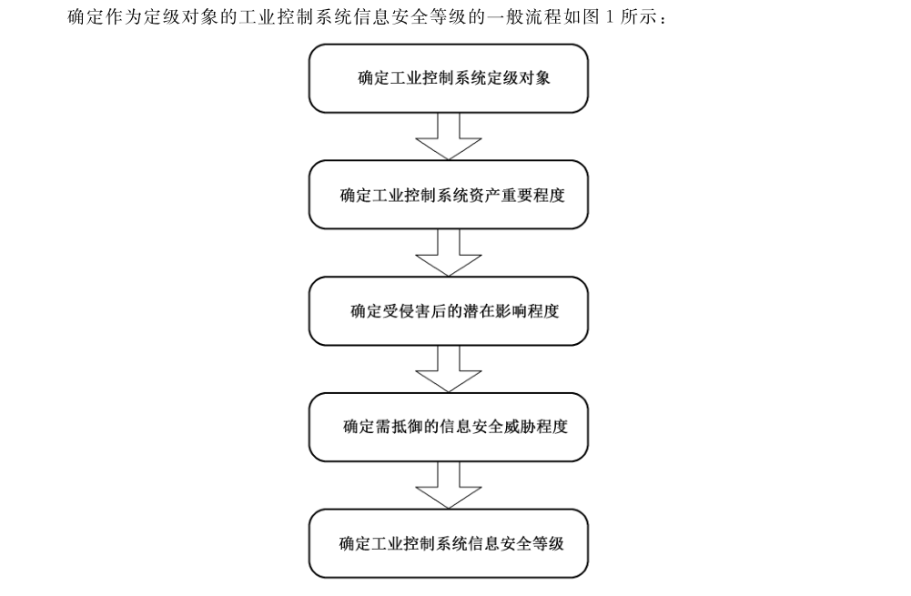

# GB/T 36324-2018 信息安全技术 工业控制系统信息安全分级规范

> 来源：[GB/T 36324-2018 国家标准详情](https://openstd.samr.gov.cn/bzgk/std/newGbInfo?hcno=EE7DE5D87C36A032BD7644FBD38BE6C8)；发布日期：2018-06-07；实施日期：2019-10-01。
> PDF SHA-256：0379747ebc33db1945bc283fcfa50ae427d5a1ed695bf399731540020275fc64。
> 转写说明：逐页对照官方 PDF 的 29 页图像校核文字、公式、表格及流程图；合并跨页表格和段落，省略封面、目录、页眉与页码。正式引用请核对原 PDF。

## 前言

本标准按照 GB/T 1.1—2009给出的规则起草。

请注意本文件的某些内容可能涉及专利。本文件的发布机构不承担识别这些专利的责任。

本标准由全国信息安全标准化技术委员会（SAC/TC 260）提出并归口。

本标准起草单位：北京江南天安科技有限公司、中国电子技术标准化研究院、全球能源互联网研究院有限公司、上海三零卫士信息安全有限公司、网神信息技术（北京）股份有限公司。

本标准主要起草人：陈冠直、邓冬柏、范科峰、高昆仑、周睿康、李琳、梁潇、程鹏、张翀斌、尧相振、龚洁中、李航。

## 引言

工业控制系统信息安全事关工业生产运行、国家经济安全和人民生命财产安全，为加强工业控制系统信息安全管理，对工业控制系统信息安全采取等级化管理。本标准规定了基于风险评估的工业控制系统信息安全等级划分规则和定级方法，提出了等级划分模型和定级要素，包括工业控制系统资产重要程度、存在的潜在风险影响程度和需抵御的信息安全威胁程度，并提出了对工业控制系统信息安全划分四个等级的特征。

本标准第4章工业控制系统概述，描述了工业控制系统基本构成，工业控制系统定级对象；第5章工业控制系统信息安全等级划分规则，规定了工业控制系统信息安全等级划分模型，工业控制系统信息安全定级要素，工业控制系统信息安全等级特征；第6章工业控制系统信息安全定级方法，提出了工业控制系统信息安全定级流程，陈述了确定工业控制系统定级对象、确定工业控制系统资产重要程度、确定受侵害后的潜在影响程度、确定需抵御的信息安全威胁程度、确定工业控制系统信息安全等级；附录A说明了有关生产安全事故和突发环境事件分级。

在5.3中，为清晰表示工业控制系统每一个信息安全等级比较低一级安全等级的安全技术要求的增加和增强，每一级的新增部分用“宋体加粗字”表示。

## 1 范围

本标准规定了基于风险评估的工业控制系统信息安全等级划分规则和定级方法，提出了等级划分模型和定级要素，包括工业控制系统资产重要程度、存在的潜在风险影响程度和需抵御的信息安全威胁程度，并提出了工业控制系统信息安全四个等级的特征。

本标准适用于工业生产企业以及相关行政管理部门，为工业控制系统信息安全等级的划分提供指导，为工业控制系统信息安全的规划、设计、运维以及评估和管理提供依据。

## 2 规范性引用文件

下列文件对于本文件的应用是必不可少的。凡是注日期的引用文件，仅注日期的版本适用于本文件。凡是不注日期的引用文件，其最新版本（包括所有的修改单）适用于本文件。

- GB/T 22080—2016 信息技术 安全技术 信息安全管理体系 要求

- GB/T 31722—2015 信息技术 安全技术 信息安全风险管理

- 生产安全事故报告和调查处理条例 国务院第 493 号令

- 突发环境事件信息报告办法 环境保护部令第 17 号

## 3 术语和定义、缩略语

### 3.1 术语和定义

GB/T 22080—2016 界定的以及下列术语和定义适用于本文件。

#### 3.1.1 信息安全风险 information security risk

特定威胁利用单个或一组资产脆弱性的可能性以及由此可能给组织带来的损害。

> 注：它以事态的可能性及其后果的组合来度量。

［GB/T 31722—2015，定义3.2］

#### 3.1.2 影响 impact

事件的后果，对已达到的业务目标水平的不利改变。在信息安全中，一般指不测事件的后果。

［GB/T 31722—2015，定义3.1］

#### 3.1.3 威胁 threat

可能导致对系统或组织的损害的不期望事件发生的潜在原因。

［GB/T 29246—2012，定义2.45］

#### 3.1.4 安全属性 security attribute

主体、用户（包括外部的IT 产品）、客体、信息、会话和/或资源的某些特性，这些特性用于定义安全功能需求，并且其值用于实施安全功能需求。

［GB/T 25069 -2010，定义2.2.1.18］

#### 3.1.5 可靠性 reliability

预期行为和结果保持一致的特性。

［GB/T 25069—2010，定义2.1.19］

#### 3.1.6 实时性 real-time

在规定时间内系统获得正确结果的反应能力。

> 注：一般，实时系统能够及时响应外部事件的请求，并能在一个规定的时间内完成对事件的处理，要求做到逻辑或功能正确（logical or functional correctness） 和时间正确（timing correctness）。

#### 3.1.7 信息安全事件 information security incident

一个或一系列意外或不期望的信息安全事态，它/它们极有可能损害业务运行并威胁信息安全。

［GB/T 29246—2012.定义2.21］

### 3.2 缩略语

下列缩略语适用于本文件。

DCS：分布式控制系统（Distributed Control System）

ICS：工业控制系统（Industrial control system）

IED：智能电子装置（Intelligent Electronic Device）

PCS：过程控制系统（Process Control System）

PLC：可编程逻辑控制器（Programmable Logic Controller）

RTU：远程终端单元（Remote Terminal Unit）

SCADA：数据采集与监视控制系统（Supervisory Control And Data Acquisition）

SIS：安全仪表系统（Safety Instrumented System）

## 4 工业控制系统概述

### 4.1 工业控制系统基本构成

工业控制系统（ICS）是由各种自动化控制组件以及对实时数据进行采集、监测的过程控制组件，共同构成的确保工业基础设施自动化运行、过程控制与监控的业务流程管控系统。可从以下几方面分析和确认：

a） 工业控制系统组成：主要包括数据采集与监视控制系统（SCADA）、分布式控制系统（DCS）、过程控制系统（PCS）、可编程逻辑控制器（PLC）、远程终端单元（RTU）、智能电子装置（IED）、安全仪表系统（SIS）。

b） 工业控制系统控制过程：通常可由控制回路、人机接口（HMI）、远程诊断与维护工具三部分共同完成，控制回路用以控制逻辑运算，人机接口执行信息交互，远程诊断与维护工具确保出现异常的操作时进行诊断和恢复。

c） 工业控制系统结构层次：工业控制系统的技术领域、行业特点或者承载业务类型存在较大差异，不同工业控制系统的技术架构也会有所不同。根据工业控制系统的功能特点和部署形式，可对一个企业的与工业控制系统相关系统纵向划分为若干层次，如：第1层物理过程、生产装置，第2层安全和保护系统、基本控制系统，第3层监控系统，第4层运营管理系统，第5层业务规划和物流系统。对于其中第1层～第3层的相关系统、设备，可作为构成工业控制系统的范围。在实际工业生产系统环境中，可出现相邻两层的功能由一个系统、设备来实现，即在物理上并未分开，但并不影响所应实现信息安全控制措施的部署。

d） 工业控制系统安全区域：对于比较大的或复杂的工业控制系统，对所有组成部分都采取同样等级的安全性是不实际的或不必要的，需要将一个工业控制系统划分若干个安全区域、通信网络。一个安全区域是采用共同的安全需求的工业控制系统中的一组物理资产，可以是工业控制系统一个或几个相邻的层，也可以是一个层内部的一部分。一个安全区域应有一个边界，介于被包含的和被排斥的元素之间。一个通信网络是不同安全区域之间连接的载体，具有共同的安全需求。

### 4.2 工业控制系统定级对象

对工业控制系统划分信息安全等级，其定级对象是一个具体的完整的工业控制系统，也可以是这个工业控制系统中相对独立的一部分，包括：

a） 一个具体的完整的工业控制系统：应以企业工业自动化生产过程为基础，属于企业的一个自动化生产全过程或一个工业自动化生产装置（如聚苯乙烯生产装置）的工业控制系统；

b） 工业控制系统中相对独立的一部分：是以企业工业自动化生产过程的局部环节为基础，属于企业的一个自动化生产全过程或一个工业自动化生产装置的工业控制系统中的相对独立的且物理边界清晰的某个安全区域或通信网络。

通常，对一个具体的完整的工业控制系统定级可偏重于信息安全管理的需要，对工业控制系统中相对独立的一部分定级可偏重于信息安全防护设计的需要。根据具体需要可对一个具体的完整的工业控制系统和其中相对独立的一部分分别定级，一般情况下工业控制系统中相对独立的一部分的信息安全等级不应高于其整体的工业控制系统的信息安全等级。

## 5 工业控制系统信息安全等级划分规则

### 5.1 工业控制系统信息安全等级划分模型

本标准规定的工业控制系统信息安全等级是基于工业控制系统存在的信息安全风险划分的，由工业控制系统资产重要程度、受侵害后潜在影响程度，需抵御的信息安全威胁程度等三个定级要素决定。

其中：

a） 工业控制系统资产重要程度（5.2.1.1）：反映了工业控制系统所在工业生产行业领域的重要性，工业控制系统在企业生产过程中业务使命的重要性，工业控制系统及其相关生产装置以及相关生产总值等资产综合价值；

b） 工业控制系统受侵害后潜在影响程度（5.2.2.1）：反映了工业控制系统信息安全受到侵害后产生的直接损失和间接损失，包括对工业控制系统及其相关生产装置的影响，对工业生产运行安全的影响，以及对其他受侵害对象（如公民、企业、其他组织的合法权益及重要财产安全，环境安全、社会秩序、公共利益和人员生命安全，国家安全（特别是其中的国家经济安全））的影响；

c） 工业控制系统需抵御的信息安全威胁程度（5.2.3.1）：反映了对工业控制系统信息安全可能进行侵害的主要威胁及其强度；在工业控制系统客观存在的众多威胁中，依据工业控制系统、相关生产装置以及所属企业或行业本身的固有脆弱性及其可利用性，信息安全事件发生的可能性，确定实际需要抵御的信息安全威胁，并选择其中最高的威胁程度。

这三个定级要素之间既具有相对独立性，也具有一定的相互叠加效应。定级要素的相对独立性是指在一个侧面或一定程度上可表示工业控制系统的信息安全等级。定级要素的相互叠加效应是指，一个工业控制系统的资产重要程度越高，对受侵害后潜在影响程度的考虑会越多，对需抵御的信息安全威胁程度也会更敏感，反之亦然。基于信息安全风险的考虑，对工业控制系统资产重要程度、受侵害后潜在影响程度，需抵御的信息安全威胁程度进行综合评价，得出工业控制系统信息安全等级。

本标准对工业控制系统资产重要程度、受侵害后潜在影响程度、需抵御的信息安全威胁程度这三个定级要素和工业控制系统信息安全等级均以其特征值表示，那么工业控制系统信息安全等级特征值与这三个定级要素的特征值具有一定的函数关系，即这个工业控制系统信息安全等级特征值函数表述为式（1）：

$$
N_{SL}=F((A,N_A),(I,N_I),(T,N_T)) \tag{1}
$$

式中：

- $N_{SL}$：表示工业控制系统信息安全等级特征值；
- $A$：表示工业控制系统重要性；
- $N_A$：表示工业控制系统重要程度的可接受特征值，以 1～5 的尺度来测量；
- $I$：表示工业控制系统信息安全受侵害后潜在影响；
- $N_I$：表示工业控制系统信息安全受侵害后潜在影响程度的可接受特征值，以 1～5 的尺度来测量；
- $T$：表示工业控制系统信息安全威胁；
- $N_T$：表示工业控制系统信息安全威胁程度的可接受特征值，以 1～5 的尺度来测量。

这个工业控制系统信息安全等级特征值函数按照表1所述的计算方法解析。工业控制系统信息安全等级特征值以1～13 的尺度来测量，这种尺度被映射到工业控制系统信息安全的四个等级为：工业控制系统信息安全等级第一级对应特征值取值范围是1～4，第二级是5～7，第三级是8～10，第四级是11～13。

根据工业控制系统资产重要程度特征值、受侵害后潜在影响程度特征值、需抵御的信息安全威胁程度特征值，可在表1中查出工业控制系统信息安全等级特征值，及其对应的工业控制系统信息安全等级。

**表1 工业控制系统信息安全等级对照表**

| 资产重要程度特征值 | 受侵害后潜在影响程度特征值 | 威胁特征值 1 | 威胁特征值 2 | 威胁特征值 3 | 威胁特征值 4 | 威胁特征值 5 |
| --- | --- | --- | --- | --- | --- | --- |
| 1 | 1 | 第一级（1） | 第一级（2） | 第一级（3） | 第一级（4） | 第二级（5） |
| 2 | 1 | 第一级（2） | 第一级（3） | 第一级（4） | 第二级（5） | 第二级（6） |
| 3 | 1 | 第一级（3） | 第一级（4） | 第二级（5） | 第二级（6） | 第二级（7） |
| 4 | 1 | 第一级（4） | 第二级（5） | 第二级（6） | 第二级（7） | 第三级（8） |
| 5 | 1 | 第二级（5） | 第二级（6） | 第二级（7） | 第三级（8） | 第三级（9） |
| 1 | 2 | 第一级（2） | 第一级（3） | 第一级（4） | 第二级（5） | 第二级（6） |
| 2 | 2 | 第一级（3） | 第一级（4） | 第二级（5） | 第二级（6） | 第二级（7） |
| 3 | 2 | 第一级（4） | 第二级（5） | 第二级（6） | 第二级（7） | 第三级（8） |
| 4 | 2 | 第二级（5） | 第二级（6） | 第二级（7） | 第三级（8） | 第三级（9） |
| 5 | 2 | 第二级（6） | 第二级（7） | 第三级（8） | 第三级（9） | 第三级（10） |
| 1 | 3 | 第一级（3） | 第一级（4） | 第二级（5） | 第二级（6） | 第二级（7） |
| 2 | 3 | 第一级（4） | 第二级（5） | 第二级（6） | 第二级（7） | 第三级（8） |
| 3 | 3 | 第二级（5） | 第二级（6） | 第二级（7） | 第三级（8） | 第三级（9） |
| 4 | 3 | 第二级（6） | 第二级（7） | 第三级（8） | 第三级（9） | 第三级（10） |
| 5 | 3 | 第二级（7） | 第三级（8） | 第三级（9） | 第三级（10） | 第四级（11） |
| 1 | 4 | 第一级（4） | 第二级（5） | 第二级（6） | 第二级（7） | 第三级（8） |
| 2 | 4 | 第二级（5） | 第二级（6） | 第二级（7） | 第三级（8） | 第三级（9） |
| 3 | 4 | 第二级（6） | 第二级（7） | 第三级（8） | 第三级（9） | 第三级（10） |
| 4 | 4 | 第二级（7） | 第三级（8） | 第三级（9） | 第三级（10） | 第四级（11） |
| 5 | 4 | 第三级（8） | 第三级（9） | 第三级（10） | 第四级（11） | 第四级（12） |
| 1 | 5 | 第二级（5） | 第二级（6） | 第二级（7） | 第三级（8） | 第三级（9） |
| 2 | 5 | 第二级（6） | 第二级（7） | 第三级（8） | 第三级（9） | 第三级（10） |
| 3 | 5 | 第二级（7） | 第三级（8） | 第三级（9） | 第三级（10） | 第四级（11） |
| 4 | 5 | 第三级（8） | 第三级（9） | 第三级（10） | 第四级（11） | 第四级（12） |
| 5 | 5 | 第三级（9） | 第三级（10） | 第四级（11） | 第四级（12） | 第四级（13） |

> 注：表中括号内的数字是工业控制系统信息安全等级特征值。

### 5.2 工业控制系统信息安全定级要素

#### 5.2.1 工业控制系统资产重要性

##### 5.2.1.1 工业控制系统资产重要程度

工业控制系统资产重要程度是工业控制系统信息安全等级的定级要素之一，由工业控制系统行业领域（5.2.1.2）和工业控制系统资产价值确定。其中，工业控制系统资产价值包括其作用价值（5.2.1.3）和获取价值（5.2.1.4）。可反映工业控制系统在国家安全、经济建设、社会生活中的重要程度。

工业控制系统资产重要程度特征值可按表2得出：

**表2 工业控制系统资产重要程度特征值**

| 工业控制系统资产价值 | 一般领域 | 重点领域 | 关键领域 |
| --- | --- | --- | --- |
| 资产作用价值一般且资产获取价值一般 | 1 | 2 | 3 |
| 资产作用价值一般且资产获取价值很高 | 2 | 3 | 4 |
| 资产作用价值中等 | 2 | 3 | 4 |
| 资产作用价值很高 | 3 | 4 | 5 |

工业控制系统资产重要程度特征值取值范围从 1~5，工业控制系统资产重要程度特征值越高表示工业控制系统资产重要程度越高。

##### 5.2.1.2 工业控制系统行业领域

在工业控制系统资产重要程度要素构成中的工业控制系统行业领域是指，工业控制系统所在的工业生产行业领域，可分为关键领域、重点领域、一般领域，具体划分条件如下：

a） 关键领域的工业控制系统：是指属于国家关键基础设施中的工业控制系统，国家关键基础设施是国家的重要战略资源；

b）重点领域的工业控制系统：是指上述关键领域的工业控制系统以外，与国计民生紧密相关的工业生产领域中的工业控制系统，如核设施、钢铁、有色、化工、石油石化、电力、天然气、先进制造、水利枢纽、环境保护、铁路、城市轨道交通、民航、城市供水供气供热等；

c） 一般领域的工业控制系统：是指上述关键领域和重点领域之外的其他工业生产领域中的工业控制系统。

##### 5.2.1.3 工业控制系统资产作用价值

工业控制系统资产作用价值是指工业控制系统承担的业务使命、所处生产环节、受依赖程度等情况，可划分为资产作用价值很高、资产作用价值中等、资产作用价值一般，具体划分条件如下：

a） 资产作用价值很高的工业控制系统应符合下列条件之一：

1） 工业控制系统控制对象承担企业工业生产中的关键业务使命；

2） 当工业控制系统控制对象属于工业生产系统的核心生产部位，该控制对象功能受到损害或丧失会对主要生产流程产生中断或对主要生产流程产生严重影响；

3） 工业生产系统对该工业控制系统的依赖程度高，当该工业控制系统功能受到损害或丧失时，工业生产系统无法运行或不能正常运行，甚至会发生危险，而且无法通过手工操作使工业生产系统正常运行；

4） 工业控制系统所属的工业生产系统的生产总值很高。

b） 资产作用价值中等的工业控制系统应符合下列条件之一：

1） 工业控制系统控制对象承担企业工业生产中的重要业务使命；

2） 当工业控制系统控制对象属于工业生产系统的重要生产部位，该控制对象功能受到损害或丧失会对局部生产流程产生中断或主要生产流程产生较大影响；

3） 工业生产系统对该工业控制系统的依赖程度中等，当该工业控制系统功能受到损害或丧失时，工业生产系统部分不能正常运行但不会发生危险，而且可通过手工操作辅助工业生产系统正常运行；

4） 工业控制系统所属的工业生产系统的生产总值中等。

c） 资产作用价值一般的工业控制系统应符合下列条件之一：

1） 工业控制系统控制对象承担企业工业生产中的一般业务使命；

2） 当工业控制系统控制对象属于工业生产系统的生产辅助部位，该控制对象功能受到损害或丧失不会对主要生产流程产生影响或影响较小；

3） 工业生产系统对该工业控制系统的依赖程度低，当该工业控制系统功能受到损害或丧失时，可改为手工操作替代该工业控制系统，使工业生产系统相关过程正常运行；

4） 工业控制系统所属的工业生产系统的生产总值一般。

工业控制系统所属的工业生产系统的生产总值评价中“很高”、“中等”、“一般”的具体数值，应依据工业生产各个行业的价值评价习惯确定。

##### 5.2.1.4 工业控制系统资产获取价值

工业控制系统资产获取价值是指工业控制系统资产的原始成本、更换或再造成本，以及工业控制系统控制范围内相关工业生产装置设施价值等情况，可划分为资产获取价值很高、资产获取价值一般，具体划分条件如下：

a） 资产获取价值很高的工业控制系统应符合下列条件之一：

1） 工业控制系统资产的原始成本很高，或者其控制范围内相关工业生产装置设施价值很高，或者其抽象价值很高（例如，组织名誉的价值），或者具有一定的稀缺性；

2） 工业控制系统设备本身更换或再造成本很高，或者因事件导致系统可用性、完整性和保密性的损失，导致生产过程丧失完整性或可用性，以及干扰了生产过程的准确顺序或协调性而导致的物理资产的破坏而付出的成本很高。

b） 资产获取价值一般的工业控制系统应符合下列条件之一：

1） 工业控制系统资产的原始成本一般，或者其控制范围内相关工业生产装置设施价值一般，或者其抽象价值一般；

2） 工业控制系统设备本身更换或再造成本一般，或者因事件导致系统可用性、完整性和保密性的损失，导致生产过程丧失完整性或可用性，以及干扰了生产过程的准确顺序或协调性而导致的物理资产的破坏而付出的成本一般。

工业控制系统资产获取价值评价中“一般”、“很高”的具体数值，应依据工业生产各个行业的价值评价习惯确定。

#### 5.2.2 受侵害后的潜在影响

##### 5.2.2.1 受侵害后潜在影响程度

受侵害后潜在影响程度是工业控制系统信息安全等级的定级要素之一，由受侵害的对象（5.2.2.2）和受侵害的程度（5.2.2.3）确定。

当工业控制系统信息安全受到侵害，因其资产丧失可用性、完整性和保密性等事件会对工业控制系统本身和其他相关受侵害的对象造成的损害或后果，可能影响到一项或多项资产和业务过程，或者资产和业务过程的一部分；后果可能是临时性的，也可能是永久性的（当资产被毁灭时）。

工业控制系统信息安全受侵害程度用受侵害后潜在影响程度特征值表示，如表3所示：

**表3 受侵害后潜在影响程度特征值**

| 受侵害的对象 | 一般损害 | 严重损害 | 特别严重损害 |
| --- | --- | --- | --- |
| 工业控制系统及相关生产装置安全 | 1 | 2 | 3 |
| 工业生产运行安全和公民、企业、其他组织的合法权益及重要财产安全 | 1 | 2 | 3 |
| 社会秩序、公共利益、环境安全和人员生命安全 | 2 | 3 | 4 |
| 国家安全（特别是其中的国家经济安全） | 3 | 4 | 5 |

工业控制系统受侵害后潜在影响程度特征值取值范围从1～5，工业控制系统受侵害后潜在影响程度特征值越高表示工业控制系统受侵害后潜在影响程度越高。

##### 5.2.2.2 受侵害的对象

在工业控制系统信息安全受侵害后潜在影响程度划分条件中的受侵害的对象是指，工业控制系统信息安全受到破坏后，不仅会对工业控制系统本身造成损失，还会对相关工业生产运行安全以及其他相关受侵害对象安全造成侵害。这些受侵害的对象可划分如下：

a） 工业控制系统及相关生产装置安全；

b） 工业生产运行安全和公民、企业、其他组织的合法权益及重要财产安全；

c） 社会秩序、公共利益、环境安全和人员生命安全；

d） 国家安全（特别是其中的国家经济安全¹）。

> ¹ 国家经济安全：在《国家安全法》第 3 条中的总体国家安全观，以人民安全为宗旨，以政治安全为根本，以经济安全为基础，以军事、文化、社会安全为保障，以促进国际安全为依托，维护各领域国家安全，构建国家安全体系，走中国特色国家安全道路。本标准将国家经济安全作为一个受侵害的对象，是强调工业控制系统信息安全受侵害后有可能影响到国家经济安全。

##### 5.2.2.3 受侵害的程度

工业控制系统信息安全受到侵害是指工业控制系统的可用性、完整性、保密性等三个安全目标受到侵害。通常，工业控制系统信息安全受到侵害时，可用性、完整性、保密性的可能影响值并非总是相同的，应以三个安全目标中受到影响最高的作为选择依据。

在工业控制系统受侵害后潜在影响程度划分条件中的受侵害的程度是指，工业控制系统信息安全受到破坏后，因其资产丧失可用性、完整性和保密性等事件分别会造成不同程度的损害或后果，选择各个受侵害对象的受侵害程度中最大的，确定其受侵害程度。受侵害的程度划分如下：

a） 造成一般损害；

b） 造成严重损害；

c） 造成特别严重损害。

#### 5.2.3 需抵御的信息安全威胁

##### 5.2.3.1 需抵御的信息安全威胁程度

需抵御的信息安全威胁程度是工业控制系统信息安全等级的定级要素之一，由工业控制系统面临的信息安全威胁（5.2.3.2）和信息安全事件可能性（5.2.3.3）确定。

根据信息安全事件发生的可能性水平对初始已识别的工业控制系统面临所有信息安全威胁（即威胁列表）进行取舍，包括：

a） 当某个初始识别的信息安全威胁造成工业控制系统信息安全事件发生的可能性为“高”时，则该信息安全威胁应保留，即确认需要抵御的威胁；

b） 当某个初始识别的信息安全威胁造成工业控制系统信息安全事件发生的可能性为“低”时，则该信息安全威胁可舍去，即确认为不需要抵御的威胁；

c） 通过取舍后，在实际需要抵御的众多信息安全威胁中，确定该工业控制系统的最高的信息安全威胁程度特征值。

对于信息安全威胁造成工业控制系统信息安全事件发生的可能性高低的界限，应依据各个工业生产行业对安全事件可能性的敏感程度确定。当不能依据各个工业生产行业对安全事件可能性的敏感程度确定工业控制系统信息安全事件可能性时，可将初始已识别的工业控制系统面临所有信息安全威胁，结合以往曾发生过的信息安全事件，确定作为定级对象的工业控制系统实际需要抵御的信息安全威胁程度使用。

工业控制系统需要抵御威胁的程度特征值取值范围从1~5，工业控制系统需要抵御威胁的程度特征值越高表示工业控制系统需要抵御威胁的程度越高。

##### 5.2.3.2 面临的信息安全威胁

工业控制系统面临信息安全威胁主要从威胁来源、威胁表现形式和威胁程度等方面进行识别，并建立定级的工业控制系统的威胁列表。对工业控制系统面临信息安全威胁的识别，主要包括：

a） 威胁来源，是指威胁主体，可被描述为单个的实体，也可以实体类或实体群体等方式来描述，通常有：

1） 意外的威胁，是指非恶意人员可能意外地损害工业控制系统资产的所有行为和其他技术因素，如在职员工误操作、硬件缺陷、软件开发缺陷、能源等公共服务供应失效等；

2） 故意的威胁，是指恶意人员故意地损害工业控制系统资产的所有行为，如心怀不满的在职员工、无特殊诉求的黑客、心怀不满的离职人员、经济罪犯、恐怖分子、敌对势力或敌对国家的恶意行为等；

3） 环境的威胁，是指非人为行为的损害工业控制系统资产的所有事件，如地震、洪水、风暴等自然灾害。

b） 威胁表现形式，是指威胁主体对资产执行的动作，这些动作会影响资产的一个或多个属性，而资产正是通过这些属性来体现价值的。常见的威胁表现形式主要有：

1） 被动信息收集：可为潜在入侵者提供有价值的信息；

2） 通信攻击：可使工业控制系统的通信中断；

3） 回放攻击：可提供对工业控制系统的访问或伪造工业控制系统的数据；

4） 恶意代码：可采取病毒、蠕虫、自开发代码或木马等形式，给工业控制系统运行带来长期困扰，甚至严重损坏；

5） 特权升级：攻击者通过获得访问特权及特权的增加，攻击者可采取一些本来能够被防御的攻击行动；

6） 拒绝服务：可影响工业控制系统网络操作系统或应用资源的可用性，造成重大损失；

7） 社会工程：企图通过哄骗个人来获取安全信息和其他数据，用来攻击工业控制系统；

8） 物理破坏：破坏或使系统物理部件失效（如硬件、软件存储设备、接线、传感器和控制器），或使得系统执行某个行动，导致部件的物理破坏、毁灭或丧失能力。

c） 根据威胁来源以及威胁表现形式，对工业控制系统面临的信息安全威胁程度进行划分，并给出相应的信息安全威胁程度特征值：

1） T1：是指来自占有少量资源且愿意冒少量风险的对手的故意威胁（如个人），一般的环境威胁，一般的意外威胁，以及其他相当危害程度的威胁，其威胁程度特征值为1；

2） T2：是指来自占有少量资源且愿意冒很大风险的对手的故意威胁（如个人、有组织的较小团体），一般的环境威胁，严重的意外威胁，以及其他相当危害程度的威胁，其威胁程度特征值为2；

3） T3：是指来自占有中等程度资源且愿意冒少量风险的熟练对手的故意威胁（如有组织的团体），严重的环境威胁，特别严重的意外威胁，以及其他相当危害程度的威胁，其威胁程度特征值为 3；

4） T4：是指来自占有中等程度资源且愿意冒较大风险的熟练对手的故意威胁（如敌对组织），严重的环境威胁，特别严重的意外威胁，以及其他相当危害程度的威胁，其威胁程度特征值为 4；

5） T5：是指来自占有丰富程度资源的特别熟练对手的故意威胁（如敌对国家、敌对组织），特别严重的环境威胁，特别严重的意外威胁，以及其他相当危害程度的威胁，其威胁程度特征值为5。

对于战争威胁，包括来自国家级别暴力手段的威胁，以及毁灭性自然灾难等意外威胁，不在本标准考虑范围。

##### 5.2.3.3 信息安全事件可能性

工业控制系统需抵御的信息安全威胁等级确定条件中，信息安全事件发生的可能性是指，工业控制系统面临特定信息安全威胁发生相应信息安全事件可能性的高低。工业控制系统某个信息安全事件可能性，应通过特定威胁发生可能性以及脆弱性利用容易度组合来评价。其中：

a） 根据5.2.3.2中的要求建立威胁列表，并对每个威胁逐一分析其发生频度；

b） 识别定级的工业控制系统存在的固有脆弱性及其相关因素；

c） 对威胁列表中每个威胁逐一分析定级的工业控制系统固有脆弱性被相应威胁可利用容易度；

d） 根据固有脆弱性可利用容易度和威胁发生的频度，对威胁列表中每个威胁逐一分析信息安全事件可能性；

e） 对威胁列表的每个威胁逐一给出信息安全事件发生的可能性“高”或“低”的评价。

对于工业控制系统信息安全事件可能性的评价，应依据各工业生产行业对安全事件可能性的敏感程度确定，得出工业控制系统信息安全事件可能性为“高”或“低”的结论。

### 5.3 工业控制系统信息安全等级特征

#### 5.3.1 第一级工业控制系统

按照基于风险评估的信息安全等级划分的工业控制系统，第一级应具有以下主要特征：

a） 第一级工业控制系统信息安全受到破坏后，会对一般领域的工业生产运行造成损害，或者对公民、企业和其他组织的合法权益及重要财产造成损害，但不会损害国家安全（特别是其中的国家经济安全）、环境安全、社会秩序、公共利益和人员生命；

b） 第一级工业控制系统的信息安全保护，应使工业控制系统能够抵御来自个人，拥有少量资源的故意威胁，一般的环境威胁，一般的意外威胁，以及其他相当危害程度威胁所造成资产损失的信息安全风险；

c） 第一级工业控制系统应至少具有对系统资产、运行环境、安全风险的基本认识，采取基本的信息安全控制措施，检测系统异常和安全事件，应急响应的执行和维护等方面的安全保护能力；

d） 第一级工业控制系统信息安全应得到所属企业依据国家有关管理规范和技术标准的保护和管理。

#### 5.3.2 第二级工业控制系统

按照基于风险评估的信息安全等级划分的工业控制系统，第二级应具有以下主要特征：

a） 第二级工业控制系统信息安全受到破坏后，会对一般领域的工业生产运行造成**重大损害**，或者**对重点领域的工业生产运行造成损害**，或者对公民、企业和其他组织的合法权益及重要财产造成**严重损害**，或者**对环境安全、社会秩序、公共利益和人员生命造成损害**，但不会损害国家安全（特别是其中的国家经济安全）；

b） 第二级工业控制系统的信息安全保护，应使工业控制系统能够抵御来自**有组织的团体、拥有中等资源的故意威胁**，一般的环境威胁，**严重的意外威胁**，以及其他相当危害程度威胁所造成资产损失的信息安全风险；

c） 第二级工业控制系统应至少具有对系统资产、运行环境、安全风险的**比较全面认识，初步建立风险管理战略**；采取**比较全面**的信息安全控制措施；**及时**检测系统异常和安全事件；应急响应的执行和维护，**防止事件扩大和减轻影响**；**基本恢复受安全事件影响的工业控制系统**运行等方面的安全保护能力；

d） 第二级工业控制系统信息安全应得到所属企业依据国家有关管理规范和技术标准的保护和管理，**以及国家主管部门和信息安全监管部门的指导**。

#### 5.3.3 第三级工业控制系统

按照基于风险评估的信息安全等级划分的工业控制系统，第三级应具有以下主要特征：

a） 第三级工业控制系统信息安全受到破坏后，会对重点领域的工业生产运行造成**重大损害**，或者**对关键领域的工业生产运行造成损失**，或者对环境安全、社会秩序、公共利益和人员生命造成**严重损害**，**或者会对国家安全（特别是其中的国家经济安全）造成损害**；

b）第三级工业控制系统的信息安全保护，应使工业控制系统能够抵御来自**敌对组织、有组织的团体**拥有中等程度资源的故意威胁，**严重的环境威胁，特别严重的意外威胁**，以及其他相当危害程度威胁所造成资产损失的信息安全风险；

c） 第三级工业控制系统应至少具有对系统资产、运行环境、安全风险的**全面认识，建立**风险管理战略，**实施信息安全治理**；采取全面的信息安全控制措施，**确保与组织的风险管理战略相一致**；及时**和全面**监测系统异常和安全事件；应急响应的执行和维护，防止事件扩大和减轻影响；**恢复**受安全事件影响的工业控制系统运行等方面的安全保护能力；

d） 第三级工业控制系统信息安全应得到所属企业依据国家有关管理规范和技术标准的保护和管理，以及国家主管部门和信息安全监管部门的**监督、检查**。

#### 5.3.4 第四级工业控制系统

按照基于风险评估的信息安全等级划分的工业控制系统，第四级应具有以下主要特征：

a） 第四级工业控制系统信息安全受到破坏后，会**对关键领域的工业生产运行造成重大损害**，或者对环境安全、社会秩序、公共利益和人员生命造成**特别严重损害**，或者对国家安全（特别是其中的国家经济安全）**造成严重损害**；

b） 第四级工业控制系统的信息安全保护，应使工业控制系统能够抵御来自**敌对组织、拥有丰富资源的故意威胁，特别严重的环境威胁**，特别严重的意外威胁，以及其他相当危害程度威胁所造成资产损失的信息安全风险；

c） 第四级工业控制系统应至少具有对系统资产、运行环境、安全风险的全面认识，建立**全面**风险管理战略，实施信息安全治理；采取全面的信息安全控制措施，确保与组织的风险管理战略相一致；**连续**和全面监测系统异常和安全事件，**采取必要的应对措施**；应急响应的执行和维护，防止事件扩大和减轻影响，**采取改进措施**；**及时恢复**受安全事件影响的工业控制系统运行等方面的安全保护能力；

d） 第四级工业控制系统信息安全应得到所属企业依据国家有关管理规范和技术标准的管理，以及国家主管部门和信息安全监管部门**强化的监督、检查**。

另外，对于直接用于维护国家安全的工业控制系统，以及需要抵御战争威胁或毁灭性自然灾难等意外威胁的工业控制系统，不在本标准的等级范围内，可在第四级基础上另行规定增强控制措施。

## 6 工业控制系统信息安全等级定级方法

### 6.1 工业控制系统信息安全定级流程

本标准基于风险评估过程规定工业控制系统信息安全定级流程。

依据 GB/T 31722—2015，风险管理应先建立语境，再进入风险评估、风险处置等过程。风险评估过程由风险分析和风险评价活动组成，其中风险分析包括风险识别及风险估算活动。这与本标准中工业控制系统信息安全定级流程是一致的。定级流程中的确定工业控制系统定级对象，是在建立风险评估的语境；定级流程中的确定工业控制系统资产重要程度、确定受侵害后的潜在影响程度、确定需抵御的信息安全威胁程度，属于风险分析的风险识别及风险估算活动；定级流程中的确定工业控制系统信息安全等级，属于风险评价活动。

### 6.2 确定工业控制系统定级对象

#### 6.2.1 定级对象的确认条件

确认一个工业控制系统作为定级对象，该工业控制系统应具备如下基本条件：

a） 一个具体的完整的工业控制系统：

1） 承载“单一”的工业控制业务应用，属于企业的一个自动化生产过程或一个生产装置（如聚苯乙烯生产装置）的工业控制系统；

2） 与其他业务应用的控制过程没有交叉或嵌套以及控制信息的交换，且独享所有信息处理设备、控制设备和受控设备；

3） 以 DCS 或 SCADA 为主构成生产过程控制的自动化系统，可由若干服务器、工程师工作站、操作员工作站、数据采集接口或控制接口，以及相关网络等其他设施组成。

b） 工业控制系统中相对独立的一部分：

1） 承载“相对独立”的工业控制过程中一部分业务应用或控制过程独立，处于一个工业生产装置中一个相对独立的区域，与其他业务应用的控制过程有上位或下位关系或少量控制信息交换，可能会与其他业务应用共享一些设备，如网络传输设备；

2） 这个相对独立的区域一般属于比较大的或复杂的工业控制系统的一个或几个相邻的层、安全区域、通信网络，可按地理位置或管理责任划分，但应具有共同的安全需求；

3） 必要时，起传输作用的工业控制基础网络系统可作为单独的定级对象。

c） 具有工业控制系统的基本要素：

1） 作为定级对象的工业控制系统应该是由相关的自动化控制组件以及对实时数据进行采集、监测的过程控制组件按照一定的工业控制目标、控制流程和控制规则组合而成的有形实体，保留完整的控制过程；

2） 一个工业控制系统可由多个厂家的设备与系统组成，所有功能协调一起为工业生产装置提供整合自动化功能；

3） 避免将某个单一的系统组件，如服务器、控制终端、网络设备、通信路径以及控制部件等作为定级对象。

d） 具有唯一确定的安全责任单位：

1） 作为定级对象的工业控制系统应能够唯一地确定其安全责任单位，即定级对象的责任单位应对所定级的工业控制系统具有安全管理责任；

2） 如果一个单位的某个下级单位负责工业控制系统安全建设、运行维护等过程的全部安全责任，则这个下级单位可以成为工业控制系统的安全责任单位；

3） 如果一个单位中的不同下级单位分别承担工业控制系统不同方面的安全责任，则该工业控制系统的安全责任单位应是这些下级单位共同所属的单位。

#### 6.2.2 定级对象的系统描述

对定级对象进行系统描述的目的是识别该工业控制系统的任务和使命，即该工业控制系统的任务要求和它所要达到的能力，包括工业控制系统执行的功能、所需的接口及这些接口相关的能力、所要处理的信息、所支持的运行结构以及需要抵御的威胁等。

对作为定级对象的工业控制系统描述应包括：

a） 工业控制系统的基本信息：

1） 工业控制系统及其归属的工业生产装置的目的、任务和使命；

2） 工业控制系统的控制过程、控制范围、边界、信息流；

3） 工业控制系统的业务体系、技术体系和管理体系等；

4） 形成资产列表，与资产相关的业务过程及其相关性的列表。

b） 工业控制系统的网络及设备部署：包括工业控制系统的物理环境、工业控制系统网络拓扑结构、工业控制系统及受控设备的部署情况，并明确工业控制系统的边界。

c） 工业控制系统的业务种类和特性：包括工业控制系统涉及的业务种类和受控设备数量，以及工业控制系统对可用性、实时性、可操作性、完整性、保密性需求及业务特性，如是否形成闭合控制回路、是否连续控制系统等。

d） 工业控制系统的系统服务：包括为完成预定的业务目标和任务，提供的操作、控制过程和其他业务功能，以及这些服务在可用性（如及时有效）、完整性和保密性等方面的重要性。

e） 工业控制系统的业务数据：包括工业控制系统涉及的主要数据及相关协议，以及这些数据在保密性、完整性和可用性等方面的重要性。

f） 工业控制系统与企业相关信息系统的连接：包括连接方式、接口控制、传输内容，及相关用户范围和用户类型等。

g） 工业控制系统的管理框架：包括工业控制系统的组织管理结构、管理策略、相关部门设置和部门在业务运行中的作用、岗位职责。

h） 比较大的或复杂的工业控制系统的安全区域和通讯网络作为定级对象，应描述与相关安全区域和通讯网络的相互依赖关系。

### 6.3 确定工业控制系统资产重要程度

#### 6.3.1 评价工业控制系统安全领域和业务使命

评价作为定级对象的工业控制系统重要性相关内容，确认方法如下：

a） 按照5.2.1.4的要求，对工业控制系统资产进行分析，确定该工业控制系统的资产价值属于以下类型之一：

1） 一般资产价值；

2） 很高资产价值。

b）按照5.2.1.2的要求，对工业控制系统所属工业生产行业分类进行分析，确定该工业控制系统的行业领域属于以下类型之一：

1） 一般领域；

2） 重点领域；

3） 关键领域。

c） 按照5.2.1.3的要求，对工业控制系统在工业生产系统中所具有的业务使命进行分析，确定该工业控制系统的业务使命属于以下类型之一：

1） 一般业务使命；

2） 重要业务使命；

3） 关键业务使命。

#### 6.3.2 评价工业控制系统资产重要程度

根据作为定级对象的工业控制系统行业领域、工业控制系统业务使命，按照5.2.1.1 的要求，分析工业控制系统资产重要性相关内容，依照表2得出工业控制系统资产重要程度特征值，取值范围是由低到高（1~5），共5个等级。

### 6.4 确定受侵害后的潜在影响程度

#### 6.4.1 确认工业控制系统信息安全受到破坏

工业控制系统信息安全主要包括保护、维持工业控制系统所采取的可用性、完整性、保密性措施，通常是指工业控制系统的各种自动化控制组件、数据采集监测等过程控制组件及其系统中的工业控制系统数据受到保护，且不受偶然的或者恶意的原因而遭到破坏，确保工业生产设施自动化运行、过程控制与监控的业务流程管控系统连续可靠正常地运行。

工业控制系统信息安全属性主要包括：

a） 可用性：是指已授权实体一旦需要就可访问和使用的数据和资源的特性，确保工业控制系统及其所有部件能够可靠地运行，防止拒绝服务的发生，通常也包含工业控制系统的实时性（时间响应性，如要求系统响应时间可在毫秒级以内）、可靠性、可控性、业务连续性等；

b） 完整性：是指保护工业控制系统资产准确和完整的特性，确保工业控制系统能够以不受损害的方式执行其预定功能，避免对工业控制系统故意的或意外的未授权操作，确保工业控制相关数据没有遭受以未授权方式所作的更改或破坏，通常也包含工业控制系统的抗抵赖性、可核查性、真实性等属性；

c） 保密性：是指使信息不泄露给未授权的个人、实体、进程，或不被其利用的特性，确保工业控制系统中保密或敏感信息在传输和存储中受到保护，能够防止窃听和非授权访问。

工业控制系统信息安全受到破坏是指，工业控制系统信息安全的可用性、完整性、保密性属性的部分或全部受到破坏。在确认工业控制系统信息安全受到破坏中，需要分别查看这三个方面安全属性受到破坏的情况，并选择其中受到破坏最严重的安全属性的破坏程度，作为工业控制系统信息安全受到破坏的程度。

#### 6.4.2 依据侵害的客观方面进行分析

在客观方面，对受侵害对象的侵害外在表现对工业控制系统本身的破坏。对工业控制系统的危害方式表现为：

a） 对工业控制系统提供的系统服务的破坏，是指对工业控制系统的正常运行受到性能下降、功能失效、运行中断等，影响系统预定的工业控制系统目标的完成，破坏工业控制系统的可用性（如系统可控性、业务连续性）、系统完整性、保密性；

b） 对工业控制系统涉及的业务数据的破坏，是指工业控制系统中的相关数据、控制指令、保密信息等数据被窃取、篡改、伪造等，破坏工业控制系统业务数据的完整性、可用性、保密性。

由于工业控制系统服务安全和工业控制系统业务数据安全受到破坏，所侵害的对象及其受侵害程度可能会有所不同，在确定受侵害后的潜在影响过程中，需要分别处理这两种危害方式。对受侵害对象的侵害程度的确认应按照工业控制系统服务安全和工业控制系统业务数据安全方式分别进行分析确认，并选用受侵害后的潜在影响程度特征值较高者。

#### 6.4.3 评价受侵害的对象

定级的工业控制系统信息安全受到破坏所侵害的对象包括国家安全（特别是其中的国家经济安全），环境安全和人民生命安全、社会秩序稳定、公共利益、工业生产运行安全，以及公民、企业和其他组织的合法权益及重要财产安全，以及工业控制系统及相关生产装置。

对定级的工业控制系统信息安全受到破坏所侵害的对象的确认，应根据以下条件的优先顺序，逐一进行分析和选择：

a） 侵害国家安全的事项：是指定级的工业控制系统信息安全受到侵害，及其造成工业生产系统受到侵害，并由此产生对国家安全的影响，造成国家外部的威胁和侵害，造成内部的混乱和疾患，造成危害国家的安全、荣誉和利益的行为，主要包括以下方面：

1） 影响国家政权稳固和国防实力；

2） 影响国家统一、民族团结和社会安定；

3） 影响国家对外活动中的政治、经济利益；

4） 影响国家重要的安全保卫工作；

5） 影响国家经济竞争力和科技实力；

6） 其他影响国家安全的事项。

b） 侵害国家经济安全的事项：是指定级的工业控制系统信息安全受到侵害，及其造成工业生产系统受到侵害，并由此产生对国家经济安全的影响，主要包括以下方面：

1） 影响国家保持其经济存在和发展所需资源有效供给；

2） 影响经济体系独立稳定运行；

3） 影响整体经济福利；

4） 影响系统防护恶意侵害和非可抗力损害能力；

5） 影响国民经济发展和经济实力；

6） 其他影响国家经济安全的事项。

c） 侵害社会秩序稳定的事项：是指定级的工业控制系统信息安全受到侵害，及其造成工业生产系统受到侵害，并由此产生对社会秩序稳定的影响，主要包括以下方面：

1） 影响国家机关社会管理和公共服务的工作秩序；

2） 影响各种类型的经济活动秩序；

3）影响各行业的科研、生产秩序；

4） 影响公众在法律约束和道德规范下的正常生活秩序等；

5） 其他影响社会秩序稳定的事项。

d） 侵害公共利益的事项：是指定级的工业控制系统信息安全受到侵害，及其造成工业生产系统受到侵害，并由此产生对公共利益及重要公共财产安全的影响，主要包括以下方面：

1） 影响社会成员使用公共设施；

2） 影响国有财产、劳动群众集体所有的财产安全或造成损失；

3） 影响社会成员获取公开信息资源；

4） 影响社会成员接受公共服务等方面；

5） 其他影响公共利益及重要公共财产安全的事项。

e） 侵害环境安全和人民生命安全的事项：是指定级的工业控制系统信息安全受到侵害，及其造成工业生产系统受到侵害，并由此产生对环境安全的影响，主要包括以下方面：

1） 影响工业控制系统及工业生产系统的生产技术性环境、相关自然生态环境，造成污染或破坏；

2） 因环境污染或破坏直接导致人员死亡或中毒、造成人员疏散转移、造成直接经济损失、造成区域生态功能丧失或国家重点保护物种灭绝、造成集中式饮用水水源地取水中断、造成严重辐射污染后果等。

f） 侵害公民、企业和其他组织的合法权益及重要财产安全的事项：是指定级的工业控制系统信息安全受到侵害，及其造成工业生产系统受到侵害，并由此产生对公民、企业和其他组织的合法权益及财产安全的影响，主要包括以下方面：

1） 影响由法律确认的并受法律保护的公民、企业和其他组织所享有的社会权利和利益；

2） 影响公民、企业和其他组织所有的资金和物质财产损失；

3） 影响工业生产系统运行安全，引发的工业生产安全事故；

4） 影响公民、企业和其他组织的人员生命安全，直接或间接造成的相关人员的伤害。

g） 侵害工业生产运行安全的事项：是指定级的工业控制系统信息安全受到侵害，直接产生对其控制范围内的以及上下游相关的工业生产运行安全的影响，主要包括以下方面：

1） 影响工业生产运行的有关过程不能正常；

2） 影响工业生产运行的业务连续性，出现运行中断；

3） 影响工业生产运行安全，发生生产安全事故，甚至影响人员生命财产安全；

4） 影响工业生产运行安全，发生突发环境事件，甚至影响环境安全；

5） 其他影响工业生产运行安全的事项。

h） 侵害工业控制系统及相关生产装置安全的事项：是指定级的工业控制系统信息安全受到侵害，及其造成工业控制系统自身功能受到损害或丧失，并由此产生对其所控制的相关生产装置功能受到损害或丧失，以致影响工业生产运行安全，主要包括以下方面：

1） 工业控制系统自身功能不能正常；

2） 工业控制系统自身功能完全丧失；

3） 工业控制系统自身受到毁坏；

4） 工业控制系统相关生产装置功能不能正常；

5） 工业控制系统相关生产装置功能受到损害或丧失；

6） 工业控制系统相关生产装置受到毁坏。

#### 6.4.4 评价受侵害的程度

##### 6.4.4.1 判定对国家安全的侵害程度

当工业控制系统信息安全受到破坏时，造成对国家安全的侵害程度，判定条件如下：

a） 一般损害：当对国家的安全、荣誉和利益未造成影响或造成较小的危害，可判定对国家安全的侵害程度为一般损害；

b） 严重损害：当对国家的安全、荣誉和利益造成较严重的危害，可判定对国家安全的侵害程度为严重损害；

c） 特别严重损害：当对国家的安全、荣誉和利益造成非常严重危害，可判定对国家安全的侵害程度为特别严重损害。

##### 6.4.4.2 判定对国家经济安全的侵害程度

当工业控制系统信息安全受到破坏时，造成对国家经济安全的侵害程度，判定条件如下：

a）一般损害：当对国民经济发展和经济实力未造成影响或造成较小的破坏时，可判定对国家经济安全的侵害程度为一般损害；

b） 严重损害：当对国民经济发展和经济实力造成较严重的破坏时，可判定对国家经济安全的侵害程度为严重损害；

c） 特别严重损害：当对国民经济发展和经济实力造成非常严重破坏时，可判定对国家经济安全的侵害程度为特别严重损害。

##### 6.4.4.3 判定对社会秩序稳定的侵害程度

当工业控制系统信息安全受到破坏时，造成对社会秩序稳定的侵害程度，判定条件如下：

a）一般损害：当对国家机关社会管理和公共服务的工作秩序、各类经济活动秩序、各行业科研及生产秩序、正常生活秩序产生有限的社会不良影响，可判定对社会秩序稳定的侵害程度为一般损害；

b） 严重损害：当对国家机关社会管理和公共服务的工作秩序、各类经济活动秩序、各行业科研及生产秩序、正常生活秩序产生较大范围的社会不良影响，可判定对社会秩序稳定的侵害程度为严重损害；

c） 特别严重损害：当对国家机关社会管理和公共服务的工作秩序、各类经济活动秩序、各行业科研及生产秩序、正常生活秩序产生大范围的社会不良影响，可判定对社会秩序稳定的侵害程度为特别严重损害。

##### 6.4.4.4 判定对公共利益的侵害程度

当工业控制系统信息安全受到破坏时，造成对公共利益及重要公共财产安全的侵害程度，判定条件如下：

a）一般损害：当对社会成员使用公共设施、获取公开信息资源、接受公共服务等公共利益产生有限的社会不良影响，对重要公共财产造成较小损失，可判定对公共利益、重要公共财产的侵害程度为一般损害；

b） 严重损害：当对社会成员使用公共设施、获取公开信息资源、接受公共服务等公共利益产生较大范围的社会不良影响，对重要公共财产造成较高损失，可判定对公共利益、重要公共财产的侵害程度为严重损害；

c） 特别严重损害：当对社会成员使用公共设施、获取公开信息资源、接受公共服务等公共利益产生大范围的社会不良影响，对重要公共财产造成极高损失，可判定对公共利益、重要公共财产的侵害程度为特别严重损害。

##### 6.4.4.5 判定对环境安全和人员生命安全的侵害程度

当工业控制系统信息安全受到破坏时，造成对环境安全和人员生命安全的侵害程度，可通过生产安全事故和突发环境事件的等级表述，判定条件如下：

a） 生产安全事故等级：根据国务院第 493 号令中规定的条件（见附录 A 中 A.1），确定为下列等级之一：

1） 特别重大事故；

2） 重大事故；

3） 较大事故；

4） 一般事故。

b） 突发环境事件等级：根据环境保护部令第17号中规定的条件（见附录 A 中A.2），确定为下列等级之一：

1） 特别重大（Ⅰ级）突发环境事件；

2） 重大（Ⅱ级）突发环境事件；

3） 较大（Ⅲ级）突发环境事件；

4） 一般（Ⅳ级）突发环境事件。

##### 6.4.4.6 判定对公民、企业和其他组织的合法权益及重要财产安全的侵害程度

当工业控制系统信息安全受到破坏时，造成对公民、企业、其他组织的合法权益及重要财产安全的侵害程度，判定条件如下：

a） 一般损害：当对公民、企业、其他组织的工作职能产生局部影响，业务能力有所降低但不影响主要功能的执行，出现较轻的法律问题，以及较低的财产损失时，可判定对公民、企业、其他组织的合法权益及重要财产安全的侵害程度为一般损害；

b） 严重损害：当对公民、企业、其他组织的工作职能产生严重影响，业务能力显著下降且严重影响主要功能执行，出现较严重的法律问题，以及较高的财产损失时，可判定对公民、企业、其他组织的合法权益及重要财产安全的侵害程度为严重损害；

c） 特别严重损害：当对公民、企业、其他组织的工作职能产生特别严重影响或丧失行使能力，业务能力严重下降或功能无法执行，出现极其严重的法律问题，以及极高的财产损失时，可判定公民、企业、其他组织的合法权益及重要财产安全的侵害程度为特别严重损害。

##### 6.4.4.7 判定对工业生产运行安全的侵害程度

当工业控制系统信息安全受到破坏时，造成对其范围内相关工业生产运行安全的侵害程度，判定条件如下：

a）一般损害：判定对工业生产系统运行安全的侵害程度为一般损害的条件：

1） 对工业生产系统的任务无影响、整体功能有所下降或一部分任务不能完成；

2） 出现部分系统故障或功能下降，能够通过调整消除故障或能够立即修复出现的故障；

3） 可能出现较轻的过程安全、业务连续性问题；

4） 对工业生产系统运行的地理区域、人群区域、生产生活领域、时间跨度影响较小；

5） 不会发生生产安全事故或突发环境事件。

b） 严重损害：判定对工业生产系统运行安全的侵害程度为严重损害的条件为：

1） 对工业生产系统的大部分任务不能完成或整体功能严重下降；

2） 出现部分系统的功能严重下降或产生中断，出现的故障不能立即通过检修予以修复；

3） 可能出现严重的过程安全、业务连续性问题，或者较轻的人员安全，环境安全；

4） 对工业生产系统运行的地理区域、人群区域、生产生活领域、时间跨度影响为中等；

5） 可能会发生一般、较大的生产安全事故或突发环境事件（见附录 A）。

c） 特别严重损害：判定对工业生产系统运行安全的侵害程度为特别严重损害的条件为：

1） 对工业生产系统的整体任务不能完成或功能部分丧失；

2） 出现部分系统的功能全部丧失或完全中断，出现的故障需经彻底修理才能消除；

3） 可能出现特别严重的过程安全、业务连续性问题，或者严重的人员安全、环境安全；

4） 对工业生产系统运行的地理区域、人群区域、生产生活领域、时间跨度影响为较大；

5） 可能会发生重大、特别重大的生产安全事故或突发环境事件（见附录A）。

##### 6.4.4.8 判定对工业控制系统及相关生产装置的侵害程度

当工业控制系统信息安全受到破坏时，造成对工业控制系统及相关装置的侵害程度，判定条件如下：

a） 一般损害：当对工业控制系统及相关装置产生局部影响或较轻影响，生产过程局部且非关键部位丧失完整性或可用性，较轻地干扰了生产过程的准确顺序或协调性，未产生设备功能受到损害或丧失，没有导致停工、重新加工、重新设计，对上游或下游生产过程没有产生影响，可判定对工业控制系统及相关装置的侵害程度为一般损害；

b） 严重损害：当对工业控制系统及相关装置产生关键部位的影响或严重影响，生产过程关键部位丧失完整性或可用性，严重地干扰了生产过程的准确顺序或协调性，产生了设备功能受到损害或丧失但资产更新产生的成本不高，导致短时间的停工且在短时间内恢复工业过程控制，对上游或下游生产过程产生较轻影响，可判定对工业控制系统及相关装置的侵害程度为严重损害；

c） 特别严重损害：当对工业控制系统及相关装置产生全局影响或特别严重影响，生产过程全部丧失完整性或可用性，产生了设备功能受到损害或丧失且资产更新产生的成本很高，导致停工且不能在短时间内恢复工业过程控制，甚至需要重新加工、重新设计，对上游或下游生产过程产生严重影响，或泄露了知识产权丧失竞争优势（如生产过程的技术秘密），可判定对工业控制系统及相关装置的侵害程度为严重损害。

#### 6.4.5 评价受侵害后的潜在影响程度

受侵害后潜在影响程度用其特征值表示，评价工业控制系统受侵害后的潜在影响程度，包括：

a） 确定受侵害的对象（5.2.2.2），按照6.4.3 提供的方法，分析工业控制系统信息安全受到破坏后受侵害的对象，判定为下列受侵害的对象中的一个或几个：

1） 工业控制系统及相关生产装置安全；

2） 工业生产运行安全和公民、企业、其他组织的合法权益及重要财产安全；

3） 环境安全、社会秩序、公共利益和人员生命安全；

4） 国家安全（特别是其中的国家经济安全）。

b）确定受侵害的程度（5.2.2.3），分析工业控制系统信息安全受到破坏后对受侵害对象的侵害程度：

1） 按照6.4.4.1提供的方法，判定对国家安全的侵害程度；按照6.4.4.2 提供的方法，判定对国家经济安全的侵害程度；选择其中侵害程度高的作为对“国家安全（特别是其中的国家经济安全）”的侵害程度；

2） 按照6.4.4.3提供的方法，判定对社会秩序稳定的侵害程度；按照6.4.4.4提供的方法，判定对公共利益及重要公共财产安全的侵害程度；按照 6.4.4.5提供的方法，判定对环境安全和人员生命安全的侵害程度；选择其中侵害程度最高的作为对“环境安全、社会秩序、公共利益和人员生命安全”的侵害程度；

3） 按照6.4.4.6提供的方法，判定对公民、企业和其他组织的合法权益及重要财产安全的侵害程度；按照6.4.4.7 提供的方法，判定对工业生产运行安全的侵害程度；选择其中侵害程度高的作为对“工业生产运行安全和公民、企业、其他组织的合法权益及重要财产安全”的侵害程度；

4） 按照6.4.4.8提供的方法，判定对“工业控制系统及相关生产装置安全”的侵害程度；

5） 上述判定的对受侵害对象的侵害程度按照下列受侵害程度之一表示：

- 造成一般损害；
- 造成严重损害；
- 造成特别严重损害。

c） 根据a）判定的一个或几个受侵害对象，以及根据b）判定的对相应受侵害对象的侵害程度，逐一按照5.2.2.1的要求，分析工业控制系统受侵害后潜在影响的相关内容，分别依照表3得出工业控制系统受侵害潜在影响程度特征值，并选择其中最高者作为工业控制系统受侵害潜在影响程度特征值。影响程度特征值取值范围是由低到高1～5，共5个等级。

### 6.5 确定需抵御的信息安全威胁程度

#### 6.5.1 评价面临的信息安全威胁

评价工业控制系统面临的信息安全威胁，包括：

a） 分析定级的工业控制系统可能面临的各种威胁，如：

1） 按照 5.2.3.2列出的常见威胁列表；

2） 查阅企业、行业或业界已有的威胁列表和统计数据；

3） 查阅国际组织发布的关于定级的工业控制系统及其组件面临的威胁；

4） 收集定级的工业控制系统及其组件以往安全事件报告中出现过的威胁；

5） 收集定级的工业控制系统有关现场检测工具以及各种日志发现的威胁；

汇集上述威胁信息被综合分析，建立定级的工业控制系统可能面临威胁的列表。

b） 根据 5.2.3.2 c），对上述威胁列表中每个威胁评价其威胁程度并确定其特征值（取值范围为 1～5），形成定级的工业控制系统完整的威胁列表。

#### 6.5.2 评价信息安全事件可能性

评价信息安全事件可能性的目的是识别威胁和估算其发生可能性，应考虑来自事件和以往威胁评估的内部经验，关注相关威胁的持续变化，特别是当业务环境或工业控制系统发生变化时。评价信息安全事件可能性包括：

a） 根据6.5.1形成的威胁列表，对确定存在每一种威胁逐一分析其发生频度：

1） 收集定级的工业控制系统以往安全事件报告中、各种日志中或现场检测工具发现的威胁发生的频度；

2） 收集行业（或企业）内类似工业控制系统的威胁发生的频度；

3） 收集国际组织发布的类似工业控制系统的威胁发生的频度；

4） 其中，威胁发生频度分为高、中、低，对没有发生过定发生频度低，发生过1次定发生频度中，发生过多次定为发生频度高；

5） 选择1）～3）中发生频度的最高者作定级的工业控制系统对该指定威胁发生的频度。

b） 识别工业控制系统存在的固有脆弱性，即工业控制系统、相关生产装置以及所属企业或行业本身固有的，而非某个工业控制系统个体原因（如人疏忽）造成的脆弱性，如：

1） 用于易燃易爆、强辐射、剧毒等危险品生产的工业控制系统；

2） 用于野外或难以监管的工业控制系统；

3） 受行业生产条件限制或技术水平限制，存在一定缺陷的工业控制系统；

4） 工业控制系统所属企业或行业固有的单个和聚集的脆弱性；

5） 对意外的威胁或环境的威胁，如地理因素、极端天气情况的可能性、可能导致人为错误或设备故障的因素；

6） 应关注工业控制系统固有脆弱性可利用容易度的变化，当环境变化、技术变化、系统部件的故障，替换部件的不可用、人员流动、以及更高级的威胁出现的影响，一个最初只包含有限固有脆弱性的工业控制系统，可能会变得更易受攻击。

c） 识别工业控制系统存在固有脆弱性的相关因素：

1） 工业控制系统资产的吸引力或可能影响较高；

2） 工业控制系统受侵害后可造成影响或获得收益的容易度较高；

3） 工业控制系统面临威胁发起者的技术能力和占有资源的强度较高；

4） 工业控制系统受影响客体的可补救性成本较高。

d） 根据 6.5.1 形成的威胁列表，对每个威胁逐一分析定级的工业控制系统固有脆弱性被相应威胁可利用容易度：

1） 当定级的工业控制系统不符合上述 b）和 c）的条件时，其固有脆弱性被相应威胁可利用容易度定为低；

2） 当定级的工业控制系统存在上述 b）和 c）的条件之一时，其固有脆弱性被相应威胁可利用容易度定为中；

3） 当定级的工业控制系统同时存在上述 b）和 c）的条件时，其固有脆弱性被相应威胁可利用容易度定为高。

e） 根据 6.5.1 形成的威胁列表，对每个威胁逐一分析信息安全事件可能性，取决于定级的工业控制系统对该指定威胁发生的频度［6.5.2 a）］、定级的工业控制系统固有脆弱性被相应威胁可利用容易度［6.5.2 d）］两个条件，信息安全事件可能性估算如表 4 所示。

**表4 信息安全事件可能性估算表**

| 威胁发生频度 | 固有脆弱性可利用容易度：低 | 固有脆弱性可利用容易度：中 | 固有脆弱性可利用容易度：高 |
| --- | --- | --- | --- |
| 低 | 1 | 2 | 3 |
| 中 | 2 | 3 | 4 |
| 高 | 3 | 4 | 5 |

f） 根据信息安全事件可能性估算表，其中特征值为1～5，一般可对特征值为1～2者定为事件可能性低，对特征值为3~5者定为事件可能性高；但由于工业控制系统所属企业或行业通常对待安全事件可能性的敏感程度，或对安全事件发生的可接受程度进行判断存在一定差异，甚至可以容忍一定概率的信息安全事件发生，因此确定事件发生可能性的特征值范围可以依据行业具体情况适当调整，如特征值2~5为高，或特征值4～5为高，但同一行业类似的工业控制系统应保持一致。

g） 根据以上分析，对威胁列表的每个威胁逐一给出信息安全事件发生的可能性“高”或“低”的评价。

#### 6.5.3 评价需抵御的信息安全威胁程度

评价工业控制系统需抵御的信息安全威胁程度，包括：

a） 根据6.5.2形成的威胁列表，选择所有信息安全事件发生的可能性“高”的威胁作为定级的工业控制系统需抵御的信息安全威胁；

b） 比较定级的工业控制系统需抵御的所有信息安全威胁，选择其中威胁程度特征值（取值范围1~5）最高者，判定为定级的工业控制系统需抵御的信息安全威胁程度特征值。

### 6.6 确定工业控制系统信息安全等级

根据5.1的要求，用已确定的工业控制系统资产重要程度特征值、受侵害潜在影响程度特征值、需抵御的信息安全威胁程度特征值，在表1中查找对应的级别，即可确定基于工业控制系统信息安全风险的工业控制系统信息安全等级。

## 附录 A（规范性附录）有关生产安全事故和突发环境事件分级

### A.1 生产安全事故分级

国务院第 493 号令中，生产经营活动中发生的造成人身伤亡或者直接经济损失的生产安全事故等级规定如下：

根据生产安全事故（以下简称事故）造成的人员伤亡或者直接经济损失，事故一般分为以下等级：

（一）特别重大事故，是指造成 30 人以上死亡，或者 100 人以上重伤（包括急性工业中毒，下同），或者 1 亿元以上直接经济损失的事故；

（二）重大事故，是指造成10人以上30人以下死亡，或者50人以上100人以下重伤，或者5000万元以上1亿元以下直接经济损失的事故；

（三）较大事故，是指造成3人以上10人以下死亡，或者10人以上50人以下重伤，或者1000万元以上5000万元以下直接经济损失的事故；

（四）一般事故，是指造成3人以下死亡，或者10人以下重伤，或者1000万元以下直接经济损失的事故。

国务院安全生产监督管理部门可以会同国务院有关部门，制定事故等级划分的补充性规定。

本条款所称的“以上”包括本数，所称的“以下”不包括本数。

### A.2 突发环境事件分级

#### A.2.1 说明

环境保护部令第 17 号中，规定了突发环境事件分级的标准。按照突发环境事件严重性和紧急程度，突发环境事件分为特别重大（Ⅰ级）、重大（Ⅱ级）、较大（Ⅲ级）和一般（Ⅳ级）四级。为便于本标准应用，现将相关内容摘录如下。

#### A.2.2 突发环境事件分级条件摘要

##### A.2.2.1 特别重大（Ⅰ级）突发环境事件

凡符合下列情形之一的，为特别重大突发环境事件：

a） 因环境污染直接导致10人以上死亡或100人以上中毒的；

b） 因环境污染需疏散、转移群众5万人以上的；

c） 因环境污染造成直接经济损失1亿元以上的；

d） 因环境污染造成区域生态功能丧失或国家重点保护物种灭绝的；

e） 因环境污染造成地市级以上城市集中式饮用水水源地取水中断的；

f） 1、2 类放射源失控造成大范围严重辐射污染后果的；核设施发生需要进入场外应急的严重核事故，或事故辐射后果可能影响邻省和境外的，或按照“国际核事件分级（INES）标准²”属于 3 级以上的核事件；台湾核设施中发生的按照“国际核事件分级（INES）标准”属于 4 级以上的核事故；周边国家核设施中发生的按照“国际核事件分级（INES）标准”属于 4 级以上的核事故；

g） 跨国界突发环境事件。

##### A.2.2.2 重大（Ⅱ级）突发环境事件

凡符合下列情形之一的，为重大突发环境事件：

a） 因环境污染直接导致3人以上10人以下死亡或50人以上100人以下中毒的；

b）因环境污染需疏散、转移群众1万人以上5万人以下的；

c） 因环境污染造成直接经济损失2000万元以上1亿元以下的；

d） 因环境污染造成区域生态功能部分丧失或国家重点保护野生动植物种群大批死亡的；

e） 因环境污染造成县级城市集中式饮用水水源地取水中断的；

f） 重金属污染或危险化学品生产、贮运、使用过程中发生爆炸、泄漏等事件，或因倾倒、堆放、丢弃、遗撒危险废物等造成的突发环境事件发生在国家重点流域、国家级自然保护区、风景名胜区或居民聚集区、医院、学校等敏感区域的；

g） 1、2 类放射源丢失、被盗、失控造成环境影响，或核设施和铀矿冶炼设施发生的达到进入场区应急状态标准的，或进口货物严重辐射超标的事件；

h） 跨省（区、市）界突发环境事件。

##### A.2.2.3 较大（Ⅲ级）突发环境事件

凡符合下列情形之一的，为较大突发环境事件：

a） 因环境污染直接导致3人以下死亡或10人以上50人以下中毒的；

b） 因环境污染需疏散、转移群众5000人以上1万人以下的；

c） 因环境污染造成直接经济损失 500 万元以上 2000 万元以下的；

d） 因环境污染造成国家重点保护的动植物物种受到破坏的；

e） 因环境污染造成乡镇集中式饮用水水源地取水中断的；

f） 3 类放射源丢失、被盗或失控，造成环境影响的；

g） 跨地市界突发环境事件。

##### A.2.2.4 一般（Ⅳ级）突发环境事件

除特别重大突发环境事件、重大突发环境事件、较大突发环境事件以外的突发环境事件。

> ² “国际核事件分级（INES）标准”是由国际原子能机构（IAEA）和经济合作与发展组织核能机构（OECE/NEA）于 1990 年共同制订的有关核事件分级文件，国际上通常采用国际核事件分级（INES）标准对核电厂事件进行分级。国防科工委于 2001 年发布的《国际核事件分级和事件报告系统管理办法（试行）》，也使用了国际核事件分级（INES）标准。

## 参考文献

- ［1］ GB 17859—1999 计算机信息系统安全保护等级划分准则

- ［2］ GB/T 22240—2008 信息安全技术 信息系统安全等级保护定级指南

- ［3］ GB/T 25069—2010 信息安全技术 术语

- ［4］ GB/T 29246—2012 信息技术 安全技术 信息安全管理体系 概述和词汇

- ［5］ 关于加强工业控制系统信息安全管理的通知 工信部协［2011］451号

- ［6］ IEC 62443 Security for industrial automation and control systems
