# GB/T 36466-2018 信息安全技术 工业控制系统风险评估实施指南

> 来源：[GB/T 36466-2018 国家标准详情](https://openstd.samr.gov.cn/bzgk/std/newGbInfo?hcno=C0EFB696B56508F64E75A65C0A66097E)；封面发布日期：2018-06-07；实施日期：2019-01-01。
> PDF SHA-256：e677631d46fce80b3177976476ffac1e07fdc788f85154e544353e183652ae65。
> 转写说明：逐页对照官方 PDF 的 45 页图像校核文字、表格及流程图；合并跨页表格和段落，省略封面、目录、页眉与页码。正式引用请核对原 PDF。
> 转写注：表 7“非法的数据流向”的描述原文仅为“控制网络的数据”；6.4.1 d）引用 6.4.5，但 6.4.5 的标题为“脆弱性分析”。参考文献 [6] 原文印为 IEC 60860-5-101。以上照录原版，不作内容订正。

## 前言

本标准按照 GB/T 1.1—2009给出的规则起草。

本标准由全国信息安全标准化技术委员会（SAC/TC 260）提出并归口。

本标准主要起草单位：国家信息技术安全研究中心、中国电子技术标准化研究院、全球能源互联网研究院、中国电子信息产业集团有限公司第六研究所。

本标准主要起草人：李京春、李冰、刘鸿运、方进社、刘贤刚、范科峰、高昆仑、刘仁辉、葛培勤、王宏、曾珍珍、李健、梁潇、詹雄、李霞、庞宁、姚相振、周睿康、赵婷、刘楠、徐克超、蔡磊。

## 引言

随着工业控制系统和信息化技术的融合，工业控制系统广泛应用于冶金、电力、石化、水处理、铁路、航空和食品加工等行业。工业控制系统指应用于工业控制领域的数据采集、监视与控制系统，是由计算机设备、工业过程控制组件和网络组成的控制系统，是工业领域的神经中枢。工业中使用的控制系统包括监视控制与采集系统、分布式控制系统、可编程逻辑控制器系统等。我国把工业控制系统信息安全作为信息安全保障的一个相对独立的体系进行建设，其安全性将直接关系到国家重要基础工业设施生产的正常运行和广大公众的利益。

本标准在对工业控制系统的资产进行整理分析的基础上，从其资产的安全特性出发，分析工业控制系统的威胁来源与自身脆弱性，归纳出工业控制系统面临的信息安全风险，并给出实施工业控制系统风险评估的指导性建议。

本标准主要为第三方安全检测评估机构在工业控制系统现场实施风险评估提供指南，也可供工业控制系统业主单位进行自评估时参考。

## 1 范围

本标准规定了工业控制系统风险评估实施的方法和过程。

本标准适用于指导第三方安全检测评估机构对工业控制系统的风险评估实施工作，也可供工业控制系统业主单位进行自评估时参考。

## 2 规范性引用文件

下列文件对于本文件的应用是必不可少的。凡是注日期的引用文件，仅注日期的版本适用于本文件。凡是不注日期的引用文件，其最新版本（包括所有的修改单）适用于本文件。

- GB/T 20984—2007 信息安全技术 信息安全风险评估规范

- GB/T 31509—2015 信息安全技术 信息安全风险评估实施指南

- GB/T 32919—2016 信息安全技术 工业控制系统安全控制应用指南

- ISO/IEC 62264-1:2013 企业控制系统综合 第1部分：模型和术语（Enterprise-control system integration—Part 1: Models and terminology）

## 3 术语、定义和缩略语

### 3.1 术语和定义

GB/T 31509—2015和 GB/T 32919—2016中界定的以及下列术语和定义适用于本文件。

#### 3.1.1 监视控制数据采集系统 supervisory control and data acquisition system; SCADA

在工业生产控制过程中，对大规模远距离地理分布的资产和设备在广域网环境下进行集中式数据采集与监控管理的控制系统。

#### 3.1.2 分布式控制系统 distributed control system; DCS

以计算机为基础，在系统内部（单位内部）对生产过程进行分布控制、集中管理的系统。

#### 3.1.3 主终端单元 master terminal unit;MTU

用于生产过程信息收集和检测的工业控制系统总站。

> 注：一般部署在调度控制中心。

#### 3.1.4 远程终端单元 remote terminal unit;RTU

用于监测、控制远程工业生产装备的工业控制系统远程站点设备。

#### 3.1.5 可编程逻辑控制器 programmable logic controller; PLC

采用可编程存储器，通过数字运算操作对工业生产装备进行控制的电子设备。

#### 3.1.6 智能电子设备 intelligent electronic device;IED

用于生产过程的信息采集、自动测量记录和传导，通过网络与 MTU 保持通信的智能化电子设备。

> 注：一般部署在管网站场。

#### 3.1.7 人机界面 human-machine interface;HMI

为操作者和控制器之间提供操作界面和数据通信的软硬件平台。

### 3.2 缩略语

下列缩略语适用于本文件。

ICS 工业控制系统（Industrial Control System）

SCADA 监视控制与数据采集系统（Supervisory Control And Data Acquisition）

DCS 分布式控制系统（Distributed Control System）

PLC 可编程逻辑控制器（Programmable Logic Controller）

RTU 远程终端设备（Remote Terminal Unit）

MTU 主终端设备（Master Terminal Unit）

ACL 访问控制列表（Access Control List）

DNS 域名系统（Domain Name System）

DHCP 动态主机配置协议（Dynamic Host Configuration Protocol）

DNP 分布式网络协议（Distributed Network Protocol）

RPC 远程过程调用协议（Remote Procedure Call Protocol）

DCOM 分布式组件对象模式（Microsoft Distributed Component Object Model）

OPC 用于过程控制的对象连接与嵌入（Object Linking and Embedding for Process Control）

DoS 拒绝服务（Denial of Service）

CAN 控制器局域网络（Controller Area Network）

UPS 不间断电源（Uninterruptible Power System）

HMI 人机界面（Human Machine Interface）

CVSS 通用漏洞评分系统（Common Vulnerability Scoring System）

## 4 概述

### 4.1 工业控制系统层次结构模型

工业控制系统应用的技术领域、行业特点或者承载的业务类型的差异化导致实际中工业控制系统的架构差别较大。为了就典型的工业控制系统的功能特点和部署形式达成共识，本标准依据 ISO/IEC 62264-1:2013 的层次结构模型，给出了通用的工业控制系统的层次结构模型，如图 1 深色部分所示：

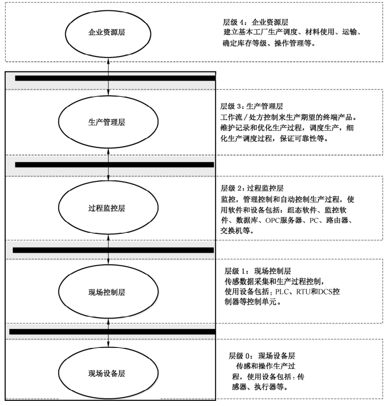

根据层次结构模型图中所述，企业资源层与生产管理层中用到的多为传统信息系统中通用的软件和硬件，GB/T 31509—2015给出了相应的评估方法。过程监控层、现场控制层和现场设备层是工业控制系统中特有的部分。本标准主要规范这3个层面的风险评估的实施工作。

### 4.2 实施原则及工作形式

GB/T 31509—2015 规定了风险评估实施的原则，包括标准性原则、关键业务原则、可控性原则及最小影响原则。

GB/T 20984—2007明确了风险评估的基本工作形式是自评估与检查评估。无论自评估或检查评估均可委托第三方工业控制系统风险评估机构实施。

### 4.3 框架及流程

#### 4.3.1 风险要素关系

风险评估中各要素及其关系如图2所示。

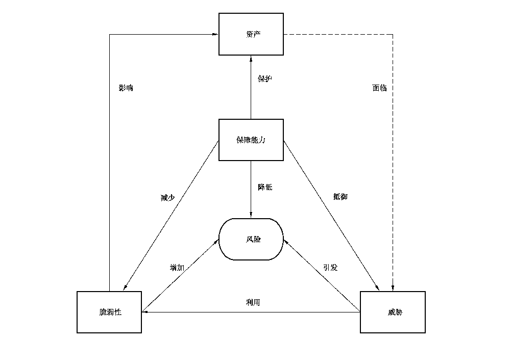

工业控制系统风险评估的基本要素包括资产、威胁、保障能力以及脆弱性。风险评估围绕这些基本要素展开，在对这些基本要素的评估过程中需要充分考虑与基本要素相关的各类属性。风险基本要素与属性间存在如下的关系：

a） 工业生产运行依赖资产去实现；

b） 资产具有资产价值，体现在工业生产运行以及系统信息安全对资产的依赖程度，依赖度越高，资产价值越大；

c） 资产面临威胁，资产价值越大则其面临的威胁越大；

d） 保障能力可保护资产安全，抵御威胁，保障能力越强，资产面临的威胁越少；

e） 风险是由威胁引发的，资产面临的威胁越多则其风险越大；

f） 脆弱性会影响资产安全，威胁可利用脆弱性来损害资产，从而形成风险；

g） 脆弱性越多，安全风险的可能性越大；

h） 保障能力可减少脆弱性，降低安全风险；

i） 需要结合资产价值综合考虑保障能力的实施成本；

j） 保障能力可抵御威胁，弥补或减少脆弱性，降低安全风险。

风险不可能降低到零，在实施了安全措施后还会有残留风险。有些残留风险来自于保障能力的不足，需要加强控制，而有些残留风险则是在综合考虑了安全成本与效益后未控制的风险，是可以被接受的风险。

#### 4.3.2 风险评估流程

工业控制系统风险评估实施分为3个阶段，包括：风险评估准备阶段、风险要素评估阶段、综合分析阶段。根据工业控制系统风险评估的不同阶段，评估方制定相应的工作计划，保证评估工作的顺利进行。

风险评估实施过程见第6章，风险评估实施流程如图3所示。

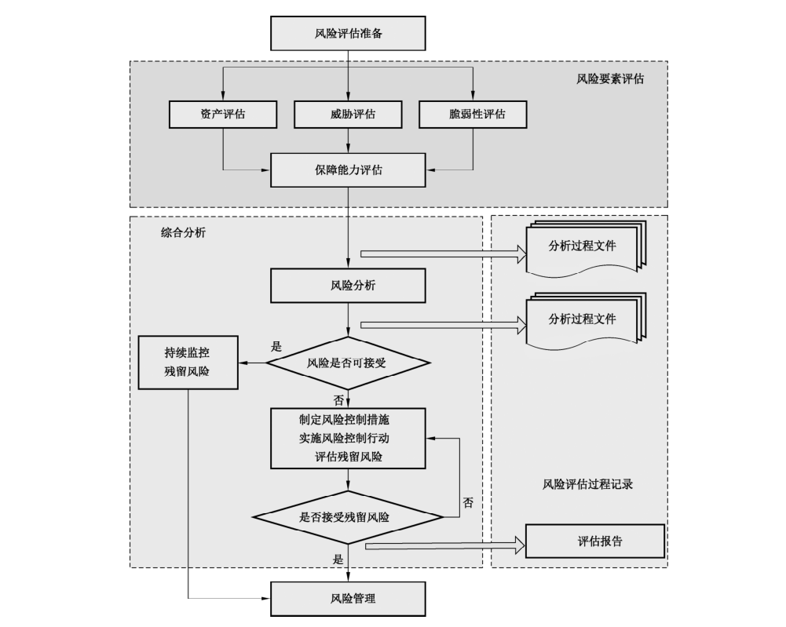

## 5 实施方法

### 5.1 概述

对工业控制系统进行风险评估需要进行调查、取证、分析和测试。工业控制系统风险评估的方法主要有5种：文档查阅、现场访谈、现场核查、现场测试和模拟仿真环境测试。

### 5.2 文档查阅

文档查阅用于确认被评估方的政策及技术方面是否全面且是最新的。被评估方应提供评估所需的文件，以确保评估方对其进行全面审查。评估方查阅被评估方的工业控制系统规划设计方案、网络拓扑图、系统安全防护计划、安全策略、架构、要求、标准作业程序、授权协议、系统互连备忘录、信息安全事件应急响应计划等文档，评估其准确性和完整性。

文档查阅有助于评估方了解工业控制系统的基本信息，包括网络拓扑结构、主要软硬件构成等。文档查阅可以发现可能导致丢失、不足或不正确执行的安全策略。评估方需验证被评估方的文档是否符合标准和法规，查找被评估方政策的缺陷、过时内容或不合理。

实施指南如下：

a） 评估方在准备阶段编制一份通用的工业控制系统风险评估文档查阅所需文件目录；

b） 被评估方根据文件目录提供相对应的文档；

c） 评估方审查相关文档内容是否完整合规；

d） 当所需文件不可调阅或不存在时，评估方对其进行标注，并就相关内容与被评估方沟通。

### 5.3 现场访谈

现场访谈用于收集客观事实材料，补充在文档查阅中未被发现的工业控制系统细节，进一步理解和洞察工业控制系统的开发、集成、供应、使用、管理等过程。

评估方应在评估实施之前准备好访谈问卷或调查表。访谈中，可以根据被访者的反映，对调查问题作调整或展开。现场访谈调查表参见附录 A。

实施指南如下：

a） 评估方在评估准备阶段编制一份通用工业控制系统风险评估访谈调查表；

b） 被评估方根据具体问题分配不同的人员配合评估方访谈，分配的人员应是最熟悉该评估对象的人员；

c） 若访谈对象对某些问题无法给出确定的答复，应对该问题进行标注，并在后续评估过程中对其进行确认；

d） 对访谈中需要验证的问题进行标注，以备后期现场核查及技术确认；

e） 访谈对象在访谈结束后对访谈记录进行核查，若无误则需进行签字确认。

### 5.4 现场核查

现场核查是在工业控制系统现场生产环境下进行的核查工作，能够真实地反应系统的安全问题。

以下几种情况可能需要使用现场核查：

a） 对工业控制系统现场物理环境评估；

b） 对工业控制系统配置、系统架构和系统日志等评估；

c） 对工业控制系统安全管理评估；

d） 对已采取安全措施进行确认。

实施指南如下：

a） 评估方需将需要现场核查的测试项与工业控制系统现场生产管理、操作人员进行沟通，制定现场核查计划安排。如果工业控制系统分布区域很大，涉及多个部门，需提前做好计划安排，统筹时间和人员等；

b） 对于部分工业控制系统所在的现场环境恶劣的情况，应严格遵守被评估方现场规章制度；必要时，在进入工业控制系统现场前，被评估方可组织评估人员进行安全教育培训，保障人员的安全；

c） 评估方核查工业控制系统的访问控制、审计等功能时，需工业控制系统的现场生产管理、操作人员和相应的信息安全人员在场，最好由工业控制系统操作人员对其进行核查操作，评估人员只负责查看并记录结果；

d） 现场核查测试时，评估方不应改动工业控制系统的任何配置；

e） 记录现场核查的结果。若发现不符合项或脆弱项，需对其进行验证。

### 5.5 现场测试

工业控制系统分为离散型和连续型。某些离散的工业控制系统，如数控机床等，处于非运行状态时可以进行现场测试。现场测试是指直接在待评估工业控制系统现场环境上进行安全性测试，这种测试方法能够更真实的反应工业控制系统存在的脆弱性。现场测试方法包括漏洞扫描、协议分析、设备漏洞挖掘、渗透性测试等。

渗透性测试的目的是为发现和确认工业控制系统的脆弱性，可在被评估方允许的前提下对离散过程的工业控制系统实施。测试前应与相关专家讨论具体的实施方案和评估可能产生的后果，并制定相应的处置计划。评估方应谨慎使用渗透性测试方法。

现场测试完成后，需要对系统进行验证才能再次投入使用。

### 5.6 模拟仿真环境测试

连续型工业控制系统往往处于不间断运行状态，任何系统故障都可能造成巨大的损失。风险评估过程中脆弱性识别往往需要进行攻击测试或绕过系统的安全机制，若直接在生产系统上实施会带来更大的安全风险，甚至导致工业控制系统崩溃或进入不可控状态。因此需要搭建模拟仿真测试环境并在此基础上进行安全测试工作。由于测试工作仅在模拟环境中进行，不会对现场工业控制系统的正常运行造成影响。模拟仿真环境下的测试评估是最有效的测试评估方法，能够在更大的范围内发现被测试系统内的流程、协议、实现等安全漏洞。

模拟仿真测试评估在测试过程中可能会造成被测试设备的损坏，或导致被测试系统的数据库中产生无效数据。若使用工业控制系统的开发、测试或备用系统作模拟仿真测试环境，在测试完成后需要经过验证才能将其投入使用，以承担其原本的功能。

模拟仿真测试最常用的技术测试方法包括：渗透测试、固件逆向分析、专用嵌入式系统分析、源代码审计、程序的上传下载漏洞分析、专有协议分析、硬件板卡分析等。常用的检测工具包括漏洞扫描器，渗透性测试工具，通讯协议数据捕获工具等。

在模拟仿真环境中既可对整个系统的安全性进行测试，评估系统整体安全状况，也可针对重要设备进行单独的组件测试，以识别工业控制系统的关键风险。

## 6 实施过程

### 6.1 准备

#### 6.1.1 概述

风险评估的准备是整个风险评估过程有效性的保证。评估方与被评估方都应充分做好风险评估实施前的各项准备工作。为保障风险评估工作的顺利开展，应召开风险评估工作启动会议，GB/T31509—2015规定了启动会议的内容及意义。图4是工业控制系统风险评估准备工作流程。

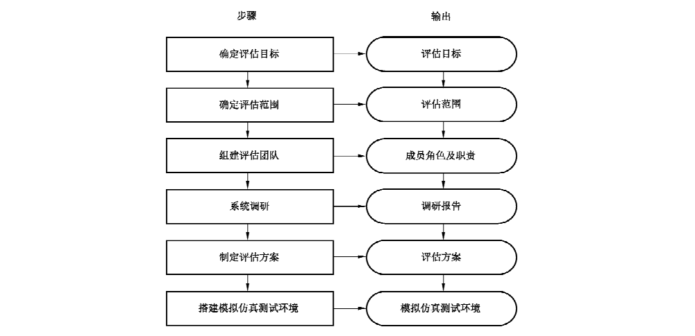

#### 6.1.2 确定目标

风险评估应贯穿于工业控制系统生命周期的各阶段中，由于工业控制系统生命周期各阶段中风险评估实施的内容、对象、安全需求均不同，因此评估方应首先根据当前工业控制系统的实际情况来确定在工业控制系统生命周期中所处的阶段，并以此来明确风险评估目标，如图5所示。具体实施过程见GB/T 20984—2007 以及 GB/T 31509—2015。

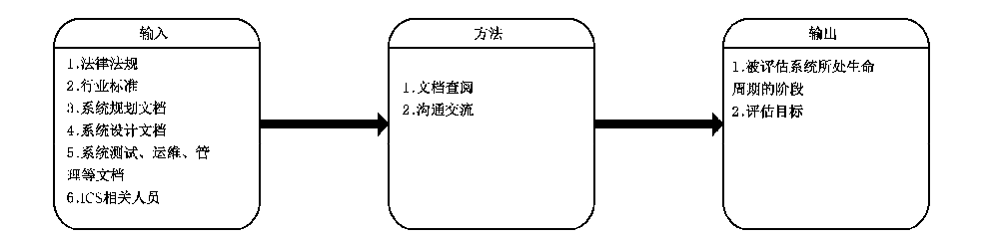

实施指南如下：

a） 评估方应根据输入的文档材料及对相关人员的访谈，分析研判出工业控制系统现在所处的生命周期；

b） 根据生命周期不同阶段的要求确定评估目标。

#### 6.1.3 确定范围

风险评估实施范围是评估方工作的范围。评估范围可以是包括生产管理层和企业资源层在内的整个工业控制系统，也可以是工业控制系统中特有部分或关键业务处理系统等。在确定评估范围时，应结合评估目标以及工业控制系统的实际建设运行情况合理的确定评估范围边界。确定评估范围如图6所示。

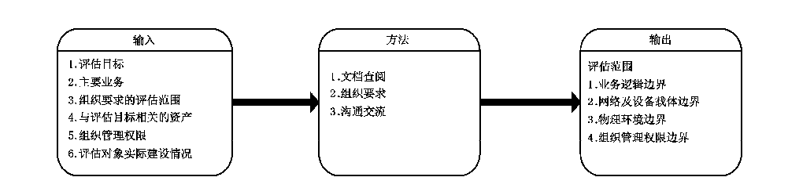

实施指南如下：

a） 评估方应了解工业控制系统所处的工业控制安全基线级别，具体见 GB/T 32919—2016；

b） 评估方应了解被评估方要求评估的范围和实际工业控制系统建设情况；

c） 风险评估实施范围应包括被评估方工业控制系统相关的资产、管理机构，关键业务流程等；

d） 评估方应结合已确定的评估目标、被评估方要求评估的范围和实际工业控制系统建设情况，合理定义评估对象和评估范围边界。

#### 6.1.4 组建团队

风险评估实施团队可由评估方与被评估方的风险评估实施组、专家组共同组成。评估方应由工业控制系统专业人员、信息技术评估人员等组成。一个运行的工业控制系统会涉及多个利益相关方，包括提供工控产品的厂商、实际销售工控产品的分销商、集成并开发应用系统的集成商、为系统提供运行维护的厂商以及工控系统的所有者等。在进行工业控制系统的风险评估之前，需要清晰界定评估所针对的是工控系统生态的哪一部分，涉及哪些利益相关方，从而确定风险评估过程中被评估方应当邀请的参与人员。

评估实施团队应进行风险评估技术培训和保密教育，制定风险评估过程管理相关规定。评估方与被评估方应签署保密协议。

每个团队成员应具有明确的职位和责任。为确保风险评估实施工作的顺利有效进行，应采用合理的项目管理机制，评估团队和被评估方主要成员的职位与职责说明分别见表1和表2。

**表1 评估方成员职位与职责说明**

| 评估方人员职位 | 工作职责 |
| --- | --- |
| 项目组长 | 是风险评估项目中实施方的管理者、责任人，具有丰富的工业控制系统风险评估经验。具体工作职责包括： 1）GB/T 31509—2015 规定的； 2）参与风险评估启动会议； 3）组织开展风险评估方案专家评审会； 4）组织开展风险评估报告等项目成果物专家评审会； 5）组织评估方成员开展保密教育及相关技术培训； 6）参与项目验收会议； 7）配合搭建模拟仿真测试环境。 |
| 评估人员 | 是负责风险评估项目中技术方面评估工作的实施人员，应熟悉工业控制系统专用的通信协议（例如：DNP3、ModBus、PROFINET、PROFIBUS 等）；同时应精通编码、逆向工程、协议分析和渗透测试等；部分工业控制系统使用非桌面操作系统，评估实施团队成员应熟悉被检测工业控制系统使用的操作系统。具体工作职责包括： 1）GB/T 31509—2015 规定的； 2）参与保密教育及相关技术培训。 |
| 质量管控员 | 是负责风险评估项目中质量管理的人员。具体工作职责包括： 1）GB/T 31509—2015 规定的； 2）参与保密教育及相关技术培训。 |

**表2 被评估方成员职位与职责说明**

| 被评估方人员职位 | 工作职责 |
| --- | --- |
| 项目组长 | 是风险评估项目中被评估方的管理者。具体工作职责包括： 1）GB/T 31509—2015 规定的； 2）组织被评估方成员开展保密教育及相关技术培训； 3）组织召开风险评估启动会议； 4）组织开展项目验收会议； 5）组织搭建模拟仿真测试环境。 |
| 项目协调人 | 是指风险评估项目中被评估方的工作协调人员，应被赋予一定权力。具体工作职责包括： 1）GB/T 31509—2015 规定的； 2）参与保密教育及相关技术培训； 3）参与风险评估启动会议； 4）配合搭建模拟仿真测试环境。 |
| 信息安全管理人员 | 是指被评估方的专职信息安全管理人员。在风险评估项目中的具体工作职责包括： 1）GB/T 31509—2015 规定的； 2）参与保密教育及相关技术培训； 3）配合搭建模拟仿真测试环境。 |
| 运维及操作人员 | 是指在被评估方的工业控制系统运行维护及操作人员。运维及操作人员承担工业控制系统中的现场控制层及现场设备层的管理运维及使用。在风险评估项目中的具体工作职责包括： 1）GB/T 31509—2015 规定的； 2）参与保密教育及相关技术培训； 3）配合搭建模拟仿真测试环境。 |
| 关键产品供应商人员 | 是指工业控制系统关键产品（包括软硬件）供应商人员代表。在风险评估项目中的具体工作职责包括： 1）在项目组长的安排下，配合评估方的工作； 2）参与保密教育培训； 3）参与风险评估项目的验收。 |
| 系统集成商人员 | 是指工业控制系统的集成商代表，在风险评估项目中具体的工作职责包括： 1）在项目组长的安排下，配合评估方的工作； 2）参与保密教育及相关技术培训； 3）配合搭建模拟仿真测试环境； 4）参与对风险评估项目的验收。 |

专家组由工业控制系统相关领域专家组成，职责包括：

a） 对风险评估实施方案进行评审；

b） 对风险评估报告等项目成果物进行评审；

c） 对评估工作中出现的关键性问题提供指导；

d） 对风险评估整个过程进行监督。

#### 6.1.5 系统调研

系统调研是熟悉了解被评估对象的过程，风险评估组应进行充分的系统调研，修正评估目标跟范围，同时为风险评估依据和方法的选择、评估内容的实施奠定基础。评估方对工业控制系统进行调研可采取文档查阅、资料收集、现场交流和现场查看等方式进行，如图7所示。

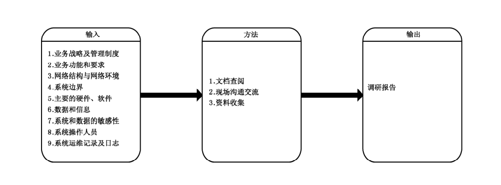

实施指南如下：

a） 评估组针对工业控制系统与系统运维、系统操作、关键产品供应商等相关人员进行交流，了解其承担的业务、网络结构、系统边界等。

b） 评估组查看其设计、使用说明等文档：

1） 在工业控制系统中，若现场设备及其应用软件非被评估方自己开发，评估组需仔细审查供应商提供的所有资料，并与供应商取得联系，以便评估实施时可以进行技术沟通；

2） 查看工业控制系统的安全需求及对应工业控制系统所处安全控制基线级别，采取哪些工业控制系统安全措施。

c） 评估组现场核查工业控制系统的物理环境、操作过程、设备组成等方面的信息并进行资料收集。

d） 评估组根据现场调研整理调研结果，编写调研报告。

#### 6.1.6 制定评估方案

风险评估方案是评估工作实施活动总体计划，用于管理评估工作的开展，使评估各阶段工作可控，并作为评估项目验收的主要依据之一。风险评估方案应得到被评估方的确认和认可。风险评估方案的内容应包括（但不仅限于）：

a） 风险评估工作框架：包括评估目标、评估范围、评估依据、评估工具等，其中评估依据和评估工具可根据GB/T 31509—2015 来确定；

b） 评估团队：包括评估组成员、组织结构、角色、责任；

c） 评估工作计划：包括各阶段工作内容和工作形式；

d） 评估环境要求：根据具体的评估方法选取相应的评估环境，包括工业控制系统现场环境，工业控制系统开发和测试环境，模拟仿真测试环境；

e） 风险规避：包括保密协议、评估工作环境要求、评估方法、工具选择、应急预案等；

f） 时间进度安排：评估工作实施的时间进度安排。

#### 6.1.7 搭建模拟仿真测试环境

被评估方应根据测试方案的需要，搭建合适的模拟仿真测试环境。模拟仿真测试环境搭建需保证与现场工业控制系统的一致性，主要体现在以下5个方面：

a） 现场控制层设备、过程监控层设备、网络边界设备，包括其品牌、型号、固件、配置、开启的服务等；

b） 关键软件，包括其厂商、版本号、补丁、配置等；

c） 通讯协议；

d） 系统架构及网络架构；

e） 模拟仿真测试环境的规模不必与实际系统相同。

若被评估方存在工业控制系统的开发、测试环境，评估方需对其进行评判，满足模拟仿真环境的要求后方可在其中进行进一步的测试评估工作。图8是模拟仿真测试环境示例。

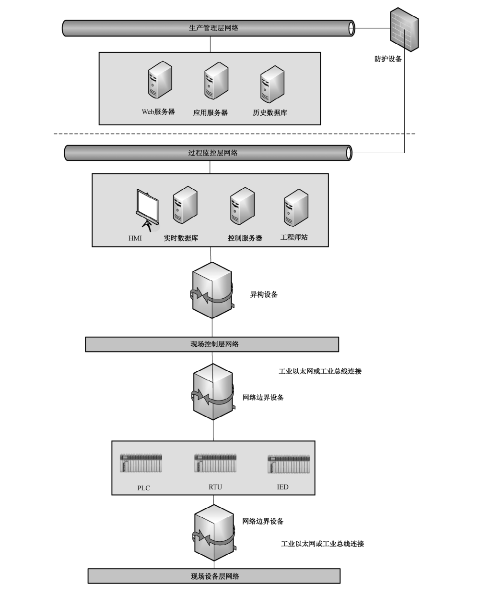

### 6.2 资产评估

#### 6.2.1 资产评估概述

资产是对被评估方具有价值的信息或资源，是安全策略的保护对象。资产价值是资产重要程度或敏感程度的表征。资产评估包括识别资产和评估资产价值2个方面内容。

#### 6.2.2 资产分类

在一个组织中，资产有多种存在形式。不同类别的资产重要性不同，面临的威胁也不同。对工业控制系统及相关的资产进行分类可以提高资产识别的效率。在实际工作中，具体的资产分类方法可以根据具体的评估对象和要求，由评估方灵活把握。根据资产的表现形式，可将资产分为软资产、硬资产和人力资产等，如表3所示。

**表3 一种基于表现形式的资产分类方法**

| 资产类别 | 资产举例 |
| --- | --- |
| 软资产 | 系统软件：操作系统、数据库管理系统、开发系统等； 应用软件：远程拨号软件、OPC、办公软件、数据库软件、远程控制软件、工业控制系统组态软件、工业控制系统相关开发软件、各类工业控制系统工具软件等； 源程序：各种共享源代码、自行或合作开发的各种代码、工业控制系统定制开发流程代码、现场设备固件等； 工业控制系统专有协议：CAN、MODBUS、PROFIBUS、MPI、PPI、PROFINET、OPC、DNP3.0、Foundation Fieldbus、LonWorks、HART 和工业以太网等； 通用协议：FTP、TFTP、HTTP、DNS、SNMP、Telnet 等； 数据：保存在信息媒介上的各种数据资料，包括源代码、实时数据库数据、历史数据库数据、系统文档、系统日志、运行管理规程、计划、报告、用户手册、各类文档等。 |
| 硬资产 | 现场控制层设备：IED、DCS、PLC、RTU 等； 网络设备：工业控制系统协议转换器、路由器、网关、交换机、调制解调器等； 安全设备：工业防火墙、入侵检测系统、网闸、VPN 等； 计算机设备：服务器、工作站、台式计算机、便携计算机、HMI 等； 存储设备：磁带机、磁盘阵列、磁带、光盘、软盘、移动硬盘等； 传输线路：光纤、双绞线、无线、CAN 总线、MODBUS、PROFIBUS 专用工业控制系统总线等； 保障设备：UPS、变电设备、空调、保险柜、文件柜、门禁、消防设施等。 |
| 人力资产 | 掌握重要信息和核心业务的人员：信息安全人员、工业控制系统设计人员、集成人员、关键设备供应商、操作人员、运维人员等。 |

#### 6.2.3 资产调查

资产调查是识别被评估方工业控制系统中资产的重要途径。资产调查一方面应识别出有哪些资产，另一方面要识别出每项资产自身的关键属性。工业控制系统结构复杂，资产繁多，为保证风险评估工作的进度要求及质量要求，有时不能对所有资产进行全面分析，应选取其中关键的资产进行分析，资产调查如图9所示。

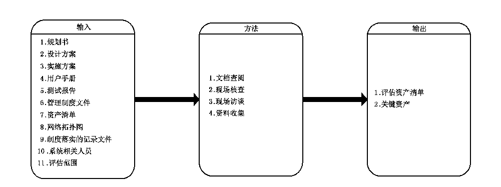

协议也属于系统资产。工业控制系统广泛使用私有协议，往往会出现许多安全问题。资产调查过程中，应识别出工业控制系统使用的通讯协议并对其进行评估。

实施指南如下：

a） 评估组根据评估目标和范围，确定风险评估对象，并梳理其基本信息，可以参照附录 A中表 A.1进行访谈；

b） 评估方根据被评估方提供的规划书、设计方案、用户手册等文档并结合现场访谈相关人员识别出工业控制系统的具体业务；

c） 评估方根据工业控制系统的业务并结合现场访谈相关人员，识别出工业控制系统的工艺需求以及安全需求；

d） 评估方根据工业控制系统的工艺需求和安全需求，结合现场访谈相关人员，识别出关键功能需求及安全需求；

e） 评估方根据识别的关键需求、被评估方提供的资产清单、网络拓扑图等识别出工业控制系统的关键资产。

#### 6.2.4 资产分析

根据工业控制系统承担的业务，判断资产的可用性、完整性和保密性的优先级。通常工业控制系统将可用性作为首要需求。

进行资产赋值时可以参考如下因素：

a） 工业控制系统的重要性以及安全等级；

b） 资产对工业控制系统正常运行的重要程度；

c） 工业控制系统信息安全对资产的依赖程度；

d） 资产可用性、完整性、保密性对工业控制系统以及相关业务的重要程度。

分析资产的可用性、完整性、保密性安全属性的等级，并参考对可用性、完整性、保密性赋值，经过综合评定得到资产的最终赋值结果，如图10所示。将资产价值分为5个等级，具体含义见 GB/T 20984—2007。

实施指南如下：

a） 根据系统承担的业务，分析研判资产的安全属性可用性、完整性和保密性的优先级；一般情况下，工业控制系统会将可用性放在首位；

b） 根据资产调查以及资产赋值结果，确定重要资产的范围，并主要围绕重要资产进行下一步的风险评估。

### 6.3 威胁评估

#### 6.3.1 威胁评估概述

威胁是指可能导致危害系统或被评估方的不希望事故的潜在起因。威胁是客观存在的，不同的资产面临威胁不同，同一个资产不同威胁发生的可能性和造成的影响也不同。全面、准确地识别威胁有利于做好防范措施。威胁评估要识别出威胁源、威胁途径及可能性和威胁影响，并对威胁进行分析赋值。

#### 6.3.2 威胁分类

威胁源是产生威胁的主体。不同的威胁源具有不同的攻击能力，在进行威胁调查时，首要应识别存在哪些威胁源，同时分析这些威胁源的动机和能力。攻击者的能力越强，攻击成功的可能性就越大。衡量攻击能力主要包括：施展攻击的知识、技能、经验和必要的资金、人力和技术资源等。表4列出了工业控制系统通常面临的威胁来源。

**表4 基于威胁源的威胁分类**

| 威胁源 | 描述 |
| --- | --- |
| 环境因素 | 环境因素包括断电、静电、灰尘、潮湿、温度、鼠蚁虫害、电磁干扰、洪水、火灾、地震、意外事故等环境危害或自然灾害等；除了自然灾害等不可抗因素，来自环境因素的威胁基本上可以通过加强保障能力来抵御 |
| 内部：误操作 | 误操作是由于内部人员缺乏责任心、不关心或者不关注，没有遵循规章制度和操作流程，缺乏培训，专业技能不足等导致的工业控制系统故障或被攻击 |
| 内部：有意破坏 | 有意破坏是由对被评估方不满或具有某种恶意目的的内部员工对工业控制系统进行破坏或窃取系统信息；内部人员了解系统状况并具有一定的访问权限，可以物理接触系统、掌握系统的关键信息。进行有意破坏不需要掌握太多入侵知识就可以破坏系统或窃取系统数据 |
| 外部攻击 | 外部攻击是外部人员或组织对系统进行的攻击。外部攻击者难以接触系统，应具备一定的资金、人力、技术等资源。不同的攻击者能力差异较大 |
| 供应链 | 供应链包括对被评估方提供硬件、软件、服务等的制造商及生产厂，可能在提供的软硬件设备上设置“后门”来达到方便维护人员调试或窃取系统信息等目的 |

表5中提供了工业控制系统可能存在的威胁。

**表5 工业控制系统可能面临的威胁**

| 威胁名称 | 描述 |
| --- | --- |
| 灾难 | 自然灾难使工业控制系统的一个或多个组件停止运行，例如地震、火灾、洪水或其他未预期的事故 |
| 停电 | 自然灾难，恶意或无恶意的个人引起的停电事故，影响工业控制系统一个或多个组件的运行 |
| 非法信息披露 | 无权限者进行攻击（嗅探，社会活动），以获得储存在工业控制系统组件中的敏感信息 |
| 非法分析 | 无权限者进行攻击（嗅探，社会活动），用于分析受保护的敏感信息 |
| 非法修改 | 无权限者进行攻击（修改，旁路，嗅探），以修改存储于工业控制系统组件中的敏感信息 |
| 非法破坏 | 无权限者进行攻击（破坏，旁路），以破坏存储于工业控制系统组件中的敏感信息 |
| 篡改控制组件 | 通过以下攻击（修改，旁路，物理攻击），工业控制系统组件被恶意的人员篡改 |
| 错误操作 | 合法操作员意外的发布错误指令或进行错误配置，导致受控工业控制系统过程和组件被破坏 |
| 冒充合法用户 | 无权限者进行攻击（嗅探，欺骗，社会活动），以获得存储于工业控制系统组件中的用户凭证，冒充合法用户 |
| 抵赖 | 合法用户否认在工业控制系统交互式系统中已执行的错误操作 |
| 拒绝服务 | 无权限者进行攻击（破坏，DOS），使工业控制系统组件在一段时间内无法使用，达到系统拒绝为合法用户提供服务的目的 |
| 提升权限 | 无权限者进行攻击（错误操作，嗅探，欺骗，社会活动），以获得存储于工业控制系统服务器组件中的用户凭证，提升工业控制系统组件访问的权限，达成恶意目的 |
| 故障检测缺失 | 操作员错误操作和安全违规的系统故障，在工业控制系统交互式系统中，执行的日常任务没有被检测和审计，以作进一步的分析和修正 |
| 病毒感染 | 个人恶意或无意地将病毒传入工业控制系统网络，恶意代码造成不必要的系统停机和数据腐败 |
| 非法物理存取 | 无权限者进行一次物理攻击，以实现对受保护工业控制系统组件的物理存取 |

#### 6.3.3 威胁调查

##### 6.3.3.1 概述

工业控制系统网络化、系统化、自动化、集成化的不断提高，尤其是互联网技术进入工业控制领域，信息系统与工业控制系统的集成，其面临的安全威胁日益增长。威胁调查就是要识别被评估方工业控制系统中可能发生并造成影响的威胁，进而分析哪些威胁发生的可能性较大，可能会造成重大影响，如图11所示。

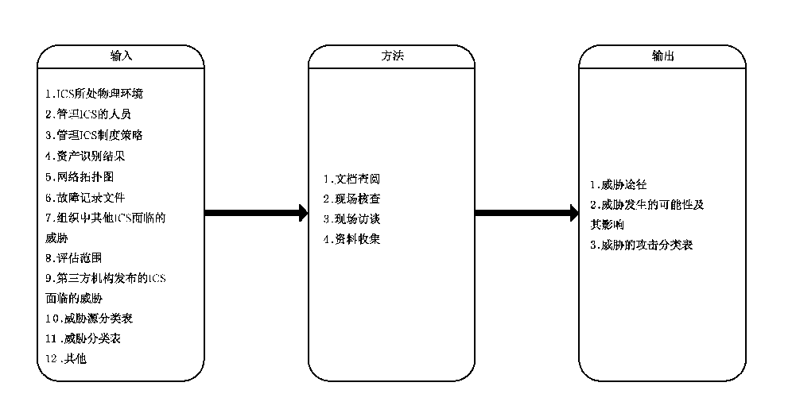

工业控制系统大多部署网闸设备，在工业控制网络和外部网络之间进行网络隔离。威胁调查中要着重识别针对网闸等网络隔离设备的威胁。

评估组将被评估的工业控制系统所处的自然环境、相关管理制定策略、资产清单、网络拓扑图、故障记录等文件进行汇总，对系统相关人员进行访谈，以识别工业控制系统威胁，如图11所示。

实施指南如下：

a） 评估方通过查看系统日志，分析系统面临的威胁；

b） 评估方可参考被评估方内其他工业控制系统面临的威胁来分析本系统所面临威胁；

c） 评估方可收集一些第三方组织发布的安全态势方面的数据；

d） 若系统运行过一段时间，可根据以往发生的安全事件记录，分析系统面临的威胁。例如，系统维修频率，系统受到病毒攻击频率，系统不可用频率，系统遭遇黑客攻击频率等。

##### 6.3.3.2 威胁途径及可能性

威胁途径是指威胁源对工业控制系统或信息系统造成破坏的手段和路径。威胁源对威胁客体造成破坏，有时候并不是直接的，而是通过中间若干媒介的传递，形成一条威胁路径。在风险评估工作中，调查威胁路径有利于分析各个环节威胁发生的可能性和造成的破坏。

威胁是客观存在的，但对于不同的被评估方和工业控制系统，威胁发生的可能性不尽相同。威胁发生的可能性与威胁途径、攻击能力、动机、工业控制系统的脆弱性、保障能力是密切相关的。例如，当威胁需要物理接触设备时，其可能性会大大降低。

实施指南如下：

a） 评估方统计以往安全事件报告中出现过的威胁及其频率；

b） 评估方统计现场工业控制系统中通过检测工具以及各种日志发现的威胁及其频率；

c） 统计国际组织发布的关于该工业控制系统及其组件面临的威胁及其频率；

d） 确定不同威胁的频率值；

e） 非人为威胁途径表现为发生自然灾难、出现恶劣的物理环境、出现软硬件故障或性能降低等；

f） 人的威胁途径表现嗅探、重放、拒绝服务、误操作等；

g） 调查威胁攻击路径，要明确威胁发生的起点、威胁发生的中间点以及威胁发生的终点，并明确威胁在不同环节的特点，确定威胁路径；

h） 根据威胁途径、攻击能力等判断威胁发生的可能性。

##### 6.3.3.3 威胁的影响

威胁出现的频率是衡量威胁严重程度的重要要素，因此威胁识别后需要对发生频率进行赋值，以代入最后的风险计算中。

威胁客体是威胁发生时受到影响的对象，威胁影响跟威胁客体密切相关。当一个威胁发生时，会影响到多个对象。威胁客体有层次之分，通常威胁直接影响的对象是资产，间接影响到工业控制系统和组织。

实施指南如下：

a） 识别那些直接受影响的客体，再逐层分析间接受影响的客体；

b） 确定威胁客体的价值，其价值越大，威胁发生的影响越大；

c） 确定客体范围，其范围越广泛，威胁发生的影响越大；

d） 受影响客体的可补救性也是威胁影响的一个重要方面。遭到威胁破坏的客体，有的可以补救且补救代价可以接受，威胁发生的影响较小；有的不能补救或补救代价难以接受，威胁发生的影响较大。

#### 6.3.4 威胁分析

在调查威胁的基础上，识别威胁发生的概率、威胁影响，分析并确定计算威胁值的方法并对其进行赋值。威胁分析实施见 GB/T 31509—2015。

### 6.4 脆弱性评估

#### 6.4.1 脆弱性评估概述

脆弱性是资产自身存在的，威胁总是要利用资产的脆弱性才可能造成危害。评估方应考虑工业控制系统脆弱性具有难以修复、原则上需要保密的特点，从物理环境、网络、平台和安全管理4个方面对工业控制系统脆弱性进行评估。

脆弱性评估分为脆弱性识别与脆弱性分析赋值两个环节。脆弱性识别的依据可以是国际标准或国家安全标准，也可以是行业规范、应用流程的安全要求。对应用在不同环境中相同的脆弱点，其脆弱性严重程度是不同的，评估者应从被评估方安全策略的角度考虑、判断资产的脆弱性及其严重程度。

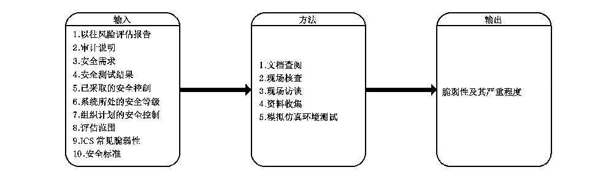

工业控制系统以往风险评估报告、审计说明、安全需求、安全测试结果、系统所处的安全等级、被评估方计划实施的安全措施、评估范围、常见脆弱性、依据国际或国家安全标准等均可作为评估方评估的资料。评估方通过资料收集、文档查阅、现场访谈、现场核查、模拟仿真环境测试等方法识别工业控制系统存在的脆弱性，如图12所示。

实施指南如下：

a） 评估方通过现场访谈和现场核查的方式对物理环境脆弱性进行识别，具体识别过程见 6.4.2；

b） 评估方通过现场访谈，现场核查等方式对网络脆弱性进行识别，具体识别过程见 6.4.3；

c） 评估方通过现场访谈、现场核查、模拟仿真环境测试的方式对平台脆弱性进行识别，具体识别过程见 6.4.4；

d） 评估方通过文档查阅、现场访谈和现场核查的方式对安全管理脆弱性进行识别，具体识别过程见 6.4.5。

#### 6.4.2 物理环境脆弱性识别

物理环境脆弱性识别主要识别工业控制系统物理环境的安全风险，包括场所环境、电磁环境、设备实体、线路等方面。评估方核查已采取物理环境的安全措施及验证其已采取的安全措施有效性，同时查看基于该安全控制级别缺少哪些安全措施。

实施指南如下：

a） 评估方文档查阅及访谈被评估方相关人员确定工业控制系统所处的安全控制基线级别，参考系统所处级别应采取的安全措施，查看系统是否存在明显不符的脆弱性；

b） 评估方现场核查所在的场所建筑物是否坚固，是否存在易于闯入的任何缺口，所有外部门是否使用控制机制来保护，防制未授权进入，采用哪些安全措施，验证核实已采用措施的有效性；

c） 工业控制系统所在场所、办公室、公共访问接待区是否交叉，有无安全保卫人员，有无监控装置等；

d） 评估方现场核查工业控制系统所在场所与办公室和公共访问接待区有交叉的建筑物是采用何种方式的物理访问控制，并核实其采取的安全措施的有效性。例如门禁、身份标识、访客人员登记、专人陪同、不准携带移动介质、相机等管理措施；

e）评估方查看工业控制系统所在场所是否安装避雷针、安装通风装置、配备灭火器、配备应急电源、远离易燃易爆物品、建筑物漏水渗水等；

f） 评估方查看工业控制系统场地是否处于复杂的电磁环境，内部电磁信息是否泄漏；

g） 网络节点中心、网络设备、安全防护设备、办公设备、工作站、服务器和现场设备等设备安放位置是否合适、是否将需要专门保护的组件隔离放置等；

h）光缆、电缆、网络线缆等线路是否在地下布线，且将电源电缆与通信电缆分开布线，电缆设备标识是否清晰。

表6列出了工业控制系统通常可能存在的物理环境脆弱性。

**表6 物理环境脆弱性**

| 脆弱性 | 描述 |
| --- | --- |
| 系统所在场所建筑物无物理屏障或访问控制机制 | 场所外墙应够坚固，外部的门应使用控制机制保护，例如，身份识别仪器、门禁系统、锁、报警器等，若无物理屏障可导致未授权人员可以进入系统所在场所 |
| 系统所在场所建筑物未安装安防监控系统 | 应在系统所在场所建筑物安装安防监控系统，防制设备和信息被盗，造成信息泄漏 |
| 系统无应急电源 | 系统应配备应急电源，防制断电对设备的损坏及数据丢失造成损失 |
| 系统无应急开关 | 系统应配备应急开关以便紧急情况快速切断电源 |
| 未安装加热/通风、空调等支持系统 | 需安装加热/通风、空调等支持系统，保证工业控制系统工作环境的稳定 |
| 自然灾害 | 火灾、洪水、地震、雷电和地震等自然灾害引起破坏时，应能备份系统数据，远离易燃易爆材料，配备适当的灭火器 |
| 缺少访问登记机制 | 第三方人员及临时授权人员进入系统场所时应有访问登记记录，防制未授权进入 |
| 系统处于复杂电磁环境内 | 应避免系统暴露于强电磁场等有较强电磁干扰的环境内 |

#### 6.4.3 网络脆弱性识别

##### 6.4.3.1 网络结构及网络边界脆弱性识别

网络结构及网络边界脆弱性是指工业控制系统网络结构及网络边界存在的脆弱性。表7列出了通常工业控制系统可能存在的网络结构和网络边界脆弱性。

**表7 工业控制系统网络结构和网络边界脆弱性**

| 脆弱性 | 描述 |
| --- | --- |
| 工业控制系统网络未分层 | 被评估方设计实施时未对工业控制系统网络进行分层隔离，可能会导致部分设备出现的安全问题弥散到整个工业控制系统网络中 |
| 薄弱的网络安全架构 | 因业务和操作需要对工业控制系统网络架构的开发和修改，可能在不经意间将安全漏洞引入网络架构的某一部分中 |
| 企业资源层网络与工控网络中未部署逻辑隔离设备 | 网络之间未部署网络隔离设备，可直接通信。攻击数据包和恶意软件在网络之间传播，可轻易监测到其他网络上的敏感数据，造成未经授权的访问 |
| 使用双宿主机 | 双宿主机可以导致数据在两个网络之间传输，若没有适当安全措施的双宿主机将会造成额外的威胁 |
| 在控制网中传输非控制数据 | 控制数据与非控制数据有着不同的要求，比如可靠性程度不同，因此在同一个网络中传输两种流量会导致难以配置网络。例如，非控制流量可能会大量损耗控制流量传输所需要的网络带宽资源，导致工业控制系统的系统功能中断 |
| 在控制网络中应用IT 网络服务 | IT 网络中使用的服务，如DNS.DHCP、HTTP.FTP、SMTP 等，在控制网络中被使用时，可能引入额外的严重安全漏洞 |
| 非法的数据流向 | 控制网络的数据 |
| 重要网络链路或设备没有冗余配置 | 在重要的网络中没有冗余备份链路，可能导致设备遭遇单点故障 |
| 安全边界定义不清晰 | 控制网络边界定义不清晰，将难以保证必要的安全措施被合适的实施或配置，会导致对系统和数据的未授权的访问和其他问题 |
| 设备 MAC地址未绑定 | 设备的 MAC地址未绑定，容易遭到中间人攻击 |
| 边界防护设备访问控制措施不当 | 缺少或未配置合适的边界防护控制措施会导致无用数据在网络间传递。这会引起多种问题，如攻击和病毒在网络中扩散，可以在其他网络中对控制网中敏感数据进行监控和窃听及对系统进行非法访问等 |
| 网络设备日志未开启 | 如果没有合适、详细的日志信息，将无法分析出导致安全事件发生的原因 |
| 未部署安全监控设备 | 如果不进行定期的安全监控，事故可能被忽视，将可能导致额外的破坏或中断 |

核查网络结构和网络边界脆弱性，以及被评估方采取的安全措施的有效性。

实施指南如下：

a） 查看网络拓扑图及现场核查工业控制系统网络结构是否分层，各层之间是否部署访问控制设备、入侵检测设备、安全隔离设备、安全审计设备和防护设备等，未部署上述设备的网络是否有其他措施替代；

b） 现场核查企业资源层网络与工控网络中是否部署逻辑隔离设备，如防火墙等；

c） 现场核查工业控制系统部署访问控制设备、入侵检测设备、安全隔离设备、安全审计设备和防护设备等的配置，并验证其配置有效性，分析这些设备的日志；评估方可根据 GB/T 32919—2016 中附录 B 中 B.16 和 B.17 进行评估；

d） 现场核查工业控制系统是否使用远程通信，是否使用访问控制措施；

e） 现场核查边界防护设备的访问控制措施配置是否合适；

f） 在模拟仿真环境中对是否存在通过侵入远程设备进而控制部分或整个工业控制系统的风险进行测试分析；

g） 查看工业控制系统网络运维记录或日志，记录网络中曾出现过的故障及原因；

h） 工业控制系统网络与办公网之间的接入点数量是否严格控制，接入口是否进行安全管理和安全防护；

i） 查看网络中是否存在双宿主机使用情况；

j） 查看设备 MAC地址是否绑定；

k）评估方查看工业控制系统网络是否部署组织企业管理级应用，是否在控制网络中传输非控制数据；

l） 评估方在模拟环境测试中抓取网络数据，并分析控制数据、口令等是否加密。并在模拟仿真环境进行 DOS 攻击，验证是否存在非控制流量大量损耗控制流量传输所需要资源，导致工业控制系统的系统功能中断的脆弱性；

m） 评估方现场核查工业控制系统网络中是否有冗余链路和设备；

n） 评估方查看控制网络中是否应用 IT 网络服务，例如 DNS、DHCP、FTP、Telnet、 SMTP、SNMP 等；

o） 评估方根据工业控制系统使用的服务应用，在模拟仿真环境中进行 DNS劫持，ARP欺骗，获取远程登录密码，发送恶意软件等测试，验证在控制网络中使用IT 网络服务应用存在脆弱性；

p） 评估方查看网络拓扑图及现场核查其网络，并在实验室中进行跨 VLAN 攻击，验证被评估方划分 VLAN合理性及安全性；

q） 评估方现场对系统网络的边界完整性进行核查。

##### 6.4.3.2 网络设备脆弱性识别

网络设备脆弱性是指工业控制系统网络设备存在的脆弱性，表8列出了工业控制系统的网络设备通常可能存在的脆弱性。

**表8 工业控制系统网络设备脆弱性**

| 脆弱性 | 描述 |
| --- | --- |
| 网络设备物理保护不足 | 应对网络设备的物理访问进行控制，以防止破坏网络设备 |
| 不安全的物理端口 | 不安全的通用接口如 USB、PS/2 等外部接口可能会导致未授权的设备接入 |
| 无关人员物理访问网络设备 | 对网络设备进行不当的物理访问会导致： 数据和硬件窃取； 数据和硬件的物理损伤破坏； 对网络安全环境（比如，修改 ACL 允许攻击进入网络）的篡改； 未授权的阻止或控制网络行为； 关闭物理数据链路 |
| 没有使用数据流控制 | 未采用数据流控制机制，如利用访问控制列表（ACL），限制系统或人对网络设备的直接访问 |
| IT 安全设备配置不当 | 使用缺省配置往往导致主机上运行了不必要的开放端口和可能被威胁所利用的网络服务。不当的防火墙配置规则和路由器访问控制列表将允许不必要的流量通过 |
| 网络设备配置未备份 | 没有制定和实施网络设备配置备份和恢复规程，偶然或者恶意对网络设备配置进行修改造成系统通信中断时无法及时恢复 |
| 口令未加密传输 | 以明文传输的口令很容易被攻击者窃听，攻击者会利用这些口令对网络设备进行非法访问。通过这种访问，攻击者可以破坏工业控制系统的系统操作或者监视工业控制系统网络行为 |
| 网络设备口令长期未更改 | 口令应定期更换，这样，即使未授权用户获得密码，也只有很短的时间段内可以访问网络设备。未定期更换密码可能使黑客破坏工业控制系统的操作或监视工业控制系统的网络活动 |
| 采用的访问控制不足 | 通过非法访问网络设备，攻击者可以破坏工业控制系统的系统操作或者监视工业控制系统网络行为 |
| 专用工业控制系统协议转换设备采用默认设置 | 将工业控制系统网络中总线协议转换为以太网协议进行数据传输，该设备多为专用设备，管理人员对其内部知之甚少，多采取出厂默认设置，存在一定安全风险 |

实施指南如下：

a） 查看重要网络设备放置场所，场所有无物理访问控制、有无禁止无关人员进人的措施，是否安装监视系统、是否安装空调等支持设备；针对被评估方采取的措施，验证其有效性；

b） 查看是否留有不安全的物理端口，是否将无用的USB、PS/2、网络接口封堵，是否采用技术手段对这些端口进行监控；

c） 查看设备的访问日志、安全配置及网络权限，在模拟环境中对设备进行测试，通过尝试使用口令绕过，提取权限，修改 ACL，发现设备的脆弱性，并验证其安全措施的有效性；

d） 在模拟测试环境中查看设备是否开启不必要的端口并对其进行测试；

e） 在模拟仿真测试环境中查找设备存在的系统漏洞；

f） 查看网络设备口令更新周期及字符长度等配置；

g） 现场访谈被评估方是否为网络硬件配备专门运维人员；

h）现场访谈及核查被评估方是否对替换下的网络硬件进行登记、保存或按照要求进行销毁。

##### 6.4.3.3 通信和无线连接脆弱性识别

通信和无线连接脆弱性是指工业控制系统网络通信和无线连接存在的脆弱性。表9列出了工业控制系统的通信和无线连接通常可能存在的脆弱性。

**表9 通信和无线连接脆弱性**

| 脆弱性 | 描述 |
| --- | --- |
| 通信协议明文传输 | 攻击者可以使用协议分析工具或者其他设备解析 ProfiBus、DNP、Modbus、CAN等协议传输的数据，实现对工业控制系统的网络监控。使用这些协议也可以使攻击者更容易攻击工业控制系统或控制工业控制系统网络行为 |
| 通信协议缺少认证机制 | 许多工业控制系统协议不具备认证机制，采用此类型的通信协议，存在重放或篡改数据的可能性 |
| 缺少通信完整性保护 | 大部分的工业控制系统协议不具备完整性检查机制。攻击者可以操纵这种没有完整性检查的通信 |
| 无线连接客户端与接入点间认证不足 | 无线客户端与接入点之间认证不足，导致客户端访问的是攻击者伪造的接入点，同时非法入侵者可访问工业控制系统无线网络 |
| 无线连接客户端与接入点间数据保护不力 | 无线客户端与接入点间传递的敏感数据未采用加密保护，攻击者监听明文信息造成信息泄露 |
| 无线网络边界不清 | 无线网络的范围无法精确控制，导致非受控终端的接入 |

实施指南如下：

a） 现场对工业控制系统控制柜及机房环境中的无线网络进行搜索，确认企业的无线组网是否采取身份认证措施、是否需要标识和密码验证、是否采取安全监测措施，检查被评估方有无为防止经无线网络进行恶意入侵所采取的其他措施，并分析其有效性；

b） 在模拟仿真环境中对使用的通信协议进行协议分析，分析是否是明文传输；

c） 在模拟仿真环境中使用重放攻击验证是否有数据校验，防篡改的措施；

d） 评估方现场核查无线连接客户端与接入点间的认证方式，评估方在模拟仿真环境中采用相应的测试方法验证其有效性；

e） 评估方现场核查是否有未授权接入无线网络的设备；

f） 在模拟仿真环境中使用相应的工具分析该无线协议是否明文传输。

#### 6.4.4 平台脆弱性识别

##### 6.4.4.1 平台脆弱性识别概述

工业控制系统平台是由工业控制系统硬件、操作系统及其应用软件组成。平台脆弱性是由工业控制系统中软硬件本身存在的缺陷、配置不当和缺少必要的维护等问题造成。平台脆弱性包括平台硬件、平台软件和平台配置3个方面的脆弱性。

##### 6.4.4.2 平台硬件脆弱性识别

平台硬件脆弱性是指工业控制系统平台硬件设备存在的脆弱性。表10列出了工业控制系统的平台硬件通常可能存在的脆弱性。

**表10 平台硬件脆弱性**

| 脆弱性 | 描述 |
| --- | --- |
| 开启远程服务的设备安全保护不足 | 开启远程服务的设备没有配备运行维护工作人员，也没有物理监视技术手段 |
| 安全变更时未进行充分测试 | 更换设备时，未对其进行充分的检测 |
| 不安全的物理端口 | 不安全的通用接口如 USB、PS/2等外部接口可能会导致设备未授权接入 |
| 无访问控制的硬件调试接口 | 攻击人员可利用调试工具更改设备参数，造成设备非正常运行 |
| 不安全的远程访问工业控制系统设备 | 未部署安全措施，开启了调制解调器和其他远程访问措施，使维护工程师和供应商获得远程访问系统的能力 |
| 重要设备无冗余配置 | 重要的设备没有备份会导致单点失败 |
| 设备中使用双网卡连接网络 | 使用双网卡连接到不同网络的设备，可能会导致未授权访问并造成本应逻辑隔离的网络出现数据交互 |
| 设备未进行注册 | 工业控制系统中某些设备模块未进行资产登记，可能会导致存在非授权用户访问点以及后门 |
| 设备存在后门 | 工业控制系统中关键设备存在后门，可能会导致非法窃取系统数据 |

实施指南如下：

a） 查看被评估方是否为平台硬件，尤其开启远程服务的设备配备运维人员；

b） 查看是否留有不安全的物理端口，是否将无用的 USB、PS/2、远程接口、网络接口进行封堵，或采取其他技术措施进行监控；

c） 查看是否有对变更设备时的测试记录或者其他证明变更时进行过测试的证据；

d） 现场核查工业控制系统中是否存在调制解调器或专业远程连接设备，是否针对这些设备部署安全措施，并验证安全措施的有效性；

e） 现场核查是否仅必要人员可以物理访问工业控制系统设备；

f） 现场核查被评估方的资产清单中是否包括工业控制系统所有设备；

g） 现场查看被评估方是否对重要设备进行冗余设计，并按设计部署；

h） 现场查看硬件设备中是否存在使用双网卡；

i） 检测关键设备是否存在后门。

##### 6.4.4.3 平台软件脆弱性识别

平台软件脆弱性是指工业控制系统平台软件存在的脆弱性。平台软件包括工业控制系统使用的操作系统、应用软件、防病毒软件等。在工业控制系统中，SCADA 主机、操作站、工程师站、HMI、历史数据库、实时数据库等通常使用与 IT 行业相同的计算机、服务器以及操作系统（主要是 WINDOWS 和 UNIX）。PLC、RTU、DCS 控制器以及其他数据采集设备一般使用专用的实时或嵌入式操作系统，这些实时或嵌入式操作系统内部安全功能有限。表11列出了工业控制系统平台软件通常可能存在的脆弱性。

**表11 工业控制系统软件脆弱性**

| 脆弱性 | 描述 |
| --- | --- |
| 缓冲区溢出 | 工业控制系统软件可能存在缓冲区溢出的问题。攻击者可以利用这一点实施攻击 |
| 缺省配置中关闭安全功能 | 如果关闭或者不使用产品自带的安全功能，此类安全功能将不能起到作用 |
| 拒绝服务攻击 | 大多数实时或嵌入式操作系统都没有拒绝访问系统资源的机制。工业控制系统软件可能遭受 DoS攻击，导致合法用户不能访问系统，或者系统操作和功能延迟 |
| 对未定义、定义不明确或“非法”情况的错误处理 | 一些工业控制系统没有进行有效检测就处理可能包含格式错误或者包含非法域值的数据包 |
| 依赖 OPC | 不升级系统补丁，RPC/DCOM的脆弱性可能被利用来攻击OPC |
| 使用不安全的工业控制系统协议 | 工业控制系统普遍使用的 CAN、DNP3.0、Modbus、IEC 60870-5-101、IEC 60870-5-104 和一些工业控制系统专用协议的相关信息已公开或被破译。而且这些协议中只有很少或根本不包含安全功能 |
| 开启了不必要的服务 | 不必要的服务未被禁用关闭，可能会被利用 |
| 使用明文传输协议 | 许多工业控制系统的系统协议以明文方式传递信息，导致消息很容易被攻击者窃听 |
| 配置和程序软件的认证和访问控制不足 | 攻击者可以通过非法访问配置和程序软件破坏设备或系统 |
| 未安装入侵检测和防御软件 | 入侵行为会导致系统不可用，数据被截获、修改和删除，控制命令的错误执行 |
| 某些软件中存在安全后门 | 不法供应商为了各种目的，在提供的软件中设置后门，危害性大 |
| 通信协议脆弱性 | 工业控制系统采用的部分通信协议，由于设计原因存在安全脆弱性，这些协议脆弱性可能被攻击者利用，造成系统的不可用，数据被截获、修改和删除，控制系统执行错误的动作等 |
| 未安装防护软件 | 恶意代码会导致系统性能低下、系统不可用和数据被截获、修改和删除 |
| 病毒防护软件病毒库过期 | 病毒防护软件病毒库过期导致系统容易被新的病毒攻击 |
| 安装病毒防护软件及其病毒库升级包前未经过仔细的测试 | 未经测试就安装病毒防护软件及其病毒库升级包可能会影响工业控制系统的正常运行 |
| 操作系统存在漏洞 | 操作系统不升级补丁，存在已知漏洞 |

实施指南如下：

a） 评估方查看平台中安装的操作系统版本及应用软件类型，例如：windows 操作系统、嵌入式系统、Linux 系统、程序下载软件、数据库软件、远程控制软件等；

b） 必要时在模拟仿真环境中对重要组件进行组件测试，识别其脆弱性；

c） 在模拟仿真环境中查看设备开启的端口，是否开启了不必要的端口服务；

d） 在模拟仿真环境中查找设备存在的系统漏洞；

e） 评估方查看平台是否安装病毒防护软件，病毒防护软件是否经过测试安装，病毒库是否定期更新，查看测试记录及病毒库更新记录；

f） 现场核查系统使用 DCOM 设备是否进行端口限定，是否对 OPC及时修补升级；

g） 在模拟仿真环境中可以使用恶意代码针对 OPC 进行测试，识别其脆弱性；

h）查看关键应用软件源代码，若关键应用软件为第三方供应商提供，则需与其联系，取得软件源代码，对其进行分析研判，识别其脆弱性；

i） 现场核查在远程访问控制设备时使用的专用设备及软件，在模拟仿真环境中对其进行技术检测，识别其脆弱性；

j） 现场核查并分析系统运行产生的历史数据，验证系统数据是否曾出现异常及出现异常的时间及原因；

k）评估方查看程序下载软件固件的使用权限，下载程序是否加密认证，并验证其认证的有效性；

l） 评估方现场查看工业控制系统中使用了哪些的工控协议，其是否只用于工业控制系统控制网络中；

m）在模拟仿真环境中对使用的工业控制系统协议进行分析，是否是明文传输；

n） 在模拟仿真环境中进行重放攻击，验证是否有数据校验，防篡改；

o） 在模拟仿真环境中进行模糊测试，验证平台是否存在拒绝服务等安全漏洞；

p） 评估方现场查看工业控制系统中重要数据存储是否进行加密或采取其他安全措施。

##### 6.4.4.4 平台配置脆弱性识别

平台配置脆弱性是指工业控制系统平台软硬件的配置存在的脆弱性。表12列出了工业控制系统的平台配置通常可能存在的脆弱性。

**表12 平台配置脆弱性**

| 脆弱性 | 描述 |
| --- | --- |
| 关键配置未存储或备份 | 没有制定和实施工业控制系统软硬件配置备份和恢复规程，对系统参数意外或者恶意的修改可能造成系统故障或数据丢失 |
| 便携设备上存储数据且无保护措施 | 敏感数据（密码，拨号号码）以明文方式存储在了移动设备上，如笔记本、PDA，一旦这些设备丢失或者被盗，系统安全就会遭受极大威胁 |
| 缺少恰当的口令策略 | 没有口令策略，系统就缺少合适的口令控制，使得对系统的非法访问更容易。口令策略是整个工业控制系统安全策略的一部分，口令策略的制定应考虑到工业控制系统处理复杂口令的能力 |
| 未设置口令 | 未设置口令可能导致非法访问。口令相关的脆弱性包括： 系统登陆无口令（如果系统有用户账户）； 系统启动无口令（如果系统没有用户账户）； 系统待机无口令（如果工业控制系统组件一段时间内没被使用） |
| 口令保护不当 | 缺少适当的密码控制措施，未授权用户可能擅自访问机密信息。例子包括： 以明文方式将口令记录在本地系统； 与个人账户使用同一的口令； 口令泄漏给第三方； 在未受保护的通信中以明文方式传输口令 |
| 访问控制不当 | 访问控制方法不当，可能导致工业控制系统用户具有过多或过少的权限。如采用缺省的访问控制设置使得操作员具备了管理员特权 |
| 未安装入侵检测和防御软件 | 入侵行为会导致系统不可用，数据被截获、修改和删除，控制命令的错误执行 |
| 不安全的工业控制系统组件远程访问 | 系统工程师或厂商在无安全控制措施的情况下，实施对工业控制系统的远程访问，可能导致工业控制系统访问权限被非法用户获取 |
| 未配置安全审计 | 当系统出现安全事件后，无法及时的找到安全事件发生的时间、类型等信息 |
| 未对系统进行权限划分 | 被评估方未根据工作需要合理分类设置账户权限，操作员可以取得高权限的授权，对其进行操作，造成损失 |

实施指南如下：

a） 评估方现场核查重要配置是否备份，是否将敏感数据存储在便携设备中；

b） 评估方现场核查口令是否以明文的方式存储在本地系统或便携设备中，过去是否存在泄漏口令的事件，在模拟仿真环境中使用暴力破解等方法验证口令的可靠性；

c） 查看平台硬件设备口令更新周期及字符长度等配置；

d） 现场核查远程访问控制设备接入控制网络时是否需要用户验证；

e） 现场核查是否对远程访问进行审计，是否生成审计记录，或者使用其他替代安全措施；

f） 现场核实是否有远程访问记录，远程访问是否经过批准或认证，远程访问数据是否加密，或者采用其他防篡改，防泄密的措施；

g） 现场核查是否使用平台软硬件安装时的预设口令、空口令是否无法登录系统，账户口令是否属于弱口令；

h） 评估方查看工业控制的权限分配，是否责权分离，是否是所需的最小权限，管理员权限是否被评估方指定管理，是否使用缺省访问控制。验证配置访问控制的有效性；

i） 现场核查平台软硬件是否具有限制无效访问次数的能力，对任何用户（人、软件进程和设备）在可配置的时间周期内连续无效访问尝试的次数是否限制为一个可配置的数目，在可配置时间周期内未成功尝试次数超过上限时，在指定时间内是否拒绝其访问直到由最高权限者解锁；

j） 检查控制系统是否提供会话锁能力，在会话不活跃状态超过可配置的时间周期之后，检查会话锁是否启用，防止其进一步的访问，会话锁是否保持有效直到最高权限者使用适当的标识和认证规程重新建立访问；

k）现场核查是否安装入侵检测和防御软件，或是否采用其他替代措施；

l） 现场核查可开启审计功能的软硬件是否开启相关功能，或是否采取替代措施。

#### 6.4.5 脆弱性分析

根据脆弱性识别结果，可以根据脆弱性对资产的影响程度、利用脆弱性的难易程度、脆弱点的流行程度等对已识别的脆弱性的严重程度进行赋值。

脆弱性是客观存在的，脆弱性赋值是由主观评判的，因此评估方应结合实际情况选取合适的脆弱性赋值方法，例如CVSS。由于很多脆弱点反映的是同一方面的问题，或可能造成相似的后果，赋值时应综合考虑这些脆弱点，以确定这一方面脆弱性的严重程度。脆弱性严重程度可以进行等级化处理，不同的等级分别代表资产脆弱性严重程度的高低。等级数值越大，脆弱性严重程度越高。表13提供了脆弱性严重程度的一种赋值方法。

**表13 脆弱性严重程度赋值表**

| 等级 | 标识 | 定义 |
| --- | --- | --- |
| 5 | 很高 | 如果被威胁利用，将对资产造成完全损害 |
| 4 | 高 | 如果被威胁利用，将对资产造成重大损害 |
| 3 | 中等 | 如果被威胁利用，将对资产造成一般损害 |
| 2 | 低 | 如果被威胁利用，将对资产造成较小损害 |
| 1 | 很低 | 如果被威胁利用，对资产造成的损害可以忽略 |

### 6.5 保障能力评估

#### 6.5.1 保障能力评估概述

保障能力是指被评估方在工业控制系统管理、运行、人员和技术等方面提供保障措施和对策的能力。工业控制系统的安全需求可以通过安全保障得以满足。合适的安全保障能够减少系统脆弱性、抵御工业控制系统所面临的安全威胁，从而降低工业控制系统的安全风险；或在安全事件发生时，缓解对被评估方的影响。

保障能力评估包括但不限于对网络安全管理、工控系统安全管理、密码使用管理、宣传教育培训、应急响应、技术防护能力等六个方面进行充分性、合规性、有效性的评估。合规性是指与相关法律、规则和标准的一致性；充分性是指充分覆盖被评估方的安全需求；有效性是指能保护资产、抵御威胁和减少脆弱性。

不同的工业控制系统的保障能力要求不同，本标准提供了一种通用的保障能力评估方法，评估方应根据被评估系统的特点、行业要求等，选取更适合被评估系统的保障能力评估方法，当没有更适用的方法时可以参考本标准进行评估。

#### 6.5.2 网络安全管理

网络安全管理包括对制度建立及落实、责任明确及落实、人员安全管理、资产安全管理、供应链安全管理、外包服务管理、业务连续性管理、宣传教育培训和安全经费保障等方面的要求。评估人员可以依据GB/T 32919—2016附录B中的B.1、B.4、B.5 和 B.6对网络安全管理进行评估。

#### 6.5.3 系统安全管理

工控安全管理通常包括对架构安全、连接安全、组网安全、配置安全、运维安全、数据安全、应急安全等方面的要求。评估人员可以依据GB/T 32919—2016中的B.1、B.9和B.10 对系统安全管理进行评估。

#### 6.5.4 密码使用管理

密码使用管理可以依据 GB/T 32919—2016中的B.18进行评估。

#### 6.5.5 宣传教育培训

宣传教育培训可以依据 GB/T 32919—2016中的B.14进行评估。

#### 6.5.6 应急响应

应急响应可以依据 GB/T 32919—2016中的B.13进行评估。

#### 6.5.7 技术防护能力

技术防护能力包括对物理环境安全防护、网络安全防护、网络设备安全防护、安全设备安全防护、服务器安全防护、终端计算机安全防护、存储介质安全防护、应用系统安全防护、门户网站安全防护、电子邮件系统安全防护、重要数据安全防护等方面的要求。评估人员可以依据 GB/T 32919—2016中的B.7、B.11、B.12、B.16、B.17 和 B.18进行评估。

#### 6.5.8 保障能力分析

通过对上述保障能力的识别，综合分析出工业控制系统的保障能力水平。表14给出了一种保障能力的等级划分方法。

**表14 保障能力等级划分**

| 等级 | 标识 | 定义 |
| --- | --- | --- |
| 4 | 低 | 未达到 GB/T 32919—2016 一级基线标准或不满足系统基本安全要求 |
| 3 | 一般 | 达到 GB/T 32919—2016一级基线标准或满足系统基本安全需求 |
| 2 | 较高 | 达到 GB/T 32919—2016二级基线标准或满足系统大部分安全需求 |
| 1 | 高 | 达到 GB/T 32919—2016三级基线标准或几乎满足系统所有安全需求 |

### 6.6 风险分析

#### 6.6.1 风险分析原理

完成了资产评估、威胁评估、脆弱性评估，保障能力评估后，将采用适当的方法与工具确定威胁利用脆弱性导致安全事件发生的可能性。综合安全事件所作用的资产价值及脆弱性的严重程度，判断安全事件造成的损失对被评估方的影响，即安全风险。风险分析原理如图13所示。

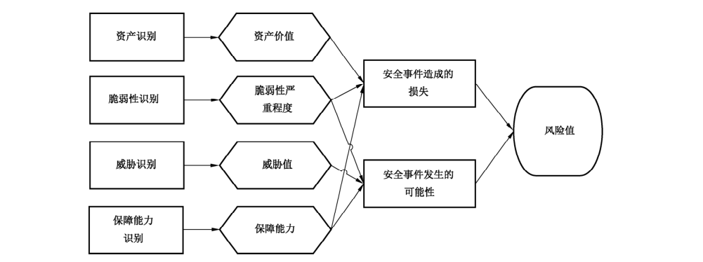

工业控制系统各要素的关系，R=F（A,T,V,P）。其中，R 表示安全风险；F表示安全风险计算函数：A 表示资产；T表示威胁：V表示脆弱性；P表示安全保障能力。风险分析如图 14所示。

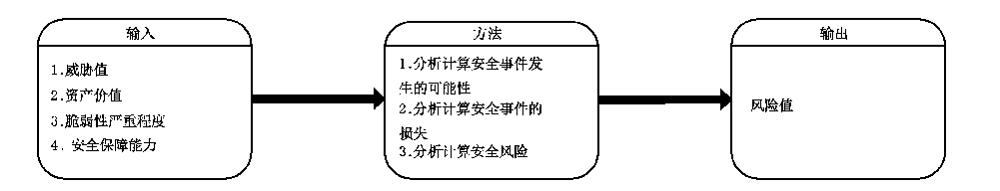

风险计算方法包括定性计算和定量计算，但在实际工作中定量计算方法的可操作性较差，一般多采用定性计算方法。无论评估方采用何种计算方法，都应对完成协议跨界的设备以及关键设备重点加权。

评估方通过风险计算，完成对风险情况的综合分析与评价。

#### 6.6.2 风险结果判定

为实现对风险的控制与管理，可以对风险评估的结果进行等级化处理。等级化处理的方法是按照风险值的高低进行等级划分，风险值越高，风险等级越高。风险等级一般可划分为五级。

根据风险值的分布状况，为每个等级设定风险值范围，并对所有风险计算结果进行等级处理。每个等级代表了相应风险的严重程度。表15提供了一种风险等级划分方法。

**表15 风险等级划分表**

| 等级 | 标识 | 描述 |
| --- | --- | --- |
| 5 | 很高 | 一旦发生将产生非常严重的社会或经济影响，如重大生产事故、系统无法正常运行等 |
| 4 | 高 | 一旦发生将产生较大的社会或经济影响，如生产事故、在一定范围内影响系统的正常运行等 |
| 3 | 中等 | 一旦发生会造成一定的社会或经济影响，但影响面和影响程度不大 |
| 2 | 低 | 一旦发生造成的影响程度较低，一般仅限于被评估方内部，通过一定手段很快能解决 |
| 1 | 很低 | 一旦发生造成的影响几乎不存在，通过简单的措施就能弥补 |

被评估方应当综合考虑风险控制成本与风险造成的影响，提出一个可接受的风险范围。对某些资产的风险，如果风险计算值在可接受的范围内，则该风险是可接受的风险，应保持已有的安全措施；如果风险评估值在可接受的范围外，即风险计算值高于可接受范围的上限值，是不可接受的风险，需要采取安全措施以降低、控制风险。另一种确定不可接受的风险的办法是根据等级化处理的结果，设定可接受风险值的基准，达到相应等级的风险都进行处理。

### 6.7 残留风险控制

风险分析完成后，被评估方需判断风险是否在接受范围内。若风险是可接受的，被评估方应对残留风险进行持续的监控。若风险不可接受，需制定风险控制措施并实施风险控制行动。在实施风险控制行动之后，对仍然存在的不可接受安全风险应重新进行评估、控制和管理的活动。残留风险的评估流程及内容可有针对性的适当剪裁。

风险评估报告是综合分析阶段的输出文档，是对整个风险评估过程和结果的总结。

评估方根据评估检测数据和风险计算结果，对被评估对象进行定性、定量分析，明确被评估对象面临的威胁和主要脆弱点，提出相应的整改建议，并在此基础上编制风险评估报告。风险评估报告需要对评估对象进行说明，并阐明采用的风险计算原理及风险评估方法。报告中应对综合分析阶段的结果给予详细说明，主要包括资产、威胁和脆弱性的评估结果，风险对被评估方业务及系统的影响范围、影响程度，风险统计和风险等级，残留风险控制等。评估报告发布后，若需改动或增补，只能采用补充报告的形式，报告上应标明原报告的标题和编号，补充报告的编写要求与原报告相同。

## 附录 A（资料性附录）记录表

### A.1 工业控制系统基本信息记录表

工业控制系统基本信息记录表见表 A.1。

**表 A.1 工业控制系统基本信息记录表**

| 系统名称 |  |
| --- | --- |
| 主要业务 |  |
| 操作对象 |  |
| 与危险源关联情况 |  |
| 部署位置 |  |
| 网络拓扑结构 |  |
| 连接互联网情况 |  |
| 操作系统名称型号 |  |
| 系统所在网段 |  |
| 数据集中情况 |  |
| 数据灾备情况 |  |
| 服务对象 |  |
| 用户规模 |  |
| 业务周期 |  |
| 业务主管部门 |  |
| 运维机构 |  |
| 系统开发商 |  |
| 系统集成商 |  |
| 上线运行及最近一次系统升级时间 |  |
| 系统定级情况 |  |

### A.2 工业控制系统资产记录表

工业控制系统资产记录表见表 A.2。

**表A.2 资产记录表**

| 编号 | 资产名称 | 品牌和型号 | 数量 | IP 地址 | 物理位置 | 业务应用 | 是否为关键资产 |
| --- | --- | --- | --- | --- | --- | --- | --- |
| 1 |  |  |  |  |  |  |  |
| 2 |  |  |  |  |  |  |  |
| 3 |  |  |  |  |  |  |  |
| 4 |  |  |  |  |  |  |  |
| 5 |  |  |  |  |  |  |  |
| 6 |  |  |  |  |  |  |  |

### A.3 工业控制系统威胁记录表

工业控制系统威胁记录表见表 A.3。

**表A.3 威胁记录表**

| 编号 | 威胁名称 | 威胁来源 | 威胁动机 | 威胁攻击方法 | 威胁发生的可能性 | 威胁发生后造成的影响 |
| --- | --- | --- | --- | --- | --- | --- |
| 1 |  |  |  |  |  |  |
| 2 |  |  |  |  |  |  |
| 3 |  |  |  |  |  |  |
| 4 |  |  |  |  |  |  |

## 附录 B（资料性附录）脆弱性及保障能力核查表示例

### B.1 工业控制系统物理环境脆弱性核查表示例

工业控制系统物理环境脆弱性核查表示例见表 B.1。

**表B.1 物理环境脆弱性核查**

| 序号 | 核查项 | 核查结果 |
| --- | --- | --- |
| 1 | 工业控制系统是否集中在一区域 |  |
| 2 | 是否建立了防火、防潮、防雷击、防电磁干扰等技术保障措施 |  |
| 3 | 是否采用应急电源、应急照明和紧急停机等措施 |  |
| 4 | 是否在工业控制系统相关区域配置了门禁系统和监控系统 |  |
| 5 | 是否制定并维护对工业控制系统具有访问权限的人员名单 |  |
| 6 | 是否按被评估方定义的时间间隔对授权人员进行评审和批准 |  |
| 7 | 是否根据职位、角色对工业控制系统实施进行物理访问授权 |  |
| 8 | 是否及时从访问列表中清除那些不再访问工业控制系统的人员 |  |
| 9 | 是否保存物理访问记录 |  |
| 10 | 是否在需要对访客进行陪同和监视的环境下对访问者的行为进行陪同和监视 |  |
| 11 | 是否按照被评估方定义的时间间隔更换访问控制设备的口令，在密码泄露和人员调动或离职时更换访问控制设备的口令 |  |
| 12 | 设备资产是否进行了标识和统计管理 |  |
| 13 | 关键设备或存储介质携带出工作环境时，是否具备行为审计和内容加密措施 |  |
| 14 | 是否设立一个人工值守的接待区域 |  |
| 15 | 物理出入控制是否采用发放/佩戴身份识别标志 |  |
| 16 | 物理出人控制是否采用离开后收回访问权限 |  |
| 17 | 物理出入控制是否采用限制敏感区域访问 |  |
| 18 | 是否采用保护电力和通讯电缆不受侦听或者破坏 |  |
| 19 | 放置工业控制系统设施的区域是否有可靠的边界设施 |  |
| 20 | 是否采用应急设备和备份介质的存储位置与主安全区域保持一个安全距离 |  |

### B.2 工业控制系统网络脆弱性核查表示例

工业控制系统网络脆弱性核查表示例见表 B.2。

**表B.2 网络脆弱性核查表**

| 序号 | 核查项 | 核查结果 |
| --- | --- | --- |
| 1 | 系统网络结构是否分层设计 |  |
| 2 | 系统中网络边界是否清晰 |  |
| 3 | 系统网络边界中是否使用网络隔离设备 |  |
| 4 | 系统划分 VLAN是否合理 |  |
| 5 | 网络链路是否有冗余设计 |  |
| 6 | 网络设备是否有容错能力 |  |
| 7 | 控制网络中是否部署企业级应用 |  |
| 8 | 控制网络中是否允许IT 网络服务应用 |  |
| 9 | 被评估方是否限制工业控制系统系统访问的数量 |  |
| 10 | 网络中存在的通信协议有哪些 |  |
| 11 | 控制网络中是否采用专用标准的协议 |  |
| 12 | 通信协议是否是明文传输 |  |
| 13 | 通信协议是否健壮 |  |
| 14 | 是否使用密码产品 |  |
| 15 | 是否对产生的密钥进行管理 |  |
| 16 | 是否使用无线传输协议 |  |
| 17 | 无线传输是否采用加密协议 |  |
| 18 | 是否管制控制范围内的无线网络 |  |
| 19 | 通信被捕获后是否可以被解析出数据 |  |
| 20 | 通信协议是否有完整性校验 |  |
| 21 | 通信协议是否可被篡改、重放 |  |
| 22 | 无线客户端与接入点是否具有认证措施 |  |
| 23 | 是否存在远程通信 |  |
| 24 | 是否使用 VPN进行远程通信 |  |
| 25 | 采用远程在线运维服务方式时，是否对远程在线运维服务的安全风险进行充分评估并采取书面审批、访问控制、在线监测、日志审计等安全防护措施进行安全风险控制 |  |
| 26 | 是否使用OPC协议 |  |
| 27 | 系统网络中是否部署网络设备 |  |
| 28 | 部署的网络设备是否冗余 |  |
| 29 | 网络设备系统版本是否是最新版本 |  |
| 30 | 系统配置是否备份 |  |
| 31 | 是否存在无用USB 接口、PS/2、现场控制组件的网络模块接口，是否对这些无用端口进行封堵 |  |
| 32 | 是否按照用户分配账号 |  |
| 33 | 是否存在不同用户间共享账号 |  |
| 34 | 是否使用账号的密码策略 |  |
| 35 | Password是否加密 |  |
| 36 | 是否存在简单口令 |  |
| 37 | 是否禁用远程管理员权限操作 |  |
| 38 | 是否禁用 Telnet 方式访问系统 |  |
| 39 | 是否使用 SSH |  |
| 40 | 是否限制 VTY 的数量 |  |
| 41 | 是否启用远程访问 ACL 控制 |  |
| 42 | 是否开启 SNMP 服务 |  |
| 43 | SNMP 版本 |  |
| 44 | SNMP 服务的共同体字符串是否为默认值 |  |
| 45 | SNMP 是否设置了 ACL 控制 |  |
| 46 | 是否禁用 HTTP 配置方式 |  |
| 47 | 设备是否定时账户自动退出 |  |
| 48 | 是否禁用不使用的端口 |  |
| 49 | 是否禁用 AUX端口（远程配置端口） |  |
| 50 | 是否开启日志功能，能否远程传输保存日志 |  |
| 51 | 是否有日志审计功能 |  |
| 52 | 是否配置了 SYSLOG |  |
| 53 | SYSLOG 配置信息 |  |
| 54 | SYSLOG 能否被收集 |  |
| 55 | logging 的配置 |  |
| 56 | 是否设置安全访问控制，过滤掉已知安全攻击数据包 |  |
| 57 | 当前系统版本是否存在严重的安全漏洞 |  |
| 58 | 当前系统版本是否需要升级 |  |

### B.3 工业控制系统平台脆弱性核查表示例

工业控制系统平台脆弱性核查表示例见表 B.3。

**表B.3 平台脆弱性核查表**

| 序号 | 核查项 | 核查结果 |
| --- | --- | --- |
| 1 | ICS 是否进行物理或逻辑分区 |  |
| 2 | 系统中部署工程师站、操作员站、实时数据库、历史数据库等应用的PC 和服务器中使用的操作系统是否最新版本，是否存在已知漏洞 |  |
| 3 | HMI、PLC、RTU 和IED 等控制组件使用的是否是专用操作系统 |  |
| 4 | 专业操作系统是否最新版本，是否存在已知漏洞 |  |
| 5 | 是否开放的非必要的 TCP 和 UDP 端口 |  |
| 6 | 历史数据库是否使用通用数据库，是否存在已知漏洞 |  |
| 7 | 实时数据库是否为专用数据库，是否存在已知漏洞 |  |
| 8 | 组态软件是否存在已知漏洞 |  |
| 9 | 是否进行 MAC地址绑定 |  |
| 10 | 是否禁止控制网络中设备接受邮件 |  |
| 11 | 系统中是否使用 TELNET、FTP、TFTP进行文件传输 |  |
| 12 | 用户功能与系统管理功能是否分离 |  |
| 13 | 账户类型是否基于角色、设备和属性进行设立 |  |
| 14 | 工程师站、操作员站、控制组件等是否存在供应商设置的默认账户口令 |  |
| 15 | 是否存在共享账户 |  |
| 16 | 是否仅授予管理用户所需的最小权限，权限分离 |  |
| 17 | 工业控制系统是否禁止通过共享的系统资源进行未授权的、无意的数据传输 |  |
| 18 | 工业控制系统是否禁止在软件应用中自动执行移动代码 |  |
| 19 | 工业控制系统是否对输入信息进行验证 |  |
| 20 | 日志中是否出现敏感信息 |  |
| 21 | 是否具有审计功能 |  |
| 22 | 工程师站、实时数据库、控制组件是否冗余备份，是否具有容错能力 |  |
| 23 | 系统数据是否异地备份 |  |
| 24 | 系统敏感数据是否加密存储 |  |
| 25 | 是否在安装实时检测与查杀恶意代码的软件产品前，进行测试 |  |
| 26 | 服务器是否安装多系统 |  |
| 27 | 检查系统安装的补丁 |  |
| 28 | 是否开启屏幕保护程序 |  |
| 29 | 开启屏幕保护程序时间 |  |
| 30 | 屏幕保护程序是否有恢复口令 |  |
| 31 | 是否有失败登录控制 |  |
| 32 | 是否具有会话锁定 |  |
| 33 | 口令复杂度要求是否开启 |  |
| 34 | 口令复杂度要求 |  |
| 35 | 最短口令长度要求是否开启 |  |
| 36 | 口令过期策略 |  |
| 37 | 账户锁定计数器 |  |
| 38 | 账户锁定时间 |  |
| 39 | 账户锁定阀值 |  |
| 40 | 是否限制当前会话数量 |  |
| 41 | 是否下载控制程序时加密 |  |
| 42 | 是否具有防御措施防制非授权用户对设备固件进行更新和维护 |  |
| 43 | 固件是否加壳加密 |  |
| 44 | PLC、RTU、DCS控制器是否存在硬件锁 |  |
| 45 | 管理员是否更改默认名称 |  |
| 46 | Administrators 组是否存在可疑账号 |  |
| 47 | 端口、进程对应信息检查 |  |
| 48 | 检查主机端口限制信息 |  |
| 49 | 查看主机磁盘分驱类型 |  |
| 50 | 检查特定目录的权限 |  |
| 51 | 审核策略成功还是失败 |  |
| 52 | 系统日志覆写规则是否默认 |  |
| 53 | 系统日志覆写规则 |  |
| 54 | 安全日志存储位置是否默认 |  |
| 55 | 安全日志存储位置 |  |
| 56 | 最大安全日志文件大小是否默认 |  |
| 57 | 最大安全日志文件大小（单位：k） |  |
| 58 | 安全日志覆写规则是否默认 |  |
| 59 | 安全日志覆写规则 |  |
| 60 | 应用日志存储位置是否默认 |  |
| 61 | 应用日志存储位置 |  |
| 62 | 最大应用日志文件大小是否默认 |  |
| 63 | 最大应用日志文件大小（单位：k） |  |
| 64 | 应用日志覆写规则是否默认 |  |
| 65 | 应用日志覆写规则 |  |
| 66 | 是否无法记录安全审计时立即关闭系统 |  |
| 67 | 是否对匿名连接做限制 |  |
| 68 | 是否自动注销用户 |  |
| 69 | 是否显示上次成功登录用户名 |  |
| 70 | 是否允许未登录关机 |  |
| 71 | 是否仅登录用户允许使用光盘 |  |
| 72 | 是否仅登录用户允许使用软盘 |  |
| 73 | 保护注册表，防止匿名访问 |  |
| 74 | 检查注册表中自动启动选项 |  |
| 75 | 有无指定当前主机的操作人员 |  |
| 76 | 有无指定当前主机的物理接触人员 |  |
| 77 | 有无相应的物理损害和其他故障的备份恢复策略 |  |
| 78 | 操作人员是否有对应的日志记录 |  |
| 79 | 是否安装防病毒软件 |  |
| 80 | 防病毒软件厂商 |  |
| 81 | 防病毒软件是否自动更新 |  |
| 82 | 防病毒软件当前版本 |  |

### B.4 工业控制系统保障能力核查表示例

工业控制系统保障能力核查表示例见表 B.4。

**表B.4 保障能力核查表**

| 序号 | 核查项 | 核查结果 |
| --- | --- | --- |
| 1 | 是否设立了专门组织机构管理工业控制系统 |  |
| 2 | 机构成员角色如何设立 |  |
| 3 | 成员职责如何分派 |  |
| 4 | 与其他业务部门的关系及如何协调 |  |
| 5 | 是否配备一定数量的系统管理员、网络管理员、安全管理员等 |  |
| 6 | 是否配备专职安全管理员，不可兼任 |  |
| 7 | 查阅相关工作计划、工作方案、规章制度、监督检查记录、宣传教育培训记录等文档，检查网络安全管理机构的履职情况 |  |
| 8 | 关键事务岗位是否配备多人共同管理 |  |
| 9 | 是否根据各个部门和岗位的职责明确授权审批事项、审批部门和批准人等 |  |
| 10 | 是否针对系统变更、重要操作、物理访问和系统接入等事项建立审批程序，按照审批程序执行审批过程，对重要活动建立逐级审批制度 |  |
| 11 | 是否定期审查审批事项，及时更新需授权和审批的项目、审批部门和审批人等信息 |  |
| 12 | 是否记录审批过程并保存审批文档 |  |
| 13 | 是否建立互联网接入审批和登记制度，严格控制互联网接入口数量，加强互联网接入口安全管理和安全防护 |  |
| 14 | 是否加强各类管理人员之间、组织内部机构之间以及信息安全职能部门内部的合作与沟通，定期或不定期召开协调会议，共同协作处理信息安全问题 |  |
| 15 | 是否与供应商、业界专家、专业的安全公司、安全组织的合作与沟通 |  |
| 16 | 是否建立外联单位联系列表，包括外联单位名称、合作内容、联系人和联系方式等信息 |  |
| 17 | 建立并严格执行外包服务安全管理制度 |  |
| 18 | 与网络技术外包服务提供商签订服务合同和网络安全与保密协议，明确网络安全与保密责任，要求服务提供商不得将服务转包，不得泄露、扩散、转让服务过程中获知的敏感信息，不得占有服务过程中产生的任何资产，不得以服务为由强制要求委托方购买、使用指定产品 |  |
| 19 | 安全管理员是否定期进行安全检查，检查内容包括系统日常运行、系统漏洞和数据备份等情况 |  |
| 20 | 组织或上级单位是否定期进行全面安全检查，检查内容包括现有安全技术措施的有效性、安全配置与安全策略的一致性、安全管理制度的执行情况等 |  |
| 21 | 是否制定安全检查表格实施安全检查，汇总安全检查数据，形成安全检查报告，并对安全检查结果进行通报 |  |
| 22 | 是否制定安全审核和安全检查制度规范安全审核和安全检查工作，定期按照程序进行安全审核和安全检查活动 |  |
| 23 | 是否建立了工业控制系统安全事件应急管理策略 |  |
| 24 | 是否建立了移动存储设备的使用与管理策略 |  |
| 25 | 是否对系统的配置变更进行变更管理 |  |
| 26 | 是否建立了计算机病毒防治管理制度 |  |
| 27 | 是否建立了数据备份管理制度 |  |
| 28 | 是否形成由安全策略、管理制度、操作规程等构成的全面的信息安全管理制度体系 |  |
| 29 | 是否指定或授权专门的部门或人员负责安全管理制度的制定 |  |
| 30 | 安全管理制度是否具有统一的格式，并进行版本控制 |  |
| 31 | 安全管理制度是否通过正式、有效的方式发布 |  |
| 32 | 是否定期或不定期对安全管理制度进行检查和审定，对存在不足或需要改进的安全管理制度进行修订 |  |
| 33 | 是否对被录用人具备的专业技术水平和安全管理知识进行了岗位符合性审查 |  |
| 34 | 是否对各类人员进行了安全意识和基本技能培训 |  |
| 35 | 是否与关键岗位人员签署了保密协议 |  |
| 36 | 应严格规范人员离岗过程，及时终止离岗员工的所有访问权限 |  |
| 37 | 是否有对从事信息安全服务的第三方人员的管控措施 |  |
| 38 | 是否对关键岗位的人员进行全面、严格的安全审查和技能考核 |  |
| 39 | 是否对考核结果进行记录并保存 |  |
| 40 | 是否对外部人员允许访问的区域、系统、设备、信息等内容应进行书面的规定，并按照规定执行 |  |
| 41 | 建立资产台账（清单），对资产进行统一分类、分级、编号、标识，及时记录资产状态和使用情况，保证账物相符 |  |
| 42 | 专人负责资产的管理 |  |

## 参考文献

- ［1］ GB/T 18336.1—2015 信息技术 安全技术 信息技术安全评估准则 第 1 部分：简介和一般模型
- ［2］ GB/T 26333—2010 工业控制网络安全风险评估规范
- ［3］ GB/T 30976.1—2014 工业控制系统信息安全 第 1 部分：评估规范
- ［4］ ISO/IEC 27005:2008 Information Technology—Security techniques—Information security risk management
- ［5］ IEC 60870-5-101 Telecontrol equipment and systems—Part 5-101: Transmission protocols—Companlon standard for basic telecontrol tasks
- ［6］ IEC 60870-5-104 Telecontrol equipment and systems—Part 5-104: Transmission protocols—Network access for IEC 60860-5-101 using standard transport profiles
- ［7］ IEC/TR 62443-1-2 Industrial communication networks—Network and system security—Part 1-2: Master glossary of terms and abbreviations3
- ［8］ IEC/TS 62443-1-3 Industrial communication networks—Network and system security—Part 1-3: System security compliance metrics4
- ［9］ IEC/TR 62443-1-4 Industrial communication networks—Network and system security—Part 1-4: IACS security life cycle and use-case5
- ［10］ IEC/TR 62443-2-2 Industrial communication networks—Network and system security—Part 2-2: Implementation guidance for an IACS security management system6
- ［11］ IEC/TR 62443-2-3 Industrial communication networks—Network and system security—Part 2-3: Patch management in the IACS environment7
- ［12］ IEC 62443-2-4 Industrial communication networks—Network and system security—Part 2-4: Installation and maintenance requirements for IACS suppliers8
- ［13］ IEC/TR 62443-3-1 Industrial communication networks—Network and system security—Part 3-1: Security technologies for industrial automation and control systems
- ［14］ IEC 62443-3-2 Industrial communication networks—Network and system security—Part 3-2: Security levels for zones and conduits9
- ［15］ IEC 62443-4-1 Industrial communication networks—Network and system security—Part 4-1: Product development requirements10
- ［16］ IEC 62443-4-2 Industrial communication networks—Network and system security—Part 4-2: Technical security requirements for IACS components11
- ［17］ NIST Special Publication 800-53 Security and Privacy Controls for Federal Information Systems and Organizations
- ［18］ NIST Special Publication 800-82 Guide to Industrial Control Systems (ICS) Security
- ［19］ NIST Special Publication 800-115 Technical Guide to Information Security Testing and Assessment
