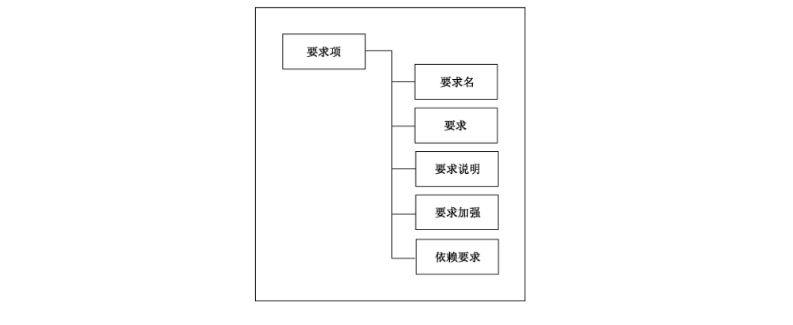
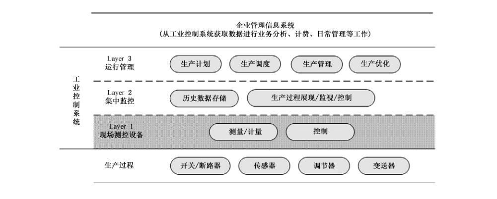
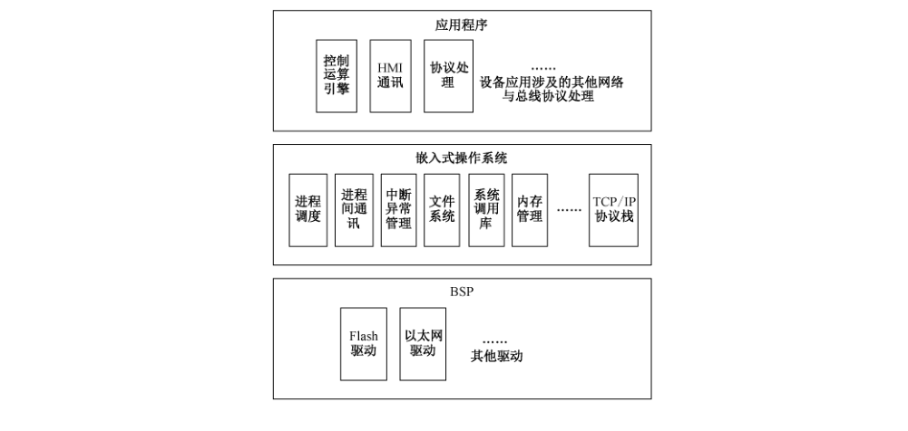

# GB/T 36470-2018 信息安全技术 工业控制系统现场测控设备通用安全功能要求

> 来源：[GB/T 36470-2018 国家标准详情](https://openstd.samr.gov.cn/bzgk/std/newGbInfo?hcno=BBF1C5487A8E0D48E6365DEC3A21382F)；封面发布日期：2018-06-07；实施日期：2019-01-01。
> 官方 PDF SHA-256：4d9596bb3928f2f41ef45e5ab5d6c20a97c31c89d3508905d9087c2c3a7fe602。
> 依据官方 PDF 全部 42 页的页面图像转写与校核；省略封面、目录、页眉、页脚和分页，合并印刷折行；附录示意图保留为从原文页面裁出的图像。

## 前言

本标准按照 GB/T 1.1—2009 给出的规则起草。

请注意本文件的某些内容可能涉及专利。本文件的发布机构不承担识别这些专利的责任。

本标准由全国信息安全标准化技术委员会（SAC/TC 260）提出并归口。

本标准起草单位：全球能源互联网研究院有限公司、中国电力科学研究院有限公司、北京和利时系统工程有限公司、北京四方继保自动化股份有限公司、华北电力大学、国电南瑞科技股份有限公司、沈阳电业电气安装有限公司、中国信息安全测评中心、北京江南天安科技有限公司、中国电子技术标准化研究院、国家信息技术安全研究中心。

本标准主要起草人：梁潇、高昆仑、王弢、任雁铭、李焕、郑晓崑、徐茹枝、殷尧、郑洁、王迪、赵保华、安宁钰、王志皓、赵婷、詹雄、李凌、张錋、谢丰、陈冠直、李冰、刘鸿运、范科峰、李琳。

## 引言

现场测控设备是工业控制系统的基本功能执行设备，直接对工业生产过程进行监视与控制，对于生产的安全稳定运行至关重要。

随着信息通信技术在工业控制系统中的应用，现场设备的智能化程度逐渐增加，网络化和处理能力的增加使得这些设备所面临的信息安全风险较传统现场设备面临的风险种类更多，范围更大，层次更为深入，一旦遭受攻击，将直接导致设备所辖区域内甚至连锁性的生产事故，因此其信息安全不仅与生产安全和经济安全密不可分，而且电力、化工、天然气等重要基础设施的现场安全水平直接关系到国计民生、社会稳定与公众利益。

为提高现场设备的信息安全能力，本标准提出针对现场测控设备的通用安全功能要求，用于设备的安全设计、开发、测试与评估。使用者应根据实际或计划使用环境的安全风险分析结果，选择设备应满足的安全功能要求。

## 1 范围

本标准规定了工业控制系统现场测控设备的用户标识与鉴别、使用控制、数据完整性、数据保密性、数据流限制、资源可用性 6 类通用的安全功能要求。

本标准适用于指导设备的安全设计、开发、测试与评估。

涉及设备功能实现原理、工业控制系统整体管理和运行以及信息安全外围技术的内容不在本标准范围之内。例如：

- 本标准不涵盖与设备自身安全功能与实现没有直接关联的行政性管理和运行安全要求，如组织管理和人员管理等。对于影响技术实施的口令策略和配置程序等管理措施，将包含在要求的描述中，不作关于管理和运行内容的强调；
- 本标准不涵盖与设备自身信息安全功能与实现没有直接关联的电磁辐射等物理安全方面的内容，对于影响信息安全技术防护效果的物理安全访问控制等措施，将包含在要求的描述中，不作关于物理安全内容的强调；
- 本标准不对传统工业控制系统中机电式、液压式和气动式等不涉及信息技术实现原理的设备的信息安全功能进行要求；
- 本标准不覆盖传感器、变送器、调节器、开关/断路器等生产过程设备。

## 2 规范性引用文件

下列文件对于本文件的应用是必不可少的。凡是注日期的引用文件，仅注日期的版本适用于本文件。凡是不注日期的引用文件，其最新版本（包括所有的修改单）适用于本文件。

- GB/T 9387.2—1995 信息处理系统 开放系统互连 基本参考模型 第 2 部分：安全体系结构
- GB/T 25069—2010 信息安全技术 术语
- GB/T 32919—2016 信息安全技术 工业控制系统安全控制应用指南

## 3 术语和定义

GB/T 9387.2—1995、GB/T 25069—2010 和 GB/T 32919—2016 界定的以及下列术语和定义适用于本文件。

### 3.1 工业控制系统现场测控设备 data acquisition and control field devices of industrial control systems

工业控制系统中，位于现场，具有以下生产相关全部或部分功能的一种独立实体设备：

- 从传感器、变送器、调节器或开关等过程设备接收采集数据；
- 进行逻辑与控制计算；
- 向调节器或开关等过程执行设备发送控制指令。

设备与其他同类设备、系统主站或应用进行采集数据与控制指令等数字或模拟信号通信。

典型工业控制系统现场测控设备的功能与构成参见附录 A。

> 注：下列设备为典型的工业控制系统现场测控设备：远程终端单元（RTU，Remote Terminal Unit）；智能电子设备（IED，Intelligent Electric Device）；分散处理单元（DPU，Distributed Processing Unit）。

### 3.2 鉴别 authentication

信息系统中，在用户、进程或设备接入资源之前，对其身份进行验证。

［NIST SP 800-53 R3］

### 3.3 泛洪 flooding

通过向计算系统或其他数据处理实体提供大于其处理能力的输入，企图引起其在信息安全方面的故障的攻击。

［RFC 2828］

## 4 缩略语

下列缩略语适用于本文件。

- API：应用程序编程接口（Application Programming Interface）
- CA：认证中心（Certificate Authority）
- CRC：循环冗余校验（Cyclic Redundancy Check）
- DoS：拒绝服务攻击（Deny of Service）
- DPU：分散处理单元（Distributed Processing Unit）
- IED：智能电子设备（Intelligent Electric Device）
- I/O：输入/输出（Input/Output）
- MAC：消息鉴别码（Message Authentication Code）
- MCU：微控制单元（Microcontroller Unit）
- MMI：人机接口（Man Machine Interface）
- MMU：内存管理单元（Memory Management Unit）
- MPU：微处理器单元（Microprocessor Unit）
- RAM：随机存取存储器（Random Access Memory）
- RTOS：实时多任务操作系统（Real-time Operating System）
- RTU：远程终端单元（Remote Terminal Unit）
- TCP：传输控制协议（Transmission Control Protocol）
- UDP：用户数据报协议（User Datagram Protocol）

## 5 安全功能要求描述结构

### 5.1 要求类结构

图 1 以框图形式示意了要求类的结构。每个要求类包括一个类名、类描述和一个或多个要求族。

类名提供标识和划分不同要求类所必需的信息。每个要求类都有一个唯一的名称，类的分类信息由三个字符的简写组成。要求类分类信息简写说明见附录 B。类名的简写也用于该类中族的族名规范中。

类描述总体描述类中包含的族和该类要求的主要作用。类描述用图来描述类中的族以及每个族中组件的层次结构。

### 5.2 要求族结构

图 2 以框图形式示意了要求族的结构。每个要求族包括一个族名、族描述和一个或多个组件。

族名提供标识和划分不同要求族所必需的信息。每个要求族都有一个唯一的名称，族的分类信息由所属类的简写和族名三个字符的简写组成。要求族的分类信息简写说明见附录 B。

族描述总体描述族和该族要求的主要作用。

### 5.3 要求项结构

图 3 以框图形式示意了要求项的结构。每个要求项包括要求名、要求的内容、要求说明、零个或多个要求加强子项和依赖要求。

要求名：用于标识、分类、分族不同的要求。每个要求都有一个唯一的名称，表明该要求的目的。用序号标识在族中的位置。

要求：描述要求的内容，表述设备为达到该项要求应满足的条件。

要求说明：描述要求的典型实现机制和技术原理。

要求加强：要求加强子项是对要求强度的加强或内容的增加，用序号标识在要求内的位置。

依赖要求：当要求项需要依赖于其他要求项，或与其他要求项共同使用才能发挥作用时，这种对其他要求项的直接关联关系在本部分中注明。要求项间的依赖关系具体见附录 C。

## 6 通用安全功能要求

### 6.1 概述

工业控制系统现场测控设备的通用安全功能要求归纳见附录 D。

### 6.2 FIA 类：用户标识与鉴别

#### 6.2.1 类描述

用户标识和鉴别的目的是确定对设备的访问行为主体（人员、进程和设备），以及对访问行为进行控制。

根据设备数字与智能化程度的不同，设备具有多种外部访问接口，典型的接口包括：

- 本地操作面板，用于查看或修改配置；
- 本地 RS232 或 RS485 接口，用于业务数据传输或设备调试、管理；
- 网络，用于设备调试、管理与业务数据传输。

通过这些接口对设备进行访问的典型的用户包括但不限于以下几种：

- 设备使用、配置等操控人员；
- 设备配置软件；
- 系统上位机应用进程。

#### 6.2.2 FIA_IAM 族：标识与鉴别方式

##### 6.2.2.1 族描述

设备对用户身份进行标识和鉴别是对设备最基本的安全防护，也是实现权限分配和访问控制的基础。

##### 6.2.2.2 FIA_IAM.1 标识及方式

###### 6.2.2.2.1 要求

工控系统现场测控设备应具备标识用户的能力。

###### 6.2.2.2.2 要求说明

应对重要的用户提供身份标识，如配置管理用户、上位机控制进程等。典型的用户身份标识符包括网络地址（如物理地址、IP 地址）、操控人员的用户标识符等。

###### 6.2.2.2.3 要求加强

FIA_IAM.1 标识及方式的要求加强包括：

a) 设备在所有对外接口上具有标识用户的能力；
b) 设备在所有对外接口上都具备唯一标识用户的能力。

###### 6.2.2.2.4 依赖要求

无。

##### 6.2.2.3 FIA_IAM.2 鉴别及方式

###### 6.2.2.3.1 要求

工控系统现场测控设备应具备在对外接口对用户身份进行鉴别的能力。

###### 6.2.2.3.2 要求说明

设备应对开启的网络服务接口和重要的本地访问用户进行鉴别，如配置管理用户、远程访问服务等。典型的身份鉴别方式包括：口令、共享密钥、数字证书和生物特征等。

###### 6.2.2.3.3 要求加强

FIA_IAM.2 鉴别及方式的要求加强包括：

a) 设备在远程网络访问接口上对具有控制、参数和定值修改功能的用户实施双因素鉴别；
b) 设备对所有远程网络访问接口上的用户实施双因素鉴别。

###### 6.2.2.3.4 依赖要求

FIA_IAM.2 鉴别及方式的依赖要求是 FIA_IAM.1。

#### 6.2.3 FIA_IDM 族：标识符管理

##### 6.2.3.1 族描述

工控系统现场测控设备能用于标识用户（人员、进程和设备）的标识包括网络层面的 IP 地址、物理地址、TCP/UDP 端口、应用地址或操控人员标识符等。

其中人员用户标识符管理的功能相当于普通 IT 应用系统的用户管理，针对直接使用控制面板对设备进行查看或配置的操控人员，而 IP 地址、物理地址和端口的管理将在访问控制中阐述。

##### 6.2.3.2 FIA_IDM.1 操控人员标识符管理

###### 6.2.3.2.1 要求

工控系统现场测控设备应具备向操控人员分配标识符的能力。

###### 6.2.3.2.2 要求说明

设备应具备向具有运行参数或设备配置访问权限的操控人员分配标识符的能力。

###### 6.2.3.2.3 要求加强

FIA_IDM.1 操控人员标识符管理的要求加强包括：

a) 设备支持对操控人员标识符进行添加、删除等管理；
b) 设备支持对安全策略规定一段时间不使用的操控人员标识符进行锁定。

###### 6.2.3.2.4 依赖要求

FIA_IDM.1 操控人员标识符管理的依赖要求是 FIA_IAM.1。

#### 6.2.4 FIA_ACM 族：鉴别凭证管理

##### 6.2.4.1 族描述

工控系统现场测控设备管理用户身份鉴别凭证的能力主要包括对鉴别凭证的强度和使用的管理。由于对设备的访问方式可能包括本地面板访问、串口访问、网络访问、上位机应用访问，因此鉴别凭证的使用和管理涵盖设备层和网络层的鉴别。

##### 6.2.4.2 FIA_ACM.1 口令修改

###### 6.2.4.2.1 要求

工控系统现场测控设备应支持管理员等操控人员在不影响正常操作的情况下修改他们管理范围内口令。设备应支持并提示对出厂默认口令的修改。

###### 6.2.4.2.2 要求说明

主要针对管理员、配置查看用户、配置修改用户等设备操控人员口令进行管理。

###### 6.2.4.2.3 要求加强

无。

###### 6.2.4.2.4 依赖要求

FIA_ACM.1 口令修改的依赖要求是 FIA_IAM.2。

##### 6.2.4.3 FIA_ACM.2 口令更换周期

###### 6.2.4.3.1 要求

工控系统现场测控设备应支持安全策略中要求的口令使用周期。

###### 6.2.4.3.2 要求说明

操控人员验证成功后，工控系统现场测控设备应提供必要的自动提醒能力，通知用户距离上次修改密码时间已经超过了安全策略要求的密码使用周期。

###### 6.2.4.3.3 要求加强

FIA_ACM.2 口令更换周期的要求加强为设备应支持管理员对口令更换周期进行配置。

###### 6.2.4.3.4 依赖要求

FIA_ACM.2 口令更换周期的依赖要求是 FIA_IAM.2。

##### 6.2.4.4 FIA_ACM.3 口令强度控制

###### 6.2.4.4.1 要求

工控系统现场测控设备应提供支持安全策略中口令强度要求的能力。

###### 6.2.4.4.2 要求说明

在实现上，当用户设定口令强度不足时，工控系统现场测控设备应自动提醒用户口令强度应满足怎样的安全策略。

###### 6.2.4.4.3 要求加强

FIA_ACM.3 口令强度控制的要求加强为设备应支持管理员对口令的最小长度、使用周期和字母或特殊字符数量进行配置。

###### 6.2.4.4.4 依赖要求

FIA_ACM.3 口令强度控制的依赖要求是 FIA_IAM.2。

##### 6.2.4.5 FIA_ACM.4 口令失效

###### 6.2.4.5.1 要求

设备的用户名/口令鉴别控制不应被绕过。

###### 6.2.4.5.2 要求说明

典型的绕过机制包括但不限于以下机制和技术：

- 嵌入式主口令
- 嵌入式芯片在硬件或软件故障时自动运行的默认的管理员权限
- 如跳线和开关设置等的密码模块或硬件旁路

厂商应说明设备上所有能绕过用户创建的用户名/口令鉴别的机制。如果设备没有这样的机制，厂商应予以声明。

###### 6.2.4.5.3 要求加强

无。

###### 6.2.4.5.4 依赖要求

FIA_ACM.4 口令失效的依赖要求是 FIA_IAM.2。

##### 6.2.4.6 FIA_ACM.5 证书及公私钥管理

###### 6.2.4.6.1 要求

如果使用了公私钥或证书作为鉴别机制，工控系统现场测控设备（及其配置软件）应提供对公私钥和证书进行管理的能力。

###### 6.2.4.6.2 要求说明

用户使用配置软件对工业控制系统现场测控设备进行配置时，常使用证书进行身份鉴别，配置软件应能够对配置用户的公钥进行管理，并对证书进行识别。

在通信层面上，公私钥可用于现场测控设备和其他设备、远程配置系统、监控后台或上位机的通信身份鉴别。设备应保证本地存储私钥的安全，应能够对证书进行正确解析，对证书的真实性和有效性进行验证。

###### 6.2.4.6.3 要求加强

FIA_ACM.5 证书及公私钥管理的要求加强包括：

a) 现场测控设备及其配置软件应支持按照安全策略要求定期更新公私钥；
b) 在工控系统层面上建立有效的公私钥管理设施，如 CA。

###### 6.2.4.6.4 依赖要求

FIA_ACM.5 证书及公私钥管理的依赖要求是 FIA_IAM.2。

##### 6.2.4.7 FIA_ACM.6 对称密钥管理

###### 6.2.4.7.1 要求

如果使用了对称密钥作为鉴别机制或进行传输数据加密，工控系统现场测控设备应提供对对称密钥进行管理的能力。

###### 6.2.4.7.2 要求说明

对称密钥可用于现场测控设备和其他设备、监控后台或上位机的通信身份鉴别。设备应能保证本地存储密钥的安全，同时满足密钥管理策略。

###### 6.2.4.7.3 要求加强

FIA_ACM.6 对称密钥管理的要求加强包括：

a) 现场测控设备应支持按照安全策略要求定期更新对称密钥；
b) 现场测控设备应支持工控系统层面上的密钥管理体系，支持对密钥的分发、更新和撤销的实现。

###### 6.2.4.7.4 依赖要求

FIA_ACM.6 对称密钥管理的依赖要求是 FIA_IAM.2。

##### 6.2.4.8 FIA_ACM.7 密码服务失效

###### 6.2.4.8.1 要求

如果使用基于密码的鉴别机制，工控系统现场测控设备的重要用户的现场访问不得依赖于外部密码服务。

###### 6.2.4.8.2 要求说明

如果外部密码（如加密、密钥验证）服务不可用，可能导致测控设备拒绝服务。本地重要用户访问关键功能不应依靠外部验证服务。对于远程访问关键功能的情况，可酌情考虑使用。

###### 6.2.4.8.3 要求加强

无。

###### 6.2.4.8.4 依赖要求

FIA_ACM.7 密码服务失效的依赖要求是 FIA_IAM.2、FIA_ACM.5 和 FIA_ACM.6。

#### 6.2.5 FIA_LGM 族：登录管理

##### 6.2.5.1 族描述

工控系统现场测控设备登录管理主要包括对管理员、配置查看用户、配置修改用户等操控人员登录行为的成功、失败和登录历史等进行管理。

##### 6.2.5.2 FIA_LGM.1 登录失败管理

###### 6.2.5.2.1 要求

工控系统现场测控设备应管理和记录操控人员自从最近的成功登录后的登录失败的次数和时间。

###### 6.2.5.2.2 要求说明

主要对管理员等实现鉴别了的重要用户的登录失败行为进行管理。登录方式涵盖本地面板登录、通过私有配置软件登录、网络登录等方式。

###### 6.2.5.2.3 要求加强

无。

###### 6.2.5.2.4 依赖要求

FIA_LGM.1 登录失败管理的依赖要求是 FIA_IAM.2。

##### 6.2.5.3 FIA_LGM.2 登录成功记录

###### 6.2.5.3.1 要求

工控系统现场测控设备应管理和记录操控人员最后一次登录成功的日期和时间。

###### 6.2.5.3.2 要求说明

主要对管理员等实现鉴别了的重要用户的登录成功进行管理。登录方式包括本地面板登录、通过私有配置软件登录、网络登录等方式。

###### 6.2.5.3.3 要求加强

无。

###### 6.2.5.3.4 依赖要求

FIA_LGM.2 登录成功记录的依赖要求是 FIA_IAM.2。

##### 6.2.5.4 FIA_LGM.3 登录历史

###### 6.2.5.4.1 要求

用户验证成功后，工控系统现场测控设备应显示最近的登录成功的时间，及此后该账号登录失败的次数和时间。

###### 6.2.5.4.2 要求说明

主要对管理员等实现鉴别了的重要用户的登录进行管理。登录方式涵盖本地面板登录、通过私有配置软件登录、网络登录等方式。

###### 6.2.5.4.3 要求加强

无。

###### 6.2.5.4.4 依赖要求

FIA_LGM.3 登录历史的依赖要求是 FIA_IAM.2 和 FIA_LGM.1。

##### 6.2.5.5 FIA_LGM.4 多次登录失败

###### 6.2.5.5.1 要求

当操控人员在一段时间内失败的登录尝试次数超过了安全策略中的规定值，现场测控设备应执行限制机制。

###### 6.2.5.5.2 要求说明

限制机制包括对操控人员进行锁定、发出警报等。

###### 6.2.5.5.3 要求加强

FIA_LGM.4 多次登录失败的要求加强为设备应支持管理员对锁定前的登录失败次数和解锁方式进行配置。

###### 6.2.5.5.4 依赖要求

FIA_LGM.4 多次登录失败的依赖要求是 FIA_IAM.2 和 FIA_LGM.1。

##### 6.2.5.6 FIA_LGM.5 鉴别反馈

###### 6.2.5.6.1 要求

现场测控设备应在鉴别过程中对鉴别的返回信息模糊化，以免非授权人员利用这些信息。

###### 6.2.5.6.2 要求说明

反馈信息中不应包含未授权人员可以利用的危害鉴别机制的信息。

###### 6.2.5.6.3 要求加强

无。

###### 6.2.5.6.4 依赖要求

FIA_LGM.5 鉴别反馈的依赖要求是 FIA_IAM.2。

### 6.3 FUC 类：使用控制

#### 6.3.1 类描述

使用控制的目的是为了保护设备，在用户发起请求之前，确定每个请求访问设备的用户标识和权限，根据权限执行所请求的操作，并进行控制和审计。

#### 6.3.2 FUC_ACA 族：访问控制授权

##### 6.3.2.1 族描述

工控系统现场测控设备为不同访问用户分配权限，只允许通过身份鉴别的用户访问已授权的资源。权限包括设备操控层面的运行数据查看、配置参数变更，系统应用层面的控制命令下发、定值下发、数据量采集。

##### 6.3.2.2 FUC_ACA.1 权限管理

###### 6.3.2.2.1 要求

现场测控设备应支持对权限的管理。

###### 6.3.2.2.2 要求说明

需要授权的典型功能包括：

- 查看数据：查看数据是指查看设备的运行数据（电压、电流、功率、状态、报警等）；
- 查看配置设置：查看设备的配置（标值、通信地址、可编程的逻辑程序、固件版本号等）；
- 配置变更：下发和上传装置的配置文件，变更现有配置（如修改输入值、设定值、工艺参数值等）；
- 固件变更：对不需要变更其硬件的设备进行新固件加载；
- 账户管理：创建、删除或修改账户内容；
- 审计日志：查看或下载审计日志；
- 控制命令：上位机对设备下发控制命令。

授权项管理包括：对于设备使用、配置人员和配置软件，依据配置、查看、审计等角色分配权限，进行权限管理；对于访问现场设备的其他设备或进程，对其发起采集或控制（功能）命令的权限进行管理。

###### 6.3.2.2.3 要求加强

无。

###### 6.3.2.2.4 依赖要求

无。

##### 6.3.2.3 FUC_ACA.2 基于角色的访问控制

###### 6.3.2.3.1 要求

现场测控设备的访问控制功能应提供支持基于角色的访问控制策略的能力。

###### 6.3.2.3.2 要求说明

基于角色的访问控制，根据具体的用户访问权限级别来定义用户角色，用户在鉴别成功后被授予与所分配角色对应的权限。对于功能相对简单的设备，现场测控设备的用户角色和权限可在出厂时完成配置，如配置用户、查看用户、审计用户、FTP 应用访问、控制上位机等角色。对于设备使用和配置用户，用户设置可固定，如只有一个查看用户、一个配置用户、一个审计用户和一个管理员用户。

###### 6.3.2.3.3 要求加强

无。

###### 6.3.2.3.4 依赖要求

FUC_ACA.2 基于角色的访问控制的依赖要求是 FIA_IAM.1。

##### 6.3.2.4 FUC_ACA.3 管理员用户

###### 6.3.2.4.1 要求

现场测控设备访问控制功能应支持管理员用户角色，管理员主要负责用户账户管理和安全功能管理。

###### 6.3.2.4.2 要求说明

仅允许管理员角色权限建立和管理其他账号。对于功能简单的设备，管理员、配置用户和审计用户可由一个用户承担，不设置复杂的用户管理模式。系统运行中可采用“操作票”等管理手段实现用户和操作人员的对应关系。

###### 6.3.2.4.3 要求加强

无。

###### 6.3.2.4.4 依赖要求

FUC_ACA.3 管理员用户的依赖要求是 FIA_IAM.1、FUC_ACA.1 和 FUC_ACA.2。

##### 6.3.2.5 FUC_ACA.4 最小权限原则

###### 6.3.2.5.1 要求

用户仅具备完成任务所需的最小权限。

###### 6.3.2.5.2 要求说明

新建的操控人员用户应由管理员来根据策略确定其权限。现场设备的对端设备（上位机或其他现场设备）对设备的访问也应基于最小权限，如只能访问某一服务端口、只能进行某一类操作。

###### 6.3.2.5.3 要求加强

无。

###### 6.3.2.5.4 依赖要求

FUC_ACA.4 最小权限原则的依赖要求是 FIA_IAM.1 和 FUC_ACA.1。

##### 6.3.2.6 FUC_ACA.5 权限分离

###### 6.3.2.6.1 要求

现场测控设备应支持用户修改重要参数或进行重要控制操作的权限分离管理。

###### 6.3.2.6.2 要求说明

分权管理的典型过程是操作用户和审核用户合作获得访问设备数据或执行控制操作的权限。主要是针对重要操作流程的安全机制，实现重要控制操作的执行和确认。

###### 6.3.2.6.3 要求加强

无。

###### 6.3.2.6.4 依赖要求

FUC_ACA.5 权限分离的依赖要求是 FIA_IAM.1、FUC_ACA.1 和 FUC_ACA.2。

#### 6.3.3 FUC_SEC 族：会话控制

##### 6.3.3.1 族描述

工控系统现场测控设备对设备配置软件和操控人员用户会话进行控制，通过终止或锁定超时会话保证会话的安全性。

##### 6.3.3.2 FUC_SEC.1 本地会话超时

###### 6.3.3.2.1 要求

当操控人员通过本机控制面板与设备的会话在策略规定的一段时间内不活动，设备应锁定会话。

###### 6.3.3.2.2 要求说明

会话锁定应一直保持到用户重新登录。

###### 6.3.3.2.3 要求加强

FUC_SEC.1 本地会话超时的要求加强为设备应支持管理员对会话锁定前的不活动时间进行配置。

###### 6.3.3.2.4 依赖要求

无。

##### 6.3.3.3 FUC_SEC.2 网络会话超时

###### 6.3.3.3.1 要求

工控系统现场测控设备应在设备配置用户或配置软件与设备的会话在策略规定的一段时间内不活动时，对会话进行终止。

###### 6.3.3.3.2 要求说明

网络会话超时终止主要用于设备配置用户的网络访问，特别是远程访问，不对上位机进程进行限制。如果会话建立途经网络是具有完备物理访问控制机制的可信网络，也可依照本地会话超时进行控制。

###### 6.3.3.3.3 要求加强

FUC_SEC.2 网络会话超时的要求加强为设备应支持管理员对会话终止前的不活动时间进行配置。

###### 6.3.3.3.4 依赖要求

无。

#### 6.3.4 FUC_ATC 族：审计踪迹产生

##### 6.3.4.1 族描述

工控系统现场测控设备对安全性事件和重要生产活动的进行审计，对于修正错误、事故恢复、事件调查等相关工作。

##### 6.3.4.2 FUC_ATC.1 审计事件

###### 6.3.4.2.1 要求

工控系统现场测控设备应具备审计功能，对重要的安全性事件和重要生产活动进行审计。

###### 6.3.4.2.2 要求说明

管理层面上，应根据设备和设备运行环境的风险评估结果决定需要审计的事件。

典型的重要设备操作事件包括：

- 登录成功：操控人员成功本地/远程登录设备；
- 非法登录尝试：操控人员连续多次输入口令错误；
- 正常退出：操控人员发起的退出；
- 超时退出：在预先定义好的一段时间内不活动，系统注销操控人员此次登陆；
- 访问配置：将配置文件从设备下载存储到外部设备中（例如，计算机、记忆棒、光盘）；
- 配置更改：在设备中传入新配置或者通过面板输入新配置参数，使设备的配置发生改变；
- 固件更换：在内存中增加新的设备运行固件；
- 创建用户名/口令或更改：创建新的操控人员用户名/口令或者修改权限；
- 删除用户名/口令：删除操控人员用户名/口令；
- 访问审计踪迹：操控人员查看日志或将日志保存在外部设备或存储空间（计算机、内存条、光盘）；
- 修改时间/日期：用户修改时间和日期。

典型的重要生产活动包括：

- 参数修改：上位机或其他设备修改设备的开关量、档位等参数；
- 设备重启：由于断电、按下重启按钮、修改上电顺序或配置修改导致的设备重启；
- 非法连接尝试：不符合访问控制策略的连接尝试，如连接非法的 IP、MAC 或不允许访问的端口。

审计事件要与设备具备并开启的安全功能相对应，如不具备访问控制功能的设备不需要记录“非法连接尝试”事件。

###### 6.3.4.2.3 要求加强

FUC_ATC.1 审计事件的要求加强为设备应支持管理员对需要审计的事件清单进行配置。

###### 6.3.4.2.4 依赖要求

FUC_ATC.1 审计事件的依赖要求是 FIA_LGM.2、FIA_LGM.4、FRF_NAC.2 和 FRA_BUC.1。

##### 6.3.4.3 FUC_ATC.2 审计踪迹的内容

###### 6.3.4.3.1 要求

工控系统现场测控设备或承担审计功能的组件，其审计踪迹中应包含足够的可用于追踪与分析安全事件的内容。

###### 6.3.4.3.2 要求说明

根据审计踪迹，用户能够确定有哪些事件发生，事件发生时间，事件来源和事件结果。大多数审计踪迹内容包括：

- 事件的日期和时间；
- 事件的来源（例如，用户 ID、应用地址、设备 IP 等）；
- 事件的操作；
- 事件的结果（成功或失败）。

###### 6.3.4.3.3 要求加强

FUC_ATC.2 审计踪迹的内容的要求加强为设备应支持管理员对审计踪迹的内容进行配置。

###### 6.3.4.3.4 依赖要求

FUC_ATC.2 审计踪迹的内容的依赖要求是 FUC_ATC.1。

##### 6.3.4.4 FUC_ATC.3 审计的时间戳

###### 6.3.4.4.1 要求

工控系统现场测控设备或承担审计功能的组件，其审计踪迹的时间应基于“系统时间”。

###### 6.3.4.4.2 要求说明

系统时间是指工控系统内同步的时间，以便各种来源的事件都可以准确地和一个时间基准比对，准确地判断事故。

###### 6.3.4.4.3 要求加强

无。

###### 6.3.4.4.4 依赖要求

无。

##### 6.3.4.5 FUC_ATC.4 用户关联

###### 6.3.4.5.1 要求

工控系统现场测控设备或承担审计功能的组件，其记录的每个审计事件都应与引起该事件的用户相关联。

###### 6.3.4.5.2 要求说明

无。

###### 6.3.4.5.3 要求加强

无。

###### 6.3.4.5.4 依赖要求

FUC_ATC.4 用户关联的依赖要求是 FIA_IAM.1。

#### 6.3.5 FUC_ATS 族：审计踪迹存储

##### 6.3.5.1 族描述

工控系统现场测控设备存储并保护安全性事件和重要生产活动的审计踪迹，分析时获得足够的、正确的信息。

##### 6.3.5.2 FUC_ATS.1 审计存储容量

###### 6.3.5.2.1 要求

工控系统现场测控设备应具备一定的审计踪迹存储容量。

###### 6.3.5.2.2 要求说明

如果由工控系统现场测控设备自身完成审计功能，那么设备能维护一个大小合理的存储空间，在满足审计功能的同时，保证不影响设备的可用性。

###### 6.3.5.2.3 要求加强

无。

###### 6.3.5.2.4 依赖要求

无。

##### 6.3.5.3 FUC_ATS.2 审计功能异常

###### 6.3.5.3.1 要求

工控系统现场测控设备或从事审计功能的组件应在审计失败时发出适当的告警。

###### 6.3.5.3.2 要求说明

告警的方式如警示灯、鸣笛等。审计处理失败包括软件或硬件错误、生成审计踪迹过程中的错误、审计踪迹存储空间满载等。

###### 6.3.5.3.3 要求加强

FUC_ATS.2 审计功能异常的要求加强为设备应支持管理员配置设备在审计踪迹存储空间满载时可自动执行的操作，如覆盖旧的审计踪迹或停止生成审计踪迹等。

###### 6.3.5.3.4 依赖要求

FUC_ATS.2 审计功能异常的依赖要求是 FUC_ATS.1。

##### 6.3.5.4 FUC_ATS.3 审计踪迹保护

###### 6.3.5.4.1 要求

工控系统现场测控设备或从事审计功能的组件应保护审计踪迹和审计工具不被非授权访问、修改或删除。

###### 6.3.5.4.2 要求说明

应保证只有授权用户可对审计踪迹进行操作。可通过增加校验码实现审计踪迹的防篡改。

###### 6.3.5.4.3 要求加强

FUC_ATS.3 审计踪迹保护的要求加强为设备应为审计踪迹提供基于密码的保护功能。

###### 6.3.5.4.4 依赖要求

FUC_ATS.3 审计踪迹保护的依赖要求是 FUC_ACA.1。

#### 6.3.6 FUC_ATR 族：审计踪迹访问

##### 6.3.6.1 族描述

工控系统现场测控设备支持用户对审计踪迹进行访问，便于查看、分析和集中处理。

##### 6.3.6.2 FUC_ATR.1 审计踪迹读取

###### 6.3.6.2.1 要求

工控系统现场测控设备或从事审计功能的组件应保证以便于用户理解的方式提供审计踪迹，且只有授权用户可读取审计踪迹。

###### 6.3.6.2.2 要求说明

只有授权用户具备获得和解释审计踪迹的能力。用户是操控人员时，信息应以可理解的方式表示；用户为外部 IT 实体时，信息应以电子方式无歧义的表示。

###### 6.3.6.2.3 要求加强

无。

###### 6.3.6.2.4 依赖要求

FUC_ATR.1 审计踪迹读取的依赖要求是 FUC_ACA.1 和 FUC_ATS.3。

##### 6.3.6.3 FUC_ATR.2 审计踪迹报送

###### 6.3.6.3.1 要求

工控系统现场测控设备或承担审计功能的组件应能够将自身审计踪迹发送给其他设备进行更高级别的审计。

###### 6.3.6.3.2 要求说明

由于嵌入式设备的审计踪迹存储容量是有限的，宜从系统层面使用工具对系统范围内所有设备和主机的审计踪迹进行过滤和分析，设备的审计踪迹格式应是统一的。

###### 6.3.6.3.3 要求加强

无。

###### 6.3.6.3.4 依赖要求

无。

##### 6.3.6.4 FUC_ATR.3 审计报告

###### 6.3.6.4.1 要求

工控系统现场测控设备或承担审计功能的组件应具备审计归纳和报告功能，以实现对审计踪迹的归纳、审查。报告工具支持在不改变原始审计踪迹的情况下作安全事件的事后调查。

###### 6.3.6.4.2 要求说明

一般情况下，审计踪迹的归纳和报告的生成会在一个独立的信息系统中执行，比如在系统范围审计工具中实现。

###### 6.3.6.4.3 要求加强

无。

###### 6.3.6.4.4 依赖要求

FUC_ATR.3 审计报告的依赖要求是 FUC_ATR.2。

### 6.4 FDI 类：数据完整性

#### 6.4.1 类描述

对数据的完整性进行保护的目的是防止数据被篡改，主要防护对象是危险的开放环境中传输的数据或存储的数据。

#### 6.4.2 FDI_DSI 族：数据存储完整性

##### 6.4.2.1 族描述

在工控系统现场测控设备上对存储数据的完整性进行保护，防止软件和信息被未授权篡改。

##### 6.4.2.2 FDI_DSI.1 安全功能检测

###### 6.4.2.2.1 要求

工控系统现场测控设备应具备机制验证安全保护功能的执行情况，在发生异常情况时发出报告。

###### 6.4.2.2.2 要求说明

对于不具备安全功能自检的设备，应具备其他补偿机制或者判定风险是可接收的。设备厂商或集成商应提供如何测试所设计的安全措施的指南。

###### 6.4.2.2.3 要求加强

FDI_DSI.1 安全功能检测的要求加强为设备应提供接口并支持工控系统层面的整体安全功能自动验证与报警。

###### 6.4.2.2.4 依赖要求

FDI_DSI.1 安全功能检测的依赖要求是 FUC_ATC.1。

##### 6.4.2.3 FDI_DSI.2 异常处理

###### 6.4.2.3.1 要求

工控系统现场测控设备应识别和处理异常情况并迅速产生安全相关错误消息。

###### 6.4.2.3.2 要求说明

错误消息中应仅包含用于定位处理某一特定问题的信息，应不包含可用于发起信息安全攻击的信息。

###### 6.4.2.3.3 要求加强

无。

###### 6.4.2.3.4 依赖要求

无。

##### 6.4.2.4 FDI_DSI.3 输入验证

###### 6.4.2.4.1 要求

工控系统现场测控设备应检查输入信息的一致性、完整性、有效性和真实性。

###### 6.4.2.4.2 要求说明

外部源输入的数据主要包括两类：

- 应用输入：用于作为过程控制的输入（如：操作员的输入、I/O 输入和其他现场设备传输的数据）；
- 程序配置：用于对设备进行状态变更。

通过本地控制面板或配置软件输入的参数应可见。

###### 6.4.2.4.3 要求加强

无。

###### 6.4.2.4.4 依赖要求

无。

##### 6.4.2.5 FDI_DSI.4 静态数据防篡改

###### 6.4.2.5.1 要求

工控系统现场测控设备应具备防止对静态数据进行非授权写操作的保护机制（硬件和/或软件）。

###### 6.4.2.5.2 要求说明

工控系统现场测控设备应具备基本的对用户应用配置数据、可执行代码的未授权修改、删除或插入的防护机制。具有操作系统的工控系统现场测控设备应具备防止未授权修改产品操作系统和修改、删除或插入运行数据的机制。

工控系统现场测控设备应能够自动检测对内存中的应用配置数据的修改，自动检测对内存中可执行代码的修改与插入，防止非授权的修改或插入。设备应针对当可执行代码的修改和加载不是厂商授权版本更新的情况进行防护。

工控系统现场测控设备应能够自动检测对内存中操作系统配置的修改。设备应针对当操作系统配置的修改不是厂商的授权版本更新的情况进行防护。典型操作包括非法修改处理系统异常的中断向量表和进程调度算法。

###### 6.4.2.5.3 要求加强

FDI_DSI.4 静态数据防篡改的要求加强为设备应具备基于密码的静态数据未授权修改的防护机制。

###### 6.4.2.5.4 依赖要求

无。

#### 6.4.3 FDI_DTI 族：数据传输完整性

##### 6.4.3.1 族描述

工控系统现场测控设备对传输数据的完整性，主要针对系统应用通信数据的安全，例如设备与上位机之间、设备与设备之间的通信。

##### 6.4.3.2 FDI_DTI.1 数据包插入

###### 6.4.3.2.1 要求

工控系统现场测控设备应具备抵御在通信数据中插入恶意或无关数据包的机制。

###### 6.4.3.2.2 要求说明

主要通过添加序列码，设备对序列码的有效性进行判断，从而识别是否为无用或恶意的数据包。

###### 6.4.3.2.3 要求加强

无。

###### 6.4.3.2.4 依赖要求

无。

##### 6.4.3.3 FDI_DTI.2 数据包丢失

###### 6.4.3.3.1 要求

工控系统现场测控设备应具备抵御恶意删除数据包的机制。

###### 6.4.3.3.2 要求说明

主要通过添加序列码，设备判断序列码的连续性，从而识别是否存在数据包丢失的情况。

###### 6.4.3.3.3 要求加强

无。

###### 6.4.3.3.4 依赖要求

无。

##### 6.4.3.4 FDI_DTI.3 数据包延迟

###### 6.4.3.4.1 要求

工控系统现场测控设备应能够处理过度延迟的数据包。

###### 6.4.3.4.2 要求说明

可以通过在系统应用层面上收方发送收包确认信息、使用时间窗或设定超时容忍时间来处理过度延迟的数据包。

###### 6.4.3.4.3 要求加强

无。

###### 6.4.3.4.4 依赖要求

无。

##### 6.4.3.5 FDI_DTI.4 数据包重放

###### 6.4.3.5.1 要求

工控系统现场测控设备应具备机制抵御数据包的重放。

###### 6.4.3.5.2 要求说明

主要通过添加序列码或时间标签，设备判断序列码或时间标签是否新鲜，从而识别是否存在数据包的重放。

###### 6.4.3.5.3 要求加强

无。

###### 6.4.3.5.4 依赖要求

无。

##### 6.4.3.6 FDI_DTI.5 数据包防篡改

###### 6.4.3.6.1 要求

工控系统现场测控设备应具备识别篡改通信信息的机制。

###### 6.4.3.6.2 要求说明

检测通信过程中出现的错误的典型机制为 CRC，一般用于对抗随机错误，比如 TCP 的循环校验码。

###### 6.4.3.6.3 要求加强

FDI_DTI.5 数据包防篡改的要求加强为设备应具备基于密码的通信信息防篡改机制。典型机制如 MAC、散列函数（HASH）等。

###### 6.4.3.6.4 依赖要求

无。

##### 6.4.3.7 FDI_DTI.6 会话保护

###### 6.4.3.7.1 要求

工控系统现场测控设备应具备保护会话完整的机制，以防止中间人攻击。

###### 6.4.3.7.2 要求说明

主要针对协议交互过程进行安全设计，防止中间人通过对协议观察分析从而加入或窃取通信会话。

###### 6.4.3.7.3 要求加强

无。

###### 6.4.3.7.4 依赖要求

无。

### 6.5 FDC 类：数据保密性

#### 6.5.1 类描述

对数据的保密性进行保护的目的是防止数据被窃听，主要防护对象是危险的开放环境中传输或存储的敏感数据。

#### 6.5.2 FDC_CRM 族：加密机制

##### 6.5.2.1 族描述

加密算法的使用、加密设备的采购需符合国家和行业的相关规定。

##### 6.5.2.2 FDC_CRM.1 加密机制

###### 6.5.2.2.1 要求

工控系统现场测控设备采用的加密机制应符合国家和行业的相关规定。

###### 6.5.2.2.2 要求说明

保证加密机制有效的方法是直接采用国家认证的加密模块。工控系统现场测控设备应提供所使用的加密机制的说明文档或第三方的认证报告，用户可以通过这些文档判断所采购的设备是否符合法律、规章等要求。

###### 6.5.2.2.3 要求加强

无。

###### 6.5.2.2.4 依赖要求

无。

#### 6.5.3 FDC_DSC 族：存储数据保密性

##### 6.5.3.1 族描述

工控系统现场测控设备对存储数据的保密性进行保护，防止未授权的存储数据盗用。

##### 6.5.3.2 FDC_DSC.1 存储数据保密性

###### 6.5.3.2.1 要求

工控系统现场测控设备应具备机制保护存储数据的保密性。

###### 6.5.3.2.2 要求说明

工控系统现场测控设备中的口令、密钥、用户隐私等敏感数据应以非明文方式存储。

###### 6.5.3.2.3 要求加强

FDC_DSC.1 存储数据保密性的要求加强为设备应具备基于密码的存储数据保密性保护机制，如加密等。

###### 6.5.3.2.4 依赖要求

FDC_DSC.1 存储数据保密性的依赖要求是 FDC_CRM.1。

#### 6.5.4 FDC_DTC 族：传输数据保密性

##### 6.5.4.1 族描述

工控系统现场测控设备对传输数据的保密性进行保护，防止未授权的通信数据窃听，主要针对口令、密钥等安全管理数据和重要的系统应用通信数据。

##### 6.5.4.2 FDC_DTC.1 传输数据保密性

###### 6.5.4.2.1 要求

工控系统现场测控设备应具备机制保护传输数据的保密性。

###### 6.5.4.2.2 要求说明

传输的口令、密钥和用户隐私等敏感数据应以非明文方式传输。数据保密性保护机制可以在应用层实现，也可以当数据在非安全域内传输时，在网络层上实现。

###### 6.5.4.2.3 要求加强

FDC_DTC.1 传输数据保密性的要求加强为设备应具备基于密码的传输数据保密性保护机制，如加密等。

###### 6.5.4.2.4 依赖要求

FDC_DTC.1 传输数据保密性的依赖要求是 FDC_CRM.1。

### 6.6 FRF 类：数据流限制

#### 6.6.1 类描述

数据流限制的目的是在网络与本地通过访问控制和分区限制不必要的数据流。

#### 6.6.2 FRF_NAC 族：网络与端口访问控制

##### 6.6.2.1 族描述

工控系统现场测控设备对网络和本地端口实施访问控制，主要用于保证仅限合法上位机、配置工作站、其他现场设备或存储介质对设备进行访问。

##### 6.6.2.2 FRF_NAC.1 端口禁用

###### 6.6.2.2.1 要求

工控系统现场测控设备应关闭不使用或访问控制范围外通信服务和物理端口。

###### 6.6.2.2.2 要求说明

设备上线后通常不需要使用 FTP、HTTP 等配置应用，应关闭对应的服务端口，同时也应关闭用于本地配置的固件升级物理网络端口或串口。开启的端口和服务均应具备用户鉴别机制。

###### 6.6.2.2.3 要求加强

无。

###### 6.6.2.2.4 依赖要求

无。

##### 6.6.2.3 FRF_NAC.2 数据流控制

###### 6.6.2.3.1 要求

工控系统现场测控设备应具备对流入设备数据流的源端访问控制信息进行维护的机制。

###### 6.6.2.3.2 要求说明

设备网络层面的访问控制信息包括源 IP 地址、物理地址、可访问服务及服务中的内容有效性和合理性，应通过这些内容实现对源端身份合法性的识别。

###### 6.6.2.3.3 要求加强

FRF_NAC.2 数据流控制的要求加强为设备应维护公钥、对称密钥等基于密码的设备身份鉴别机制，以证实通信对端的身份。

###### 6.6.2.3.4 依赖要求

FRF_NAC.2 数据流控制的依赖要求是 FIA_IAM.1。

##### 6.6.2.4 FRF_NAC.3 无线访问

###### 6.6.2.4.1 要求

使用无线访问的工控系统现场测控设备，应能支持在物理上关闭无线功能（如硬压板），且其采用的无线协议应具备安全机制。

###### 6.6.2.4.2 要求说明

关闭设备上的无线访问物理开关后，将不能通过交换机或软件配置开启设备的无线功能。无线协议应具备鉴别、完整性保护和加密等安全机制。

###### 6.6.2.4.3 要求加强

FRF_NAC.3 无线访问的要求加强为设备应禁用无线通信方式。

###### 6.6.2.4.4 依赖要求

无。

##### 6.6.2.5 FRF_NAC.4 可移动存储介质

###### 6.6.2.5.1 要求

工控系统现场测控设备应具备对可移动存储介质（SD 卡、U 盘等）的使用进行限制的能力。

###### 6.6.2.5.2 要求说明

根据授权限制 U 盘等可移动存储介质的使用，如禁用自启动、对可移动存储介质传入/传出的代码和数据类型进行限制。

###### 6.6.2.5.3 要求加强

FRF_NAC.4 可移动存储介质的要求加强为设备应禁用可移动存储介质。

###### 6.6.2.5.4 依赖要求

无。

#### 6.6.3 FRF_FUP 族：功能分区

##### 6.6.3.1 族描述

工控系统现场测控设备不同功能的分离通过分区与隔离机制实现。

##### 6.6.3.2 FRF_FUP.1 应用分区

###### 6.6.3.2.1 要求

工控系统现场测控设备应将数据获取服务与管理功能分区。

###### 6.6.3.2.2 要求说明

应用分区的手段包括使用不同的处理单元、不同的操作系统实例、不同的网络地址、不同的端口或其他方法。

###### 6.6.3.2.3 要求加强

无。

###### 6.6.3.2.4 依赖要求

无。

##### 6.6.3.3 FRF_FUP.2 安全功能隔离

###### 6.6.3.3.1 要求

工控系统现场测控设备应将安全功能与非安全功能隔离，使用的方法如控制安全功能的硬件、软件和固件的完整性和对它们的访问等。

###### 6.6.3.3.2 要求说明

设备应为每个执行进程维护一个独立的执行域（比如地址空间）。对于一些无法做到该点的老旧工控设备，应在安全计划中记录该情况并制定风险缓解方法。

###### 6.6.3.3.3 要求加强

无。

###### 6.6.3.3.4 依赖要求

无。

##### 6.6.3.4 FRF_FUP.3 数据的非可执行性

###### 6.6.3.4.1 要求

工控系统现场测控设备应将数据和可执行代码分别存储在不同的内存空间，并能够阻止数据内存空间内的代码执行。

###### 6.6.3.4.2 要求说明

可静态分配内存、使用支持硬件 MMU 的 OS，或者支持分离内存硬件设计的 CPU。

###### 6.6.3.4.3 要求加强

无。

###### 6.6.3.4.4 依赖要求

无。

### 6.7 FRA 类：资源可用性

#### 6.7.1 类描述

资源可用性的目的是确保设备灵活应对不同类型的拒绝服务事件，并保持设备在紧急情况下能够保持业务连续性。

#### 6.7.2 FRA_DSP 族：拒绝服务保护

##### 6.7.2.1 族描述

工控系统现场测控设备抵御 DoS 攻击或降低攻击的影响，保障重要服务。在实际防护中还要综合考虑网络上的隔离手段，例如在网络边界设备上降低 DoS 攻击成功的可能性。

##### 6.7.2.2 FRA_DSP.1 数据洪泛保护

###### 6.7.2.2.1 要求

工控系统现场测控设备应能够抵御一定的数据洪泛攻击或降低攻击的影响，保证重要业务功能的通信。

###### 6.7.2.2.2 要求说明

常用的抵御洪泛攻击或限制其影响的机制包括：现场设备在遭遇洪泛攻击时，以降级模式（限速）运行直至攻击结束；在网络边界上使用数据包过滤设备。

###### 6.7.2.2.3 要求加强

无。

###### 6.7.2.2.4 依赖要求

无。

#### 6.7.3 FRA_BUC 族：业务连续性

##### 6.7.3.1 族描述

工控系统现场测控设备应具备业务连续性保护机制。

##### 6.7.3.2 FRA_BUC.1 关键服务连续性

###### 6.7.3.2.1 要求

工控系统现场测控设备即使发生一般故障也能保证主要的业务功能。

###### 6.7.3.2.2 要求说明

设备应在出现一般故障（软件错误、缓冲区溢出、数据洪泛等）或中断时提供自动保护功能，当故障发生时自动保护重要状态信息和进程，保证设备能够进行恢复。典型的机制如看门狗进程。

###### 6.7.3.2.3 要求加强

FRA_BUC.1 关键服务连续性的要求加强为设备应具备一般故障或中断通知报警功能。

###### 6.7.3.2.4 依赖要求

FRA_BUC.1 关键服务连续性的依赖要求是 FUC_ATC.1。

##### 6.7.3.3 FRA_BUC.2 协议模糊攻击保护

###### 6.7.3.3.1 要求

工控系统现场测控设备应能够容忍针对通信协议的模糊攻击。

###### 6.7.3.3.2 要求说明

协议模糊攻击的防护主要依靠设备所开启服务在开发实现过程中的安全水平。

###### 6.7.3.3.3 要求加强

无。

###### 6.7.3.3.4 依赖要求

无。

##### 6.7.3.4 FRA_BUC.3 数据备份

###### 6.7.3.4.1 要求

工控系统现场测控设备应直接或依靠其他工具提供备份功能，进行应用级和系统级信息（包括系统安全状态信息）的备份。

###### 6.7.3.4.2 要求说明

备份的功能和方法应在用户手册中说明。

###### 6.7.3.4.3 要求加强

FRA_BUC.3 数据备份的要求加强为设备应能够验证备份机制的可靠性和备份信息的完整性。

###### 6.7.3.4.4 依赖要求

无。

##### 6.7.3.5 FRA_BUC.4 设备恢复

###### 6.7.3.5.1 要求

工控系统现场测控设备应具备在中断或故障后，恢复和重构到已知安全状态的能力。

###### 6.7.3.5.2 要求说明

工控系统现场测控设备应提供恢复功能，即能够恢复到预先定义的安全状态，或在中断或故障后由用户恢复并重组先前保存的备份。

预先定义的状态包括：

- 未上电状态；
- 可知的最后的好值；
- 由资产属主或应用确定的固定值。

###### 6.7.3.5.3 要求加强

无。

###### 6.7.3.5.4 依赖要求

无。

##### 6.7.3.6 FRA_BUC.5 备用电源

###### 6.7.3.6.1 要求

工控系统现场测控设备或附属组件应支持在不影响业务运行情况下的备用电源切换。

###### 6.7.3.6.2 要求说明

无。

###### 6.7.3.6.3 要求加强

无。

###### 6.7.3.6.4 依赖要求

无。

## 附录 A（资料性附录）典型工业控制系统现场测控设备功能与构成

### A.1 工业控制系统现场测控设备典型功能

工业控制系统现场测控设备位于工业控制系统的最底层，直接与生产过程设备连接，实现对现场的测量与控制，如图 A.1 所示。现场设备具备的典型功能包括：通过现场总线与生产过程上的传感器、调节器、变送器、开关或 I/O 单元进行通信；进行控制逻辑运算；通过本地或远程以太网上传数据给实时数据库服务器及操作员站，接受本地与中心操作员站的控制命令，完成控制参数调整与输出调整，接受工程师站的控制方案更改、调试等操作；系统启动、诊断、掉电数据保持等。

### A.2 工业控制系统现场测控设备典型硬件结构

在硬件组成上，数字化的尤其是使用嵌入式软件的工业控制系统现场测控设备通常由微处理器、存储器、输入/输出模块、通信模块、电源、人机接口以及管理模块等部分组成。根据设备的用途和先进程度的不同，设备的硬件组成不完全相同，并不是所有现场设备都具备以上提到所有的模块。

微处理器进行设备内部逻辑控制与计算，具体功能包括采集输入接口的所有数据、执行用户程序、输出控制指令到输出接口并发送或接收通信数据至通信接口。作为系统核心的微处理器包括 MCU 和 MPU。

存储器包括有系统程序存储器、用户程序存储器和数据存储器。具体存储介质包括 RAM、Flash 等。

电源模块实现设备自身的供电。

总线协议处理模块实现对现场总线协议的处理和接口，但它物理上一般并不是独立的硬件模块，而是和处理器在一个模块内。

通信模块实现设备的通信连接。随着总线技术以及网络技术在工业控制系统中的标准化和应用，目前很多嵌入式现场设备都通过以太网实现现场数据采集与控制。即采用不同的网络协议处理与接口模块取代原有的输入和输出模块。

输入模块接收电压、电流、温度、压力等现场测量量，可分为模拟输入模块和数字输入模块。

输出模块输入对开关、调节器等设备的控制信号。

人机接口（MMI）一般固定在装置前面板上，有液晶显示屏、参数设置键和就地功能按钮。可以显示当前的测量值、配置信息等。

管理模块实现装置的管理和通信。具体功能包括实现与人机接口面板、调试软件、监控后台、工程师站、远动和打印机间的通信。

设备的对外物理接口形式包括有 IEEE 802.3 以太网口、电缆接口、RS232 串口、RS485 串口、ISO 11898 串口等。

### A.3 工业控制系统现场测控设备典型软件结构

目前工业控制系统现场测控设备的软件架构都是基于嵌入式软件。

嵌入式系统的发展主要经历了三个阶段。无操作系统的嵌入式系统的出现最初是基于单片机，这类嵌入式系统具有与一些监测、伺服和指示设备相配合的功能。它无操作系统支持，而是通过汇编语言编程对系统进行直接控制，此外，它系统结构和功能相对单一，针对性强，几乎没有用户接口。简单监控式的实时操作系统主要以嵌入式处理器为基础，以简单监控式系统为核心。系统的优点是处理器种类繁多，开销小，效率高，一般配备系统仿真器，具有一定的兼容性和扩展性。但是此时的系统通信性较差，用户界面不够友好，主要用来控制系统负载以及监控系统应用程序运行。随着对实时性要求的提高和软件规模不断扩大，实时多任务操作系统（RTOS）成为目前国际嵌入式系统的主流，包括 VxWorks、Windows CE、Linux 等，VxWorks 以其强实时性、高性能的内核和良好的开发界面成为了嵌入式实时操作系统领域的杰出代表。当前嵌入式系统的特点是能运行在各种不同的微处理器上，具有强大的通用型操作系统功能，包括多任务、设备驱动支持、网络支持、图形窗口、用户界面以及文件和目录管理等功能，具有丰富的 API 和嵌入式应用软件。

嵌入式工业控制系统的现场设备典型软件架构如图 A.2 所示。

## 附录 B（规范性附录）要求类与要求族的分类信息简写说明

要求类的分类信息简写说明见表 B.1。

**表 B.1 要求类的分类信息简写说明**

| 要求类名 | 要求类简写 | 简写对应的英文类名 |
| --- | --- | --- |
| 用户标识与鉴别 | FIA 类 | Function-Identification and Authentication |
| 使用控制 | FUC 类 | Function-Use Control |
| 数据完整性 | FDI 类 | Function-Data Integrity |
| 数据保密性 | FDC 类 | Function-Data Confidentiality |
| 受限的信息流 | FRF 类 | Function-Restrict Data Flow |
| 资源可用性 | FRA 类 | Function-Resource Availability |

要求族的分类信息简写说明见表 B.2。

**表 B.2 要求族的分类信息简写说明**

| 要求族简写 | 要求族名称 | 简写对应的英文族名 |
| --- | --- | --- |
| FIA_IAM 族 | 标识与鉴别方式 | Function-Identification and Authentication_Identification and Authentication Methods |
| FIA_IDM 族 | 标识符管理 | Function-Identification and Authentication_Identities Management |
| FIA_ACM 族 | 鉴别凭证管理 | Function-Identification and Authentication_Authentication Credential Management |
| FIA_LGM 族 | 登录管理 | Function-Identification and Authentication_Login Management |
| FUC_ACA 族 | 访问控制授权 | Function-Use Control_Access Control Authorization |
| FUC_SEC 族 | 会话控制 | Function-Use Control_Session Control |
| FUC_ATC 族 | 审计踪迹产生 | Function-Use Control_Creation of Audit Trail |
| FUC_ATS 族 | 审计踪迹存储 | Function-Use Control_Storage of Audit Trail |
| FUC_ATR 族 | 审计踪迹访问 | Function-Use Control_Report of Audit Trail |
| FDI_DSI 族 | 数据存储完整性 | Function-Data Integrity_Integrity of Stored Data |
| FDI_DTI 族 | 数据传输完整性 | Function-Data Integrity_Integrity of Transmitted Data |
| FDC_CRM 族 | 加密机制 | Function-Data Confidentiality_Cryptographic Mechanisms |
| FDC_DSC 族 | 存储数据保密性 | Function-Data Confidentiality_Confidentiality of Stored Data |
| FDC_DTC 族 | 传输数据保密性 | Function-Data Confidentiality_Confidentiality of Transmitted Data |
| FRF_NAC 族 | 网络与端口访问控制 | Function-Restrict Data Flow_Network and Interface Access Control |
| FRF_FUP 族 | 功能分区 | Funciton-Restrict Data Flow_Function Partitioning |
| FRA_DSP 族 | 拒绝服务保护 | Function-Resource Availability_Deny of Services Protection |
| FRA_BUC 族 | 业务连续性 | Function-Resource Availability_Business Continuity |

## 附录 C（规范性附录）安全功能要求依赖关系表

表 C.1 列出了安全功能要求之间的依赖关系。每个依赖其他安全功能要求的要求项在表中占据一行，被依赖的要求项在表中占据一列。表中行中标的要求项依赖列中标的要求项用“×”表示。如果表格单元为空，则该行要求不依赖于对应列中要求。

**表 C.1 安全功能要求依赖关系表**（将原表的“×”展开为逐行依赖项；空白单元格不列出）

| 要求 | 被依赖的要求 |
| --- | --- |
| FIA_IAM.2 鉴别及方式 | FIA_IAM.1 标识及方式 |
| FIA_IDM.1 操控人员标识符管理 | FIA_IAM.1 标识及方式 |
| FIA_ACM.1 口令修改 | FIA_IAM.2 鉴别及方式 |
| FIA_ACM.2 口令更换周期 | FIA_IAM.2 鉴别及方式 |
| FIA_ACM.3 口令强度控制 | FIA_IAM.2 鉴别及方式 |
| FIA_ACM.4 口令失效 | FIA_IAM.2 鉴别及方式 |
| FIA_ACM.5 证书及公私钥管理 | FIA_IAM.2 鉴别及方式 |
| FIA_ACM.6 对称密钥管理 | FIA_IAM.2 鉴别及方式 |
| FIA_ACM.7 密码服务失效 | FIA_IAM.2 鉴别及方式；FIA_ACM.5 证书及公私钥管理；FIA_ACM.6 对称密钥管理 |
| FIA_LGM.1 登录失败管理 | FIA_IAM.2 鉴别及方式 |
| FIA_LGM.2 登录成功记录 | FIA_IAM.2 鉴别及方式 |
| FIA_LGM.3 登录历史 | FIA_IAM.2 鉴别及方式；FIA_LGM.1 登录失败管理 |
| FIA_LGM.4 多次登录失败 | FIA_IAM.2 鉴别及方式；FIA_LGM.1 登录失败管理 |
| FIA_LGM.5 鉴别反馈 | FIA_IAM.2 鉴别及方式 |
| FUC_ACA.2 基于角色的访问控制 | FIA_IAM.2 鉴别及方式 |
| FUC_ACA.3 管理员用户 | FIA_IAM.1 标识及方式；FUC_ACA.1 权限管理；FUC_ACA.2 基于角色的访问控制 |
| FUC_ACA.4 最小权限原则 | FIA_IAM.1 标识及方式；FUC_ACA.1 权限管理 |
| FUC_ACA.5 权限分离 | FIA_IAM.1 标识及方式；FUC_ACA.1 权限管理；FUC_ACA.2 基于角色的访问控制 |
| FUC_ATC.1 审计事件 | FIA_LGM.2 登录成功记录；FIA_LGM.4 多次登录失败；FRF_NAC.2 数据流控制；FRA_BUC.1 关键服务连续性 |
| FUC_ATC.2 审计踪迹的内容 | FUC_ATC.1 审计事件 |
| FUC_ATC.4 用户关联 | FIA_IAM.1 标识及方式 |
| FUC_ATS.2 审计功能异常 | FUC_ATS.1 审计存储容量 |
| FUC_ATS.3 审计踪迹保护 | FUC_ACA.1 权限管理 |
| FUC_ATR.1 审计踪迹读取 | FUC_ACA.1 权限管理；FUC_ATS.3 审计踪迹保护 |
| FUC_ATR.3 审计报告 | FUC_ATR.2 审计踪迹报送 |
| FDI_DSI.1 安全功能检测 | FUC_ATC.1 审计事件 |
| FDC_DSC.1 存储数据保密性 | FDC_CRM.1 加密机制 |
| FDC_DTC.1 传输数据保密性 | FDC_CRM.1 加密机制 |
| FRF_NAC.2 数据流控制 | FIA_IAM.1 标识及方式 |
| FRA_BUC.1 关键服务连续性 | FUC_ATC.1 审计事件 |

> 转写说明：正文 6.3.2.3.4 将 FUC_ACA.2 的依赖要求写为 FIA_IAM.1；表 C.1 中该行的“×”位于 FIA_IAM.2 列。此处表格照附录原图转写，保留原标准两处表述的差异。

## 附录 D（规范性附录）通用安全功能要求汇总表

通用安全功能要求汇总表见表 D.1。

**表 D.1 通用安全功能要求汇总表**

| 要求类（6） | 要求族（18） | 要求项（58） |
| --- | --- | --- |
| FIA 类：用户标识与鉴别 | FIA_IAM 族：标识与鉴别方式 | FIA_IAM.1 标识及方式；FIA_IAM.2 鉴别及方式 |
| FIA 类：用户标识与鉴别 | FIA_IDM 族：标识符管理 | FIA_IDM.1 操控人员标识符管理 |
| FIA 类：用户标识与鉴别 | FIA_ACM 族：鉴别凭证管理 | FIA_ACM.1 口令修改；FIA_ACM.2 口令更换周期；FIA_ACM.3 口令强度控制；FIA_ACM.4 口令失效；FIA_ACM.5 证书及公私钥管理；FIA_ACM.6 对称密钥管理；FIA_ACM.7 密码服务失效 |
| FIA 类：用户标识与鉴别 | FIA_LGM 族：登录管理 | FIA_LGM.1 登录失败管理；FIA_LGM.2 登录成功记录；FIA_LGM.3 登录历史；FIA_LGM.4 多次登录失败；FIA_LGM.5 鉴别反馈 |
| FUC 类：使用控制 | FUC_ACA 族：访问控制授权 | FUC_ACA.1 权限管理；FUC_ACA.2 基于角色的访问控制；FUC_ACA.3 管理员用户；FUC_ACA.4 最小权限原则；FUC_ACA.5 权限分离 |
| FUC 类：使用控制 | FUC_SEC 族：会话控制 | FUC_SEC.1 本地会话超时；FUC_SEC.2 网络会话超时 |
| FUC 类：使用控制 | FUC_ATC 族：审计踪迹产生 | FUC_ATC.1 审计事件；FUC_ATC.2 审计踪迹的内容；FUC_ATC.3 审计的时间戳；FUC_ATC.4 用户关联 |
| FUC 类：使用控制 | FUC_ATS 族：审计踪迹存储 | FUC_ATS.1 审计存储容量；FUC_ATS.2 审计功能异常；FUC_ATS.3 审计踪迹保护 |
| FUC 类：使用控制 | FUC_ATR 族：审计踪迹访问 | FUC_ATR.1 审计踪迹读取；FUC_ATR.2 审计踪迹报送；FUC_ATR.3 审计报告 |
| FDI 类：数据完整性 | FDI_DSI 族：数据存储完整性 | FDI_DSI.1 安全功能检测；FDI_DSI.2 异常处理；FDI_DSI.3 输入验证；FDI_DSI.4 静态数据防篡改 |
| FDI 类：数据完整性 | FDI_DTI 族：数据传输完整性 | FDI_DTI.1 数据包插入；FDI_DTI.2 数据包丢失；FDI_DTI.3 数据包延迟；FDI_DTI.4 数据包重放；FDI_DTI.5 数据包防篡改；FDI_DTI.6 会话保护 |
| FDC 类：数据保密性 | FDC_CRM 族：加密机制 | FDC_CRM.1 加密机制 |
| FDC 类：数据保密性 | FDC_DSC 族：存储数据保密性 | FDC_DSC.1 存储数据保密性 |
| FDC 类：数据保密性 | FDC_DTC 族：传输数据保密性 | FDC_DTC.1 传输数据保密性 |
| FRF 类：受限的信息流 | FRF_NAC 族：网络与端口访问控制 | FRF_NAC.1 端口禁用；FRF_NAC.2 数据流控制；FRF_NAC.3 无线访问；FRF_NAC.4 可移动存储介质 |
| FRF 类：受限的信息流 | FRF_FUP 族：功能分区 | FRF_FUP.1 应用分区；FRF_FUP.2 安全功能隔离；FRF_FUP.3 数据的非可执行性 |
| FRA 类：资源可用性 | FRA_DSP 族：拒绝服务保护 | FRA_DSP.1 数据洪泛保护 |
| FRA 类：资源可用性 | FRA_BUC 族：业务连续性 | FRA_BUC.1 关键服务连续性；FRA_BUC.2 协议模糊攻击保护；FRA_BUC.3 数据备份；FRA_BUC.4 设备恢复；FRA_BUC.5 备用电源 |

## 参考文献

1. GB/T 18336.2—2015 信息技术 安全技术 信息技术安全性评估准则 第 2 部分：安全功能组件
2. GB/T 18336.3—2015 信息技术 安全技术 信息技术安全性评估准则 第 3 部分：安全保障组件
3. GB/T 20438.1—2017 电气/电子/可编程电子安全相关系统的功能安全 第 1 部分：一般要求
4. GB/T 20438.3—2017 电气/电子/可编程电子安全相关系统的功能安全 第 3 部分：软件要求
5. GB/T 20438.4—2017 电气/电子/可编程电子安全相关系统的功能安全 第 4 部分：定义和缩略语
6. GB/T 22081—2016 信息技术 安全技术 信息安全控制实践指南
7. GB/T 22239—2008 信息安全技术 信息系统安全等级保护基本要求
8. IEC 62443-04-1 Security for industrial automation and control systems: Product development requirements Draft 1, Edit 6
9. IEEE Std 1686™—2007 IEEE Standard for substation intelligent electronic devices (IEDs) cyber security capabilities
10. RFC 2828 Internet Security Glossary
11. NIST Special Publication 800-53 Revision 3 Recommended security controls for federal information systems and organizations
12. ISA-99.04.02 Security for industrial automation and control systems—Technical security requirements for IACS components Draft 1, Edit 1
13. ISA-62443-2-1(99.02.01) Security for industrial automation and control systems—Part 2-1: Industrial automation and control system security management system
14. ISA-62443-3-3(99.03.03) Security for industrial automation and control systems—Part 3-3: System security requirements and security levels Draft 4
15. ISA-62443-3-2(99.03.02) Security for industrial automation and control systems—Part 3-2: Security risk assessment and system design
16. ISA-TR62443-1-4(TR99.01.04) Security for industrial automation and control systems — Part 3-3: System security requirements and security levels Draft 4, Edit 1
17. ISA-62443-4-2(99.04.02) Security for industrial automation and control systems—Technical security requirements for IACS components Draft 1, Edit 1
