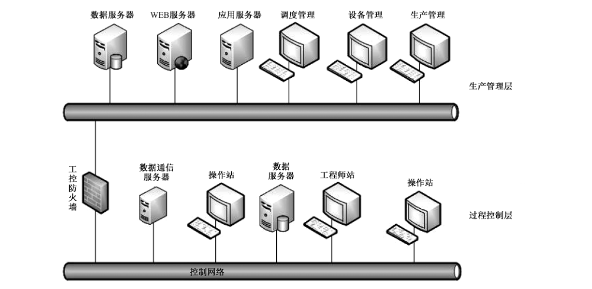
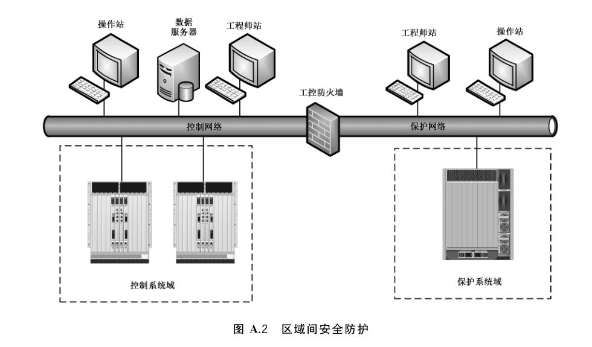
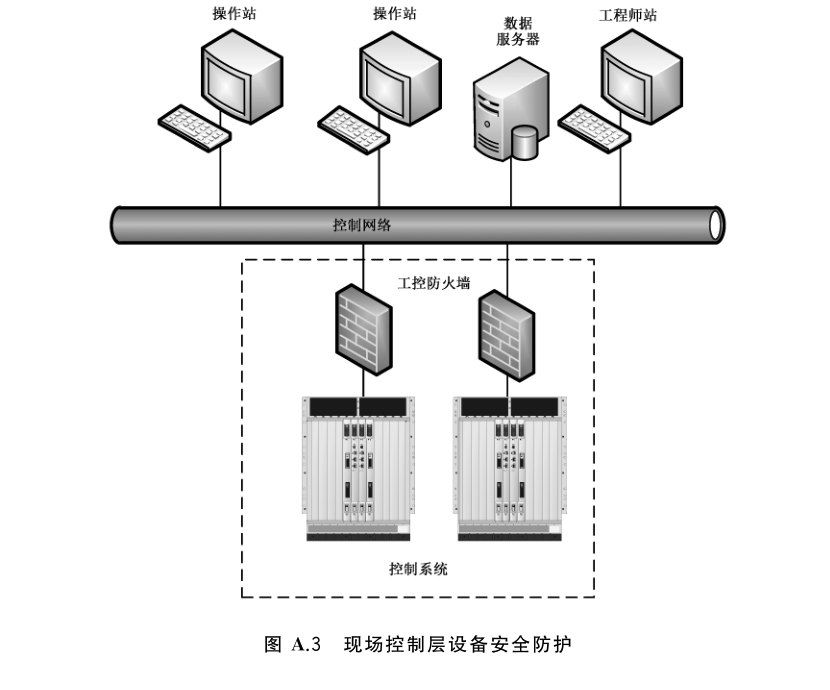

# GB/T 37933-2019 信息安全技术 工业控制系统专用防火墙技术要求

> 来源：[GB/T 37933-2019 国家标准详情](https://openstd.samr.gov.cn/bzgk/std/newGbInfo?hcno=643139368451D65D4A69009EBA234964)。
> PDF SHA-256：43281e2aa6a7f9ad139cc96e8f9f0a643c9be387d608e23af216751797e6aa8d。
> 发布日期：2019-08-30；实施日期：2020-03-01。依据官方 PDF 的 34 页图像逐页核对，重建附录 B 的 30 张表和附录 C 的跨页表，保留 3 幅原图，并去除封面、目录、分页和页眉页脚。正式引用请核对官方原文。

## 前言

本标准按照 GB/T 1.1—2009给出的规则起草。

请注意本文件的某些内容可能涉及专利。本文件的发布机构不承担识别这些专利的责任。

本标准由全国信息安全标准化技术委员会（SAC/TC 260）提出并归口。

本标准起草单位：公安部第三研究所、北京和利时系统工程有限公司、浙江中控技术股份有限公司、北京神州绿盟信息安全科技股份有限公司、中国信息安全研究院有限公司、中国电子技术标准化研究院、北京天融信网络安全技术有限公司、中国电子科技网络信息安全有限公司、网神信息技术（北京）股份有限公司、济南华汉电气科技有限公司、北京天地和兴科技有限公司、烽台科技（北京）有限公司、上海电力学院、北京工业大学。

本标准主要起草人：邹春明、田原、沈清泓、陆臻、俞优、赵婷、严益鑫、顾健、刘盈、王弢、朱毅明、范科峰、王勇、姚相振、李琳、周睿康、叶晓虎、王晓鹏、杨晨、周文奇、金光宇、雷晓锋、兰昆、黄文君、龚亮华、杨震、王刚、吴云坤。

## 引言

随着工业化与信息化的深度融合，来自信息网络的安全威胁正逐步对工业控制系统造成极大的安全威胁，通用防火墙在面对工业控制系统的安全防护时显得力不从心，因此急需要一种能应用于工业控制环境的防火墙对工业控制系统进行安全防护。

应用于工业控制环境的防火墙与通用防火墙的主要差异体现在：

——通用防火墙除了需具备基本的五元组过滤外，还需要具备一定的应用层过滤防护能力。用于工业控制环境的防火墙除了具有通用防火墙的部分通用协议应用层过滤能力外，还具有对工业控制协议应用层的过滤能力。

——用于工业控制环境的防火墙比通用防火墙具有更高的环境适应能力。

——工业控制环境中，通常流量相对较小，但对控制命令的执行要求具有实时性。因此，工业控制防火墙的吞吐量性能要求可相对低一些，而对实时性要求较高。

——工业控制环境下的防火墙比通用防火墙具有更高的可靠性、稳定性等要求。

## 1 范围

本标准规定了工业控制系统专用防火墙（以下简称工控防火墙）的安全功能要求、自身安全要求、性能要求和安全保障要求。

本标准适用于工控防火墙的设计、开发和测试。

## 2 规范性引用文件

下列文件对于本文件的应用是必不可少的。凡是注日期的引用文件，仅注日期的版本适用于本文件。凡是不注日期的引用文件，其最新版本（包括所有的修改单）适用于本文件。

- GB/T 2423.5—1995 电工电子产品环境试验 第2部分：试验方法 试验 Ea 和导则：冲击

- GB/T 2423.8—1995 电工电子产品环境试验 第2部分：试验方法 试验 Ed：自由跌落

- GB/T 2423.10—2008 电工电子产品环境试验 第2部分：试验方法 试验 Fc：振动（正弦）

- GB/T 4208—2017 外壳防护等级（IP 代码）

- GB 4824—2013 工业、科学和医疗（ISM）射频设备 骚扰特性 限值和测量方法

- GB/T 9254—2008 信息技术设备的无线电骚扰限值和测量方法

- GB/T 13729—2002 远动终端设备

- GB/T 15153.1—1998 远动设备及系统 第2部分：工作条件 第1篇：电源和电磁兼容性

- GB/T 17214.4—2005 工业过程测量和控制装置的工作条件 第4 部分：腐蚀和侵蚀影响

- GB/T 17626.2—2018 电磁兼容 试验和测量技术 静电放电抗扰度试验

- GB/T 17626.3—2016 电磁兼容 试验和测量技术 射频电磁场辐射抗扰度试验

- GB/T 17626.4—2018 电磁兼容 试验和测量技术 电快速瞬变脉冲群抗扰度试验

- GB/T 17626.5—2008 电磁兼容 试验和测量技术 浪涌（冲击）抗扰度试验

- GB/T 17626.6—2017 电磁兼容 试验和测量技术 射频场感应的传导骚扰抗扰度

- GB/T 17626.8—2006 电磁兼容 试验和测量技术 工频磁场抗扰度试验

- GB/T 17626.10—2017 电磁兼容 试验和测量技术 阻尼振荡磁场抗扰度试验

- GB/T 17626.11—2008 电磁兼容 试验和测量技术 电压暂降、短时中断和电压变化的抗扰度试验

- GB/T 17626.12—2013 电磁兼容 试验和测量技术 振铃波抗扰度试验

- GB/T 17626.16—2007 电磁兼容 试验和测量技术 0 Hz～150 kHz 共模传导骚扰抗扰度试验

- GB/T 17626.17—2005 电磁兼容 试验和测量技术 直流电源输入端口纹波抗扰度试验

- GB/T 17626.18—2016 电磁兼容 试验和测量技术 阻尼振荡波抗扰度试验

- GB/T 17626.29—2006 电磁兼容 试验和测量技术 直流电源输入端口电压暂降、短时中断和电压变化的抗扰度试验

- GB/T 20281—2015 信息安全技术 防火墙安全技术要求和测试评价方法

- GB/T 20438.3—2017 电气/电子/可编程电子安全相关系统的功能安全 第3部分：软件要求

- GB/T 20438.4—2017 电气/电子/可编程电子安全相关系统的功能安全 第4部分：定义和缩略语

- GB/T 25069—2010 信息安全技术 术语

- GB/T 32919—2016 信息安全技术 工业控制系统安全控制应用指南

## 3 术语和定义

GB/T 20281—2015、GB/T 20438.4—2017、GB/T 25069—2010 和 GB/T 32919—2016 界定的以及下列术语和定义适用于本文件。

### 3.1 工业控制协议 industrial control protocol

工业控制系统中，上位机与控制设备之间以及控制设备与控制设备之间的通信报文规约。通常包括模拟量和数字量的读写控制。

### 3.2 工业控制系统专用防火墙 industrial control system dedicated firewall

部署于工业控制系统中不同的安全域之间，或者控制器之前，具备网络层访问控制及过滤功能，工业控制协议规约检查和过滤功能，并具备高可用性，能够适用于工业控制环境的安全网关类产品。

## 4 缩略语

下列缩略语适用于本文件。

DMZ：非军事区（Demilitarized Zone）

DNAT：目的地址转换（Destination Network Address Translation）

ICMP：网络控制报文协议（Internet Control Message Protocol）

MAC：介质访问控制（Media Access Control）

NAT：网络地址转换（Network Address Translation）

OPC：用于过程控制的对象链接与嵌入（Object Linking and Embedding for Process Control）

SNAT：源地址转换（Source Network Address Translation）

SNMP：简单网络管理协议（Simple Network Management Protocol）

SYN：同步序列编号（Synchronize Sequence Numbers）

UDP：用户数据报协议（User Datagram Protocol）

## 5 产品描述

工控防火墙是应用于工业控制系统的一类特殊防火墙，其既要满足通用防火墙的基本要求，还要满足工业控制环境下的特殊要求，工控防火墙主要应用在工业控制层级间防护以及各层区域间防护。工控防火墙的典型部署场景参见附录 A。

本标准将工控防火墙安全技术要求分安全功能要求、自身安全要求、性能要求和安全保障要求四个大类。本标准将安全功能要求、自身安全要求和安全保障要求分为基本级和增强级，与基本级内容相比，增强级中要求有所增加或变更的内容在正文中通过“黑体”表示。若工控防火墙部署在工业控制现场，应根据实际需求满足附录B环境适应性要求。

## 6 安全技术要求

### 6.1 基本级安全技术要求

#### 6.1.1 安全功能要求

##### 6.1.1.1 网络层控制

###### 6.1.1.1.1 包过滤

工控防火墙的包过滤要求如下：

a） 安全策略应使用默认禁止原则，即除非明确允许，否则就禁止；

b） 安全策略应包含基于源 IP 地址、目的IP地址的访问控制；

c） 安全策略应包含基于源端口、目的端口的访问控制；

d） 安全策略应包含基于协议类型的访问控制；

e） 安全策略应包含基于 MAC地址的访问控制；

f） 应支持用户自定义的安全策略，安全策略可以是MAC地址、IP地址、端口的部分或全部组合。

###### 6.1.1.1.2 NAT

部署域间的工控防火墙应具备 NAT 功能，具体技术要求如下：

a）应支持双向 NAT：SNAT 和 DNAT；

b）SNAT 应至少可实现“多对一”地址转换，使得内部网络主机访问外部网络时，其源 IP 地址被转换。

###### 6.1.1.1.3 状态检测

工控防火墙应具备状态检测功能，支持基于状态检测技术的访问控制。

###### 6.1.1.1.4 动态开放端口

工控防火墙应具备动态开放端口功能，应至少支持OPC、FTP 协议。

###### 6.1.1.1.5 IP/MAC 地址绑定

工控防火墙应支持自动或手动绑定 IP/MAC 地址；应能够检测 IP 地址盗用事件，拦截盗用 IP 地址的主机经过工控防火墙的各种访问。

###### 6.1.1.1.6 抗拒绝服务攻击

工控防火墙应具有抗拒绝服务攻击的能力，具体技术要求如下（包括，但不限于）：

a） ICMP Flood 攻击；

b） UDP Flood 攻击；

c） SYN Flood 攻击；

d） TearDrop 攻击；

e） Land 攻击；

f） 超大 ICMP 数据攻击。

###### 6.1.1.1.7 网络扫描防护

工控防火墙应能够检测和记录扫描行为，包括对受保护网络的扫描。

##### 6.1.1.2 应用层控制

###### 6.1.1.2.1 应用协议控制

工控防火墙应能识别并控制各种应用类型，具体技术要求如下：

a） 支持 HTTP、FTP、Telnet 等通用应用层协议；

b） 支持常用工业控制协议，如 OPC、Modbus TCP、Profinet、BACnet、DNP3、IEC104 等。

###### 6.1.1.2.2 工业协议深度内容检测

工控防火墙应能对主流工业协议进行深度内容检测，具体技术要求如下：

a） 工控协议格式规约检查，禁止不符合协议规约的通信；

b） 对工业协议的操作类型、操作对象、操作范围等参数进行控制；

c） 至少支持一种主流工控协议。

> 注：具体工控协议检测深度参见附录C。

#### 6.1.2 自身安全要求

##### 6.1.2.1 运维管理

###### 6.1.2.1.1 管理安全

工控防火墙应具备管理安全功能，具体技术要求如下：

a） 支持对授权管理员的口令鉴别方式，且口令设置满足安全要求；

b） 应在所有授权管理员请求执行任何操作之前，对每个授权管理员进行唯一的身份鉴别；

c） 应具有登录失败处理功能，身份鉴别在经过一个可设定的鉴别失败最大次数后，工控防火墙应终止管理主机或用户建立的会话；

d） 工控防火墙应为每一位规定的授权管理员提供一套唯一的为执行安全策略所必需的安全属性。

###### 6.1.2.1.2 管理方式

工控防火墙应具备多种管理方式，具体技术要求如下：

a） 应支持进行本地管理工控防火墙；

b） 应支持通过网络接口进行远程管理，并可限定可进行远程管理的网络接口；

c） 远程管理过程中，管理端与工控防火墙之间的所有通信数据应加密传输。

###### 6.1.2.1.3 管理能力

工控防火墙应具备相应的管理能力，具体技术要求如下：

a） 向授权管理员提供设置和修改安全管理相关的数据参数的功能；

b） 向授权管理员提供设置、查询和修改各种安全策略的功能；

c） 向授权管理员提供管理审计日志的功能。

##### 6.1.2.2 安全审计

###### 6.1.2.2.1 记录事件类型

工控防火墙应具备安全审计功能，记录事件类型要求如下：

a） 工控防火墙访问控制策略匹配的访问请求；

b） 访问控制策略默认禁止的访问请求，包括试图穿越或到达工控防火墙的访问请求；

c） 检测到的攻击行为；

d） 试图登录工控防火墙管理端口和管理身份鉴别请求；

e） 对工控防火墙系统重要管理配置操作，如增加/删除/修改管理员、保存/删除审计日志、更改安全策略和配置参数等；

f） 其他应记录的事件类型。

###### 6.1.2.2.2 日志内容

工控防火墙应具备安全审计功能，日志内容要求如下：

a） 事件发生的日期时间，日期应包括年、月、日，时间应包括时、分、秒；

b） 访问控制日志应包括数据包的协议类型、源地址、目标地址、源端口、目标端口，允许或禁止；

c） 工控协议的深度内容检查信息；

d） 管理日志应包括事件主体、事件客体、事件描述。

###### 6.1.2.2.3 日志管理

工控防火墙应具备日志管理功能，具体技术要求如下：

a） 应只允许授权审计员对日志进行读取、存档、导出、删除和清空等操作；

b） 应提供日志查阅工具，具备对审计事件以时间、日期、主体标识、客体标识等条件检索的能力，并且只允许授权审计员使用查阅工具；

c） 审计事件应存储于掉电非易失性存储介质中，且在存储空间达到阈值时通知授权管理员进行处理。

##### 6.1.2.3 安全管理

###### 6.1.2.3.1 安全支撑系统

工控防火墙的底层支撑系统应满足以下要求：

a） 不提供多余的网络服务；

b） 不含任何导致产品权限丢失、拒绝服务等的安全漏洞。

###### 6.1.2.3.2 异常处理机制

工控防火墙在非正常关机（比如掉电、强行关机）再重新启动后，应满足如下技术要求：

a） 安全策略恢复到关机前的状态；

b） 日志信息不会丢失；

c） 管理员重新鉴别。

##### 6.1.2.4 高可用性

###### 6.1.2.4.1 可用性保障

部署在现场控制层的工控防火墙应具备 Bypass 功能，当工控防火墙自身出现断电故障时，应使工控防火墙内部接口与外部接口直接物理连通，保持内部网络与外部网络之间的正常通信，并及时告警。

###### 6.1.2.4.2 设备自检

工控防火墙应具备一定的自检功能：

a） 在初始化或启动期间，应能对设备硬件、程序或功能模块、重要配置文件等进行检测，当发现异常时能够及时告警；

b） 在运行期间，应能在授权管理员的要求下或者周期性的对提供安全功能的模块或进程进行检测，当出现异常时能够及时告警。

###### 6.1.2.4.3 运行模式

工控防火墙应支持多种运行模式，工控防火墙能够区分部署过程和工作过程，以实现对被防护系统的最小影响，具体技术要求如下：

a） 支持学习模式，工控防火墙记录运行过程中经过防火墙的所有策略、资产等信息，形成白名单策略集；

b） 支持验证模式或测试模式，该模式下工控防火墙对禁止策略进行告警，但不拦截；

c） 支持正常工作模式，工控防火墙的正常工作模式，严格按照防护策略进行过滤等动作保护。

###### 6.1.2.4.4 安全策略更新

工控防火墙安全策略应用时不应影响正常的数据通信。

###### 6.1.2.4.5 时间同步

工控防火墙应支持与时钟服务器自动同步时间的功能。

###### 6.1.2.4.6 电源冗余

部署现场控制层的工控防火墙应提供双电源冗余功能。

###### 6.1.2.4.7 散热方式

部署现场控制层的工控防火墙应采用自然散热，无风扇方式设计。

#### 6.1.3 性能要求

##### 6.1.3.1 吞吐量

工控防火墙在只有一条允许规则和不丢包的情况下，一对相应速率的端口应达到的双向吞吐量指标如下：

a） 部署在域间的工控防火墙：

1）对64字节短包，百兆工控防火墙应不小于线速的30%，千兆工控防火墙应不小于线速的40%；

2） 对256字节中长包，百兆工控防火墙应不小于线速的70%，千兆工控防火墙应不小于线速的 80%；

3） 对512字节长包，百兆工控防火墙应不小于线速的90%，千兆工控防火墙应不小于线速的95%。

b） 部署在现场控制层设备前的工控防火墙：

1） 对64字节短包，百兆工控防火墙应不小于线速的10%，千兆工控防火墙应不小于线速的 20%；

2） 对256字节中长包，百兆工控防火墙应不小于线速的30%，千兆工控防火墙应不小于线速的 40%；

3） 对512字节长包，百兆工控防火墙应不小于线速的50%，千兆工控防火墙应不小于线速的70%。

##### 6.1.3.2 延迟

延迟视不同速率的工控防火墙有所不同，在吞吐量90%条件下，应满足如下要求：

a） 部署在域间的工控防火墙：

1） 对64字节短包、256字节中长包、512字节长包，百兆工控防火墙平均延迟不应超过1 ms；

2）对 64 字节短包、256 字节中长包、512 字节长包，千兆工控防火墙平均延迟不应超过 200 μs。

b） 部署在现场控制层设备前的工控防火墙：

1）对 64 字节短包、256 字节中长包、512 字节长包，百兆工控防火墙平均延迟不应超过 500 μs；

2）对 64 字节短包、256 字节中长包、512 字节长包，千兆工控防火墙平均延迟不应超过 200 μs。

##### 6.1.3.3 最大并发连接数

最大并发连接数视不同速率的工控防火墙有所不同，具体指标要求如下：

a） 百兆工控防火墙的最大并发连接数应不小于60 000个；

b） 千兆工控防火墙的最大并发连接数应不小于300000个。

##### 6.1.3.4 最大连接速率

最大连接速率视不同速率的工控防火墙有所不同，具体指标要求如下：

a） 百兆工控防火墙的最大连接速率应不小于1 500个/s；

b） 千兆工控防火墙的最大连接速率应不小于5 000个/s。

#### 6.1.4 安全保障要求

##### 6.1.4.1 开发

###### 6.1.4.1.1 安全架构

开发者应提供产品安全功能的安全架构描述，技术要求如下：

a） 与产品设计文档中对安全功能的描述一致；

b） 描述与安全功能要求一致的安全域；

c） 描述产品安全功能初始化过程及安全措施；

d） 证实产品安全功能能够防止被破坏；

e） 证实产品安全功能能够防止安全策略被旁路。

###### 6.1.4.1.2 功能规范

开发者应提供完备的功能规范说明，技术要求如下：

a） 完整描述产品的安全功能；

b） 描述所有安全功能接口的目的与使用方法；

c） 标识和描述每个安全功能接口相关的所有参数；

d） 描述安全功能接口相关的安全功能实施行为；

e） 描述由安全功能实施行为而引起的直接错误消息；

f） 证实安全功能要求到安全功能接口的追溯。

###### 6.1.4.1.3 产品设计

开发者应提供产品设计文档，技术要求如下：

a） 根据子系统描述产品结构，并标识和描述产品安全功能的所有子系统；

b） 描述安全功能所有子系统间的相互作用；

c） 提供的映射关系能够证实设计中描述的所有行为能够映射到调用它的安全功能接口。

##### 6.1.4.2 指导性文档

###### 6.1.4.2.1 操作用户指南

开发者应提供明确和合理的操作用户指南，操作用户指南与为评估而提供的其他所有文档保持一致，对每一种用户角色的描述要求如下：

a） 描述授权用户可访问的功能和特权，包含适当的警示信息；

b） 描述如何以安全的方式使用产品提供的接口；

c）描述可用功能和接口，尤其是受用户控制的所有安全参数，适当时指明安全值；

d） 明确说明与需要执行的用户可访问功能有关的每一种安全相关事件，包括改变安全功能所控制实体的安全特性；

e） 标识产品运行的所有可能状态（包括操作导致的失败或者操作性错误），以及它们与维持安全运行之间的因果关系和联系；

f） 实现安全目的所应执行的安全策略。

###### 6.1.4.2.2 准备程序

开发者应提供产品及其准备程序，技术要求如下：

a） 描述与开发者交付程序相一致的安全接收所交付产品必需的所有步骤；

b） 描述安全安装产品及其运行环境必需的所有步骤。

##### 6.1.4.3 生命周期支持

###### 6.1.4.3.1 配置管理能力

开发者的配置管理能力应满足以下要求：

a） 为产品的不同版本提供唯一的标识；

b） 使用配置管理系统对组成产品的所有配置项进行维护，并唯一标识各配置项；

c） 提供配置管理文档，配置管理文档描述用于唯一标识配置项的方法。

###### 6.1.4.3.2 配置管理范围

开发者应提供产品配置项列表，并说明配置项的开发者。配置项列表至少包括产品、安全保障要求的评估证据和产品的组成部分。

###### 6.1.4.3.3 交付程序

开发者应使用一定的交付程序交付产品，并将交付过程文档化。在给用户方交付产品的各版本时，交付文档应描述为维护安全所必需的所有程序。

###### 6.1.4.3.4 支撑系统安全保障

开发者应明确产品支撑系统的安全保障措施，技术要求如下：

a） 若产品以软件形态提交，应在交付文档中详细描述支撑操作系统的兼容性、可靠性、安全性要求；

b） 若产品以硬件形态提交，应选取和采用安全可靠的支撑操作系统，以最小化原则选取必要的系统组件，并采取一定的加固措施。

###### 6.1.4.3.5 硬件安全保障

若产品以硬件形态提交，开发者应采取措施保障硬件安全，技术要求如下：

a） 产品应采用具有高可靠性、满足性能指标要求的硬件平台；

b） 若硬件平台为外购，应制定相应程序对硬件提供商进行管理、对采购的硬件平台或部件进行验证测试。并要求硬件提供商提供合格证明及必要的第三方环境适用性测试报告。

##### 6.1.4.4 测试

###### 6.1.4.4.1 测试覆盖

开发者应提供测试覆盖文档，测试覆盖描述应表明测试文档中所标识的测试与功能规范中所描述的产品的安全功能间的对应性。

###### 6.1.4.4.2 功能测试

开发者应测试产品安全功能，将结果文档化并提供测试文档。测试文档应包括以下内容：

a） 测试计划，标识要执行的测试，并描述执行每个测试的方案，这些方案包括对于其他测试结果的任何顺序依赖性；

b） 预期的测试结果，表明测试成功后的预期输出；

c） 实际测试结果和预期的测试结果一致。

###### 6.1.4.4.3 性能测试

开发者应测试产品性能，将结果文档化并提供测试文档。测试文档应包括以下内容：

a） 测试计划，标识要执行的性能测试指标，并描述执行每个测试的方案，这些方案包括产品的安全参数及安全策略条件，测试工具仪表及其配置参数等；

b） 测试结果，记录各条件下测试的性能指标值。

###### 6.1.4.4.4 独立测试

开发者应提供一组与其自测安全功能时使用的同等资源，以用于安全功能的抽样测试。

##### 6.1.4.5 脆弱性评定

基于已标识的潜在脆弱性，产品能够抵抗基本的攻击。

### 6.2 增强级安全技术要求

#### 6.2.1 安全功能要求

##### 6.2.1.1 网络层控制

###### 6.2.1.1.1 包过滤

工控防火墙的包过滤要求如下：

a） 安全策略应使用默认禁止原则，即除非明确允许，否则就禁止；

b） 安全策略应包含基于源 IP 地址、目的IP地址的访问控制；

c） 安全策略应包含基于源端口、目的端口的访问控制；

d） 安全策略应包含基于协议类型的访问控制；

e） 安全策略可包含基于 MAC地址的访问控制；

f）**安全策略可包含基于时间的访问控制**；

g） 应支持用户自定义的安全策略，安全策略可以是 MAC地址、IP地址、端口、协议类型和时间的部分或全部组合。

###### 6.2.1.1.2 NAT

部署域间的工控防火墙应具备 NAT 功能，具体技术要求如下：

a） 应支持双向 NAT:SNAT 和 DNAT；

b） SNAT 应至少可实现“多对一”地址转换，使得内部网络主机访问外部网络时，其源IP地址被转换；

c）**DNAT 应至少可实现“一对多”地址转换，将 DMZ 的 IP 地址/端口映射为外部网络合法 IP 地址/端口，使外部网络主机通过访问映射地址和端口实现对 DMZ 服务器的访问。**

###### 6.2.1.1.3 状态检测

工控防火墙应具备状态检测功能，支持基于状态检测技术的访问控制。

###### 6.2.1.1.4 动态开放端口

工控防火墙应具备动态开放端口功能，应至少支持 OPC、FTP 协议。

###### 6.2.1.1.5 IP/MAC地址绑定

工控防火墙应支持自动或手动绑定 IP/MAC地址；应能够检测IP地址盗用事件，拦截盗用IP地址的主机经过工控防火墙的各种访问。

###### 6.2.1.1.6 流量监测

**部署域间的工控防火墙应具备流量统计功能：**

a）**能够通过 IP 地址、网络服务、时间和协议类型等参数或它们的组合对流量进行正确的统计**；

b）**能够实时或者以报表形式输出流量统计结果**；

c）**能够对流量超过预警值的行为进行告警。**

###### 6.2.1.1.7 带宽管理

**部署域间的工控防火墙应具备带宽保障功能，使得在带宽出现拥堵时，能够保障重要终端的网络通信。**

###### 6.2.1.1.8 抗拒绝服务攻击

工控防火墙具有抗拒绝服务攻击的能力，具体技术要求如下（包括，但不限于）：

a） ICMP Flood 攻击；

b） UDP Flood 攻击；

c） SYN Flood攻击；

d） TearDrop 攻击；

e） Land 攻击；

f） 超大 ICMP数据攻击。

###### 6.2.1.1.9 网络扫描防护

工控防火墙应能够检测和记录扫描行为，包括对工控防火墙自身和受保护网络的扫描。

##### 6.2.1.2 应用层控制

###### 6.2.1.2.1 应用协议控制

工控防火墙应能识别并控制各种应用类型，具体技术要求如下：

a） 支持 HTTP、FTP、Telnet 等通用应用层协议；

b） 支持常用工业控制协议，如 OPC、Modbus TCP、Profinet、BACnet、DNP3、IEC104 等；

c）**自定义应用类型。**

###### 6.2.1.2.2 工业协议深度内容检测

工控防火墙应能对主流工业协议进行深度内容检测，具体技术要求如下：

a） 工控协议格式规约检查，禁止不符合协议规约的通信；

b） 对工业协议的操作类型、操作对象、操作范围等参数进行控制；

c）**至少支持三种主流工控协议。**

> 注：具体工控协议检测深度参见附录C。

#### 6.2.2 自身安全要求

##### 6.2.2.1 运维管理

###### 6.2.2.1.1 管理安全

工控防火墙应具备相应措施保证管理安全，具体技术要求如下：

a） 支持对授权管理员的口令鉴别方式，且口令设置满足安全要求；

b） 应在所有授权管理员请求执行任何操作之前，对每个授权管理员进行唯一的身份鉴别；

c）**应对授权管理员选择两种或两种以上组合的鉴别技术进行身份鉴别**；

d） 应具有登录失败处理功能，身份鉴别在经过一个可设定的鉴别失败最大次数后，工控防火墙应终止管理主机或用户建立的会话；

e） 工控防火墙应为每一个规定的授权管理员提供一套唯一的为执行安全策略所必需的安全属性。

###### 6.2.2.1.2 管理方式

工控防火墙应具备多种管理方式，具体技术要求如下：

a） 应支持进行本地管理工控防火墙；

b）**应支持通过安全管理平台方式对工控防火墙进行集中管理**；

c） 应支持通过网络接口进行远程管理，并可限定可进行远程管理的网络接口；

d） 应支持对可远程管理的主机地址（IP 或 MAC）进行限制；

e） 应支持通过标准协议（如 SNMP）对工控防火墙的状态进行监测，如CPU、内存使用率，接口状态等；

f） 远程管理过程中，管理主机与工控防火墙之间的所有通信数据应加密传输。

###### 6.2.2.1.3 管理能力

工控防火墙应具备相应的管理能力，具体技术要求如下：

a） 向授权管理员提供设置和修改安全管理相关的数据参数的功能；

b）向授权管理员提供设置、查询和修改各种安全策略的功能；

c） 向授权管理员提供管理审计日志的功能；

d）**工控防火墙应支持将管理用户权限进行分离。**

##### 6.2.2.2 安全审计

###### 6.2.2.2.1 记录事件类型

工控防火墙应具备安全审计功能，记录事件类型要求如下：

a） 工控防火墙访问控制策略匹配的访问请求；

b） 访问控制策略默认禁止的访问请求，包括试图穿越或到达工控防火墙的访问请求；

c） 检测到的攻击行为；

d） 试图登录工控防火墙管理端口和管理身份鉴别请求；

e） 对工控防火墙系统重要管理配置操作，如增加/删除/修改管理员、保存/删除审计日志、更改安全策略和配置参数等；

f） 其他应记录的事件类型。

###### 6.2.2.2.2 日志内容

工控防火墙应具备安全审计功能，日志内容要求如下：

a） 事件发生的日期时间，日期应包括年、月、日，时间应包括时、分、秒；

b） 访问控制日志应包括数据包的协议类型、源地址、目标地址、源端口、目标端口，允许或禁止；

c） 工控协议的深度内容检查信息；

d） 管理日志应包括事件主体、事件客体、事件描述；

e）**应根据日志内容设置日志级别，包括但不限于调试、信息、警告、错误等多个级别。**

###### 6.2.2.2.3 日志管理

工控防火墙应支持日志管理功能，具体技术要求如下：

a） 应只允许授权审计员对日志进行读取、存档、导出、删除和清空等操作；

b） 应提供日志查阅工具，具备对审计事件以时间、日期、主体标识、客体标识等条件检索的能力，并且只允许授权管理员使用查阅工具；

c） 审计事件应存储于掉电非易失性存储介质中，且在存储空间达到阈值时通知授权管理员进行处理；

d）**应支持第三方日志管理系统对工控防火墙日志信息进行集中收集、存储。**

##### 6.2.2.3 安全管理

###### 6.2.2.3.1 安全支撑系统

工控防火墙的底层支撑系统应满足以下要求：

a） 不提供多余的网络服务；

b） 不含任何导致产品权限丢失、拒绝服务等中高风险的安全漏洞。

###### 6.2.2.3.2 异常处理机制

工控防火墙在非正常关机（比如掉电、强行关机）再重新启动后，应满足如下技术要求：

a） 安全策略恢复到关机前的状态；

b） 日志信息不会丢失；

c） 管理员重新鉴别。

##### 6.2.2.4 高可用性

###### 6.2.2.4.1 可用性保障

部署在现场控制层的工控防火墙应具备 Bypass 功能，当工控防火墙自身出现断电**或其他软硬件故障**时，应使工控防火墙内部接口与外部接口直接物理连通，保持内部网络与外部网络之间的正常通信，并及时告警。

###### 6.2.2.4.2 设备自检

工控防火墙应具备一定的自检功能：

a）在初始化或启动期间，应能对设备硬件、程序或功能模块、重要配置文件等进行检测，当发现异常时能够及时告警，**并对程序文件或者配置文件的异常提供一定的恢复功能**；

b）在运行期间，应能在授权管理员的要求下或者周期性的对提供安全功能的模块或进程进行检测，当出现异常时能够及时告警，**并自动恢复功能模块或者进程的运行**。

###### 6.2.2.4.3 运行模式

工控防火墙应支持多种运行模式，工控防火墙能够区分部署过程和工作过程，以实现对被防护系统的最小影响，具体技术要求如下：

a） 支持学习模式，工控防火墙记录运行过程中经过防火墙的所有策略、资产等信息，形成白名单策略集；

b）**应支持工控协议的深度内容检测策略学习，学习深度与工业协议深度内容检测深度一致**；

c） 支持验证模式或测试模式，该模式下工控防火墙对禁止策略进行告警，但不拦截；

d） 支持正常工作模式，工控防火墙的正常工作模式，严格按照防护策略进行过滤等动作保护。

###### 6.2.2.4.4 安全策略更新

工控防火墙安全策略应用时不应影响正常的数据通信。

###### 6.2.2.4.5 时间同步

工控防火墙应支持与时钟服务器自动同步时间功能。

###### 6.2.2.4.6 电源冗余

部署现场控制层的工控防火墙应提供双电源冗余功能。

###### 6.2.2.4.7 散热方式

部署现场控制层的工控防火墙应采用自然散热，无风扇方式设计。

###### 6.2.2.4.8 双机热备

**部署域间的工控防火墙应具备双机热备的能力，当主防火墙自身出现断电或其他软硬件故障时，备防火墙应及时发现并接管主防火墙进行工作。**

#### 6.2.3 性能要求

见6.1.3。

#### 6.2.4 安全保障要求

##### 6.2.4.1 开发

###### 6.2.4.1.1 安全架构

开发者应提供产品安全功能的安全架构描述，技术要求如下：

a） 与产品设计文档中对安全功能的描述一致；

b） 描述与安全功能要求一致的安全域；

c） 描述产品安全功能初始化过程及安全措施；

d） 证实产品安全功能能够防止被破坏；

e） 证实产品安全功能能够防止安全策略被旁路。

###### 6.2.4.1.2 功能规范

开发者应提供完备的功能规范说明，技术要求如下：

a） 完整描述产品的安全功能；

b） 描述所有安全功能接口的目的与使用方法；

c） 标识和描述每个安全功能接口相关的所有参数；

d） 描述安全功能接口相关的安全功能实施行为；

e） 描述由安全功能实施行为而引起的直接错误消息；

f） 证实安全功能要求到安全功能接口的追溯；

g）**描述安全功能实施过程中，与安全功能接口相关的所有行为**；

h）**描述可能由安全功能接口的调用而引起的所有错误消息。**

###### 6.2.4.1.3 实现表示

**开发者应提供全部安全功能的实现表示，技术要求如下：**

a）**提供产品设计描述与实现表示实例之间的映射，并证明其一致性**；

b）**详细定义产品安全功能，达到无须进一步设计就能生成安全功能的程度**；

c）**实现表示以开发人员使用的形式提供。**

###### 6.2.4.1.4 产品设计

开发者应提供产品设计文档，技术要求如下：

a） 根据子系统描述产品结构，并标识和描述产品安全功能的所有子系统；

b） 描述安全功能所有子系统间的相互作用；

c）提供的映射关系能够证实设计中描述的所有行为能够映射到调用它的安全功能接口；

d）**根据模块描述安全功能，并提供安全功能子系统到模块间的映射关系**；

e）**描述所有安全功能实现模块，包括其目的及与其他模块间的相互关系**；

f）**描述所有模块的安全功能要求相关接口与其他相邻接口的调用参数及返回值**；

g）**描述所有安全功能的支撑或相关模块，包括其目的及与其他模块间的相互作用。**

##### 6.2.4.2 指导性文档

###### 6.2.4.2.1 操作用户指南

开发者应提供明确和合理的操作用户指南，操作用户指南与为评估而提供的其他所有文档保持一致，对每一种用户角色的描述要求如下：

a） 描述授权用户可访问的功能和特权，包含适当的警示信息；

b） 描述如何以安全的方式使用产品提供的接口；

c） 描述可用功能和接口，尤其是受用户控制的所有安全参数，适当时指明安全值；

d） 明确说明与需要执行的用户可访问功能有关的每一种安全相关事件，包括改变安全功能所控制实体的安全特性；

e） 标识产品运行的所有可能状态（包括操作导致的失败或者操作性错误），以及它们与维持安全运行之间的因果关系和联系；

f） 实现安全目的所应执行的安全策略。

###### 6.2.4.2.2 准备程序

开发者应提供产品及其准备程序，技术要求如下：

a） 描述与开发者交付程序相一致的安全接收所交付产品必需的所有步骤；

b） 描述安全安装产品及其运行环境必需的所有步骤。

##### 6.2.4.3 生命周期支持

###### 6.2.4.3.1 配置管理能力

开发者的配置管理能力应满足以下要求：

a） 为产品的不同版本提供唯一的标识；

b） 使用配置管理系统对组成产品的所有配置项进行维护，并唯一标识各配置项；

c） 提供配置管理文档，配置管理文档描述用于唯一标识配置项的方法；

d）**配置管理系统提供一种自动方式来支持产品的生成，并确保只能对配置项进行已授权的变更**；

e）**配置管理文档包括配置管理计划，计划中需描述如何使用配置管理系统，并依据该计划实施配置管理**；

f）**配置管理计划描述配置项的变更（包括新建、修改、删除）控制程序。**

###### 6.2.4.3.2 配置管理范围

开发者应提供产品配置项列表，并说明配置项的开发者，技术要求如下：

a） 产品、安全保障要求的评估证据和产品的组成部分；

b）**实现表示、安全缺陷报告及其解决状态。**

###### 6.2.4.3.3 交付程序

开发者应使用一定的交付程序交付产品，并将交付过程文档化。在给用户方交付产品的各版本时，交付文档应描述为维护安全所必需的所有程序。

###### 6.2.4.3.4 开发安全

**开发者应提供开发安全文档。开发安全文档应描述在产品的开发环境中，为保护产品设计和实现的保密性和完整性所必需的所有物理的、程序的、人员的和其他方面的安全措施。**

###### 6.2.4.3.5 生命周期定义

**开发者应建立一个生命周期模型对产品的开发和维护进行的必要控制，并提供生命周期定义文档描述用于开发和维护产品的模型。**

###### 6.2.4.3.6 工具和技术

**开发者应明确定义用于开发产品的工具，并提供开发工具文档无歧义的定义实现中所有语句的含义和所有依赖选项的含义。**

###### 6.2.4.3.7 支撑系统安全保障

开发者应明确产品支撑系统的安全保障措施，技术要求如下：

a） 若产品以软件形态提交，应在交付文档中详细描述支撑操作系统的兼容性、可靠性、安全性要求；

b） 若产品以硬件形态提交，应选取和采用安全可靠的支撑操作系统，以最小化原则选取必要的系统组件，并采取一定的加固措施。

###### 6.2.4.3.8 硬件安全保障

若产品以硬件形态提交，开发者应采取措施保障硬件安全，技术要求如下：

a） 产品应采用具有高可靠性、满足性能指标要求的硬件平台；

b） 若硬件平台外购，应制定相应程序对硬件提供商进行管理、对采购的硬件平台或部件进行验证测试。并要求硬件提供商提供合格证明及必要的第三方环境适用性测试报告。

##### 6.2.4.4 测试

###### 6.2.4.4.1 测试覆盖

开发者应提供测试覆盖文档，技术要求如下：

a）证实测试文档中所标识的测试与功能规范中所描述的产品的安全功能间的对应性；

b）**证实功能规范中的所有安全功能接口都进行了测试。**

###### 6.2.4.4.2 测试深度

**开发者应提供测试深度的分析，技术要求如下：**

a）**证实测试文档中的测试与产品设计中的安全功能子系统和实现模块之间的一致性**；

b）**证实产品设计中的所有安全功能子系统、实现模块都已经进行过测试。**

###### 6.2.4.4.3 功能测试

开发者应测试产品安全功能，将结果文档化并提供测试文档。测试文档应包括以下内容：

a） 测试计划，标识要执行的测试，并描述执行每个测试的方案，这些方案包括对于其他测试结果的任何顺序依赖性；

b） 预期的测试结果，表明测试成功后的预期输出；

c） 实际测试结果和预期的测试结果一致。

###### 6.2.4.4.4 功能安全测试

**开发者应按照 GB/T 20438.3—2017 中 7.9 的要求进行产品软件功能安全测试。**

###### 6.2.4.4.5 性能测试

开发者应测试产品性能，将结果文档化并提供测试文档。测试文档应包括以下内容：

a） 测试计划，标识要执行的性能测试指标，并描述执行每个测试的方案，这些方案包括产品的安全参数及安全策略条件，测试工具仪表及其配置参数等；

b）测试结果，记录各条件下测试的性能指标值。

###### 6.2.4.4.6 独立测试

开发者应提供一组与其自测安全功能时使用的同等资源，以用于安全功能的抽样测试。

##### 6.2.4.5 脆弱性评定

**基于已标识的潜在脆弱性，产品能够抵抗较强的攻击。**

## 附录 A（资料性附录）工控防火墙的应用

工控防火墙是应用于工业控制系统的一类特殊防火墙，其既要满足通用防火墙的基本要求，还要满足工业控制环境下的特殊要求，工控防火墙主要应用在工业控制层级间防护以及各层区域间防护。

参考 GB/T 20720 的层次结构模型划分，工业控制系统主要分三层架构：生产管理层、过程监控层、现场控制层。

生产管理层：将生产过程控制、生产过程管理和经营管理活动中产生的诸多信息进行转换、加工、传递，是生产过程控制与管理信息集成的重要桥梁和纽带，完成生产计划的调度与统计、生产过程成本控制、产品质量控制与管理、设备控制与管理、生产数据采集与处理等功能，负责生产管理和调度执行。

过程控制层：以操作监视为主要任务，兼有部分管理功能。这一级是面向操作员和控制系统工程师的，因而这一级配备有技术手段齐备，功能强的计算机系统及各类外部装置，特别是显示器和键盘，以及需要较大存储容量的硬盘或软盘支持，另外还需要功能强的软件支持，确保工程师和操作员对系统进行组态、监视和操作，对生产过程实行高级控制策略、故障诊断、质量评估。

现场控制层：现场控制层的主要功能包括：采集过程数据，进行数据转换与处理；对生产过程进行监测和控制，输出控制信号，实现反馈控制、逻辑控制、顺序控制和批量控制功能；对现场设备及 I/O 卡件进行自诊断；与过程监控层进行数据通信。

工控防火墙常见应用如下：

a） 工业控制系统网络各层级间的安全防护，如图 A.1 在生产管理层网络与过程控制层网络之间安全防护；

b） 同层级网络不同控制域间的安全防护，如图A.2在区域间安全防护；

c） 对现场控制层设备进行安全防护，如图A.3对现场控制层设备安全防护。

> 注：图A.3的部署方式不适合对通信实时性有要求的场合。

## 附录 B（规范性附录）环境适应性要求

### B.1 概述

本附录的环境适应性要求包括气候、电磁兼容、绝缘、接地、机械适应性、外壳防护。应根据设备实际部署环境的不同，由用户和设备制造商确定具体应满足的要求。

> 注：本附录环境适应性的编写主要参考了 GB/T 30094，其参考的相关标准主要为 GB/T 2423、GB/T 17626 等。

### B.2 环境适应性

#### B.2.1 温度

表 B.1 规定了设备工作、贮存和运输温度条件。设备在规定的工作温度范围内工作时，其功能和性能应满足本附录的规定。在规定的温度范围内贮存和运输时，不应发生裂痕、老化或其他损坏；当经受该温度范围后再恢复到工作温度范围时，设备应能正常工作。应用于温度快速变化场合的设备，在经受不超过 5 ℃/min 的温度变化时应能正常工作。

**表 B.1 温度条件**

| 等级 | 工作低温/℃ | 工作高温/℃ | 贮存和运输低温/℃ | 贮存和运输高温/℃ |
| --- | ---: | ---: | ---: | ---: |
| I | 0 | 60 | −40 | 70 |
| II | −40 | 70 | −40 | 85 |
| Xᵃ | 特定 | 特定 | 特定 | 特定 |

ᵃ X 是一个开放等级，具体温度要求范围可根据设备实际应用环境与客户协商确定。

#### B.2.2 相对湿度

设备在表 B.2 规定的相对湿度环境条件下应能正常工作。

**表 B.2 相对湿度条件（无凝结）**

| 等级 | 低相对湿度/% | 高相对湿度/% |
| --- | ---: | ---: |
| I | 5 | 95 |
| Xᵃ | 特定 | 特定 |

ᵃ X 是一个开放等级，具体相对湿度要求范围可根据设备实际应用环境与客户协商确定。

#### B.2.3 大气压力

设备工作大气压力条件见表 B.3。

**表 B.3 大气压力条件**

| 等级 | 低气压/kPa | 高气压/kPa |
| --- | ---: | ---: |
| I | 80 | 106 |
| II | 70 | 106 |
| Xᵃ | 特定 | 特定 |

ᵃ X 是一个开放等级，具体大气压力要求范围可根据设备实际应用环境与客户协商确定。

#### B.2.4 防腐蚀

设备工作在盐雾环境条件下或存在其他化学活性物质，应提供工业环境中抗腐蚀和侵蚀的能力，保证设备在表 B.4、表 B.5 规定的环境条件下能够长期使用。

**表 B.4 盐雾**

| 等级 | 最大盐雾浓度/（mg/m³） |
| --- | ---: |
| I | ≤5 |
| Xᵃ | 特定 |

ᵃ X 是一个开放等级，具体抗盐雾要求范围可根据设备实际应用环境与客户协商确定。

**表 B.5 化学活性物质条件**

| 等级 | 依据标准 | 化学活性物质 |
| --- | --- | --- |
| I | GB/T 17214.4—2005 | 工业清洁空气 |
| II | GB/T 17214.4—2005 | 中等污染 |
| III | GB/T 17214.4—2005 | 严重污染 |
| Xᵃ | GB/T 17214.4—2005 | 特定 |

ᵃ X 是一个开放等级，具体抗腐蚀性要求范围可根据设备实际应用环境与客户协商确定。

#### B.2.5 抗霉变

设备工作在潮湿多雨地区和霉菌滋生环境下不应发生霉变，并能够正常工作。

### B.3 电磁兼容性

设备应满足工业环境中的电磁兼容性要求，具体技术指标见表 B.7～表 B.26。

其中，电磁兼容辐射和传导发射限值按 GB 4824—2013 为 A 类，电磁兼容抗扰度的性能判据要求见表 B.6。

**表 B.6 性能判据**

| 性能评价判据 | 说明 |
| --- | --- |
| A | 试验期间和试验后受试设备均应按预期要求继续运行，无功能丧失或性能下降 |
| B | 试验期间，受试设备允许出现暂时的性能下降或功能丧失，但设备可以自我恢复，试验后设备应按预期要求继续运行。不能出现系统死机、复位或重启 |
| C | 试验期间，允许受试设备出现暂时的性能下降或功能丧失，但需要人工干预或系统复位才能恢复 |

**表 B.7 辐射发射及传导发射要求**

| 测试项 | 测试端口 | 依据标准 | 测试频段 | 限值 |
| --- | --- | --- | --- | --- |
| 辐射发射 | 整机 | GB 4824—2013、GB/T 9254—2008 | 30 MHz～1 GHz | A 类 |
| 传导发射 | 电源口、信号口 | GB 4824—2013、GB/T 9254—2008 | 150 kHz～30 MHz | A 类 |

**表 B.8 外壳端口静电放电抗扰度要求**

| 等级 | 依据标准 | 严酷等级 | 判据 |
| --- | --- | --- | --- |
| I | GB/T 17626.2—2018 | 3（接触放电 ±6 kV，空气放电 ±8 kV） | A |
| II | GB/T 17626.2—2018 | 4（接触放电 ±8 kV，空气放电 ±15 kV） | A |
| Xᵃ | GB/T 17626.2—2018 | 特定 | 特定 |

ᵃ X 是一个开放等级，具体电磁兼容性能力要求可根据设备实际应用环境与客户协商确定。

**表 B.9 整机射频电磁场辐射抗扰度要求**

| 等级 | 依据标准 | 严酷等级 | 试验频段 | 判据 |
| --- | --- | --- | --- | --- |
| I | GB/T 17626.3—2016 | 2（3 V/m，80% AM） | 80 MHz～1 GHz | A |
| II | GB/T 17626.3—2016 | 3（10 V/m，80% AM） | 80 MHz～1 GHz | A |
| Xᵃ | GB/T 17626.3—2016 | 特定 | 特定 | 特定 |

ᵃ X 是一个开放等级，具体电磁兼容性能力要求可根据设备实际应用环境与客户协商确定。

**表 B.10 电源端口及信号端口电快瞬变脉冲群抗扰度要求**

| 等级 | 依据标准 | 严酷等级 | 判据 |
| --- | --- | --- | --- |
| I | GB/T 17626.4—2018 | 3（电源口 ±2 kV，信号口 ±1 kV） | A |
| II | GB/T 17626.4—2018 | 4（电源口 ±4 kV，信号口 ±2 kV） | A |
| Xᵃ | GB/T 17626.4—2018 | 特定 | 特定 |

ᵃ X 是一个开放等级，具体电磁兼容性能力要求可根据设备实际应用环境与客户协商确定。

**表 B.11 信号端口浪涌（冲击）抗扰度要求**

| 等级 | 依据标准 | 线-地严酷等级 | 判据 |
| --- | --- | ---: | --- |
| I | GB/T 17626.5—2008 | 2 | A |
| II | GB/T 17626.5—2008 | 3 | A |
| III | GB/T 17626.5—2008 | 4 | A |
| Xᵃ | GB/T 17626.5—2008 | 特定 | 特定 |

ᵃ X 是一个开放等级，具体电磁兼容性能力要求可根据设备实际应用环境与客户协商确定。

**表 B.12 直流电源输入端口浪涌（冲击）抗扰度要求**

| 等级 | 依据标准 | 线-地严酷等级 | 线-线严酷等级 | 判据 |
| --- | --- | ---: | ---: | --- |
| I | GB/T 17626.5—2008 | 3 | 3 | A |
| II | GB/T 17626.5—2008 | 4 | 4 | A |
| Xᵃ | GB/T 17626.5—2008 | 特定 | 特定 | 特定 |

ᵃ X 是一个开放等级，具体电磁兼容性能力要求可根据设备实际应用环境与客户协商确定。

**表 B.13 交流电源输入端口浪涌（冲击）抗扰度要求**

| 等级 | 依据标准 | 线-地严酷等级 | 线-线严酷等级 | 判据 |
| --- | --- | ---: | ---: | --- |
| I | GB/T 17626.5—2008 | 3 | 3 | A |
| II | GB/T 17626.5—2008 | 4 | 4 | A |
| Xᵃ | GB/T 17626.5—2008 | 特定 | 特定 | 特定 |

ᵃ X 是一个开放等级，具体电磁兼容性能力要求可根据设备实际应用环境与客户协商确定。

**表 B.14 电源端口及信号端口射频场感应的传导骚扰抗扰度要求**

| 等级 | 依据标准 | 严酷等级 | 试验频段 | 判据 |
| --- | --- | --- | --- | --- |
| I | GB/T 17626.6—2017 | 2（3 V，80% AM） | 150 kHz～80 MHz | A |
| II | GB/T 17626.6—2017 | 3（10 V，80% AM） | 150 kHz～80 MHz | A |
| Xᵃ | GB/T 17626.6—2017 | 特定 | 特定 | 特定 |

ᵃ X 是一个开放等级，具体电磁兼容性能力要求可根据设备实际应用环境与客户协商确定。

**表 B.15 整机工频磁场抗扰度要求**

| 等级 | 依据标准 | 严酷等级 | 判据 |
| --- | --- | --- | --- |
| I | GB/T 17626.8—2006 | 稳定持续磁场：4 级；短时作用磁场：4 级 | A |
| II | GB/T 17626.8—2006 | 稳定持续磁场：5 级；短时作用磁场：5 级 | A |
| Xᵃ | GB/T 17626.8—2006 | 特定 | 特定 |

ᵃ X 是一个开放等级，具体电磁兼容性能力要求可根据设备实际应用环境与客户协商确定。

**表 B.16 整机阻尼振荡磁场抗扰度要求**

| 等级 | 依据标准 | 严酷等级 | 判据 |
| --- | --- | --- | --- |
| I | GB/T 17626.10—2017 | 4 | A |
| II | GB/T 17626.10—2017 | 5 | A |
| Xᵃ | GB/T 17626.10—2017 | 特定 | 特定 |

ᵃ X 是一个开放等级，具体电磁兼容性能力要求可根据设备实际应用环境与客户协商确定。

**表 B.17 电源端口阻尼振荡波抗扰度要求**

| 等级 | 依据标准 | 严酷等级 | 判据 |
| --- | --- | --- | --- |
| I | GB/T 17626.18—2016 | 2 | A |
| II | GB/T 17626.18—2016 | 3 | A |
| Xᵃ | GB/T 17626.18—2016 | 特定 | 特定 |

ᵃ X 是一个开放等级，具体电磁兼容性能力要求可根据设备实际应用环境与客户协商确定。

**表 B.18 振铃波抗扰度要求**

| 等级 | 依据标准 | 严酷等级 | 判据 |
| --- | --- | --- | --- |
| I | GB/T 17626.12—2013 中的表 1 | 3 | A |
| II | GB/T 17626.12—2013 中的表 1 | 4 | A |
| Xᵃ | GB/T 17626.12—2013 中的表 1 | 特定 | 特定 |

ᵃ X 是一个开放等级，具体电磁兼容性能力要求可根据设备实际应用环境与客户协商确定。

**表 B.19 电源口 0 Hz～150 Hz 共模传导骚扰抗扰度要求**

| 等级 | 依据标准 | 严酷等级 | 判据 |
| --- | --- | --- | --- |
| I | GB/T 17626.16—2007 | 3 | A |
| II | GB/T 17626.16—2007 | 4 | A |
| Xᵃ | GB/T 17626.16—2007 | 特定 | 特定 |

ᵃ X 是一个开放等级，具体电磁兼容性能力要求可根据设备实际应用环境与客户协商确定。

**表 B.20 交流电源输入端口电压暂降抗扰度要求**

| 等级 | 依据标准 | 严酷等级 | 判据 |
| --- | --- | --- | --- |
| I | GB/T 17626.11—2008 | 2 类 | B |
| II | GB/T 17626.11—2008 | 3 类 | B |
| Xᵃ | GB/T 17626.11—2008 | 特定 | 特定 |

ᵃ X 是一个开放等级，具体电磁兼容性能力要求可根据设备实际应用环境与客户协商确定。

**表 B.21 交流电源输入端口短时中断抗扰度要求**

| 等级 | 依据标准 | 严酷等级 | 判据 |
| --- | --- | --- | --- |
| I | GB/T 17626.11—2008 | 2 类 | C |
| II | GB/T 17626.11—2008 | 3 类 | C |
| Xᵃ | GB/T 17626.11—2008 | 特定 | 特定 |

ᵃ X 是一个开放等级，具体电磁兼容性能力要求可根据设备实际应用环境与客户协商确定。

**表 B.22 交流电源输入端口电压变化抗扰度要求**

| 等级 | 依据标准 | 电压试验等级 | 电压降低所需时间 | 降低后电压维持时间 | 电压增加所需时间 | 判据 |
| --- | --- | --- | --- | --- | --- | --- |
| I | GB/T 17626.11—2008 | 70% | 突变 | 1 周期 | 25 周期 | A |
| Xᵃ | GB/T 17626.11—2008 | 特定 | 特定 | 特定 | 特定 | 特定 |

ᵃ X 是一个开放等级，具体电磁兼容性能力要求可根据设备实际应用环境与客户协商确定。

**表 B.23 直流电源输入端口纹波抗扰度**

| 等级 | 依据标准 | 严酷等级 | 判据 |
| --- | --- | --- | --- |
| I | GB/T 17626.17—2005 | 2 | A |
| II | GB/T 17626.17—2005 | 3 | A |
| III | GB/T 17626.17—2005 | 4 | A |
| Xᵃ | GB/T 17626.17—2005 | 特定 | 特定 |

ᵃ X 是一个开放等级，具体电磁兼容性能力要求可根据设备实际应用环境与客户协商确定。

**表 B.24 直流电源输入端口电压暂降抗扰度**

| 等级 | 依据标准 | 严酷等级 | 判据 |
| --- | --- | --- | --- |
| I | GB/T 17626.29—2006 | 试验等级：40%UT 和 70%UT；持续时间：1 s | A |
| Xᵃ | GB/T 17626.29—2006 | 特定 | 特定 |

ᵃ X 是一个开放等级，具体电磁兼容性能力要求可根据设备实际应用环境与客户协商确定。

**表 B.25 直流电源输入端口短时中断抗扰度**

| 等级 | 依据标准 | 严酷等级 | 判据 |
| --- | --- | --- | --- |
| I | GB/T 17626.29—2006 | 试验等级：0%UT；持续时间：1 s | B |
| Xᵃ | GB/T 17626.29—2006 | 特定 | 特定 |

ᵃ X 是一个开放等级，具体电磁兼容性能力要求可根据设备实际应用环境与客户协商确定。

**表 B.26 直流电源输入端口电压变化抗扰度**

| 等级 | 依据标准 | 严酷等级 | 判据 |
| --- | --- | --- | --- |
| I | GB/T 17626.29—2006 | 试验等级：80%UT 和 120%UT；持续时间：10 s | A |
| Xᵃ | GB/T 17626.29—2006 | 特定 | 特定 |

ᵃ X 是一个开放等级，具体电磁兼容性能力要求可根据设备实际应用环境与客户协商确定。

### B.4 绝缘性能

#### B.4.1 绝缘电阻

设备的绝缘电阻要求见表 B.27。

**表 B.27 绝缘电阻要求**

| 名称 | 依据标准 |
| --- | --- |
| 一般环境绝缘电阻 | GB/T 13729—2002 中的表 13 |
| 湿热环境绝缘电阻 | GB/T 13729—2002 中的表 14 |

#### B.4.2 绝缘耐压

设备的绝缘耐压要求见表 B.28。

**表 B.28 绝缘耐压要求**

| 名称 | 依据标准 | 严酷等级 |
| --- | --- | --- |
| 额定绝缘电压小于或等于 60 V 的回路 | GB/T 15153.1—1998 | VW2 |
| 额定绝缘电压大于或等于 60 V 的回路 | GB/T 15153.1—1998 | VW3 |

注：高海拔地区空气密度小，同等电压下，空气更容易产生电离现象，使设备的绝缘性能下降。在高海拔地区使用的设备可通过合理设计，保证其绝缘性能。

#### B.4.3 泄漏电流

设备工作时对保护接地端的泄漏电流应不大于 5 mA。

### B.5 接地

设备应具有接地端子及标记，标记应具耐久性且易识别，接地直流电阻不大于 10 mΩ。

### B.6 机械适应性

设备应提供工业环境中的机械适应性能力，具体技术要求见表 B.29。

**表 B.29 机械适应性要求**

| 名称 | 依据标准 | 等级 | 备注 |
| --- | --- | --- | --- |
| 正弦振动-工作 | GB/T 2423.10—2008 | 5 Hz≤f≤9 Hz，7 mm；9 Hz≤f≤150 Hz，2.0 g；每分钟一倍频程（±10%） | 在三个互相垂直轴的每个轴上分别扫描 10 次 |
| 冲击-工作 | GB/T 2423.5—1995 | 15 g；持续时间：11 ms/次；脉冲波形：半正弦 | 每个坐标轴的＋/－方向各进行 3 次冲击，即共 18 次 |
| 垂直冲击-包装运输 | GB/T 2423.8—1995 | 未包装产品质量≤10 kg，跌落高度 0.25 m；未包装产品质量≤50 kg，跌落高度 0.10 m；在完整包装箱中质量≤50 kg，跌落高度 0.5 m；在完整包装箱中质量≤100 kg，跌落高度 0.25 m | 面棱角的顺序，每个包装实验 3 次 |

### B.7 外壳防护

设备的外壳防护等级由制造商和用户协商确定，防护等级应从表 B.30 规定的范围内选择。

**表 B.30 外壳防护等级表**

| 防尘等级 | 防水等级 | 依据标准 |
| --- | --- | --- |
| IP2X、IP3X、IP4X、IP5X | IPX0、IPX1、IPX2、IPX3、IPX4、IPX5、IPX6、IPX7 | GB/T 4208—2017 |

## 附录 C（资料性附录）典型工控协议应用层控制要求

典型工控协议应用层深度内容检测见表 C.1。

**表 C.1 典型工控协议深度内容检测要求**

| 工控协议名称 | 控制深度要求 | 备注 |
| --- | --- | --- |
| Modbus TCP 协议 | 按寄存器起始地址读写控制 | — |
| Modbus TCP 协议 | 按寄存器长度读写控制 | 与“按寄存器结束地址读写控制”相结合，二选一 |
| Modbus TCP 协议 | 按寄存器结束地址读写控制 | 与“按寄存器长度读写控制”相结合，二选一 |
| Modbus TCP 协议 | 寄存器值的读写控制 | 值的大小范围 |
| Modbus TCP 协议 | 功能码检查 | — |
| OPC 协议 | 支持动态开放端口 | — |
| OPC 协议 | 支持 TAG 控制点的全局读写控制 | — |
| OPC 协议 | 支持 TAG 控制点名称的读写控制 | — |
| OPC 协议 | 支持 TAG 控制点数据类型的控制 | — |
| OPC 协议 | 支持 TAG 控制点值的读写控制 | 值的大小范围 |
| OPC 协议 | 支持文件导入 TAG 控制点 | — |
| S7 协议 | 功能码检查 | — |
| S7 协议 | 按数据空间类型读写控制 | — |
| S7 协议 | 按数据地址长度读写控制 | 与“按数据结束地址读写控制”相结合，二选一 |
| S7 协议 | 按数据结束地址读写控制 | 与“按数据长度读写控制”相结合，二选一 |
| S7 协议 | 数据值的读写控制 | 值的大小范围 |
| Ethernet/IP | 支持 ITEM 控制点名称的读写控制 | — |
| Ethernet/IP | 支持 ITEM 控制点值的读写控制 | 值的大小范围 |
| FINS | 命令类型检查 | — |
| FINS | 按数据空间类型读写控制 | — |
| FINS | 按源、目的网络地址，源、目的节点地址，源、目的单元地址控制 | — |
| FINS | 按数据地址长度读写控制 | 与“按数据结束地址读写控制”相结合，二选一 |
| FINS | 按数据结束地址读写控制 | 与“按数据长度读写控制”相结合，二选一 |
| IEC104 协议 | 支持 S 帧、I 帧、U 帧格式检查 | — |
| IEC104 协议 | 支持遥控、遥调、总召、突变上传等操作码控制 | — |
| IEC104 协议 | 支持功能码检查、点号地址控制、值范围控制 | I 帧有则适用 |
| IEC104 协议 | 支持信息体地址范围检查、信息体元素值检查、公共地址范围检查、传送原因检查 | I 帧有则适用 |
| IEC61850/GOOSE | 支持畸形数据包检查 | — |
| IEC61850/GOOSE | 按点位值的范围控制 | — |
| IEC61850/GOOSE | 支持按照数据集进行点位值检查 | — |
| IEC61850/SV | 支持畸形数据包检查 | — |
| IEC61850/SV | 支持多 ASDU 检查 | — |
| IEC61850/SV | 支持 svID、数据集、版本号的检查 | — |
| IEC61850/MMS | 支持 mmsPDU 类型控制 | — |
| IEC61850/MMS | 支持 mms 服务类型控制 | 与 mms 服务类型有关 |
| IEC61850/MMS | 支持按逻辑节点名控制 | — |
| IEC61850/MMS | 支持对应逻辑节点的数据类型、值检测 | — |
| DNP3 协议 | 支持主站、从站地址控制 | — |
| DNP3 协议 | 支持链路层、应用层功能码检查 | — |
| DNP3 协议 | 支持对象组和变体的控制 | 变体对象与应用层功能码有关 |
| DNP3 协议 | 支持对应变体对象的限定词、变体值控制 | — |
| DNP3 协议 | 支持是否允许广播控制 | 变体对象与应用层功能码有关 |
| FF 协议 | 支持 FF 消息类型控制 | — |
| FF 协议 | 支持参数下标、参数次标、设备号位控制 | 下标、次标、设备号位与 FF 消息类型有关 |
| FF 协议 | 支持对应下标、参数次标的数据类型及数据控制 | — |

## 参考文献

- [1] GB/T 2423（所有部分）环境试验

- [2] GB/T 17626（所有部分）电磁兼容 试验和测量技术

- [3] GB/T 20720（所有部分）企业控制系统集成

- [4] GB/T 30094—2013 工业以太网交换机技术规范

- [5] GB/T 35673—2017 工业通信网络 网络和系统安全 系统安全要求和安全等级
