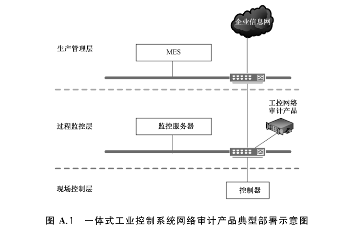
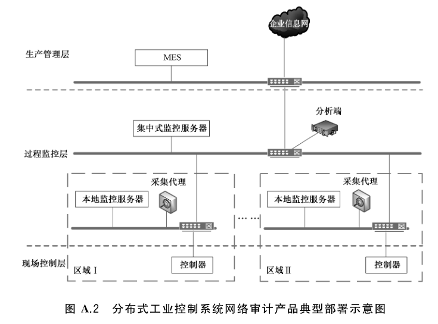

# GB/T 37941-2019 信息安全技术 工业控制系统网络审计产品安全技术要求

> 来源：[GB/T 37941-2019 国家标准详情](https://openstd.samr.gov.cn/bzgk/std/newGbInfo?hcno=B3C4B25316B18B3B35E8A950E83BBD0F)；封面发布日期：2019-08-30；实施日期：2020-03-01。
> PDF SHA-256：6f063c5f79c7db63a1095f5e88c151d31e28fd824d560a1219ad0dcbb7ab29cf。
> 转写说明：将 PDF 按页渲染为图像，逐页对照原图校正文字、30 张表格和 2 幅图示；省略封面、目录、页眉和页脚。正式引用请核对原 PDF。

## 前言

本标准按照 GB/T 1.1—2009给出的规则起草。

请注意本文件的某些内容可能涉及专利。本文件的发布机构不承担识别这些专利的责任。

本标准由全国信息安全标准化技术委员会（SAC/TC 260）提出并归口。

本标准起草单位：公安部第三研究所、公安部网络安全保卫局、珠海市鸿瑞软件技术有限公司、北京天地和兴科技有限公司、上海三零卫士信息安全有限公司、北京神州绿盟信息安全科技股份有限公司、中国信息安全研究院有限公司、北京天融信网络安全技术有限公司、中国电子技术标准化研究院、济南华汉电气科技有限公司、北京和利时系统工程有限公司、上海电力学院。

本标准主要起草人：邹春明、沈清泓、刘瑞、陆臻、陆磊、范春玲、田原、孟双、俞优、顾健、康天娇、王勇、刘智勇、陈敏超、金光宇、倪华、叶晓虎、王晓鹏、周文奇、雷晓锋、范科峰、姚相振、李琳、周睿康、朱毅明、杨晨。

## 引言

随着工业化与信息化的深度融合，来自信息网络的安全威胁正逐步对工业控制系统造成极大的安全威胁，通用安全审计产品在面对工业控制系统的安全防护时显得力不从心，因此急需要一种能应用于工业控制环境的安全审计产品对工业控制系统进行安全防护。

应用于工业控制环境的安全审计产品与通用安全审计产品的主要差异体现在：

- 通用安全审计产品主要针对应用于互联网的通用协议进行分析和记录。用于工业控制环境的安全审计产品除了能够分析部分互联网的通用协议外，还应具有对工业控制协议的深度解释能力，而无需对电子邮件等工业控制系统中不会使用的通用协议。

- 用于工业控制环境的安全审计产品可能有部分组件部署在工业现场环境，因此比通用安全审计产品需具有更高的环境适应能力。

- 工业控制环境中，通常流量相对较小，流量类型相对固定，对可靠性要求更高，用于工业控制环境的安全审计产品能够支持全流量审计，并要求支持采用基于白名单方式对审计信息进行分析。

## 1 范围

本标准规定了工业控制系统网络审计产品的安全技术要求，包括安全功能要求、自身安全要求和安全保障要求。

本标准适用于工业控制系统网络审计产品的设计、生产和测试。

## 2 规范性引用文件

下列文件对于本文件的应用是必不可少的。凡是注日期的引用文件，仅注日期的版本适用于本文件。凡是不注日期的引用文件，其最新版本（包括所有的修改单）适用于本文件。

- GB/T 2423.5—1995 电工电子产品环境试验 第2部分：试验方法 试验 Ea 和导则：冲击

- GB/T 2423.8—1995 电工电子产品环境试验 第2部分：试验方法 试验 Ed：自由跌落

- GB/T 2423.10—2008 电工电子产品环境试验 第2部分：试验方法 试验 Fc：振动（正弦）

- GB/T 4208—2017 外壳防护等级（IP 代码）

- GB 4824—2013 工业、科学和医疗（ISM）射频设备 骚扰特性 限值和测量方法

- GB/T 9254—2008 信息技术设备的无线电骚扰限值和测量方法

- GB/T 13729—2002 远动终端设备

- GB/T 15153.1—1998 远动设备及系统 第2部分：工作条件 第1篇：电源和电磁兼容性

- GB/T 17214.4—2005 工业过程测量和控制装置的工作条件 第4部分：腐蚀和侵蚀影响

- GB/T 17626.2—2018 电磁兼容 试验和测量技术 静电放电抗扰度试验

- GB/T 17626.3—2016 电磁兼容 试验和测量技术 射频电磁场辐射抗扰度试验

- GB/T 17626.4—2018 电磁兼容 试验和测量技术 电快速瞬变脉冲群抗扰度试验

- GB/T 17626.5—2008 电磁兼容 试验和测量技术 浪涌（冲击）抗扰度试验

- GB/T 17626.6—2017 电磁兼容 试验和测量技术 射频场感应的传导骚扰抗扰度

- GB/T 17626.8—2006 电磁兼容 试验和测量技术 工频磁场抗扰度试验

- GB/T 17626.10—2017 电磁兼容 试验和测量技术 阻尼振荡磁场抗扰度试验

- GB/T 17626.11—2008 电磁兼容 试验和测量技术 电压暂降、短时中断和电压变化的抗扰度试验

- GB/T 17626.12—2013 电磁兼容 试验和测量技术 振铃波抗扰度试验

- GB/T 17626.16—2007 电磁兼容 试验和测量技术 0 Hz～150 kHz 共模传导骚扰抗扰度试验

- GB/T 17626.17—2005 电磁兼容 试验和测量技术 直流电源输入端口纹波抗扰度试验

- GB/T 17626.18—2016 电磁兼容 试验和测量技术 阻尼振荡波抗扰度试验

- GB/T 17626.29—2006 电磁兼容 试验和测量技术 直流电源输入端口电压暂降、短时中断和电压变化的抗扰度试验

- GB/T 20945—2013 信息安全技术 信息系统安全审计产品技术要求和测试评价方法

- GB/T 25069—2010 信息安全技术 术语

- GB/T 32919—2016 信息安全技术 工业控制系统安全控制应用指南

## 3 术语和定义

GB/T 20945—2013、GB/T 25069—2010 和 GB/T 32919—2016 界定的以及下列术语和定义适用于本文件。

### 3.1 工业控制协议 industrial control protocol

工业控制系统中，上位机与控制设备之间以及控制设备与控制设备之间的通信报文规约。

> 注：通常包括模拟量和数字量的读写控制。

### 3.2 工业控制系统网络审计产品 industrial control system network audit products

部署于工业控制网络中，对工业控制系统中的事件进行记录和分析，并针对特定事件采取相应匹配动作的产品。

## 4 缩略语

下列缩略语适用于本文件。

- MAC：媒体接入控制（Media Access Control）
- SMS：短信服务（Short Message Service）
- SNMP：简单网络管理协议（Simple Network Management Protocol）
- URL：统一资源定位符（Uniform Resource Locator）

## 5 产品描述

工业控制系统网络审计产品的结构一般分为两种：一种是一体化设备，将数据采集和分析功能集中在一台硬件中，统一完成审计分析功能；另一种是由采集端和分析端两部分组成，采集端主要提供数据采集的功能，将采集到的网络数据发送给分析端，由分析端进一步处理和分析，采取相应的响应措施，并支持采集端分布式部署。该产品典型部署场景参见附录 A。

本标准将工业控制系统网络审计产品安全技术要求分为安全功能要求、自身安全要求和安全保障要求三个大类。安全功能要求、自身安全要求和安全保障要求分为基本级和增强级，与基本级内容相比，增强级中要求有所增加或变更的内容在正文中通过“宋体加粗”表示。若产品全部或部分组件部署在工业控制现场，应根据实际需求满足附录B环境适应性要求。

## 6 安全技术要求

### 6.1 基本级安全技术要求

#### 6.1.1 安全功能要求

##### 6.1.1.1 审计数据采集

###### 6.1.1.1.1 采集策略

产品应支持基于策略的数据采集：

a） 支持基于网络层要素的数据采集策略：至少包括源目的MAC或源目的IP、传输层协议、目的端口；

b） 支持基于工业控制协议的数据采集策略。

###### 6.1.1.1.2 审计数据生成

产品应在实际的系统环境和网络带宽下及时生成审计数据。

##### 6.1.1.2 审计数据还原

###### 6.1.1.2.1 网络层通信协议还原

产品应支持对网络层通信协议的数据进行还原，至少包括源目的MAC、源目的IP、传输层协议、源目的端口、应用层协议。

###### 6.1.1.2.2 应用协议还原

产品应支持对 HTTP、FTP、TELNET 协议的应用数据还原：

a） HTTP 通信：目标 URL；

b） FTP 通信：使用的账号、输入命令；

c） TELNET 通信：使用的账号、输入命令。

###### 6.1.1.2.3 工业控制协议还原

产品应支持对工业控制协议应用数据进行分析和还原，支持至少一种工业控制协议。至少支持：

a） 组态变更，包括上传、下载；

b） 指令变更，包括写指令及相关参数，如控制点位地址、控制值等。

##### 6.1.1.3 审计事件识别和分析

###### 6.1.1.3.1 基于白名单规则分析

###### 6.1.1.3.1.1 白名单规则定义

产品应支持白名单规则的定义：

a） 网络通信白名单：支持基于 IP 或 MAC 等要求进行规则定义；

b） 工业控制协议通信白名单：支持基于控制命令、控制点位、控制值等要素进行规则定义。

###### 6.1.1.3.1.2 白名单方式识别

产品应支持基于白名单机制对审计信息的识别。

###### 6.1.1.3.2 异常事件识别

产品应支持对以下异常事件的识别：

a） 网络中出现IP 或 MAC白名单之外的设备；

b） 工业控制协议通信出现异常的控制命令、控制点位、控制值。

##### 6.1.1.4 审计记录

###### 6.1.1.4.1 记录内容

产品应按照事件的分类和级别，生成包含以下内容的审计记录：

a） 事件主体；

b） 事件客体；

c） 事件发生的日期和时间；

d） 事件类型；

e） 事件的级别；

f） 审计源身份（分布式产品）；

g） 事件的描述；

h） 工业控制协议的深度解析内容，至少包括控制命令、控制点位、控制值。

###### 6.1.1.4.2 事件分类

产品应对事件按用户可理解的方式进行分类，方便用户浏览和策略定制。如按事件的潜在风险分类，正常事件、异常事件；按协议类型分类等。

###### 6.1.1.4.3 事件分级

产品应将异常事件可能的潜在危害程度划分为不同的级别，对不同级别的事件采取不同的处理方式。

###### 6.1.1.4.4 数据库支持

产品应支持一种数据库管理软件，用于存储审计记录，方便用户查阅、检索和统计分析。

##### 6.1.1.5 事件响应和报警

###### 6.1.1.5.1 事件告警

产品应能对系统安全策略定义的不同等级的事件采取不同方式进行告警。

###### 6.1.1.5.2 告警方式

产品应产生报警，响应报警方式至少包含以下方式中的一种：

a） 管理界面告警；

b） 向网管中心发送 SNMP Trap 报警消息；

c） 向声光电发生装置发送启动信号；

d） 向网管人员发送 SMS报警短消息。

##### 6.1.1.6 审计查阅和报表

###### 6.1.1.6.1 常规查阅

产品应提供查阅审计记录的工具，查阅的结果应以用户易于理解的方式和格式提供，并且能支持导出及打印。

###### 6.1.1.6.2 有限查阅

产品应确保除授权管理员之外，其他用户无权对审计记录进行查阅。

###### 6.1.1.6.3 可选查阅

产品应为授权管理员提供将审计记录按一定的条件进行选择、搜索、分类和排序的功能，所得结果应以用户友好的、便于理解的形式提供报告或打印。

###### 6.1.1.6.4 审计报表

报表生成器将审计分析器传来的分析结果进行数据汇总报表输出，对报表至少有以下要求：

a） 产品应提供审计报表模板，能够基于模板生成审计报表；

b） 报告内容应至少支持文字、图像两种描述方式；

c） 审计数据报告生成格式应至少支持 txt、html、doc、xls、pdf 等通用文件格式中的一种。

##### 6.1.1.7 审计记录存储

###### 6.1.1.7.1 存储安全

产品应提供安全机制保护审计记录数据免遭未经授权的删除或修改，如采取严格的身份鉴别机制和适合的文件读写权限等。任何对审计记录数据的删除或修改都应生成系统自身安全审计记录。应对审计记录进行完整性保护。

###### 6.1.1.7.2 存储空间耗尽处理

产品应提供数据存储空间耗尽处理功能，当剩余存储空间达到预定义的阈值时进行告警。

#### 6.1.2 自身安全要求

##### 6.1.2.1 标识和鉴别

###### 6.1.2.1.1 唯一性标识

产品应保证任何用户都具有全局唯一的标识。

###### 6.1.2.1.2 管理员属性定义

产品应为每个管理员规定与之相关的安全属性，如管理员标识、鉴别信息、隶属组、权限等，并提供使用默认值对创建的每个管理员的属性进行初始化的功能。

###### 6.1.2.1.3 管理员角色

产品应为管理角色进行分级，使不同级别的管理角色具有不同的管理权限。

###### 6.1.2.1.4 基本鉴别

产品应保证任何用户在执行安全功能前都要进行身份鉴别。若采用口令方式鉴别，应支持对口令强度进行检查，如口令长度、是否需包含数字、字母、特殊字符等。

###### 6.1.2.1.5 超时锁定或注销

当已通过身份鉴别的管理角色空闲操作的时间超过规定值时，在该管理角色执行管理功能前，产品应对该管理角色的身份重新进行鉴别。

###### 6.1.2.1.6 鉴别失败处理

产品应为管理员登录设定一个授权管理员可修改的鉴别尝试阈值，当管理员的不成功登录尝试超过阈值时，系统应通过技术手段阻止管理员的进一步鉴别请求。

###### 6.1.2.1.7 鉴别数据保护

产品应保证管理员鉴别数据以非明文形式存储，不被未授权查看或修改。

##### 6.1.2.2 安全管理

###### 6.1.2.2.1 接口及管理安全

产品应保证业务接口、管理接口、管理界面的安全：

a） 业务接口和管理接口采用不同的网络接口；

b） 业务接口采取被动收包方式工作，不得外发数据包；

c） 管理接口及管理界面不存在中高风险安全漏洞。

###### 6.1.2.2.2 管理信息传输安全

产品需要通过网络进行管理时，产品应能对管理信息进行保密传输。

###### 6.1.2.2.3 安全状态监测

产品应能够监测产品自身及组件状态，包括对产品CPU、内存、存储空间等系统资源使用状态进行监测。

##### 6.1.2.3 时间同步

产品及组件应支持以下时间同步功能：

a） 若由多个组件组成，各组件支持与审计中心进行时间同步；

b）审计中心支持与外部时间服务器进行时间同步。

##### 6.1.2.4 审计日志

###### 6.1.2.4.1 审计日志生成

产品应对与自身安全相关的以下事件生成审计日志：

a） 身份鉴别，包括成功和失败；

b） 因鉴别失败次数超过了阈值而采取的禁止进一步尝试的措施；

c） 审计策略的增加、删除、修改。

###### 6.1.2.4.2 审计日志内容

审计日志内容至少应包括日期、时间、事件主体、事件客体、事件描述等。

###### 6.1.2.4.3 审计日志存储

产品应将自身审计日志与审计记录分开保存到不同的记录文件或数据库（或同一数据库的不同表）中，方便用户查阅和分析。应保证自身审计日志存储的最短期限不少于6个月。

#### 6.1.3 安全保障要求

##### 6.1.3.1 开发

###### 6.1.3.1.1 安全架构

开发者应提供产品安全功能的安全架构描述，技术要求如下：

a） 与产品设计文档中对安全功能的描述一致；

b） 描述与安全功能要求一致的安全域；

c） 描述产品安全功能初始化过程及安全措施；

d） 证实产品安全功能能够防止被破坏；

e） 证实产品安全功能能够防止安全策略被旁路。

###### 6.1.3.1.2 功能规范

开发者应提供完备的功能规范说明，技术要求如下：

a） 完整描述产品的安全功能；

b） 描述所有安全功能接口的目的与使用方法；

c） 标识和描述每个安全功能接口相关的所有参数；

d） 描述安全功能接口相关的安全功能实施行为；

e） 描述由安全功能实施行为而引起的直接错误消息；

f） 证实安全功能要求到安全功能接口的追溯。

###### 6.1.3.1.3 产品设计

开发者应提供产品设计文档，技术要求如下：

a） 根据子系统描述产品结构，并标识和描述产品安全功能的所有子系统；

b） 描述安全功能所有子系统间的相互作用；

c） 提供的映射关系能够证实设计中描述的所有行为能够映射到调用它的安全功能接口。

##### 6.1.3.2 指导性文档

###### 6.1.3.2.1 操作用户指南

开发者应提供明确和合理的操作用户指南，操作用户指南与为评估而提供的其他所有文档保持一致，对每一种用户角色的描述要求如下：

a） 描述授权用户可访问的功能和特权，包含适当的警示信息；

b） 描述如何以安全的方式使用产品提供的接口；

c） 描述可用功能和接口，尤其是受用户控制的所有安全参数，适当时指明安全值；

d） 明确说明与需要执行的用户可访问功能有关的每一种安全相关事件，包括改变安全功能所控制实体的安全特性；

e） 标识产品运行的所有可能状态（包括操作导致的失败或者操作性错误），以及他们与维持安全运行之间的因果关系和联系；

f） 实现安全目的所应执行的安全策略。

###### 6.1.3.2.2 准备程序

开发者应提供产品及其准备程序，技术要求如下：

a） 描述与开发者交付程序相一致的安全接收所交付产品必需的所有步骤；

b） 描述安全安装产品及其运行环境必需的所有步骤。

##### 6.1.3.3 生命周期支持

###### 6.1.3.3.1 配置管理能力

开发者的配置管理能力应满足以下要求：

a） 为产品的不同版本提供唯一的标识；

b） 使用配置管理系统对组成产品的所有配置项进行维护，并唯一标识各配置项；

c） 提供配置管理文档，配置管理文档描述用于唯一标识配置项的方法。

###### 6.1.3.3.2 配置管理范围

开发者应提供产品配置项列表，并说明配置项的开发者。配置项列表至少包括产品、安全保障要求的评估证据和产品的组成部分。

###### 6.1.3.3.3 交付程序

开发者应使用一定的交付程序交付产品，并将交付过程文档化。在给用户方交付产品的各版本时，交付文档应描述为维护安全所必需的所有程序。

###### 6.1.3.3.4 支撑系统安全保障

开发者应明确产品支撑系统的安全保障措施，技术要求如下：

a） 若产品以软件形态提交，应在交付文档中详细描述支撑操作系统的兼容性、可靠性、安全性要求；

b） 若产品以硬件形态提交，应选取和采用安全可靠的支撑操作系统，以最小化原则选取必要的系统组件，并采取一定的加固措施。

###### 6.1.3.3.5 硬件安全保障

若产品以硬件形态提交，开发者应采取措施保障硬件安全，技术要求如下：

a） 产品应采用具有高可靠性、满足性能指标要求的硬件平台；

b） 若硬件平台外购，应制定相应程序对硬件提供商进行管理、对采购的硬件平台或部件进行验证测试，并要求硬件提供商提供合格证明及必要的第三方环境适用性测试报告。

##### 6.1.3.4 测试

###### 6.1.3.4.1 测试覆盖

开发者应提供测试覆盖文档，测试覆盖描述应表明测试文档中所标识的测试与功能规范中所描述的产品的安全功能间的对应性。

###### 6.1.3.4.2 功能测试

开发者应测试产品安全功能，将结果文档化并提供测试文档。测试文档应包括以下内容：

a） 测试计划，标识要执行的测试，并描述执行每个测试的方案，这些方案包括对于其他测试结果的任何顺序依赖性；

b） 预期的测试结果，表明测试成功后的预期输出；

c） 实际测试结果和预期的测试结果一致。

###### 6.1.3.4.3 性能测试

开发者应测试产品性能，将结果文档化并提供测试文档。测试文档应包括以下内容：

a） 测试计划，标识要执行的性能测试指标，并描述执行每个测试的方案，这些方案包括产品的安全参数及安全策略条件，测试工具仪表及其配置参数等；

b） 测试结果，记录各条件下测试的性能指标值。

###### 6.1.3.4.4 独立测试

开发者应提供一组与其自测安全功能时使用的同等资源，以用于安全功能的抽样测试。

##### 6.1.3.5 脆弱性评定

基于已标识的潜在脆弱性，产品能够抵抗基本的攻击。

### 6.2 增强级安全技术要求

#### 6.2.1 安全功能要求

##### 6.2.1.1 审计数据采集

###### 6.2.1.1.1 采集策略

产品应支持基于策略的数据采集：

a） 支持基于网络层要素的数据采集策略：至少包括源目的MAC 或源目的IP、传输层协议、目的端口；

b） 支持基于工业控制协议的数据采集策略；

c） 支持全流量报文的采集。

###### 6.2.1.1.2 网络流量监测

产品应能根据源目的 MAC 或 IP 地址、协议类型、日期时间段等对流量进行监测，并以统计报表的形式输出。

###### 6.2.1.1.3 审计数据生成

产品应在实际的系统环境和网络带宽下及时生成审计数据。

##### 6.2.1.2 审计数据还原

###### 6.2.1.2.1 网络层通信协议还原

产品应支持对网络层通信协议的数据进行还原，至少包括源目的 MAC、源目的IP、传输层协议、源目的端口、应用层协议类型。

###### 6.2.1.2.2 通用应用协议还原

产品应支持对 HTTP、FTP、TELNET 协议的应用数据还原：

a） HTTP通信：目标 URL；

b） FTP 通信：使用的账号、输入命令；

c） TELNET 通信：使用的账号、输入命令。

###### 6.2.1.2.3 工业控制协议还原

产品应支持对工业控制协议应用数据进行分析和还原，支持至少三种工业控制协议。至少支持：

a） 组态变更，包括上传、下载；

b） 指令变更，包括写指令及相关参数，如控制点位地址、控制值等；

c） 负载变更。

##### 6.2.1.3 审计事件识别和分析

###### 6.2.1.3.1 事件辨别扩展接口

产品应提供一个功能接口，对自身无法辨别的工业控制协议和安全事件，用户可通过该接口，将扩展的事件辨别模块以插件的形式接入事件辨别器。

###### 6.2.1.3.2 基于白名单规则分析

###### 6.2.1.3.2.1 白名单规则定义

产品应支持白名单规则的定义：

a） 网络通信白名单：支持基于源目的 MAC或源目的IP、传输层协议、目的端口等要素进行规则定义；

b） 工业控制协议通信白名单：支持基于协议格式规约、控制命令、控制点位、控制值等要素进行规则定义。

###### 6.2.1.3.2.2 白名单方式识别

产品应支持基于白名单机制对审计信息的识别。

###### 6.2.1.3.2.3 学习模式

产品应支持学习模式，对网络流量进行学习，自动生成推荐性规则，至少包括网络层规则和工业控制协议应用层规则。

###### 6.2.1.3.3 异常事件

###### 6.2.1.3.3.1 异常事件识别

产品应支持对以下异常事件的识别：

a） 网络层通信异常：不合规的通信链路，包括源 IP、源 MAC、目的IP、目的MAC、目的端口等；

b） 工业控制协议通信出现异常的控制命令、控制点位、控制值；

c） 不符合协议规约规定格式的工业控制协议报文；

d） 端口报文异常：端口报文速率突变、超过阈值、长时间无报文；

e） 工业控制协议应用层断链及断链后重连等。

###### 6.2.1.3.3.2 自定义识别规则

产品应维护一个与被审计信息系统相关的恶意事件集合，可结合控制系统的实际生产工艺进行定义，当这些事件发生时表明信息系统受到了攻击。恶意事件集合应可定制。

###### 6.2.1.3.3.3 基于规则事件生成

产品支持基于黑名单规则对异常事件进行分析，识别并生成恶意事件。

###### 6.2.1.3.3.4 基于统计的分析

产品应提供基于统计方式对审计事件进行分析，单个审计事件累计发生次数或单个审计事件发生频率超过阈值时，分析生成新的事件。

###### 6.2.1.3.4 关联分析

产品应支持事件的关联分析，并进行以下操作：

a） 对相互关联的事件进行综合分析和判断；

b） 向授权用户提供自定义匹配模式。

##### 6.2.1.4 审计记录

###### 6.2.1.4.1 记录内容

产品应按照事件的分类和级别，生成包含以下内容的审计记录：

a） 事件主体；

b） 事件客体；

c） 事件发生的日期和时间；

d） 事件类型；

e） 事件级别；

f） 审计源身份（分布式产品）；

g） 事件的描述；

h） 工业控制协议的深度解析内容，至少包括控制命令、控制点位、控制值。

###### 6.2.1.4.2 事件分类

产品应对事件按用户可理解的方式进行分类，方便用户浏览和策略定制。如按事件的潜在风险分类，正常事件、异常事件；按协议类型分类等。

###### 6.2.1.4.3 事件分级

产品应将异常事件可能的潜在危害程度划分为不同的级别，对不同级别的事件采取不同的处理方式。

###### 6.2.1.4.4 数据库支持

产品应支持一种数据库管理软件，用于存储审计记录，方便用户查阅、检索和统计分析。

##### 6.2.1.5 事件响应和报警

###### 6.2.1.5.1 事件响应

对异常事件，应支持全报文审计，以利于事后分析。

###### 6.2.1.5.2 事件告警

产品应能对系统安全策略定义的不同等级的事件采取不同方式进行告警。

###### 6.2.1.5.3 告警方式

产品应产生报警，响应报警方式至少包含以下方式中的两种：

a） 管理界面告警；

b） 向网管中心发送 SNMP Trap 报警消息；

c） 向声光电发生装置发送启动信号；

d） 向网管人员发送SMS报警短消息。

##### 6.2.1.6 审计查阅和报表

###### 6.2.1.6.1 常规查阅

产品应提供查阅审计记录的工具，查阅的结果应以用户易于理解的方式和格式提供，并且能支持导出及打印。

###### 6.2.1.6.2 有限查阅

产品应确保除授权管理员之外，其他用户无权对审计记录进行查阅。

###### 6.2.1.6.3 可选查阅

产品应为授权管理员提供将审计记录按一定的条件进行选择、搜索、分类和排序的功能，所得结果应以用户友好的、便于理解的形式提供报告或打印。

###### 6.2.1.6.4 审计报表

报表生成器将审计分析器传来的分析结果进行数据汇总报表输出，对报表至少有以下要求：

a） 产品应提供审计报表模板，能够基于模板生成审计报表；

b） 应支持按时间段、源目的IP、事件级别等条件生成自定义审计报表；

c） 报告内容应至少支持文字、图像两种描述方式；

d） 审计数据报告生成格式应至少支持 txt、html、doc、xls、pdf 等通用文件格式中的一种。

##### 6.2.1.7 审计记录存储

###### 6.2.1.7.1 审计数据外发

产品应支持以标准格式将审计数据外发至其他系统，以做进一步的分析处理。

###### 6.2.1.7.2 存储安全

产品应提供安全机制保护审计记录数据免遭未经授权的删除或修改，如采取严格的身份鉴别机制和适合的文件读写权限等。任何对审计记录数据的删除或修改都应生成系统自身安全审计记录。应对审计记录进行完整性保护。

###### 6.2.1.7.3 存储空间耗尽处理

产品应提供数据存储空间耗尽处理功能：

a） 当剩余存储空间达到预定义的阈值时进行告警；

b） 在存储空间耗尽前采取一定的措施（如：转储等）防止新近审计记录丢失。

#### 6.2.2 自身安全要求

##### 6.2.2.1 标识和鉴别

###### 6.2.2.1.1 唯一性标识

产品应保证任何用户都具有全局唯一的标识。

###### 6.2.2.1.2 管理员属性定义

产品应为每个管理员规定与之相关的安全属性，如管理员标识、鉴别信息、隶属组、权限等，并提供使用默认值对创建的每个管理员的属性进行初始化的功能。

###### 6.2.2.1.3 管理员角色

产品应为管理角色进行分级，使不同级别的管理角色具有不同的管理权限。各管理角色的权限应形成互相制约关系。

###### 6.2.2.1.4 基本鉴别

产品应保证任何用户在执行安全功能前都要进行身份鉴别。若采用口令方式鉴别，应支持对口令强度进行检查，如口令长度、是否需包含数字、字母、特殊字符等。若其采用网络远程方式管理，还应对管理地址进行识别。

###### 6.2.2.1.5 多鉴别

产品应能向管理角色提供除口令身份鉴别机制以外的其他身份鉴别机制（如证书、智能IC卡、指纹、视网膜等鉴别机制）。

###### 6.2.2.1.6 超时锁定或注销

当已通过身份鉴别的管理角色空闲操作的时间超过规定值时，在该管理角色执行管理功能前，产品应对该管理角色的身份重新进行鉴别。

###### 6.2.2.1.7 鉴别失败处理

产品应为管理员登录设定一个授权管理员可修改的鉴别尝试阈值，当管理员的不成功登录尝试超过阈值时，系统应通过技术手段阻止管理员的进一步鉴别请求。

###### 6.2.2.1.8 鉴别数据保护

产品应保证管理员鉴别数据以非明文形式存储，不被未授权查看或修改。

##### 6.2.2.2 安全管理

###### 6.2.2.2.1 接口及管理安全

产品应保证业务接口、管理接口、管理界面的安全：

a） 业务接口和管理接口采用不同的网络接口；

b） 业务接口采取被动收包方式工作，不得外发数据包；

c） 管理接口及管理界面不存在中高风险安全漏洞。

###### 6.2.2.2.2 管理信息传输安全

产品需要通过网络进行管理时，产品应能对管理信息进行保密传输。

###### 6.2.2.2.3 安全状态监测

产品应能够监测产品自身及组件状态，包括：

a） 对产品CPU、内存、存储空间等系统资源使用状态进行监测；

b） 对产品的主要功能模块运行状态进行监测；

c） 产品若由多个组件组成，审计中心能够对各组件的运行状态进行监测。

###### 6.2.2.2.4 分布式部署

产品应支持分布式部署模式，审计中心能够对多个采集器所采集的数据进行集中分析处理。

##### 6.2.2.3 时间同步

产品及组件应支持时间同步功能：

a） 若由多个组件组成，各组件支持与审计中心进行时间同步；

b） 审计中心支持与外部时间服务器进行时间同步。

##### 6.2.2.4 审计日志

###### 6.2.2.4.1 审计日志生成

产品应对与自身安全相关的以下事件生成审计日志：

a） 身份鉴别，包括成功和失败；

b） 因鉴别失败次数超过了阈值而采取的禁止进一步尝试的措施；

c） 管理员的增加、删除、修改；

d） 审计策略的增加、删除、修改；

e） 时间同步；

f） 超过保存时限的审计记录和自身审计日志的自动删除；

g） 审计日志和审计记录的备份与恢复；

h） 存储空间达到阈值报警；

i） 其他事件。

###### 6.2.2.4.2 审计日志内容

审计日志内容至少应包括日期、时间、事件主体、事件客体、事件描述等。

###### 6.2.2.4.3 审计日志存储

产品应将自身审计日志与审计记录分开保存到不同的记录文件或数据库（或同一数据库的不同表）中，方便用户查阅和分析。应保证自身审计日志存储的最短期限不少于6个月。

#### 6.2.3 安全保障要求

##### 6.2.3.1 开发

###### 6.2.3.1.1 安全架构

开发者应提供产品安全功能的安全架构描述，技术要求如下：

a） 与产品设计文档中对安全功能的描述一致；

b） 描述与安全功能要求一致的安全域；

c） 描述产品安全功能初始化过程及安全措施；

d） 证实产品安全功能能够防止被破坏；

e） 证实产品安全功能能够防止安全策略被旁路。

###### 6.2.3.1.2 功能规范

开发者应提供完备的功能规范说明，技术要求如下：

a） 完整描述产品的安全功能；

b） 描述所有安全功能接口的目的与使用方法；

c） 标识和描述每个安全功能接口相关的所有参数；

d） 描述安全功能接口相关的安全功能实施行为；

e） 描述由安全功能实施行为而引起的直接错误消息；

f） 证实安全功能要求到安全功能接口的追溯；

g） 描述安全功能实施过程中，与安全功能接口相关的所有行为；

h） 描述可能由安全功能接口的调用而引起的所有错误消息。

###### 6.2.3.1.3 实现表示

开发者应提供全部安全功能的实现表示，技术要求如下：

a） 提供产品设计描述与实现表示实例之间的映射，并证明其一致性；

b） 详细定义产品安全功能，达到无须进一步设计就能生成安全功能的程度；

c） 实现表示以开发人员使用的形式提供。

###### 6.2.3.1.4 产品设计

开发者应提供产品设计文档，技术要求如下：

a） 根据子系统描述产品结构，并标识和描述产品安全功能的所有子系统；

b） 描述安全功能所有子系统间的相互作用；

c） 提供的映射关系能够证实设计中描述的所有行为能够映射到调用它的安全功能接口；

d） 根据模块描述安全功能，并提供安全功能子系统到模块间的映射关系；

e） 描述所有安全功能实现模块，包括其目的及与其他模块间的相互关系；

f） 描述所有模块的安全功能要求相关接口、与其他相邻接口的调用参数及返回值；

g） 描述所有安全功能的支撑或相关模块，包括其目的及与其他模块间的相互作用。

##### 6.2.3.2 指导性文档

###### 6.2.3.2.1 操作用户指南

开发者应提供明确和合理的操作用户指南，操作用户指南与为评估而提供的其他所有文档保持一致，对每一种用户角色的描述要求如下：

a） 描述授权用户可访问的功能和特权，包含适当的警示信息；

b） 描述如何以安全的方式使用产品提供的接口；

c） 描述可用功能和接口，尤其是受用户控制的所有安全参数，适当时指明安全值；

d） 明确说明与需要执行的用户可访问功能有关的每一种安全相关事件，包括改变安全功能所控制实体的安全特性；

e） 标识产品运行的所有可能状态（包括操作导致的失败或者操作性错误），以及它们与维持安全运行之间的因果关系和联系；

f） 实现安全目的所应执行的安全策略。

###### 6.2.3.2.2 准备程序

开发者应提供产品及其准备程序，技术要求如下：

a） 描述与开发者交付程序相一致的安全接收所交付产品必需的所有步骤；

b） 描述安全安装产品及其运行环境必需的所有步骤。

##### 6.2.3.3 生命周期支持

###### 6.2.3.3.1 配置管理能力

开发者的配置管理能力应满足以下要求：

a） 为产品的不同版本提供唯一的标识；

b） 使用配置管理系统对组成产品的所有配置项进行维护，并唯一标识各配置项；

c） 提供配置管理文档，配置管理文档描述用于唯一标识配置项的方法；

d） 配置管理系统提供一种自动方式来支持产品的生成，并确保只能对配置项进行已授权的变更；

e） 配置管理文档包括配置管理计划，计划中需描述如何使用配置管理系统，并依据该计划实施配置管理；

f） 配置管理计划描述配置项的变更（包括新建、修改、删除）控制程序。

###### 6.2.3.3.2 配置管理范围

开发者应提供产品配置项列表，并说明配置项的开发者，技术要求如下：

a） 产品、安全保障要求的评估证据和产品的组成部分；

b） 实现表示、安全缺陷报告及其解决状态。

###### 6.2.3.3.3 交付程序

开发者应使用一定的交付程序交付产品，并将交付过程文档化。在给用户方交付产品的各版本时，交付文档应描述为维护安全所必需的所有程序。

###### 6.2.3.3.4 开发安全

开发者应提供开发安全文档。开发安全文档应描述在产品的开发环境中，为保护产品设计和实现的保密性和完整性所必需的所有物理的、程序的、人员的和其他方面的安全措施。

###### 6.2.3.3.5 生命周期定义

开发者应建立一个生命周期模型对产品的开发和维护进行的必要控制，并提供生命周期定义文档描述用于开发和维护产品的模型。

###### 6.2.3.3.6 工具和技术

开发者应明确定义用于开发产品的工具，并提供开发工具文档无歧义的定义实现中所有语句的含义和所有依赖选项的含义。

###### 6.2.3.3.7 支撑系统安全保障

开发者应明确产品支撑系统的安全保障措施，技术要求如下：

a） 若产品以软件形态提交，应在交付文档中详细描述支撑操作系统的兼容性、可靠性、安全性要求；

b） 若产品以硬件形态提交，应选取和采用安全可靠的支撑操作系统，以最小化原则选取必要的系统组件，并采取一定的加固措施。

###### 6.2.3.3.8 硬件安全保障

若产品以硬件形态提交，开发者应采取措施保障硬件安全，技术要求如下：

a） 产品应采用具有高可靠性、满足性能指标要求的硬件平台。

b） 若硬件平台外购，应制定相应程序对硬件提供商进行管理、对采购的硬件平台或部件进行验证测试。并要求硬件提供商提供合格证明及必要的第三方环境适用性测试报告。

##### 6.2.3.4 测试

###### 6.2.3.4.1 测试覆盖

开发者应提供测试覆盖文档，技术要求如下：

a） 证实测试文档中所标识的测试与功能规范中所描述的产品的安全功能间的对应性；

b） 证实功能规范中的所有安全功能接口都进行了测试。

###### 6.2.3.4.2 测试深度

开发者应提供测试深度的分析，技术要求如下：

a） 证实测试文档中的测试与产品设计中的安全功能子系统和实现模块之间的一致性；

b） 证实产品设计中的所有安全功能子系统、实现模块都已经进行过测试。

###### 6.2.3.4.3 功能测试

开发者应测试产品安全功能，将结果文档化并提供测试文档。测试文档应包括以下内容：

a） 测试计划，标识要执行的测试，并描述执行每个测试的方案，这些方案包括对于其他测试结果的任何顺序依赖性；

b） 预期的测试结果，表明测试成功后的预期输出；

c） 实际测试结果和预期的测试结果一致。

###### 6.2.3.4.4 性能测试

开发者应测试产品性能，将结果文档化并提供测试文档。测试文档应包括以下内容：

a） 测试计划，标识要执行的性能测试指标，并描述执行每个测试的方案，这些方案包括产品的安全参数及安全策略条件，测试工具仪表及其配置参数等；

b） 测试结果，记录各条件下测试的性能指标值。

###### 6.2.3.4.5 独立测试

开发者应提供一组与其自测安全功能时使用的同等资源，以用于安全功能的抽样测试。

##### 6.2.3.5 脆弱性评定

基于已标识的潜在脆弱性，产品能够抵抗较强的攻击。

## 附录 A（资料性附录）工业控制系统网络审计产品的应用

根据工业控制现场的特点和环境要求，一体式工控网络审计产品一般部署在较为简单的工业控制网络中，主要监测过程控制层中的网络通信，如图 A.1 所示；分布式工控网络审计产品主要部署在较为复杂的工业控制网络中，通常在各区域中部署采集代理设备，在上层部署分析端设备，接收各采集代理所采集的数据进行集中分析处理，如图 A.2 所示。

## 附录 B（规范性附录）环境适应性要求

### B.1 概述

本附录的环境适应性要求包括气候、电磁兼容、绝缘、接地、机械适应性、外壳防护。应根据设备实际部署环境的不同，由用户和设备制造商确定具体应满足的要求。

> 注：本附录环境适应性的编写主要参考了 GB/T 30094，其参考的相关标准主要为 GB/T 2423、GB/T 17626 等。

### B.2 环境适应性

#### B.2.1 温度

表 B.1 规定了设备工作、贮存和运输温度条件。设备在规定的工作温度范围内工作时，其功能和性能应满足本附录的规定。在规定的温度范围内贮存和运输时，不应发生裂痕、老化或其他损坏；当经受该温度范围后再恢复到工作温度范围时，设备应能正常工作。应用于温度快速变化场合的设备，在经受不超过 5 ℃/min 的温度变化时应能正常工作。

**表 B.1 温度条件**

| 等级 | 工作温度低温（℃） | 工作温度高温（℃） | 贮存和运输温度低温（℃） | 贮存和运输温度高温（℃） |
| --- | ---: | ---: | ---: | ---: |
| I | 0 | 60 | -40 | 70 |
| II | -40 | 70 | -40 | 85 |
| Xᵃ | 特定 | 特定 | 特定 | 特定 |

> ᵃ X 是一个开放等级，具体温度要求范围可根据设备实际应用环境与客户协商确定。

#### B.2.2 相对湿度

设备在表 B.2 规定的相对湿度环境条件下应能正常工作。

**表 B.2 相对湿度条件（无凝结）**

| 等级 | 低相对湿度（%） | 高相对湿度（%） |
| --- | ---: | ---: |
| I | 5 | 95 |
| Xᵃ | 特定 | 特定 |

> ᵃ X 是一个开放等级，具体相对湿度要求范围可根据设备实际应用环境与客户协商确定。

#### B.2.3 大气压力

设备工作大气压力条件见表 B.3。

**表 B.3 大气压力条件**

| 等级 | 低气压（kPa） | 高气压（kPa） |
| --- | ---: | ---: |
| I | 80 | 106 |
| II | 70 | 106 |
| Xᵃ | 特定 | 特定 |

> ᵃ X 是一个开放等级，具体抗腐蚀性要求范围可根据设备实际应用环境与客户协商确定。

#### B.2.4 防腐蚀

设备工作在盐雾环境条件下或存在其他化学活性物质，应提供工业环境中抗腐蚀和侵蚀的能力，保证设备在表 B.4、表 B.5 规定的环境条件下能够长期使用。

**表 B.4 盐雾**

| 等级 | 最大盐雾浓度（mg/m³） |
| --- | ---: |
| I | ≤5 |
| Xᵃ | 特定 |

> ᵃ X 是一个开放等级，具体抗腐蚀性要求范围可根据设备实际应用环境与客户协商确定。

**表 B.5 化学活性物质条件**

| 等级 | 依据标准 | 化学活性物质 |
| --- | --- | --- |
| I | GB/T 17214.4—2005 | 工业清洁空气 |
| II | GB/T 17214.4—2005 | 中等污染 |
| III | GB/T 17214.4—2005 | 严重污染 |
| Xᵃ | GB/T 17214.4—2005 | 特定 |

> ᵃ X 是一个开放等级，具体抗腐蚀性要求范围可根据设备实际应用环境与客户协商确定。

#### B.2.5 抗霉变

设备工作在潮湿多雨地区和霉菌滋生环境下不应发生霉变，并能够正常工作。

### B.3 电磁兼容性

设备应满足工业环境中的电磁兼容性要求，具体技术指标见表 B.7～表 B.26。

其中，电磁兼容辐射和传导发射限值按 GB 4824—2013 为 CLASS A，电磁兼容抗扰度的性能判据要求详见表 B.6。

**表 B.6 性能判据**

| 性能评价判据 | 说明 |
| --- | --- |
| A | 试验期间和试验后受试设备均应按预期要求继续运行，无功能丧失或性能下降 |
| B | 试验期间，受试设备允许出现暂时的性能下降或功能丧失，但设备可以自我恢复，试验后设备应按预期要求继续运行。不能出现系统死机、复位或重启 |
| C | 试验期间，允许受试设备出现暂时的性能下降或功能丧失，但需要人工干预或系统复位才能恢复 |

**表 B.7 辐射发射及传导发射要求**

| 测试项 | 测试端口 | 依据标准 | 测试频段 | 限值 |
| --- | --- | --- | --- | --- |
| 辐射发射 | 整机 | GB 4824—2013、GB/T 9254—2008 | 30 MHz～1 GHz | A 类 |
| 传导发射 | 电源口、信号口 | GB 4824—2013、GB/T 9254—2008 | 150 kHz～30 MHz | A 类 |

**表 B.8 外壳端口静电放电抗扰度要求**

| 等级 | 依据标准 | 严酷等级 | 判据 |
| --- | --- | --- | --- |
| I | GB/T 17626.2—2018 | 3（接触放电 ±6 kV，空气放电 ±8 kV） | A |
| II | GB/T 17626.2—2018 | 4（接触放电 ±8 kV，空气放电 ±15 kV） | A |
| Xᵃ | GB/T 17626.2—2018 | 特定 | 特定 |

> ᵃ X 是一个开放等级，具体电磁兼容性能力要求可根据设备实际应用环境与客户协商确定。

**表 B.9 整机射频电磁场辐射抗扰度要求**

| 等级 | 依据标准 | 严酷等级 | 试验频段 | 判据 |
| --- | --- | --- | --- | --- |
| I | GB/T 17626.3—2016 | 2（3 V/m，80% AM） | 80 MHz～1 GHz | A |
| II | GB/T 17626.3—2016 | 3（10 V/m，80% AM） | 80 MHz～1 GHz | A |
| Xᵃ | GB/T 17626.3—2016 | 特定 | 特定 | 特定 |

> ᵃ X 是一个开放等级，具体电磁兼容性能力要求可根据设备实际应用环境与客户协商确定。

**表 B.10 电源端口及信号端口电快瞬变脉冲群抗扰度要求**

| 等级 | 依据标准 | 严酷等级 | 判据 |
| --- | --- | --- | --- |
| I | GB/T 17626.4—2018 | 3（电源口 ±2 kV，信号口 ±1 kV） | A |
| II | GB/T 17626.4—2018 | 4（电源口 ±4 kV，信号口 ±2 kV） | A |
| Xᵃ | GB/T 17626.4—2018 | 特定 | 特定 |

> ᵃ X 是一个开放等级，具体电磁兼容性能力要求可根据设备实际应用环境与客户协商确定。

**表 B.11 信号端口浪涌（冲击）抗扰度要求**

| 等级 | 依据标准 | 严酷等级（线-地） | 判据 |
| --- | --- | ---: | --- |
| I | GB/T 17626.5—2008 | 2 | A |
| II | GB/T 17626.5—2008 | 3 | A |
| III | GB/T 17626.5—2008 | 4 | A |
| Xᵃ | GB/T 17626.5—2008 | 特定 | 特定 |

> ᵃ X 是一个开放等级，具体电磁兼容性能力要求可根据设备实际应用环境与客户协商确定。

**表 B.12 直流电源输入端口浪涌（冲击）抗扰度要求**

| 等级 | 依据标准 | 严酷等级（线-地） | 严酷等级（线-线） | 判据 |
| --- | --- | ---: | ---: | --- |
| I | GB/T 17626.5—2008 | 3 | 3 | A |
| II | GB/T 17626.5—2008 | 4 | 4 | A |
| Xᵃ | GB/T 17626.5—2008 | 特定 | 特定 | 特定 |

> ᵃ X 是一个开放等级，具体电磁兼容性能力要求可根据设备实际应用环境与客户协商确定。

**表 B.13 交流电源输入端口浪涌（冲击）抗扰度要求**

| 等级 | 依据标准 | 严酷等级（线-地） | 严酷等级（线-线） | 判据 |
| --- | --- | ---: | ---: | --- |
| I | GB/T 17626.5—2008 | 3 | 3 | A |
| II | GB/T 17626.5—2008 | 4 | 4 | A |
| Xᵃ | GB/T 17626.5—2008 | 特定 | 特定 | 特定 |

> ᵃ X 是一个开放等级，具体电磁兼容性能力要求可根据设备实际应用环境与客户协商确定。

**表 B.14 电源端口及信号端口射频场感应的传导骚扰抗扰度要求**

| 等级 | 依据标准 | 严酷等级 | 试验频段 | 判据 |
| --- | --- | --- | --- | --- |
| I | GB/T 17626.6—2017 | 2（3 V，80% AM） | 150 kHz～80 MHz | A |
| II | GB/T 17626.6—2017 | 3（10 V，80% AM） | 150 kHz～80 MHz | A |
| Xᵃ | GB/T 17626.6—2017 | 特定 | 特定 | 特定 |

> ᵃ X 是一个开放等级，具体电磁兼容性能力要求可根据设备实际应用环境与客户协商确定。

**表 B.15 整机工频磁场抗扰度要求**

| 等级 | 依据标准 | 严酷等级 | 判据 |
| --- | --- | --- | --- |
| I | GB/T 17626.8—2006 | 稳定持续磁场：4 级；短时作用磁场：4 级 | A |
| II | GB/T 17626.8—2006 | 稳定持续磁场：5 级；短时作用磁场：5 级 | A |
| Xᵃ | GB/T 17626.8—2006 | 特定 | 特定 |

> ᵃ X 是一个开放等级，具体电磁兼容性能力要求可根据设备实际应用环境与客户协商确定。

**表 B.16 整机阻尼振荡磁场抗扰度要求**

| 等级 | 依据标准 | 严酷等级 | 判据 |
| --- | --- | --- | --- |
| I | GB/T 17626.10—2017 | 4 | A |
| II | GB/T 17626.10—2017 | 5 | A |
| Xᵃ | GB/T 17626.10—2017 | 特定 | 特定 |

> ᵃ X 是一个开放等级，具体电磁兼容性能力要求可根据设备实际应用环境与客户协商确定。

**表 B.17 电源端口阻尼振荡波抗扰度要求**

| 等级 | 依据标准 | 严酷等级 | 判据 |
| --- | --- | --- | --- |
| I | GB/T 17626.18—2016 | 2 | A |
| II | GB/T 17626.18—2016 | 3 | A |
| Xᵃ | GB/T 17626.18—2016 | 特定 | 特定 |

> ᵃ X 是一个开放等级，具体电磁兼容性能力要求可根据设备实际应用环境与客户协商确定。

**表 B.18 振铃波抗扰度要求**

| 等级 | 依据标准 | 严酷等级 | 判据 |
| --- | --- | --- | --- |
| I | GB/T 17626.12—2013 的表 1 | 3 | A |
| II | GB/T 17626.12—2013 的表 1 | 4 | A |
| Xᵃ | GB/T 17626.12—2013 的表 1 | 特定 | 特定 |

> ᵃ X 是一个开放等级，具体电磁兼容性能力要求可根据设备实际应用环境与客户协商确定。

**表 B.19 电源口 0 Hz～150 Hz 共模传导骚扰抗扰度要求**

| 等级 | 依据标准 | 严酷等级 | 判据 |
| --- | --- | --- | --- |
| I | GB/T 17626.16—2007 | 3 | A |
| II | GB/T 17626.16—2007 | 4 | A |
| Xᵃ | GB/T 17626.16—2007 | 特定 | 特定 |

> ᵃ X 是一个开放等级，具体电磁兼容性能力要求可根据设备实际应用环境与客户协商确定。

**表 B.20 交流电源输入端口电压暂降抗扰度要求**

| 等级 | 依据标准 | 严酷等级 | 判据 |
| --- | --- | --- | --- |
| I | GB/T 17626.11—2008 | 2 类 | B |
| II | GB/T 17626.11—2008 | 3 类 | B |
| Xᵃ | GB/T 17626.11—2008 | 特定 | 特定 |

> ᵃ X 是一个开放等级，具体电磁兼容性能力要求可根据设备实际应用环境与客户协商确定。

**表 B.21 交流电源输入端口短时中断抗扰度要求**

| 等级 | 依据标准 | 严酷等级 | 判据 |
| --- | --- | --- | --- |
| I | GB/T 17626.11—2008 | 2 类 | C |
| II | GB/T 17626.11—2008 | 3 类 | C |
| Xᵃ | GB/T 17626.11—2008 | 特定 | 特定 |

> ᵃ X 是一个开放等级，具体电磁兼容性能力要求可根据设备实际应用环境与客户协商确定。

**表 B.22 交流电源输入端口电压变化抗扰度要求**

| 等级 | 依据标准 | 电压实验等级 | 电压降低所需时间 | 降低后电压维持时间 | 电压增加所需时间 | 判据 |
| --- | --- | --- | --- | --- | --- | --- |
| I | GB/T 17626.11—2008 | 70% | 突变 | 1 周期 | 25 周期 | A |
| Xᵃ | GB/T 17626.11—2008 | 特定 | 特定 | 特定 | 特定 | 特定 |

> ᵃ X 是一个开放等级，具体电磁兼容性能力要求可根据设备实际应用环境与客户协商确定。

**表 B.23 直流电源输入端口纹波抗扰度**

| 等级 | 依据标准 | 严酷等级 | 判据 |
| --- | --- | --- | --- |
| I | GB/T 17626.17—2005 | 2 | A |
| II | GB/T 17626.17—2005 | 3 | A |
| III | GB/T 17626.17—2005 | 4 | A |
| Xᵃ | GB/T 17626.17—2005 | 特定 | 特定 |

> ᵃ X 是一个开放等级，具体电磁兼容性能力要求可根据设备实际应用环境与客户协商确定。

**表 B.24 直流电源输入端口电压暂降抗扰度**

| 等级 | 依据标准 | 严酷等级 | 判据 |
| --- | --- | --- | --- |
| I | GB/T 17626.29—2006 | 试验等级：40% UT 和 70% UT；持续时间：1 s | A |
| Xᵃ | GB/T 17626.29—2006 | 特定 | 特定 |

> ᵃ X 是一个开放等级，具体电磁兼容性能力要求可根据设备实际应用环境与客户协商确定。

**表 B.25 直流电源输入端口短时中断抗扰度**

| 等级 | 依据标准 | 严酷等级 | 判据 |
| --- | --- | --- | --- |
| I | GB/T 17626.29—2006 | 试验等级：0% UT；持续时间：1 s | B |
| Xᵃ | GB/T 17626.29—2006 | 特定 | 特定 |

> ᵃ X 是一个开放等级，具体电磁兼容性能力要求可根据设备实际应用环境与客户协商确定。

**表 B.26 直流电源输入端口电压变化抗扰度**

| 等级 | 依据标准 | 严酷等级 | 判据 |
| --- | --- | --- | --- |
| I | GB/T 17626.29—2006 | 试验等级：80% UT 和 120% UT；持续时间：10 s | A |
| Xᵃ | GB/T 17626.29—2006 | 特定 | 特定 |

> ᵃ X 是一个开放等级，具体电磁兼容性能力要求可根据设备实际应用环境与客户协商确定。

### B.4 绝缘性能

#### B.4.1 绝缘电阻

设备的绝缘电阻要求见表 B.27。

**表 B.27 绝缘电阻要求**

| 名称 | 依据标准 |
| --- | --- |
| 一般环境绝缘电阻 | GB/T 13729—2002 的表 13 |
| 湿热环境绝缘电阻 | GB/T 13729—2002 的表 14 |

#### B.4.2 绝缘耐压

设备的绝缘耐压要求见表 B.28。

**表 B.28 绝缘耐压要求**

| 名称 | 依据标准 | 严酷等级 |
| --- | --- | --- |
| 额定绝缘电压小于 60 V 的回路 | GB/T 15153.1—1998 | VW2 |
| 额定绝缘电压大于 60 V 的回路 | GB/T 15153.1—1998 | VW3 |

> 注：高海拔地区空气密度小，同等电压下，空气更容易产生电离现象，使设备的绝缘性能下降。在高海拔地区使用的设备可通过合理设计，保证其绝缘性能。

#### B.4.3 泄漏电流

设备工作时对保护接地端的泄露电流应不大于 5 mA。

### B.5 接地

设备应具有接地端子及标记，标记应具耐久性且易识别，接地直流电阻不大于 10 mΩ。

### B.6 机械适应性

设备应提供工业环境中的机械适应性能力，具体技术要求见表 B.29。

**表 B.29 机械适应性要求**

| 名称 | 依据标准 | 等级 | 备注 |
| --- | --- | --- | --- |
| 正弦振动-工作 | GB/T 2423.10—2008 | 5 Hz≤f≤9 Hz，7 mm；9 Hz≤f≤150 Hz，2.0 g；每分钟一倍频程（±10%） | 在 3 个互相垂直轴的每个轴上分别扫描 10 次 |
| 冲击-工作 | GB/T 2423.5—1995 | 15 g，持续时间：11 ms/次，脉冲波形：半正弦 | 每个坐标轴的＋/－方向各进行 3 次冲击，即共 18 次 |
| 垂直冲击-包装运输 | GB/T 2423.8—1995 | 未包装产品质量≤10 kg，跌落高度 0.25 m；未包装产品质量≤50 kg，跌落高度 0.10 m；在完整包装箱中质量≤50 kg，跌落高度 0.5 m；在完整包装箱中质量≤100 kg，跌落高度 0.25 m | 面棱角的顺序，每个包装实验 3 次 |

### B.7 外壳防护

设备的外壳防护等级由制造商和用户协商确定，防护等级应从表 B.30 规定的范围内选择。

**表 B.30 外壳防护等级表**

| 防尘等级 | 防水等级 | 依据标准 |
| --- | --- | --- |
| IP2X、IP3X、IP4X、IP5X | IPX0、IPX1、IPX2、IPX3、IPX4、IPX5、IPX6、IPX7 | GB/T 4208—2017 |

## 参考文献

- ［1］ GB/T 2423（所有部分）环境试验

- ［2］ GB/T 17626（所有部分）电磁兼容 试验和测量技术

- ［3］ GB/T 20720（所有部分）企业控制系统集成

- ［4］ GB/T 30094—2013 工业以太网交换机技术规范

- ［5］ GB/T 35673—2017 工业通信网络 网络和系统安全 系统安全要求和安全等级
