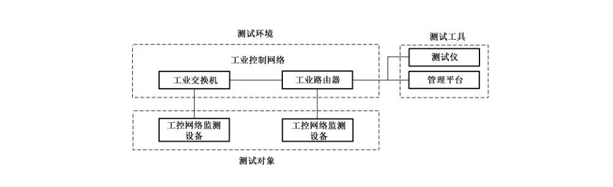

# GB/T 37953-2019 信息安全技术 工业控制网络监测安全技术要求及测试评价方法

> 来源：[GB/T 37953-2019 国家标准详情](https://openstd.samr.gov.cn/bzgk/std/newGbInfo?hcno=C1976106F20C20871B1F512CF43D43B7)；封面发布日期：2019-08-30；实施日期：2020-03-01。
> 官方 PDF SHA-256：5831b7f06be55040eded89e529da2b9fedc9e976676acc8f9e1c19875de2318f。
> 依据官方 PDF 全部 43 页页面图像转写与校核；省略封面、目录、页眉、页脚和分页，合并印刷折行。原文黑体新增要求用加粗表示。

## 前言

本标准按照 GB/T 1.1—2009 给出的规则起草。

请注意本文件的某些内容可能涉及专利。本文件的发布机构不承担识别这些专利的责任。

本标准由全国信息安全标准化技术委员会（SAC/TC 260）提出并归口。

本标准起草单位：中国电子技术标准化研究院、中国科学院沈阳自动化研究所、深圳赛西信息技术有限公司、北京工业大学、公安部第三研究所、浙江浙能台州第二发电有限责任公司、中国信息安全测评中心、上海三零卫士信息安全有限公司、上海交通大学、国家信息技术安全研究中心、和利时集团、北京启明星辰信息安全技术有限公司、烽台科技（北京）有限公司、国网浙江省电力有限公司电力科学研究院、华大半导体有限公司、中国电力工程顾问集团西南电力设计院有限公司、中国平安保险（集团）股份有限公司、北京匡恩网络科技有限责任公司。

本标准主要起草人：范科峰、周睿康、姚相振、李琳、刘贤刚、龚洁中、张大江、尚文利、赖英旭、顾健、陆臻、邹春明、夏克晁、朱青国、谢丰、邸丽清、戴忠华、赵剑明、仵大奎、谷大武、夏正敏、李冰、王弢、孟雅辉、龚亮华、魏钦志、罗志浩、兰天、张晋宾、于惊涛、毕思文。

## 引言

随着工业化与信息化的深度融合，来自信息网络的安全威胁正逐步对工业控制系统造成极大的安全威胁，通用网络监测产品在面对工业控制系统的安全防护时显得力不从心，因此需要一种能应用于工业控制环境的网络监测产品对工业控制系统进行安全防护。

应用于工业控制环境的网络监测产品与通用网络监测产品的主要差异体现在：

- 通用网络监测产品主要针对互联网通用协议进行分析和响应。应用于工业控制环境的网络监测产品除了能够分析部分互联网通用协议外，还具有对工业控制协议的深度解析能力，而无需对工业控制系统中不会使用的通用协议进行分析。
- 应用于工业控制环境的网络监测产品可能有部分组件需部署在工业现场环境，因此比通用网络监测产品具有更高的环境适应能力。
- 应用于工业控制环境的网络监测产品比通用网络监测产品具有更高的可用性、可靠性、稳定性。

## 1 范围

本标准规定了工业控制网络监测产品的安全技术要求和测试评价方法。

本标准适用于工业控制网络监测产品的设计生产方对其设计、开发及测评等提供指导，同时也可为工业控制系统设计、建设和运维方开展工业控制系统安全防护工作提供指导。

## 2 规范性引用文件

下列文件对于本文件的应用是必不可少的。凡是注日期的引用文件，仅注日期的版本适用于本文件。凡是不注日期的引用文件，其最新版本（包括所有的修改单）适用于本文件。

- GB/T 2423.5—1995 电工电子产品环境试验 第 2 部分：试验方法 试验 Ea 和导则：冲击
- GB/T 2423.8—1995 电工电子产品环境试验 第 2 部分：试验方法 试验 Ed：自由跌落
- GB/T 2423.10—2008 电工电子产品环境试验 第 2 部分：试验方法 试验 Fc：振动（正弦）
- GB/T 4208—2017 外壳防护等级（IP 代码）
- GB/T 17214.4—2005 工业过程测量和控制装置的工作条件 第 4 部分：腐蚀和侵蚀影响
- GB/T 18336.1—2015 信息技术 安全技术 信息技术安全评估准则 第 1 部分：简介和一般模型
- GB/T 22239—2019 信息安全技术 网络安全等级保护基本要求
- GB/T 25069—2010 信息安全技术 术语
- GB/T 32919—2016 信息安全技术 工业控制系统安全控制应用指南

## 3 术语和定义

GB/T 25069—2010、GB/T 32919—2016 和 GB/T 18336.1—2015 界定的以及下列术语和定义适用于本文件。

### 3.1 工业控制系统 industrial control system

多种工业生产中使用的控制系统。

> 注：包括监控和数据采集系统（SCADA）、分布式控制系统（DCS）和其他较小的控制系统，如可编程逻辑控制器（PLC），现已广泛应用在工业部门和关键基础设施中。

### 3.2 工业控制网络监测 industrial control network monitoring

部署于工业控制网络中，以实现针对工业控制网络中网络行为的安全事件监测、审计和管理等功能的技术。

> 注 1：用于监测和分析工业控制网络中的数据报文，发现违反安全策略的行为、异常操作、工业控制设备被攻击的迹象，或工业生产受到影响的迹象。
>
> 注 2：本标准所指“工业控制网络监测”即“工业控制网络监测产品”。工业控制网络监测产品是部署于工业控制网络中，用于实现工业控制网络监测功能的设备产品。

## 4 缩略语

下列缩略语适用于本文件。

- DNP：分布式网络协议（Distributed Network Protocol）
- FTP：文件传输协议（File Transfer Protocol）
- HTTP：超文本传输协议（Hypertext Transfer Protocol）
- NTP：网络时间协议（Network Time Protocol）
- OLE：对象连接与嵌入（Object Linking and Embedding）
- OPC：用于过程控制的 OLE（OLE for Process Control）

## 5 产品描述

工业控制网络监测产品是应用于工业控制环境，通过监视工业控制网络内的数据报文，实时获取数据包进行深度解析，监测工业控制网络中的入侵行为和异常行为，并及时告警的设备。该设备需满足特定工业环境和安全功能要求，可对工业控制网络边界或工业控制网络内部不同控制区域之间进行监测保护，发现非法入侵活动，并根据监测结果实时报警、响应，达到主动发现入侵活动、确保网络安全目的。该设备产品可以硬件或者软件形式实现。

本标准按照工业控制网络监测产品安全功能要求强度，对工业控制网络监测产品分为基本级和增强级，安全功能强弱和安全保证要求高低是等级划分的具体依据。其中基本级安全功能要求应具备 GB/T 22239—2019 中第二级安全保护能力，增强级安全功能要求应具备 GB/T 22239—2019 中第三级安全保护能力。在增强级中新增的要求会通过黑体标识。

工业控制网络监测安全技术要求的分级及其要求条款见附录 A，工业控制网络监测测评方法的分级及其测评项见附录 B，工业环境应用要求见附录 C。

## 6 安全技术要求

### 6.1 安全功能要求

#### 6.1.1 功能要求

##### 6.1.1.1 安全事件监测

###### 6.1.1.1.1 流量监测

产品应能够具有流量监测的功能，具体满足下述要求：

a) 应能够监视网络内的流量数据包，实时获取数据包用于检测分析，且不影响工控设备正常运行。

b) 应能够监测指定的协议或 IP 地址的流量数据包，且不影响工控设备正常运行。

###### 6.1.1.1.2 工业控制协议分析

对于在工业控制网络内获取的数据包，产品应能够分析其承载的工业控制协议报文，满足下述一种要求：

a) 分析以下（但不限于）通用协议：Modbus/TCP 协议、OPC Classic 协议、DNP3.0 协议、IEC-60875-5-104 协议、SIEMENS S7Comm 协议、PROFINET 协议、EtherNet/IP 协议；

b) 一种行业专业协议，例如，IEC-61850 MMS 协议、IEC-61850 GOOSE 协议、IEC-61850 SV 协议、轨道交通专业协议等。

###### 6.1.1.1.3 互联网协议分析

对于在工业控制网络内获取的互联网协议流量，产品应能够分析其承载的数据报文，分析以下（但不限于）互联网协议报文：

a) HTTP；

b) FTP；

c) TELNET；

d) SNMP。

###### 6.1.1.1.4 攻击行为监测

产品应能够通过分析、对比等方法，包括但不限于发现以下攻击行为：

a) 工业协议漏洞攻击；

b) 工业控制应用漏洞攻击；

c) 操作系统漏洞攻击；

d) 工业控制设备漏洞攻击；

**e) 应能够监测网络中蠕虫病毒、木马等攻击行为的发生，且不影响工控设备正常运行。**

> 注：安全漏洞和攻击参见国家信息安全漏洞共享平台发布的信息。

##### 6.1.1.2 安全事件响应

###### 6.1.1.2.1 事件告警

对于攻击行为或异常行为，产品应按照事件的严重程度将事件分级，采取屏幕实时提示等直观有效的方式传达告警讯息。

###### 6.1.1.2.2 告警过滤

产品应允许管理员定义安全策略，对工业控制网络中的指定事件不予告警。

###### 6.1.1.2.3 事件合并

产品应对高频度发生的相同安全事件进行合并告警，避免出现告警风暴。

###### 6.1.1.2.4 定制响应

产品应允许管理员定义安全策略，对工业控制网络中的事件定制响应方式。

##### 6.1.1.3 安全配置管理

###### 6.1.1.3.1 安全策略配置

产品应提供安全策略配置功能。

###### 6.1.1.3.2 工业控制漏洞知识库

产品应内置工业控制漏洞知识库，内容应包括工业控制协议漏洞、工业控制应用漏洞、操作系统漏洞和工业控制设备漏洞，详细的漏洞修补方案和可采取的对策。

###### 6.1.1.3.3 工业控制检测特征库

产品应内置工业控制检测特征库，详细的修补方案和可采取的对策。

###### 6.1.1.3.4 工业控制协议端口设定

除支持基于默认端口的工业控制网络协议解析外，产品应能对现有工业控制协议和扩展工业控制协议的端口进行重新设定。

###### 6.1.1.3.5 自定义攻击事件

产品应允许管理员对攻击事件进行自定义，自定义的内容应包括攻击目标、攻击特征和事件等级。

###### 6.1.1.3.6 工业控制协议扩展

**除支持默认的工业控制网络协议外，产品应支持添加新的工业控制协议。**

##### 6.1.1.4 产品功能管理

###### 6.1.1.4.1 界面管理

产品应提供友好的管理员界面用于管理和配置。管理配置界面应包含配置和管理产品所需的所有功能。

###### 6.1.1.4.2 硬件管理

###### 6.1.1.4.2.1 分布式部署和集中管理

**产品应具有分布式部署的能力。**

**产品应设置集中管理平台，对同一系列不同型号监测设备进行统一管理。**

###### 6.1.1.4.2.2 端口分离

监测设备应配备不同的物理端口，分别用于配置管理和网络数据监听。

###### 6.1.1.4.2.3 产品自检

产品在启动和正常工作时，应具备运行状态自检机制，包括硬件工作状态监测、组件连接状态监测等，以验证产品自身状态是否正常。

###### 6.1.1.4.2.4 时钟同步

产品应提供与外部的时钟服务器进行时钟同步的功能。

###### 6.1.1.4.2.5 时钟设置

产品应提供手动设置时钟的功能，以便在没有外部时钟服务器时设置正确时间。

###### 6.1.1.4.2.6 电源冗余

产品应提供电源冗余功能。

###### 6.1.1.4.2.7 掉电物理导通

**串联部署时产品应能够在突发掉电的情况下，自动实现每一对输入输出通信端口的物理导通。**

###### 6.1.1.4.2.8 硬件故障处理

产品应能够监测自身硬件是否工作正常，并在出现故障时及时向管理员告警。

###### 6.1.1.4.3 配置信息恢复

替换监测设备后，产品应能够通过本地或远程进行配置信息恢复。

###### 6.1.1.4.4 数据存储空间管理

在存储器空间将耗尽时，产品应自动产生告警。触发告警的剩余存储空间限值应由管理员自主设定。产品应采取措施保证已存储的事件记录可用和后续事件记录的存储（例如，转存已有事件记录、仅记录重要的事件数据等）。产品应允许用户设定在空间耗尽时的处理策略。

###### 6.1.1.4.5 升级管理

###### 6.1.1.4.5.1 库升级

产品应具有本地和远程升级工业控制漏洞知识库和工业控制检测特征库的功能。

产品应具有通过控制台或管理平台对监测设备的工业控制漏洞知识库和工业控制检测特征库进行统一升级的功能。

###### 6.1.1.4.5.2 产品升级

产品应具有通过本地和远程进行升级的功能。

###### 6.1.1.4.5.3 产品统一升级

产品应具有通过控制台或管理平台对监测设备进行统一升级的功能。

###### 6.1.1.4.5.4 升级包校验

**产品应确保事件库和产品升级时的安全，应具有升级包校验机制，防止得到错误的或伪造的升级包。升级过程须进行双向身份鉴别。**

###### 6.1.1.4.6 用户管理

###### 6.1.1.4.6.1 标识管理

产品应支持权限划分，为每一使用者设置安全属性信息，包括标识、鉴别数据、授权信息或管理组信息、其他安全属性等。

###### 6.1.1.4.6.2 超时设置

产品应具有使用者登录超时重新鉴别功能。在安全策略设定的时间段内没有任何操作的情况下，锁定或终止会话，需要再次进行身份鉴别才能够重新登录。

###### 6.1.1.4.6.3 控制台鉴别

产品应在使用者通过控制台对监测设备执行任何与安全功能相关的操作之前对控制台进行鉴别。

###### 6.1.1.4.6.4 会话锁定

产品应允许使用者锁定当前的交互会话，锁定后需要再次进行身份鉴别才能够重新登录。

###### 6.1.1.4.6.5 鉴别数据保护

产品应保护鉴别数据不被未授权查阅和修改。

##### 6.1.1.5 通信安全

###### 6.1.1.5.1 通信保密性

产品若由多个组件构成，应保证各组件之间通信的保密性。

###### 6.1.1.5.2 通信完整性

**产品若由多个组件构成，应保证各组件之间通信的完整性。如果数据的完整性被破坏，产品应确保及时发现并通知管理员。**

#### 6.1.2 自身安全要求

##### 6.1.2.1 用户管理与鉴别

###### 6.1.2.1.1 用户管理

产品应支持用户管理，包括添加、删除、激活、禁止用户。

产品应为每个用户设定标识、权限等安全属性。

###### 6.1.2.1.2 用户鉴别

产品应在用户登录时进行鉴别。

###### 6.1.2.1.3 鉴别失败处理

当用户鉴别尝试失败连续达到指定次数后，产品应阻止用户进一步的鉴别请求。

###### 6.1.2.1.4 超时设置

**产品应具有登录超时锁定或注销功能。**

###### 6.1.2.1.5 远程管理

**若产品的控制台提供远程管理功能，应能对可远程管理的主机地址进行身份鉴别和访问控制，并保证传输数据的保密性和完整性。**

##### 6.1.2.2 产品升级

###### 6.1.2.2.1 升级功能

产品应具有升级的功能（包括修复自身缺陷等）。

###### 6.1.2.2.2 升级包校验

产品应具有升级包校验机制，防止得到错误的或伪造的升级包。

##### 6.1.2.3 日志管理

###### 6.1.2.3.1 安全日志生成

产品应对相关安全事件生成安全日志，包括但不限于：

a) 登录成功和退出、登录失败；

b) 重启；

c) 鉴别连续尝试不成功的次数超出了设定的限值；

d) 增加、删除管理员角色和对管理员角色的属性进行修改的操作；

e) 升级；

f) 监测操作。

每一条安全日志应包括事件发生的日期、时间、用户标识、事件类型、事件描述和结果。若采用远程登录方式对产品进行管理还应记录管理主机的地址。

###### 6.1.2.3.2 安全日志管理

产品应提供下列安全日志管理功能：

a) 只允许授权管理员访问安全日志；

b) 提供对安全日志的查询功能；

c) 授权管理员应能保存或删除安全日志；

d) 安全日志应能够以通用格式（例如，Excel）导出。

##### 6.1.2.4 策略安全管理

产品应对监测策略的创建、修改、删除、应用提供访问控制等安全措施。

##### 6.1.2.5 时钟同步

产品及组件应支持时间同步功能：

a) 若由多个组件组成，各组件应支持与中心监测组件进行时间同步；

b) 中心监测组件应支持与外部时间服务器进行时间同步。

##### 6.1.2.6 敏感信息保护

定制监测策略时，一些敏感信息可能被涉及，应采取相应措施来保证敏感信息的保密性和完整性，例如，对用户口令进行加密存储。

产品应只允许具有权限的用户读取监测数据。

### 6.2 安全保障要求

#### 6.2.1 产品配置管理

##### 6.2.1.1 配置管理能力

###### 6.2.1.1.1 版本号

开发者应为产品的不同版本提供唯一的标识。

###### 6.2.1.1.2 配置项

工业控制系统网络监测产品应满足以下要求：

a) 开发者应使用配置管理系统并提供配置管理文档。

b) 配置管理文档应包括一个配置清单，配置清单应唯一标识组成产品的所有配置项并对配置项进行描述，还应描述对配置项给出唯一标识的方法，并提供所有的配置项得到有效维护的证据。

###### 6.2.1.1.3 授权控制

工业控制系统网络监测产品应满足以下要求：

a) 开发者提供的配置管理文档应包括一个配置管理计划，配置管理计划应描述如何使用配置管理系统。实施的配置管理应与配置管理计划相一致。

b) 开发者应提供所有的配置项得到有效地维护的证据，并应保证只有经过授权才能修改配置项。

##### 6.2.1.2 配置管理覆盖

工业控制系统网络监测产品应满足以下要求：

a) 配置管理范围至少应包括产品实现表示、设计文档、测试文档、指导性文档、配置管理文档，从而确保它们的修改是在一个正确授权的可控方式下进行的。

b) 配置管理文档至少应能跟踪上述内容，并描述配置管理系统是如何跟踪这些配置项的。

#### 6.2.2 交付与运行

##### 6.2.2.1 交付程序

工业控制系统网络监测产品在交付时应满足以下要求：

a) 开发者应使用一定的交付程序交付产品，并将交付过程文档化。

b) 交付文档应描述在给用户方交付产品的各版本时，为维护安全所必需的所有程序。

##### 6.2.2.2 安装、生成和启动程序

开发者应提供文档说明产品的安装、生成和启动的过程，并对产品的现场调试运行提供详细的说明。

#### 6.2.3 开发

##### 6.2.3.1 描述性高层设计

开发者应提供产品安全功能的高层设计，高层设计应满足以下要求：

a) 按子系统描述安全功能的结构；

b) 描述每个安全功能子系统所提供的安全功能性；

c) 标识安全功能所要求的任何基础性的硬件、固件或软件，以及在这些硬件、固件或软件中实现的支持性保护机制所提供功能的一个表示；

d) 标识安全功能子系统的所有接口；

e) 标识安全功能子系统的哪些接口是外部可见的。

##### 6.2.3.2 安全加强的高层设计

**开发者提供的安全加强的高层设计应满足以下要求：**

**a) 描述产品的功能子系统所有接口的用途与使用方法，适当时应提供效果、例外情况和错误消息的细节；**

**b) 把产品分成安全策略实施和其他子系统来描述。**

#### 6.2.4 指导性文档

##### 6.2.4.1 管理员指南

开发者应提供管理员指南，管理员指南应与为评价而提供的其他所有文档保持一致。

管理员指南应说明以下内容：

a) 管理员可使用的管理功能和接口；

b) 怎样安全地管理、配置产品，防止产品对工业控制系统实时性等造成影响；

c) 在安全处理环境中应被控制的功能和权限；

d) 所有与产品的安全操作有关的用户行为的假设；

e) 所有受管理员控制的安全参数，如果可能，应指明安全值；

f) 每一种与管理功能有关的安全相关事件，包括对安全功能所控制实体的安全特性进行的改变；

g) 所有与管理员有关的 IT 环境安全要求。

##### 6.2.4.2 用户指南

开发者应提供用户指南，用户指南应与为评估而提供的其他所有文档保持一致。

用户指南应说明以下内容：

a) 产品的非管理员用户可使用的安全功能和接口；

b) 产品提供给用户的安全功能和接口的使用方法；

c) 用户可获取但应受安全处理环境所控制的所有功能和权限；

d) 产品安全操作中用户所应承担的职责；

e) 与用户有关的 IT 环境的所有安全要求。

#### 6.2.5 生命周期支持

**开发者应提供开发安全文档。**

**开发安全文档应描述在产品的开发环境中，为保护产品设计和实现的保密性和完整性所必需的所有物理的、程序的、人员的和其他方面的安全措施，并应提供在产品的开发和维护过程中执行安全措施的证据。**

#### 6.2.6 测试

##### 6.2.6.1 测试覆盖

###### 6.2.6.1.1 覆盖证据

覆盖证据要求如下：

a) 开发者应提供测试覆盖的证据。

b) 在测试覆盖证据中，应表明测试文档中所标识的测试与功能规范中所描述的产品的安全功能是对应的。

###### 6.2.6.1.2 覆盖分析

**覆盖分析要求如下：**

**a) 开发者应提供测试覆盖的分析结果。**

**b) 测试覆盖的分析结果应表明测试文档中所标识的测试与功能规范中所描述的产品的安全功能之间的对应性是完备的。**

##### 6.2.6.2 测试深度

**测试深度要求如下：**

**a) 开发者应提供测试深度的分析。**

**b) 深度分析应证实测试文档中所标识的测试足以证实该产品的功能是依照其高层设计运行的。**

##### 6.2.6.3 功能测试

开发者应测试安全功能，将结果文档化并提供测试文档。

测试文档应包括以下内容：

a) 测试计划，应标识要测试的安全功能，并描述测试的目标；

b) 测试过程，应标识要执行的测试，并描述每个安全功能的测试概况，这些概况应包括对于其他测试结果的顺序依赖性；

c) 预期的测试结果，应表明测试成功后的预期输出；

d) 实际测试结果，应表明每个被测试的安全功能能按照规定进行运作。

##### 6.2.6.4 独立测试

###### 6.2.6.4.1 一致性

开发者应提供适合测试的产品，提供的测试集合应与其自测产品功能时使用的测试集合相一致。

###### 6.2.6.4.2 抽样

开发者应提供一组相当的资源，用于安全功能的抽样测试。

#### 6.2.7 脆弱性分析保证

##### 6.2.7.1 指南审查

**开发者应提供指导性文档，指导性文档应满足以下要求：**

**a) 标识所有可能的产品运行模式（包括失败或操作失误后的运行）、它们的后果以及对于保持安全运行的意义；**

**b) 是完备的、清晰的、一致的、合理的；**

**c) 列出关于预期使用环境的所有假设；**

**d) 列出对外部安全措施（包括外部程序的、物理的或人员的控制）的所有要求。**

##### 6.2.7.2 产品安全功能强度评估

开发者应对指导性文档中所标识的每个具有安全功能强度声明的安全机制进行安全功能强度分析，并说明安全机制达到或超过定义的最低强度级别或特定功能强度度量，同时应提供产品对实际生产环境中，工业控制系统稳定运行的影响性分析。

##### 6.2.7.3 开发者脆弱性分析

开发者应开展脆弱性分析，以确保功能的有效实现，具体应满足如下要求：

a) 开发者应执行脆弱性分析，并提供脆弱性分析文档。

b) 开发者应从用户可能破坏安全策略的明显途径出发，对产品的各种功能进行分析并提供文档。对被确定的脆弱性，开发者应明确记录采取的措施。

c) 对每一条脆弱性，应有证据显示在使用产品的环境中，该脆弱性不能被利用。

d) 开发者应提供文档证明经过标识脆弱性的产品可以抵御明显的穿透性攻击。

## 7 测评方法

### 7.1 安全功能测评方法

#### 7.1.1 测试环境

网络监测产品功能测试的典型网络拓扑结构如图 1 所示。主要由测试仪、工业交换机、管理平台和相互独立的监测设备组成，主要以旁路接入等方式接入。其中，工业控制网络是包含工业控制系统在内的工业网络，由 PLC、DCS 等工业控制系统、上位机等终端设备和连接上述设备的网络设备构成，是工业控制网络监测的基础环境；工业交换机等网络设备为被监测设备，是工控网络监测设备的接入点；工控网络监测设备是网络监控的主体，同时也是本标准被测试的对象；测试仪和管理平台是测试工具，测试仪向被测设备发送相关数据报文，测试人员由管理控制台发送相关指令，通过监测设备对整个工控系统进行监测，以达到相应的预期测评结果。

#### 7.1.2 安全事件监测

##### 7.1.2.1 流量监测

流量监测功能的测试评价方法与预期结果如下：

a) 测试评价方法：

1. 测试仪向被测设备随机发送工业控制协议报文，且可做数据包解析；
2. 测试人员通过被测设备的控制台指定协议和目标 IP 地址。

b) 预期结果：

1. 被测设备能够实时获取全部数据包，数据完整，解析正确；
2. 测试人员可以通过控制台监测指定协议或目标 IP 地址的数据包。

##### 7.1.2.2 工业控制协议分析

工业控制协议分析功能的测试评价方法与预期结果如下：

a) 测试评价方法：测试仪向被测设备发送 6.1.1.1.2 所述的工业控制协议的合法报文，以测试测试仪对数据报文的识别情况。

b) 预期结果：被测设备能够识别并正确解析测试仪发送的合法报文。

##### 7.1.2.3 互联网协议分析

互联网协议功能的测试评价方法与预期结果如下：

a) 测试评价方法：测试仪向被测设备发送 6.1.1.1.3 所述的互联网协议的合法报文，以测试测试仪对数据报文的识别情况。

b) 预期结果：被测设备能够识别并正确解析测试仪发送的报文。

##### 7.1.2.4 攻击行为监测

攻击行为监测功能的测试评价方法与预期结果如下：

a) 测试评价方法：测试仪向被测设备发送包含 6.1.1.1.4 所述的漏洞的攻击报文。

b) 预期结果：被测设备能够识别攻击报文。

#### 7.1.3 安全事件响应

##### 7.1.3.1 事件告警

事件告警功能的测试评价方法与预期结果如下：

a) 测试评价方法：

1. 打开产品的事件库，检查是否每个事件都有分级信息；
2. 检查界面显示的安全事件是否具备事件级别信息；
3. 测试仪向被测设备发送攻击报文。

b) 预期结果：

1. 被测设备能够对收集到的数据包进行分析，发现入侵事件；
2. 被测设备以直观有效的方式（例如，屏幕实时提示）传达告警讯息；
3. 被测设备能够按照事件的严重程度将事件分级并报告给管理员；
4. 事件库的所有事件都具有分级信息；
5. 界面显示的安全事件，都以文字等形式显示事件级别。

##### 7.1.3.2 告警过滤

告警过滤功能的测试评价方法与预期结果如下：

a) 测试评价方法：通过被测设备的控制台界面选取工业控制设备 IP 地址，指定不予告警。

b) 预期结果：可以对工业控制设备指定不予告警。

##### 7.1.3.3 事件合并

事件合并功能的测试评价方法与预期结果如下：

a) 测试评价方法：

1. 设置事件合并规则，将某些内容进行合并，如只显示告警信息的事件名称、发生的次数、源 IP 地址等；
2. 连续触发同一事件，查看告警显示的情况，是否是将同一事件进行合并显示。

b) 预期结果：

1. 可以根据需要进行同类事件的合并；
2. 可以按照设置显示告警信息的事件名称、发生的次数、源 IP 地址等信息。

##### 7.1.3.4 定制响应

定制响应功能的测试评价方法与预期结果如下：

a) 测试评价方法：

1. 打开控制台界面，检查产品是否允许管理员设置仅对被检测网段中指定的设备进行告警；
2. 通过被测设备的控制台界面选取 IP 地址，指定响应方式。

b) 预期结果：可以对工业控制设备指定不同的响应方式。

#### 7.1.4 安全配置管理

##### 7.1.4.1 安全策略配置

安全策略配置功能的测试评价方法与预期结果如下：

a) 测试评价方法：

1. 登录控制台界面，查看产品提供的默认策略；
2. 查看是否允许编辑或修改生成新的策略。

b) 预期结果：

1. 产品应提供默认的策略，并可以直接应用；
2. 允许管理员编辑策略；
3. 具有供管理员编辑策略的向导功能；
4. 支持策略的导入、导出；
5. 记录产品提供的策略种类和名称。

##### 7.1.4.2 工业控制漏洞知识库

工业控制漏洞知识库功能的测试评价方法与预期结果如下：

a) 测试评价方法：

1. 检查产品是否有漏洞知识库，漏洞知识库是否包含国家信息安全漏洞共享平台等相关组织机构发布的工控相关漏洞；
2. 检查漏洞知识库的内容。

b) 预期结果：

1. 产品有漏洞知识库，且包含国家信息安全漏洞共享平台等相关组织机构发布的工控相关漏洞；
2. 漏洞知识库的内容应包括漏洞的定义、详细的漏洞修补方案、可采取的对策等内容。

##### 7.1.4.3 工业控制检测特征库

工业控制检测特征库功能的测试评价方法与预期结果如下：

a) 测试评价方法：

1. 检查产品是否有检测特征库；
2. 检查检测特征库的内容。

b) 预期结果：

1. 产品有检测特征库；
2. 检测特征库的内容应包括详细的修补方案、可采取的对策等内容。

##### 7.1.4.4 工业控制协议端口设定

工业控制协议端口设定功能的测试评价方法与预期结果如下：

a) 测试评价方法：查看产品是否提供自定义协议的界面，是否允许对协议的端口进行重新定义。

b) 预期结果：可以对协议的端口进行重新定义。

##### 7.1.4.5 自定义攻击事件

自定义攻击事件功能的测试评价方法与预期结果如下：

a) 测试评价方法：查看产品设置，是否提供自定义事件的界面。

b) 预期结果：

1. 可以自定义的攻击事件；
2. 可以自定义的攻击事件的特征应包括攻击对象、攻击特征、告警等级等。

##### 7.1.4.6 工业控制协议扩展

**工业控制协议扩展功能的测试评价方法与预期结果如下：**

**a) 测试评价方法：**

1. **查看协议管理功能；**
2. **添加新的工业控制协议。**

**b) 预期结果：可以添加新的工业控制协议，并对协议的内容进行正确解析。**

#### 7.1.5 产品功能管理

##### 7.1.5.1 界面管理

界面管理功能的测试评价方法与预期结果如下：

a) 测试评价方法：

1. 查看管理员界面的功能，包括管理配置界面、告警显示界面等；
2. 通过界面配置控制台和监测设备的连接。

b) 预期结果：

1. 具备独立的控制台；
2. 具有图形化的管理界面；
3. 具备划分清晰功能区域的告警显示界面。

##### 7.1.5.2 硬件管理

###### 7.1.5.2.1 分布式部署和集中管理

**分布式部署和集中管理功能的测试评价方法与预期结果如下：**

**a) 测试评价方法：**

1. **登录控制台界面；**
2. **编辑网络拓扑图。**

**b) 预期结果：集中管理平台的拓扑图上应可进行分级部署。**

###### 7.1.5.2.2 端口分离

端口分离功能的测试评价方法与预期结果如下：

a) 测试评价方法：查看被测设备的物理端口。

b) 预期结果：用于产品管理的物理端口和用于网络数据监听的物理端口不同。

###### 7.1.5.2.3 产品自检

产品自检功能的测试评价方法与预期结果如下：

a) 测试评价方法：检查被测设备是否在启动和正常工作时能够周期性地，或者按照授权管理员的要求执行自检，包括硬件工作状态检测、组件连接状态检测等。

b) 预期结果：产品在启动和正常工作时，可以周期性地，或者按照授权管理员的要求执行自检。

###### 7.1.5.2.4 时钟同步

时钟同步功能的测试评价方法与预期结果如下：

a) 预置条件：部署 NTP 时钟源服务器。

b) 测试评价方法：

1. 配置产品的 NTP 时钟同步的方式和提供 NTP 时钟源服务器的 IP 地址；
2. 手动执行时钟同步；
3. 断开被测设备的电源，切断时钟源的连接；
4. 重新启动被测设备，查看被测设备的时钟和时钟源的时钟是否一致。

c) 预期结果：

1. 配置提示无出错，时钟同步成功；
2. 产品显示时钟同步的事件和结果；
3. 被测设备的时钟和时钟源上的时间一致。

###### 7.1.5.2.5 时钟设置

时钟设置功能的测试评价方法与预期结果如下：

a) 测试评价方法：检查网络监测产品是否可以手动设置产品时钟。

b) 预期结果：可以手动设置产品时钟。

###### 7.1.5.2.6 电源冗余

电源冗余功能的测试评价方法与预期结果如下：

a) 测试评价方法：物理识别被测设备是否具备电源冗余，断开被测设备的主电源。

b) 预期结果：被测设备具备双路电源，并且冗余电源其作用。

###### 7.1.5.2.7 掉电物理导通

**掉电物理导通功能的测试评价方法与预期结果如下：**

**a) 测试评价方法：**

1. **测试仪向被测设备发送报文；**
2. **断开被测设备的所有电源。**

**b) 预期结果：测试仪可以在一段时间内收到报文。**

###### 7.1.5.2.8 硬件故障处理

硬件故障处理功能的测试评价方法与预期结果如下：

a) 测试评价方法：

1. 检查产品的硬件失效处理机制；
2. 使被测设备的硬件暂时失效，查看设备情况。

b) 预期结果：

1. 具有硬件失效处理机制；
2. 硬件失效触发告警。

##### 7.1.5.3 配置信息恢复

配置信息恢复功能的测试评价方法与预期结果如下：

a) 测试评价方法：

1. 将被测设备的配置信息导出；
2. 替换被测设备；
3. 导入配置信息。

b) 预期结果：新被测设备的配置信息与原被测设备相同。

##### 7.1.5.4 数据存储空间管理

数据存储空间管理功能的测试评价方法与预期结果如下：

a) 测试评价方法：将存储器空间耗至产品默认的告警值以下，查看产品是否可以保证已存储事件记录可用和后续事件记录的存储。

b) 预期结果：

1. 可以保证已存储事件记录可用和后续事件记录的存储；
2. 提醒管理员采取措施保证已存储事件记录可用和后续事件记录的存储。

##### 7.1.5.5 升级管理

###### 7.1.5.5.1 库升级

库升级功能的测试评价方法与预期结果如下：

a) 测试评价方法：

1. 检查工业控制漏洞知识库和工业控制检测特征库的升级方式。
2. 升级工业控制漏洞知识库和工业控制检测特征库。
3. 在控制台进行工业控制漏洞知识库和工业控制检测特征库统一升级。

b) 预期结果：

1. 可以手动或自动升级工业控制漏洞知识库和工业控制检测特征库。
2. 升级过程中被测设备可以正常工作。
3. 可以将升级后的工业控制漏洞知识库和工业控制检测特征库下发给所有被测设备。

###### 7.1.5.5.2 产品升级

产品升级功能的测试评价方法与预期结果如下：

a) 测试评价方法：

1. 检查产品的升级方式；
2. 启动产品升级功能，进行产品升级。

b) 预期结果：

1. 可以手动或自动升级产品；
2. 升级的过程中被测设备可以正常工作；
3. 升级后被测设备可以正常工作。

###### 7.1.5.5.3 产品统一升级

产品统一升级功能的测试评价方法与预期结果如下：

a) 测试评价方法：在控制台进行产品统一升级。

b) 预期结果：

1. 可以统一对所有被测设备进行产品升级；
2. 升级的过程中被测设备可以正常工作；
3. 升级后被测设备可以正常工作。

###### 7.1.5.5.4 升级包校验

**升级包校验功能的测试评价方法与预期结果如下：**

**a) 测试评价方法：检查产品是否具有升级包校验机制。**

**b) 预期结果：产品具有升级包校验机制。**

##### 7.1.5.6 用户管理

###### 7.1.5.6.1 标识管理

标识管理功能的测试评价方法与预期结果如下：

a) 测试评价方法：

1. 检查产品是否支持权限划分；
2. 检查产品是否为每一使用者设置安全属性信息，包括标识、鉴别数据、授权信息或管理组信息、其他安全属性等。

b) 预期结果：

1. 被测产品支持权限用户划分；
2. 被测产品能够为每一使用者设置安全属性信息，该安全属性信息包括标识、鉴别数据、授权信息或管理组信息、其他安全属性等，这些属性信息只有具有一定权限的用户才能修改。

###### 7.1.5.6.2 超时设置

超时设置功能的测试评价方法与预期结果如下：

a) 测试评价方法：

1. 检查产品是否具有管理员登录超时重新鉴别功能；
2. 设定管理员登录超时重新鉴别的时间间隔；
3. 检查管理员在设定的时间间隔内没有任何操作时产品是否锁定或终止了会话，检查管理员是否需要再次进行身份鉴别。

b) 预期结果：

1. 产品具有登录超时后重新鉴别功能；
2. 在设定的时间间隔内管理员没有任何操作，会话被锁定或终止，管理员需要再次进行身份鉴别才可以使用产品；
3. 最大超时时间仅由授权管理员设定。

###### 7.1.5.6.3 控制台鉴别

控制台鉴别功能的测试评价方法与预期结果如下：

a) 测试评价方法：

1. 设置允许访问被测设备的操作台信息（例如，IP 地址）；
2. 从正确的操作台访问被测设备；
3. 从其他操作台访问被测设备。

b) 预期结果：

1. 可以从正确的操作台访问被测设备；
2. 无法从其他操作台访问被测设备。

###### 7.1.5.6.4 会话锁定

会话锁定功能的测试评价方法与预期结果如下：

a) 测试评价方法：

1. 检查是否允许管理员锁定当前会话；
2. 检查会话锁定后是否需要再次进行身份鉴别才能够重新管理产品。

b) 预期结果：

1. 管理员可以锁定当前会话；
2. 锁定后，管理员需要再次进行身份鉴别才能够重新管理产品。

###### 7.1.5.6.5 鉴别数据保护

鉴别数据保护功能的测试评价方法与预期结果如下：

a) 测试评价方法：检查产品是否仅允许指定的角色查阅或修改身份鉴别数据。

b) 预期结果：产品应仅允许指定的角色查阅或修改身份鉴别数据。

#### 7.1.6 通信安全

##### 7.1.6.1 通信保密性

通信保密性功能的测试评价方法与预期结果如下：

a) 测试评价方法：

1. 被测设备提供商，应提供对产品组件之间的数据传输进行加密的检测接口；
2. 判断加解密算法是否符合国家密码相关政策法规；
3. 检查接收端是否可以正常接收并解密。

b) 预期结果：产品应使用合规的密码算法，在各组件之间传输数据时，数据应能够被正常传输和加解密。

##### 7.1.6.2 通信完整性

**通信完整性功能的测试评价方法与预期结果如下：**

**a) 测试评价方法：**

1. **对产品组件之间的数据传输加以完整性保护；**
2. **检查接收端是否可以进行完整性验证。**

**b) 预期结果：产品在各组件之间传输数据时，数据应能够被加以完整性保护。**

#### 7.1.7 用户管理与鉴别

##### 7.1.7.1 用户管理

用户管理功能的测试评价方法与预期结果如下：

a) 测试评价方法：

1. 检查产品是否具有用户管理功能；
2. 检查产品是否能够为用户设置安全属性。

b) 预期结果：

1. 产品能够添加、删除、激活、禁止用户；
2. 产品能够设置用户的安全属性。

##### 7.1.7.2 用户鉴别

用户鉴别功能的测试评价方法与预期结果如下：

a) 测试评价方法：登录控制台，检查要求进行身份鉴别。

b) 预期结果：

1. 当用户登录对用户进行鉴别，拒绝未通过鉴别的用户登录；
2. 登录之前允许做的操作，仅限于输入登录信息、查看登录帮助等操作；
3. 允许用户在登录后执行与其安全功能相关的各类操作时，不再重复鉴别。

##### 7.1.7.3 鉴别失败处理

鉴别失败处理功能的测试评价方法与预期结果如下：

a) 测试评价方法：

1. 检查产品的安全功能是否可定义用户鉴别尝试的最大允许失败次数；
2. 检查产品的安全功能是否可定义当用户鉴别尝试失败连续达到指定次数后，采取相应的措施，阻止用户进一步的鉴别请求；
3. 尝试多次失败的用户鉴别行为，检查到达指定的鉴别失败次数后，产品是否采取了相应的措施。

b) 预期结果：

1. 产品具备定义用户鉴别尝试的最大允许失败次数的功能；
2. 当用户鉴别尝试失败连续达到指定次数后，产品能够锁定该账号；
3. 最多失败次数仅由授权用户设定。

##### 7.1.7.4 超时设置

**超时设置功能的测试评价方法与预期结果如下：**

**a) 测试评价方法：**

1. **检查产品是否具有用户登录超时重新鉴别功能；**
2. **设定用户登录超时重新鉴别的时间段，检查登录用户在设定的时间段内没有任何操作的情况下，产品是否锁定或终止了会话，用户是否需要再次进行身份鉴别才能够重新管理和使用产品。**

**b) 预期结果：**

1. **产品具有登录超时重新鉴别功能；**
2. **任何登录用户在设定的时间段内没有任何操作的情况下，应被锁定或终止了会话，管理员需要再次进行身份鉴别才能够重新管理和使用产品；**
3. **最大超时时间仅由授权管理员设定。**

##### 7.1.7.5 远程管理

**远程管理功能的测试评价方法与预期结果如下：**

**a) 测试评价方法：**

1. **通过控制台设置可以进行远程管理的主机地址；**
2. **检查是否在执行所有功能之前要求首先进行主机地址的身份鉴别；**
3. **检查传输过程是否采用了保密性和完整性保护手段。**

**b) 预期结果：**

1. **可以设置远程管理主机地址；**
2. **在通过远程主机进行任何与安全功能相关的操作之前都应进行鉴别，拒绝未通过鉴别的管理请求；**
3. **传输过程采用了保密性和完整性保护手段。**

#### 7.1.8 产品升级

##### 7.1.8.1 升级功能

升级功能的测试评价方法与预期结果如下：

a) 测试评价方法：

1. 检查监测产品的升级方式；
2. 进行产品升级。

b) 预期结果：

1. 可以对产品进行升级；
2. 产品在升级的过程中可以正常工作；
3. 产品在升级后可以正常工作。

##### 7.1.8.2 升级包校验

升级包校验功能的测试评价方法与预期结果如下：

a) 测试评价方法：使用经过破坏性修改的升级包进行升级。

b) 预期结果：产品无法升级并显示将完整性校验结果。

#### 7.1.9 日志管理

##### 7.1.9.1 安全日志生成

安全日志生成功能的测试评价方法与预期结果如下：

a) 测试评价方法：

1. 结合开发者文档，使用不同角色模拟对产品进行访问、运行、修改、关闭以及重复失败尝试等相关操作，检查产品提供了对哪些事件的审计；
2. 审查安全日志的正确性。

b) 预期结果：

1. 产品至少为下述可审计事件产生安全日志：用户登录、用户退出、鉴别失败、设备重启、安全配置更改等重大事件，产品升级时间和版本号等；
2. 在每条安全日志中至少记录如下信息：事件发生的日期、时间、用户标识、事件类型、事件描述和结果、远程登录的管理主机的地址。

##### 7.1.9.2 安全日志管理

安全日志管理功能的测试评价方法与预期结果如下：

a) 测试评价方法：

1. 模拟授权与非授权管理员访问安全日志，检查是否仅允许授权管理员访问安全日志；
2. 检查是否可以进行日志查询；
3. 检查是否可以修改日志；
4. 检查日志是否能够导出。

b) 预期结果：

1. 除了具有明确的访问权限的授权管理员之外，禁止所有其他用户对安全日志的访问；
2. 提供日志查询功能；
3. 允许授权管理员保存或删除安全日志；
4. 日志能够以通用格式导出。

#### 7.1.10 策略安全管理

策略安全管理功能的测试评价方法与预期结果如下：

a) 测试评价方法：检查产品具有监控策略，并对监控策略进行创建、修改、删除、应用等操作，检查产品是否对上述操作提供访问控制功能；

b) 预期结果：产品具有对监控策略进行访问控制的功能。

#### 7.1.11 时钟同步

对于由多个组件的产品，时钟同步功能的测试评价方法与预期结果如下：

a) 测试评价方法：

1. 评价者应检查产品说明手册，产品是否提供同步时间的功能；
2. 检查监测产品，是否时间同步并有自动记录。

b) 预期结果：

1. 产品提供各组件与中心监测组件的时间同步的功能；
2. 产品提供与外部时间同步的功能。

#### 7.1.12 敏感信息保护

敏感信息保护功能的测试评价方法与预期结果如下：

a) 测试评价方法：

1. 评价者应检查产品说明手册，产品是否采取措施对敏感信息进行保护；
2. 检查监测数据的读取是否需要不同用户权限。

b) 预期结果：

1. 产品标识鉴别等手段对敏感信息数据进行保护；
2. 产品只允许用户访问与其自身权限相当的敏感信息。

### 7.2 安全保障测评方法

#### 7.2.1 配置管理

##### 7.2.1.1 配置管理能力

###### 7.2.1.1.1 版本号

版本号的测试评价方法与预期结果如下：

a) 测试评价方法：评价者应审查开发者提供的配置管理支持文件是否包含以下内容：版本号，要求开发者所使用的版本号与所应表示的产品样本完全对应，没有歧义。

b) 预期结果：审查记录以及最后结果符合测试评价方法要求，开发者应提供唯一版本号。

###### 7.2.1.1.2 配置项

配置项的测试评价方法与预期结果如下：

a) 测试评价方法：评价者应审查开发者所提供的信息是否满足如下要求：

1. 配置管理功能应对所有的配置项定义唯一的标识。
2. 配置管理文档应包括配置清单、配置管理计划。配置清单用来描述组成系统的配置项。
3. 配置管理文档还应描述对配置项给出唯一标识的方法。

b) 预期结果：审查记录以及最后结果符合测试评价方法要求，评价者审查内容至少包括测试评价方法中的 3 方面。

###### 7.2.1.1.3 授权控制

授权控制的测试评价方法与预期结果如下：

a) 测试评价方法：评价者应审查开发者所提供的信息是否满足如下要求：

1. 配置管理系统应保证只有经过授权才能修改配置项。
2. 在配置管理计划中，应描述配置管理系统是如何使用的。实施的配置管理应与配置管理计划相一致。
3. 配置管理文档还应提供所有的配置项得到有效地维护的证据。

b) 预期结果：审查记录以及最后结果符合测试评价方法要求，评价者审查内容至少包括测试评价方法中的 3 方面。开发者提供的配置管理内容应完整。

##### 7.2.1.2 配置管理覆盖

配置管理覆盖的测试评价方法与预期结果如下：

a) 测试评价方法：评价者应审查开发者提供的配置管理支持文件是否包含以下内容：

1. 产品配置管理范围，要求将系统的交付与运行文档、开发文档、指导性文档、生命周期支持文档、测试文档、脆弱性分析文档和配置管理文档等置于配置管理之下，从而确保它们的修改是在一个正确授权的可控方式下进行的。为此要求：
   - 开发者所提供的配置管理文档应展示配置管理系统至少能跟踪上述配置管理之下的内容；
   - 文档应描述配置管理系统是如何跟踪这些配置项的；
   - 文档还应提供足够的信息表明达到所有要求。
2. 问题跟踪配置管理范围，除产品配置管理范围描述的内容外，要求特别强调对安全缺陷的跟踪。

b) 预期结果：审查记录以及最后结果符合测试评价方法要求，评价者应审查产品受控于配置管理。

#### 7.2.2 交付与运行

##### 7.2.2.1 交付程序

交付程序的测试评价方法与预期结果如下：

a) 测试评价方法：评价者应审查开发者是否使用一定的交付程序交付系统，并使用文档描述交付过程，并且评价者应审查开发者交付的文档是否包含以下内容：在给用户方交付系统的各版本时，为维护安全所必需的所有程序。

b) 预期结果：审查记录以及最后结果符合测试评价方法要求，开发者应提供完整的文档描述所有交付的过程（文档和程序交付）。

##### 7.2.2.2 安装、生成和启动程序

安装、生成和启动程序的测试评价方法与预期结果如下：

a) 测试评价方法：评价者应审查开发者是否提供了文档说明系统的安装、生成、启动和使用的过程。用户能够通过此文档了解安装、生成、启动和使用过程，是否具有对产品的现场调试运行提供详细的说明。

b) 预期结果：审查记录以及最后结果符合测试评价方法要求。

#### 7.2.3 开发

##### 7.2.3.1 描述性高层设计

描述性高层设计的测试评价方法与预期结果如下：

a) 测试评价方法：评价者应审查开发者所提供的信息是否满足如下要求：

1. 是内在一致的；
2. 按子系统描述安全功能的结构；
3. 描述每个安全功能子系统所提供的安全功能性；
4. 标识安全功能所要求的任何基础性的硬件、固件或软件，以及在这些硬件、固件或软件中实现的支持性保护机制所提供功能的一个表示；
5. 标识安全功能子系统的所有接口；
6. 标识安全功能子系统的哪些接口是外部可见的。

b) 预期结果：审查记录以及最后结果符合测试评价方法要求，评价者审查内容至少包括测试评价方法中的 6 个方面。开发者提供的高层设计内容应精确和完整。

##### 7.2.3.2 安全加强的高层设计

安全加强的高层设计的测试评价方法与预期结果如下：

a) 测试评价方法：评价者审查开发者所提供的安全加强高层设计是否满足如下要求：

1. 描述系统的功能子系统所有接口的用途与使用方法，适当时应提供效果、例外情况和错误消息的细节；
2. 把系统分成安全策略实施和其他子系统来描述。

b) 预期结果：审查记录以及最后结果符合测试评价方法要求，评价者审查内容至少包括测试评价方法中的 2 个方面。

#### 7.2.4 指导性文档

##### 7.2.4.1 管理员指南

管理员指南的测试评价方法与预期结果如下：

a) 测试评价方法：评价者应审查开发者是否提供了供授权管理员使用的管理员指南，并且此管理员指南是否包括如下内容：

1. 产品可以使用的管理功能和接口；
2. 怎样安全地管理产品；
3. 在安全处理环境中应进行控制的功能和权限；
4. 所有对与产品的安全操作有关的用户行为的假设；
5. 所有受管理员控制的安全参数，如果可能，应指明安全值；
6. 每一种与管理功能有关的安全相关事件，包括对安全功能所控制的实体的安全特性进行的改变；
7. 所有与授权管理员有关的 IT 环境的安全要求。

b) 预期结果：审查记录以及最后结果符合测试评价方法要求，评价者审查内容至少包括测试评价方法中的 7 个方面。开发者提供的管理员指南应完整。

##### 7.2.4.2 用户指南

用户指南的测试评价方法与预期结果如下：

a) 测试评价方法：评价者应审查开发者是否提供了供系统用户使用的用户指南，并且此用户指南是否包括如下内容：

1. 产品的非管理员用户可使用的安全功能和接口；
2. 产品提供给用户的安全功能和接口的用法；
3. 用户可获取但应受安全处理环境控制的所有功能和权限；
4. 产品安全操作中用户所应承担的职责；
5. 与用户有关的 IT 环境的所有安全要求。

b) 预期结果：审查记录以及最后结果符合测试评价方法要求，评价者审查内容至少包括测试评价方法中的 5 个方面。开发者提供的用户指南应完整。

#### 7.2.5 生命周期支持

生命周期支持的测试评价方法与预期结果如下：

a) 测试评价方法：评价者应审查开发者所提供的开发安全文档是否满足如下要求：描述在系统的开发环境中，为保护系统设计和实现的保密性和完整性所必需的所有物理的、程序的、人员的和其他方面的安全措施，并应提供在系统的开发和维护过程中执行安全措施的证据。

b) 预期结果：审查记录以及最后结果符合测试评价方法要求，开发者提供的开发安全文档应完整。

#### 7.2.6 测试

##### 7.2.6.1 测试覆盖

###### 7.2.6.1.1 覆盖证据

覆盖证据的测试评价方法与预期结果如下：

a) 测试评价方法：评价者应审查开发者提供的测试覆盖证据，在测试覆盖证据中，是否表明测试文档中所标识的测试与功能规范中所描述的系统的安全功能是对应的。

b) 预期结果：审查记录以及最后结果符合测试评价方法要求，开发者提供的测试覆盖证据，应表明测试文档中所标识的测试与功能规范中所描述的系统的安全功能是对应的。

###### 7.2.6.1.2 覆盖分析

覆盖分析的测试评价方法与预期结果如下：

a) 测试评价方法：

1. 评价者应审查开发者提供的测试覆盖分析结果，是否表明了测试文档中所标识的测试与安全功能设计中所描述的安全功能是对应的；
2. 评价测试文档中所标识的测试，是否完整。

b) 预期结果：审查记录以及最后结果符合测试评价方法要求，开发者提供的测试文档中所标识的测试与安全功能设计中所描述的安全功能应对应，并且标识的测试应覆盖所有安全功能。

##### 7.2.6.2 测试深度

测试深度的测试评价方法与预期结果如下：

a) 测试评价方法：评价开发者提供的测试深度分析，是否说明了测试文档中所标识的对安全功能的测试，足以表明该安全功能和高层设计是一致的。

b) 预期结果：审查记录以及最后结果符合测试评价方法要求，评价者测试和审查与安全功能相对应的测试，这些测试应能正确保证测试出的安全功能符合高层设计的要求。

##### 7.2.6.3 功能测试

功能测试的测试评价方法与预期结果如下：

a) 测试评价方法：

1. 评价开发者提供的测试文档，是否包括测试计划、测试规程、预期的测试结果和实际测试结果；
2. 评价测试计划是否标识了要测试的安全功能，是否描述了测试的目标；
3. 评价测试规程是否标识了要执行的测试，是否描述了每个安全功能的测试概况（这些概况包括对其他测试结果的顺序依赖性）；
4. 评价期望的测试结果是否表明测试成功后的预期输出；
5. 评价实际测试结果是否表明每个被测试的安全功能能按照规定进行运作。

b) 预期结果：审查记录以及最后结果符合测试评价方法要求，评价者审查内容至少包括测试评价方法中的 5 个方面。开发者提供的内容应完整。

##### 7.2.6.4 独立测试

###### 7.2.6.4.1 一致性

一致性的测试评价方法与预期结果如下：

a) 测试评价方法：评价者应评价开发者提供的测试系统，提供的测试集合是否与其自测系统功能时使用的测试集合相一致，提供的执行测试及其结果是否与其自测系统功能时执行的测试及其结果相一致。

b) 预期结果：审查记录以及最后结果符合测试评价方法要求，开发者应提供适合测试的系统，提供的测试集合应与其自测系统功能时使用的测试集合相一致，提供的执行测试及其结果与其自测系统功能时执行的测试及其结果相一致。

###### 7.2.6.4.2 抽样

抽样的测试评价方法与预期结果如下：

a) 测试评价方法：评价开发者是否提供一组相当的资源，用于安全功能的抽样测试。

b) 预期结果：审查记录以及最后结果符合测试评价方法要求，开发者应提供一组相当的资源，用于安全功能的抽样测试。

#### 7.2.7 脆弱性分析保证

##### 7.2.7.1 指南审查

指南审查的测试评价方法与预期结果如下：

a) 测试评价方法：评价者应审查开发者提供的文档，是否满足了以下要求：

1. 评价文档，是否确定了对产品的所有可能的操作方式（包括失败和操作失误后的操作），是否确定了它们的后果，以及是否确定了对于保持安全操作的意义；
2. 评价文档，是否列出了所有目标环境的假设以及所有外部安全措施（包括外部程序的、物理的或人员的控制）的要求；
3. 评价文档是否完整、清晰、一致、合理；
4. 评价开发者提供的分析文档，是否阐明文档是完整的。

b) 预期结果：审查记录以及最后结果符合测试评价方法要求。开发者提供的评价文档应完整，并且通过分析文档等方式阐明文档是完整的。

##### 7.2.7.2 系统安全功能强度评估

系统安全功能强度评估的测试评价方法与预期结果如下：

a) 测试评价方法：评价者应审查开发者提供的指导性文档，是否对所标识的每个具有安全功能强度声明的安全机制进行了安全功能强度分析，是否说明了安全机制达到或超过定义的最低强度级别或特定功能强度度量。

b) 预期结果：审查记录以及最后结果符合测试评价方法要求。开发者应对指导性文档中所标识的每个具有安全功能强度声明的安全机制进行安全功能强度分析，并说明安全机制达到或超过定义的最低强度级别或特定功能强度度量。

##### 7.2.7.3 开发者脆弱性分析

开发者脆弱性分析的测试评价方法与预期结果如下：

a) 测试评价方法：

1. 评价开发者提供的脆弱性分析文档，是否从用户可能破坏安全策略的明显途径出发，对系统的各种功能进行了分析；
2. 对被确定的脆弱性，评价开发者是否明确记录了采取的措施；
3. 对每一条脆弱性，评价是否能够显示在使用系统的环境中该脆弱性不能被利用；
4. 对每一条脆弱性，评价其是否可能对真实工业控制系统的稳定运行造成影响，确保工业控制系统的稳定运行。

b) 预期结果：审查记录以及最后结果符合测试评价方法要求。开发者提供的脆弱性分析文档应完整。

## 附录 A（规范性附录）工业控制网络监测安全技术要求的分级及其要求条款

本附录给出了工业控制网络监测安全技术要求的分级及其要求，详见表 A.1。

**表 A.1 工业控制网络监测安全技术要求的分级及其要求条款**

| 安全技术要求 | 项目 | 基本级 | 增强级 |
| --- | --- | --- | --- |
| 安全功能要求 / 功能要求 / 安全事件监测 | 流量监测 | 6.1.1.1.1 | 6.1.1.1.1 |
| 安全功能要求 / 功能要求 / 安全事件监测 | 工业控制协议分析 | 6.1.1.1.2 | 6.1.1.1.2 |
| 安全功能要求 / 功能要求 / 安全事件监测 | 互联网协议分析 | 6.1.1.1.3 | 6.1.1.1.3 |
| 安全功能要求 / 功能要求 / 安全事件监测 | 攻击行为监测 | 6.1.1.1.4 a)～d) | 6.1.1.1.4 a)～e) |
| 安全功能要求 / 功能要求 / 安全事件响应 | 事件告警 | 6.1.1.2.1 | 6.1.1.2.1 |
| 安全功能要求 / 功能要求 / 安全事件响应 | 告警过滤 | 6.1.1.2.2 | 6.1.1.2.2 |
| 安全功能要求 / 功能要求 / 安全事件响应 | 事件合并 | 6.1.1.2.3 | 6.1.1.2.3 |
| 安全功能要求 / 功能要求 / 安全事件响应 | 定制响应 | 6.1.1.2.4 | 6.1.1.2.4 |
| 安全功能要求 / 功能要求 / 安全配置管理 | 安全策略配置 | 6.1.1.3.1 | 6.1.1.3.1 |
| 安全功能要求 / 功能要求 / 安全配置管理 | 工业控制漏洞知识库 | 6.1.1.3.2 | 6.1.1.3.2 |
| 安全功能要求 / 功能要求 / 安全配置管理 | 工业控制监测特征库 | 6.1.1.3.3 | 6.1.1.3.3 |
| 安全功能要求 / 功能要求 / 安全配置管理 | 工业控制协议端口设定 | 6.1.1.3.4 | 6.1.1.3.4 |
| 安全功能要求 / 功能要求 / 安全配置管理 | 自定义攻击事件 | 6.1.1.3.5 | 6.1.1.3.5 |
| 安全功能要求 / 功能要求 / 安全配置管理 | 工业控制协议扩展 | — | 6.1.1.3.6 |
| 安全功能要求 / 功能要求 / 产品功能管理 | 界面管理 | 6.1.1.4.1 | 6.1.1.4.1 |
| 安全功能要求 / 功能要求 / 产品功能管理 / 硬件管理 | 分布式部署和集中管理 | — | 6.1.1.4.2.1 |
| 安全功能要求 / 功能要求 / 产品功能管理 / 硬件管理 | 端口分离 | 6.1.1.4.2.2 | 6.1.1.4.2.2 |
| 安全功能要求 / 功能要求 / 产品功能管理 / 硬件管理 | 产品自检 | 6.1.1.4.2.3 | 6.1.1.4.2.3 |
| 安全功能要求 / 功能要求 / 产品功能管理 / 硬件管理 | 时钟同步 | 6.1.1.4.2.4 | 6.1.1.4.2.4 |
| 安全功能要求 / 功能要求 / 产品功能管理 / 硬件管理 | 时钟设置 | 6.1.1.4.2.5 | 6.1.1.4.2.5 |
| 安全功能要求 / 功能要求 / 产品功能管理 / 硬件管理 | 电源冗余 | 6.1.1.4.2.6 | 6.1.1.4.2.6 |
| 安全功能要求 / 功能要求 / 产品功能管理 / 硬件管理 | 掉电物理导通 | — | 6.1.1.4.2.7 |
| 安全功能要求 / 功能要求 / 产品功能管理 / 硬件管理 | 硬件故障处理 | 6.1.1.4.2.8 | 6.1.1.4.2.8 |
| 安全功能要求 / 功能要求 / 产品功能管理 | 配置信息恢复 | 6.1.1.4.3 | 6.1.1.4.3 |
| 安全功能要求 / 功能要求 / 产品功能管理 | 数据存储空间管理 | 6.1.1.4.4 | 6.1.1.4.4 |
| 安全功能要求 / 功能要求 / 产品功能管理 / 升级管理 | 库升级 | 6.1.1.4.5.1 | 6.1.1.4.5.1 |
| 安全功能要求 / 功能要求 / 产品功能管理 / 升级管理 | 产品升级 | 6.1.1.4.5.2 | 6.1.1.4.5.2 |
| 安全功能要求 / 功能要求 / 产品功能管理 / 升级管理 | 产品统一升级 | 6.1.1.4.5.3 | 6.1.1.4.5.3 |
| 安全功能要求 / 功能要求 / 产品功能管理 / 升级管理 | 升级包校验 | — | 6.1.1.4.5.4 |
| 安全功能要求 / 功能要求 / 产品功能管理 / 用户管理 | 标识管理 | 6.1.1.4.6.1 | 6.1.1.4.6.1 |
| 安全功能要求 / 功能要求 / 产品功能管理 / 用户管理 | 超时设置 | 6.1.1.4.6.2 | 6.1.1.4.6.2 |
| 安全功能要求 / 功能要求 / 产品功能管理 / 用户管理 | 控制台鉴别 | 6.1.1.4.6.3 | 6.1.1.4.6.3 |
| 安全功能要求 / 功能要求 / 产品功能管理 / 用户管理 | 会话锁定 | 6.1.1.4.6.4 | 6.1.1.4.6.4 |
| 安全功能要求 / 功能要求 / 产品功能管理 / 用户管理 | 鉴别数据保护 | 6.1.1.4.6.5 | 6.1.1.4.6.5 |
| 安全功能要求 / 功能要求 / 通信安全 | 通信保密性 | 6.1.1.5.1 | 6.1.1.5.1 |
| 安全功能要求 / 功能要求 / 通信安全 | 通信完整性 | — | 6.1.1.5.2 |
| 安全功能要求 / 自身安全要求 / 用户管理与鉴别 | 用户管理 | 6.1.2.1.1 | 6.1.2.1.1 |
| 安全功能要求 / 自身安全要求 / 用户管理与鉴别 | 用户鉴别 | 6.1.2.1.2 | 6.1.2.1.2 |
| 安全功能要求 / 自身安全要求 / 用户管理与鉴别 | 鉴别失败处理 | 6.1.2.1.3 | 6.1.2.1.3 |
| 安全功能要求 / 自身安全要求 / 用户管理与鉴别 | 超时设置 | — | 6.1.2.1.4 |
| 安全功能要求 / 自身安全要求 / 用户管理与鉴别 | 远程管理 | — | 6.1.2.1.5 |
| 安全功能要求 / 自身安全要求 / 产品升级 | 升级功能 | 6.1.2.2.1 | 6.1.2.2.1 |
| 安全功能要求 / 自身安全要求 / 产品升级 | 升级包校验 | 6.1.2.2.2 | 6.1.2.2.2 |
| 安全功能要求 / 自身安全要求 / 日志管理 | 安全日志生成 | 6.1.2.3.1 | 6.1.2.3.1 |
| 安全功能要求 / 自身安全要求 / 日志管理 | 安全日志管理 | 6.1.2.3.2 | 6.1.2.3.2 |
| 安全功能要求 / 自身安全要求 | 策略安全管理 | 6.1.2.4 | 6.1.2.4 |
| 安全功能要求 / 自身安全要求 | 时钟同步 | 6.1.2.5 | 6.1.2.5 |
| 安全功能要求 / 自身安全要求 | 敏感信息保护 | 6.1.2.6 | 6.1.2.6 |
| 安全保障要求 / 产品配置管理 / 配置管理能力 | 版本号 | 6.2.1.1.1 | 6.2.1.1.1 |
| 安全保障要求 / 产品配置管理 / 配置管理能力 | 配置项 | 6.2.1.1.2 | 6.2.1.1.2 |
| 安全保障要求 / 产品配置管理 / 配置管理能力 | 授权控制 | 6.2.1.1.3 | 6.2.1.1.3 |
| 安全保障要求 / 产品配置管理 | 配置管理覆盖 | 6.2.1.2 | 6.2.1.2 |
| 安全保障要求 / 交付与运行 | 交付程序 | 6.2.2.1 | 6.2.2.1 |
| 安全保障要求 / 交付与运行 | 安装、生成和启动程序 | 6.2.2.2 | 6.2.2.2 |
| 安全保障要求 / 开发 | 描述性高层设计 | 6.2.3.1 | 6.2.3.1 |
| 安全保障要求 / 开发 | 安全加强的高层设计 | — | 6.2.3.2 |
| 安全保障要求 / 指导性文档 | 管理员指南 | 6.2.4.1 | 6.2.4.1 |
| 安全保障要求 / 指导性文档 | 用户指南 | 6.2.4.2 | 6.2.4.2 |
| 安全保障要求 | 生命周期支持 | — | 6.2.5 |
| 安全保障要求 / 测试 / 测试覆盖 | 覆盖证据 | 6.2.6.1.1 | 6.2.6.1.1 |
| 安全保障要求 / 测试 / 测试覆盖 | 覆盖分析 | — | 6.2.6.1.2 |
| 安全保障要求 / 测试 | 测试深度 | — | 6.2.6.2 |
| 安全保障要求 / 测试 | 功能测试 | 6.2.6.3 | 6.2.6.3 |
| 安全保障要求 / 测试 / 独立测试 | 一致性 | 6.2.6.4.1 | 6.2.6.4.1 |
| 安全保障要求 / 测试 / 独立测试 | 抽样 | 6.2.6.4.2 | 6.2.6.4.2 |
| 安全保障要求 / 脆弱性分析保证 | 指南审查 | — | 6.2.7.1 |
| 安全保障要求 / 脆弱性分析保证 | 产品安全功能强度评估 | 6.2.7.2 | 6.2.7.2 |
| 安全保障要求 / 脆弱性分析保证 | 开发者脆弱性分析 | 6.2.7.3 | 6.2.7.3 |

## 附录 B（规范性附录）工业控制网络监测测评方法的分级及其测评项

本附录给出了工业控制网络监测测评方法的分级及其测评项，详见表 B.1。

**表 B.1 工业控制网络监测测评方法的分级及其测评项**

| 测评方法 | 项目 | 基本级 | 增强级 |
| --- | --- | --- | --- |
| 安全功能测评方法 / 安全事件监测 | 流量监测 | 7.1.2.1 | 7.1.2.1 |
| 安全功能测评方法 / 安全事件监测 | 工业控制协议分析 | 7.1.2.2 | 7.1.2.2 |
| 安全功能测评方法 / 安全事件监测 | 互联网协议分析 | 7.1.2.3 | 7.1.2.3 |
| 安全功能测评方法 / 安全事件监测 | 攻击行为监测 | 7.1.2.4 | 7.1.2.4 |
| 安全功能测评方法 / 安全事件响应 | 事件告警 | 7.1.3.1 | 7.1.3.1 |
| 安全功能测评方法 / 安全事件响应 | 告警过滤 | 7.1.3.2 | 7.1.3.2 |
| 安全功能测评方法 / 安全事件响应 | 事件合并 | 7.1.3.3 | 7.1.3.3 |
| 安全功能测评方法 / 安全事件响应 | 定制响应 | 7.1.3.4 | 7.1.3.4 |
| 安全功能测评方法 / 安全配置管理 | 安全策略配置 | 7.1.4.1 | 7.1.4.1 |
| 安全功能测评方法 / 安全配置管理 | 工业控制漏洞知识库 | 7.1.4.2 | 7.1.4.2 |
| 安全功能测评方法 / 安全配置管理 | 工业控制检测特征库 | 7.1.4.3 | 7.1.4.3 |
| 安全功能测评方法 / 安全配置管理 | 工业控制协议端口设定 | 7.1.4.4 | 7.1.4.4 |
| 安全功能测评方法 / 安全配置管理 | 自定义攻击事件 | 7.1.4.5 | 7.1.4.5 |
| 安全功能测评方法 / 安全配置管理 | 工业控制协议扩展 | — | 7.1.4.6 |
| 安全功能测评方法 / 产品功能管理 | 界面管理 | 7.1.5.1 | 7.1.5.1 |
| 安全功能测评方法 / 产品功能管理 / 硬件管理 | 分布式部署和集中管理 | — | 7.1.5.2.1 |
| 安全功能测评方法 / 产品功能管理 / 硬件管理 | 端口分离 | 7.1.5.2.2 | 7.1.5.2.2 |
| 安全功能测评方法 / 产品功能管理 / 硬件管理 | 产品自检 | 7.1.5.2.3 | 7.1.5.2.3 |
| 安全功能测评方法 / 产品功能管理 / 硬件管理 | 时钟同步 | 7.1.5.2.4 | 7.1.5.2.4 |
| 安全功能测评方法 / 产品功能管理 / 硬件管理 | 时钟设置 | 7.1.5.2.5 | 7.1.5.2.5 |
| 安全功能测评方法 / 产品功能管理 / 硬件管理 | 电源冗余 | 7.1.5.2.6 | 7.1.5.2.6 |
| 安全功能测评方法 / 产品功能管理 / 硬件管理 | 掉电物理导通 | — | 7.1.5.2.7 |
| 安全功能测评方法 / 产品功能管理 / 硬件管理 | 硬件故障处理 | 7.1.5.2.8 | 7.1.5.2.8 |
| 安全功能测评方法 / 产品功能管理 | 配置信息恢复 | 7.1.5.3 | 7.1.5.3 |
| 安全功能测评方法 / 产品功能管理 | 数据存储空间管理 | 7.1.5.4 | 7.1.5.4 |
| 安全功能测评方法 / 产品功能管理 / 升级管理 | 库升级 | 7.1.5.5.1 | 7.1.5.5.1 |
| 安全功能测评方法 / 产品功能管理 / 升级管理 | 产品升级 | 7.1.5.5.2 | 7.1.5.5.2 |
| 安全功能测评方法 / 产品功能管理 / 升级管理 | 产品统一升级 | 7.1.5.5.3 | 7.1.5.5.3 |
| 安全功能测评方法 / 产品功能管理 / 升级管理 | 升级包校验 | — | 7.1.5.5.4 |
| 安全功能测评方法 / 产品功能管理 / 用户管理 | 标识管理 | 7.1.5.6.1 | 7.1.5.6.1 |
| 安全功能测评方法 / 产品功能管理 / 用户管理 | 超时设置 | 7.1.5.6.2 | 7.1.5.6.2 |
| 安全功能测评方法 / 产品功能管理 / 用户管理 | 控制台鉴别 | 7.1.5.6.3 | 7.1.5.6.3 |
| 安全功能测评方法 / 产品功能管理 / 用户管理 | 会话锁定 | 7.1.5.6.4 | 7.1.5.6.4 |
| 安全功能测评方法 / 产品功能管理 / 用户管理 | 鉴别数据保护 | 7.1.5.6.5 | 7.1.5.6.5 |
| 安全功能测评方法 / 通信安全 | 通信保密性 | 7.1.6.1 | 7.1.6.1 |
| 安全功能测评方法 / 通信安全 | 通信完整性 | — | 7.1.6.2 |
| 安全功能测评方法 / 用户管理与鉴别 | 用户管理 | 7.1.7.1 | 7.1.7.1 |
| 安全功能测评方法 / 用户管理与鉴别 | 用户鉴别 | 7.1.7.2 | 7.1.7.2 |
| 安全功能测评方法 / 用户管理与鉴别 | 鉴别失败处理 | 7.1.7.3 | 7.1.7.3 |
| 安全功能测评方法 / 用户管理与鉴别 | 超时设置 | — | 7.1.7.4 |
| 安全功能测评方法 / 用户管理与鉴别 | 远程管理 | — | 7.1.7.5 |
| 安全功能测评方法 / 产品升级 | 升级功能 | 7.1.8.1 | 7.1.8.1 |
| 安全功能测评方法 / 产品升级 | 升级包校验 | 7.1.8.2 | 7.1.8.2 |
| 安全功能测评方法 / 日志管理 | 安全日志生成 | 7.1.9.1 | 7.1.9.1 |
| 安全功能测评方法 / 日志管理 | 安全日志管理 | 7.1.9.2 | 7.1.9.2 |
| 安全功能测评方法 | 策略安全管理 | 7.1.10 | 7.1.10 |
| 安全功能测评方法 | 时钟同步 | 7.1.11 | 7.1.11 |
| 安全功能测评方法 | 敏感信息保护 | 7.1.12 | 7.1.12 |
| 安全保障测评方法 / 配置管理 / 配置管理能力 | 版本号 | 7.2.1.1.1 | 7.2.1.1.1 |
| 安全保障测评方法 / 配置管理 / 配置管理能力 | 配置项 | 7.2.1.1.2 | 7.2.1.1.2 |
| 安全保障测评方法 / 配置管理 / 配置管理能力 | 授权控制 | 7.2.1.1.3 | 7.2.1.1.3 |
| 安全保障测评方法 / 配置管理 | 配置管理覆盖 | 7.2.1.2 | 7.2.1.2 |
| 安全保障测评方法 / 交付与运行 | 交付程序 | 7.2.2.1 | 7.2.2.1 |
| 安全保障测评方法 / 交付与运行 | 安装、生成和启动程序 | 7.2.2.2 | 7.2.2.2 |
| 安全保障测评方法 / 开发 | 描述性高层设计 | 7.2.3.1 | 7.2.3.1 |
| 安全保障测评方法 / 开发 | 安全加强的高层设计 | 7.2.3.2 | 7.2.3.2 |
| 安全保障测评方法 / 指导性文档 | 管理员指南 | 7.2.4.1 | 7.2.4.1 |
| 安全保障测评方法 / 指导性文档 | 用户指南 | 7.2.4.2 | 7.2.4.2 |
| 安全保障测评方法 | 生命周期支持 | 7.2.5 | 7.2.5 |
| 安全保障测评方法 / 测试 / 测试覆盖 | 覆盖证据 | 7.2.6.1.1 | 7.2.6.1.1 |
| 安全保障测评方法 / 测试 / 测试覆盖 | 覆盖分析 | 7.2.6.1.2 | 7.2.6.1.2 |
| 安全保障测评方法 / 测试 | 测试深度 | 7.2.6.2 | 7.2.6.2 |
| 安全保障测评方法 / 测试 | 功能测试 | 7.2.6.3 | 7.2.6.3 |
| 安全保障测评方法 / 测试 / 独立测试 | 一致性 | 7.2.6.4.1 | 7.2.6.4.1 |
| 安全保障测评方法 / 测试 / 独立测试 | 抽样 | 7.2.6.4.2 | 7.2.6.4.2 |
| 安全保障测评方法 / 脆弱性分析保证 | 指南审查 | 7.2.7.1 | 7.2.7.1 |
| 安全保障测评方法 / 脆弱性分析保证 | 系统安全功能强度评估 | 7.2.7.2 | 7.2.7.2 |
| 安全保障测评方法 / 脆弱性分析保证 | 开发者脆弱性分析 | 7.2.7.3 | 7.2.7.3 |

## 附录 C（规范性附录）工业环境应用要求

### C.1 概述

本附录的工业环境应用要求包括温度、湿度、防尘、防雾、抗振动等，具体要求详见 C.2～C.10。应根据设备实际部署环境的不同，由用户和设备制造商确定具体应满足的要求。

### C.2 温度要求

温度要求见表 C.1。

**表 C.1 工业控制网络监测产品温度要求**

| 等级 | 工作温度低温/℃ | 工作温度高温/℃ | 贮存和运输温度低温/℃ | 贮存和运输温度高温/℃ | 判据 |
| --- | ---: | ---: | ---: | ---: | --- |
| I | 0 | +60 | −40 | +70 | A |
| II | −40 | +70 | −40 | +85 | A |
| X | 特定 | 特定 | 特定 | 特定 | 特定 |

> 注：X 是一个开放等级，具体温度要求范围可根据实际应用环境与客户协商确定。

### C.3 湿度要求

湿度要求见表 C.2。

**表 C.2 工业控制网络监测产品湿度要求**

| 等级 | 低相对湿度/% | 高相对湿度/% | 判据 |
| --- | ---: | ---: | --- |
| I | 5 | 95 | A |
| X | 特定 | 特定 | 特定 |

> 注：X 是一个开放等级，具体相对湿度要求范围可根据实际应用环境与客户协商确定。

### C.4 防尘要求

防尘要求见表 C.3。

**表 C.3 工业控制网络监测产品防尘要求**

| 防尘等级 | 防水等级 | 依据标准 |
| --- | --- | --- |
| IP2X、IP3X、IP4X、IP5X | IPX0、IPX1、IPX2、IPX3、IPX4、IPX5、IPX6、IPX7 | GB/T 4208—2017 |

### C.5 电磁兼容要求

电磁兼容要求见表 C.4。

**表 C.4 工业控制网络监测产品电磁兼容要求**

| 测试项 | 测试端口 | 参考标准 | 测试频段 | 限值 |
| --- | --- | --- | --- | --- |
| 辐射发射 | 整机 | GB 4824—2013、GB/T 9254—2008 | 30 MHz～1 GHz | A 类 |
| 传导发射 | 电源口、信号口 | GB 4824—2013、GB/T 9254—2008 | 150 kHz～30 MHz | A 类 |

### C.6 抗盐雾要求

抗盐雾要求见表 C.5。

**表 C.5 工业控制网络监测产品抗盐雾要求**

| 等级 | 最大盐雾浓度/(mg/m³) |
| --- | ---: |
| I | ≤5 |
| X | 特定 |

> 注：X 是一个开放等级，具体抗盐雾要求范围可根据实际应用环境与客户协商确定。

### C.7 抗腐蚀性要求

抗腐蚀性要求见表 C.6。

**表 C.6 工业控制网络监测产品抗腐蚀性要求**

| 等级 | 依据标准 | 化学活性物质 |
| --- | --- | --- |
| I | GB/T 17214.4—2005 | 工业清洁空气 |
| II | GB/T 17214.4—2005 | 中等污染 |
| III | GB/T 17214.4—2005 | 严重污染 |
| X | GB/T 17214.4—2005 | 特定 |

> 注：X 是一个开放等级，具体抗腐蚀性要求范围可根据实际应用环境与客户协商确定。

### C.8 抗霉菌要求

在潮湿多雨地区和霉菌滋生环境下不应发生霉变，并能够正常工作。

### C.9 抗振动要求

抗振动要求见表 C.7。

**表 C.7 工业控制网络监测产品抗振动要求**

| 名称 | 依据标准 | I 级 | II 级 | 备注 |
| --- | --- | --- | --- | --- |
| 正弦稳态振动：位移幅值（频率范围 2 Hz～9 Hz） | GB/T 2423.10—2008 | 3.5 mm | 7.5 mm | 在每一轴线上的扫频循环数为 10 次 |
| 正弦稳态振动：加速度幅值（频率范围 9 Hz～150 Hz） | GB/T 2423.10—2008 | 1g | 2g | 在每一轴线上的扫频循环数为 10 次 |
| 冲击：半正弦脉冲时间、峰值加速度 | GB/T 2423.5—1995 | 11 ms；15g | 11 ms；15g | 每个坐标轴的 +/− 方向各进行 3 次冲击 |
| 自由跌落：未包装产品 | GB/T 2423.8—1995 | 质量≤10 kg，跌落高度 0.25 m；质量≤50 kg，跌落高度 0.10 m | 同 I 级 |  |
| 自由跌落：在完整包装箱中 | GB/T 2423.8—1995 | 质量≤50 kg，跌落高度 0.5 m；质量≤100 kg，跌落高度 0.25 m | 同 I 级 |  |

### C.10 工业控制网络监测产品性能判据

系统应支持导轨安装或机架式安装，工业控制网络监测产品的物理安全性能判据如表 C.8 所示。

**表 C.8 工业控制网络监测产品物理安全性能判据**

| 性能评价判据 | 说明 |
| --- | --- |
| A | 试验期间和试验后设备工作正常，符合本标准规定的功能和性能要求 |
| B | 试验期间，设备出现暂时的性能下降或功能丧失，但设备可以自我恢复，试验后设备工作正常 |
| C | 试验期间，设备出现暂时的性能下降或功能丧失，需要人工干预或系统复位才能恢复 |

## 参考文献

[1] GB 4824—2013 工业、科学和医疗（ISM）射频设备 骚扰特性 限值和测量方法

[2] GB/T 9254—2008 信息技术设备的无线电骚扰限值和测量方法

[3] GB/T 18336.2—2015 信息技术 安全技术 信息技术安全评估准则 第 2 部分：安全功能组件

[4] GB/T 18336.3—2015 信息技术 安全技术 信息技术安全评估准则 第 3 部分：安全保障组件

[5] GB/T 20275—2013 信息安全技术 网络入侵检测系统技术要求和测试评价方法

[6] GB/T 26268—2010 网络入侵检测系统测试方法

[7] GB/T 26269—2010 网络入侵检测系统技术要求
