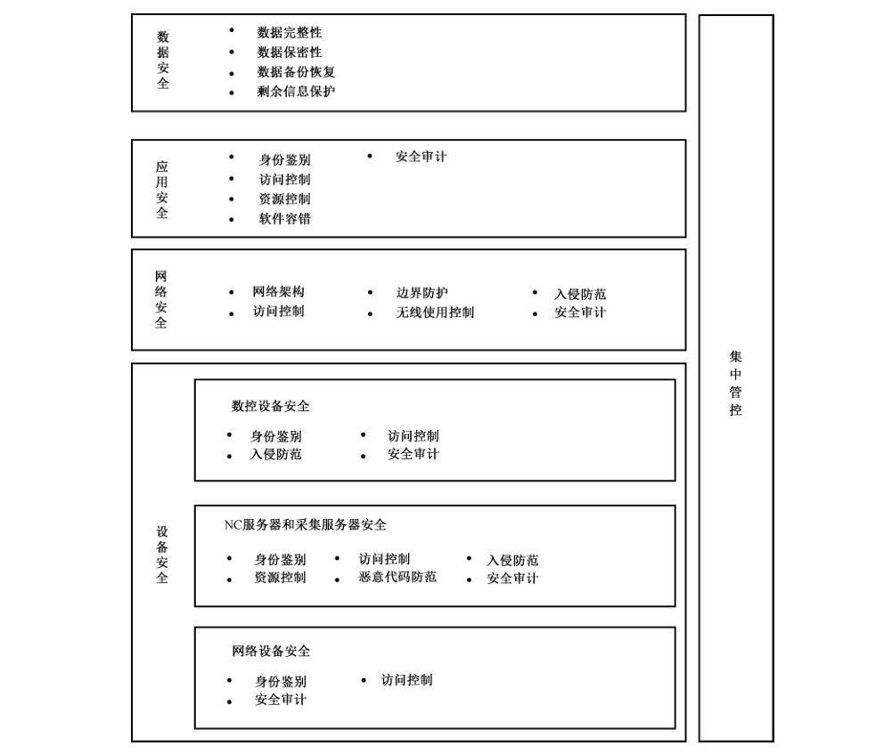
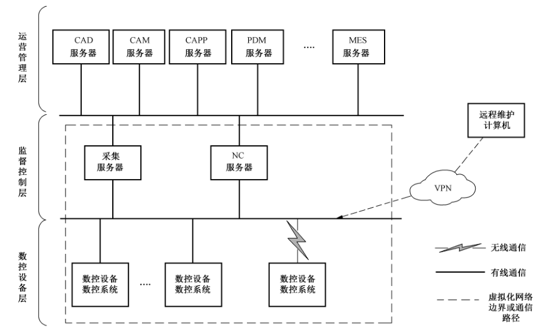

# GB/T 37955-2019 信息安全技术 数控网络安全技术要求

> 来源：[GB/T 37955-2019 国家标准详情](https://openstd.samr.gov.cn/bzgk/std/newGbInfo?hcno=EF8E674572A639AE032D4CDE8A08FED0)；封面发布日期：2019-08-30；实施日期：2020-03-01。
> PDF SHA-256：681c1762f0c73cacb8323edfae229c072ab2c9381e81eff8cf90a73378adcc87。
> 转写说明：按页渲染 PDF 并用 macOS Vision 进行图像识别，对照全部原页校正文字和列表；省略封面、目录、页眉和页脚。正式引用请核对原 PDF。

## 前言

本标准按照 GB/T 1.1—2009给出的规则起草。

请注意本文件的某些内容可能涉及专利。本文件的发布机构不承担识别这些专利的责任。

本标准由全国信息安全标准化技术委员会（SAC/TC 260）提出并归口。

本标准起草单位：中国电子技术标准化研究院、华中科技大学、北京赛西科技发展有限责任公司、北京匡恩网络科技有限责任公司、中国科学院沈阳自动化研究所、沈阳高精数控智能技术股份有限公司、北京数码大方科技有限公司、北京兰光创新科技有限公司、国家计算机网络应急技术处理协调中心、西门子（中国）有限公司、杭州电子科技大学、长春启明信息集成服务技术有限公司。

本标准主要起草人：张大江、李强强、伍泽光、李凯斌、王峥、范科峰、李琳、姚相振、周纯杰、尚文利、胡毅、韩盛夏、丁涛、丁效振、闫韬、舒敏、张晓明、李江力、钟诚、安高峰、徐向华、胡昔祥、许艳萍、刘昊。

## 1 范围

本标准提出了数字化工厂或数字化车间的数控网络安全防护原则，规定了数控网络的安全技术要求，包括设备安全技术要求、网络安全技术要求、应用安全技术要求和数据安全技术要求。

本标准适用于数控网络安全防护的规划、设计和检查评估。

## 2 规范性引用文件

下列文件对于本文件的应用是必不可少的。凡是注日期的引用文件，仅注日期的版本适用于本文件。凡是不注日期的引用文件，其最新版本（包括所有的修改单）适用于本文件。

- GB/T 25069—2010 信息安全技术 术语

## 3 术语和定义

GB/T 25069—2010界定的以及下列术语和定义适用于本文件。

### 3.1 数控设备 numerical control equipment

按预先编制的程序，由控制系统发出数字信息指令对工作过程进行控制的设备。

注1：改写 GB/T 6477—2008，定义2.1.26。

注2：常见的数控设备有：数控机床、数控切割机、三坐标测量仪等。

### 3.2 数控系统 numerical control system

数控设备上使用数值数据的控制系统，在运行过程中，不断地引入数值数据，从而实现设备工作过程的自动化控制。

> 注：改写 GB/T 26220—2010，定义3.1。

### 3.3 数控代码 numerical control code

用于控制数控设备运作的指令集。

### 3.4 数控网络 numerical control network

由数字控制服务器、采集服务器、数控设备和网络通信设备等构成的网络。

> 注：在数控网络中实现了数控设备的集中控制，以及数字控制服务器、采集服务器和数控设备之间的控制指令及设备状态信息的传输。

### 3.5 区域 zone

共享相同信息安全要求的逻辑资产或物理资产的集合。

> 注：区域具有清晰的边界。一个信息安全区域的信息安全策略在其内部和边界都要强制执行。

［GB/T 35673—2017，定义3.1.47］

## 4 缩略语

下列缩略语适用于本文件。

CAD：计算机辅助设计（Computer Aided Design）

CAM：计算机辅助制造（Computer Aided Manufacturing）

CAPP：计算机辅助工艺过程设计（Computer Aided Process Planning）

CPU：中央处理器（Central Processing Unit）

DMZ：非军事区（De-Militarized Zone）

IP：因特网协议（Internet Protocol）

MES：制造执行系统（Manufacturing Execution System）

NC：数字控制（Numerical Control）

PDM：产品数据管理（Product Data Management）

USB：通用串行总线（Universal Serial Bus）

VLAN：虚拟局域网（Virtual Local Area Network）

## 5 概述

### 5.1 数控网络安全框架

数控网络由数字控制服务器（即 NC服务器）、采集服务器、数控设备、网络通信设备等组成。数控网络的参考模型参见附录 A。设备（数控设备、采集服务器、NC服务器、网络通信设备）、设备上安装运行的操作系统、应用软件和存储的数据以及设备间的通信（有线、无线）是本标准所涵盖的保护对象。

数控网络面临的信息安全风险参见附录 B。针对数控网络面临的安全风险和面对的保护对象，本标准提出了数控网络安全框架，如图 1 所示。本标准的第 6 章、第 7 章、第 8 章、第 9 章基于安全框架和 5.2 中的数控网络安全防护原则分别对各项提出具体的安全技术要求。

### 5.2 数控网络信息安全防护原则

数控网络信息安全防护应遵循以下原则：

a） 网络可用  
各类安全防护措施的使用不应对数控网络的正常运行以及数控网络与外部网络的交互造成影响。

b） 网络隔离  
数控网络应仅用于数控生产加工业务，应采用专用的物理网络，与外部网络的交互应采取有效的安全防护措施。

c） 分区防御  
应将数控网络划分为数控网络-监督控制区域和数控网络-数控设备区域。数控网络-数控设备区域按照生产功能可进一步划分为不同的子区域。对不同的区域应根据安全要求采取安全保护措施。在不影响各区域工作的前提下，应于各区域边界处采取安全隔离措施，确保各个区域之间有清楚明晰的边界设定，并保障各区域边界安全。

d） 全面保护  
数控网络的安全防护可通过物理访问控制措施、管理措施以及技术措施实现。单一设备的防护、单一防护措施或单一防护产品的使用无法有效的保护数控网络，数控网络的防护应采取多种安全机制和多层防护策略。

> 注：物理访问控制措施参见 GB/T 22239中的要求。

### 5.3 安全技术要求

本标准提出了设备安全技术要求、网络安全技术要求、应用安全技术要求、数据安全技术要求和集中管控技术要求。

设备安全技术要求对数控网络中采集服务器上的操作系统，NC 服务器上的操作系统、数据库系统，数控设备上数控系统的操作系统以及数控网络中的网络通信设备从身份鉴别、访问控制、入侵防范、资源控制、恶意代码防范、安全审计等方面进行了规定。

网络安全技术要求从网络架构、数控网络与管理网络以及数控网络内部不同安全区域之间的边界防护、访问控制、入侵防范、安全审计以及数控网络中无线网络的使用控制等方面进行了规定。

应用安全技术要求对采集服务器、NC服务器、数控设备上数控系统安装的各类应用软件从身份鉴别、访问控制、资源控制、软件容错、安全审计等方面进行了规定。

数据安全技术要求对设备上存储的NC 代码、工艺文件、审计记录等及设备之间传输的 NC 代码、设备状态信息等数据从数据完整性、数据保密性、数据备份恢复、剩余信息保护等方面进行了规定，应根据业务类型对数控网络的业务敏感数据进行分级并采取相应的保护措施。

集中管控技术要求对数控网络中由安全设备及安全组件实现的各类安全机制的集中管理进行了规定。

### 5.4 安全技术要求分级

本标准按照数控网络对安全防护能力的需求将各类要求分为基本要求和增强要求。增强要求是对基本要求的补充和加强。

## 6 设备安全技术要求

### 6.1 NC 服务器和采集服务器安全技术要求

#### 6.1.1 身份鉴别

##### 6.1.1.1 基本要求

基本要求包括：

a） 应能够唯一地标识和鉴别登录 NC 服务器操作系统、采集服务器操作系统和 NC 服务器数据库系统的用户；

b） 应能够通过设置最小长度和多种字符类型以达到强制配置NC 服务器操作系统、采集服务器操作系统和 NC 服务器数据库系统的用户口令强度；

c） 应通过加密方式存储用户的口令；

d）应对连续无效的访问尝试设置阈值，在规定的时间周期内，对NC服务器操作系统、采集服务器操作系统和 NC 服务器数据库系统的访问尝试次数超出阈值时，应能够进行告警并进行锁定直到管理员解锁。

##### 6.1.1.2 增强要求

增强要求包括：

a） 应防止NC服务器操作系统、采集服务器操作系统和 NC服务器数据库系统任何已有的用户账号重复使用同一口令；

b）应具有登录失败处理功能，采取结束会话、登录连接超时自动退出等措施；

c） 应能够唯一地标识所有设备；

d） 应限制用户口令的最长和最短有效期；

e） 应能够隐藏鉴别过程中的鉴别信息反馈；

f） 应提供两种或两种以上的鉴别技术来进行身份鉴别，其中至少有一种身份鉴别信息是不可伪造的。

#### 6.1.2 访问控制

##### 6.1.2.1 基本要求

基本要求包括：

a） 应对登录 NC 服务器、采集服务器操作系统和 NC服务器数据库系统的用户分配账号和权限，根据用户的角色仅授予用户所需的最小权限。

b） 应支持 NC 服务器、采集服务器操作系统和 NC 服务器数据库系统的授权用户管理所有账号，包括添加、激活、修改、禁用和删除账号。

c） 应支持重命名 NC 服务器、采集服务器操作系统和 NC服务器数据库系统的默认账号和修改默认账号的默认口令。

d） 应支持删除或禁用 NC 服务器、采集服务器操作系统和NC服务器数据库系统多余的、过期的账号，避免存在共享账号。

e） 应能够配置非活动时间周期，对 NC服务器、采集服务器操作系统和 NC服务器数据库系统的用户，应在安全策略规定的非活动时间周期后自动启动或通过手动启动会话锁定防止进一步访问。会话锁定应一直保持有效，直到发起会话的人员或其他授权人员使用适当的身份标识和鉴别重新建立访问。

f） 应支持 NC 服务器、采集服务器操作系统和 NC服务器数据库系统的授权用户或角色对所有用户的权限映射进行规定和修改。

##### 6.1.2.2 增强要求

增强要求包括：

a） 应能够对访问 NC服务器的采集服务器进行操作超时设置，在超时后自动锁定；

b）应支持授权人员配置访问控制策略，访问控制策略规定用户对资源的访问规则；

c） 访问控制的粒度应达到访问主体为用户或软件进程，可访问的资源为文件、数据库表；

d） 应对 NC 代码、用户鉴别信息等重要信息资源设置敏感标记，应依据安全策略严格控制用户对有敏感标记的重要信息资源进行操作。

#### 6.1.3 入侵防范

##### 6.1.3.1 基本要求

基本要求包括：

a） 采集服务器、NC服务器的操作系统应采用最小化安装原则，只安装必要的组件和应用软件；

b） 应明确阻止或限制使用采集服务器、NC服务器的USB 等外设端口和无线功能；

c） 不准许未授权的移动设备连接采集服务器或 NC服务器，不准许授权移动设备进行超越其权限的操作；

d） 不准许通过即时消息通信系统与数控网络外的用户或系统通信；

e） 应关闭不需要的系统服务、默认共享和端口。

##### 6.1.3.2 增强要求

增强要求包括：

a）应仅允许授权的采集服务器访问 NC服务器、仅允许授权的移动设备访问采集服务器、NC服务器；

b） 应在经过充分测试评估后及时修补采集服务器、NC服务器操作系统存在的漏洞，漏洞的修补不应影响正常的生产。

> 注：为保证生产的正常进行，可在计划的或非计划的系统维护期间进行漏洞修补的测试及漏洞修补。

#### 6.1.4 资源控制

##### 6.1.4.1 基本要求

基本要求包括：

a） 应按照供应商提供的指南中所推荐的网络和安全配置进行设置；

b） 应对设备的运行资源进行监视，包括但不限于 CPU、硬盘、内存等资源的使用情况；

c） 应提供 NC服务器和工业交换机的硬件冗余，保证系统的可用性。

##### 6.1.4.2 增强要求

增强要求包括：

a） 应能够对设备的资源使用情况设置阈值，当达到阈值时进行告警；

b） 应能够对设备的接口限制并发会话数量，并且会话数量可配置；

c） 应能够对设备当前的安全配置生成一个列表。

#### 6.1.5 恶意代码防范

##### 6.1.5.1 基本要求

基本要求包括：

a） 应在采集服务器、NC 服务器部署恶意代码防护机制以达到防恶意代码的目的；

b） 采集服务器、NC服务器恶意代码的防护不应改变系统的配置、读取敏感信息、消耗大量系统资源或影响系统的可用性；

c） 应在采集服务器、NC 服务器上限制使用可能造成损害的移动代码技术，包括但不限于防止移动代码的执行、对移动代码的源进行鉴别和授权、监视移动代码的使用；

注1：移动代码指的是 Java、JavaScript、ActiveX 等程序或插件。

d） 采集服务器、NC 服务器上恶意代码的防护机制应定期进行升级，恶意代码防护机制的升级不应影响正常的生产且升级内容应经过充分的测试。

注2：为保证生产的正常进行，可在计划的或非计划的系统维护期间进行恶意代码防护机制的升级及测试。

##### 6.1.5.2 增强要求

增强要求包括：

a） 应在移动代码执行之前对移动代码的完整性进行检查；

b）在更新恶意代码库、木马库以及规则库前，应首先在测试环境中测试通过，对隔离区域恶意代码更新应有专人负责，更新操作应离线进行，并保存更新记录。

#### 6.1.6 安全审计

##### 6.1.6.1 基本要求

基本要求包括：

a） 应对包括但不限于用户登录操作系统、对 NC 代码的访问、NC代码传输、请求错误、备份和恢复、配置改变等安全事件进行审计；

b） 审计记录应包括但不限于时间戳、来源、类别、事件标识和事件结果等；

c） 设备应设置足够的审计记录存储容量；

d） 应通过权限控制、加密存储等对设备的审计记录进行保护；

e） 在审计记录生成时，设备应提供时间戳；

f） 应定期备份审计记录，避免受到未预期的删除、修改或覆盖等而丢失审计信息；

g） 应能够对时钟同步频率进行配置，按照设定的频率进行系统时钟同步。

##### 6.1.6.2 增强要求

增强要求包括：

a） 在审计失败时，包括但不限于软件或硬件出错、审计捕获机制失败、审计存储容量饱和或溢出，应能够进行告警并能够采取恰当的措施（如覆盖最早的审计记录或停止审计日志生成）；

b） 应能够配置审计存储容量的阈值，当审计记录存储值达到审计存储容量的阈值时应能够进行告警；

c） 应能够把审计记录写入非易失性存储介质；

d） 应能够为集中审计管理提供接口，将自身生成的审计记录上传；

e） 应能够通过编程访问审计记录。

### 6.2 数控设备安全技术要求

#### 6.2.1 身份鉴别

##### 6.2.1.1 基本要求

基本要求包括：

a） 应能够唯一地标识和鉴别登录数控设备操作系统的用户；

b） 应能够对数控设备操作系统的用户组、角色进行唯一标识；

c） 应能够通过设置最小长度和多种字符类型以达到强制配置数控设备口令强度；

d） 应通过加密方式存储用户的口令；

e） 应对数控设备操作系统用户在规定的时间周期内，对连续无效的访问尝试次数设置阈值，当访问尝试次数达到阈值时，应能进行告警并在规定的时间内进行锁定或者直到管理员解锁。

##### 6.2.1.2 增强要求

增强要求包括：

a） 应防止数控设备操作系统任何已有的用户账号重复使用同一口令；

b） 应能够唯一地标识所有设备；

c） 应限制用户口令的最长和最短有效期；

d） 应能够隐藏鉴别过程中的鉴别信息反馈；

e） 应提供两种或两种以上的鉴别技术来进行身份鉴别，其中至少有一种身份鉴别信息是不可伪造的。

> 注：对于无法支持部署身份鉴别措施的设备，可通过物理访问控制等方式提供补偿控制措施。

#### 6.2.2 访问控制

##### 6.2.2.1 基本要求

基本要求包括：

a） 应对登录数控设备操作系统用户分配账号和权限，遵循职责分离原则，根据用户的角色仅授予用户所需的最小权限。

b） 应支持数控设备操作系统授权用户管理所有账号，包括添加、激活、修改、禁用和删除账号。

c） 应支持重命名数控设备操作系统默认账号或修改默认账号的默认口令。

d） 应支持删除或禁用数控设备操作系统多余的、过期的账号，避免共享账号的存在。

e） 应支持配置非活动时间，超过非活动时间后，数控设备操作系统用户应自动启动或通过手动启动会话锁定防止进一步访问。会话锁定应一直保持有效，直到拥有会话的人员或其他授权人员使用适当的身份标识和鉴别重新建立访问。

f） 应支持数控设备操作系统授权用户或角色对所有用户的权限映射进行规定和修改。

##### 6.2.2.2 增强要求

增强要求包括：

a） 应支持授权人员配置访问控制策略，访问控制策略规定用户对资源的访问规则；

b）应对NC代码、用户鉴别信息等重要信息资源设置敏感标记，应依据安全策略严格控制用户对有敏感标记的重要信息资源进行操作。

> 注：对于无法支持部署访问控制措施的设备，可通过物理访问控制、人员管理等提供相应的补偿控制措施。

#### 6.2.3 入侵防范

##### 6.2.3.1 基本要求

基本要求包括：

a） 数控设备的操作系统应采用最小化安装原则，只安装必要的组件和应用软件；

b） 应明确阻止或限制使用数控设备的 USB 等外设端口和无线功能；

c） 不准许未授权的移动设备连接数控设备，不准许授权移动设备进行超越其权限的操作。

##### 6.2.3.2 增强要求

增强要求包括：

a） 应仅允许授权的移动设备访问数控设备；

b） 应及时进行升级修补数控设备存在的漏洞，补丁升级应满足功能和版本的基础要求，数控设备的升级不应影响正常的生产。

> 注：为保证生产的正常进行，可在计划的或非计划的系统维护期间进行漏洞修补的测试及漏洞修补。

#### 6.2.4 安全审计

##### 6.2.4.1 基本要求

基本要求包括：

a） 应对包括但不限于用户登录操作系统、对NC 代码的访问、NC 代码传输、请求错误、备份和恢复、配置改变等安全事件进行审计；

b）审计记录应包括时间戳、来源、类别、事件 ID 和事件结果等；

c） 设备应允许用户设置审计记录的存储容量；

d） 应通过权限控制、加密存储等对设备的审计记录进行保护；

e）应定期备份审计记录，避免受到未预期的删除、修改或覆盖等而丢失审计信息。

##### 6.2.4.2 增强要求

增强要求包括：

a） 应能够对时钟同步频率进行配置，按照设定的频率进行系统时钟同步；

b） 在审计失败时（包括但不限于软件或硬件出错、审计捕获机制失败、审计存储容量饱和或溢出），应能够进行告警并能够采取措施（如覆盖最早的审计记录或停止审计日志生成）；

c） 应能够配置审计存储容量的阈值，当审计记录存储值达到审计存储容量的阈值时应能够进行告警；

d） 应能够为集中审计管理提供接口，将自身生成的审计记录上传；

e） 应能够把审计记录写入非易失性存储介质；

f） 应能够通过编程接口访问审计记录。

### 6.3 网络通信设备安全技术要求

#### 6.3.1 身份鉴别

##### 6.3.1.1 基本要求

基本要求包括：

a） 应对登录的用户进行身份标识和鉴别，身份标识具有唯一性，身份鉴别信息具有复杂度要求并定期更换；

b）应具有登录失败处理功能，采取结束会话、限制非法登录次数等措施；

c） 当进行远程管理时，应采取必要措施，防止鉴别信息在网络传输过程中被窃听。

##### 6.3.1.2 增强要求

应采用两种或两种以上组合的鉴别技术对用户进行身份鉴别。

> 注：对于无法支持部署身份鉴别措施的设备，可通过物理访问控制等方式提供补偿控制措施。

#### 6.3.2 访问控制

##### 6.3.2.1 基本要求

基本要求包括：

a） 应对登录的用户分配账号和权限；

b） 应删除默认账号或修改默认账号的默认口令；

c） 应及时删除或停用多余的、过期的账号，避免存在共享账号；

d） 应授予管理用户所需的最小权限，实现管理用户的权限分离。

##### 6.3.2.2 增强要求

应进行角色划分，遵循职责分离原则，根据用户的角色仅授予用户所需的最小权限。

> 注：对于无法支持部署访问控制措施的设备，可通过物理访问控制、人员管理等提供相应的补偿控制措施。

#### 6.3.3 安全审计

##### 6.3.3.1 基本要求

基本要求包括：

a） 应启用安全审计功能，审计覆盖到每个用户，对重要的用户行为和重要安全事件进行审计；

b） 审计记录应包括但不限于事件的日期和时间、用户、事件类型、事件是否成功及其他与审计相关的信息；

c） 应对审计记录进行保护，定期备份，避免受到未预期的删除、修改或覆盖等。

##### 6.3.3.2 增强要求

应能够对时钟同步频率进行配置，按照设定的频率进行系统时钟同步。

## 7 网络安全技术要求

### 7.1 网络架构

#### 7.1.1 基本要求

应将数控网络与管理网络进行逻辑分区，数控网络内部关键网络区域与其他网络区域进行逻辑分区。宜在数控网络内部划分出 DMZ区域。

> 注：逻辑分区可通过划分 VLAN 等方式实现，在数控网络内部可以根据设备所处的位置、网络层次、设备完成的生产功能等进行逻辑分区。

#### 7.1.2 增强要求

应将数控网络和其他网络进行物理隔离。宜在数控网络内部不同区域进行物理隔离。

### 7.2 边界防护

#### 7.2.1 基本要求

基本要求包括：

a） 应监视和控制数控网络和管理网、互联网之间的通信以及数控网络内各区域之间的通信；

b） 应在各边界默认拒绝所有网络数据流，仅允许例外的网络数据流；

c） 应能够对非授权设备私自连接到数控网络内部的行为进行限制或检查，并进行有效阻断；

d） 应能够对数控网络内部用户私自连接到外部网络的行为进行限制或检查，并进行有效阻断。

#### 7.2.2 增强要求

增强要求包括：

a） 应在数控网络和管理网络边界、数控网络内部的区域边界部署保护设备，保证跨越边界的访问和数据通过受控接口进行通信；

b） 当数控网络与管理网络的边界防护机制出现操作失效时，应阻止数控网络与管理网络之间的边界通信；

c） 当数控网络内部安全域之间的边界防护机制失效时，应能够进行告警，并确保不影响关键设备的通信。

### 7.3 访问控制

#### 7.3.1 基本要求

基本要求包括：

a） 在数据传输之前，应能够对通信的双方进行身份鉴别；

b） 远程维护数控设备时，应通过可信信道接入，采用单向访问控制措施，不准许从数控设备获取NC 代码等工艺信息，应采用加密技术防止鉴别信息在网络传输过程中泄露；

c） 应通过设定终端接入方式或网络地址范围对通过网络进行管理的终端进行限制；

d） 应支持配置非活动时间，超过非活动时间后，应终止远程会话；

e） 应在数控设备层和监督控制层之间、监督控制层和管理网络之间部署保护设备对进出网络的数据流量进行深度解析，对数据流量的源地址、目的地址、源端口、目的端口和协议等信息进行检查过滤，以允许/拒绝数据包进出数控网络。

#### 7.3.2 增强要求

增强要求包括：

a） 不准许通过互联网等公共网络进行远程访问；

b） 应能够对 NC服务器和数控设备之间传输的 NC代码进行内容过滤以防止恶意修改。

### 7.4 入侵防范

#### 7.4.1 基本要求

基本要求包括：

a） 应在数控设备层和监督控制层之间、监督控制层和管理网络之间的关键网络节点处检测、防止或限制从外部发起的网络攻击行为；

b） 应能够通过网络行为分析实现对网络攻击的检测；

c） 应在数控设备层和监督控制层之间、监督控制层和管理网络之间的关键网络节点处检测和限制从内部发起的网络攻击行为；

d） 应能够对检测到的入侵行为进行告警。

#### 7.4.2 增强要求

增强要求包括：

a） 应能够通过网络行为分析实现对未知的新型网络攻击的检测；

b） 当检测到攻击行为时，应能够记录包括但不限于攻击源 IP、攻击类型、攻击对象、攻击时间等信息。

### 7.5 无线使用控制

#### 7.5.1 基本要求

基本要求包括：

a） 应能够对数控网络中参与无线通信的设备进行唯一标识和鉴别；

b） 应能够对数控网络中进行的无线传输进行加密；

c） 应能够对数控网络中无线连接的使用进行授权验证和监控。

#### 7.5.2 增强要求

应能够识别在数控网络中使用的未经授权的无线设备，并告警。

### 7.6 安全审计

#### 7.6.1 基本要求

基本要求包括：

a）应在数控网络和管理网络、数控设备层和监督控制层之间的关键网络节点处采取审计机制进行安全审计，安全审计应包括但不限于流量审计、协议审计、内容审计、行为审计；

b） 应允许用户配置审计记录的存储容量；

c） 审计记录应包括但不限于时间戳、来源、类别、协议类型、事件标识和事件结果；

d） 在审计失败时（包括但不限于软件或硬件出错、审计捕获机制失败、审计存储容量饱和或溢出）应能够进行告警并能够采取恰当的措施（如覆盖最早的审计记录或停止审计日志生成）；

e） 应通过加密存储、权限控制、身份鉴别等方式保护审计信息和审计工具，防止其在未授权情况下被获取、修改和删除；

f） 应定期备份审计记录，避免受到未预期的删除、修改或覆盖等而丢失审计信息；

g） 应保护时间源防止非授权改动，一旦改动则生成审计事件。

#### 7.6.2 增强要求

增强要求包括：

a） 应能够对数控设备的远程访问提供全面的审计记录，包括但不限于访问时间、访问地址、访问人员、具体操作内容等；

b） 应能够配置审计存储容量的阈值，当审计记录存储量达到审计存储容量的阈值时应能够进行告警；

c） 应能够对时钟同步频率进行配置，按照设定的频率进行系统时钟同步；

d） 应能够为集中审计管理提供接口，将生成的审计记录上传；

e） 应能够把审计记录写入非易失性存储介质；

f） 应能够通过编程接口访问审计记录。

### 7.7 集中管控

#### 7.7.1 基本要求

无。

#### 7.7.2 增强要求

增强要求包括：

a） 应划分出特定的管理区域，对分布在数控网络中的安全设备或安全组件进行管理；

b） 应能够建立一条安全的信息传输路径，对数控网络中的安全设备或安全组件进行管理；

c） 应对网络链路、安全设备、网络通信设备、NC服务器、采集服务器、数控设备等的运行状况进行集中监控；

d） 应对分散在各个设备上的审计数据进行收集汇总和集中分析；

e） 应对安全策略、恶意代码、补丁升级、系统日志等安全相关事项进行集中管理；

应对数控网络中发生的各类安全事件进行识别、告警和分析。

## 8 应用安全技术要求

### 8.1 身份鉴别

#### 8.1.1 基本要求

基本要求包括：

a） 应能够唯一地标识和鉴别登录采集服务器、NC服务器、数控设备应用软件的用户；

b） 应能够通过设置口令的最小长度和多种字符类型以达到强制配置采集服务器、NC服务器、数控设备应用软件用户的口令强度；

c） 应通过加密方式存储用户口令；

d） 应能够对采集服务器、NC服务器、数控设备应用软件的用户组、角色进行唯一标识；

e） 对采集服务器、NC服务器、数控设备应用软件应在配置时间周期内，对连续无效的访问尝试次数设置阈值，当访问尝试次数超出阈值时，应能进行告警并在规定的时间内进行锁定或者直到管理员解锁。

#### 8.1.2 增强要求

增强要求包括：

a） 应防止采集服务器、NC服务器、数控设备应用软件已有的用户账号重复使用同一口令；

b） 应限制采集服务器、NC服务器、数控设备应用软件用户口令的最长和最短有效期；

c） 应提供两种或两种以上的鉴别技术来进行身份鉴别，其中至少有一种身份鉴别信息是不可伪造的；

d） 应能够隐藏鉴别过程中的鉴别信息反馈。

### 8.2 访问控制

#### 8.2.1 基本要求

基本要求包括：

a） 应对登录 NC服务器、采集服务器、数控设备上的应用软件的用户分配账号和权限，遵循职责分离原则，根据用户的角色仅授予用户所需的最小权限。

b）应支持 NC 服务器、采集服务器、数控设备上的应用软件的授权用户管理所有账号，包括添加、激活、修改、禁用和删除账号。

c） 应支持重命名 NC服务器、采集服务器、数控设备上的应用软件的默认账号或修改这些账号的默认口令。

d） 应支持删除或禁用 NC 服务器、采集服务器、数控设备上的应用软件的多余或过期的账号，避免存在共享账号。

e） 应支持配置非活动时间周期，对NC服务器、采集服务器、数控设备上的应用软件，应在非活动时间周期后自动启动或通过手动启动会话锁定防止进一步访问。会话锁定应一直保持有效，直到发起会话的人员或其他授权人员使用适当的身份标识和鉴别重新建立访问。

f） 对NC服务器、采集服务器、数控设备上的应用软件应支持授权用户或角色对所有用户的权限映射进行规定和修改。

#### 8.2.2 增强要求

增强要求包括：

a） 应支持统一管理所有账号；

b） 应删除多余或无效的访问控制规则，优化访问控制列表，使访问控制规则数量最小化；

c） 应支持授权人员配置访问控制策略，访问控制策略规定用户对资源的访问规则。

### 8.3 资源控制

#### 8.3.1 基本要求

应能够对软件进程限制并发会话数量，并且会话数量可配置。

#### 8.3.2 增强要求

增强要求包括：

a） 应限制单个用户对系统资源的最大或最小使用限度；

b） 应提供服务优先级设定功能，并在安装后根据安全策略设定访问帐号优先级，根据优先级分配系统资源。

### 8.4 软件容错

#### 8.4.1 基本要求

基本要求包括：

a） 应能够检查通过人机接口输入的内容是否符合系统设定要求；

b） 在故障发生时，应能够继续提供基本功能。

#### 8.4.2 增强要求

当攻击后正常的操作不能保持时，应能够设定输出为预定义状态。

### 8.5 安全审计

#### 8.5.1 基本要求

基本要求包括：

a） 应对包括但不限于用户登录、用户对 NC代码的操作等用户行为、系统资源的异常使用和重要系统命令等重要的安全事件进行审计；

b） 审计记录应包括但不限于时间戳、来源、类别、事件标识和事件结果等；

c） 应通过权限控制、加密等方式保护审计信息，防止其在未授权情况下被获取、修改和删除；

d） 应定期备份审计记录，避免受到未预期的删除、修改或覆盖等而丢失审计信息。

#### 8.5.2 增强要求

增强要求包括：

a） 应能够对时钟同步频率进行配置，按照设定的频率进行系统时钟同步；

b） 应能够设置审计存储容量的阈值，当审计记录存储值达到阈值时，应进行告警；

c） 应能够把审计记录写入不易修改、不易删除的存储介质；

d） 应能够为集中审计管理提供接口，将自身生成的审计记录上传；

e） 应对审计进程进行保护，防止非法中断；

f） 应支持通过编程接口访问审计记录。

## 9 数据安全技术要求

### 9.1 数据完整性

#### 9.1.1 基本要求

基本要求包括：

a） 应采用校验码技术或密码技术保证传输的 NC代码及设备状态等信息的完整性；

b）应能够检测、记录、报告和防止对存储介质中的NC 代码及设备状态等信息的未经授权的更改；

c） 应采用校验码技术或密码技术保证NC 代码、设备状态、审计记录等信息在存储过程中的完整性；

d） 应支持国家密码管理主管部门批准使用的密码算法，使用国家密码管理主管部门认证核准的密码产品，遵循相关密码国家标准和行业标准。

#### 9.1.2 增强要求

增强要求包括：

a） 应能够识别通信过程中信息是否被修改；

b） 在完整性验证过程中发现差异时，应能够自动通知指定人员。

### 9.2 数据保密性

#### 9.2.1 基本要求

基本要求包括：

a） 应对工艺文件、NC代码等信息的传输进行加密保护；

b） 应对工艺文件、NC 代码、审计记录等信息的存储进行加密保护；

c） 应支持国家密码管理主管部门批准使用的密码算法，使用国家密码管理主管部门认证核准的密码产品，遵循相关密码国家标准和行业标准。

#### 9.2.2 增强要求

增强要求包括：

a） 应对穿过任何区域边界传输的数据进行加密保护；

b） 应对存储数据进行加密保护。

### 9.3 数据备份恢复

#### 9.3.1 基本要求

基本要求包括：

a） 应设置安全策略定期对存储在 NC 服务器上的 NC代码、工艺文件、审计数据以及系统级和用户级的信息进行数据备份；

b） 应验证备份机制的可靠性。

#### 9.3.2 增强要求

增强要求包括：

a） 应支持设置备份频率，并根据设定的频率自动进行备份；

b） 在受到破坏或发生失效后，应能够恢复和重构设备到一个已知的安全状态。

### 9.4 剩余信息保护

#### 9.4.1 基本要求

基本要求包括：

a） 清除不再使用的、退役组件上的工艺文件、NC代码等敏感信息；

b） 应保证用户的鉴别信息所在的存储空间被释放或重新分配前得到完全清除。

#### 9.4.2 增强要求

应保证存有 NC代码、工艺文件等敏感信息的存储空间被释放或重新分配前得到完全清除。

## 附录 A（资料性附录）数控网络参考模型

数控网络的参考模型如图 A.1 所示。图中虚线框内的部分为数控网络，由 NC 服务器、采集服务器、数控设备、网络通信设备等组成。

> 注：NC 服务器、采集服务器实现的功能也可以作为 MES 的一部分实现，在这种情况下数控网络的防护聚焦于数控设备及数控设备和运营管理层之间的边界防护。

数控网络包括数控设备层和监督控制层。数控设备层中是各类通过有线通信或无线通信方式联网的数控设备。通过数控网络可以实现 NC 代码的集中管理、数控设备的启停控制以及数控设备加工状态的自动采集。监督控制层中是各类数据采集服务器和 NC服务器。根据生产规模的不同，NC服务器、采集服务器可能会分级部署，如（厂级）NC服务器、（车间级）NC子服务器，（厂级）采集服务器、（车间级）采集子服务器。

监督控制层的服务器和运营管理层的服务器进行信息交互。PDM 实现设计图纸、工艺文件、加工程序的集中管理。企业的设计图纸、工艺文件、加工程序可以分散在 CAD、CAM、CAPP 等不同的系统中进行管理。NC 服务器从运营管理层系统获取设计图纸、工艺文件以及定型的 NC 代码并进行存储；根据 MES 下达的生产任务向数控设备下发数控加工程序。采集服务器接收数控设备采集的加工状态信息并将设备加工状态信息反馈给 MES 系统。数控设备根据预先编制的程序指令，控制生产过程的运行，采集设备运行状态信息传送给采集服务器。

## 附录 B（资料性附录）数控网络面临的信息安全风险

数控网络存在的信息安全风险主要体现在如下方面：

a） 网络安全风险：数控网络在与管理网连接过程中，由于很少采用边界防护措施，缺乏按照业务类别进行网络区域边界隔离的部署，而导致其容易引入管理网中的安全风险；数控设备经常需要远程维护，且部分数控网络中存在无线网络，若管理网络某处存在病毒，极易感染与其连接的其他数控网络。

b） 设备安全风险：在数控网络中采集服务器、NC服务器、数控设备以及网络通信设备普遍存在弱（无）口令、漏洞无法及时修复、USB 口缺乏管控的情况，使这些设备容易受到病毒或黑客的攻击，导致敏感数据外泄或 NC代码遭到篡改。

c） 应用安全风险：数控网络中应用系统普遍存在弱口令、身份鉴别措施脆弱、软件自身存在安全漏洞和自身安全措施较少等问题，容易受到病毒或黑客的攻击，导致数控网络中的应用系统崩溃或敏感数据和 NC代码泄露或遭到篡改。

d） 数据安全风险：数控网络中的网络、设备和应用本身存在的问题容易导致数控网络中敏感数据以及 NC 代码泄露。数控网络中数据的产生、使用、存储等方面缺乏防护，导致数据的完整性和机密性容易受到破坏。

e） 安全管控风险：数控网络中部署的各类安全设备缺乏统一的安全管控，难以及时发现和阻断病毒和网络攻击，导致容易出现数控网络中的敏感数据泄露或生产业务中断等风险。

## 参考文献

- ［1］ GB/T 6477—2008 金属切削机床 术语

- ［2］ GB/T 26220—2010 工业自动化系统与集成 机床数值控制 数控系统通用技术条件

- ［3］ GB/T 32919—2016 信息安全技术 工业控制系统安全控制应用指南

- ［4］ GB/T 35673—2017 工业通信网络 网络和系统安全 系统安全要求和安全等级

- ［5］ JB/T 11961 工业通信网络 网络和系统安全 术语、概念和模型

- ［6］ NIST SP 800-53 Security and Privacy Controls for Federal Information Systems and Organizations, revision 4.

- ［7］ NIST SP 800-82 Guide to Industrial Control Systems （ICS） Security, revision 2.
