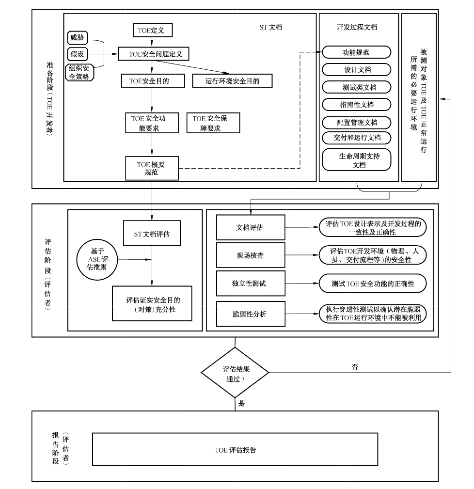
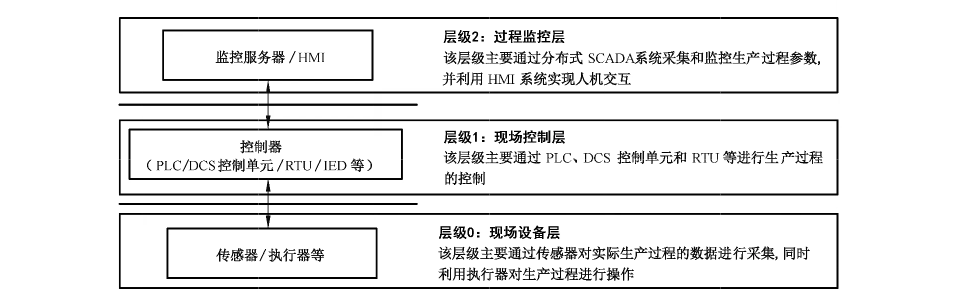

# GB/T 37962-2019 信息安全技术 工业控制系统产品信息安全通用评估准则

> 来源：[GB/T 37962-2019 国家标准详情](https://openstd.samr.gov.cn/bzgk/std/newGbInfo?hcno=958BFF9728BC1E1736F16DEFD0886879)；封面发布日期：2019-08-30；实施日期：2020-03-01。
> 官方在线预览截图 SHA-256：9c34924ac6767a123dce0b3b3cd24b696075dbc26800045cf36230b8da53dbf2。
> 转写说明：依据官方在线预览的全部 49 页图像整理正文、图示、表格及附录；省略封面、目录、页眉、页脚和页码，合并跨页内容。正式引用请核对官方原件。

## 前言

本标准按照 GB/T 1.1—2009给出的规则起草。

请注意本文件的某些内容可能涉及专利。本文件的发布机构不承担识别这些专利的责任。

本标准由全国信息安全标准化技术委员会（SAC/TC 260）提出并归口。

本标准起草单位：中国信息安全测评中心、上海三零卫士信息安全有限公司、北京匡恩网络科技有限责任公司、中国电子信息产业集团有限公司第六研究所、北京江南天安科技有限公司、北京交通大学、网神信息技术（北京）股份有限公司。

本标准主要起草人：邸丽清、李斌、张普含、谢丰、李智林、谢新勤、张大江、王峥、陈冠直、高洋、伊胜伟、张尼、燕飞、李航。

## 1 范围

本标准定义了工业控制系统产品信息安全评估的通用安全功能组件和安全保障组件集合，规定了工业控制系统产品的安全要求和评估准则。

本标准适用于工业控制系统产品安全保障能力的评估，产品安全功能的设计、开发和测试也可参照使用。

## 2 规范性引用文件

下列文件对于本文件的应用是必不可少的。凡是注日期的引用文件，仅注日期的版本适用于本文件。凡是不注日期的引用文件，其最新版本（包括所有的修改单）适用于本文件。

- GB/T 18336.1—2015 信息技术 安全技术 信息技术安全评估准则 第1部分：简介和一般模型

- GB/T 18336.2—2015 信息技术 安全技术 信息技术安全评估准则 第2部分：安全功能组件

- GB/T 18336.3—2015 信息技术 安全技术 信息技术安全评估准则 第3部分：安全保障组件

- GB/T 25069—2010 信息安全技术 术语

- GB/T 30270—2013 信息技术 安全技术 信息技术安全性评估方法

## 3 术语和定义

GB/T 18336.1—2015 和 GB/T 25069—2010界定的以及下列术语和定义适用于本文件。

### 3.1 工业控制系统 industrial control system

多种工业生产中使用的控制系统。

注1：包括监控和数据采集系统（SCADA）、分布式控制系统（DCS）、可编程逻辑控制器（PLC）等，现已广泛应用在工业部门和关键基础设施中。

注2：改写 GB/T 32919—2016，定义3.1。

### 3.2 工控上位机 industrial control host

在工业控制环境中，管理、控制工业控制设备的主机。

> 注：通常运行通用的操作系统，如 Windows、Unix/Linux 等。

### 3.3 工业控制设备 industrial control device

对工业生产过程及装置进行检测与控制的设备。

### 3.4 工业控制协议 industrial control protocol

工业控制系统中，工控上位机与工业控制设备之间以及工业控制设备与工业控制设备之间的通信报文规约。

> 注：通常包括模拟量和数字量的读写控制。

## 4 缩略语

GB/T 18336.1—2015界定的以及下列缩略语适用于本文件。

| 缩略语 | 中文名称 | 英文名称 |
| --- | --- | --- |
| CM | 配置管理 | Configuration Management |
| DCS | 分布式控制系统 | Distributed Control System |
| ETR | 评估技术报告 | Evaluation Technical Report |
| HMI | 人机界面 | Human Machine Interface |
| ICS | 工业控制系统 | Industry Control System |
| IT | 信息技术 | Information Technology |
| PLC | 可编程逻辑控制器 | Programmable Logic Controller |
| RTU | 远程终端单元 | Remote Terminal Unit |
| ST | 安全目标 | Security Target |
| SFR | 安全功能要求 | Security Functional Requirement |
| TOE | 评估对象 | Target of Evaluation |
| TSF | TOE 安全功能 | TOE Security Functionality |
| TSFI | TSF 接口 | TSF Interface |

## 5 概述

本标准主要包括评估对象、扩展组件定义、工业控制系统产品安全要求和工业控制系统产品安全评估准则等。本标准凡涉及采用密码技术解决机密性、完整性、真实性、不可否认性的应遵循密码相关国家标准和行业标准。

第6章描述了本标准适用的评估对象，包括但不限于ICS控制类产品和ICS网络安全类产品。

第7章参考 GB/T 18336.2—2015 安全功能组件、GB/T 18336.3—2015 安全保障组件相关要求，围绕ICS 产品与传统IT产品的差异（参见附录 A），针对ICS产品的特性，对组件进行了扩展和重新定义，扩展和重新定义组件在组件名称后加上“_EXT”表示，对新增扩展组件要求的描述用粗体表示，对组件要求中选择/赋值的选项用斜体表示。

第8章基于安全问题（参见附录 B）定义了适用于ICS产品的通用安全要求，开发者根据 TOE的预期使用环境及边界定义，根据威胁分析结果选择适用的安全功能要求和安全保障等级。在选择安全功能组件时，应考虑到组件的依赖关系。

第9章描述了工业控制系统产品评估准则。

## 6 评估对象

本标准适用于采用信息技术的工业控制系统产品，产品类型包括但不限于：

a） ICS 控制类产品：PLC、DCS、RTU、HMI等；

b） ICS 网络安全类产品：工控防火墙、网闸、主机防护设备、监测审计设备等。

TOE 被定义为一组可能包含指南的软件、固件和/或硬件的集合。TOE 的定义较灵活，未局限于公共理解的工业控制系统产品，TOE 可以是一个产品、一个产品的一部分、一种不可能形成产品的独特技术等。因此对于 TOE 的范围确定尤为重要，对 TOE 只包含产品某部分的评估不应与整个产品的评估相混淆。对于产品不涉及信息技术的部分可以不纳入评估范围，如对于未采用通信及信息处理等信息技术的工业控制系统执行机构等产品是不适合作为评估对象的。

对于存在多种方法配置的产品，如以不同的方法安装，使用不同的启用或禁用选项等，应明确 TOE 的安全配置，其中每种配置应满足 TOE 的指定要求，并写入 TOE 指南文档，TOE 指南（仅允许一种配置或在安全相关方面没有不同的配置）通常与产品指南（允许多种配置）有所不同。

## 7 扩展组件定义

### 7.1 安全组件扩展列表

安全功能组件扩展如表1所示。

**表1 安全功能扩展组件列表**

| 安全功能类 | 组件标识符 | 组件名称 |
| --- | --- | --- |
| FAU 类：安全审计 | FAU_SAA_EXT.5 | 基于白名单策略的异常检测 |
| FAU 类：安全审计 | FAU_SAA_EXT.6 | 工业控制协议解析 |
| FAU 类：安全审计 | FAU_SAR_EXT.4 | 审计数据报送 |
| FDP 类：用户数据保护 | FDP_IDP_EXT.1 | 输入数据验证 |
| FDP 类：用户数据保护 | FDP_IDP_EXT.2 | 输入数据双重确认 |
| FDP 类：用户数据保护 | FDP_SDI_EXT.1 | 软件/固件和信息完整性 |
| FDP 类：用户数据保护 | FDP_SDC_EXT.1 | 存储数据保密性 |
| FDP 类：用户数据保护 | FDP_DTI_EXT.1 | TOE 与外部实体传送数据完整性 |
| FDP 类：用户数据保护 | FDP_DTI_EXT.2 | TOE 内部传送数据完整性 |
| FDP 类：用户数据保护 | FDP_DTC_EXT.1 | TOE 与外部实体传送数据保密性 |
| FDP 类：用户数据保护 | FDP_DTC_EXT.2 | TOE 内部传送数据保密性 |
| FIA 类：标识和鉴别 | FIA_UAU_EXT.1 | 外部实体鉴别 |
| FIA 类：标识和鉴别 | FIA_UID_EXT.3 | 唯一性标识 |
| FPT 类：TSF 保护 | FPT_PHP_EXT.4 | 物理环境要求 |
| FPT 类：TSF 保护 | FPT_PHP_EXT.5 | 物理篡改防护 |
| FPT 类：TSF 保护 | FPT_FLS_EXT.2 | 确定性输出 |
| FPT 类：TSF 保护 | FPT_STM_EXT.2 | 时间同步 |
| FRU 类：资源利用 | FRU_RUB_EXT.1 | 数据备份 |

安全保障组件扩展如表2所示。

**表2 安全保障扩展组件列表**

| 安全保障类 | 组件标识符 | 组件名称 |
| --- | --- | --- |
| ATE 类：测试 | ATE_TES_EXT.1 | 测试人员 |
| ATE 类：测试 | ATE_TES_EXT.2 | 独立的测试人员 |

### 7.2 安全功能组件扩展定义

#### 7.2.1 安全审计分析（FAU_SAA）

##### 7.2.1.1 类别

所属类别为 GB/T 18336.2—2015中定义的FAU类：安全审计。

##### 7.2.1.2 族行为

本族定义了一些采用自动化手段分析系统活动和审计数据以寻找可能的或真正的安全侵害的要求。这种分析通过人侵检测来实现，或对潜在的安全侵害作出自动响应。

基于检测而采取的动作，可用FAU_ARP“安全审计自动响应”族来规范。

ICS 的基于白名单的监视探测保护策略与原有的“基于轮廓的异常检测”不同，其内容不仅包含用户操作行为，还包括进程、信息流等其他实体，故扩展了组件 FAU_SAA_EXT.5“基于白名单策略的异常监测”。基于 ICS 状态数据和通信数据进行行为分析前，需要对工业控制协议进行解析，本族扩展了组件 FAU_SAA_EXT.6“工业控制协议解析”。

##### 7.2.1.3 组件层次

FAU_SAA_EXT.5“基于白名单策略的异常监测”，提供基于信任列表的对异常行为进行监测的能力。

FAU_SAA_EXT.6“工业控制协议解析”，要求具备解析工业控制协议的能力。

##### 7.2.1.4 FAU_SAA_EXT.5 管理

FMT 中的管理功能可考虑下列行为：对信任列表的维护（添加、修改、删除）。

##### 7.2.1.5 FAU_SAA_EXT.6 管理

尚无预见的管理活动。

##### 7.2.1.6 FAU_SAA_EXT.5 审计

如果 PP/ST 中包含FAU_GEN“安全审计数据产生”，下列行为应是可审计的：

a） 最小级：开启和关闭任何分析机制；

b） 最小级：通过工具软件实现自动响应。

##### 7.2.1.7 FAU_SAA_EXT.6 审计

尚无预见的可审计事件。

##### 7.2.1.8 FAU_SAA_EXT.5 基于白名单策略的异常检测

从属于：无其他组件。

依赖关系：无依赖关系。

FAU_SAA_EXT.5.1 TSF 应能定义和维护基于［赋值：被信任的实体］的信任列表，并仅允许符合信任列表要求的行为通过，一旦检测到异常，应采取［赋值：动作列表］。

应用说明：

a） 被信任的实体可以是应用程序、用户组、信息流特征等；

b） 动作列表可以赋值无。

##### 7.2.1.9 FAU_SAA_EXT.6 工业控制协议解析

从属于：无其他组件。

依赖关系：无依赖关系。

FAU_SAA_EXT.6.1 TSF 应支持［赋值：工业控制协议名称］的解析，解析协议的深度包括［选择：工业控制协议的协议名称、指令格式、指令类型和指令参数、［赋值：其他参数了］。

应用说明：

a） 常见的工业控制协议包括（但不限于）Modbus/TCP 协议、OPC Classic 协议、DNP3.0协议、SIEMENS S7Comm 协议、EtherNet/IP 协议、EtherCAT 协议、PowerLink 协议和 Profinet 协议等；互联网协议主要包括（但不限于）HTTP、FTP、TELNET、SNMP 等协议。除上述协议外，还可以支持串行总线网络、工业无线网络、工业互联网等与 TCP/IP 网络技术不同的协议。

b）赋值协议名称可以是一种或多种。

c） 选择可以选择一个或多个。

#### 7.2.2 安全审计查阅（FAU_SAR）

##### 7.2.2.1 类别

所属类别为 GB/T 18336.2—2015中定义的FAU类：安全审计。

##### 7.2.2.2 族行为

本族定义了一些有关审计工具的要求，授权用户可使用这些审计工具查阅审计数据。

由于部分ICS 产品存储和处理能力有限，可采用集中审计模式，本族扩展了 FAU_SAR_EXT.4“审计数据报送”组件。

##### 7.2.2.3 组件层次

FAU_SAR_EXT.4“审计数据报送”，TSF 可将审计数据报送给其他设备。

##### 7.2.2.4 FAU_SAR_EXT.4 管理

FMT 中的管理功能可考虑下列行为：

a） 维护（删除、修改、添加）接受报送审计数据的设备组；

b） 维护根据审计数据属性过滤需要发送的审计数据。

##### 7.2.2.5 FAU_SAR_EXT.4 审计

如果 PP/ST 中包含FAU_GEN“安全审计数据产生”，下列行为应是可审计的：基本级：审计数据报送的失败动作。

##### 7.2.2.6 FAU_SAR_EXT.4 审计数据报送

从属于：无其他组件。

依赖关系：FTP_ITC.1 可信信道。

FAU_SAR_EXT.4.1 TSF 应能够将自身审计记录通过可信信道报送给其他设备，进行更高级别的审计。

应用说明：有些嵌入式设备的审计信息存储容量是有限的，宜从系统层面使用工具对系统范围内所有设备和主机的审计记录进行过滤和分析，设备的审计信息格式应是统一的。

#### 7.2.3 输入数据保护（FDP_IDP_EXT）

##### 7.2.3.1 类别

所属类别为GB/T 18336.2—2015中定义的FDP类：用户数据保护。

##### 7.2.3.2 族行为

本族为扩展的 FDP_IDP族，以描述TOE关键数据安全功能的保护能力。要求对输入到 TOE 的关键数据或动作进行输入内容和语法的合法性、安全性进行验证，并对关键操作执行双重批准确认。

##### 7.2.3.3 组件层次

FDP_IDP.EXT.1 “输入数据验证”，要求检测输入信息的安全性和合法性，一旦检测到错误后，TOE 应采取相关的动作。

FDP_IDP_EXT.2“输入数据双重确认”，要求对输入到 TOE 的关键数据或动作执行双重确认操作。

##### 7.2.3.4 FDP_IDP_EXT.1 管理

FMT 中的管理功能可考虑下列行为：对行为的管理（添加、删除或修改）。

##### 7.2.3.5 FDP_IDP_EXT.2 管理

尚无预见的管理活动。

##### 7.2.3.6 FDP_IDP_EXT.1 审计

如果 PP/ST 中包含FAU_GEN“安全审计数据产生”，下列行为应是可审计的：最小级：检测到错误后而采取的动作。

##### 7.2.3.7 FDP_IDP_EXT.2 审计

如果 PP/ST 中包含 FAU_GEN“安全审计数据产生”，下列行为应是可审计的：

a） 最小级：双重确认的成功执行；

b） 基本级：双重确认的未成功执行。

##### 7.2.3.8 FDP_IDP.EXT.1 输入数据验证

从属于：无其他组件。

依赖关系：无依赖关系。

FDP_IDP_EXT.1.1 TOE 应检测输入信息的安全性和合法性，一旦检测到错误后，TOE 应采取相关的动作［赋值：动作列表］。

应用说明：

a） 输入信息包括但不限于应用输入（如 I/O 输入或其他传输设备传输的数据）和参数配置（如授权人员通过配置界面/控制面板输入的参数）；

b） 系统输入信息的检测包括超出预定义字段值的范围、无效字符、缺失或不完整的数据和缓冲区溢出等。

##### 7.2.3.9 FDP_IDP_EXT.2 输入数据双重确认

从属于：无其他组件。

依赖关系：无依赖关系。

FDP_IDP_EXT.2.1 TOE 应对输入到TOE 的关键数据或动作执行双重确认操作。

应用说明：

a） 当需要很高级别可靠性和正确性执行的操作时，限制双重确认是一个普遍接受的良好实践；

要求双重批准强调正确操作失败所导致后果的严重性。如对关键工业过程的设定值进行改变或紧急关停装置等。

#### 7.2.4 存储数据的完整性（FDP_SDI）

##### 7.2.4.1 类别

所属类别为 GB/T 18336.2—2015 中定义的FDP类：用户数据保护。

##### 7.2.4.2 族行为

本族将存储数据的完整性扩展到了固件、可执行代码等在初始启动阶段、运行阶段或更新阶段的完整性保护。

##### 7.2.4.3 组件层次

FDP_SDI_EXT.1“软件/固件和信息完整性”，要求 TOE 在初始阶段、运行阶段或更新阶段可以对固件、可执行代码、关键配置数据等的完整性错误进行检测。

##### 7.2.4.4 FDP_SDI_EXT.1 管理

尚无预见的管理活动。

##### 7.2.4.5 FDP_SDI_EXT.1 审计

如果 PP/ST 中包含 FAU_GEN“安全审计数据产生”，下列行为应是可审计的：

a） 最小级：检查数据/固件/代码完整性的成功尝试，包括检测的结果；

b） 基本级：检查数据/固件/代码的所有尝试，如果成功的话，还包括加测的结果；

c） 详细级：出现的完整性错误的类型。

##### 7.2.4.6 FDP_SDI_EXT.1 软件/固件和信息完整性

从属于：无其他组件。

依赖关系：无依赖关系。

FDP_DSI.EXT.1.1 TOE 应在［选择：初始化启动、正常运行期间、代码/固件更新］时，对TOE［选择：关键配置数据、可执行代码、固件］的未授权修改、删除或插入等完整性错误进行检测。

FDP_DSI.EXT.1.2 当检测到完整性错误后，TOE 应采取相关的动作［赋值：动作列表］。

应用说明：

a） 本要求针对当存储数据、软件/固件被未授权更改后的检测和防护；

b） 更新中检测到加载的不是厂商授权版本情况应进行防护。

#### 7.2.5 存储数据的保密性（FDP_SDC_EXT）

##### 7.2.5.1 类别

所属类别为 GB/T 18336.2—2015中定义的FDP类：用户数据保护。

##### 7.2.5.2 族行为

本族为扩展的FDP_SDC 族，以描述 TSF 可保护敏感数据安全的能力。规定了存储数据的保密性，如鉴别数据、密钥、证书、关键配置等敏感数据。

##### 7.2.5.3 组件层次

FDP_SDC.EXT.1“存储数据的保密性”，要求有能力保护存储在TOE 中的敏感数据不被未授权泄露。

##### 7.2.5.4 FDP_SDC_EXT.1 管理

尚无预见的管理活动。

##### 7.2.5.5 FDP_SDC_EXT.1 审计

尚无预见的审计活动。

##### 7.2.5.6 FDP _SDC_EXT.1 存储数据保密性

从属于：无其他组件。

依赖关系：无依赖关系。

FDP_SDC_EXT. 1.1 TSF 应具备能力保护存储在TSF 中的敏感数据不被未授权泄露。

应用说明：保密性机制可以采取非明文或加密存储等。

#### 7.2.6 数据传输完整性（FDP_DTI_EXT）

##### 7.2.6.1 类别

所属类别为 GB/T 18336.2—2015中定义的FDP类：用户数据保护。

##### 7.2.6.2 族行为

本族为扩展的 FDP_DTI族，确保数据在TOE 内部及 TOE 与外部实体之间传送时不被非法篡改，数据的错误传输对ICS 系统基本功能的运行会产生严重影响，TOE 应能提供数据完整性保护及验证数据完整性的能力。

##### 7.2.6.3 组件层次

FDP_DTI_EXT.1“TOE 与外部实体传送数据完整性”，TOE 应在与外部实体之间发送及接收数据时提供数据完整性保护的能力。

FDP_DTI_EXT.2“TOE 内部传送数据完整性”，TOE 应在内部发送和接收数据时提供数据完整性保护的能力。

##### 7.2.6.4 FDP_DTI_EXT.1、FDP_DTI_EXT.2 管理

尚无预见的管理活动。

##### 7.2.6.5 FDP_DTI_EXT.1、FDP_DTI_EXT.2 审计

如果 PP/ST 中包含 FAU_GEN“安全审计数据产生”，下列行为应是可审计的：最小级：数据传输失败的记录。

##### 7.2.6.6 FDP_DTI_EXT.1 TOE 与外部实体传送数据完整性

从属于：无其他组件。

依赖关系：无依赖关系。

FDP_DTI_EXT.1.1 当 TOE 传送［赋值：数据类型］到［赋值：外部实体］时，TOE 应能对所传送数据进行完整性保护（如采用校验码或密码算法等）。

FDP_DTI_EXT.1.2 当 TOE 接收［赋值：外部实体］传送数据时，TOE 应能检测所传送数据的修改、替换、重排、重放、删除、延迟等完整性错误，当检测到完整性错误后，TOE 应采取相应的动作［赋值：动作列表］。

应用说明：

a） 赋值数据类型，如鉴别数据、控制数据等；

b） 赋值与TOE通信的外部实体，如果有多个，应进行识别，然后分别进行描述；

c） 赋值动作列表，如丢弃接收到的错误数据等。

##### 7.2.6.7 FDP_DTI_EXT.2 TOE 内部传送数据完整性

从属于：无其他组件。

依赖关系：无依赖关系。

FDP_DTI_EXT.2 TOE 应能检测在 TOE 内部不同部分间传送数据的［选择：修改、替换、重排、重放、删除、延迟］等完整性错误，当检测到完整性错误后，TOE 应采取相关的动作［赋值：动作列表］。

应用说明：

a） 选择一个或多个完整性错误类型，根据实体情况来定，如果TOE属于分布式，两个部分位于不同的地方，应考虑全面的完整性错误类型；

b） 赋值动作列表，如丢弃接收到的错误数据等。

#### 7.2.7 数据传输保密性（FDP_DTC_EXT）

##### 7.2.7.1 类别

所属类别为 GB/T 18336.2—2015中定义的FDP类：用户数据保护。

##### 7.2.7.2 族行为

本族规定了传输数据的保密性，防止未授权的通信数据窃听，主要针对敏感数据（如鉴别数据、密钥、安全配置等）和系统重要的应用通信数据（如控制参数等）。

##### 7.2.7.3 组件层次

FDP_DTC_EXT.1 “TOE 与外部实体传送数据保密性”，TOE 应在与外部实体之间发送及接收数据时提供数据保密性保护的能力。

FDP_DTC_EXT.2“TOE 内部传送数据保密性”，TOE 应在内部发送和接收数据时提供数据保密性保护的能力。

##### 7.2.7.4 FDP_DTC_EXT.1,FDP_DTC_EXT.2 管理

尚无预见的管理活动。

##### 7.2.7.5 FDP_DTC_EXT.1、FDP_DTC_EXT.2 审计

尚无预见的可审计事件。

##### 7.2.7.6 FDP_DTC_EXT.1 TOE 与外部实体传送数据保密性

从属于：无其他组件。

依赖关系：无依赖关系。

FDP_DTC_EXT.1.1 当 TOE 与［赋值：外部实体］传送［赋值：数据类型］时，TOE 应具备能力保护传送数据免遭未授权泄露（如对传送数据进行加密防护等）。

应用说明：

a） 赋值与 TOE 通信的外部实体，如果有多个，应进行识别，然后分别进行描述；

b） 本要求指通信应用层的加密防护，而FTP_ITC.1可信信道侧重传输层的加密防护。

##### 7.2.7.7 FDP_DTC_EXT.2 TOE 内部传送数据保密性

从属于：无其他组件。

依赖关系：无依赖关系。

FDP_DTC_EXT.2.1 TOE 应保护敏感数据在TOE 不同部分间传送时不被泄露。

应用说明：

a） TOE 的不同部分物理上可以在一起或不在一起（如分布式）；

b） 可以采取加密传输或可信信道。

#### 7.2.8 用户标识（FIA_UID）

##### 7.2.8.1 类别

所属类别为 GB/T 18336.2—2015中定义的FIA类：标识和鉴别。

##### 7.2.8.2 族行为

本族定义了在执行任何其他有TSF 促成的且需要用户标识的动作前，要求用户标识其身份的条件。对于访问 TOE 的外部实体标识应具备唯一性，本族扩展了 FIA_UID_EXT.”唯一性标识”组件。

##### 7.2.8.3 组件层次

FIA_UID_EXT.3“唯一性标识”，TOE应在对外接口提供唯一性标识用户的能力。

##### 7.2.8.4 FIA_UID_EXT.3 管理

尚无预见的管理活动。

##### 7.2.8.5 FIA_UID_EXT.3 审计

尚无预见的审计活动。

##### 7.2.8.6 FIA_UID_EXT.3 唯一性标识

从属于：无其他组件。

依赖关系：无依赖关系。

FIA_UID_EXT.3.1 TSF 应在对外接口提供唯一性标识用户（人员、软件进程和设备）的能力，且标识不可被篡改和分离。

应用说明：TOE应对外部接口用户提供标识，如远程网络接口、上位机控制进程等，典型的标识方式如设备的ID、MAC地址、用户ID 等，如有些不能进行标识的实体应进行说明。

#### 7.2.9 用户鉴别（FIA_UAU）

##### 7.2.9.1 类别

所属类别为 GB/T 18336.2—2015中定义的FIA类：标识和鉴别。

##### 7.2.9.2 族行为

本族在既有组件的基础上，重新定义了外部实体在允许访问 TOE之前需满足的行为活动。开发者应制定所有外部实体列表（人员、软件进程或设备等），并在通信前通过对任何请求访问 TOE 的外部实体进行身份验证来保护 TOE，任何请求访问 TOE 的外部实体，应在验证身份后才能激活通信。

##### 7.2.9.3 组件层次

FIA_UAU_EXT.1 “外部实体鉴别”，外部实体在被鉴别前可执行部分由TOE促成的动作列表，但若执行任何其他由 TOE 促成的动作前，应成功被鉴别。

##### 7.2.9.4 FIA_UAU_EXT.1 管理

尚无预见的管理活动。

##### 7.2.9.5 FIA_UAU_EXT.1审计

尚无预见的审计活动。

##### 7.2.9.6 FIA_UAU_EXT.1 外部实体鉴别

从属于：无其他组件。

依赖关系：无依赖关系。

FIA_UAU_EXT.1.1 在外部实体［选择：人员、软件进程、设备］被鉴别前，TOE 应允许执行代表外部实体的［赋值：由 TOE 促成的动作列表］。

FIA_UAU_EXT.1.2 在允许执行代表该外部实体的任何其他由TOE 促成的动作前，TOE 应要求每个外部实体都已被成功鉴别。

应用说明：

a） 赋值动作列表可以填无或允许的动作列表；

b） 应分析和分类所有通过TOE 外部接口与TOE 进行交互的外部实体，分别对这些外部实体的鉴别进行说明。

#### 7.2.10 TSF 物理保护（FPT_PHP）

##### 7.2.10.1 类别

所属类别为 GB/T 18336.2-2015中定义的FPT类：TSF保护。

##### 7.2.10.2 族行为

TSF 物理保护组件涉及限制对TSF 进行未授权的物理访问，以及阻止和抵抗对TSF 进行未授权的物理修改或替换。

本族中组件的要求确保了 TSF 不被物理侵害和干扰。若满足了这些组件要求，TSF 就可以被封装起来使用，并可检测出物理侵害或抵抗物理侵害。如果没有这些组件，在物理性损害无法避免的环境中，TSF 的保护功能就会失效。关于 TSF 如何对物理侵害尝试作出反应，本族也提供了要求。

为实现适应 ICS 现场环境对 TOE 的要求，扩展了 FPT_PHP_EXT.4“物理环境要求”、FPT_PHP_EXT.5“物理篡改防护”。

##### 7.2.10.3 组件层次

FPT_PHP_EXT.4“物理环境要求”，规定了TOE 设备在ICS 中应满足的物理环境指标要求。

FPT_PHP_EXT.5“物理篡改防护”，规定了 TOE 设备可以通过封装和设计使得难以对其进行物理篡改。

##### 7.2.10.4 FPT_PHP_EXT.4、FPT_PHP_EXT.5管理

尚无预见的管理活动。

##### 7.2.10.5 FPT_PHP_EXT.4、FPT_PHP_EXT.5审计

尚无预见的可审计事件。

##### 7.2.10.6 FPT_PHP_EXT.4物理环境要求

从属于：无其他组件。

依赖关系：无依赖关系。

FPT_PHP_EXT.4.1 TSF 应具备符合下列标准［赋值：标准列表］中规定的［赋值：物理侵害类型］的［赋值：度量或等级］的防护能力。

应用说明：

a） 不同行业有不同的针对物理环境的要求，应赋值具体的标准；

b） 物理侵害类型可以包含电磁辐射、抗浪涌（沖击）、高低温、化学品侵害、IP防护等等；

c） 针对每种物理侵害有些标准会规定不同的防护等级。

##### 7.2.10.7 FPT_PHP_EXT.5物理篡改防护

从属于：无其他组件。

依赖关系：无依赖关系。

FPT_PHP_EXT.5.1 TOE 应针对未授权的物理破坏提供物理防篡改的机制。

应用说明：防篡改机制可以防止攻击者对TOE进行未授权的物理访问，防篡改机制可以通过使用特材料或设计来实现，如封装、锁闭等。

#### 7.2.11 失效保护（FPT_FLS）

##### 7.2.11.1 类别

所属类别为 GB/T 18336.2—2015中定义的FPT类：TSF 保护。

##### 7.2.11.2 族行为

本族要求确保当 TSF 中已确定的失效类型出现时，该 TOE 总是执行它的SFR。在ICS中，当TOE 失效后应以不影响ICS系统自身的功能安全首要目标，因此是否继续维持执行 SFR 应根据具体情况进行分析。本族扩展了组件 FPT_FLS_EXT.2“确定性输出”。

##### 7.2.11.3 组件层次

FPT_FLS_EXT.2“确定性输出”，要求在受到攻击或TOE 失效后正常操作不能保持时，设定输出为预定义状态的能力。

##### 7.2.11.4 FPT_FLS_EXT.2 管理

FMT 中的管理功能可考虑下列行为：对预定义状态的管理（添加、删除或修改）。

##### 7.2.11.5 FPT_FLS_EXT.2 审计

如果 PP/ST 中包含 FAU_GEN“安全审计数据产生”，下列行为应是可审计的：基本级：TOE失效。

##### 7.2.11.6 FPT_FLS_EXT.2 确定性输出

从属于：无其他组件。

依赖关系：无依赖关系。

FPT_FLS_EXT.2.1 TOE 在受到攻击或失效后，如果不能维持正常操作，应输出预先设定的安全状态，该状态的输出应考虑TOE 在工业控制系统中的应用，不应对工业控制系统的安全性和可用性造成影响。

应用说明：

a） 失效类型可以包括硬件故障、软件故障、断电等；

b） 预先设定的失败状态由开发者根据工业控制系统应用环境定义，如输出保持某一状态或某一固定值等。示例，如工控防火墻失效后输出导通状态或阻断状态等。

#### 7.2.12 时间戳（FPT_STM）

##### 7.2.12.1 类别

所属类别为 GB/T 18336.2—2015中定义的FPT类：TSF保护。

##### 7.2.12.2 族行为

本族对一个 TOE 内可靠的时间戳功能提出要求，ICS 系统的正常运行大部分依靠时间同步服务器来同步时间，如果时间同步失败，会影响系统的正常运行，本族扩展了组件 FPT_STM_EXT.2“时间同步”。

##### 7.2.12.3 组件层次

FPT_STM_EXT.2“时间同步”，TOE应提供可靠的时间戳，并可实现时钟同步功能。

##### 7.2.12.4 FPT_STM_EXT.2 管理

尚无预见的管理活动。

##### 7.2.12.5 FPT_STM_EXT.2审计

如果 PP/ST 中包含 FAU_GEN“安全审计数据产生”，下列行为应是可审计的：

a） 基本级：时间同步失败；

b） 基本级：时间源被篡改。

##### 7.2.12.6 FPT_STM_EXT.2 时间同步

从属于：无其他组件。

依赖关系：无依赖关系。

FPT_STM_EXT.2.1 TOE 应具备同步TOE 内部各部分系统时钟的能力，并提供统一的时间基准。

FPT_STM_EXT.2.2 TOE 应保护时间源防止非授权改动，一旦改动则生成审计事件。

应用说明：ICS系统通常具备统一的时钟源，各部分的通信需要时间同步，因此TOE 应确保时间同步的能力。

#### 7.2.13 资源备份（FRU_RUB_EXT）

##### 7.2.13.1 类别

所属类别为 GB/T 18336.2—2015中定义的FRU类：资源利用。

##### 7.2.13.2 族行为

本族为扩展的 FIA_RUB族，要求 TOE 设备应在不影响正常设备使用的前提下，提供关键文件的识别和定位，以及信息备份（包括系统状态信息）的能力。

##### 7.2.13.3 组件层次

FRU_RUB.EXT.1 “数据备份”，要求在不影响设备正常适应的情况下，TOE 设备可对信息进行备份。

##### 7.2.13.4 FRU_RUB_EXT.1管理

尚无预见的管理活动。

##### 7.2.13.5 FIA_RUB_EXT.1 审计

尚无预见的审计活动。

##### 7.2.13.6 FRU_RUB.EXT.1 数据备份

从属于；无其他组件。

依赖关系：无依赖关系。

FRU_RUB_EXT.1.1 TOE 设备应在不影响正常设备使用的前提下，提供关键文件的识别和定位，并根据可配置的频率进行信息备份的能力。

### 7.3 安全保障组件扩展定义

#### 7.3.1 测试人员（ATE_TES）

##### 7.3.1.1 类别

所属类别为 GB/T 18336.3—2015中定义的 ATE类：测试。

##### 7.3.1.2 目的

本族的组件涉及测试人员的组成。TOE 测试人员的独立性会影响测试结果的准确性。本族的目的是降低测试人员在 TOE 测试中存在的人为错误风险，有助于保障未知缺陷出现的可能性相对较小。

##### 7.3.1.3 组件分级

本族中的组件分级是基于测试独立性的严格程度分级的。

##### 7.3.1.4 应用注释

在执行测试的过程中最好确保测试人员的独立性，可以有效地避免因开发者和测试者来自同一人或同一部门导致的测试结果异议。

#### 7.3.2 组件定义

##### 7.3.2.1 ATE_TES_EXT.1 测试人员

###### 7.3.2.1.1 目的

本组件的目的是避免开发人员对TOE 进行测试导致的测试结果误差。

依赖关系：ATE_FUN.1功能测试。

###### 7.3.2.1.2 开发者行为元素

ATE_TES_EXT.1.1D 开发者应提供测试文档。

###### 7.3.2.1.3 内容和形式元素

ATE_TES_EXT.1.1C 对 TOE进行测试的测试人员与开发人员应不是同一个人。

###### 7.3.2.1.4 评估者行为元素

ATE_TES_EXT. 1.1E 评估者应确认所提供的信息满足证据内容和形式的所有要求。

##### 7.3.2.2 ATE_TES_EXT.2独立的测试人员

###### 7.3.2.2.1 目的

本组件的目的是通过不同部门的独立测试确保测试的公正性。

依赖关系：ATE_FUN.1 功能测试。

###### 7.3.2.2.2 开发者行为元素

ATE_TES_EXT.2.1D 开发者应提交由独立测试部门测试的文档。

###### 7.3.2.2.3 内容和形式元素

ATE_TES_EXT.2.1C对 TOE进行测试的测试人员与开发人员应不属于同一部门。

###### 7.3.2.2.4 评估者行为元素

ATE_TES_EXT.2.1E 评估者应确认所提供的信息满足证据内容和形式的所有要求。

## 8 工业控制系统产品安全要求

### 8.1 安全功能要求

#### 8.1.1 安全审计

> 注：安全审计功能包括识别、记录、存储和分析那些与安全相关活动有关的信息。安全审计有助于监测与安全有关的事件，并能对安全侵害起到威慑作用。与安全审计功能相关的子功能包括安全审计事件的记录、安全审计记录的查阅、安全审计记录的存储和安全审计事件的分析。

##### 8.1.1.1 安全审计事件记录

与安全审计事件记录相关的安全功能组件包括：FAU_GEN.1、FAU_GEN.2 和 FAU_SEL.1。

a） 组件FAU_GEN.1 用于定义用于审计的安全事件，对ICS 系统重要或相关的事件应被审计，但考忠到审计活动会影响到ICS的性能，因此开发者在考虑审计事件列表时，应考虑通常公认和被接受的清单和配置指南；

组件 FAU_GEN.1 可被执行反复操作，记录网络状态数据（如MAC、IP、端口、协议等）和数据流等信息用于监视异常事件的出现；

c） 组件FAU_GEN.2 仅适用于处理单个用户身份级别上可审计事件的责任追溯，对于基于用户角色和用户组的访问方式不适用本组件；

d） 组件 FAU_SEL.1允许安全审计事件列表可由授权管理员进行配置，如在某些特殊情况下（如审计迹空间不足）仅选择重要事件进行审计等。如选择本组件，需要在 FMT_SMR.1 中定义被授权修改审计列表的角色或用户。

##### 8.1.1.2 安全审计事件查阅

与安全审计事件查阅相关的安全功能组件包括：FAU_SAR.1, FAU_SAR.2, FAU_SAR. 3和FAU_SAR_EXT.4。

a）组件 FAU_SAR.1应授权读取审计记录的角色，如管理员或审计员，安全角色需在FMT- SMR.1 中进行定义；

b） 组件FAU_SAR.2应除被授权角色外，默认设置拒绝所有用户访问；

c） 组件FAU_SAR.3可对所记录的审计事件进行选择性查阅，便于对可疑事件进行统计和定位；

d） 组件 FAU_SAR_EXT.4 针对存储容量受限的设备或ICS 系统需要进行集中审计时选用此组件，审计事件在传送到外部实体时应确保通道的通信安全。

##### 8.1.1.3 安全审计事件存储

与安全审计事件存储相关的安全功能组件包括：FAU_STG.1、FAU_STG.2、FAU_STG.3和FAU_STG.4。

a） 组件 FAU_STG.1 和FAU_STG.2定义防止审计迹中审计记录的未授权修改或删除；

b） 组件 FAU_STG.3和 FAU_STG.4定义在发生失效事件时应确保审计记录的可用性。开发者应根据实际情况对 TOE进行赋值。

##### 8.1.1.4 安全审计事件分析

与安全审计事件分析相关的安全功能组件包括：FAU_ARP.I、FAU_SAA.1,FAU_SAA.3,FAU- SAA_EXT.5 和 FAU_SAA_EXT.6。

a） 组件 FAU_ARP.1用于定义安全告警的方式，如声音、屏幕提示、锁定登录等。

b）组件FAU_SAA.1、FAU_SAA.3和FAU_SAA_EXT.5采用了不同的规则来监视审计事件的异常，开发者根据实际情况进行选择和赋值。典型异常事件包括用户异常登录次数超过限值、网络流量异常、控制数据修改异常、恶意代码或异常进程启动等。

c） 组件 FAU_SAA_EXT.6定义了对网络协议（含工业控制协议）的解析能力。

#### 8.1.2 标识和鉴别

> 注：TOE 具备标识鉴别功能，是为防止外部实体未授权的登录、访问 TOE，并对要保护的资产造成破坏。开发者根据 TOE运行环境和威胁分析情况，在TOE 的所有外部接口上考虑标识和鉴别机制的应用。

##### 8.1.2.1 外部实体标识

TOE 在对外部实体进行鉴别前，应首先具备对其进行标识的能力，尤其是需要在TOE 进行注册的用户，与外部实体标识相关的安全功能组件包括：FIA_UID. 1、FIA_UID.2、 FIA_UID_EXT.3和FIA_ATD.1。

a） 组件 FIA_UID.1 和 FIA_UID.2定义在TOE对外部实体执行仲裁动作前，如允许建立通信连接前、可执行有效鉴别前，需要对外部实体进行成功标识；

b） 组件 FIA_UID_EXT.3要求外部实体标识应具备唯一性；

c） TSF 应识别所有可能访问TOE 的外部实体，并明确其标识及对应的安全属性、角色等，组件FIA_ATD.1定义用户的安全属性，FMT_MSA 族“安全属性的管理”侧重管理权限和职责的明确。

##### 8.1.2.2 外部实体鉴别

对外部实体进行安全鉴别可防止未授权的访问，与鉴别相关的安全功能组件包括：FIA_UAU- EXT.1.FIA_UAU.5、FIA_UAU.6 和 FIA_AFL.1。

a） 组件 FIA_UAU_EXT.1定义了外部实体在访问或登录TOE 前应成功完成鉴别。外部实体可包含人类用户、软件进程或设备等，因此识别和梳理需要进行鉴别的实体是必须的。

组件 FIA_UAU.5定义了可实现多重鉴别机制，常用的鉴别机制分为基于密码、PIN 等（你所知道的）、基于令牌、智能卡等（你所拥有的）和基本生物特征的（你所具备的），如果采取其中两种或三种可选择该组件。

c） 组件 FIA_UAU.6定义需要重新鉴别的条件，如在用户长时间未活动退出或锁屏等。

d） 组件FIA_AFL.1是为防止恶意猜测鉴别数据的行为而设定的保护机制，如未成功登录次数达到限值时的动作，对于数值的设定等应在 FMT_SMR.1 和FMT_MTD.1 中定义授权角色和职责。

##### 8.1.2.3 鉴别数据的保护

鉴别数据在 TOE 中属于敏感数据，一旦被窃取利用将会对资产产生破坏，因此应确保鉴别数据在传输和存储时的安全。与鉴别数据保护相关的安全功能组件包括：FIA_UAU.3、FIA_UAU.4、FIA_ UAU.7、FTP_TRP.1 和 FDP_SDC_EXT.1。

a） 组件 FIA_UAU.3 和 FIA_UAU.4防止鉴别机制被伪造和重用；

b） 组件 FIA_UAU.7 定义用户在输入鉴别数据时应被保护；

c） 组件FTP_TRP.1和 FDP_SDC_EXT.1 确保鉴别数据在传输和存储时的完整性和保密性。

##### 8.1.2.4 鉴别数据的强度

与鉴别数据的强度相关的安全功能组件包括：FIA_SOS.1。

组件 FIA_SOS.1可定义鉴别数据需要满足的强度，如规定密码的最小长度、最低复杂度和密钥的算法强度等。

#### 8.1.3 访问控制

访问控制策略包括访问控制策略和信息流访问控制策略，访问控制策略控制范围包括策略控制下的主体、策略控制下的客体以及策略所涵盖受控主体和受控客体间的操作。信息流控制策略控制范围包括策略控制下的主体、策略控制下的信息以及策略所涵盖的引起受控信息流入、流出受控主体的操作。每一种策略应采用唯一的名称，可通过组件的反复操作来实现多个策略的定义。相关的安全功能组件包括：FDP_ACC.1、FDP_ACC.2,FDP_ACF.1,FDP_IFC.1、FDP_IFC.2 和 FDP_IFF.1。

a） 组件 FDP_ACC.1、FDP_ACC.2和 FDP_ACF.1 用来建立访问控制策略和访问控制功能，访问控制策略可以是基于用户角色、用户组、物理位置、时间等属性建立，每个不同的策略应分别命名，用户角色应在 FMT_SMR.1 中定义，安全属性的管理应在 FMT_MSA 族中进行定义；

b）组件FDP_IFC.I、FDP_IFC.2 和FDP_IFE.1 用来建立信息流访问控制策略和访问控制功能，访问控制策略可以是基于源目标 IP、源目标 MAC 和网络协议等属性建立，每个不同的策略应分别命名。

#### 8.1.4 会话安全

建立和维护用户会话的安全可以防止会话劫持、并发会话占用TOE 资源等事件。与会话建立和管理相关的安全功能组件包括：FTA_TSE.1、FTA_LSA.1、FTA_MCS.1、FTA_SSL.1、FTA_SSL.2、FTA_SSL.3,FTA_SSL.4,FTA_TAB.1 和 FTA_TAH.1。

a） 组件 FTA_TSE.1 和 FTA_LSA.1定义建立会话连接的安全，属于访问控制策略的一种，建立基于会话属性的会话建立机制；

b） 组件 FTA_MCS.1 限制同一用户的并发会话数量，可防止发生资源耗尽的 DoS；

c） 组件 FTA_SSI.1 和 FTA_SSI.3定义了TOE锁定和终止会话的要求，在工业控制系统中不是所有情况下都可以采用该要求，对于操作员站的监控软件，由于要确保业务的连续性，即使操作员不动作也不应对会话进行锁定和终止，因此TOE 为了确保安全，应假定运行环境的安全来抵御预期的威胁；

d） 组件 FTA_SSI.2 和 FTA_SS1.4定义了用户锁定和终止会话的要求；

e） 组件 FTA_TAB.1 和 FTA_TAH.1起到会话安全建立的提示和警告的作用。

#### 8.1.5 安全通信

##### 8.1.5.1 可信路径/信道

TOE 可支持在用户与TOE之间建立可信路径以及 TOE 和外部IT实体间建立可信信道的要求，可信路径和信道具备通信完整性和保密性要求，且提供通信两端端点身份的抗抵赖性。相关的安全功能组件包括：FTP_ITC.1 和 FTP_TRP.1。

组件 FTP_ITC.1 和FTP_TRP.1定义了TOE 与用户或外部IT 实体间的可信路径和信道，如采用HTTPS的方式，采用 IPSEC的方式等。为了保护鉴别数据不被泄露和篡改，用户鉴别应采用可信路径。

##### 8.1.5.2 通信完整性

如 TOE 不具备满足可信路径或通道的条件，应通过TOE 实现通信数据完整性的保护。相关的安全功能组件包括：FDP_DT1.1 和 FDP_DTI.2。

组件 FDP_DTI.1 和 FDP_DTI.2定义了TOE与外部IT 实体或TOE 内部的一部分进行通信时的数据完整性保护要求。

##### 8.1.5.3 通信保密性

如TOE 不具备满足可信路径或通道的条件，应通过TOE 实现通信数据保密性的保护。相关的安全功能组件包括：FDP_DTC.1 和 FDP_DTC.2。

组件FDP_DTC.1 和 FDP_DTC.2定义了 TOE 与外部IT 实体或TOE 内部的一部分进行通信时的数据保密性保护要求。由于工业控制系统中实时性要求较高，因此可仅对关键和敏感数据采用保密性保护。

##### 8.1.5.4 重放检测

TOE 应能对各种类型实体（如消息、服务请求、服务应答）的重放进行检测，并在检测到重放后采取一定的措施进行保护。与重放检测相关的安全功能组件包括：FPT_RPL.1。

组件 FPT_RPL.1可定义对通信数据进行重放的检测及纠正动作。

##### 8.1.5.5 状态和时间同步

分布式 TOE 由于存在 TOE 各部分间潜在的状态差别及通信延迟等问题，因此需要在通信时实现状态和时间同步的要求。相关的安全功能组件包括：FPT_SSP.1、FPT_SSP.2 和 FPT_STM_EXE.2。

a） 组件 FPT_SSP.1 和 FPT_SSP.2定义TOE 不同部分间通信时应对请求进行回执，以确保各部分状态保持一致；

b）组件FPT_STM_EXE.2确保各部分间的时钟进行同步。

#### 8.1.6 数据/代码保护

##### 8.1.6.1 完整性保护

要求 TOE 在初始阶段、运行阶段或更新阶段可以对固件、可执行代码、关键配置数据等的完整性错误进行检测，相关的安全功能组件包括：FDP_SDI_EXT.1。

组件 FDP_SDI_EXT.1 定义了数据、固件、可执行代码等的完整性保护。

##### 8.1.6.2 输入数据保护

用户在输入数据时，应避免数据的不合法、超限等错误，且必要时需要双重确认动作的回退等。

相关的安全功能组件包括：FDP_IDP_EXT.I、FDP_IDP_EXT.2 和 FDP_ROL.1。

a） 组件 FDP_IDP_EXT.1可对输入数据的合法性和安全性进行检测；

b） 组件 FDP_IDP_EXT.2 要求对输入的数据执行双重确认操作；

c） 组件 FDP_ROL.1允许用户从配置和其他管理错误中快速恢复。

##### 8.1.6.3 残余信息防护

要求确保当资源从一个客体释放并重新分配给另一个客体时，其中的任何数据均不可用。相关的安全功能组件包括：FDP_RIP.1。

组件 FDP_RIP.I要求确保任何资源的任何残余信息在资源分配或释放时不可用。

#### 8.1.7 加密

当TOE 具备加密运算模块及数据签名的生成和验证时，应考虑密钥管理和密码运算的功能，相关的安全功能组件包括：FCS_CKM.1,FCS_CKM.2、FCS_CKM.3、FCS_CKM.4 和 FCS_COP.1。在使用密码技术时应遵循密码相关标准和行业密码标准的规定。

#### 8.1.8 安全管理

TOE 的安全管理功能不是一个独立的功能，管理操作与其他安全功能都相关，如安全角色的定义，与安全审计、身份鉴别、访问控制的功能的用户角色都相关，安全管理功能涉及安全角色的定义，安全管理功能的定义，安全属性的管理、TSF 数据的管理等。

a） 与安全管理角色相关的安全组件 FMT_SMR.1 可以定义TOE设计到的安全角色，如管理员、审计员、操作员、工程师、普通用户等角色；

b） 与安全管理功能相关的安全组件 FMT_SMF.1 可以定义TOE具备的安全管理功能，这些功能可能会与之前的功能有重复，但需要利用该组件独立定义所有与管理相关的功能，用以明确管理角色和明确管理角色对应的管理功能，管理功能主要包括安全功能的管理、安全属性的管理和 TSF 数据的管理等，可利用FMT_MOF、FMT_MSA、FMT_MTD 等族下的组件进行定义相关功能。

#### 8.1.9 资源可用性

##### 8.1.9.1 物理防护

TOE 应限制未授权的物理访问，以及阻止和抵抗对TOE 进行未授权的物理修改或替换。相关的安全功能组件包括：FPT_PHP.1、FPT_PHP.2、FPT_PHP.3,FPT_PHP_EXT.4 和 FPT_PHP_EXT.5。

a） 组件 FPT_PHP.1、FPT_PHP.2 和 FPT_PHP.3定义了物理防护检测的能力；

b） 组件 FPT_PHP_EXT.4定义了物理环境适应性要求；

c）组件 FPT_PHP_EXT.5定义了物理防篡改要求。

##### 8.1.9.2 失效防护

TOE 在发生设备失效后应能导向安全状态，该安全状态应以维持工业控制系统基本功能的运行为目的。相关的安全功能组件为 FPT_FLS_EXT.2 确定性输出。

##### 8.1.9.3 TOE 测试

TOE 应在设备最初的启动、正常运行期间或授权用户要求下来检测所依托的外部环境或实体的正确性以及 TOE 自身的正确性和完整性。相关的安全功能组件包括：FPT_TEE.1 和 FPT_TST.1。

##### 8.1.9.4 备份与恢复

为保证系统的可用性，TOE应具备资源备份及可信复的能力，相关的安全功能组件包括：FIA_ RUB_EXT.1 和 FPT_RCV 族。

##### 8.1.9.5 资源利用

为防止 TOE 在发生DoS攻击时资源被耗尽，TOE 应具备服务优先级和资源合理分配的能力，相关的安全功能组件包括 FRU_PRS族和 FRU_RSA 族。

### 8.2 安全保障要求

本节定义了 ICS 产品需要满足的四个安全保障等级 EAL1～EAL4。安全保障组件的定义和解释参考 GB/T 18336.3—2015，开发者需要根据安全保障要求准备相关的评估证据，评估者依据要求对评估证据进行评估确认。表3给出了四个保障等级对应的安全保障组件集合。

**表3 安全保障要求组件**

| 组件分类 | 安全保障要求组件 | EAL1 | EAL2 | EAL3 | EAL4 |
| --- | --- | :---: | :---: | :---: | :---: |
| 开发 | ADV_ARC.1 安全架构描述 | √ | √ | √ | √ |
| 开发 | ADV_FSP.1 基本功能规范 | √ | | | |
| 开发 | ADV_FSP.2 安全执行功能规范 | | √ | | |
| 开发 | ADV_FSP.3 带完整摘要的功能规范 | | | √ | |
| 开发 | ADV_FSP.4 完备的功能规范 | | | | √ |
| 开发 | ADV_IMP.1 TSF 实现表示 | | | | √ |
| 开发 | ADV_TDS.1 基础设计 | | √ | | |
| 开发 | ADV_TDS.2 结构化设计 | | | √ | |
| 开发 | ADV_TDS.3 基础模块设计 | | | | √ |
| 指导性文档 | AGD_OPE.1 操作用户指南 | √ | √ | √ | √ |
| 指导性文档 | AGD_PRE.1 准备程序 | √ | √ | √ | √ |
| 生命周期 | ALC_CMC.1 TOE 标识 | √ | | | |
| 生命周期 | ALC_CMC.2 CM 系统的使用 | | √ | | |
| 生命周期 | ALC_CMC.3 授权控制 | | | √ | |
| 生命周期 | ALC_CMC.4 生产支持和接受程序及其自动化 | | | | √ |
| 生命周期 | ALC_CMS.1 TOE CM 覆盖 | √ | | | |
| 生命周期 | ALC_CMS.2 部分 TOE CM 覆盖 | | √ | | |
| 生命周期 | ALC_CMS.3 实现表示 CM 覆盖 | | | √ | |
| 生命周期 | ALC_CMS.4 问题跟踪 CM 覆盖 | | | | √ |
| 生命周期 | ALC_DEL.1 交付程序 | | √ | √ | √ |
| 生命周期 | ALC_FLR.2 缺陷报告程序 | | √ | √ | |
| 生命周期 | ALC_FLR.3 系统的缺陷纠正 | | | | √ |
| 生命周期 | ALC_DVS.1 安全措施标识 | | | √ | √ |
| 生命周期 | ALC_LCD.1 开发者定义的生命周期模型 | | | √ | √ |
| 生命周期 | ALC_TAT.1 明确定义的开发工具 | | | | √ |
| 测试 | ATE_COV.1 覆盖证据 | | √ | | |
| 测试 | ATE_COV.2 覆盖分析 | | | √ | √ |
| 测试 | ATE_DPT.1 测试：基本设计 | | | √ | |
| 测试 | ATE_DPT.2 测试：安全执行模块 | | | | √ |
| 测试 | ATE_FUN.1 功能测试 | | √ | √ | √ |
| 测试 | ATE_TES_EXT.1 测试人员 | | | √ | |
| 测试 | ATE_TES_EXT.2 独立的测试人员 | | | | √ |
| 测试 | ATE_IND.1 独立测试—符合性 | | | | |
| 测试 | ATE_IND.2 独立测试—抽样 | | √ | √ | √ |
| 脆弱性分析 | AVA_VAN.1 脆弱性调查 | √ | √ | | |
| 脆弱性分析 | AVA_VAN.2 脆弱性分析 | | √ | | |
| 脆弱性分析 | AVA_VAN.3 关注点脆弱性分析 | | | √ | |
| 脆弱性分析 | AVA_VAN.4 系统的脆弱性分析 | | | | √ |

注：“√”代表在该保障级别下应选择的安全保障组件。

## 9 工业控制系统产品评估准则

### 9.1 评估模型

按GB/T 30270—2013，评估模型一般包括评估输入任务、评估子活动和评估输出任务等活动。

a） 评估证据输入评估：评估发起者应向安全评估机构提供评估所有必需的评估证据，评估证据应参考每个评估保障等级的要求，评估者应对这些证据输入进行评估；

b） 评估子活动：评估子活动参考不同的评估保障等级要求，每个子活动对应一个保障组件；

c） 评估结果输出评估：安全评估机构的输出任务评估的目的是评估输出的观察报告和评估技术报告应满足评估结果的可重复性和可再现性原则，并应保持各种报告信息类型和数量的一致性。

对照评估模型，TOE 评估分为三个阶段，即准备阶段、评估阶段和报告阶段。准备阶段 TOE 开发者应准备 TOE 相关的评估证据，如 ST 文档、开发过程文档和 TOE 及 TOE 正常运行所需的必要运行环境；评估阶段评估者主要依据 ASE 类评估准则针对 ST 文档进行评估，来确定 TOE 安全目的及 TOE 运行环境安全目的的充分性；根据 ST 文档中规定的安全保障等级要求对 TOE 相关的评估证据进行评估以确定 TOE 安全功能实现的正确性；报告阶段评估者依据 TOE 开发者提供的评估证据，评估确认该 TOE 是否满足 ST 文档要求的特定保障级别，如果评估未通过则回到 TOE 准备阶段对评估者提出的问题进行整改；如果评估通过，评估者拟制评估报告。图1给出 ICS 产品评估流程示意图。

### 9.2 评估方法

评估方法包括但不限于：

a） 分析并检查过程和程序；

b） 检查过程和程序是否正在被使用；

c） 分析 TOE 各设计表示之间的一致性；

d） 对照要求，分析 TOE 的设计表示；

e） 验证证据；

f） 分析指导性文档；

g） 分析所开发的功能测试和所提供的结构；

h） 独立的功能测试；

i） 脆弱性分析（包括缺陷假设）；

j） 穿透性测试。

### 9.3 评估内容

#### 9.3.1 ST 评估

> 注：ST为TOE评估子活动提供依据和评估背景，所以 ST评估在所有TOE 评估子活动之前启动。鉴于TOE评估过程中子活动的有关发现可能会导致ST 的改变，因此直到 TOE 评估完成后，才可能形成对ST 的最终栽定。

不管ST 中宣称的安全保障等级是多少，对于每个 ST 评估，其要求和方法是完全相同的。开发者通过分析TOE 预期使用的环境及安全问题定义，定义TOE的安全功能组件和安全保障组件及 TOE 的概要规范等内容。评估通过评估ST确认 TOE安全要求的充分性。

##### 9.3.1.1 ST 引言（ASE_INT.1）

对ST引言的评估需要证实 ST 和TOE被正确标识，TOE 的三层抽象方式描述正确，并且这三方面的描述相互一致。ST 引言安全评估内容包括：

a） 评估者应核查开发者提供的ST 引言，确认它包含ST 参照号，TOE 参照号，TOE 概述和TOE 描述；

b） 评估者应核查 ST参照号，确认它能唯一标识 ST；

c） 评估者应核查 TOE 参照号，确认它能唯一标识 TOE；

d） 评估者应核查 TOE 参照号，确认它不会误导消费者辨识 TOE；

e） 评估者应核查 TOE 概述，确认它正确的概括 TOE 的用法及其主要安全特性；

f） 评估者应核查 TOE 概述，确认它正确标识了 TOE 类型；

g） 评估者应核查 TOE 概述，确认它不会误导消费者辨识 TOE 类型；

h） 评估者应核查 TOE 概述，确认它标识了任何 TOE 要求的非 TOE 范围内的硬件/软件/固件；

1） 评估者应核查 TOE 描述，确认它正确的描述 TOE 的物理范围；

j） 评估者应核查 TOE 描述，确认它正确的描述 TOE 的逻辑范围；

k）评估者应核查 TOE 参照号、TOE概述和 TOE 描述，确认它们之间的相互一致性。

##### 9.3.1.2 安全目的（ASE_OBJ.2）

安全目的评估是确定安全目的描述是否完备和一致，并确定安全目的是否能对抗已标识的威胁，实现已标识的组织安全策略并遵循规定的假设。安全目的安全评估内容包括：

a） 评估者应核查开发者提供的安全目的的陈述，确认它描述 TOE 的安全目的和运行环境安全目的；

b） 评估者应核查安全目的基本原理，确认 TOE 的每一个安全目的能追溯到安全目的所对抗的威胁及安全目的实施的组织安全策略；

c） 评估者应核查安全目的基本原理，确认 TOE运行环境的每一个安全目的能追溯到安全目的所对抗的威胁、安全目的实施的组织安全策略和安全目的支持的假设；

d） 评估者应核查安全目的基本原理，能证实安全目的能抵抗所有威胁；

e） 评估者应核查安全目的基本原理，能证实安全目的执行所有组织安全策略；

f） 评估者应核查安全目的基本原理，能证实运行环境安全目的支持所有的假设。

##### 9.3.1.3 推导出的安全要求（ASE_REQ.2）

本组件评估目的是确定 TOE 安全要求（包括TOE 安全功能要求和 TOE 安全保障要求）和 IT环境安全要求是否完备和一致，并次TOE的开发提供充分的基础，以达到其安全目的。推导出的安全要求组件安全评估内容包括：

a） 评估者应核查安全要求的陈述是否描述了 TOE 安全功能要求；

b） 评估者应核查安全要求的陈述是否描述了 TOE 保障安全要求；

c） 评估者应核查安全目标，确认安全功能要求和安全保障要求中使用的所有主体、客体、操作、安全属性、外部实体及其他术语进行了定义；

d） 评估者应核查安全要求的陈述，确认对安全要求的所有操作进行了标识；

e） 评估者应核查安全要求的陈述，确认所有赋值操作都应被正确地执行；

f） 评估者应核查安全要求的陈述，确认所有反复操作都应被正确地执行；

g） 评估者应核查安全要求的陈述，确认所有选择操作都应被正确地执行；

h） 评估者应核查安全要求的陈述，确认所有细化操作都应被正确地执行；

评估者应核查安全要求的陈述，确认安全要求间的依赖关系应满足，或安全要求基本原理应证明不需要满足某个依赖关系；

j 评估者应核查安全要求的基本原理，确认每一个安全功能要求可追溯至对应的TOE 安全目的；

k）评估者应核查安全要求的基本原理，证明安全功能要求可满足所有的 TOE 安全目的；

I） 评估者应核查安全要求的基本原理，确认有安全保障要求的选择理由。

##### 9.3.1.4 安全问题定义（ASE_SPD.1）

安全问题定义评估是确定 ST 中TOE 安全问题的陈述是否为有关TOE及其预期应用环境的安全问题提供了一个清晰、一致的定义。安全问题定义评估内容如下：

a） 评估者应核查安全问题定义，确认描述了威胁；

b） 评估者应核查安全问题定义，确认对所有的威胁都根据威胁主体、资产和敌对行为进行了描述；

c） 评估者应核查安全问题定义，确认描述了组织安全策略；

d） 评估者应核查安全问题定义，确认描述了 TOE运行环境的相关假设。

##### 9.3.1.5 TOE 概要规范（ASE_TSS.1）

TOE 概要规范评估是确定TOE 概要规范是否安全功能和安全保障措施提供了清晰的、一致的高层定义，且满足指定的TOE安全要求。TOE 概要规范安全评估内容如下：

a） 评估者应核查TOE 概要规范，确认是否描述了TOE 是如何满足每一项安全功能要求的；

b） 评估者应核查 TOE 概要规范，确认 TOE 概要规范与 TOE 概述、TOE描述是一致的。

#### 9.3.2 功能规范评估

##### 9.3.2.1 基本功能规范（ADV_FSP.1）

基本功能规范组件评估是确认开发者是否对TOE安全功能接口的目的、使用方法及其参数作了充分描述。基本功能规范组件评估证据包括安全目标和功能规范。如果安全目标包含评估证据的话，那么所使用的评估证据应包括用户操作指南。基本功能规范组件评估要求如下：

a） 评估者应检查功能规范，标识出 TSF 对应的TSFI，以确认该规范完整地描述了 TSF 的接口；

b） 评估者应检查功能规范，确认是否描述了每个 TSFI 目的，以使得评估者能够理解这些接口；

c） 评估者应检查功能规范，确认该规范完整地描述了每个 TSFI 的使用方法；

d） 评估者应检查TSFI 的表示，确认该表示完整地指出了与各 TSFI 相关的所有参数；

评估者应检查 TSFI 的表示，确认该表示完整和准确地描述了各 TSFI 相关的所有参数；

f 评估者应检查 TSFI 的表示所有相关行动，确认外部 TOE 安全功能接口进行了详细的描述，以使得评估者能够确定接口是否是与安全相关的；

8g） 评估者应检查是否将 SFR追溯到对应的 TSFI；

h） 评估者应检查功能规范，确定它是TOE安全功能要求的一个完备实例化；

评估者应检查功能规范，确定它是 TOE 安全功能要求的一个准确实例化。

##### 9.3.2.2 安全执行功能规范（ADV_FSP.2）

安全执行功能规范组件评估是确认开发者是否对TOE 安全功能接口的目的、使用方法及其参数做了充分描述。另外每个安全功能接口的行为、结果和出错信息描述应足够充分，以便评估人员能确认TSFI 是安全相关的。安全执行功能规范组件评估证据包括：安全目标、功能规范和 TOE 设计。如果TOE 的ST有评估证据的话，那么所使用的评估证据应包括：安全架构描述和用户操作指南。安全执行功能规范组件评估要求如下：

a） 评估者应检查功能规范，标识出 TSF 对应的 TSFI，以确认该规范完整地描述了 TSF 的接口；

b） 评估者应检查功能规范，确认是否描述了每个 TSFI目的，以使得评估者能够理解这些接口；

c） 评估者应检查功能规范，确认该规范完整地描述了每个 TSFI 的使用方法；

d） 评估者应检查 TSFI 的表示，确认该表示完整地指出了与各 TSFI 相关的所有参数；

e） 评估者应检查 TSFI 的表示，确认该表示完整和准确地描述了各 TSFI 相关的所有参数；

评估者应检查 TSFI 的表示所有相关行动，确认外部 TOE 安全功能接口进行了详细的描述，以使得评估者能够确认接口是否是与安全相关的；

g） 评估者应检查 TSFI 的表示，确认其充分并正确地描述了各外部接口的相关参数、异常和出错信息的TOE行为；

h） 评估者应检查将 SFR追溯到对应的 TSFI；

i） 评估者应检查功能规范，确定它是 TOE 安全功能要求的一个完备实例化；

j） 评估者应检查功能规范，确定它是 TOE 安全功能要求的一个准确实例化。

##### 9.3.2.3 带完整摘要的功能规范（ADV_FSP.3）

带完整摘要功能规范组件评估是确认开发者是否对TOE 安全功能接口的目的、使用方法及其参数做了充分描述。另外每个安全功能接口的行为、结果、出错信息描述应足够充分，以便评估人员能比较不同TSFI之间安全相关强度。带完整摘要功能规范组件评估证据包括：安全目标、功能规范和TOE 设计。如果 TOE的ST 有评估证据的话，那么所使用的评估证据应包括：安全架构描述、实现表示、TSF 内部描述和用户操作指南。安全执行功能规范组件评估要求如下：

a） 评估者应检查功能规范，标识出 TSF 对应的接口（TSFI），以确认该规范完整地描述了 TSF 的接口；

b） 评估者应检查功能规范，确认是否描述了每个TSFI 目的，以使得评估者能够理解这些接口；

c） 评估者应检查功能规范，确认该规范完整地描述了每个 TSFI 的使用方法；

d） 评估者应检查TSFI 的表示，确认该表示完整地描述了与各TSFI 相关的所有参数；

e） 评估者应检查 TSFI 的表示，确认该表示完整和准确地描述了各TSFI 相关的所有参数；

f） 评估者应检查 TSFI 的表示所有相关行动，确认外部TOE 安全功能接口进行详细的描述，以使得评估者能够确定接口是否是与安全相关的；

g） 评估者应检查TSFI的表示，确认其充分并正确地描述了各外部接口的相关参数、异常和出错信息的 TOE 行为；

h）评估者应检查TSFI 的表示，确认每个 TSFI是否概述了SFR支持和SFR 不相关的行为；

i） 评估者应检查将 SFR追溯到对应的 TSFI；

j 评估者应检查功能规范，确定它是 TOE安全功能要求的一个完备实例化；

k）评估者应检查功能规范，确定它是 TOE 安全功能要求的一个准确实例化。

##### 9.3.2.4 完备的功能规范（ADV_FSP.4）

完备的功能规范组件评估时确定开发者是否完全描述了所有TSFI，描述的方式是否可使评估者能够肯定 TSFI完整精确地描述了ST 的安全功能需求。接口的完整度是基于实现介绍判断的。完备的功能规范组件评估证据包括：安全目标、功能规范、TOE设计和实现表示。如果TOE 的ST 有评估证据的话，那么所使用的评估证据应包括：安全体系结构描述、TSF 内部描述、安全策略模型。安全执行功能规范组件评估要求如下：

a） 评估者应检查功能规范，标识出 TSF 对应的TSFI，以确认该规范完整地描述了 TSF 的接口；

b） 评估者应检查功能规范，确认接口描述的结构化/半结构化、上下一致，并使用常用术语；

c） 评估者应检查功能规范，确认它说明了各 TSFI接口所提供的功能的总述；

d） 评估这应检查功能规范，确认规范给出了各 TSFI的使用方法；

e） 评估者应检查功能规范，确认 TSFI 的完整性；

f） 评估者应检查 TSFI的表示，确认该表示完整地指出了与各 TSFI 相关的所有参数；

g） 评估者应检查 TSFI 的表示，确认该表示完整和准确地描述了各 TSFI 相关的所有参数；

h） 评估者应检查 TSFI 的表示，确认该表示完整地、准确地描述了与各TSFI 相关的所有行动；

i） 评估者应检查 TSFI 的表示，确认该表示完整地、准确地描述了调用各TSFI产生的所有错误信息；

j 评估者应检查TSFI的表示，确认该表示完整和准确地描述了调用各TSFI产生的所有错误信息；

k）评估者应检查功能规范，确认规范完整、准确地描述了调用一个 TSFI 不会产生的所有错误信息；

I） 评估者应检查功能规范，确认对于每一个包含在TSF 实现内但不是从 TSFI调用中产生的错误，该规范都给出了原因；

m）评估者应检查将 SFR 链追溯到对应的 TSFI；

n） 评估者应检查功能规范，确定它是 TOE 安全功能要求的一个完备实例化；

o） 评估者应检查功能规范，确定它是 TOE安全功能要求的一个准确实例化。

#### 9.3.3 设计规范及实现评估

##### 9.3.3.1 安全架构描述（ADV_ARC.1）

安全架构描述组件评估是确定数据库的TSF 结构是否使TSF 不能被篡改或绕过，且提供安全域的TSF 是否分离了这些域。安全评估活动的证据包括：安全目标、数据库安全功能规范、TOE 设计文档、安全架构描述、TOE 实现技术资料、操作性用户指南等。安全架构描述组件安全评估要求如下：

a） 评估者应检查安全体系结构的描述，以确认证据提供的信息的详细水平与在细节与功能规范和 TOE 设计文件中包含的 SFR 强制实施抽象的描述相称；

b） 评价者应检查安全体系结构的描述，确认它描述了 TSF 维护的安全域；

c） 评估者应检查安全体系结构的描述，确认初始化过程保持了安全性；

d） 评估者应检查安全体系结构的描述，确认它包含的信息足以证明TSF 能够保护自身不受非受信活动实体的篡改；

e） 评估者应检查安全体系结构的描述，确认该描述的分析充分说明了 SFR 强制实施机制是如何不能被绕过的；

f） 评估者也应确认描述是全面的，表现为每个接口都结合声明的SFR 的全集进行了分析。

##### 9.3.3.2 基础设计（ADV_TDS.1）

基础设计组件评估是确定 TOE的设计是否提供了一个足以确定TSF 边界的描述，以供评估者确定TOE 完整、准确地执行了 SFR。基础设计组件评估证据包括：安全目标、功能规范、安全架构描述和TOE 设计描述。基础设计组件评估要求如下：

a） 评估者应检查TOE设计，确认它以子系统方式描述了整个 TOE结构；

b）评估者应检查 TOE 设计，确认整个 TSF 所有子系统都进行了标识；

c） 评估者应检查 TOE 设计，确认 TSF 的 SFR支持或SFR 不相干子系统行为被足够描述清楚，以保证评估人员能区分 SFR 支持或SFR 不相干子系统；

d） 评估者应检查 TOE设计，确认它完整、准确和详细地描述了 TSF 的SFR 子系统 SFR 强制实施行为；

e） 评估者应检查TOE设计，确认它描述了 TSF各子系统之间的相互作用；

f） 评估者应检查 TOE 设计，确认 TSF 子系统和 TSF 功能接口规范之间的映射是完整的；

g） 评估者应检查 TOE 安全功能需求和 TOE 设计，确认 TOE 设计覆盖了 TOE 所有安全功能需求；

h）评估者应检查TOE设计，确定设计是所有安全功能要求的正确且完全的实例。

##### 9.3.3.3 结构化设计（ADV_TDS.2）

结构化设计组件评估是确定高层设计是否按照子系统提供了 TSF的描述，提供了这些子系统接口的描述，并是功能规范的一个正确实现。结构化设计组件评估证据包括：安全目标、功能规范、安全架构描述和 TOE设计描述。结构化设计组件评估要求如下：

a） 评估者应检查 TOE设计，确认它以子系统方式描述了整个 TOE设计；

b） 评估者应检查TOE设计，确认整个 TSF 所有子系统都进行了标识；

c） 评估者应检查TOE设计，确认 TSF的SFR 不相干子系统的行为描述足够让评估者确认 SFR不相干的子系统；

d） 评估者应检查TOE设计，确认它完整、准确和详细地描述了 TSF 的SFR 子系统SFR 强制实施行为；

e） 评估者应检查 TOE 设计，确认它完整和准确地提供了 SRF 强制实施的 SRF 支持和 SRF 不相干子系统的高层行为描述；

f） 评估者应检查TOE 设计，确认它完整和准确地提供了 SRF强制实施的高层行为描述；

g） 评估者应检查 TOE 设计，确认它描述了 TSF 各子系统之间的相互作用；

h） 评估者应检查TOE 设计，确认 TOE 设计中描述的所有行为能够映射到调用它的 TSFI；

i） 评估者应检查TOE 安全功能需求和 TOE 设计，确认 TOE 设计覆盖了TOE 所有安全功能需求；

j） 评估者应检查TOE设计，确定设计是所有安全功能要求的正确且完全的实例。

##### 9.3.3.4 基础模块设计（ADV_TDS.3）

基础模块设计评估是确定TOE设计是否提供了一个足以确定TSF边界的描述，且以模块方式描述了 TOE 内部描述。它提供了 SFR 强制实施模块和 SFR 支持模块的详细描述，以供评估者确定TOE 完整、准确地执行了 SFR。基础模块设计组件评估证据包括：安全目标、功能规范、安全架构描述和TOE设计描述。基础模块设计组件评估要求如下：

a） 评估者应检查TOE设计，确认它以子系统方式描述了整个 TOE 设计；

b）评估者应检查TOE设计，确认完整的TSF 是以模块方式描述的；

c） 评估者应检查 TOE 设计，确认整个 TSF 所有子系统都进行了标识；

d） 评估者应检查TOE 设计，确认 TSF 的每个子系统描述了它在安全目标中 SRF强制实施的角色；

e） 评估者应检查TOE设计，确认 TSF 中每个 SFR不相干子系统描述的足够让评估者确认它是SFR 不相干子系统；

f） 评估者应检查 TOE 设计，确认 TSF 各子系统之间的相互作用已经描述；

g） 评估者应检查TOE 设计，确认提供了 TSF 子系统到 TSF 模块间的映射关系；

h）评估者应检查 TOE 设计，确认每一个 SFR-执行模块，包括它的目的及与其他模块间的相互作用；

i） 评估者应检查TOE设计，确认每一个 SFR-执行模块，包括它的安全功能要求相关接口、其他接口的返回值、与其他模块间的相互作用及调用的接口；

j） 评估者应检查TOE 设计，确认描述每一个 SFR-支撑或 SFR-无关模块，包括它的目的及与其他模块间的相互作用；

k）评估者应检查TOE设计，确认映射关系应论证 TOE设计中描述的所有行为能够映射到调用它的 TSFI。

##### 9.3.3.5 TSF 实现表示（ADV_IMP.1）

TSF 实现表示组件评估是确定开发者编写的实现介绍适合于给其他分析活动使用；其适用性由它与该组件需求的一致性决定。TSF 实现表示组件评估证据包括：实现表示、与ALC-TAT 相关的开发工具文档和 TOE 设计描述。TSF 实现表示组件评估要求如下：

a） 评估者应检查实现表示，确认其无歧义地定义了 TSF，且详细程度达到了不需要进一步的设计就能生成 TSF 的程度；

b） 评估者应检查开发者提供的实现表示，确认它是以开发人员使用的形式提供的；

c） 评估者应检查TOE设计描述与实现表示示例之间的映射应能证明它们的一致性。

#### 9.3.4 指导性文档评估

##### 9.3.4.1 操作用户指南（AGD_OPE.1）

操作用户指南组件是判断用户手册是否描述了每个用户角色的安全功能和 TSF 接口，是否说明了TOE 的安全使用方法，是否所有操作模式的安全步骤，是否有简易的 TOE 不安全状态的预防和探测，以及是否很有歧义或其他不合理内容。用户操作指南组件评估依据包括安全目标、功能规范、TOE 设计和用户操作指南。用户操作指南组件安全评估内容如下：

a） 评估者应检查用户操作手册，判断它是否描述了每个用户角色可用的功能、在安全处理环境控制下的权限及适当的警告；

b） 评估者应检查用户操作手册，判断它是否描述了每个用户角色相应的TOE 提供接口的安全用法；

c） 评估者应检查用户操作手册，判断它是否描述每个用户角色可用的功能和接口，特别是用户可以控制的安全参数，指出安全参数合适的数值；

d） 评估者应检查用户操作手册，判断它是否描述了每个用户角色每种需要演示的功能的安全相关事件，包括在 TSF控制下的实体的属性变更和运行失败和错误之后的操作；

e） 评估者应检查用户操作手册和其他评估证据，判断手册是否指出所有可能的TOE 操作的模式（包括可选的、运行失败和错误之后的操作），它们对维护安全操作的影响和后果；

评估者应检查用户操作手册，判断它是否对每个用户角色描述了，应当运用的安全措施，以满足 ST 描述的安全操作环境的安全目标；

g） 评估者应检查用户操作手册，判断它是否清晰；

h） 评估者应检查用户操作手册，判断它是否合理。

##### 9.3.4.2 准备程序（AGD_PRE.1）

准备程序组件判断TOE 的安全准备步骤是否被记录并得到安全的配置。准备程序组件评估依据包括安全目标、TOE及其准备步骤和开发者提供服务的步骤。准备程序组件安全评估内容如下：

a） 评估者应检查接受步骤，判断是否描述了所有安全接受TOE 交付的必要步骤，以及和开发商交付步骤的配合；

b） 评估者应检查所提供的安装步骤，判断是否描述了 TOE 安全安装的所有必要步骤；为了达到依据 ST 描述了操作环境的安全目标，所需进行的安全准备步骤；

c） 评估者应运行所有必要的TOE 准备步骤，判断只有用给定的准备步骤，TOE 和它的操作环境可以被安全的准备。

#### 9.3.5 配置管理文档及工具使用评估

##### 9.3.5.1 TOE 标识（ALC_CMC.1）

TOE 标识组件确认开发者是否使用了 TOE 唯一的参照号，以确保TOE实例在被评估时不会产生歧义。TOE 标识组件安全评估内容包括：

a） 评估者应核查所提交评估的 TOE是否标记了参照号；

b）评估者应核查所使用的TOE参照号的一致性。

##### 9.3.5.2 CM 系统的使用（ALC_CMC.2）

CM 系统的使用组件判断开发者是否已经清晰地定义了TOE及其相关的配置项，对这些配置项的修改是否恰当地由工具自动控制，以使得CM系统更少地受到人为错误或疏忽的影响。CM 系统的使用组件评估的依据包括安全目标、适合测试的TOE 和配置管理文档。CM 系统的使用组件安全评估内容包括：

a） 评估者应核查所提交评估的TOE 是否标记了参照号；

b） 评估者应核查所使用的TOE 参照号的一致性；

c） 评估者应核查所使用CM文档应有用于描述唯一标识配置项的方法；

d） 评估者应核查CM 系统所有配置项以在CM文档中各配置项的一致性。

##### 9.3.5.3 授权控制（ALC_CMC.3）

授权控制组件判断开发者使用CM 唯一标识了所有的系统配置项，且每个配置项的修改都被CM系统控制。授权控制组件评估的依据包括安全目标、适合测试的TOE 和配置管理文档。授权控制组件安全评估内容包括：

a） 评估者应核查所提交评估的 TOE 是否标记了参照号；

b） 评估者应核查所使用的 TOE 参照号的一致性；

c） 评估者应核查所使用CM文档应有用于描述唯一标识配置项的方法；

d） 评估者应核查CM 系统所有配置项标识与CM文档中各配置项方法相一致；

e） 评估者应核查在CM 计划中描述的CM访问控制措施使得只能对配置项进行授权变更；

f） 评估者应核查在CM文档应包括一个 CM 计划；

g） 评估者应核查 CM计划应描述CM 系统是如何应用于 TOE 的开发过程；

h） 评估者应核查证据证实所有配置项都正在CM 系统下进行维护；

i）- 评估者应核查证据证实 CM系统的运行与CM 计划是一致的。

##### 9.3.5.4 生产支持和接受程序及其自动化（ALC_CMC.4）

生产支持和接受程序及其自动化组件判断开发者是否已经清晰地定义了TOE及其相关的配置项，对这些配置项的修改是否恰当地由工具自动控制，以使得CM 系统更少地受到人为错误或疏忽的影响。生产支持和接受程序及其自动化组件的依据包括安全目标、适合测试的TOE 和配置管理文档。

生产支持和接受程序及其自动化组件评估内容包括：

a） 评估者应核查所提交评估的 TOE 是否标记了参照号；

b） 评估者应核查所使用的 TOE 参照号的一致性；

c） 评估者应核查所使用CM文档中有用于描述唯一标识配置项的方法；

d） 评估者应核查CM 系统所有配置项标识与CM文档中各配置项方法相一致；

e） 评估者应核查在CM 计划中描述的CM访问控制措施使得只能对配置项进行授权变更；

f） 评估者应核查在CM计划中提供了自动化的措施使得只能对配置项进行授权变更；

g） 评估者应核查TOE生产系统支持程序，确认CM系统应以自动化的方式支持TOE 的生产；

h） 评估者应核查在CM 文档中包括一个CM计划；

评估者应核查 CM 计划，确认是否描述了 CM 系统是如何应用于 TOE 的开发过程；

评估者应核查CM 计划，确认是否描述了 TOE 配置项修改和增減的程序规范；

k）评估者应核查证据证实所有配置项都正在CM 系统下进行维护；

l） 评估者应核查CM文档，确认它包含了CM计划规定的CM 配置记录内容；

m）评估者应核查证据证实CM 系统的运行与CM 计划是一致的。

##### 9.3.5.5 TOE CM 覆盖（ALC_CMS.1）

TOE CM 覆盖组件判断 TOE 中的配置列表是否包含了 TOE 自身及ST 中其他的安全保障要求评估证据。TOE CM覆盖组件的安全评估内容包括：

a） 评估者应核查配置列表，确认包括 TOE 本身和安全保障要求的评估证据；

b） 评估者应核查配置列表，确认能唯一标识使用配置项。

##### 9.3.5.6 部分 TOE CM覆盖（ALC_CMS.2）

部分 TOE CM覆盖组件判断 TOE 中的配置列表是否包括了 TOE所有组成，包括相关的评估证据。这些配置项应与 ALC_CMC 受控程序相一致。部分TOE CM 覆盖组件的安全评估依据包括安全目标和配置列表。部分 TOE CM 覆盖组件评估内容包括：

a） 评估者应核查配置列表，确认包括TOE本身、安全保障要求的评估证据和 TOE 的组成部分；

b） 评估者应核查配置列表，确认能唯一标识使用配置项；

c） 评估者应核查配置列表，确认对于每一个 TSF 相关的配置项，配置项列表应简要说明该配置项的开发者。

##### 9.3.5.7 实现表示 CM 覆盖（ALC_CMS.3）

实现表示CM覆盖组件判断 TOE 中的配置列表是否包括了 TOE 所有组成，TOE 实现表示和相关的评估证据。这些配置项应与 ALC_CMC 受控程序相一致。实现表示CM覆盖组件的安全评估依据包括安全目标和配置列表。实现表示CM 覆盖组件评估内容包括：

a） 评估者应核查配置列表，确认包括TOE 本身、TOE 实现表示、安全保障要求的评估证据和TOE 的组成部分；

b） 评估者应核查配置列表，确认能唯一标识使用配置项；

c） 评估者应核查配置列表，确认对于每一个 TSF 相关的配置项，配置项列表应简要说明该配置项的开发者。

##### 9.3.5.8 问题跟踪 CM 覆盖（ALC_CMS.4）

问题跟踪CM覆盖组件判断TOE 中的配置列表是否包括了 TOE所有组成，TOE 实现表示、安全弱点和相关的评估证据。这些配置项应与ALC_CMC受控程序相一致。问题跟踪CM 覆盖组件的安全评估依据包括安全目标和配置列表。问题跟踪CM覆盖组件评估内容包括：

a） 评估者应核查配置列表，确认包括TOE 本身、TOE 实现表示、安全保障要求的评估证据、安全缺陷报告及其解決状态和 TOE 的组成部分；

b） 评估者应核查配置列表，确认能唯一标识使用配置项；

c） 评估者应核查配置列表，确认对于每一个 TSF 相关的配置项，配置项列表应简要说明该配置项的开发者。

#### 9.3.6 生命周期支持评估

##### 9.3.6.1 交付程序（ALC_DEL.1）

交付程序组件评估目的是确定交付文档是否描述了在将 TOE 分发到用户现场时，用于保持其安全性的所有程序。交付程序组件安全评估证据包括安全目标和交付文档。交付程序组件安全评估内容如下：

a） 评估者需要检查交付文档，确认描述了在将 TOE 版本及其部件发布给消费者时，所有维护安全性所需的过程；

b） 评估者应检查交付过程的各个方面，确认其使用了交付程序。

##### 9.3.6.2 安全措施标识（ALC_DVS.1）

安全措施标识组件评估目的是确定开发者在开发环境中的安全性操作足以提供TOE设计和实现的保密性和完整性，这对保证 TOE 的安全操作的作用不打折是必要的，且应用的度量充分性是合理的。安全措施标识评估依据安全目标和安全开发。安全措施标识安全评估内容包括：

a） 评估者应检查开发安全性文档，确认它细化了在开发环境中用到的所有安全性度量，确认TOE设计和实现的保密性和完整性所必需的所有物理的、程序的、人员的及其他方面的安全措施；

b） 评估者应检查开发的保密性和完整性策略，确认使用的安全性措施是足够的；

c） 评估者应检查开发安全性文档及相关的安全评估证据，确认各种安全措施都已经被应用。

##### 9.3.6.3 开发者定义的生命周期模型（ALC_LCD.1）

开发者定义的生命周期模型组件评估目标是确定开发者是否使用了文档化且可度量的TOE 生命周期模型。开发者定义的生命周期模型组件安全评估依据包括安全目标和生命周期定义文档。开发者定义的生命周期模型组件安全评估内容包括：

a） 评估者应检查所使用的生命周期模型的文档化描述，确认覆盖了开发和维护的过程，包括其计算参数的细节和/或用于度量 TOE 开发的指标；

b） 评估者应检查生命周期模型，确认由生命周期模型描述的程序、工具和技术的使用将对 TOE的开发和维护作出必要的积极贡献；

c） 评估者应检查生命周期输出文档，确认提供了使用可度量的生命周期模型的TOE开发的度量结果。

##### 9.3.6.4 明确定义的开发工具（ALC_TAT.1）

明确定义的开发工具组件安全评估目的是确定开发者和他的分包商是否使用了良好定义的、产出一致的和预期的结果的开发工具［比如编程语言或计算机辅助设计系统（CAD）］，并确定是否应用了实现标准。明确定义的开发工具评估依据包括开发者标识的用于开发 TOE 的每个工具和每个开发工具所选取的实现依赖选项。明确定义的开发工具安全评估内容包括：

a） 评估者应核查用于实现的每个开发工具都是明确定义的；

b） 评估者应核查每个开发工具的文档无歧义地定义所有语句和实现用到的所有协定与命令的含义；

c） 评估者应核查每个开发工具的文档无歧义地定义所有实现依赖选项的含义。

#### 9.3.7 开发者测试评估

##### 9.3.7.1 覆盖证据（ATE_COV.1）

覆盖证据组件评估目的是确定开发人员是否已经测试了所有的TSFI（评估对象安全功能接口），并且开发人员的测试覆盖凭证可以证明测试文档定义的测试与功能规范描述的 TSFI 相对应。覆盖证据组件评估目的依据是开发者提供的测试覆盖的分析。覆盖证据组件评估内容包括：评估者应检查测试覆盖分析，确定测试文档中的测试项与功能规范中的接口准确对应。

##### 9.3.7.2 覆盖分析（ATE_COV.2）

覆盖分析组件评估目的是确定开发人员是否已经测试了所有的TSFI（评估对象安全功能接口），并且开发人员的测试覆盖凭证可以证明测试文档定义的测试与功能规范描述的TSFI 相对应。覆盖分析组件评估目的依据是开发者提供的测试覆盖的分析。覆盖分析组件评估内容包括：

a） 评估者应检查测试覆盖分析，确认测试文档中的测试项与功能规范中的接口准确对应；

b） 评估者应检查测试计划，确认对于每一个接口的测试方法与该接口期望的行为相对应；

c） 评估者应检查测试程序，确认测试条件、测试步骤和与其测试结果刻意充分测试每一个接口；

d） 评估者应检查测试覆盖分析，确认功能规范中的接口与测试文档中的测试项的对应性是完备的。

##### 9.3.7.3 测试：基本设计（ATE_DPT.1）

测试基本设计安全评估目的是确定开发人员是否已经对照TOE 设计和安全结构描述，测试了所有的TSF 子系统和模块。安全评估活动的证据包括：安全目标、功能规范、TOE 设计、安全架构描述、测试文档和测试深度分析。安全执行模块组件安全评估要求如下：

a） 评估者应检查测试深度分析，确认测试文档中包括 TSF 子系统行为及其交互行为的描述；

b）评估者应检查测试计划、测试条件、测试步骤和期望结果，确认对于行为描述的测试方法与TOE 设计中描述的子系统行为相对应；

C）， 评估者应检查测试计划、测试条件、测试步骤和期望结果，确认对于行为描述的测试方法与TOE 设计中描述的子系统交互行为相对应；

d） 评估者应检查测试程序，证实TOE设计中的所有 TSF 子系统都已经进行过测试。

##### 9.3.7.4 测试：安全执行模块（ATE_DPT.2）

安全执行模块组件确定开发人员是否已经对照 TOE设计和安全结构描述，测试了所有的TSF子系统和模块。安全评估活动的证据包括：安全目标、功能规范、TOE 设计、安全架构描述、测试文档和测试深度分析。安全执行模块组件安全评估要求如下：

a） 评估者应检查测试深度分析，确认测试文档中包括 TSF 子系统行为及其交互行为的描述；

b）评估者应检查测试计划、测试条件、测试步骤和期望结果，确认对于行为描述的测试方法与TOE 设计中描述的子系统行为相对应；

评估者应检查测试计划、测试条件、测试步骤和期望结果，确认对于行为描述的测试方法与TOE 设计中描述的子系统交互行为相对应；

d） 评估者应检查测试深度分析，确认测试文档中包括 TSF 模块接口；

e） 评估者应检查测试计划、测试条件、测试步骤和期望，确认对于每一个 TSF模块接口的测试方法与该接口期望的行为相对应；

f） 评估者应检查测试程序，确认 TSF 子系统行为及交互行为的所有描述都被测试；

g） 评估者应检查测试程序，确认所有TSF 模块的所有安全功能都被测试。

##### 9.3.7.5 功能测试（ATE_FUN.1）

功能测试是确定开发人员是否在测试文档中正确描述了测试项。安全评估活动的证据包括：安全目标、功能规范和测试文档。功能测试组件安全评估要求如下：

a） 评估者应检查测试文档是否包括测试计划、预期测试结果和实际测试结果；

b）评估者应检查测试计划，确认描述了每个测试执行的场景；

c） 评估者应检查测试计划，确认 TOE 测试配置是否与在 ST 中列出的评估配置一致；

d） 评估者应检查测试计划，确认对于任何顺序的依赖性测试计划提供足够的规程；

e） 评估者应检查测试文档，确认其包括所有期望的测试结果；

f） 评估者应检查测试文档中的实际测试结果与预期测试结果相一致。

#### 9.3.8 独立第三方测试与分析

##### 9.3.8.1 独立测试一符合性（ATE_IND.1）

独立测试—符合性通过对TSF 的一个子集进行独立测试，确认 TOE 是否按规定运转。安全评估活动的证据包括：安全目标、功能规范、用户指南文档和适合测试的TOE。独立测试一符合性组件安全评估要求如下：

a） 评估者应检查TOE，确认测试配置与ST 规定的评估配置是一致的；

b） 评估者应检查 TOE，确认已被正确安装并处于某个已知状态；

c） 评估者选择一个适合于 TOE 的测试子集和测试策略；

d） 评估者应为测试子集编制测试文档，以便有足够的细节使得测试是可再现的；

e） 评估者使用所开发的测试文档作为对 TOE 进行测试的基础，对TOE 实施测试：

f）评估者应记录包含在测试子集中的如下测试信息：

1） 待测试的安全功能行为的标识；

2） 连接和设置执行测试所需要的所有测试设备的规程；

3） 建立测试所需的先决条件的规程；

4） 激发安全功能的规程；

5） 观察安全功能行力的规程；

6） 所有预期结果的描述，以及对观察到的行为进行的必要分析，该分析是为了与预期结果进行比较；

7） 结束测试和为 TOE建立必要的测试后状态的规程；

8） 实际测试结果；

g） 评估者应核查所有的实际测试结果是否与预期测试结果一致；

h）评估者应在 ETR 中报告评估者的测试工作，概要性的阐述测试方法、配置、深度和结果。

##### 9.3.8.2 独立测试—抽样（ATE_IND.2）

独立测试—抽样组件通过对TSF 的一个子集进行独立测试，确认 TOE是否按规定运转，并通过执行开发者测试的一个例子，以获得对开发者测试结果的信任。安全评估活动的证据包括：安全目标、功能规范、TOE设计、用户指南文档、配置管理文档、测试文档和适合测试的TOE。独立测试—抽样组件安全评估要求如下：

a） 评估者应检查 TOE，确认测试配置与 ST 规定的评估配置是一致的；

b） 评估者应检查TOE，确认已被正确安装并处于某个已知状态；

c） 评估者应检查开发者提供的资源集，确认它们与开发者做TSF 功能测试时使用的资源集等同；

d） 评估者应根据开发者测试计划和程序设计一个测试子集；

e） 评估者应核查所有的实际测试结果是否与预期测试结果一致；

f） 评估者选择一个适合于TOE 的测试子集和测试策略；

g） 评估者应为测试子集编制测试文档，以便有足够的细节使得测试是可再现的；

h）评估者使用所开发的测试文档作为对TOE进行测试的基础，对TOE 实施测试；

i） 评估者应记录包含在测试子集中的如下测试信息：

1） 待测试的安全功能行为的标识；

2） 连接和设置执行测试所需要的所有测试设备的规程；

3） 建立测试所需的先决条件的规程；

4） 激发安全功能的规程；

5）1 观察安全功能行为的规程；

6）| 所有预期结果的描述，以及对观察到的行为进行的必要分析，该分析是为了与预期结果进行比较；

7） 结束测试和为 TOE建立必要的测试后状态的规程；

8） 实际测试结果；

j） 评估者应核查所有的实际测试结果是否与预期测试结果一致；

k）评估者应在ETR 中报告评估者的测试工作，概要性的阐述测试方法、配置、深度和结果。

##### 9.3.8.3 脆弱性调查（AVA_VAN.1）

脆弱性调查组件确保 TOE 在其运行环境下是否存在会被具有基本攻击潜力的攻击者利用的公开可搜索到的脆弱性。安全评估活动的证据包括：安全目标、功能规范、安全架构描述、指导文档、适合测试的 TOE 和支持潜在脆弱性识别的公开信息。脆弱性调查组件安全评估要求如下：

a） 评估者应查 TOE，确认测试配置和 ST 所说明的测试配置一致；

b） 评估者应检查 TOE，确认它被正确安装并且处于一个已知状态；

c） 评估者应检查公共可用资源，以识别 TOE 中可能的潜在脆弱性；

d） 评估者应对ST、指导文档、功能规范、安全架构描述进行系统的分析以识别 TOE 中可能的潜在脆弱性；

e） 评估者应在ETR 中记录待测试的并且可应用于 TOE运行环境的识别出的潜在脆弱性；

f） 评估者应在独立搜索潜在脆弱性的基础上，进行穿透性测试；

g） 评估者应为基于潜在脆弱性列表的穿透性测试撰写足够详细的穿透性测试文档，以提供测试的可重复性，测试文档包括：

1） 用于测试的 TOE 潜在脆弱性标识；

2） 驱动穿透性测试需要的所有测试装置的连接和设置说明；

3） 建立所有穿透性测试准备条件的说明；

仿真TSF的说明；

5） 观察TSF 行为的说明；

6） 所有预期结果和针对期望结果对观察行为进行比较分析的描述；

7）总结TOE测试和建立必要的测试状态说明；

h） 评估者应对 TOE进行穿透性测试；

i） 评估者应记录穿透性测试的真实结果；

j） 评估者应在ETR 中报告评估者对穿透性测试的行为，主要包括测试方法、测试配置、测试深度和测试结果；

k）评估者应检查所有穿透性测试的结果以确定 TOE 在它的运行环境下能抵御具有基本攻击潜力的攻击者的攻击；

I） 评估者应在ETR 中报告所有可利用的脆弱性和剩余脆弱性，详细包括：

1） 它的来源（例如，在评估活动中发现的、评估人员知道的或在公共资源中阅读到的）；

2） 不符合要求的安全功能要求；

3） 具体描述；

4） 在运行环境中是否可以利用（即可利用还是残留）；

时间长短、专业化水平和 TOE知识水平，以及对标识脆弱性进行攻击需要的攻击可能性等，包括相应的利用价值。

##### 9.3.8.4 脆弱性分析（AVA_VAN.2）

脆弱性分析组件确保TOE 在其运行环境下是否存在会被具有基本攻击潜力的攻击者利用的脆弱性。安全评估活动的证据包括：安全目标、功能规范、TOE 设计、安全架构描述、指导文档、适合测试的TOE、支持潜在脆弱性识别的公开信息、基本设计测试的结果和当前关于公共域潜在脆弱性和攻击的信息。脆弱性分析组件安全评估要求如下：

a） 评估者应检查TOE，确认测试配置和 ST 所说明的测试配置一致；

b） 评估者应检查 TOE，确认它被正确安装并且处于一个已知状态；

c） 评估者应检查公共可用资源，以识别 TOE 中可能的潜在脆弱性；

d） 评估者应对ST、指导文档、功能规范、安全架构描述进行系统的分析以识别 TOE中可能的潜在脆弱性；

e） 评估者应在ETR 中记录待测试的并且可应用于 TOE运行环境的识别出的潜在脆弱性；

f） 评估者应在独立搜索潜在脆弱性的基础上，进行穿透性测试；

g） 评估者应为基于潜在脆弱性列表的穿透性测试撰写足够详细的穿透性测试文档，以提供测试的可重复性；测试文档包括：

1） 用于测试的 TOE潜在脆弱性标识；

2） 驱动穿透性测试需要的所有测试装置的连接和设置说明；

3） 建立所有穿透性测试准备条件的说明；

4） 仿真 TSF 的说明；

5） 观察 TSF 行为的说明；

6） 所有预期结果和针对期望结果对观察行为进行比较分析的描述；

7） 总结TOE 测试和建立必要的测试状态说明；

h） 评估者应对 TOE 进行穿透性测试；

i） 评估者应记录穿透性测试的真实结果；

评估者应在ETR 中报告评估者对穿透性测试的行为，主要包括测试方法、测试配置、测试深度和测试结果；

k） 评估者应检查所有穿透性测试的结果以确定 TOE 在它的运行环境下能抵御具有基本攻击潜力的攻击者的攻击；

I） 评估者应在ETR 中报告所有可利用的脆弱性和剩余脆弱性，详细包括：

1） 它的来源（例如，在评估活动中发现的、评估人员知道的或在公共资源中阅读到的）；

2） 不符合要求的安全功能要求；

3） 具体描述；

4） 在运行环境中是否可以利用（即可利用还是残留）；

5） 时间长短、专业化水平和TOE知识水平，以及对标识脆弱性进行攻击需要的攻击及可能性等，包括相应的利用价值。

##### 9.3.8.5 关注点脆弱性分析（AVA_VAN.3）

关注点脆弱性分析组件确保 TOE 在其运行环境下是否存在会被具有增强型基本攻击潜力的攻击者利用的脆弱性。安全评估活动的证据包括：安全目标、功能规范、TOE设计、安全架构描述、指导文档、适合测试的TOE、支持潜在脆弱性识别的公开信息，基本设计测试的结果和当前关于公共域潜在脆弱性和攻击的信息。关注点脆弱性分析组件安全评估要求如下：

a） 评估者应检查TOE，确认测试配置和 ST 所说明的测试配置一致；

b）评估者应检查TOE，确认被正确安装并且处于一个已知状态；

c） 评估者应检查公共可用资源，以识别TOE 中可能的潜在脆弱性；

d）评估者应对ST、指导文档、功能规范、安全架构描述进行系统的分析以识别 TOE 中可能的潜在脆弱性；

e）评估者应在ETR 中记录待测试的并且可应用于TOE运行环境的识别出的潜在脆弱性；

f）评估者应在独立搜索潜在脆弱性的基础上，进行穿透性测试；

g） 评估者应为基于潜在脆弱性列表的穿透性测试撰写足够详细的穿透性测试文档，以提供测试的可重复性；测试文档包括：

1） 用于测试的 TOE 潜在脆弱性标识；

2） 驱动穿透性测试需要的所有测试装置的连接和设置说明；

3） 建立所有穿透性测试准备条件的说明；

4） 仿真 TSF 的说明；

5） 观察 TSF 行为的说明；

6） 所有预期结果和针对期望结果对观察行为进行比较分析的描述；

7） 总结TOE 测试和建立必要的测试状态说明；

h） 评估者应对 TOE进行穿透性测试；

i） 评估者应记录穿透性测试的真实结果；

j） 评估者应在ETR 中报告评估者对穿透性测试的行为，主要包括测试方法、测试配置、测试深度和测试结果；

k）评估者应检查所有穿透性测试的结果以确定 TOE在它的运行环境下能抵御具有增强型基本攻击潜力的攻击者的攻击；

评估者应在 ETR 中报告所有可利用的脆弱性和剩余脆弱性，详细包括：

1） 它的来源（例如，在评估活动中发现的、评估人员知道的或在公共资源中阅读到的）；

2） 不符合要求的安全功能要求；

3） 具体描述；

4） 在运行环境中是否可以利用（即可利用还是残留）；

5） 时间长短、专业化水平和 TOE知识水平，以及对标识脆弱性进行攻击需要的攻击及可能性等，包括相应的利用价值。

##### 9.3.8.6 系统的脆弱性分析（AVA_VAN.4）

系统的脆弱性分析组件确保 TOE 在其运行环境下是否存在会被具有中等攻击潜力的攻击者利用的脆弱性。安全评估活动的证据包括：安全目标、功能规范、TOE设计、安全架构描述、TOE 实现表示、指导文档、适合测试的TOE、支持潜在脆弱性识别的公开信息、基本设计测试的结果和当前关于公共域潜在脆弱性和攻击的信息。系统的脆弱性分析组件安全评估要求如下：

a） 评估者应检查 TOE，确认测试配置和ST 所说明的测试配置一致；

b） 评估者应检查 TOE，确认它被正确安装并且处于一个已知状态；

c） 评估者应检查公共可用资源，以识别 TOE 中可能的潜在脆弱性；

d）评估者应对ST、指导文档、功能规范、安全架构描述进行系统的分析以识别TOE 中可能的潜在脆弱性；

e） 评估者应在ETR 中记录待测试的并且可应用于 TOE运行环境的识别出的潜在脆弱性；

f）评估者应在独立搜索潜在脆弱性的基础上，进行穿透性测试；

g） 评估者应为基于潜在脆弱性列表的穿透性测试撰写足够详细的穿透性测试文档，以提供测试的可重复性；测试文档包括：

1） 用于测试的 TOE 潜在脆弱性标识；

2） 驱动穿透性测试需要的所有测试装置的连接和设置说明；

3） 建立所有穿透性测试准备条件的说明；

4） 仿真 TSF 的说明；

5） 观察 TSF 行为的说明；

6） 所有预期结果和针对期望结果对观察行为进行比较分析的描述；

7） 总结TOE 测试和建立必要的测试状态说明；

h） 评估者应对TOE进行穿透性测试；

i） 评估者应记录穿透性测试的真实结果；

j） 评估者应在 ETR 中报告评估者对穿透性测试的行为，主要包括测试方法、测试配置、测试深度和测试结果；

k） 评估者应检查所有穿透性测试的结果以确定 TOE 在它的运行环境下能抵御具有中等攻击潜力的攻击者的攻击；

I） 评估者应在 ETR 中报告所有可利用的脆弱性和剩余脆弱性，详细包括：

1） 它的来源（例如，在评估活动中发现的、评估人员知道的或在公共资源中阅读到的）；

2） 不符合要求的安全功能要求；

3） 具体描述；

4） 在运行环境中是否可以利用（即可利用还是残留）；

5） 时间长短、专业化水平和 TOE知识水平，以及对标识脆弱性进行攻击需要的攻击及可能性等，包括相应的利用价值。

## 附录 A（资料性附录）工业控制系统产品与传统 IT 产品的差异

随着网络化和信息化的发展，工业控制系统越来越多采用 IT 技术来实现生产过程的自动化控制，但由于工业控制系统自身的特点，引入典型 IT 安全解决方案时仍需考虑工业控制系统自身的特殊性。

工业控制系统产品的特点如下：

a） 物理环境的差异：ICS 系统中不仅有运行在恒温机房内的产品（如：计算机、服务器和控制器），也有运行在工业现场的产品（如：采集设备、控制设备、智能仪表和智能执行设备等）。由于行业特点原因，ICS部分产品还需要同时具备满足行业需要的防尘、抗震、耐高温等环境要求。

因此在产品设计中应考虑物理环境因素，如：无风扇设计、满足工业现场的环境要求、防止设备被物理攻击等。

b） 通信协议的差异：ICS 系统中采用的网络技术不仅包括 IT 系统的 TCP/IP，还包括现场总线网络、电气通信、工业以太网等专用技术，同时运行大量工业专有协议，如 Modbus/TCP 协议、OPC Classic 协议、DNP3.0 协议、SIEMENS S7Comm 协议、EtherNet/IP 协议等。因此引入的信息技术应能解析和处理工业私有协议。

c） 安全目标的差异：在传统IT 系统中，安全目标是保障IT 资产的正常运行，并保护这些资产中处理、存储或传输的信息，信息的机密性和完整性通常是首要关注问题。ICS系统运行与物理过程和结果产生非常复杂的相互作用，ICS系统首要关注的问题是确保人员、环境和设备的安全和可用性。因此应用到ICS产品的安全功能应经过充分测试，以保证它们之间的不协调不会影响ICS系统的基本功能，同时在安全功能失效时，应定义维持ICS 系统基本功能正确运行的安全状态，如工控防火墻中发生设备失效时，应根据实际情况定义安全状态是导通还是切断。同时为了满足ICS系统的高可用性需求，系统设计的冗余及及时的数据备份也是必不可少的。

d） 性能要求的差异：ICS系统通常要求严格按照时序要求，且子系统间的时间同步要求严格。

ICS 系统的实时性要求较高，一般不可接受较严重的网络延迟和抖动，对于一些ICS而言，自动响应时间或对人机交互的系统响应是非常关键的。例如，在HMI上要求提供密码认证和授权时应不能妨碍或干扰ICS的紧急行动。信息流应不被中断或受到影响。因此ICS在设计时应根据实际情况考虑访问控制授权是否需要延时退出或锁屏等操作，如果该要求不能满足，应考虑相应的补偿措施，如物理访问控制等。同时由于ICS 系统性能要求较高，但ICS设备的处理能力相对较低，因此部分通用的安全防护功能可能未必适合，如安全审计、安全加密功能等，因此在实际设计中应考虑补偿措施或改进措施。

e） 防护策略的差异：ICS 系统要求运行环境稳定，因此系统防护策略倾向于对正常状态的定义、维持、检测和恢复，即围绕安全基线开展白名单防护策略。IT 系统则主要面向攻击模式和行为的识别，采取黑名单防护策略。ICS 系统对可用性要求较高，因此防护策略中应考虑设备的冗余切换、数据备份及可信恢复等策略。

## 附录 B（资料性附录）安全问题定义

### B.1 分析对象

本附录的分析对象为典型工业控制系统模型，其中评估对象（TOE）为工业控制系统中具备信息安全技术的产品。典型工业控制系统模型如图 B.1 所示。

安全问题定义通过分析假设、组织安全策略和威胁等，定义一套ICS 系统产品应满足的通用安全功能要求集合。威胁分析主要从登录/访问 TOE、与TOE 进行通信、安全审计、重要或敏感数据的存储和利用、更新、失效防护等方面考虑。

### B.2 资产

ICS 产品中需要保护的资产包括以下方面：

——硬件、软件或固件等；

——用户程序；

——审计数据（由 TOE 执行安全审计功能时产生）；

——鉴别数据（用于用户或外部实体访问 TOE 交互时的鉴别）；

——配置数据（TOE 的配置信息、网络连接信息等）；

——控制数据（设置和传输的控制指令数据等）。

### B.3 假设

#### B.3.1 物理保护（A.Physical）

ICS 产品应放置在受控访问的物理环境内，以避免未经授权者的物理访问。该环境应提供满足相应 ICS 产品制造商说明书要求的电源、温湿度及其他环境要素以确保 ICS 产品能可靠运行。应保护在执行安全策略中起关键作用的硬件和软件免受非授权的物理更改。

#### B.3.2 可信人员（A.Noevil & train）

ICS 产品授权管理员（或操作员）不应是粗心大意、不负责任或是怀有敌意的，应能够遵循所有管理员（或操作员）指南的规定。但是允许有出错的可能。管理员（或操作员）应受到正确运用、安装、配置和维护 ICS 产品的合格培训。

### B.4 组织安全策略

#### B.4.1 角色分离策略（P.Roles）

TOE 应为不同级别、不同粒度的安全管理设置不同的授权管理员角色。授权管理员角色应提供诸如三权分立或其他授权角色区别和分离策略。

#### B.4.2 最小权限（P.privilege）

TOE 应提供通过权限的粒度以及映射这些权限到众多支持角色的灵活性来实施最小权限。

#### B.4.3 基本功能支持原则（P.SupportFunction）

TOE 实现的安全功能无论在正常运行或故障模式情况下，均不可妨碍到 ICS 系统基本功能的运行。基本功能是一种“维护人员健康、安全、环境和受控设备可用性所必需的功能和能力”。

### B.5 威胁

#### B.5.1 威胁来源

针对 ICS 产品的威胁主要来自以下五个方面：

——自然环境因素；

——人为错误或疏忽大意；

——设备故障；

——病毒等恶意软件；

——敌对威胁，如黑客、僵尸网络的操控者、犯罪组织、国外情报机构、恶意软件作者、恐怖分子、工业间谍、内部攻击者等。

#### B.5.2 威胁表现形式

##### B.5.2.1 非授权访问（T.Unauthenticated_Access）

攻击者可能绕过 TOE 的身份鉴别，访问 TOE 的安全功能，如发布指令、修改数据、改变应用程序或设备配置等。

##### B.5.2.2 鉴别数据被破解（T.Credential Cracking）

攻击者可能反复尝试猜测身份鉴别信息来获取非法访问 TOE 功能列表的能力。

##### B.5.2.3 鉴别数据重放（T.Credential_Replay）

攻击者可通过电子或非电子手段记录身份鉴别数据，重放或重返凭证来获取非法访问 TOE 功能列表。

##### B.5.2.4 提权（T.Escalation_Of_Privilege）

心怀不满的内部员工或攻击者，已经获取限制访问权限，可以通过绕过安全限制或缺乏颗粒度的访问控制机制缺陷，提升他的授权。

##### B.5.2.5 欺骗（T.Spoofing）

攻击者可以绕过信息流控制策略且插入未经授权的请求、指令，或代码，通过伪装成合法用户或主体被成功认证。

##### B.5.2.6 审计机制失效（T.Audit_Compromise）

攻击者可修改审计策略，引起审计记录的丢失或防止从未来的攻击行为中记录数据。

##### B.5.2.7 数据篡改（T.Data_Modification）

攻击者可发起攻击修改或破坏存储或传输中的敏感数据（如控制指令、审计数据等）。

##### B.5.2.8 敏感信息泄漏（T.Unauthorized_Information_Disclosure）

攻击者可通过偷听、接入传输线或其他方式获取通信信道上传输的敏感数据或通过未授权访问获取存储在 TOE 中的敏感数据（如密钥、口令等）。

##### B.5.2.9 数据重放（T.Data_Replay）

攻击者可记录对 TOE 设备的数据通信，并且在晚些时候重放记录数据，用来欺骗 TOE 设备执行未经授权的操作。

##### B.5.2.10 通信分析（T.Analysis）

攻击者可能通过收集大量数据及数据的源、目的地址和发送数据的日期、时间进行分析。

##### B.5.2.11 软件/固件完整性破坏（T.SW/FW_Integrity）

攻击者通过发起攻击破坏 TOE 软件/固件/可执行代码的完整性。

##### B.5.2.12 拒绝服务（T.Denial_Of_Service）

攻击者会阻止其他人获取系统资源（如：通过轮询请求导致 TOE 发生泛洪），通过资源耗尽导致发生拒绝服务攻击。

##### B.5.2.13 恶意代码危害（T.MaliciousCode）

恶意代码传播会引起 ICS 网络不必要的宕机，TSF 数据或可执行代码发生不当访问（如：查看、修改或删除）。

##### B.5.2.14 输入错误（T.Input_Error）

管理员或用户可能无意地不恰当存取、修改了数据信息，或误用资源。

##### B.5.2.15 部件或电源失效（T.Fail）

一个或多个系统部件或电源失效可能造成重要系统功能破坏和重要系统数据丢失。

##### B.5.2.16 物理环境破坏（T.Physical）

恶劣的物理环境（如高温、灰尘、振动、盐雾等）可能会引起设备的故障。

### B.6 安全目的

#### B.6.1 ICS 产品安全目的

##### B.6.1.1 标识和鉴别

**B.6.1.1.1 实体鉴别（O.Object_Authentication）**

在允许外部实体访问 TOE 功能前，TOE 应对所有外部实体所声称的身份进行唯一的标识和鉴别。

**B.6.1.1.2 鉴别数据保护（O.Authen_Protection）**

TOE 应保护鉴别数据不被窃取、重用或破解。

##### B.6.1.2 访问控制

访问控制（O.Access_control_policy）：TOE 应遵循一定的访问控制策略，可以基于一定的安全属性（如：主体身份、时间、地点、端口等）设置主体对客体的访问和操作。

##### B.6.1.3 安全审计

**B.6.1.3.1 审计数据记录（O.Audit_Generation）**

TOE 应具备针对安全相关的事件产生审计记录的能力。

**B.6.1.3.2 审计数据保护（O.Audit_Protection）**

TOE 应提供安全存储审计数据，并对存储的审计事件进行保护的能力。

**B.6.1.3.3 审计记录查阅（O.Audit_Review）**

TOE 应提供查阅审计记录的能力。

**B.6.1.3.4 安全事件分析（O.Security_Event_Analysis）**

TOE 应为管理员提供自动和手动的方式在审计迹中进行安全事件分析，以识别和调查潜在的安全事件。

##### B.6.1.4 安全管理

有效管理属性（O.Attr_Eadmin）：TOE 应提供允许有效管理其功能及数据的一套功能。例如：管理人员应在通过标识与鉴别后承担其特权角色。只允许授权用户访问适当的 TOE 功能和数据。

##### B.6.1.5 安全通信

**B.6.1.5.1 可信信道/路径（O.Trusted_Connection）**

TOE 应能建立可信信道或路径确保通信端点的抗抵赖性及通信数据的完整性和保密性。

**B.6.1.5.2 重放保护（O.Replay_Protection）**

TOE 应识别任何数据重放，并且阻止基于数据重放的行为。

##### B.6.1.6 数据/代码保护

**B.6.1.6.1 数据保密性（O.Confidentiality）**

TOE 应确保敏感数据（如：口令、密钥、配置数据等）在传输和存储状态下不会泄漏。

**B.6.1.6.2 数据完整性（O.Integrity）**

TOE 应保证敏感数据及关键配置数据（如：控制指令等）在传输和存储状态下的完整性。

**B.6.1.6.3 输入安全验证（O.Input_Verification）**

TOE 应具备对输入信息的语法、安全阈值等合理性验证功能。

**B.6.1.6.4 软件/固件完整性/更新检查（O.Firmware_Signature）**

TOE 应在每一次软件/固件更新前，对新软件/固件的完整性和真实性进行检查。

##### B.6.1.7 会话安全

限制的会话连接（O.Restricted_Use_of_Session）：TOE 应限制用户会话或设备的连接数量防止并发会话。

##### B.6.1.8 资源可用性

**B.6.1.8.1 失效防护（O.fault_Protect）**

TOE 在自身失效后，应确保对 ICS 系统的基本安全功能（如：SIS 设备的功能等）不造成影响。

**B.6.1.8.2 产品自检（O.Self_Test）**

TOE 应具备对自身的检测能力，以确保其安全功能的正确运行及可执行代码、软件或固件等的完整性。

**B.6.1.8.3 资源共享（O.Resource_Sharing）**

TOE 应提供一种机制，能够缓和尝试耗尽 TOE 提供的内存、计算和输入/输出资源。

**B.6.1.8.4 恢复和响应（O.Recovery_and_Response）**

TOE 应能够在管理员设定的时间段内从系统掉电状态恢复，并且安全地分发所有的系统改变。

##### B.6.1.9 加密

加密（O.Cryptography）：TOE 应采用经公认的安全标准组织认证的无已知脆弱性的加密算法。所有算法的密钥大小应大于任何耗尽式攻击（exhaustion attack）的能力。

#### B.6.2 运行环境安全目的

##### B.6.2.1 物理保护（OE.Physical）

ICS 产品及其连接的外围设备应放置在受控访问的物理环境内，避免被未经授权者物理访问和破坏，运行环境应提供稳定电源防止掉电。

##### B.6.2.2 可信人员（OE.Personnel）

应雇佣和使用可信赖和有能力的员工。操作员和管理员应经过基本安全培训和周期性培训以获得称职的技能。

#### B.6.3 安全目的的基本原理

表 B.1 列出了威胁、组织安全策略和假设与安全目的的对应关系，本分析对象是针对整个工业控制系统的，开发者提供的 TOE 如果是 ICS 的一部分，其安全功能也可以是其中的一部分。其中安全功能的选择应根据 TOE 的安全问题定义，这部分内容应包含在 ST 文档中。对于 TOE 不能实现的安全功能可以要求外部实体或运行环境来实现，这部分应明确标识在假设的说明中。

**表B.1 威胁/组织安全策略与安全目的之间的映射关系**

| 威胁/组织安全策略 | 标识和鉴别 | 访问控制 | 安全审计 | 安全管理 | 安全通信 | 数据/代码保护 | 会话安全 | 资源可用性 | 加密 |
| --- | :---: | :---: | :---: | :---: | :---: | :---: | :---: | :---: | :---: |
| 非授权访问（T） | √ | √ | | √ | | | √ | | |
| 鉴别数据被破解（T） | √ | | | | | | | | |
| 鉴别数据重放（T） | √ | | | | | | | | |
| 提权（T） | √ | √ | | √ | | | | | |
| 欺骗（T） | √ | √ | | √ | | | √ | | |
| 审计机制失效（T） | | | √ | √ | | | | | |
| 数据篡改（T） | | | | | √ | | | | |
| 敏感信息泄漏（T） | | | | | √ | | | | √ |
| 数据重放（T） | | | | | √ | | | | |
| 通信分析（T） | | | | √ | √ | | | | √ |
| 软件/固件完整性破坏（T） | | | | √ | | √ | | | |
| 拒绝服务（T） | | | | | √ | | √ | √ | |
| 恶意代码危害（T） | | | √ | √ | | | | √ | |
| 输入错误（T） | | | | √ | | √ | | | |
| 部件或电源失效（T） | | | | | | | | √ | |
| 物理环境破坏（T） | | | | | | | | √ | |
| 角色分离策略（P） | | √ | | √ | | | | | |
| 最小权限（P） | | √ | | √ | | | | | |
| 基本功能支持原则（P） | | | | √ | | | | √ | |

## 参考文献

- ［1］ GB/Z 20283—2006 信息安全技术 保护轮廓和安全目标的产生指南

- ［2］ GB/T 32919—2016 信息安全技术 工业控制系统安全控制应用指南

- ［3］ IEC 62443-3-3 Security for industrial automation and control systems Part 3-3: System

security requirements and security levels

- ［4］ IEC 62443-4-1 Security for industrial automation and control systems Part 4-1:Security

product development lifecycle requirements

- ［5］ IEC 62443-4-2 Security for industrial automation and control systems Part 4-2:Technical

security requirements for IACS components

- ［6］ NIST SP800-82 Guide to industrial control systems （ICS） security
