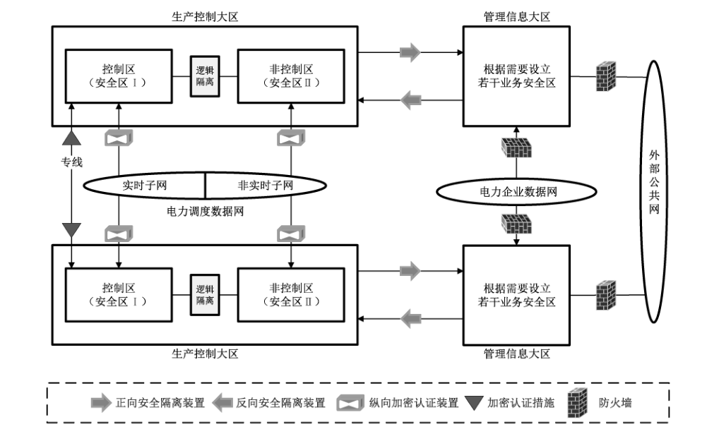
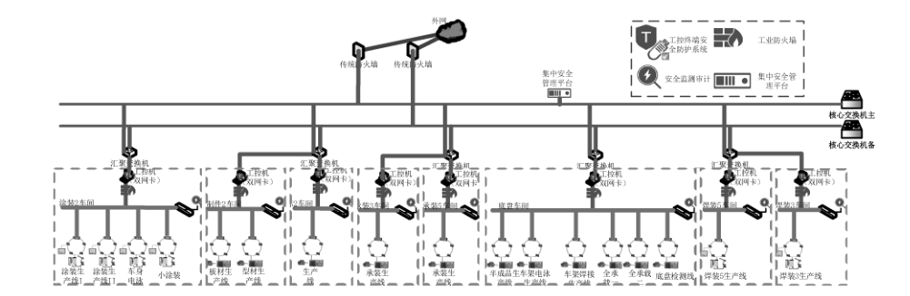
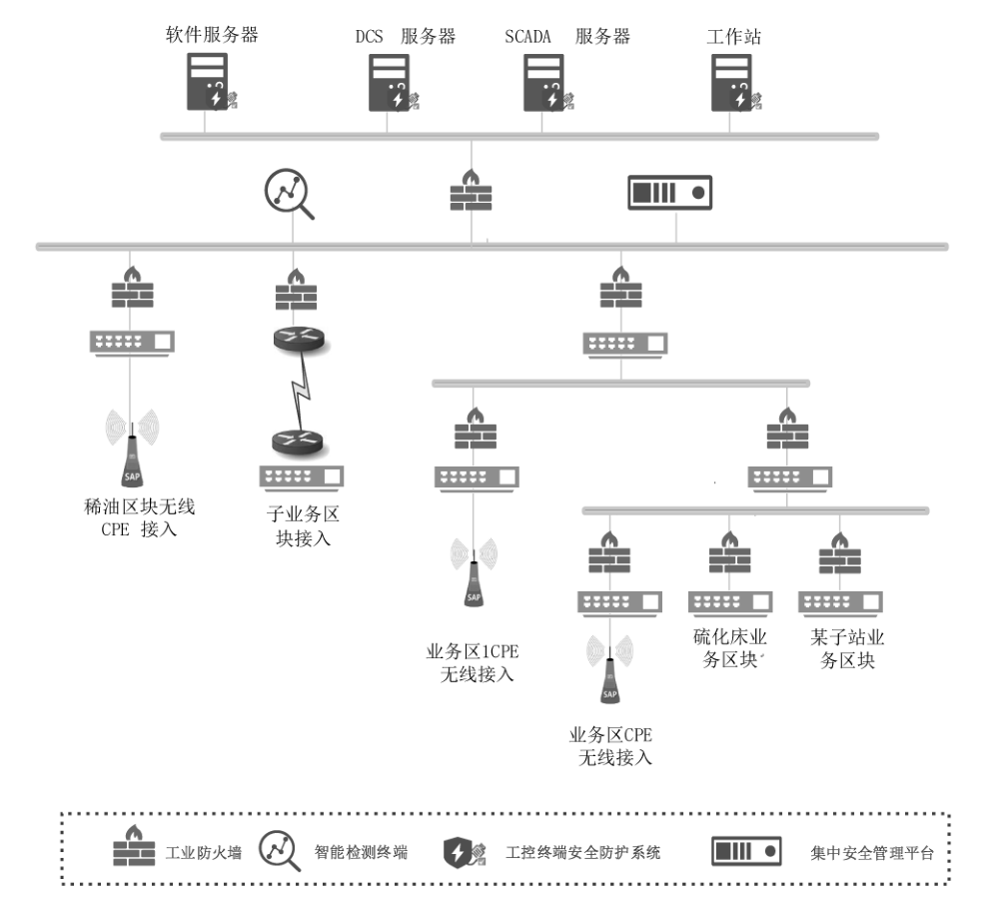
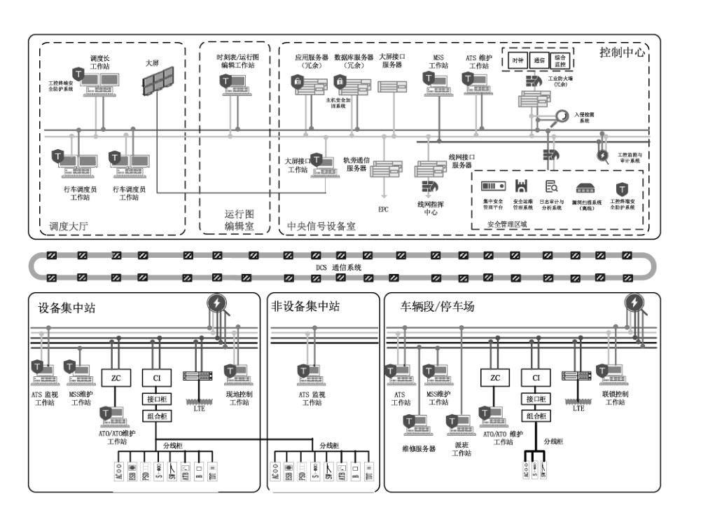
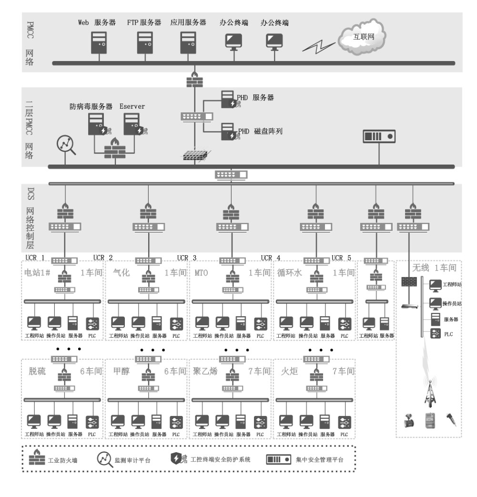
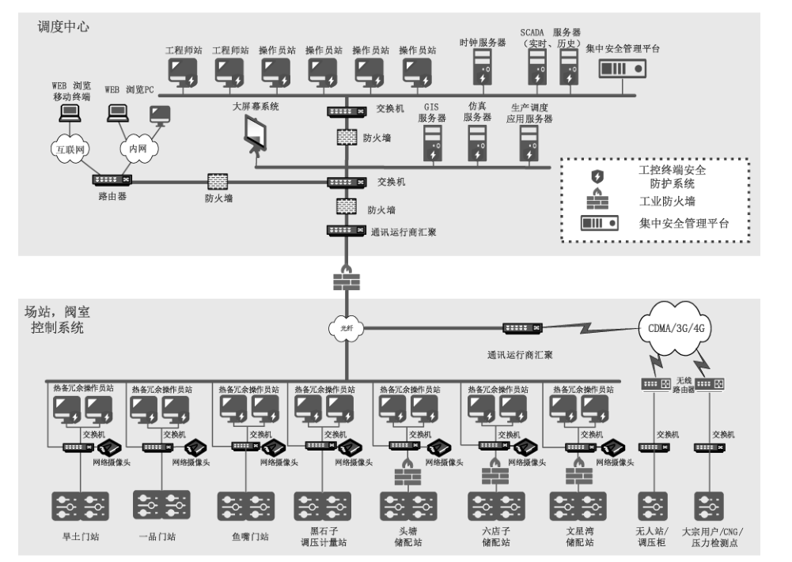
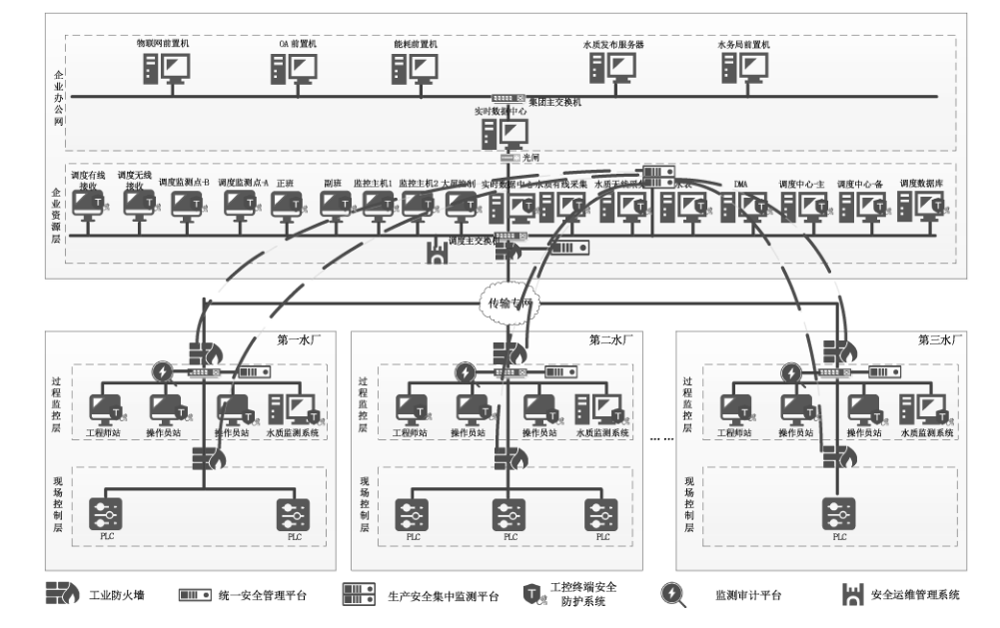
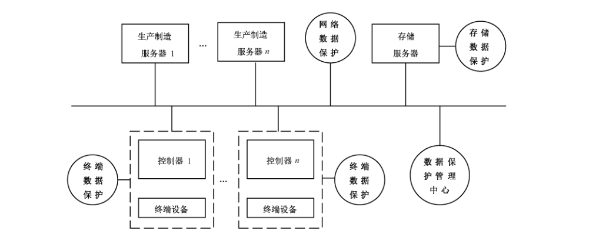
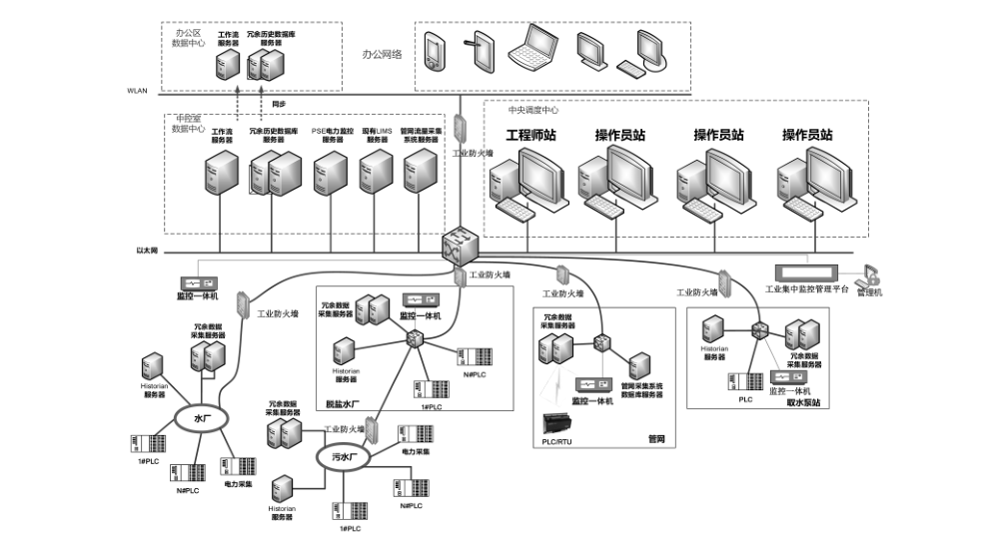
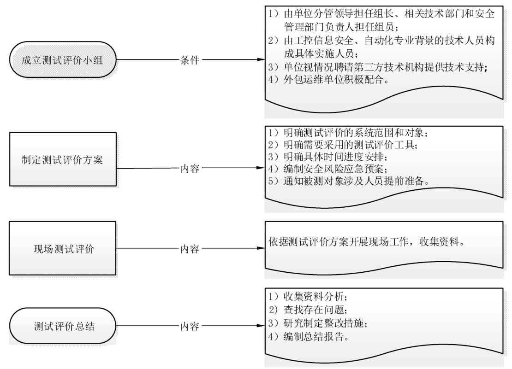

# GB/T 40813-2021 信息安全技术 工业控制系统安全防护技术要求和测试评价方法

> 来源：[GB/T 40813-2021 国家标准详情](https://openstd.samr.gov.cn/bzgk/std/newGbInfo?hcno=A292B1223209744B7FA7B37155A7465D)；发布日期：2021-10-11；实施日期：2022-05-01。
> PDF SHA-256：259b664ed322b6ac95dfa0bac56d64f9c6a17b0c1851a35b223f2cdebf734a61。
> 转写说明：依据官方 PDF 全部 66 页的页面图像识别并逐页核对；省略封面、目录、页眉、页脚和页码，合并跨页段落，保留 10 幅原图，图 D.1 另附文字转写。正式引用请核对原 PDF。
> 原文保留：FTP 的中文释义“文本传输协议”、6.4.5.3 a）的自引用、8.2.1 k）的“业务宽带”、8.3.5 i）的“网路地址”、8.4.8 a）的“再被释放”、8.10.3 a）的“检查有是否”和 A.4 a）3）的“应用协议报名单”均按原页保留。

## 前言

本文件按照 GB/T 1.1—2020《标准化工作导则 第1部分：标准化文件的结构和起草规则》的规定起草。

请注意本文件的某些内容可能涉及专利。本文件的发布机构不承担识别专利的责任。

本文件由全国信息安全标准化技术委员会（SAC/TC 260）提出并归口。

本文件起草单位：上海三零卫士信息安全有限公司、中国信息安全测评中心、中国电子技术标准化研究院、中国网络安全审查技术与认证中心、公安部第三研究所、中国石化上海高桥石油化工有限公司、上海工业自动化仪表研究院有限公司、中移（杭州）信息技术有限公司、国家信息技术安全研究中心、上海核工程研究设计院有限公司、北京天融信网络安全技术有限公司、北京和利时系统工程有限公司、上海市信息安全测评认证中心、北京圣博润高新技术股份有限公司、陕西省网络与信息安全测评中心、北京威努特技术有限公司、中国电子科技网络信息安全有限公司、中国电子科技集团公司第十五研究所、西南交通大学、国家工业信息安全发展研究中心、国家应用软件产品质量监督检验中心、中国航空油料集团有限公司、中国电子科技集团公司电子科学研究院、成都卫士通信息产业股份有限公司、北京奇虎科技有限公司、奇安信科技集团股份有限公司、中国电力科学研究院有限公司、江苏敏捷科技股份有限公司、卡斯柯信号有限公司、上海申通地铁集团有限公司、青岛地铁集团有限公司、上海电气泰雷兹交通自动化系统有限公司、北京交通大学、智巡密码（上海）检测技术有限公司、北京市地铁运营有限公司通信信号分公司、全球能源互联网研究院有限公司、吉林省电子信息产品检验研究院、深信服科技股份有限公司、中国矿业大学（北京）、国网新疆电力有限公司电力科学研究院、中国华电集团有限公司、中国平安保险（集团）股份有限公司、中科信息安全共性技术国家工程研究中心有限公司、上海工业控制安全创新科技有限公司、华东师范大学、北京和仲宁信息技术有限公司、中国华能集团有限公司、柳州市东科智慧城市投资开发有限公司、中国石油天然气股份有限公司西北销售分公司、中国石油天然气股份有限公司长庆石化分公司、北京中油瑞飞信息技术有限责任公司。

本文件主要起草人：张毅、干露、李绪国、饶志宏、李斌、李嵩、顾健、高洋、李琳、申永波、陆臻、邹春明、徐国忠、王英、陆炜、郭旭、袁专、毛磊、安高峰、刘盈、徐佟海、赵宇、杨帆、杨向东、冯全宝、唐林、兰昆、董晶晶、王丹琛、陈雪鸿、王坤、赵振学、司瑞彬、李瑞、张屹、王弢、李凌、倪海燕、崔科、李建全、王大庆、左旭涛、高翔、唐涛、郭筝、郭一力、梁潇、华颜涛、叶润国、谭波、李峰、舒斐、李辉、于惊涛、孟源、胡建勋、蒲戈光、刘虹、陈铭松、纪璐、杨硕、石永杰、于慧超、王飞、张兴、王小宏、赵朋。

## 引言

本文件结合国家已发布的法律法规、政策性文件和标准，并重点根据 GB/T 22239—2019《信息安全技术 网络安全等级保护基本要求》增加和细化安全防护技术指标、控制点和控制项，为相关方开展工业控制系统安全等级保护和日常安全防护工作提供更具操作性的依据。

与本文件相关的标准化文件包括：

- GB/T 22239—2019《信息安全技术 网络安全等级保护基本要求》；
- GB/T 28448—2019《信息安全技术 网络安全等级保护测评要求》；
- GB/T 36323—2018《信息安全技术 工业控制系统安全管理基本要求》；
- GB/T 36324—2018《信息安全技术 工业控制系统信息安全分级规范》；
- GB/T 37980—2019《信息安全技术 工业控制系统信息安全检查指南》。

## 1 范围

本文件规定了工业控制系统安全防护技术要求、保障要求和测试评价方法。

本文件适用于工业控制系统建设、运营、维护等。

## 2 规范性引用文件

下列文件中的内容通过文中的规范性引用而构成本文件必不可少的条款。其中，注日期的引用文件，仅该日期对应的版本适用于本文件；不注日期的引用文件，其最新版本（包括所有的修改单）适用于本文件。

- GB/T 7353—1999 工业自动化仪表盘、柜、台、箱

- GB/T 22239—2019 信息安全技术 网络安全等级保护基本要求

- GB/T 25069—2010 信息安全技术 术语

- GB/T 36324—2018 信息安全技术 工业控制系统信息安全分级规范

- GB/T 37933—2019 信息安全技术 工业控制系统专用防火墙技术要求

## 3 术语和定义

GB/T 22239—2019、GB/T 25069—2010、GB/T 36324—2018 和 GB/T 37933—2019界定的以及下列术语和定义适用于本文件。

### 3.1 工业控制资产 industrial control asset

工业生产控制过程中具有价值的软硬件资源和数据。

> 注：包括控制设备、工业主机、网络设备、应用程序、工业数据等。

### 3.2 中心控制室 central control room

位于组织内，具有生产操作、过程控制、安全保护、仪器仪表维护和生产管理等功能的综合性场所。

### 3.3 现场控制室 field control room

位于组织内生产现场，具有生产操作、过程控制和安全保护等功能的场所。

### 3.4 现场机柜室 field auxiliary room

位于组织内生产现场，用于安装工业控制系统机柜及其他设备的场所。

### 3.5 控制设备 control equipment

工业生产过程中用于控制执行器以及采集传感器数据的装置。

> 注：包括 DCS 现场控制单元、PLC 以及 RTU 等进行生产过程控制的单元设备。

### 3.6 工业主机 industrial host

工业生产控制各业务环节涉及组态、工作流程和工艺管理、状态监控、运行数据采集以及重要信息存储等工作的设备。

> 注：包括工程师站、操作员站、服务器等。

### 3.7 双机热备 dual-machine hot standby

通过网络连接主机和从机，正常情况下主机处于工作状态，从机处于监视状态，一旦主机异常，从机自动代替主机。

## 4 缩略语

下列缩略语适用于本文件。

APT：高级持续性威胁（Advanced Persistent Threat）

CPE：客户前置设备（Customer Premise Equipment）

DCS：分布式控制系统（Distributed Control System）

DNP：分布式网络协议（Distributed Network Protocol）

FTP：文本传输协议（File Transfer Protocol）

HMI：人机界面（Human Machine Interface）

HTTPS：以安全为目标的超文本传输协议通道（Hyper Text Transfer Protocol over Secure Socket Layer）

ICS：工业控制系统（Industrial Control System）

IEC：国际电工委员会（International Electrotechnical Commission）

IP：互联网协议（Internet Protocol）

IPSec：互联网安全协议（Internet Protocol Security）

MAC：媒体存取控制（Media Access Control）

OLE：对象连接与嵌入（Object Linking and Embedding）

OPC：用于过程控制的 OLE（OLE for Process Control）

PLC：可编程逻辑控制器（Programmable Logic Controller）

RPO：恢复点目标（Recovery Point Objective）

RTO：恢复时间目标（Recovery Time Objective）

RTU：远程终端单元（Remote Terminal Unit）

SCADA：监视控制与数据采集（Supervisory Control and Data Acquisition）

SNMP：简单网络管理协议（Simple Network Management Protocol）

SSH：安全外壳（Secure Shell）

SSL：安全套接层（Secure Socket Layer）

TCP：传输控制协议（Transmission Control Protocol）

VPN：虚拟专用网络（Virtual Private Network）

WAF：网络应用防火墙（Web Application Firewall）

## 5 概述

### 5.1 ICS 基本构成

按GB/T 36324—2018 中 4.1，ICS包括但不限于以下部分。

- a） 核心组件：包括 SCADA、DCS、PLC等控制系统和控制设备，以及各组件通信的接口单元。

- b）控制过程：由控制回路、工业主机、远程诊断与维护工具三部分完成，控制回路用以控制逻辑运算，工业主机执行信息交换，远程诊断与维护工具用于出现异常操作时进行诊断和恢复。

- c） 结构层次：参考GB/T22239—2019中附录G，ICS及相关联系统从上到下共分为企业资源层、生产管理层、过程监控层、现场控制层和现场设备层等五层。在实际工业生产环境中，可出现相邻两层的功能由一个系统、设备来实现，即在物理上并未分开。

### 5.2 安全防护对象和目的

本文件中ICS 安全防护对象包括：现场设备层、现场控制层和过程监控层工业控制资产。

本文件给出了物理环境安全防护等八项技术要求指标和软件开发安全防护等两项保障要求指标，安全防护目的包括如下内容。

- a） 安全防护技术要求：

  - 1） 物理环境安全防护的目的是防止人员未经授权访问、损坏和干扰 ICS 资产，避免受到外部物理环境因素影响，保护 ICS 的外部运行环境；

  - 2） 网络通信安全防护的目的是保护 ICS 中传输的数据的完整性和保密性，维护ICS 内部以及与外部网络之间信息的安全传输；

  - 3） 网络边界安全防护的目的是安全访问ICS，避免非授权访问，及时发现并有效保护ICS免受恶意入侵和攻击，部分行业的应用场景见附录A；

  - 4） 工业主机安全防护的目的是有效控制工业主机访问行为，避免非授权访问，防止工业主机受到非法入侵或造成工业数据泄漏；

  - 5） 控制设备安全防护的目的是安全访问控制设备，阻止非授权访问，避免控制设备受到恶意入侵、攻击或非法控制；

  - 6） 数据安全防护的目的是保护数据全生存周期的完整性和保密性，防止未经授权使用和处理数据、恶意篡改和窃取数据等现象发生，数据安全防护对象见附录 B；

  - 7） 防护产品安全的目的是产品功能安全可靠、管控策略有效，避免因产品自身功能缺陷给ICS的正常运行带来安全隐患；

  - 8） 系统集中管控的目的是集中维护和管控 ICS，统一制定与部署安全策略，集中响应安全事件，典型部署方式见附录C。

- b） 安全防护保障要求：

  - 1） 软件开发安全防护的目的是控制ICS 软件的安全开发，避免软件自身存在安全隐患；

  - 2） 系统维护安全防护的目的是有效控制系统维护过程，避免系统在维护过程中受到干扰、恶意入侵，或发生数据泄露、被破坏或篡改等现象。

本文件提出的安全防护技术要求和保障要求分为四个等级，与 GB/T 22239—2019、GB/T 36324—2018提出的相应安全保护等级要求保持一致，并按梯次推进的方式给出了不同安全保护等级ICS所对应的技术要求和保障要求。

测试评价方法是针对ICS运营单位执行本文件安全防护技术要求和保障要求的情况进行测试评价的一般方法，也可根据自身关注点自行调整测试评价指标。测试评价流程见附录 D。

### 5.3 安全防护措施的约束条件

ICS 安全防护措施的约束条件包括：

- a） ICS采用的网络边界隔离等技术防护手段应符合国家和所在行业规定要求，并采用经具备资格的第三方机构检测合格的安全产品；

- b） 数据传输和存储过程中所采用的密码技术应经过国家密码主管部门核准；

- c） ICS 与涉密信息系统之间连接应符合国家保密规定和相关标准要求；

- d） 任何情况下都不应因采用安全防护技术措施而影响ICS的正常运行或对系统的安全功能产生不利影响，例如：不应锁定用于基本功能的账户、不应因部署安全措施而显著增加延迟并影响系统的响应时间、不应因安全措施失效导致系统的基本功能中断等；

- e） 在符合本文件提出的技术要求时，如经评估对可用性有较大影响而无法实施，可调整要求并研究制定相应的补偿防护措施，但采取补偿防护措施后不应降低原有要求的整体安全防护强度。

## 6 安全防护技术要求

### 6.1 物理环境安全防护

#### 6.1.1 位置选择

##### 6.1.1.1 第一级

机房、中心控制室、现场控制室应位于具有防震能力的建筑物内，并应具有所在建筑物符合当地抗震设防标准的证明。

##### 6.1.1.2 第二级

本项要求包括：

- a） 应符合 6.1.1.1；

- b）机房、中心控制室、现场控制室应避免设在建筑物的高层或地下室，以及用水设备的下层或隔壁，如不可避免，应采取有效的防水、防潮措施。

##### 6.1.1.3 第三级～第四级

本项要求包括：

- a） 应符合 6.1.1.2；

- b） 机房、中心控制室、现场控制室应避开发生火灾危险程度高的区域；

- c） 机房、中心控制室、现场控制室应避开产生粉尘、油烟、有害气体源以及存放腐蚀、易燃、易爆物品的地方；

- d）机房、中心控制室、现场控制室应避开低洼、潮湿、落雷、重盐害区域和地震频繁的地方；

- e） 机房、中心控制室、现场控制室应避开强振动源和强噪声源；

- f） 机房、中心控制室、现场控制室应避开强电磁干扰源；

- g） 如以上无法避免，应采取相应措施。

#### 6.1.2 访问控制

##### 6.1.2.1 第一级～第二级

本项要求包括：

- a） 来访人员进入机房、中心控制室、现场控制室前应提出申请并通过审批，应记录其随身携带的设备、进出时间和工作内容，应有专人陪同并限制和监控其活动范围；

- b）机房、中心控制室出入口应安排专人值守或配置电子门禁系统，控制、识别和记录人员的进出，人员进出记录应至少保存六个月。

##### 6.1.2.2 第三级

本项要求包括：

- a） 应对机房、中心控制室、现场控制室划分不同管理区域，应将设备区域和维护操作区域分离；

- b）应对主机房、中心控制室、现场控制室的重要工程师站、数据库、服务器等核心工业控制资产所在区域采取视频监控或专人值守等防护措施；

- c） 来访人员进入主机房、中心控制室、现场控制室前应提出申请并通过审批，应记录其随身携带的设备、进出时间和工作内容，应有专人陪同并限制和监控其活动范围；设备使用前应进行系统扫描、使用过程中应进行行为监测、带出前应对工作日志等进行审计；

- d）机房、中心控制室出入口应配置电子门禁系统，控制、识别和记录人员的进出，人员进出记录应至少保存六个月。

##### 6.1.2.3 第四级

本项要求包括：

- a） 应符合6.1.2.2；

- b） 主机房、中心控制室的重要区域应配置第二道电子门禁系统，控制、识别和记录人员的进出，人员进出记录应至少保存六个月。

#### 6.1.3 防盗窃和防破坏

##### 6.1.3.1 第一级

本项要求包括：

- a） 应将服务器、路由器、交换机等主要设备放置在主机房、中心控制室或现场控制室等建筑物内；

- b） 应将室外控制设备安装在采用金属材料制作且具有防盗能力的箱体或装置中；

- c） 应将设备或主要部件进行固定，并设置明显的不易除去的粘贴标签或铭牌等标记。

##### 6.1.3.2 第二级

本项要求包括：

- a） 应符合 6.1.3.1；

- b） 应将通信线缆铺设在隐蔽处，可铺设在管道中。

##### 6.1.3.3 第三级～第四级

本项要求包括：

- a） 应符合 6.1.3.2；

- b）应采用光、电等技术设置机房、中心控制室、现场控制室防盗报警系统或设置有专人值守的视频监控系统；

- c） 应对机房、中心控制室、现场控制室的控制台等重要区域进行视频监控，监控记录应至少保存三个月。

#### 6.1.4 防雷击

##### 6.1.4.1 第一级～第二级

本项要求包括：

- a） 应对室外控制设备电源、信号线路加装避雷器或浪涌保护器，并将金属管线就近接地；

- b） 应根据室外控制设备分布，在设备集中位置设置接地汇流排、均压环、均压网等等电位连接装置；所有设备、金属机架、外壳、管、槽等应就近接地，并应符合等电位连接要求；

- c） 机房、中心控制室、现场控制室、现场机柜室应在所在建筑物防雷措施基础上采取加强防雷击措施；

- d） 机房、中心控制室、现场控制室、现场机柜室等各类机柜、设施和设备等应通过接地系统安全接地。

##### 6.1.4.2 第三级〜第四级

本项要求包括：

- a） 应符合 6.1.4.1；

- b） 应对机房、中心控制室、现场控制室、现场机柜室所在建筑物设置防雷保安器或过压保护装置等防感应雷措施。

#### 6.1.5 防火

##### 6.1.5.1 第一级

本项要求包括：

- a） 应将室外控制设备安装在采用金属材料或其他防火隔热材料制作且具有防火能力的箱体或装置中；

- b） 机房、中心控制室、现场控制室、现场机柜室应配置灭火器，配置的灭火器类型、规格、数量和位置应符合国家标准的要求，灭火所用的介质不宜造成二次破坏。

##### 6.1.5.2 第二级

本项要求包括：

- a） 应符合 6.1.5.1；

- b） 机房、中心控制室、现场控制室、现场机柜室应设置火灾自动消防系统，应能自动检测火情、自动报警，并应具有自动灭火功能；

- c） 机房、中心控制室、现场控制室的内部装修材料应采用符合国家标准的难燃烧材料和非燃烧材料。

##### 6.1.5.3 第三级～第四级

本项要求包括：

- a） 应符合 6.1.5.2；

- b） 应对机房、中心控制室、现场控制室划分不同管理区域，区域间应设置隔离防火措施，并应将重要设备和其他设备隔开；

- c） 当机房作为独立建筑物时，建筑物的耐火等级应不低于该建筑物所对应的设计防火规范中规定的二级耐火等级；

- d） 当机房位于其他建筑物内时，该机房与其他部位之间应设置耐火等级不低于2h 的隔墙或隔离物，隔墙上的门应采用符合国家标准的甲级防火门。

#### 6.1.6 防水和防潮

##### 6.1.6.1 第一级

本项要求包括：

- a） 应将室外控制设备安装在采用金属材料或其他材料制作且具有防水能力的箱体或装置中；

- b）无关的给排水管道不应穿过机房、中心控制室、现场控制室，相关的给排水管道应有可靠的防渗漏措施；

- c） 机房、中心控制室、现场控制室外墙壁应采用无窗设计或采用双层固定窗并作密封、防水处理；

- d） 如机房、中心控制室、现场控制室周围有用水设备，应有防渗水和导流措施；

- e）应采取措施防止雨水通过机房、中心控制室、现场控制室的窗户、屋顶和墙壁渗透到机房、中心控制室、现场控制室内。

##### 6.1.6.2 第二级

本项要求包括：

- a）应符合 6.1.6.1；

- b） 应采取措施防止机房、中心控制室、现场控制室内发生凝露和地下积水转移或渗漏现象。

##### 6.1.6.3 第三级～第四级

本项要求包括：

- a） 应符合 6.1.6.2；

- b）应安装对水敏感的检测仪表或传感器，并对机房、中心控制室、现场控制室应在漏水隐患处设置漏水检测报警系统。

#### 6.1.7 防静电

##### 6.1.7.1 第一级～第二级

本项要求包括：

- a） 机房、各控制室、现场机柜室应采用防静电地板或地面；

- b） 应对机房、各控制室、现场机柜室内的设备采取必要的接地防静电措施；

- c） 机房、各控制室、现场机柜室内易产生静电的地方，可采用静电消除剂和静电消除器；

- d） 室外控制设备应就近接地，并应设置人工接地装置。

##### 6.1.7.2 第三级～第四级

本项要求包括：

- a） 应符合 6.1.7.1；

- b） 应符合 GB/T 22239—2019 中 8.1.1.7b）。

#### 6.1.8 防爆

本项要求包括：

- a） 对于存在爆炸危险的组织，主机房、中心控制室应位于爆炸危险区域外，其建筑物的建筑结构应根据抗爆强度分析结果进行设计；

- b） 对于存在爆炸危险的生产车间（装置），现场控制室、现场机柜室应位于爆炸危险区域外，应根据安全专业抗爆强度分析结果确定是否设计为抗爆结构，应根据不同的易爆因素设置监测报警装置。

#### 6.1.9 防鼠害

本项要求包括：

- a） 应采用防火材料封堵机房、中心控制室、现场控制室、现场机柜室的孔、洞；

- b） 应对易受鼠害的机房、中心控制室、现场控制室、现场机柜室内的缆线采取防护措施。

#### 6.1.10 温湿度控制

##### 6.1.10.1 第一级

本项要求包括：

- a） 应在机房内设置必要的温、湿度调节装置，并使温、湿度控制在设备工作允许范围内，其中：开机时温度、相对湿度和温度变化率宜符合 GB/T 2887—2011表2中C级要求，停机时温度、相对湿度和温度变化率宜符合 GB/T 2887—2011表3中C级要求；应有对主机房内的温、湿度监测记录；

- b） 应在中心控制室、现场控制室和现场机柜室内设置必要的温、湿度调节装置，并使温、湿度控制在设备工作允许范围内，其中：温度宜控制在冬季20 °C ± 2 °C、夏季24 °C ± 2 °C，温度变化率小于5°C/h；相对湿度宜控制在40%～60%，湿度变化率小于6%/h；

- c） 按GB/T7353—1999中6.9，工业控制（台）柜环境温度应控制在−5 °C～40 °C，相对湿度应控制在40%～90%。

##### 6.1.10.2 第二级～第四级

本项要求包括：

- a） 应符合6.1.10.1b）和c）；

- b）应在机房内设置必要的温、湿度调节装置，并使温、湿度控制在设备工作允许范围内，其中：开机时温度、相对湿度和温度变化率宜符合GB/T 2887—2011表2中B级要求，停机时温度、相对湿度和温度变化率宜符合 GB/T 2887—2011表3中B级要求；应有对主机房内的温、湿度监测记录装置。

#### 6.1.11 电力供应

##### 6.1.11.1 第一级

应在机房、中心控制室供电系统中设置稳压稳频装置和过电压防护设备，供电系统的容量应具有一定的余量。

##### 6.1.11.2 第二级

本项要求包括：

- a） 应符合 6.1.11.1；

- b） 应为机房、中心控制室、现场控制室、现场机柜室配备不间断电源等短期备用电力供应装置，并应满足设备在断电情况下的持续供电时间不低于 20 min。

##### 6.1.11.3 第三级

本项要求包括：

- a） 应符合 6.1.11.2；

- b）应采用冗余或并行的电力电缆线路为机房、中心控制室的计算机系统供电，输入电源应采用双路市电自动切换供电方式。

##### 6.1.11.4 第四级

本项要求包括：

- a） 应符合 6.1.11.3；

- b）应为机房、中心控制室设置双路市电（或市电、备用柴油发电机）和不间断电源系统，并应满足为关键设备在断电情况下持续供电2h以上。

#### 6.1.12 电磁防护

##### 6.1.12.1 第一级

本项要求包括：

- a） 处于强电磁干扰区和有保密要求的机房应设置电磁屏蔽室；

- b）应符合GB/T 22239—2019中 6.5.1.1b）。

##### 6.1.12.2 第二级

本项要求包括：

- a） 应符合 6.1.12.1；

- b） 应符合 GB/T 22239—2019中 7.1.1.10；

- c） 电力电缆不宜穿过中心控制室、现场控制室，当受条件限制需要穿过时，应采取屏蔽措施；

- d） 对集中存储、处理、传输敏感数据的设备，应考虑电磁信息泄露防护措施。

##### 6.1.12.3 第三级

本项要求包括：

- a） 应符合 6.1.12.2；

- b） 应采用接地方式防止外界电磁干扰和设备寄生耦合干扰；

- c） 应对重要工艺控制环路所涉及设备采取免受无线注入攻击和干扰的风险防护措施；

- d） 应对涉及敏感数据的关键设备和磁媒体采取防敏感信息泄露或受到电磁攻击的电磁屏蔽措施。

##### 6.1.12.4 第四级

本项要求包括：

- a） 应符合 6.1.12.3［6.1.12.3d）除外］；

- b） 应对涉及敏感数据的关键设备和磁媒体或关键区域采取防敏感信息泄露或受到电磁攻击的电磁屏蔽措施。

### 6.2 网络通信安全防护

#### 6.2.1 网络架构

##### 6.2.1.1 第一级

本项要求包括：

- a） 应绘制与当前相符的ICS 网络拓扑图，整理设备清单和核心网络设备配置文件并定期备份更新，主要包括：设备名称、型号、网络地址等信息以及网段划分、路由、安全策略配置等信息；

- b） ICS应单独划分网络区域，并应与组织其他信息系统位于不同的网络区域内；

- c） 应根据 ICS 区域重要性和业务需求进行安全区域划分，系统不同层次之间、同一层次不同业务单元之间应划分为不同的安全防护区域；

- d） 应对ICS的开发、测试、运维和生产分别提供独立环境；

- e） 应通过路由控制在业务终端与业务服务器之间建立安全的访问路径。

##### 6.2.1.2 第二级

本项要求包括：

- a） 应符合 6.2.1.1；

- b） 应符合 GB/T 22239—2019中 7.1.2.1b）；

- c） 应符合 GB/T 22239—2019中7.5.2.1c）。

##### 6.2.1.3 第三级

本项要求包括：

- a） 应符合 6.2.1.2；

- b） 单个ICS可单独划分安全域并可划分独立子网，每个安全域应尽量少设置网络出口；

- c） 网络设备的业务处理能力应满足业务高峰期需要，并具备冗余空间；

- d） 网络各个部分的带宽应满足业务高峰期需要，并具备冗余空间；

- e） 通信线路、关键网络设备和关键计算设备的硬件应进行冗余配置。

##### 6.2.1.4 第四级

本项要求包括：

- a） 应符合 6.2.1.3；

- b） 应符合 GB/T 22239—2019中 9.1.2.1f）。

#### 6.2.2 通信传输

##### 6.2.2.1 第一级

本项要求包括：

- a） ICS与组织其他信息系统之间交换数据时，应在网络接口处对应用协议报文进行分析，并应通过访问控制机制控制两网之间的数据交换行为，仅允许交换符合安全策略的指定格式的数据；

- b） ICS 内部不同安全域之间进行信息交换时，应对 OPC、Profinet 等工业控制协议的数据包进行解析，并能及时发现异常通信行为；

- c） 现场控制设备与工程师站等上位监控系统之间应使用唯一的信息交换接口接收所有数据并对用户的合法性进行验证；

- d） 数据传输过程中安全设备不应对ICS 的实时性产生影响；

- e） 应符合 GB/T 22239—2019中6.1.2.1。

##### 6.2.2.2 第二级

本项要求包括：

- a） 应符合 6.2.2.1；

- b）通过广域网交换控制指令或相关数据时，应采用加密认证技术实现身份鉴别、访问控制和数据加密传输。

##### 6.2.2.3 第三级

本项要求包括：

- a） 应符合 6.2.2.2［6.2.2.1e）除外］；

- b） 应符合 GB/T 22239—2019中 8.1.2.2a）；

- c） 应符合 GB/T 22239—2019中 8.1.2.2b）；

- d） 应符合 GB/T 22239—2019中 8.5.3.3c）。

##### 6.2.2.4 第四级

本项要求包括：

- a） 应符合 6.2.2.3［6.2.2.3b）除外］；

- b） 应符合 GB/T 22239—2019中 9.1.2.2a）；

- c） 通信前应采用SSL、IPSec 等基于密码技术的协议对通信双方进行会话初始化验证，并应在通过加解密验证后通信；

- d） 应符合 GB/T 22239—2019中 9.1.2.2d）。

#### 6.2.3 网络设备防护

##### 6.2.3.1 第一级

本项要求包括：

- a） 应对登录网络设备的用户进行身份鉴别；

- b） 应通过采取结束会话、限制非法登录次数和网络登录连接超时自动退出等策略，实现登录失败处理功能；

- c） 非法登录次数达到预设值时，应记录相应日志，并向网络管理主机发送报警信息；

- d） 对网络设备进行远程管理时，应采取防止鉴别信息在网络传输过程中被窃取的措施。

##### 6.2.3.2 第二级

本项要求包括：

- a） 应符合 6.2.3.1；

- b） 应及时修改默认用户和默认口令，口令长度应不少于8位且为字母、数字或特殊字符的组合，用户名和口令不应相同，不应明文存储口令，每三个月应更换一次口令；

- c） 网络设备的标识应唯一，不应使用网络地址等易被仿冒的设备标识；

- d） 同一网络设备的用户标识应唯一，多个人员不应共用一个账号；

- e） 应对网络设备的管理员登录地址进行限制；

- f） 应关闭不需要的网络端口和服务，如使用SNMP服务，应采用安全性增强版本，并应设定复杂的共享控制字段，不应使用公共或私有的默认字段。

##### 6.2.3.3 第三级

本项要求包括：

- a） 应符合 6.2.3.2；

- b）应实现管理员等设备特权用户的权限分离，如系统不支持，应通过采取其他技术措施对管理员的操作行为进行审计，且管理员无权对审计记录进行操作。

##### 6.2.3.4 第四级

本项要求包括：

- a） 应符合 6.2.3.3；

- b）应采用口令、密码和生物识别等两种或两种以上组合的鉴别方式对用户身份进行鉴别，且其中至少一种鉴别方式应使用密码技术实现。

#### 6.2.4 可信验证

##### 6.2.4.1 第一级

应符合 GB/T 22239—2019 中 6.1.2.2。

##### 6.2.4.2 第二级

应符合 GB/T 22239—2019中 7.1.2.3。

##### 6.2.4.3 第三级

应符合 GB/T 22239—2019中8.1.2.3。

##### 6.2.4.4 第四级

应符合 GB/T 22239—2019中9.1.2.3。

### 6.3 网络边界安全防护

#### 6.3.1 安全区域划分

本项要求包括：

- a） ICS 与组织其他信息系统间应具有明确的网络边界；

- b） 应基于自身业务特点将ICS 内部划分为不同的安全域，安全域的划分应有利于在同一安全域内部署统一的安全防护策略，并能对内部数据的访问和传输进行合理控制；

- c） 应将ICS的开发、测试和生产环境分别置于不同的网络区域，区域间应进行物理或逻辑隔离。

#### 6.3.2 边界隔离

##### 6.3.2.1 第一级

本项要求包括：

- a） ICS 与组织管理信息系统等其他系统间应采取技术隔离措施；

- b） ICS 内部不同安全域之间应部署具有访问控制功能或具有相当功能的安全隔离设备。

##### 6.3.2.2 第二级

本项要求包括：

- a） 应符合 6.3.2.1；

- b） 应在ICS 内部不同安全域之间采取必要的边界隔离机制，对接入ICS 的设备进行识别和管控，仅允许经过授权的设备接入系统，并在防护机制失效时及时进行报警。

##### 6.3.2.3 第三级

本项要求包括：

- a） 应符合 6.3.2.2［6.3.2.1a）除外］；

- b） ICS与组织管理信息系统等其他系统之间应进行物理隔离，如有信息交换需求，应采用单向技术隔离手段，单向隔离装置的策略配置应安全有效；

- c） ICS与广域网的纵向交界处应设置访问控制设备，设备的策略配置应安全有效，并应实现双向身份核验、访问控制和数据加密传输；

- d） 应符合 GB/T 22239—2019中 8.1.3.1b）；

- e） 应符合 GB/T 22239—2019中 8.1.3.1c）；

- f） 应采取无线安全检测防护措施并识别和阻断未经授权的无线设备接入工业控制网络，应具有对无线扫描、无线破解、无线拒绝服务等攻击行为进行检测和阻断的功能。

##### 6.3.2.4 第四级

本项要求包括：

- a） 应符合 6.3.2.3；

- b） 应在ICS 不同区域边界采用ICS专用防火墙等访问控制设备，对 OPC、Profinet 等常见工业控制协议进行深度包检测和恶意代码过滤，对进出区域边界的数据进行控制，阻止非授权访问、常见网络攻击以及利用工业控制协议漏洞伪装成工业控制协议报文而进行的高级攻击，并在防护机制失效时及时报警；

- c） 应符合 GB/T 22239—2019中 9.1.3.1e）；

- d） 应符合 GB/T 22239—2019中9.1.3.1f）。

#### 6.3.3 访问控制

##### 6.3.3.1 第一级

本项要求包括：

- a） 应在ICS与组织其他信息系统之间设置访问控制规则，部署访问控制设备，默认情况下受控接口仅允许交换符合安全策略的指定格式的数据，禁用任何穿越区域边界的E-Mail、Telnet、Rlogin、FTP 等通用网络服务；

- b） 应符合 GB/T 22239—2019中 6.1.3.2b）；

- c） 应符合 GB/T 22239—2019中 6.1.3.2c）；

- d） 应符合 GB/T 22239—2019 中 6.5.3.2a）；

- e） 应符合 GB/T 22239—2019中 6.5.3.2b）；

- f） 应对各类物联网感知终端接入设置身份鉴别机制，边界访问控制机制应具有隔离功能，可设置数据包的源和目的端口号、网络地址和MAC地址绑定等规则，包括添加、删除、修改、复制、导入、导出和保存规则等。

##### 6.3.3.2 第二级

本项要求包括：

- a） 应符合 6.3.3.1［6.3.3.1e）除外］；

- b） 应根据网络边界安全控制策略，通过检查数据包的源地址、目的地址、传输协议、所请求的服务等，及时制止不符合安全控制策略的数据包进出该边界；

- c） 应能根据会话状态信息为数据流提供允许或拒绝访问的能力，控制粒度为端口级；

- d） 应根据数据的敏感标记允许或拒绝数据通过网络边界；

- e） 边界的网络控制设备应根据用户与系统之间的允许访问规则，允许或拒绝对受控系统的资源访问，控制粒度为单个用户；

- f） 部署在ICS区域边界的ICS 专用防火墙等访问控制设备应具备双机热备能力，当主防火墙自身出现断电或其他软硬件故障时，备用防火墙应能及时发现并接管主防火墙进行工作；

- g） 按GB/T 22239—2019 中 7.5.3.2；

- h）应对所有参与无线通信的用户（人员、软件进程或设备）进行授权以及执行或使用进行限制。

##### 6.3.3.3 第三级

本项要求包括：

- a） 应符合 6.3.3.2；

- b） 应符合 GB/T 22239—2019中 8.5.3.2b）；

- c） 应符合 GB/T 22239—2019 中 8.5.3.3d）。

##### 6.3.3.4 第四级

本项要求包括：

- a） 应符合 6.3.3.3；

- b） 应符合 GB/T 22239—2019中 9.1.3.2e）；

- c） 应符合 GB/T 22239—2019 中 9.5.3.2c）。

#### 6.3.4 安全审计

##### 6.3.4.1 第一级

无要求。

##### 6.3.4.2 第二级

本项要求包括：

- a） 应在ICS 网络边界、ICS 内部不同安全区域边界以及重要网络节点部署专用审计设备，或启动网络设备（系统）的审计功能并进行安全审计，审计范围应覆盖到ICS 的每个用户，审计内容应包括：设备运行状况、网络流量、用户行为、重要系统命令使用和重要安全事件等；

- b） 审计测试仅限于对软件和数据的只读访问，非只读的访问仅用于对系统文件的单独复制，审计完成时应擦除这些复制或按审计文件要求保留这些文件并给予适当保护；

- c） 如审计测试会影响系统的可用性，应在非业务时间进行；

- d） 应具备使用内部时钟为审计记录生成日期和时间等时间戳的功能；

- e） 应能发现并发出审计失败的警告，并具备重启审计的功能；

- f） 应定义审计阈值，当存储空间接近极限时，应采取备份覆盖等安全措施以正常执行审计功能；

- g） 当审计要求和活动涉及对运行系统验证时，应事先与管理者确定访问系统和数据的审计要求并获批准；

- h）应对网络系统中的网络设备运行状况、网络流量、用户行为等进行日志记录和保护并定期备份，避免受到未预期的删除、修改或覆盖等，记录保存时间应不少于六个月；

- i） 应具备拒绝远程访问审计记录的功能，仅允许授权用户根据授权范围访问审计记录；

- j） 应根据ICS的统一安全策略实现集中审计，应定期自动统计分析所采集的审计记录并形成报告，应具备审计记录的查询、输出、备份等功能；对未列入集中审计范围的设备，应定期人工采集审计数据、导入集中审计平台并进行统计分析；

- k）应具备集中管理审计事件的能力，包括：用户登录/退出事件、连接超时事件、配置变更、时间/日期变更、审计接入、用户名/口令创建和修改等。

##### 6.3.4.3 第三级～第四级

本项要求包括：

- a） 应符合 6.3.4.2；

- b）应能对远程访问的用户行为、使用互联网的用户行为等单独进行行为审计和数据分析；

- c） 应具备保护审计工具和审计进程的功能，避免受到未授权访问、修改、删除或覆盖等行为的破坏。

#### 6.3.5 入侵防范

##### 6.3.5.1 第一级

无要求。

##### 6.3.5.2 第二级

本项要求包括：

- a） 应在网络和区域边界监视端口扫描、强力攻击、木马后门攻击、拒绝服务攻击、缓冲区溢出攻击、碎片攻击和网络蠕虫攻击等攻击行为；

- b） 应在交换机、路由器等关键网络节点处采用入侵检测和防御技术，检测、防止或限制从外部或从内部发起的网络攻击行为；

- c） 采用的入侵检测技术应支持对 OPC、Profinet 等常见工业控制协议的识别和分析，并应对异常的工业控制指令、数据进行识别和告警。

##### 6.3.5.3 第三级～第四级

本项要求包括：

- a） 应符合 6.3.5.2；

- b） 应监视工业控制网络内的流量数据包，应实时获取数据包并用于检测分析，应能对蠕虫病毒、木马等网络攻击特别是 APT等新型网络攻击行为进行检测和分析，且不影响工业控制设备正常运行；

- c） 当检测到攻击行为时，应记录攻击源网络地址、目的网络地址、攻击类型、攻击目的、攻击时间等，在发生严重入侵事件时应报警。

#### 6.3.6 恶意代码防范

##### 6.3.6.1 第一级

本项要求包括：

- a） ICS与组织其他信息系统之间通信时，应通过部署恶意行为防范机制对应用协议进行安全检测；

- b） 应维护恶意代码库的升级和检测系统的更新，更新前应通过安全性和兼容性测试；

- c） 防恶意代码软件应能监测可能被用于感染系统和向其他系统传播恶意软件的应用程序的活动；

- d）应及时清理注册表、恶意锁定主页等被恶意软件修改的启动选项；

- e） 应及时清理系统中存在的木马、病毒和恶意代码程序。

##### 6.3.6.2 第二级

本项要求包括：

- a） 应符合 6.3.6.1；

- b） 应在关键网络节点处采取恶意代码检测与防范手段并对网络中传输的恶意代码进行检测和清除，维护恶意代码防护机制的升级和更新但不应影响正常的业务数据传输；

- c） 应支持检测已知的病毒、木马、蠕虫、勒索软件及针对 PLC的专用恶意代码；

- d） 应在检测到恶意代码时告警，并记录攻击源网络地址、目的网络地址、恶意代码类型名称、危害程度、攻击时间、攻击方式和执行流程，应探测其攻击源头，实现对恶意软件的追溯。

##### 6.3.6.3 第三级～第四级

本项要求包括：

- a） 应符合 6.3.6.2；

- b）应在ICS 网络和区域边界部署恶意代码防护设备，应能探测恶意入侵等行为并及时发送至安全管理中心。

#### 6.3.7 可信验证

##### 6.3.7.1 第一级

应符合 GB/T 22239—2019中 6.1.3.3。

##### 6.3.7.2 第二级

应符合 GB/T 22239—2019中7.1.3.6。

##### 6.3.7.3 第三级

应符合 GB/T 22239—2019中 8.1.3.6。

##### 6.3.7.4 第四级

应符合 GB/T 22239—2019中 9.1.3.6。

### 6.4 工业主机安全防护

#### 6.4.1 身份鉴别

##### 6.4.1.1 第一级

本项要求包括：

- a） 主机设备使用前应标识，并保持设备标识在整个生存周期的唯一性；

- b） 在启动移动工程师站等移动主机设备并接入ICS时，应对设备的真实性进行鉴别；

- c） 应强化工业主机的登录账户及口令，重命名或删除默认账户，修改默认账户的默认口令；

- d） 应对登录的用户身份进行标识和鉴别，标识具有唯一性；

- e） 用户身份认证证书的传输和存储应安全可靠，应避免在未授权的情况下使用证书，不应在不同系统和网络环境下共享身份认证证书；

- f） 应具备登录失败处理功能，多次登录失败后应结束会话、限制非法登录次数并自动退出；对高可用性的控制系统，应保留其数据采集、逻辑控制、网络通信和系统报警等基本功能，取消用户对系统的参数修改等较高级别权限并将登录权限降至最低；

- g） 登录用户执行更改配置等重要操作时应再次进行身份鉴别；

- h）应设置鉴别警示信息并描述因未授权访问可能导致的后果；

- i） 当非法登录次数达到预设值时，应记录相应日志并向网络管理主机发送报警信息。

##### 6.4.1.2 第二级

本项要求包括：

- a） 应符合 6.4.1.1；

- b） 用户身份鉴别信息丢失或失效时，应具有安全重置身份鉴别信息的功能；

- c） 身份鉴别信息不易被冒用，口令应采用数字、字母和特殊字符混排等无规律的组合方式，口令长度应不少于8位，每三个月应更换1次，更新的口令至少5次内不应重复；如设备口令长度不支持8位或其他复杂度要求，应使用所支持的最长长度并缩短更换周期；可使用动态密码卡等一次性口令认证方式；口令应加密存储；

- d） 应实现操作系统和数据库系统特权用户的权限分离；

- e） 当对服务器进行远程管理时，应采用 VPN 等接入方式防止身份鉴别信息在网络传输过程中被窃取。

##### 6.4.1.3 第三级～第四级

本项要求包括：

- a） 应符合 6.4.1.2；

- b） 应采用口令、密码和生物识别等两种或两种以上组合的鉴别方式对用户身份进行鉴别，且其中至少一种鉴别方式应使用密码技术实现。

#### 6.4.2 访问控制

##### 6.4.2.1 第一级

本项要求包括：

- a） 应按满足工作要求的最小特权原则对登录主机的用户分配账户和权限；

- b） 分配账户权限不应超出工作需要并应进行动态审计，不应存在共享账户，及时删除或停用多余的和过期的账户；

- c） 应拆除或封闭工业主机上不必要的移动存储媒体、光驱、无线等接口；若需使用，应通过主机外设安全管理技术手段实施访问控制；

- d） 工业主机需远程维护时，应采用 VPN 等接入方式。

##### 6.4.2.2 第二级

本项要求包括：

- a） 应符合 6.4.2.1；

- b） 应符合 GB/T 22239—2019中 7.1.4.2d）；

- c） 应保留工业主机的相关访问日志，并对操作过程进行安全审计；

- d） 应对敏感信息资源设置安全标记并控制主体对安全标记信息资源的访问。

##### 6.4.2.3 第三级

本项要求包括：

- a） 应符合 6.4.2.2［6.4.2.2b）和 d）除外］；

- b） 应进行角色划分，并授予管理用户所需的最小权限，实现管理用户的权限分离；

- c） 按GB/T 22239—2019 中 8.1.4.2f）；

- d）应建立基于主、客体访问关系的访问行为白名单机制并对重要主体、客体设置安全标记，主机不支持安全标记的，应在系统级生成安全标记并使系统整体支持强制访问控制机制。

##### 6.4.2.4 第四级

本项要求包括：

- a） 应符合 6.4.2.3［6.4.2.3d）除外］；

- b） 应建立基于主、客体访问关系的访问行为白名单机制并对所有主体、客体设置安全标记，主机不支持安全标记的，应在系统级生成安全标记并使系统整体支持强制访问控制机制；

- c） 应依据安全策略和所有主体、客体设置的安全标记控制主体对客体的访问；

- d） 应采用基于身份、角色和规则等的访问控制策略以及访问控制列表、访问控制许可、密码等访问执行机制实现 ICS主机用户或用户进程与设备、文件、进程、程序、域等对象间的访问控制。

#### 6.4.3 安全审计

##### 6.4.3.1 第一级

无要求。

##### 6.4.3.2 第二级

本项要求包括：

- a） 应对重要用户行为和安全事件进行审计，审计范围应覆盖服务器和重要客户端上的每个操作系统和数据库用户；主机操作系统不支持该要求的，应采用其他安全审计产品进行审计；

- b） 审计内容应包括重要用户行为、系统资源的异常使用和重要系统命令的使用等重要信息，至少包括：用户的添加和删除、审计功能的启动和关闭、审计策略的调整、权限变更、系统资源的异常使用、重要的系统操作（如用户登录、退出）等；

- c） 应符合 GB/T 22239—2019中 7.1.4.3b）；

- d） 应由系统范围内唯一确定的时钟产生审计记录的时间；

- e） 应符合 GB/T 22239—2019中 7.1.4.3c）；

- f） 审计记录的留存时间应不少于六个月。

##### 6.4.3.3 第三级

本项要求包括：

- a） 应符合 6.4.3.2；

- b） 应符合 GB/T 22239—2019中 8.1.4.3d）。

##### 6.4.3.4 第四级

本项要求包括：

- a） 应符合 6.4.3.3［6.4.3.2c）除外］；

- b） 应根据ICS的统一安全策略实现集中审计；

- c） 应符合 GB/T 22239—2019中 9.1.4.3b）。

#### 6.4.4 入侵防范

##### 6.4.4.1 第一级

本项要求包括：

- a） 应按最小安装原则安装操作系统，仅安装必要的组件和应用程序；

- b） 应在工业主机中实施应用程序白名单等检测和防止非授权软件运行的控制措施，仅允许安装和运行经过组织授权和安全评估的软件；

- c） 应符合 GB/T 22239—2019中 6.1.4.3b）；

- d） 实施的安全控制措施安装前应通过离线环境测试；

- e） 应定期检查工业主机安全控制措施的有效性，并在失效时及时报警；

- f） 针对网络攻击采取的技术措施不应对ICS的正常运行产生影响。

##### 6.4.4.2 第二级

本项要求包括：

- a） 应符合 6.4.4.1；

- b） 应符合 GB/T 22239—2019中7.1.4.4c）；

- c） 应有检测和防止针对工业主机的网络攻击行为的审计日志。

##### 6.4.4.3 第三级～第四级

本项要求包括：

- a） 应符合 6.4.4.2；

- b） 应能对重要程序的完整性进行检测，并具有完整性恢复的能力；

- c） 应能检测到对主机的入侵行为，应能记录入侵的网络地址、攻击类型、攻击目的、攻击时间，并在发生严重入侵事件时报警。

#### 6.4.5 恶意代码防范

##### 6.4.5.1 第一级～第二级

本项要求包括：

- a） 工业主机正式运行前不应存在恶意代码程序；

- b） 应在工业主机上安装通过测试的防恶意代码软件或独立部署恶意代码防护设备，且仅允许运行经过组织授权和安全评估的防恶意代码软件或应用程序白名单软件；

- c） 在读取移动存储设备上的数据以及网络上接收的文件和邮件前应进行病毒检查，外来计算机或存储设备接入系统前应进行恶意代码检查；

- d） 防恶意代码软件应能监测可能被用于感染系统和向其他系统传播恶意软件的应用程序的活动；

- e） 应及时清理注册表、恶意锁定主页等被恶意软件修改的启动选项；

- f） 应及时清理系统中存在的木马、病毒、恶意代码程序；

- g） 应定期升级和更新防恶意代码软件版本和恶意代码库，更新前应在离线环境中进行安全性和兼容性测试，必要时应在离线环境中试运行；

- h） 如系统不支持升级和更新防恶意代码软件版本和恶意代码库，应独立部署恶意代码防护设备。

##### 6.4.5.2 第三级

本项要求包括：

- a） 应符合 6.4.5.1；

- b） 应支持防恶意代码软件的统一管理；

- c） 当检测到恶意软件攻击事件时，应记录攻击源网络地址、攻击发生时间、恶意软件类型、被攻击目标，并对攻击造成的影响进行分析；

- d） 应对获得的恶意软件样本进行分析，获取恶意软件可能使用的域名、网络地址、通信端口、攻击方式和执行流程，并探测其攻击源头，实现对恶意软件的追溯；

- e） 应符合 GB/T 22239—2019中8.1.4.5。

##### 6.4.5.3 第四级

本项要求包括：

- a） 应符合 6.4.5.3；

- b）应符合 GB/T 22239—2019中 9.1.4.5。

#### 6.4.6 漏洞防范

本项要求包括：

- a） 应对补丁进行安全测试，必要时应在离线环境中试运行，通过后安装；

- b） 应借助专用工具进行漏洞扫描，工具使用前应经过安全性测试并取得相应使用许可证；

- c） 如无法通过补丁或更改配置等措施解决工业主机漏洞，应基于对漏洞系统关键性的充分考虑采取停用脆弱服务、移除软件、移除设备或系统隔离等手段；

- d） 如因停用存在漏洞的服务导致ICS关键功能不可用，应首先隔离存在漏洞的系统，有效锁定其安全区域并防止在区域边界对其进行异常访问。

#### 6.4.7 移动存储媒体防护

##### 6.4.7.1 第一级

本项要求包括：

- a） 移动存储媒体接入设备时，应通过设备自带的安全管理软件或中间机等外设技术手段实行访问控制；

- b） 不应跨安全区域使用移动存储媒体。

##### 6.4.7.2 第二级

本项要求包括：

- a） 应符合 6.4.7.1；

- b） 移动存储媒体接入设备时应进行日志记录。

##### 6.4.7.3 第三级～第四级

本项要求包括：

- a） 应符合6.4.7.2；

- b） 应对移动存储媒体进行可信标识和认证，并仅允许通过认证的可信移动存储媒体接入主机；

- c） 应基于对移动存储媒体建立的可信标识对其用户角色与权限建立相应策略，根据用户角色分配明确的移动存储媒体使用权限，禁止越权使用和随意复制数据。

#### 6.4.8 剩余信息保护

##### 6.4.8.1 第一级

无要求。

##### 6.4.8.2 第二级

本项要求包括：

- a） 应符合 6.4.8.1；

- b） 操作系统和数据库系统用户的鉴别信息所在硬盘或内存的存储空间被释放或重新分配前，应彻底清除上述信息。

##### 6.4.8.3 第三级～第四级

本项要求包括：

- a） 应符合 6.4.8.2；

- b） 应在存储空间被释放或重新分配给其他用户前彻底清除系统内的文件、目录和数据库记录等数据。

#### 6.4.9 资源控制

##### 6.4.9.1 第一级

无要求。

##### 6.4.9.2 第二级

本项要求包括：

- a） 应符合 6.4.9.1；

- b） 应根据工作需要限制单个用户对系统资源的最大使用限度。

##### 6.4.9.3 第三级～第四级

本项要求包括：

- a） 应符合6.4.9.2；

- b） 应通过设定终端接入方式、网络地址范围等条件限制终端登录；

- c） 应设置登录终端的操作超时锁定安全策略；

- d） 应对重要服务器的中央处理器、硬盘、内存、网络等资源的使用情况进行监视；

- e） 应在系统的服务水平降低到预先规定的最小值时进行检测和报警。

#### 6.4.10 可信验证

##### 6.4.10.1 第一级

应符合 GB/T 22239—2019中 6.1.4.5。

##### 6.4.10.2 第二级

应符合 GB/T 22239—2019中7.1.4.6。

##### 6.4.10.3 第三级

应符合 GB/T 22239—2019 中8.1.4.6。

##### 6.4.10.4 第四级

应符合 GB/T 22239—2019中 9.1.4.6。

### 6.5 控制设备安全防护

#### 6.5.1 身份鉴别

本项要求包括：

- a） 控制设备应实现对用户登录访问进行鉴别的安全要求，具体应符合6.4.1 相应等级的要求；

- b） 如受条件限制控制设备无法符合a）要求，应由其上位控制或管理设备实现同等功能或通过管理手段控制。

#### 6.5.2 访问控制

本项要求包括：

- a） 控制设备应实现对用户登录访问进行控制的安全要求，具体应符合6.4.2 相应等级的要求；

- b） 应对关键操作和指令执行动作实行基于用户权限的访问控制规则；

- c） 应对所有操作、管理活动采取会话锁定措施；

- d） 如受条件限制控制设备无法符合 a）～c）要求，应由其上位控制或管理设备实现同等功能或通过管理手段控制。

#### 6.5.3 安全审计

本项要求包括：

- a） 控制设备应实现对重要用户行为和重要安全事件进行审计的要求，具体应符合6.4.3 相应等级的要求；

- b） 如受条件限制控制设备无法符合a）要求，应由其上位控制或管理设备实现同等功能或通过管理手段控制。

#### 6.5.4 入侵防范

##### 6.5.4.1 第一级～第二级

本项要求包括：

- a） 控制设备应实现对各种入侵行为进行安全防范的要求，具体应符合6.4.4.1和6.4.4.2 相应等级的要求；

- b） 如受条件限制控制设备无法符合a）要求，应由其上位控制或管理设备实现同等功能或通过管理手段控制；

- c） 核心控制设备前端部署的防护设备应具备旁路功能，当防护设备出现断电或其他软硬件故障时，应使防护设备内部接口与外部接口直接物理连通以保持内部网络与外部网络的正常通信，并及时告警。

##### 6.5.4.2 第三级～第四级

本项要求包括：

- a） 应符合 6.5.4.1；

- b）可在PLC、RTU 以及DCS现场控制单元等核心控制设备前端部署具备工业控制协议深度包检测功能的防护设备，能对采用 OPC、Profinet 等主流工业控制协议进行现场通信的数据进行深度包分析和检测过滤，具备检测或阻断不符合协议结构的数据包、不符合正常生产业务范围的数据内容等功能。

#### 6.5.5 恶意代码防范

本项要求包括：

- a） 控制设备应实现对各种恶意代码进行安全防范的要求，具体应符合 6.4.5 相应等级的要求；

- b） 应支持对可执行程序、静态库、动态库的白名单防护配置；

- c） 应具备对关键上位机 HMI 的外部物理接口的启用、禁用控制能力；

- d） 应能对通过外部物理接口接入的可移动设备生成使用记录；

- e） 如受条件限制控制设备无法符合a）～d）要求，应由其上位控制或管理设备实现同等功能或通过管理手段控制。

#### 6.5.6 软件容错

##### 6.5.6.1 第一级

应提供数据有效性校验功能，通过HMI 或通信接口输入的内容应符合系统设定的要求。

##### 6.5.6.2 第二级～第四级

本项要求包括：

- a） 应符合 6.5.6.1；

- b） 在故障发生时，应能继续提供部分功能，并能够实施必要的措施；

- c） 在故障发生时，应提供自动恢复功能，自动保存易失性数据和所有状态，故障修复后，系统应恢复原工作状态。

#### 6.5.7 漏洞防范

本项要求包括：

- a） 应借助专用工具进行漏洞扫描，工具使用前应经过安全性测试并取得相应使用许可资质；

- b） 应使用专用设备和专用软件对控制设备的漏洞进行补丁更新；

- c） 如工业控制设备漏洞无法通过补丁或更改配置等有效措施解决，应根据漏洞系统关键性采取停用脆弱服务、移除软件、移除设备或系统隔离等手段；

- d） 如因停用存在漏洞的服务导致ICS关键功能不可用，应首先隔离存在漏洞的工业控制设备，有效锁定其安全区域并防止在区域边界对其有任何异常访问。

#### 6.5.8 资源控制

本项要求包括：

- a） 应通过设定终端接入方式、网络地址范围等条件限制终端登录；

- b） 应对系统的最大并发会话连接数进行限制；

- c） 当通信双方中一方在一段时间内未做响应，另一方应自动结束对话；

- d） 应对单个账户的多重并发会话进行限制。

### 6.6 数据安全防护

#### 6.6.1 数据采集

本项要求包括：

- a） 应明确数据采集的目的、用途、获取源、范围和频度；

- b） 应对数据采集环境、设施和技术采取必要的安全管控措施。

#### 6.6.2 数据传输

##### 6.6.2.1 第一级

应在传输过程中对重要数据进行完整性校验，包括但不限于鉴别数据、重要配置数据等。

##### 6.6.2.2 第二级

本项要求包括：

- a） 应符合 6.6.2.1；

- b） 应符合 GB/T 22239—2019中7.5.2.2。

##### 6.6.2.3 第三级

本项要求包括：

- a） 应符合6.6.2.2（6.6.2.1 除外）；

- b） 应在传输过程中对重要数据进行完整性校验或采用密码技术保护重要数据在传输过程中的完整性，包括但不限于鉴别数据、重要业务数据、重要审计数据和重要配置数据等；

- c） 应采用密码技术保护重要数据在传输过程中的保密性，包括但不限于鉴别数据和重要业务数据等；

- d） 在可能涉及法律责任认定的应用中，应采用密码技术提供数据原发证据和数据接收证据，实现数据原发行为的抗抵赖和数据接收行为的抗抵赖。

##### 6.6.2.4 第四级

本项要求包括：

- a） 应符合 6.6.2.3［6.6.2.3b）除外］；

- b）应采用密码技术保护重要数据在传输过程中的完整性，包括但不限于鉴别数据、重要业务数据、重要审计数据和重要配置数据等。

#### 6.6.3 数据存储

##### 6.6.3.1 第一级

数据存储媒体应存放在安全的环境中，并应对各类存储媒体使用进行控制和管理。

##### 6.6.3.2 第二级

本项要求包括：

- a） 应符合 6.6.3.1；

- b） 应对安全评估数据、现场组态开发数据、系统联调数据、现场变更测试数据、应急演练数据等测试数据采取签订保密协议、回收测试数据等措施进行保护。

##### 6.6.3.3 第三级

本项要求包括：

- a） 应符合 6.6.3.2；

- b） 应对重要存储媒体中的数据和软件进行加密存储，并根据所存储数据和软件的重要程度对媒体进行分类和标识管理；

- c） 应在存储过程中对重要数据进行完整性校验或采用密码技术保护重要数据在存储过程中的完整性，包括但不限于鉴别数据、重要业务数据、重要审计数据和重要配置数据等；

- d） 应采用密码技术保护重要数据在存储过程中的保密性，包括但不限于鉴别数据、重要业务数据、重要审计数据和重要配置数据等。

##### 6.6.3.4 第四级

本项要求包括：

- a） 应符合 6.6.3.3［6.6.3.3c）除外］；

- b）应采用密码技术保护重要数据在存储过程中的完整性，包括但不限于鉴别数据、重要业务数据、重要审计数据和重要配置数据等。

#### 6.6.4 数据应用

本项要求包括：

- a） 应界定敏感数据范围，并应明确需要监控的移动存储媒体、网络等敏感数据泄露范围；

- b） 应明确敏感数据的脱敏处理应用场景、方法和流程、涉及部门和人员职责以满足敏感数据脱敏处理的安全审计要求；

- c） 应避免使用实际生产数据等敏感数据进行测试，必要情况下应对去除所有敏感细节和内容的数据进行测试；

- d） 应对组织测试过程中产生的数据进行保护，禁止未授权获取及使用测试数据。

#### 6.6.5 数据备份恢复

##### 6.6.5.1 第一级

本项要求包括：

- a） 应定期对工艺参数、配置文件、设备运行数据、生产数据、控制指令等重要业务数据进行备份；

- b） 应对重要数据进行本地备份，应每天进行一次差分备份并至少每月进行一次全备份，数据发生较大调整后应立即进行全备份，应在场外存放备份存储媒体；

- c） 应至少每三个月对所备份的重要数据进行一次恢复测试，备份数据应能可用；

- d） 灾难恢复能力应符合 RTO小于24h,RPO小于7d。

##### 6.6.5.2 第二级

本项要求包括：

- a） 应符合 6.6.5.1［6.6.5.1d）除外］；

- b） 应符合 GB/T 22239—2019中7.1.4.8b）；

- c） 灾难恢复能力应符合 RTO 小于12h,RPO 小于1d。

##### 6.6.5.3 第三级

本项要求包括：

- a） 应符合 6.6.5.1［6.6.5.1d）除外］；

- b） 应根据数据备份的需要对重要存储媒体实行异地备份，存储地的环境要求和管理方法应与本地备份相同；

- c） 应符合 GB/T 22239—2019中8.1.4.9b）；

- d） 应符合 GB/T 22239—2019中 8.1.4.9c）；

- e） 灾难恢复能力应符合 RTO 小于 10 min,RPO 小于30 min。

##### 6.6.5.4 第四级

本项要求包括：

- a） 应符合 6.6.5.3［6.6.5.3e）除外］；

- b） 应建立异地灾难备份中心，配备灾难恢复所需的通信线路、网络设备和数据处理设备，提供业务应用的实时切换；

- c） 灾难恢复能力应符合 RTO为0,RPO为0。

#### 6.6.6 用户信息保护

##### 6.6.6.1 第一级

无要求。

##### 6.6.6.2 第二级～第四级

本项要求包括：

- a） 应仅采集和保存业务必需的用户信息；

- b） 应禁止未授权访问和非法使用用户信息。

#### 6.6.7 剩余信息保护

##### 6.6.7.1 第一级

无要求。

##### 6.6.7.2 第二级

应符合 GB/T 22239—2019中 7.1.4.9。

##### 6.6.7.3 第三级～第四级

本项要求包括：

- a） 应符合 6.6.7.2；

- b） 应符合 GB/T 22239—2019中8.1.4.10b）。

#### 6.6.8 数据销毁

##### 6.6.8.1 第一级～第二级

无要求。

##### 6.6.8.2 第三级～第四级

本项要求包括：

- a） 存储媒体销毁前应清除其中的敏感数据，防止信息的非法泄露；

- b） 对需要送出销毁的存储媒体，应采用多次读写覆盖的方式清除敏感或秘密数据，应销毁无法执行删除操作的受损存储媒体，保密性较高的信息存储媒体应获得批准并在双人监控下销毁，销毁记录应妥善保存。

### 6.7 防护产品安全

#### 6.7.1 标识与鉴别

##### 6.7.1.1 第一级

本项要求包括：

- a） 任何用户均应具有唯一标识；

- b） 应为每个管理角色规定与之相关的管理员标识、鉴别信息、隶属组、权限等安全属性，并提供使用默认值对创建的每个管理员的属性进行初始化的功能；

- c） 应为管理角色进行分级并使不同级别的管理角色具有不同的管理权限；

- d） 任何用户在执行安全功能前均应进行身份鉴别，若采用口令方式鉴别，应对口令长度和口令复杂度进行检查；

- e） 当已通过身份鉴别的管理角色无操作的时间超过规定值但又继续操作时，产品应具备对该管理角色的身份进行重新鉴别的功能；

- f） 应为管理角色登录设定一个可修改的鉴别尝试阈值，当不成功登录尝试超过阈值时，系统应能阻止管理角色的进一步鉴别请求；

- g） 管理员鉴别数据应以非明文形式存储。

##### 6.7.1.2 第二级

本项要求包括：

- a） 应符合 6.7.1.1；

- b）应能向管理角色提供除口令以外的证书、智能卡、指纹、虹膜等其他身份鉴别方式。

##### 6.7.1.3 第三级～第四级

本项要求包括：

- a） 应符合 6.7.1.2；

- b） 任何用户在执行安全功能前均应进行身份鉴别，若对其采用远程方式管理，还应对管理地址进行识别。

#### 6.7.2 用户数据保护

本项要求包括：

- a） 应通过策略配置规定对产品的访问控制要求，防止被非授权查看或获取；

- b） 应通过访问控制策略对产品控制端访问用户身份进行鉴别，防止被非授权查看或获取；

- c） 用户数据所在的存储空间被释放或重新分配前，应通过多次读写覆盖等技术手段进行彻底清除。

#### 6.7.3 安全管理

本项要求包括如下内容。

- a） 应具备以下管理方式：

  - 1） 支持对授权管理角色的口令鉴别方式，口令应采用数字、字母和特殊字符混排等无规律的组合方式，口令长度应不少于8位，每三个月应更换1次；如口令长度不支持8位或其他复杂度要求，应使用所支持的最长长度并缩短更换周期；

  - 2） 在授权管理角色请求执行操作之前，应对授权管理员进行身份鉴别；

  - 3） 对授权管理角色选择两种或两种以上组合的鉴别技术进行身份鉴别；

  - 4） 为每一个规定的授权管理角色提供一套唯一的安全属性。

- b） 应具备以下管理功能：

  - 1） 向授权管理角色提供设置和修改安全管理相关的数据参数的功能；

  - 2） 向授权管理角色提供设置、查询和修改各种安全策略的功能；

  - 3） 向授权管理角色提供管理审计日志的功能；

  - 4） 安全防护产品至少支持区分管理员和审计员角色。

#### 6.7.4 管理信息保护

本项要求包括：

- a） 产品如通过网络进行管理，应对管理信息进行加密传输；

- b） 支持远程管理的产品，应提供具有保密措施的远程管理方式，并应对鉴别数据和管理配置信息进行保护。

### 6.8 系统集中管控

#### 6.8.1 集中安全管理

##### 6.8.1.1 第一级

无要求。

##### 6.8.1.2 第二级

本项要求包括：

- a） 应符合 GB/T 22239—2019中 7.1.5.1a）；

- b） 应符合 GB/T 22239—2019中7.1.5.1b）；

- c） 应符合 GB/T 22239—2019中 7.1.5.2a）；

- d）应符合 GB/T 22239—2019中7.1.5.2b）。

##### 6.8.1.3 第三级～第四级

本项要求包括：

- a） 应符合6.8.1.2；

- b） 应符合 GB/T 22239—2019 中 8.1.5.3a）；

- c） 应符合 GB/T 22239—2019中8.1.5.3b）。

#### 6.8.2 集中安全监控

##### 6.8.2.1 第一级～第二级

无要求。

##### 6.8.2.2 第三级

本项要求包括：

- a） 应划分特定的管理区域，建立安全的信息传输路径，并对分布在网络中的安全设备和安全组件进行管控；

- b） 应符合 GB/T 22239—2019中 8.1.5.4c）；

- c） 应在具有集中安全监控功能的系统上呈现ICS设备间的访问关系，形成基于网络访问关系和业务操作指令的工业控制行为白名单，应及时发现未定义的信息通信行为以及识别异常的重要业务操作指令集；

- d） 应对工业控制现场控制设备、信息安全设备、网络设备、服务器、操作站等设备中的主体和客体进行登记；

- e） 应对各类信息安全报警和日志信息进行关联分析，应提取出少量或概括性的重要安全事件或发掘隐藏的攻击规律，并对存在类似风险的系统进行安全预警；

- f） 应对安全策略、恶意代码、补丁升级等安全相关事项进行集中监控，应对网络中发生的各类安全事件进行集中识别、报警和分析并及时处理网络攻击或异常行为，应具备与ICS统一报警、日志呈现的功能。

##### 6.8.2.3 第四级

本项要求包括：

- a） 应符合 6.8.2.2；

- b） 应对安全设备的安全配置现状进行集中分析，并应及时修复设备中存在的漏洞与不安全的配置策略；

- c） 应符合 GB/T 22239—2019中 9.1.5.4g）。

#### 6.8.3 集中安全审计

##### 6.8.3.1 第一级

无要求。

##### 6.8.3.2 第二级～第四级

本项要求包括：

- a） 应对分散在各个设备上的审计数据进行收集汇总和集中审计，包括：根据安全审计策略对审计记录进行分类等；

- b） 应提供按时间段开启和关闭相应类型的安全审计机制；

- c） 应对各类审计记录进行存储、管理和查询等，审计记录的存储时间应不少于六个月；

- d） 应对审计记录进行分析处理，包括根据安全审计策略对审计记录进行存储、管理和查询等，并应生成统一的审计报告。

## 7 安全防护保障要求

### 7.1 软件开发安全防护

#### 7.1.1 自行软件开发

##### 7.1.1.1 第一级

无要求。

##### 7.1.1.2 第二级

本项要求包括：

- a） 应符合 GB/T 22239—2019中 7.1.9.4a）；

- b） 应在软件开发过程中对其安全性进行测试；

- c） 应在软件安装前对可能存在的恶意代码、漏洞等进行安全性测试，可自行进行安全性测试并形成测试报告，也可委托具有相关资质的第三方测试机构进行安全性测试并出具测试报告；

- d） 应编制软件设计文档和使用指南。

##### 7.1.1.3 第三级～第四级

本项要求包括：

- a） 应符合 7.1.1.2；

- b） 应符合 GB/T 22239—2019中 8.1.9.4c）。

#### 7.1.2 外包软件开发

##### 7.1.2.1 第一级

无要求。

##### 7.1.2.2 第二级

应符合 GB/T 22239—2019中7.1.9.5a）。

##### 7.1.2.3 第三级～第四级

本项要求包括：

- a） 应符合 7.1.2.2；

- b） 系统建设方应要求系统开发方提供软件源代码，并对软件中可能存在的后门、隐蔽信道、安全漏洞等安全隐患进行安全性测试，应委托具备相关资质的第三方机构进行测试并出具测试报告。

#### 7.1.3 软件测试验收

##### 7.1.3.1 第一级

无要求。

##### 7.1.3.2 第二级

本项要求包括：

- a） 应符合 GB/T 22239—2019中 7.1.9.7a）；

- b） 应符合 GB/T 22239—2019中7.1.9.7b）。

##### 7.1.3.3 第三级～第四级

本项要求包括：

- a） 应符合 7.1.3.2a）；

- b） 应符合 GB/T 22239—2019中8.1.9.7b）。

### 7.2 系统维护安全防护

#### 7.2.1 设备维护

##### 7.2.1.1 第一级～第二级

应对计算机终端、工作站、便携式计算机、系统设备、网络设备和安全防护设备等关键设备（包括备份和冗余设备）的启动/停止、加电/断电等操作建立安全操作规程，并按规程规定进行操作。

##### 7.2.1.2 第三级～第四级

本项要求包括：

- a） 应符合 7.2.1.1；

- b）应符合 GB/T 22239—2019中 8.1.10.4c）；

- c） 应符合 GB/T 22239—2019中 8.1.10.4d）。

#### 7.2.2 配置变更

##### 7.2.2.1 第一级～第二级

无要求。

##### 7.2.2.2 第三级～第四级

本项要求包括：

- a） 应对重大配置变更制定变更计划并进行影响分析，配置变更实施前应通过安全测试；

- b） 应符合 GB/T 22239—2019中 8.1.10.10c）；

- c） 应控制变更性运维，改变连接、安装系统组件或调整配置参数等操作过程中应保留不可更改的审计日志，操作结束后应同步更新配置信息库。

#### 7.2.3 数据备份与恢复

##### 7.2.3.1 第一级

应符合 GB/T 22239—2019中 6.1.9.7a）。

##### 7.2.3.2 第二级～第四级

本项要求包括：

- a） 应符合 7.2.3.1；

- b） 应符合 GB/T 22239—2019中 7.1.10.11c）；

- c） 备份策略应明确备份数据存储媒体的放置场所、文件命名规则、数据备份频率和数据离站运送方法。

#### 7.2.4 外包维护

##### 7.2.4.1 第一级

本项要求包括：

- a） 应列出维护过程中允许输入设备的数据、允许从设备输出的数据，并在维护过程中进行检查和记录；

- b） 应对来自外部的、在维护过程中进入设备的数据进行安全检查并复制和存档；

- c） 应对从设备导出的数据存储、传输实施安全保护，并进行跟踪记录；

- d） 应对维护工具中存有的与控制系统设备相关的数据实施管理，对其导入、导出、传递、存储、清除进行跟踪记录，并采取措施防止数据泄露、破坏、篡改；

- e） 同一维护设备用于不同类别控制系统的维护时，应清除设备中存有的数据。

##### 7.2.4.2 第二级

本项要求包括：

- a） 应符合 7.2.4.1；

- b） 如使用外部设备开展系统维护，归还设备前应清除相关数据；

- c） 远程维护或诊断行为应通过审批并对其进行监视和控制，并符合远程设备鉴别、远程通信保护、访问控制等要求。

##### 7.2.4.3 第三级～第四级

本项要求包括：

- a） 应符合7.2.4.2；

- b） 应仅允许来自受控物理区域和信任人员实施远程维护并全程受到监控，并可设立 VPN、加密防护的专用线路等安全专用通信信道，维护结束后应及时拆除相关的设施并关闭相关的服务；

- c） 应禁止来自任何非受控物理区域或非信任人员的任何形式的远程维护行为；

- d） 应控制运维工具的使用，操作过程中应保留不可更改的审计日志，操作结束后应删除工具中的敏感数据。

## 8 测试评价方法

### 8.1 物理环境安全保护

#### 8.1.1 位置选择

可采用人员访谈、文档查阅、人工核查等方法。内容包括：

- a） 查阅机房、中心控制室、现场控制室所在建筑物抗震设计审批和验收文件；

- b）访谈、核查机房、中心控制室、现场控制室的选址是否符合防火、防尘、防有害气体、防爆、防雷电、防噪声和震动以及防磁场的要求，对不符合要求的，通过查阅相应的安全防护措施文件并对其有效性进行核查。

#### 8.1.2 访问控制

可采用人员访谈、文档查阅、人工核查等方法。内容包括：

- a） 核查机房、中心控制室出入口是否按相应安全防护技术要求安排专人值守或配置电子门禁系统；

- b） 查阅机房、中心控制室、现场控制室来访人员审批文件、监控过程记录以及对带入带出设备的使用控制措施是否符合相应要求；

- c） 核查重要区域是否按要求配置电子门禁系统，并核查是否可以识别、记录进出的人员信息；

- d） 查阅人员进出记录信息是否保存六个月；

- e） 核查机房、中心控制室、现场控制室设备和维护操作是否划分了不同的区域；

- f） 访谈、核查主机房、中心控制室、现场控制室重要工作站、数据库、服务器等工业控制软硬件设备是否按相应安全防护技术要求采取物理安全访问控制措施。

#### 8.1.3 防盗窃和防破坏

可采用人员访谈、人工核查等方法。内容包括：

- a） 核查服务器、路由器、交换机等设备是否放置在主机房、中心控制室、现场控制室等场所内；

- b） 访谈、核查检查室外控制设备的外罩保护装置和固定装置是否符合要求；

- c） 核查主机房、中心控制室、现场控制室内设备或主要部件是否采取固定措施并设置不易除去的标记，标记物与实际情况是否相符；

- d） 核查通信线路是否按相应安全防护技术要求铺设在隐蔽处；

- e） 核查主机房、中心控制室、现场控制室等重要区域是否按相应安全防护技术要求采取防盗和防破坏措施，并检查相关记录的保存是否符合要求。

#### 8.1.4 防雷击

可采用文档查阅、人工核查等方法。内容包括：

- a） 核查设备电源、信号线路是否加载避雷器或浪涌保护器以及金属管线是否接地；

- b） 核查室外控制设备的接地防护和等电位连接等措施是否符合要求；

- c） 查阅机房、中心控制室、现场控制室、现场机柜室的防雷击设计文件并核查防雷措施的部署情况；

- d） 核查机房、中心控制室、现场控制室、现场机柜室设施和设备是否采取安全接地防护措施；

- e） 检查机房、中心控制室、现场控制室、现场机柜室内是否按相应安全防护技术要求设置防感应雷措施，并查阅防雷装置验收或国家有关部门技术测试文件。

#### 8.1.5 防火

可采用文档查阅、人工核查等方法。内容包括：

- a） 核查室外控制设备的防火措施是否符合要求；

- b）核查机房、中心控制室、现场控制室、现场机柜室内是否按要求设置防火设备、设施或系统，并核查其功能是否符合要求；

- c） 查阅机房、中心控制室、现场控制室的内部装修材料及相关证明文件；

- d） 核查机房、中心控制室、现场控制室的区域划分及隔离防护情况。

#### 8.1.6 防水和防潮

可采用人员访谈、人工核查等方法。内容包括：

- a） 核查室外控制设备的防水和防潮措施是否符合要求；

- b） 对于拟建设和正在建设的机房、中心控制室、现场控制室，查阅建筑设计文件中是否含有防水措施；

- c） 核查机房、中心控制室、现场控制室内有无给排水管道，是否按要求采取防渗漏措施；

- d） 核查机房、中心控制室、现场控制室是否按要求采取防雨水渗透的措施；

- e） 核查机房、中心控制室、现场控制室内防凝露、防地下积水等措施是否符合相应安全防护技术要求，机房内是否存在积水情况；

- f）访谈、核查机房、中心控制室、现场控制室内是否按相应安全防护技术要求安装了漏水检测报警系统并对系统的有效性进行核查。

#### 8.1.7 防静电

可采用文档查阅、人工核查等方法。内容包括：

- a） 核查机房、各控制室、现场机柜室是否采用了防静电地板或地面；

- b） 核查机房、各控制室、现场机柜室设备，是否采取接地防静电措施；

- c） 核查室外控制设备，是否采取接地防静电措施；

- d） 查阅是否制定防静电产生的安全措施。

#### 8.1.8 防爆

可采用人员访谈、文档查阅、人工核查等方法。内容包括：

- a） 访谈、核查主机房、中心控制室的选址是否会受到爆炸威胁，并查阅相关防爆设计文件；

- b） 访谈、核查现场控制室、现场机柜室的选址是否会受到爆炸威胁，并查阅是否有相应的防爆设计文件，是否按要求设置监测报警装置。

#### 8.1.9 防鼠害

可采用人员访谈、人工核查等方法。内容包括：

- a） 访谈、核查机房、中心控制室、现场控制室、现场机柜室的孔、洞的封堵情况；

- b） 访谈、核查机房、中心控制室、现场控制室、现场机柜室内的缆线防护情况。

#### 8.1.10 温湿度控制

可采用文档查阅、人工核查等方法。内容包括：

- a） 对于拟建设和正在建设的机房，查阅建筑设计文件中是否含有温、湿度控制措施内容；

- b） 核查中心控制室、现场控制室和现场机柜室是否按相应安全防护技术要求设置了温、湿度调节装置，是否有温、湿度监测记录；

- c） 核查主机房、中心控制室、现场控制室、现场机柜室、工业控制台（柜）内温、湿度是否在要求范围之内，查阅记录文档相关数据是否符合要求。

#### 8.1.11 电力供应

可采用文档查阅、人工核查等方法。内容包括：

- a） 对于拟建设和正在建设的机房、中心控制室，查阅建筑设计文件中是否含有稳定、可靠的电力供应措施；

- b） 核查机房、中心控制室供电线路上是否采取稳压稳频和过电压保护措施；

- c） 核查机房、中心控制室、现场控制室、现场机柜室是否按相应安全防护技术要求配备了短期备用电力供应装置，查阅断电情况下的持续供电时间；

- d） 核查机房、中心控制室电力供应短缺时，相应的应急措施是否完善。

#### 8.1.12 电磁防护

可采用人员访谈、文档查阅、人工核查等方法。内容包括：

- a） 核查机房内电源线和通信线缆是否按相应安全防护技术要求采取隔离铺设措施；

- b） 访谈、核查室外控制设备采取的电磁防护措施是否安全可靠；

- c） 核查电力电缆是否穿越中心控制室、现场控制室以及采取的相应安全防护措施；

- d） 查阅、核查集中存储、处理、传输敏感数据的设备是否采取电磁信息泄漏防护措施；

- e） 查阅、核查是否按相应安全防护技术要求对重要工艺环路涉及的设备采取有效的防止无线注入攻击和干扰的措施；

- f） 查阅、核查是否按相应安全防护技术要求对涉及敏感数据的设备或区域采取防电磁干扰和敏感信息泄露的措施。

### 8.2 网络通信安全防护

#### 8.2.1 网络架构

可采用文档查阅、人员访谈、人工核查等方法。内容包括：

- a） 查阅是否绘制了与当前运行情况相符的网络拓扑结构图并定期维护更新；

- b） 查阅是否建有与当前情况相符的网络设备清单和核心网络设备配置文件并定期维护更新；

- c） 访谈、核查ICS与生产管理系统、办公系统等其他管理信息系统间是否根据数据流转路线划分为不同的网络安全域且网络边界清晰；

- d） 访谈、核查ICS 内部不同层次、不同业务单元间是否根据业务需求和数据流转路线划分为不同的网络安全域并对网络区域划分的合理性进行核查；

- e）核查ICS的开发、测试、运维和生产环境是否独立设置；

- f） 访谈、核查网络结构优先级的划分是否符合 ICS 业务重要性；

- g） 核查涉及实时控制和数据传输的ICS 是否按相应安全防护技术要求使用独立的网络设备组网，并在物理层面上实现与其他数据网及外部公共信息网的安全隔离；

- h） 核查ICS 内部安全域是否按相应安全防护技术要求设置网络出口；

- i） 核查业务终端与业务服务器之间是否通过路由控制建立安全的访问路径；

- j） 访谈、核查网络设备的业务处理能力是否能够按相应安全防护技术要求满足基本或业务高峰需要；

- k） 访谈、检查业务宽带配置是否能够按相应安全防护技术要求保障基本业务需要、业务高峰期需要或重要业务服务能力；

- l） 核查网络结构的冗余设计及通信线路、关键网络设备和关键计算设备设置情况。

#### 8.2.2 通信传输

可采用文档查阅、人工核查、工具检测。内容包括：

- a） 核查、检测 ICS 与组织其他信息系统、ICS 不同安全域之间交换数据时是否能够对相关应用协议进行分析，并能够发现存在的异常通信行为；

- b） 核查、检测 ICS上下位机之间交换数据时是否能够对用户的合法性进行验证；

- c） 核查是否按相应安全防护技术要求部署了具有校验码或密码技术功能的设备或组件，并测试其功能是否符合通信过程中数据的完整性要求；

- d） 核查是否按相应安全防护技术要求采用加密认证、加密传输等密码技术对广域网控制指令、无线通信、敏感信息等数据传输和访问过程进行保护；

- e） 核查是否按相应安全防护技术要求基于硬件密码模块产生密钥并进行密码运算，并查阅相关产品的测试报告或密码产品型号。

#### 8.2.3 网络设备防护

可采用人工核查等方法。内容包括：

- a） 核查路由器、交换机等网络设备的用户身份鉴别策略配置是否符合相应安全防护技术要求；

- b） 核查路由器、交换机等网络设备非法登录超限告警、登录失败处理和远程管理鉴别信息防窃取等功能；

- c） 核查用户口令配置策略是否符合相应安全防护技术要求；

- d） 核查是否按相应安全防护技术要求对网络设备和设备用户建立唯一标识；

- e） 核查路由器、交换机等网络设备的管理员访问控制策略配置是否符合相应安全防护技术要求；

- f） 核查网络端口和服务的设置是否符合相应安全防护技术要求；

- g） 核查网络管理员等特权用户的操作权限设置策略是否符合相应安全防护技术要求；

- h）核查组合鉴别方式是否符合相应安全防护技术要求。

#### 8.2.4 可信验证

可采用人工核查等方法。内容包括：

- a） 核查是否能够按相应安全防护技术要求对通信设备的系统引导程序、系统程序、重要配置参数和通信应用程序等进行可信验证；

- b） 核查是否能够按相应安全防护技术要求对应用程序的关键环节或所有执行环节进行动态可信验证；

- c） 核查是否具备检测到通信设备的可信性受到破坏后进行报警的功能；

- d）核查是否将验证结果形成审计记录送至安全管理中心，是否具备动态关联感知的功能。

### 8.3 网络边界安全防护

#### 8.3.1 安全区域划分

可采用人员访谈、人工核查等方法。内容包括：

- a） 核查ICS与组织其他系统间是否具有明确的网络边界划分；

- b） 核查 ICS 内部是否按要求划分不同的安全域，并对安全域划分的合理性进行检查；

- c） 核查ICS的开发、测试环境是否与生产系统独立部署且物理或逻辑隔离。

#### 8.3.2 边界隔离

可采用人工核查、工具检测等方法。内容包括：

- a） 核查ICS与组织其他管理信息系统间是否按相应安全防护技术要求部署物理隔离或逻辑隔离技术手段，并检测是否设置了合理的安全隔离策略；

- b） 核查ICS 不同网络安全域间是否按相应安全防护技术要求部署逻辑隔离技术手段，并检测是否设置了合理的安全隔离策略；

- c） 核查ICS与广域网纵向交界处是否按相应安全防护技术要求部署了边界安全隔离技术手段，并检测是否设置了合理的安全隔离策略；

- d） 核查是否采用可信验证机制对接入到网络中的设备进行可信验证；

- e） 核查是否采用技术措施发现并阻断内部用户存在非法外联行为；

- f） 核查是否采用技术措施发现并阻断非授权设备接入内部网络。

#### 8.3.3 访问控制

可采用人工核查、工具检测等方法。内容包括：

- a） 核查在网络边界或区域之间是否按相应安全防护技术要求部署访问控制设备并启用访问控制策略以及是否具有报警功能；

- b） 核查是否指定端口进行穿越边界的网络通信，指定端口是否配置并启用了安全策略；

- c） 采用非法无线网络设备定位检测、核查设备配置信息等手段核查是否存在其他未受控端口进行穿越边界的网络通信；

- d） 核查不同的访问控制策略之间的逻辑关系及前后排列顺序是否合理；

- e） 核查访问控制策略中设定的相关配置参数是否有效；

- f） 核查设备的最后一条访问控制策略是否为禁用所有网络通信；

- g） 核查是否存在多余或无效的访问控制策略；

- h）核查设备的访问控制策略中是否设定源地址、目的地址、源端口、目的端口和协议等相关配置参数；

- i） 核查设备访问控制策略是否能够对进出网络的数据流实现基于应用协议和应用内容的访问控制；

- j） 核查所有路由器和交换机等相关设备闲置端口是否已关闭；

- k）核查身份鉴别、访问控制、加密传输等拨号访问控制措施是否符合相应安全防护技术要求并核查拨号服务器和客户端操作系统是否进行安全加固；核查无线网络的部署方式是否单独组网后再连接到有线网络；

- l） 核查无线网络是否通过受控的边界防护设备接入到内部有线网络；

- m）核查物联网感知终端和接入设备的标识和身份鉴别机制；

- n） 核查工业控制网络内的不同区域边界的ICS 专用防火墙等访问控制设备是否具备双机热备的能力；

- o） 核查涉及实时控制和数据传输的ICS是否禁用拨号访问控制功能。

#### 8.3.4 安全审计

可采用人工核查等方法。内容包括：

- a） 核查是否按相应安全防护技术要求部署了安全审计系统或类似功能的系统平台；

- b） 查阅安全审计范围、审计内容和审计记录留存时间是否符合相应安全防护技术要求；

- c） 通过查阅相关记录检查是否按相应安全防护技术要求开展了审计测试工作；

- d） 核查是否按相应安全防护技术要求使用内部时钟为审计记录生成时间戳；

- e） 核查审计失败、审计阈值突破等异常事件的告警处置功能是否符合相应安全防护技术要求；

- f）核查是否按相应安全防护技术要求采取防止因审计行为而造成业务中断、限制非授权用户远程访问审计记录等保护措施；

- g） 核查是否按相应安全防护技术要求具备集中审计功能，审计数据生成与分析、审计记录访问等是否符合要求；

- h） 核查是否按相应安全防护技术要求具备审计工具和进程保护能力。

#### 8.3.5 入侵防范

可采用文档查阅、人工核查、工具检测等方法。内容包括：

- a） 核查是否在网络和区域边界部署入侵防护措施；

- b） 核查相关系统或组件的配置信息或安全策略是否有效并能覆盖网络所有关键节点；

- c） 核查是否按相应安全防护技术要求在路由器、交换机等关键网络节点处采取监测网络入侵行为的措施；

- d） 核查、检测相关系统或组件是否能够按相应安全防护技术要求检测到从外部发起的网络攻击行为并报警；

- e） 核查、检测相关系统或组件是否能够按相应安全防护技术要求检测到从内部发起的网络攻击行为并报警；

- f）核查入侵检测技术是否能够按相应安全防护技术要求识别、分析工业控制协议，是否能够识别异常信息并告警；

- g） 核查是否能够按相应安全防护技术要求检测和分析各类网络和异常攻击行为、记录相关信息并具备告警和处置功能；

- h） 核查是否部署相关系统或组件对 APT 等新型网络攻击行为进行检测和分析；

- i） 查阅相关系统或组件的记录是否按相应安全防护技术要求涵盖攻击源网路地址、攻击类型、攻击目标、攻击时间等相关内容；

- j） 核查相关系统或组件的规则库版本或威胁情报库是否已经更新到最新版本。

#### 8.3.6 恶意代码防范

可采用人工核查等方法。内容包括：

- a） 核查是否在关键网络节点处采取恶意代码检测与清除的措施；

- b） 核查检测恶意代码种类的能力是否满足 ICS 运行要求；

- c） 核查是否能够维护恶意代码库的升级和检测系统的更新但不会对业务流量数据的正常传输造成影响；

- d） 核查是否搭建了测试环境并能够准确检测恶意代码库升级后对系统的影响；

- e） 核查是否能够进行恶意软件的追踪溯源；

- f） 核查是否能够按相应安全防护技术要求检测和分析各类恶意代码、记录相关信息并发送至安全管理中心。

#### 8.3.7 可信验证

可采用人工核查等方法。内容包括：

- a） 核查是否能够按相应安全防护技术要求对边界设备的系统引导程序、系统程序、重要配置参数和通信应用程序等进行可信验证；

- b） 核查是否能够按相应安全防护技术要求对应用程序的关键环节或所有执行环节进行动态可信验证；

- c） 核查是否具备检测到边界设备的可信性受到破坏后进行报警的功能；

- d） 核查是否能够按相应安全防护技术要求将验证结果形成审计记录送至安全管理中心并进行动态关联感知。

### 8.4 工业主机安全防护

#### 8.4.1 身份鉴别

可采用人工核查、工具检测等方法。内容包括：

- a） 核查是否能够提供专用的登录控制模块（或在组态软件中）对登录用户进行身份标识和鉴别；

- b） 核查对登录用户的身份鉴别技术是否符合相应安全防护技术要求；

- c） 核查是否能够保证用户身份标识的唯一性；

- d） 核查登录口令设置复杂度和更换周期是否符合要求；

- e） 核查是否具备登录失败处理功能；

- f） 核查是否不存在默认账户或默认口令；

- g） 核查对服务器进行远程管理的接入方式是否符合要求；

- h） 核查组合鉴别方式是否符合相应安全防护技术要求。

#### 8.4.2 访问控制

可采用人工核查、工具检测等方法。内容包括：

- a） 核查是否能够按相应安全防护技术要求部署访问控制策略；

- b） 核查访问控制策略的覆盖范围是否涵盖与资源访问相关的主体、客体及访问关系；

- c） 检查是否对远程访问和远程运维行为部署访问控制策略；

- d） 核查主机访问日志和操作过程安全审计等安全措施实施情况；

- e） 核查工业主机上外设接口的控制措施；

- f） 检查是否能够按相应安全防护技术要求对敏感信息、主体、客体等设置安全标记并建立基于访问行为白名单的访问控制机制；

- g） 核查访问控制机制是否影响ICS正常运行。

#### 8.4.3 安全审计

可采用人工核查、工具检测等方法。内容包括：

- a） 核查是否按相应安全防护技术要求提供专用的审计模块；

- b） 核查审计范围是否符合相应安全防护技术要求；

- c） 核查审计内容是否符合相应安全防护技术要求；

- d） 核查审计记录的产生、内容和留存等是否符合相应安全防护技术要求；

- e） 对审计进程和审计记录的保护措施的有效性进行核查；

- f） 核查是否能够按相应安全防护技术要求实现集中审计。

#### 8.4.4 入侵防范

可采用人工核查、工具检测等方法。内容包括：

- a） 核查操作系统和运行程序的安装是否遵循了最小安装原则；

- b） 通过查阅相关记录检查安全控制措施安装前是否在离线环境中进行安全性和兼容性测试；

- c） 核查是否能够按要求配置应用程序白名单等入侵防护策略；

- d） 通过查阅日常文档记录或入侵防护设备日志核查是否能够按相应安全防护技术要求实现对入侵攻击行为的检测、记录和报警；

- e） 核查入侵防护日志备份情况是否符合要求；

- f） 核查工业主机防火墙是否开启，策略配置是否满足ICS业务要求；

- g） 核查入侵防护机制是否不影响ICS的正常运行。

#### 8.4.5 恶意代码防范

可采用文档查阅、人工核查、工具检测等方法。内容包括：

- a） 核查是否对工业主机采取恶意代码检测与清除的措施，并通过查阅记录文档或操作日志进行验证；

- b） 查阅防恶意代码软件或应用程序白名单软件在离线或测试环境中进行安全性和兼容性测试的技术报告，并评估其是否影响ICS正常运行；

- c） 核查是否部署对移动存储设备和网络接收文件和邮件接收前进行病毒查杀的措施，并对其有效性进行评估；

- d） 核查是否搭建了离线环境并能够测试恶意代码库升级后对系统的影响；

- e） 核查是否能够维护恶意代码库的升级和检测系统的更新且不会影响业务流量数据的正常传输；

- f） 核查恶意代码库的管理是否符合相应安全防护技术的要求；

- g） 核查是否能够进行恶意软件的追踪溯源；

- h） 核查是否能够按相应安全防护技术要求部署了免受恶意代码攻击的技术措施或主动免疫可信验证机制；

- i） 对入侵和病毒行为的阻断功能的有效性进行核查。

#### 8.4.6 漏洞防范

可采用文档查阅、人工核查、工具检测等方法。内容包括：

- a） 查阅组织印发的重大ICS 安全漏洞和可能影响ICS安全的主机软硬件漏洞的风险通报及补丁升级通知，检查组织是否密切关注重大 ICS 安全漏洞及补丁发布；

- b） 检测工业主机是否存在高危漏洞；

- c） 查阅组织ICS 安全漏洞补丁升级记录，核查组织工业主机是否已安装最新版补丁程序；

- d） 查阅组织补丁安装前进行安全测试的相关证明材料（如安全测试方案、测试报告等），评估其是否进行补丁安全性测试；

- e） 核查是否存在无法通过补丁更新或更改配置的方式解决处理的工业主机漏洞隐患，并核查相应的解决方案是否符合要求。

#### 8.4.7 移动存储媒体防护

可采用人员访谈、文档查阅、人工核查、工具检测等方法。内容包括：

- a） 核查工业主机是否存在移动存储媒体等外设接口使用痕迹，核查是否有未授权的外设终端接入记录；

- b） 访谈、查阅组织主机外设接口管理制度，并评估是否落实了工业主机外设安全管理技术手段；

- c） 核查是否按相应安全防护技术要求对外接移动设备部署可信标识和认证的技术手段；

- d） 核查是否按相应安全防护技术要求建立可信标识与用户角色和权限的对应机制。

#### 8.4.8 剩余信息保护

可采用文档查阅、工具检测等方法。内容包括：

- a） 通过查阅相关记录检查配置信息、系统设计文档、数据库记录等资源所在的硬盘或存储空间是否按相应安全防护技术的要求再被释放或重新分配前进行清除；

- b） 对存储于磁盘中的文件进行恢复测试，并通过对比数据核实剩余信息是否已被彻底清除。

#### 8.4.9 资源控制

可采用文档查阅、人工核查、工具检测等方法。内容包括：

- a） 核查是否按相应安全防护技术要求部署系统资源控制的措施，如检查配置参数是否设置最大进程数等；

- b） 通过查阅产品（应用）测试结果或检查数据库表空间，检查系统资源利用率是否在允许范围内或总体数据库表空间占用率低于阈值；

- c） 核查是否按相应安全防护技术要求部署针对数据库资源占用过大用户的限制措施；

- d） 核查是否按相应安全防护技术要求限制终端登录；

- e） 核查、检测是否按相应安全防护技术要求部署对重要节点的系统服务器中央处理器、硬盘、内存和网络等资源进行监视的措施（包括通过第三方工具或增强功能实现）；

- f） 检查、检测是否按相应安全防护技术要求部署当系统的服务水平降低到预先规定的最小值时进行报警的措施（包括通过第三方工具或增强功能实现）。

#### 8.4.10 可信验证

可采用人工核查、工具检测等方法。内容包括：

- a） 核查是否能够按相应安全防护技术要求基于可信根对计算设备的系统引导程序、系统程序、重要配置参数和通信应用程序等进行可信验证；

- b） 核查是否能够按相应安全防护技术要求对应用程序的关键环节或所有执行环节进行动态可信验证；

- c） 对是否具备检测到计算设备的可信性受到破坏后进行报警功能进行核查；

- d） 对是否能够按相应安全防护技术要求将验证结果形成审计记录送至安全管理中心并进行动态关联感知的功能进行核查。

### 8.5 控制设备安全防护

#### 8.5.1 身份鉴别

可采用人工核查等方法。内容包括：

- a） 按8.4.1的方法对设备身份鉴别措施的部署情况进行核查；

- b） 对设备无法部署身份鉴别措施的真实性进行核查，并核查是否在上位控制或管理设备上实现同等功能或通过管理手段控制。

#### 8.5.2 访问控制

可采用人工核查等方法。内容包括：

- a） 按8.4.2的方法对设备访问控制措施的部署情况进行核查、检测；

- b） 核查是否对所有操作、管理活动采取会话锁定措施；

- c） 对设备无法部署访问控制措施的真实性进行核查，并核查是否在上位控制或管理设备上实现同等功能或通过管理手段控制。

#### 8.5.3 安全审计

可采用人工核查等方法。内容包括：

- a） 按8.4.3的方法对设备安全审计措施的部署情况进行核查；

- b） 对设备无法部署安全审计措施的真实性进行核查，并核查是否在上位控制或管理设备上实现同等功能或通过管理手段控制。

#### 8.5.4 入侵防范

可采用人工核查等方法。内容包括：

- a） 按8.4.4的方法对设备各入侵防范措施的部署情况进行核查；

- b） 如核心控制设备前端部署了串接类的防护设备，核查是否具备旁路功能；

- c） 如核心控制设备前端部署了串接类的防护设备，对其协议解析、过滤、阻断等功能进行核查；

- d） 对设备无法部署入侵防范措施的真实性进行核查，并核查是否在上位控制或管理设备上实现同等功能或通过管理手段控制。

#### 8.5.5 恶意代码防范

可采用文档查阅、人工核查等方法。内容包括：

- a） 按8.4.5的方法对设备恶意代码防范措施的部署情况进行核查；

- b） 通过查阅设备上线前安全性检测报告检查是否能够保证设备固件中不存在恶意代码程序；

- c） 核查是否对设备的可执行程序、静态库、动态库配置了白名单安全防护措施；

- d） 核查是否对关键上位机 HMI的外部物理接口部署了启用和禁用控制措施，并核查是否能够对接入行为生成使用记录；

- e） 对设备无法部署恶意代码防范措施的真实性进行核查，并核查是否在上位控制或管理设备上实现同等功能或通过管理手段控制。

#### 8.5.6 软件容错

可采用人员访谈、文档查阅、人工核查等方法。内容包括：

- a） 查阅系统设计文档的内容是否包括数据有效性校验功能的内容或模块；

- b） 对HMI 或通信接口输入内容所采取的有效性校验措施进行核查；

- c） 通过查阅应用系统设计文档和维护文档，核查故障发生时应用系统是否能继续提供一部分功能，并能够实施必要的措施；

- d） 通过查阅应用系统设计文档和维护文档，核查故障发生时应用系统是否能够保证系统功能恢复；

- e） 通过人员访谈或查阅相关文档记录判断软件容错措施是否能够保障业务需求。

#### 8.5.7 漏洞防范

可采用文档查阅、人工核查等方法。内容包括：

- a） 查阅组织印发的控制设备漏洞风险通报及补丁升级通知，检查组织是否及时密切关注重大ICS 安全漏洞并及时采取应对措施；

- b） 查阅组织ICS 安全漏洞补丁升级记录，核查组织工业控制设备是否已安装最新版补丁程序；

- c） 查阅组织补丁安装前进行安全测试的相关证明材料（如安全测试方案、测试报告等），评估其是否进行补丁安全性测试；

- d） 核查是否存在无法通过补丁更新或更改配置的方式解决处理的设备漏洞隐患，并核查相应的解决方案是否符合要求。

#### 8.5.8 资源控制

可采用人工核查等方法。内容包括：

- a） 核查是否采取设定终端接入方式、网络地址范围等限制终端登录措施；

- b） 检查应用系统配置信息是否对最大并发会话连接数进行限制；

- c） 核查中间件配置信息是否对最大并发会话连接数进行限制；

- d） 核查应用系统通信双方中一方在一段时间内未做任何响应时另一方是否能够自动结束会话；

- e） 核查是否能够正确地限制单个账户的多重并发会话数。

### 8.6 数据安全防护

#### 8.6.1 数据采集

可采用文档查阅、人工核查等方法。内容包括：

- a） 通过查阅组织数据管理相关文档材料，评估其是否建立数据采集目的、用途、获取源和频度等目录和清单；

- b） 核查是否对数据采集环境、设施和技术采取必要的安全管控措施。

#### 8.6.2 数据传输

可采用文档查阅、人工核查、工具检测等方法。内容包括：

- a） 通过查阅系统设计文档，检查鉴别数据、重要业务数据、重要审计数据和重要配置数据等在传输过程中是否按相应安全防护技术要求采用了完整性校验或符合国家密码主管部门核准的密码技术保证完整性；

- b） 按相应安全防护技术要求，通过核查加密认证设备、路由器、交换机和防火墙等提供访问控制功能的设备，评估ICS 内使用广域网进行控制指令或相关数据交换过程中是否采用加密认证技术手段实现身份鉴别、访问控制和数据加密传输；

- c） 通过查阅系统设计文档，检查鉴别数据、重要业务数据、重要审计数据和重要配置数据等在传输过程中是否按相应安全防护技术要求采用密码技术保证保密性；

- d） 通过嗅探等方式抓取传输过程中的数据包，核查鉴别数据、重要业务数据、重要审计数据和重要配置数据等在传输过程中是否按相应安全防护技术要求进行了加密处理；

- e） 通过查阅设计文档，检查是否按相应安全防护技术要求采用密码技术保证数据发送和数据接收操作的不可抵赖性，检查是否采取技术措施保证数据发送和数据接收操作的不可抵赖性，测试是否能够检测到数据在传输过程中被篡改。

#### 8.6.3 数据存储

可采用文档查阅、人工核查、工具检测等方法。内容包括：

- a） 核查是否按相应安全防护技术要求对存储媒体及存储媒体中的数据进行保护；

- b） 核查是否按相应安全防护技术要求对测试数据采取签订保密协议、回收测试数据等保护性措施；

- c） 通过查阅设计文档，核查是否按相应安全防护等级要求，采用校验技术或密码技术保证鉴别数据、重要业务数据、重要审计数据和重要配置数据等在存储过程中的完整性；

- d） 核查在存储过程中如对鉴别数据、重要业务数据、重要审计数据和重要配置数据等进行篡改，是否能够检测到数据的完整性受到破坏并能够及时恢复；

- e） 通过人工核查或工具检测等方式，核查是否能够对鉴别数据、重要业务数据、重要审计数据和重要配置数据等重要工业数据进行加密存储，评估其能否符合对存储数据的安全防护要求。

#### 8.6.4 数据应用

可采用文档查阅、人员访谈、工具检测等方法。内容包括：

- a） 按相应安全防护等级要求，采用人员访谈、查阅文档等方式，检查敏感数据的范围界定和脱敏处理等管理过程是否完善，并评估是否符合敏感数据脱敏处理安全审计要求；

- b） 按相应安全防护等级要求，采取人员访谈等方式，评估是否使用实际生产数据等敏感数据进行测试；如存在敏感数据测试情况，应以人员访谈、工具检测等方式，评估测试数据是否去除所有敏感内容；

- c） 按相应安全防护等级要求，核查是否采取测试数据保护措施，并评估是否能够杜绝未授权获取及使用测试数据。

#### 8.6.5 数据备份恢复

可采用文档查阅、人工核查等方法。内容包括：

- a） 核查关键业务备份数据、数据备份日志文件，评估其是否对关键业务数据进行了定期备份；

- b） 核查数据备份方式、备份周期等策略是否符合相应安全防护技术的要求；

- c） 查阅相关恢复测试记录文档，评估是否定期开展恢复测试，并判断恢复测试的有效性；

- d） 核查是否部署重要存储媒体异地备份功能，并评估部署方式是否与本地备份相同；

- e） 核查是否部署数据处理系统的热冗余并对其可用性进行评估；

- f） 核查是否部署异地灾难备份中心并评估其功能是否符合要求；

- g） 核查灾难恢复能力指标 RTO、RPO 是否符合要求。

#### 8.6.6 用户信息保护

可采用文档查阅、人工核查等方法。内容包括：

- a） 核查采集的用户信息是否是业务应用必需的；

- b） 核查是否采取技术措施限制对用户信息的访问和使用；

- c） 查阅是否制定了保护用户信息的管理制度和流程。

#### 8.6.7 剩余信息保护

可采用文档查阅等方法。内容包括：

- a） 通过查阅相关配置信息或系统设计文档，检查鉴别信息所在的存储空间被释放或重新分配前是否得到彻底清除；

- b） 通过查阅相关配置信息或系统设计文档，检查敏感数据所在的存储空间被释放或重新分配给其他用户前是否得到彻底清除。

#### 8.6.8 数据销毁

可采用人员访谈、文档查阅、工具检测等方法。内容包括：

- a） 采用人员访谈和查阅存储媒体销毁记录等方式，检查是否按相应安全防护技术要求销毁数据存储媒体；

- b） 采用技术手段对销毁的数据进行恢复测试，并通过比对数据样本核实重要数据是否彻底清除。

### 8.7 防护产品安全

#### 8.7.1 标识与鉴别

可采用人工核查等方法。内容包括：

- a） 通过查看配置策略核查是否对用户部署了符合要求的身份标识与鉴别机制；

- b） 通过查看配置策略检查是否对管理员用户部署了与相应安全防护技术要求相符合的安全策略，包括：管理员的安全属性、身份鉴别方式和登录限制机制等。

#### 8.7.2 用户数据保护

可采用人工核查等方法。内容包括：

- a） 通过查看配置策略核查是否能够基于安全属性实施相应的访问控制功能；

- b） 通过查看配置策略核查实施的访问控制功能能否对控制端访问用户身份进行有效、正确的验证；

- c） 核查是否具备用户数据所在的存储空间被释放或重新分配前得以彻底清除的功能。

#### 8.7.3 安全管理

可采用人工核查等方法。内容包括：

- a） 通过查阅配置策略核查是否对管理员部署了符合要求的口令鉴别和身份鉴别等安全机制并进行测试检查；

- b） 核查是否向授权管理员提供了符合要求的管理功能。

#### 8.7.4 管理信息保护

可采用文档查阅、人工核查等方法。内容包括：

- a） 通过查阅产品的认证信息核查是否能实现管理信息的加密传输，并对是否存在未授权泄露风险进行评估；

- b） 核查是否在远程管理主机上采用具有保密措施的远程管理方式读取和设置产品的配置信息，并对是否存在未授权泄露风险进行评估；

- c） 查阅相关防护产品的安全功能测试报告是否经过国家有关机构的认证。

### 8.8 系统集中管控

#### 8.8.1 集中安全管理

可采用人工核查等方法。内容包括：

- a） 通过查看配置策略核查是否对系统管理员按相应安全防护技术要求部署了身份鉴别和行为审计等访问控制措施，并对措施的有效性进行测试评估；

- b）核查是否通过系统管理员对系统的资源和运行进行配置、控制和管理；

- c） 通过查看配置策略核查是否按相应安全防护技术要求对审计管理员部署了身份鉴别和行为审计等访问控制措施，并对措施的有效性进行测试评估；

- d） 核查是否按相应安全防护技术要求通过审计管理员对审计记录进行分析处理；

- e） 通过查看配置策略核查是否按相应安全防护技术要求对安全管理员部署了身份鉴别和行为审计等访问控制措施，并对措施的有效性进行测试评估；

- f） 核查是否按相应安全防护技术要求通过安全管理员对系统中的主体、客体进行统一标记、主体授权以及策略配置，并对数据完整性进行校验。

#### 8.8.2 集中安全监控

可采用人工核查等方法。内容包括：

- a） 核查是否按相应安全防护技术要求划分单独的网络区域以用于集中部署安全设备或安全组件；

- b） 核查是否按相应安全防护技术要求使用独立的带外管理网络和 SSH、HTTPS、IPSec VPN 等安全方式对安全设备或安全组件进行管理；

- c） 核查是否按相应安全防护技术要求部署了具备运行状态监测功能的系统或设备，能够对网络链路、安全设备、网络设备和服务器等的运行状况进行集中监测；

- d） 核查运行状态监测系统是否按相应安全防护技术要求，根据网络链路、安全设备、网络设备和服务器等的工作状态以及设定的阈值（或默认阈值）实时报警；

- e） 核查是否能够按相应安全防护技术要求对安全策略（如防火墙访问控制策略、入侵保护系统防护策略、WAF 安全防护策略等）进行集中管理；

- f） 核查安全管理中心是否能按相应安全防护技术要求呈现ICS设备间的访问关系并形成基于网络访问关系、业务操作指令的工业控制环境的行为白名单，实现基于白名单的访问控制；

- g） 核查是否能按相应安全防护技术要求对工业控制现场控制设备、信息安全设备、网络设备、服务器、操作站等设备中的主体和客体进行登记；

- h） 核查是否能按相应安全防护技术要求对各类信息安全报警和日志信息进行关联分析，是否能提取出少量或概括性的重要安全事件或发掘隐藏的攻击规律，并是否能够对存在类似风险的系统进行安全预警；

- i） 核查是否按相应安全防护技术要求对操作系统防恶意代码系统及网络恶意代码防护设备的集中管理，并对防恶意代码病毒规则库的升级进行集中管理；

- j） 核查是否按相应安全防护技术要求实现对各个系统或设备的补丁升级进行集中管理；

- k） 核查是否能按相应安全防护技术要求，对网络中发生的网络攻击和异常行为等各类安全事件进行集中识别、报警、分析，并具备与ICS统一报警、日志呈现的功能；

- l） 核查是否按相应安全防护技术要求在系统范围内统一使用了唯一确定的时钟源。

#### 8.8.3 集中安全审计

可采用文档查阅、人工核查等方法。内容包括：

- a） 核查是否按相应安全防护技术要求部署统一的集中安全审计系统，统一收集和存储各设备审计数据；

- b） 核查集中安全审计系统是否具备对审计记录的分类存储、按需审计和管理查询等功能；

- c） 核查各设备是否按相应安全防护技术要求配置并启用了相关策略，将审计数据发送到独立于设备自身的外部集中安全审计系统中；

- d） 查阅审计记录的留存时间是否至少为六个月。

### 8.9 软件开发安全防护

#### 8.9.1 自行软件开发

可采用文档查阅、人工核查等方法。内容包括：

- a） 核查是否按相应安全防护保障要求在独立的物理环境中完成编码和测试，并检查测试数据和结果是否处于受控状态；

- b） 查阅是否按相应安全防护保障要求提供软件安全测试报告和代码审计报告；

- c） 查阅是否编制软件设计文档和使用指南；

- d） 检查是否按相应安全防护保障要求建立了代码编写安全规范并参照执行；

- e） 核查开发人员是否由专职人员担任且其活动是否受到控制、监视和审查。

#### 8.9.2 外包软件开发

可采用文档查阅等方法。内容包括：

- a） 查阅软件交付前进行恶意代码检测的报告；

- b） 查阅外包软件第三方检测报告；

- c） 查阅安全测试报告是否包含密码应用安全性测试相关内容。

#### 8.9.3 软件测试验收

可采用文档查阅等方法。内容包括：

- a） 查阅软件测试验收方案和测试验收报告；

- b） 查阅软件上线前的安全测试报告。

### 8.10 系统维护安全防护

#### 8.10.1 设备维护

可采用人员访谈、文档查阅等方法。内容包括：

- a） 查阅是否对终端计算机、工作站、便携式计算机、系统设备、网络设备和安全防护设备等关键设备（包括备份和冗余设备）的启动/停止、加电/断电等操作行为编制了安全操作规程，并通过访谈操作人员核查是否能够按操作规程进行操作；

- b） 通过访谈设备管理员，核查是否按相应安全防护保障要求对含有重要数据的设备带出工作环境采取加密措施；

- c） 通过访谈设备管理员，检查含有存储媒体的设备在报废或重用前是否按相应安全防护保障要求彻底清除或安全覆盖设备上的敏感数据和授权软件。

#### 8.10.2 配置变更

可采用人员访谈、文档查阅、人工核查等方法。内容包括：

- a） 访谈并查阅重大配置变更影响分析报告和安全测试报告；

- b）通过访谈运维负责人，核查变更中止或失败后的恢复程序、工作方法和职责是否文档化，恢复过程是否经过演练；

- c） 访谈是否进行开展变更恢复并查阅演练记录；

- d） 核查变更恢复程序是否按相应安全防护保障要求规定变更中止或失败后的恢复流程。

#### 8.10.3 数据备份与恢复

可采用人员访谈、文档查阅等方法。内容包括：

- a） 通过访谈系统管理员和查阅记录表单，检查有是否对需定期备份的业务信息、系统数据及软件系统进行了识别；

- b） 通过查阅相关制度，检查是否按相应安全防护保障要求制定了数据备份和恢复的策略、备份程序和恢复程序等；

- c） 通过查阅相关制度，检查是否按相应安全防护保障要求明确了备份策略需要包含的内容。

#### 8.10.4 外包维护

可采用人员访谈、文档查阅、人工核查等方法。内容包括：

- a） 通过人员访谈和查阅记录文档，检查是否按相应安全防护保障要求对向维护工具等设备输入数据和从设备输出数据等操作过程进行行为管控，并对防止数据泄露、被破坏或被篡改丢失的有效性进行评估；

- b） 通过查阅相关审批文件和管理制度，检查是否按相应安全防护保障要求对远程维护行为采取事前进行审批、事中和事后监控措施，并对措施的有效性进行评估；

- c） 通过人员访谈、人工核查和查阅管理制度等方式，检查是否能够保证操作运维工具过程中保留不可更改的审计日志以及操作结束后清除工具中的敏感数据。

## 附录 A（资料性）网络边界安全防护典型应用参考场景

### A.1 电力

电力监控系统网络边界安全防护方式（见图 A.1）如下。

- a） 横向隔离是电力监控系统安全防护体系的横向防线，具体包括：

  - 1） 在生产控制大区与管理信息大区之间设置经国家指定部门检测认证的电力专用横向单向安全隔离装置，隔离强度接近物理隔离；

  - 2） 控制区与非控制区之间采用逻辑隔离措施，实现两个区域的报文过滤、访问控制等功能，其访问控制规则正确有效；

  - 3） 生产控制大区内部不同安全区之间采用具有访问控制功能的网络设备、防火墙或者相当功能的装置，实现逻辑隔离；

  - 4） 安全接入区与生产控制大区相连时，采用电力专用横向单向安全隔离装置进行集中互联。

- b） 纵向加密认证是电力监控系统安全防护体系的纵向防线，具体包括：

  - 1） 采用加密认证、访问控制等技术措施实现数据的远距离安全传输以及纵向边界的安全防护；

  - 2） 对于调度中心、发电厂、变电站在生产控制大区与广域网的纵向连接处设置经过国家指定部门检测认证的电力专用纵向加密认证装置或者加密认证网关及相应设施，实现双向身份认证、数据加密和访问控制；

  - 3） 调度中心和重要厂站两侧均配置纵向加密认证装置或纵向加密认证网关；

  - 4） 小型厂站侧至少实现单向认证、数据加密和安全过滤功能；

  - 5） 安全接入区内纵向通信采用基于非对称密钥技术的单向认证等安全措施，重要业务采用双向认证；

  - 6） 纵向加密认证装置为广域网通信提供认证与加密功能，实现数据传输的机密性、完整性保护，同时具有安全过滤功能；

  - 7） 加密认证网关除具有加密认证装置的全部功能外，还实现对电力系统数据通信应用层协议及报文的处理功能。

- c） 对处于外部网络边界的其他通信网关，进行操作系统的安全加固，对新上的系统支持加密认证的功能。

- d）传统的基于专用通道的数据通信逐步采用加密、身份认证等技术进行安全防护。

- e） 具有远方遥控功能的业务（如自动增益控制、自动电压控制、继电保护定值远方修改等）采用加密、身份鉴别等技术措施进行安全防护。

### A.2 汽车制造

汽车制造厂ICS 网络边界安全防护方式（见图 A.2）如下：

- a） 在各车间汇聚交换机与核心交换机之间部署ICS 专用防火墙，通过协议白名单的方式对ICS数据流进行安全防护，仅有被授权的数据流进出 ICS网络；

- b） 在ICS网络的工业主机、服务器上部署安全防护软硬件设备，采用白名单的形式，代替传统反病毒软件；

- c） 在核心交换机上部署统一安全管理平台，实现ICS专用防火墙和ICS主机安全防护软硬件设备的集中安全管控以及安全日志等的集中汇总分析等功能。

### A.3 石油开采

采油厂 ICS 网络边界安全防护方式（见图 A.3）如下：

- a） 通过部署ICS 专用防火墙对采油厂ICS 网络进行分区分域，配置不同访问控制策略，杜绝非法行为；

- b） 在采油厂各工程师站、操作员站上部署安全防护软硬件设备，通过白名单的方式，防止病毒对ICS 网络造成破坏；

- c） 在汇聚交换机上旁路部署监测审计平台，对操作人员的行为进行记录和审计，用于事后追踪溯源；

- d） 在核心交换机上旁路部署集中安全管理平台，对工业控制网络中部署的ICS 专用防火墙、监测审计平台和ICS主机安全防护软硬件设备进行集中配置和管理，并对其日志信息进行统一收集、管理和分析。

### A.4 轨道交通

轨道交通ICS 网络边界安全防护方式（见图 A.4）如下。

- a） 网络边界安全—ICS 专用防火墙：

  - 1） 在控制中心列车自动监控系统与外部互联系统（如综合监控系统、乘客信息系统、广播系统）等边界处串接部署ICS 专用防火墙；

  - 2） 利用五元组配置端口级访问控制策略；

  - 3） 利用白名单技术形成协议级安全基线，为每组通信对象配置应用协议报名单，如列车自动监控系统与综合监控系统、列车自动监控系统与乘客信息系统等。

- b） 流量行为安全—监测与审计产品：

  - 1） 在控制中心核心交换机处旁路部署监测审计平台；

  - 2） 在设备集中站、停车场、车辆段的列车自动监控交换机、列车自动控制交换机、维护网交换机处旁路部署监测审计平台；

  - 3） 利用学习模式对正常通信进行学习，根据信号系统通信特点形成信号系统中心-车站通信白名单基线模型；

  - 4） 启用告警模式，利用形成的通信白名单对信号系统内部出现的异常流量实时报警。

- c） 主机安全防护—终端安全防护系统：在ICS 网络的工作站、服务器等主机设备上部署安全防护软硬件设备，采用白名单的形式，代替传统反病毒软件。

- d） 集中管控—安全管理平台：

  - 1） 在信号系统控制中心维护网交换机部署统一安全管理平台；

  - 2） 配置信号系统网络结构拓扑监视图；

  - 3） 配置风险告警基线；

  - 4） 配置日志采集策略，监视安全设备、网络设备、主机设备的安全运行状态。

### A.5 化工

化工厂ICS 网络边界安全防护方式（见图 A.5）如下：

- a） 在ICS 区域和信息系统区域的网络边界部署ICS专用防火墙以实现对ICS区域的访问控制和网络入侵防护；

- b） 将ICS 内部的各生产区划分为独立的安全域，并在区域出口处部署ICS 专用防火墙进行访问控制及基于工业控制协议的入侵防护，对关键的 PLC及 DCS 进行有效保护；

- c） 旁路部署监测审计平台，对ICS 网络的数据流量、网络会话、攻击威胁进行全面审计，用于事后追踪溯源；

- d） 在ICS 网络的工业主机、服务器上部署ICS主机安全防护软硬件设备，采用白名单的形式，代替传统反病毒软件；

- e） 部署集中安全管理平台，对主机防护系统进行统一的配置和策略下发，对所有安全设备的日志信息进行集中管理和分析，解决由于事件分散、无法关联分析的问题。

### A.6 市政

市政燃气ICS 网络边界安全防护方式（见图 A.6）如下：

- a） 在调度中心和各场站之间部署ICS 专用防火墙，进行网络层级间的安全隔离和防护，提高门站、储配站、输配站等各站的安全防护能力；

- b） 将每个场站作为一个安全域，在各场站 PLC、RTU 等工业控制设备的网络出口位置部署ICS专用防火墙，对外来访问进行控制，以实现重要工业控制装置的单体设备级安全防护；

- c）在ICS 网络的操作员站、服务器上部署ICS主机安全防护软硬件设备，采用白名单的形式，代替传统反病毒软件；

- d） 在调度中心部署集中安全管理平台，对ICS 网络中的安全产品进行管理、配置和维护，用于综合分析、及时定位问题。

### A.7 水务

自来水厂ICS 网络边界安全防护方式（见图 A.7）如下：

- a） 在管理信息大区和生产控制大区之间部署ICS专用防火墙以实现网络分层分区和边界隔离，避免和业务无关的无授权设备对区域的访问；

- b） 在厂区各个系统前部署ICS专用防火墙实现对工业专有协议深度分析，学习正常操作流量，建立通讯行为白名单机制，对异常流量和非法行为进行告警及阻断，并记录日志；

- c） 在关键数据交换节点部署监测审计平台，建立正常通信行为模型，对异常操作进行告警，识别并检测工业控制协议攻击、TCP/IP 攻击、网络风暴等；

- d） 在厂区的工程师站、操作员站部署工业控制终端安全防护系统，建立可执行文件白名单，阻止恶意软件执行或利用零日漏洞发起的攻击；

- e） 在单位资源层部署统一管理平台，对部署的安全设备进行统一管理；

- f） 在单位资源层部署生产集中监测平台，根据收集的数据对各个水厂的安全情况进行分析，根据分析结果通过可视化的方式体现各个水厂的ICS 信息安全健康指数。

## 附录 B（资料性）数据安全保护对象

数据安全保护对象（见图 B.1）包括：

- a） 网络数据保护：在网络出口或安全域边界识别、控制传输中的敏感数据，对通过邮件、WEB、FTP等网络协议传送敏感数据的行为进行监视或控制；

- b）存储数据保护：对存储在服务器、数据库、存储库中的结构化数据和非结构化数据进行扫描，根据安全策略发现、记录敏感数据，并对违规存储事件报警；

- c） 终端数据保护：发现、识别、监控ICS终端的敏感数据，对敏感数据的违规使用、发送等进行策略控制，对敏感数据的终端使用行为进行监控；

- d） 数据保护管理中心：集中制定、下发数据采集、保护策略，集中监控、处置、审计和分析数据安全事件，可独立部署或嵌入终端、网络和存储模块中。

## 附录 C（资料性）系统集中管控典型部署方式

系统集中管控部署方式（见图C.1）包括：

- a） 在核心工业交换机上旁路部署工业集中监控管理平台，通过私有安全协议建立安全加密的长连接，实现对ICS 专用防火墙及工业监控设备的集中管理和监控，对异常行为、恶意代码攻击、威胁行为管理等可实现集中管理；

- b） 在ICS 内部不同区域和厂级网的边界上部署ICS专用防火墙设备，实现安全区域划分，保障高效和可靠的边界区域隔离；

- c） 在工业以太网交换机及控制网交换机上旁路部署ICS信息安全监控设备，实现网络结构风险和活动的即时可见，对网络中的可疑行为或攻击行为进行检测和报警，对网络通信行为进行翔实的审计记录，定期生成统计报表，可用于分析及展示。

## 附录 D（资料性）ICS 安全防护测试评价流程

### D.1 测试评价流程

包括成立测试评价小组、制定测试评价方案、现场测试评价和测试评价总结等四个阶段，见图D.1。

图 D.1 文字转写：

| 阶段 | 类别 | 文字内容 |
| --- | --- | --- |
| 成立测试评价小组 | 条件 | 1）由单位分管领导担任组长、相关技术部门和安全管理部门负责人担任组员；2）由工控信息安全、自动化专业背景的技术人员构成具体实施人员；3）单位视情况聘请第三方技术机构提供技术支持；4）外包运维单位积极配合。 |
| 制定测试评价方案 | 内容 | 1）明确测试评价的系统范围和对象；2）明确需要采用的测试评价工具；3）明确具体时间进度安排；4）编制安全风险应急预案；5）通知被测对象涉及人员提前准备。 |
| 现场测试评价 | 内容 | 依据测试评价方案开展现场工作，收集资料。 |
| 测试评价总结 | 内容 | 1）收集资料分析；2）查找存在问题；3）研究制定整改措施；4）编制总结报告。 |

### D.2 成立测试评价小组

本项内容包括：

- a） ICS运营单位首先成立测试评价小组，由组织分管ICS 信息安全工作的领导担任组长，负责统筹安排测试评价工作分工、测试评价工作开展以及存在问题的整改落实；

- b） 由组织负责ICS 信息安全防护工作的技术部门负责人和安全生产管理工作的部门负责人担任组员，负责编制测试评价工作方案、组织实施现场测试评价和问题分析以及督促整改落实；

- c） 根据ICS信息安全防护测试评价范围所覆盖的专业领域选择组织具备相关能力的专业技术人员，人员数量根据测试评价的工作量确定，原则上优先考虑组织ICS 信息安全防护责任部门相关专业技术人员；

- d） 如组织难以满足测试评价对专业技术人员的能力要求，积极寻求专业测评机构、工业控制网络安全服务商等第三方机构的技术支持，以合同等形式明确第三方机构提供的服务形式和内容；

- e） 为组织ICS提供外包维护服务的其他单位和人员积极配合开展测试评价工作并提供必要的技术支撑。

### D.3 制定测试评价方案

本项内容包括：

- a） 根据组织安全管理工作的需要确定需要测试评价的ICS对象，可以是一套或多套ICS，并根据ICS 网络架构和实现功能确定具体的采集范围，可采集基本控制系统、生产装置、安全监控系统、环境监控系统等涉及的控制设备、工作站、服务器、网络设备以及安全设备等对象的数据信息。

- b） 通过覆盖网路架构的合理性、软硬件资产的脆弱性以及安全防护技术手段和安全防护保障手段的有效性等测试评价内容，对第6章和第7章的指标和控制点要求的落实情况进行综合评价，并分析出当前 ICS 信息安全存在的突出问题和面临的威胁。

- c） 明确测试评价使用的测试评价工具，工具可采集ICS 资产信息、运行记录、网络数据信息等信息，采集方法的设计同时兼顾数据客观性、数据准确性和现场可实施性，明确工具的使用方法和注意事项，工具的使用不影响ICS 的正常运行。

- d） 在与被测试评价单位或部门沟通一致的基础上明确测试评价详细时间进度安排，合理设置各测试评价内容所需时间，确定测试评价工作具体日程安排。

- e） 编制安全风险应急预案，预案内容至少包括因测试评价误操作而导致ICS意外停机以及信息泄露等安全事件的应急响应和处置措施，并制定针对性的系统还原恢复措施。

- f） 在现场测试评价开始前，测试评价小组提前将测试评价方案下发给被检查ICS 责任单位或部门，责任单位或部门根据方案要求做好准备工作，包括：

  - 1） 梳理被评价ICS所涉及的资产类型、规模、位置、重要程度、产品、数量、厂商、投产时间、责任人、网络拓扑及其运营维护等情况；

  - 2） 针对本文件安全防护技术要求和保障要求指标和控制点要求，梳理已部署的ICS 安全防护措施；

  - 3） 根据方案中提出的测试评价时间安排，提前对被测试评价系统的业务运行高峰期、网络布置情况等进行调整，采取必要的系统和数据备份、核心交换机镜像端口设置等准备措施。

### D.4 现场测试评价

#### D.4.1 测试评价方式

本项内容包括。

- a） 人员访谈，具体内容包括：通过与被测试评价ICS 相关单位或部门人员进行现场交流，核实已落实的防护措施，获取证据以判断安全防护措施是否有效。

- b） 文档查阅，具体内容包括：通过对被测试评价 ICS 相关单位或部门支撑ICS安全建设与运行的安全技术与保障防护措施落实的记录等文档的核查，获取证据以判断安全技术与保障防护措施是否得到执行。

- c） 人工核查，具体内容包括：

  - 1） 通过对网络设备、安全设备、上位机和服务器等进行检查，发现账号、口令、授权、日志、服务、规则等功能和配置方面是否符合本文件要求，并查找存在的缺陷和脆弱性；

  - 2） 通过对机房、中心控制室、现场控制室等重要区域进行实地查看，核查本文件规定的物理环境安全防护措施是否得到落实。

- d） 工具检测，具体内容包括：

  - 1） 通过检测工具使被检查系统产生特定的行为，通过查看、分析这些行为的结果，获取证据以判断 ICS 安全防护措施是否有效；

  - 2） 对系统和网络进行安全扫描，发现网络结构、网络设备、服务器主机和用户账号/口令等安全对象目标存在的漏洞风险；

  - 3） 在测试评价时，如已有相应的安全测试结果材料且真实有效，可不重新实施安全测试；

  - 4） 尽量在实际运行的控制设备上进行检测，也可在等价的备份或模拟系统上进行，但须同时采集相关等价的证据。

#### D.4.2 测试评价风险控制

本项内容包括：

- a） 按测试评价方案开展测试评价，杜绝私自改变测试评价范围、调整测试评价流程，管控测试评价人员的操作行为，对操作过程和结果提供规范的记录并形成完整的报告；

- b） 按正规操作程序对被测系统进行人工核查操作，原则上避免对系统数据进行变更操作；

- c） 对系统上位机或服务器进行手动检查时，不影响ICS的正常运行；

- d） 不对正在运行的ICS进行攻击性测试，经测试评价双方协商一致，可对等价的系统实施攻击性测试；

- e） 测试评价工作结束后，及时清除测试评价过程中形成的测试数据，如采用渗透测试等入侵攻击的测试方式，清除设置的后门账户、上传的脚本木马等；

- f） 如组织以外的其他技术机构参与测试评价工作，提前签署保密协议，保证在检查过程中通过邮件、拍照、工具录入、手动录入以及录音、录像等方式收集到的全部数据文档、照片、流量、录音、录像、网络拓扑图以及与ICS相关的记录日志不被外传和泄露。

### D.5 测试评价总结

本项内容包括：

- a） 对测试评价过程及记录进行梳理、汇总，分析评价现有系统安全防护措施与标准要求的差距，以及这些差距可能导致系统面临的网络安全威胁，并对威胁的严重程度进行客观分析和判断；

- b） 对存在的不足和面临的网络安全威胁，提出针对性的安全防护整改措施和解决方案，明确下一步整改计划，包括：责任单位或部门、责任人、整改内容和完成时间、整改目标；

- c） 对测试评价过程中生成的过程文档归档保存。

## 参考文献

- ［1］ GB/T 2887—2011 计算机场地通用规范

- ［2］ GB/T 9361—2011 计算机场地安全要求

- ［3］ GB/T 20988—2007 信息安全技术 信息系统灾难恢复规范

- ［4］ GB/T 25070—2019 信息安全技术 网络安全等级保护安全设计技术要求

- ［5］ GB/T 28448 —2019 信息安全技术 网络安全等级保护测评要求

- ［6］ GB/T 30976.1—2014 工业控制系统信息安全 第1部分：评估规范

- ［7］ GB/T 32919—2016 信息安全技术 工业控制系统安全控制应用指南

- ［8］ GB/T 37941 —2019 信息安全技术 工业控制系统网络审计产品安全技术要求

- ［9］ GB/T 37980—2019 信息安全技术 工业控制系统安全检查指南

- ［10］ SH/T 3006—2012 石油化工控制室设计规范

- ［11］ HG/T 20508—2014 控制室设计规范

- ［12］ ISO/IEC 27002 Information technology—Security techniques—Code of practice for information security controls

- ［13］ IEC 62443-1-1:2009 Industrial communication networks-network and system security—Part 1-1: terminology, concepts and models

- ［14］ IEC 62443-1-2:2009 Industrial communication networks-network and system security—Part 1-2: Master Glossary

- ［15］ IEC 62443-3-1:2009 Industrial communication networks-network and system security—Part 3-1: Security technologies for industrial automation and control systems
