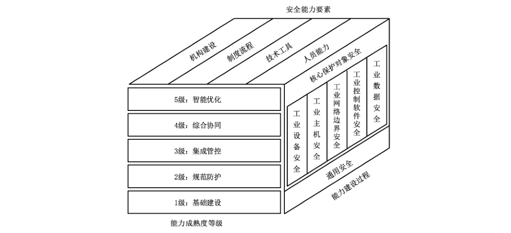
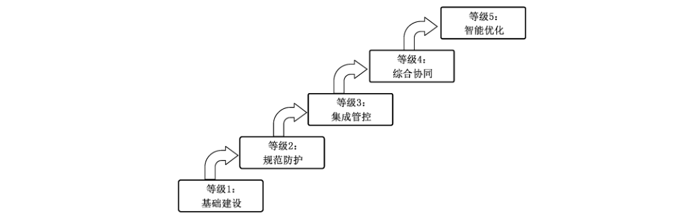
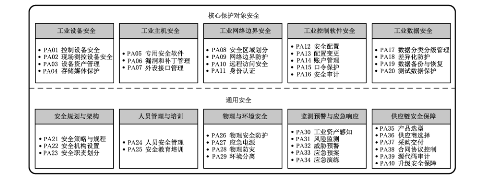
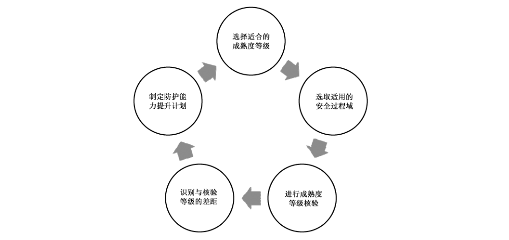
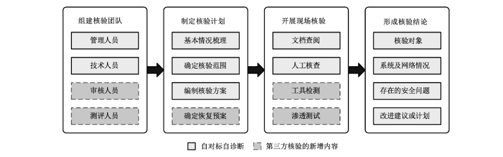

# GB/T 41400-2022 信息安全技术 工业控制系统信息安全防护能力成熟度模型

> 来源：[GB/T 41400-2022 国家标准详情](https://openstd.samr.gov.cn/bzgk/std/newGbInfo?hcno=B4272EB52F5930B214910854EFEA4C5F)；发布日期：2022-04-15；实施日期：2022-11-01。
> PDF SHA-256：5e28fd3614a5807184f380e8e970a06e2a0ff269c32cca9a44f68edd0dc6fc7f。
> 转写说明：对照官方 PDF 全部 84 页图像逐页校核；省略封面、目录、页眉、页脚和页码，合并跨页内容；图 1—图 3、图 B.1、图 C.1 保留原图。正式引用请核对官方原文。

## 前言

本文件按照 GB/T 1.1—2020《标准化工作导则 第1部分：标准化文件的结构和起草规则》的规定起草。

请注意本文件的某些内容可能涉及专利。本文件的发布机构不承担识别专利的责任。

本文件由全国信息安全标准化技术委员会（SAC/TC 260）提出并归口。

本文件起草单位：中国电子技术标准化研究院、太极计算机股份有限公司、江苏赛西科技发展有限公司、工业和信息化部计算机与微电子发展研究中心（中国软件评测中心）、广州赛宝认证中心服务有限公司、中国石油天然气股份有限公司西北销售分公司、中国石油天然气股份有限公司长庆石化分公司、宁波和利时信息安全研究院有限公司、国家工业信息安全发展研究中心、国家信息技术安全研究中心、中国信息安全测评中心、浙江省能源集团有限公司、浙江浙能乐清发电有限责任公司、上海三零卫士信息安全有限公司、陕西省网络与信息安全测评中心、西门子（中国）有限公司、上海工业控制安全创新科技有限公司、华东师范大学、杭州安恒信息技术股份有限公司、中国网络安全审查技术与认证中心、昆仑数智科技有限责任公司、西安电子科技大学、国网新疆电力有限公司电力科学研究院、中电长城网际系统应用有限公司、中国石油天然气股份有限公司新疆油田分公司数据公司、杭州立思辰安科科技有限公司、东莞市擎洲光电科技有限公司、柳州源创电喷技术有限公司、江苏省电子信息产品质量监督检验研究院（江苏省信息安全测评中心）、北京六方云信息技术有限公司、中国科学院软件研究所、烽台科技（北京）有限公司、上海化工宝数字科技有限公司、北京和仲宁信息技术有限公司、杭州木链物联网科技有限公司、陕西科技大学、中石油华东设计院有限公司、中国能源建设集团浙江省电力设计院有限公司、陕西延长石油富县发电有限公司、上海大学、海澜智云科技有限公司、成都航天通信设备有限责任公司。

本文件主要起草人：姚相振、李琳、甘俊杰、周睿康、龚洁中、周峰、李尧、刘贤刚、赵振学、赵金元、郝志强、赵梓桐、方进社、李俊、郭娴、夏冀、许玉娜、闵京华、邸丽清、孙彦、胡影、王惠莅、李弘彦、马强、程宇、陈柯宇、张宏伟、陈曦、牟文彪、张坚群、仵大奎、刘盈、杨帆、高瑞、闫涛、蒲戈光、刘虹、费敏锐、彭晨、杜大军、布宁、申永波、焦程鹏、刘鸿运、张芝军、王飞、索涛、戴赟、张建新、强剑、石永杰、于慧超、王小宏、赵朋、沈玉龙、李峰、王斌、周燕华、孙军、于盟、肖威、林昕、姜亚光、刘丕群、孙军军、刘志乐、吴兰、杨晨、龚亮华、段沛鑫、陈艳、刘克松、高智伟、张浏骅、刘冬、李敏、张晓菲、曹禹、郝鑫、马孝磊、杨立军、林洪俊、陈若春、纪璐、晏敏、方静、莫韬、何双羽、赵峰、张俊峰、刘志刚、赵学全、程薇宸、王一蔚、赵建宏。

## 1 范围

本文件给出了工业控制系统信息安全防护能力成熟度模型，规定了核心保护对象安全和通用安全的成熟度等级要求，提出了能力成熟度等级核验方法。

本文件适用于工业控制系统设计、建设、运维等相关方进行工业控制系统信息安全防护能力建设，以及对组织工业控制系统信息安全防护能力成熟度等级进行核验。

## 2 规范性引用文件

下列文件中的内容通过文中的规范性引用而构成本文件必不可少的条款。其中，注日期的引用文件，仅该日期对应的版本适用于本文件；不注日期的引用文件，其最新版本（包括所有的修改单）适用于本文件。

- GB/T 25069 信息安全技术 术语

- GB/T 32919—2016 信息安全技术 工业控制系统安全控制应用指南

## 3 术语和定义

GB/T 25069、GB/T 32919—2016 界定的以及下列术语和定义适用于本文件。

### 3.1 工业控制系统 industrial control system

由各种自动化控制组件以及对实时数据进行采集、监测的过程控制组件共同构成的确保工业基础设施自动化运行、过程控制与监控的业务流程管控系统。

> 注：工业控制系统包括监控和数据采集（SCADA）系统、分布式控制系统（DCS）和其他较小的控制系统，如可编程逻辑控制器（PLC）等。

［来源：GB/T 36323—2018,3.1，有修改］

### 3.2 工业控制系统信息安全防护能力 information security protection capability of industrial control system

组织避免工业控制系统遭到非授权或意外的访问、篡改、破坏及损失，在机构建设、制度流程、技术工具和人员能力等方面对工业控制系统的安全保障。

### 3.3 能力成熟度 capability maturity

对一个组织有条理的持续改进能力以及实现特定过程的连续性、可持续性、有效性和可信度的水平。

［来源：GB/T 37988—2019,3.6］

### 3.4 能力成熟度模型 capability maturity model

对一个组织的能力成熟度进行度量的模型，包括一系列代表能力和进展的特征、属性、指示或者模式。

> 注：能力成熟度模型为组织衡量其当前的实践、流程、方法的能力水平提供参考基准，并设置明确的提升目标。

［来源：GB/T 37988—2019,3.7］

### 3.5 过程域 process area

实现同一安全目标的相关工业控制系统信息安全防护基础实践的集合。

### 3.6 基础实践 base practice

实现某一安全目标的工业控制系统信息安全防护相关活动。

### 3.7 通用实践 generic practice

在等级核验中用于确定任何安全过程域或基础实践的实施能力的评定准则。

### 3.8 核心保护对象 core protected object

组织在工业控制系统信息安全防护能力建设过程中具有价值的信息或资源。

> 注：核心保护对象包括工业设备、工业主机、工业网络边界、工业控制软件和工业数据等。

### 3.9 工业设备 industrial equipment

工业生产过程中用于控制执行器以及采集传感器数据的装置。

> 注：工业设备包括控制设备、现场测控设备等。

### 3.10 工业主机 industrial host

工业生产控制各业务环节涉及组态、工作流程和工艺管理、状态监控、运行数据采集以及重要信息存储等工作的设备。

> 注：工业主机包括工程师站、操作员站、服务器等。

## 4 缩略语

下列缩略语适用于本文件。

APP：应用程序（Application）

BP：基础实践（Base Practice）

CF：公共特征（Common Feature）

DCS：分布式控制系统（Distributed Control System）

DPU：分散处理单元（Distributed Processing Unit）

FTP：文件传输协议（File Transfer Protocol）

GP：通用实践（Generic Practice）

GPS：全球定位系统（Global Positioning System）

HTTP：超文本传输协议（Hyper Text Transfer Protocol）

IED：智能电子设备（Intelligent Electric Device）

OLE：对象连接与嵌入（Object Linking and Embedding）

OPC：用于过程控制的 OLE（OLE for Process Control）

PA：过程域（Process Area）

PLC：可编程逻辑控制器（Programmable Logic Controller）

PKI：公钥基础设施（Public Key Infrastructure）

RFID：射频识别（Radio Frequency Identification）

RTU：远程终端单元（Remote Terminal Unit）

SCADA：监控和数据采集（Supervisory Control And Data Acquisition）

SQL：结构化查询语言（Structured Query Language）

SSH：安全外壳（Secure Shell）

UPS：不间断电源（Uninterruptible Power Supply）

USB：通用串行总线（Universal Serial Bus）

VPN：虚拟专用网络（Virtual Private Network）

## 5 工业控制系统信息安全防护能力成熟度模型

### 5.1 能力成熟度模型架构

工业控制系统信息安全防护能力成熟度模型的架构（见图1）由以下三个维度构成。

- a） 安全能力要素

  组织工业控制系统信息安全防护能力要素包括机构建设、制度流程、技术工具和人员能力。

- b） 能力成熟度等级

  组织工业控制系统信息安全防护能力成熟度等级划分为五级，具体包括：1 级是基础建设级，2 级是规范防护级，3 级是集成管控级，4 级是综合协同级，5 级是智能优化级。

- c） 能力建设过程

  组织工业控制系统信息安全防护能力建设过程包括核心保护对象安全和通用安全：

  - 1） 核心保护对象安全包括：工业设备安全、工业主机安全、工业网络边界安全、工业控制软件安全、工业数据安全5个过程类；

  - 2） 通用安全包括：安全规划与架构、人员管理与培训、物理与环境安全、监测预警与应急响应、供应链安全保障5个过程类。

### 5.2 能力要素维度

#### 5.2.1 能力构成

通过对组织工业控制系统信息安全防护过程应具备安全能力的量化，进而核验每项安全过程的实现能力。组织工业控制系统信息安全防护能力要素包括：

- a） 机构建设：工业控制系统信息安全机构的设立、职责分配和沟通协作；

- b） 制度流程：组织在工业控制系统信息安全领域的制度和流程执行；

- c） 技术工具：通过技术手段和产品工具落实安全要求或自动化实现安全工作；

- d） 人员能力：执行工业控制系统信息安全防护工作的人员的安全意识及相关专业能力。

#### 5.2.2 机构建设

从承担工业控制系统信息安全防护工作的组织应具备的机构建设能力角度，根据以下方面进行能力等级区分：

- a） 工业控制系统信息安全架构对组织业务的适用性；

- b） 工业控制系统信息安全机构承担的工作职责的明确性；

- c） 工业控制系统信息安全机构运作、沟通协调的有效性。

#### 5.2.3 制度流程

从组织工业控制系统信息安全防护制度流程的建设以及执行情况角度，根据以下方面进行能力等级区分：

- a） 工业控制系统核心保护对象关键控制节点授权审批流程的明确性；

- b） 相关制度流程的制定、发布、修订的规范性；

- c） 制度流程实施的一致性和有效性。

#### 5.2.4 技术工具

从组织用于开展工业控制系统信息安全防护工作的安全技术、应用系统和工具角度，根据以下方面进行能力等级区分：

- a） 工业控制系统信息安全防护技术在系统核心保护对象中的利用情况，针对系统安全风险的应对能力；

- b） 利用技术工具对工业控制系统信息安全防护工作的自动化支持能力，对工业控制系统信息安全防护制度流程固化执行的实现能力。

#### 5.2.5 人员能力

从组织承担工业控制系统信息安全防护工作的人员应具备的能力角度，根据以下方面进行能力等级区分：

- a） 工业控制系统信息安全人员所具备的安全技能是否能够满足复合型能力要求（对工业控制系统相关业务的理解程度以及工业控制系统信息安全专业能力）；

- b） 工业控制系统信息安全人员的信息安全意识以及对关键工业控制系统信息安全岗位员工信息安全能力的培养。

### 5.3 能力成熟度等级维度

组织工业控制系统信息安全防护能力成熟度等级共分为5级，见图2。

根据组织开展安全防护的能力分为5个能力成熟度等级，自低向高分别是基础建设级、规范防护级、集成管控级、综合协同级、智能优化级。各能力成熟度等级的CF 如下：

- a） 基础建设级：组织能够依据工业控制系统信息安全防护的技术基础和条件开展基本保护工作，安全防护能力建设主要基于特定业务场景，尚未形成规范化、流程化的工作方式，相关工作多依赖信息安全人员主观经验，建设过程未要求以文档形式记录，无法形成可复制；

- b） 规范防护级：组织建立并记录工业控制系统信息安全防护能力建设工作，能够针对工业控制设备、工业主机、工业网络、工业数据等方面，制定规范化安全防护制度、规章，使得组织能够以重复的方式执行，采用数字化装备、信息技术手段等，有针对性地开展安全防护，面向各方面形成独立、可复制的安全防护能力；

- c） 集成管控级：组织能够对工业控制系统设备、主机、系统、网络、数据等方面，在规范防护已有工作基础上，通过集成化工具、系统等，对相对独立的单点防护设备进行集中统一管控，同时整合相关防护规章制度文件，形成体系化制度，实现组织内部工业控制系统信息安全的集中管理、统一控制的安全防护能力；

- d） 综合协同级：组织能够面向不同产线、厂区、工厂及产业链上下游相关单位，统筹考虑信息安全风险需求，开展安全防护建设，建立多级协同的安全管理体系，并通过态势感知、统一管控等技术手段实现综合决策、协调防护的安全能力；

- e） 智能优化级：组织能够采用人工智能、主动防御、内生安全等先进技术，与已有安全防护设备、系统、制度体系深度融合，使得可通过知识学习、智能建模分析等技术，构建可智能化演进的安全防护系统，形成具有自决策、自进化能力的安全防护体系。

### 5.4 能力建设过程维度

#### 5.4.1 PA 体系

PA 体系分为核心保护对象安全和通用安全两部分，共包含40个 PA，见图3。

核心保护对象安全包括以下5个过程类：

- a） 工业设备安全的PA（PA01~PA04）包括：控制设备安全、现场测控设备安全、设备资产管理、存储媒体保护；

- b） 工业主机安全的 PA（PA05~PA07）包括：专用安全软件、漏洞和补丁管理、外设接口管理；

- c） 工业网络边界安全的 PA（PA08~PA11）包括：安全区域划分、网络边界防护、远程访问安全、身份认证；

- d） 工业控制软件安全的 PA（PA12~PA16）包括：安全配置、配置变更、账户管理、口令保护、安全审计；

- e） 工业数据安全的 PA（PA17~PA20）包括：数据分类分级管理、差异化防护、数据备份与恢复、测试数据保护。

通用安全包括以下5个过程类：

- a） 安全规划与架构的 PA（PA21~PA23）包括：安全策略与规程、安全机构设置、安全职责划分；

- b）人员管理与培训的PA（PA24 和PA25）包括：人员安全管理、安全教育培训；

- c） 物理与环境安全的PA（PA26~PA29）包括：物理安全防护、应急电源、物理防灾、环境分离；

- d）监测预警与应急响应的 PA（PA30~PA34）包括：工业资产感知、风险监测、威胁预警、应急预案、应急演练；

- e） 供应链安全保障的 PA（PA35～PA40）包括：产品选型、供应商选择、采购交付、合同协议控制、源代码审计、升级安全保障。

#### 5.4.2 编码规则

工业控制系统信息安全防护PA 编码规则如下：

- a） 每个 PA 有对应的编号，分别采用递增的数值01，02，⋯，表示；

- b） 每个PA 由若干 BP组成，BP用BP.XX.XX 进行编号，第一组编码表示所在 PA 的序号，第二组编码表示具体 BP的序号，具体 BP 的序号采用递增的数值 01，02，⋯，表示；

- c） 对于每个PA 的每个级别，组织需同时实现该级别和所有低于该级别的BP，才能达到该级别的能力水平。

#### 5.4.3 关系描述

能力成熟度等级与PA、BP、能力要素的关系如下：

- a） 组织在每个 PA 的能力成熟度划分为5级，对每个等级下组织应具备的能力要求，从4个能力要素提出具体的 BP；

- b） 并非每个 PA的能力成熟度等级都包含完整的4个能力要素；

- c） 对于每个 PA，高等级的能力要求不低于所有低等级能力要求，可依据 GB/T 32919—2016 提供的方法对某一等级能力要求进行裁剪。

> 注：针对某一具体 PA，如5级的能力要求中未涉及某一能力要素的内容，则默认应实现在4级的能力要求中该能力要素的内容，以此类推。

能力成熟度等级的描述与GP，见附录A。

能力成熟度模型使用方法，见附录 B。

能力成熟度等级核验流程，见附录C。

## 6 核心保护对象安全

### 6.1 工业设备安全

#### 6.1.1 PA01 控制设备安全

##### 6.1.1.1 PA描述

保护工业控制设备，阻止非授权访问，避免控制设备受到恶意入侵、攻击或非法控制。

##### 6.1.1.2 等级描述

###### 6.1.1.2.1 等级 1：基础建设

该等级的安全防护能力描述如下：

人员能力：组织仅根据特定需求或基于组织经验对工业控制设备进行安全管理（BP.01.01）。

###### 6.1.1.2.2 等级2：规范防护

该等级的安全防护能力描述如下：

- a） 制度流程：组织建立工业控制设备安全保障制度，制定安全管理文档（BP.01.02）；

- b） 技术工具：组织采用具有身份鉴别、访问控制和安全审计等安全功能的工业控制设备，如受条件限制工业控制设备无法实现上述要求，部署上位控制或管理设备实现同等功能，或通过管理手段控制（BP.01.03）；

- c） 人员能力：组织在经过测试评估后，在不影响系统安全稳定运行的情况下对工业控制设备进行补丁更新、固件更新等工作（BP.01.04）。

###### 6.1.1.2.3 等级3：集成管控

该等级的安全防护能力描述如下：

- a） 技术工具：组织使用专用设备和专用软件对工业控制设备进行更新（BP.01.05）；

- b）人员能力：组织在工业控制设备上线前对其进行安全性检测，工业控制设备固件中不存在恶意代码程序（BP.01.06）。

###### 6.1.1.2.4 等级 4：综合协同

该等级的安全防护能力描述如下：

技术工具：可在 PLC、DCS 等核心控制设备前端部署具备工业控制协议深度包检测功能的防护设备，能对 OPC、Profinet 等主流工业控制协议数据进行深度包分析和检测过滤，具备检测或阻断不符合协议标准结构的数据包、不符合正常生产业务范围的数据内容等功能（BP.01.07）。

###### 6.1.1.2.5 等级5：智能优化

该等级的安全防护能力描述如下：

技术工具：组织部署内嵌安全功能的控制设备，构建工业控制系统安全可信环境（BP.01.08）。

#### 6.1.2 PA02 现场测控设备安全

##### 6.1.2.1 PA 描述

根据实际或计划使用环境的安全风险分析结果，保护现场测控设备免受攻击、侵入、干扰和破坏。

##### 6.1.2.2 等级描述

###### 6.1.2.2.1 等级1：基础建设

该等级的安全防护能力描述如下：

人员能力：组织仅根据特定需求或基于组织经验对现场测控设备进行安全管理（BP.02.01）。

###### 6.1.2.2.2 等级 2：规范防护

该等级的安全防护能力描述如下。

- a） 制度流程：建立工业控制系统现场测控设备安全保障制度，制定安全管理文档（BP.02.02）。

- b） 技术工具：

  - 1） 组织选择现场测控设备，优先考虑具有对访问行为主体（人员、进程和设备）进行标识与鉴别的功能（BP.02.03）；

  - 2） 组织选择现场测控设备，优先考虑具有访问控制与审计功能，支持基于角色的访问控制策略，并对重要的安全性事件和重要生产活动进行审计（BP.02.04）；

  - 3） 组织选择现场测控设备，优先考虑具有数据完整性校验功能，具备防止对静态数据进行非授权写操作的保护机制（硬件或软件），并具备抵御数据包插入、丢失、重放、篡改的机制（BP.02.05）；

  - 4） 组织采用的现场测控设备具备机制保护存储和传输数据的保密性（BP.02.06）。

###### 6.1.2.2.3 等级 3：集成管控

该等级的安全防护能力描述如下：

技术工具：

- a） 组织部署统一配置管理平台对 RTU、IED、DPU 等现场测控设备进行集中管理（BP.02.07）；

- b） 如现场测控设备直接或依靠其他工具提供备份功能，组织进行应用级和系统级信息（包括系统安全状态信息）的备份（BP.02.08）。

###### 6.1.2.2.4 等级 4：综合协同

该等级的安全防护能力描述如下：

机构建设：组织建立现场测控设备提供者和运营者的协同运维机制，明确设备检修阶段的各方责任划分（BP.02.09）。

###### 6.1.2.2.5 等级 5：智能优化

该等级的安全防护能力描述如下：

技术工具：在现场测控设备的远程管理过程中，组织可采用基于公钥密码理论的 PKI 安全体系（BP.02.10）。

#### 6.1.3 PA03 设备资产管理

##### 6.1.3.1 PA描述

建立组织工业控制系统资产管理机制，从资产的类型、管理模式等方面实现统一的管理要求。

##### 6.1.3.2 等级描述

###### 6.1.3.2.1 等级 1：基础建设

该等级的安全防护能力描述如下：

人员能力：组织仅根据特定需求或基于组织经验开展设备资产管理（BP.03.01）。

###### 6.1.3.2.2 等级2：规范防护

该等级的安全防护能力描述如下：

制度流程：

- a） 组织制定设备资产管理制度（BP.03.02）；

- b）组织建立工业控制系统资产清单（包括软件资产、硬件资产、固件资产等），确保工业控制系统资产信息可核查、可追溯（BP.03.03）。

###### 6.1.3.2.3 等级3：集成管控

该等级的安全防护能力描述如下：

- a） 制度流程：围绕组织工业控制系统承载的关键业务，制定涵盖关键工业主机、网络设备、控制组件等的重要资产清单（BP.03.04）；

- b） 技术工具：组织对关键工业主机、网络设备、控制组件等进行冗余配置（如双机冷/热备等）（BP.03.05）。

###### 6.1.3.2.4 等级 4：综合协同

该等级的安全防护能力描述如下：

- a） 机构建设：组织建立资产多级管理及使用处置规则并明确资产责任人，在资产生命周期内对其进行适当管理（BP.03.06）；

- b） 技术工具：组织将工业控制系统设备资产清单及相关信息上传至云服务（可私有云），对设备资产进行综合管控（BP.03.07）。

###### 6.1.3.2.5 等级5：智能优化

该等级的安全防护能力描述如下：

技术工具：组织采用自动化扫描等技术，智能发现新增或变更的网络设备、工业主机、控制设备等，并自动更新资产清单（BP.03.08）。

#### 6.1.4 PA04 存储媒体保护

##### 6.1.4.1 PA描述

为数据存储媒体的访问和使用提供有效的技术和管理手段，防止对媒体的不当使用可能引发的数据泄露风险。

##### 6.1.4.2 等级描述

###### 6.1.4.2.1 等级1：基础建设

该等级的安全防护能力描述如下：

机构建设：组织仅根据特定需求或基于组织经验开展存储媒体保护工作（BP.04.01）。

###### 6.1.4.2.2 等级 2：规范防护

该等级的安全防护能力描述如下。

- a） 制度流程：

  - 1） 组织建立存储媒体保护制度，包括存储媒体登记、存储媒体使用、存储媒体销毁等，并定期对存储媒体保护制度进行评审、更新（BP.04.02）；

  - 2） 组织对存储媒体进行分类保护，将存储媒体分为数字存储媒体和非数字存储媒体。其中，数字存储媒体包括：硬盘、光盘、软盘、U盘等，非数字存储媒体包括文档、缩微胶片等（BP.04.03）；

  - 3） 存储媒体销毁前进行审阅、批准、跟踪等步骤，经组织审查和批准后进行存储媒体销毁，并确认该销毁过程的合规性（BP.04.04）。

- b） 技术工具：受控区域外传递各类存储媒体时，组织采取安全防护措施进行保护和控制（BP.04.05）。

- c） 人员能力：受控区域内，组织采取物理控制措施并安全存放各类存储媒体，实行专人管理，并根据存储媒体登记的清单定期盘点（BP.04.06）。

###### 6.1.4.2.3 等级3：集成管控

该等级的安全防护能力描述如下。

- a） 制度流程：存储媒体由组织集中管控，依据确定的范围登记存储媒体的名称/种类、序号、分发范围、访问要求、处理要求、销毁要求等（BP.04.07）。

- b） 技术工具：

  - 1） 组织采用管理系统对存储媒体传递相关活动进行记录，确保存储媒体在受控区域外传递过程的可核查性（BP.04.08）；

  - 2） 在存储媒体报废、回收前，组织对存储媒体进行销毁，采用销毁机制的强度、覆盖范围与存储媒体中存储信息的安全类别或级别相匹配（BP.04.09）。

- c） 人员能力：组织对存储媒体在物理传输过程中的人员选择、打包、交付等情况进行控制，并对存储媒体的归档和查询等进行记录（BP.04.10）。

###### 6.1.4.2.4 等级 4：综合协同

该等级的安全防护能力描述如下：

技术工具：销毁前组织采用技术手段确认存储媒体内的信息不能恢复或重建（BP.04.11）。

###### 6.1.4.2.5 等级5：智能优化

该等级的安全防护能力描述如下：

技术工具：组织采用自动化技术手段，识别并禁止未标识的存储媒体在工业控制系统中使用（BP.04.12）。

### 6.2 工业主机安全

#### 6.2.1 PA05 专用安全软件

##### 6.2.1.1 PA描述

在操作员站、工程师站等工业主机上安装专用安全软件，对可执行程序进行管理，防止病毒、木马等恶意程序感染。

##### 6.2.1.2 等级描述

###### 6.2.1.2.1 等级1：基础建设

该等级的安全防护能力描述如下：

人员能力：组织仅根据特定需求或基于组织经验对工业主机可执行程序进行管理（BP.05.01）。

###### 6.2.1.2.2 等级2：规范防护

该等级的安全防护能力描述如下。

- a） 制度流程：建立工业主机防病毒和恶意软件入侵管理制度，制定安全管理文档（BP.05.02）。

- b） 技术工具：

  - 1） 组织在工业主机中安装安全软件，防范病毒、木马等恶意程序，防止未授权应用程序和服务运行（BP.05.03）；

  - 2） 组织在离线环境中对安全软件进行测试，验证安全软件不会对工业控制系统的正常运行造成影响（BP.05.04）。

- c） 人员能力：组织依据采购合同、软件协议等规定的方式使用安全软件，明确业主方的责任（BP.05.05）。

###### 6.2.1.2.3 等级3：集成管控

该等级的安全防护能力描述如下：

- a） 制度流程：组织在工业控制系统上线前或检修阶段对其进行安全扫描，适用时定期对工业控制系统进行安全扫描，记录安全扫描结果并处理存在的漏洞（BP.05.06）；

- b） 技术工具：对临时接入的设备进行安全扫描，并留存安全扫描记录（BP.05.07）。

###### 6.2.1.2.4 等级4：综合协同

该等级的安全防护能力描述如下。

- a） 技术工具：

  - 1） 组织部署工业控制系统安全软件统一管理系统，对厂区内工业主机专用的安全防护软件进行统一管理（BP.05.08）；

  - 2） 组织在工业主机上安装安全软件，能够识别网络入侵和恶意软件并告警（BP.05.09）。

- b） 人员能力：组织选择定制化安全软件时，要求供应方提供开发安全文档，并在可控范围内为源代码核查提供技术支持（BP.05.10）。

###### 6.2.1.2.5 等级5：智能优化

该等级的安全防护能力描述如下：

技术工具：组织部署工业控制系统安全软件统一管理系统，集成自适应分析学习功能，通过控制行为逻辑安全性判断、分布式逻辑行为的综合分析等，实现异常控制程序、指令等实时分析反馈（BP.05.11）。

#### 6.2.2 PA06 漏洞和补丁管理

##### 6.2.2.1 PA 描述

基于组织工业控制系统风险评估结果，对工业信息安全漏洞和补丁进行管理，防止高级持续性威胁利用漏洞入侵工业主机。

##### 6.2.2.2 等级描述

###### 6.2.2.2.1 等级1：基础建设

该等级的安全防护能力描述如下：

人员能力：组织仅根据特定需求或基于组织经验对工业信息安全漏洞和补丁进行管理（BP.06.01）。

###### 6.2.2.2.2 等级 2：规范防护

该等级的安全防护能力描述如下：

- a） 制度流程：组织建立工业信息安全漏洞和补丁管理制度，跟踪重大工业信息安全漏洞信息，并进行分析研判（BP.06.02）；

- b） 机构建设：出现重大工业信息安全漏洞后，组织及时跟踪补丁发布，在适当时间进行补丁升级或开展消减措施（BP.06.03）。

###### 6.2.2.2.3 等级3：集成管控

该等级的安全防护能力描述如下：

制度流程：

- a） 补丁安装前，组织对补丁进行安全测试，验证其有效性并评估可能的后果，必要时在离线环境中进行，补丁安装不影响工业控制系统的正常运行（BP.06.04）；

- b）组织制定详细的回退计划，确保工业控制系统能够回到稳定的运行状态（BP.06.05）。

###### 6.2.2.2.4 等级4：综合协同

该等级的安全防护能力描述如下：

制度流程：组织建立补丁升级标准化流程，对不同厂区的补丁升级进行集中统一管理，由专业人员进行补丁升级（BP.06.06）。

###### 6.2.2.2.5 等级 5：智能优化

该等级的安全防护能力描述如下：

技术工具：

- a） 组织部署补丁审查系统，自动定期扫描检查工业主机补丁升级情况（BP.06.07）；

- b） 组织在补丁安装前，建立与实际生产环境高度一致的安全测试环境，并在测试环境中开展全面安全性测试，确保补丁的有效性及可靠性（BP.06.08）。

#### 6.2.3 PA07 外设接口管理

##### 6.2.3.1 PA描述

对工业主机的外设接口进行访问控制管理，降低被病毒、木马、蠕虫等恶意代码感染的风险。

##### 6.2.3.2 等级描述

###### 6.2.3.2.1 等级 1：基础建设

该等级的安全防护能力描述如下：

人员能力：组织仅根据特定需求或基于组织经验对工业主机外设接口进行管理（BP.07.01）。

###### 6.2.3.2.2 等级 2：规范防护

该等级的安全防护能力描述如下：

制度流程：建立工业主机外设接口管理制度，严格管控工业主机外设接口的使用（BP.07.02）。

###### 6.2.3.2.3 等级3：集成管控

该等级的安全防护能力描述如下：

技术工具：

- a） 组织拆除或封闭工业主机上不必要的 USB、光驱、无线等接口，防止病毒、木马、蠕虫等恶意代码入侵，并避免数据泄露（BP.07.03）；

- b）组织确需使用工业主机外设接口时，通过主机外设安全管理技术手段实施访问控制，不准许未授权的外设终端接入（BP.07.04）。

###### 6.2.3.2.4 等级 4：综合协同

该等级的安全防护能力描述如下：

技术工具：组织采用统一审批的工业主机外接设备，工业主机拒绝访问未经审批的外接设备（BP.07.05）。

###### 6.2.3.2.5 等级5：智能优化

该等级的安全防护能力不低于4级BP。

### 6.3 工业网络边界安全

#### 6.3.1 PA08 安全区域划分

##### 6.3.1.1 PA 描述

对工业控制网络安全区域之间进行逻辑隔离安全防护，防止由于单点网络攻击造成全局网络问题。

##### 6.3.1.2 等级描述

###### 6.3.1.2.1 等级 1：基础建设

该等级的安全防护能力描述如下：

制度流程：组织仅根据特定需求或基于组织经验建立安全区域划分策略（BP.08.01）。

###### 6.3.1.2.2 等级 2：规范防护

该等级的安全防护能力描述如下：

- a） 制度流程：组织根据区域重要性和业务需求对工业控制系统进行安全区域划分，确保安全风险的区域隔离（BP.08.02）；

- b） 技术工具：组织根据业务方向，采用工业防火墙、网闸、数采隔离网关等防护设备，对工业控制网络安全区域实施隔离防护（BP.08.03）。

###### 6.3.1.2.3 等级3：集成管控

该等级的安全防护能力描述如下：

技术工具：组织将具有相同功能和安全要求的控制设备划分到同一区域，区域之间执行管道通信，并对控制区域间管道中的通信内容进行统一管理（BP.08.04）。

###### 6.3.1.2.4 等级4：综合协同

该等级的安全防护能力不低于3级 BP。

###### 6.3.1.2.5 等级5：智能优化

该等级的安全防护能力描述如下：

技术工具：组织可采用自动化机制，基于深度防御的思想，智能生成区域访问控制策略并自适应演进，以针对不同安全区域的边界实现不同程度的安全隔离强度（BP.08.05）。

#### 6.3.2 PA09 网络边界防护

##### 6.3.2.1 PA 描述

通过网络边界防护设备对工业控制网络与办公网或互联网之间的边界进行安全防护，防止工业现场外部的安全风险引入工业控制网络。

##### 6.3.2.2 等级描述

###### 6.3.2.2.1 等级1：基础建设

该等级的安全防护能力描述如下：

制度流程：组织禁止未加防护的工业控制网络与互联网直接连接，确保互联网的安全风险不被引入工业控制网络（BP.09.01）。

###### 6.3.2.2.2 等级2：规范防护

该等级的安全防护能力描述如下：

技术工具：

- a） 组织在生产网和办公网边界部署安全防护设备，防止办公网的安全风险进入工业控制网络（BP.09.02）；

- b） 组织部署安全防护设备，对非授权设备私自联到内部网络的行为进行限制或检查（BP.09.03）；

- c） 组织部署安全防护设备，对内部用户非授权联到外部网络的行为进行限制或检查（BP.09.04）。

###### 6.3.2.2.3 等级 3：集成管控

该等级的安全防护能力描述如下：

- a） 制度流程：组织通过受控的接口连接外部网络或工业控制系统（BP.09.05）；

- b） 技术工具：

  - 1） 组织部署监测设备，监视并控制在工业控制网络边界上的通信，以及网络内关键边界上的通信（BP.09.06）；

  - 2） 组织规范无线网络的使用，保证无线网络通过受控的边界防护设备接入内部网络（BP.09.07）。

###### 6.3.2.2.4 等级 4：综合协同

该等级的安全防护能力描述如下：

技术工具：组织部署相应技术措施，发现并阻断非授权内联和非法外联行为（BP.09.08）。

###### 6.3.2.2.5 等级5：智能优化

该等级的安全防护能力描述如下：

技术工具：组织采用可信验证机制对接入到网络中的设备进行可信验证，保证接入网络的设备真实可信（BP.09.09）。

#### 6.3.3 PA10 远程访问安全

##### 6.3.3.1 PA 描述

根据组织远程访问工业控制系统的需求，采用适当的加密保护措施，保证传输通道和节点的安全，防止远程访问过程中的数据泄露。

##### 6.3.3.2 等级描述

###### 6.3.3.2.1 等级1：基础建设

该等级的安全防护能力描述如下：

人员能力：组织仅根据特定需求或基于组织经验对工业控制系统远程访问进行管理（BP.10.01）。

###### 6.3.3.2.2 等级 2：规范防护

该等级的安全防护能力描述如下。

- a） 制度流程：

  - 1） 组织制定远程访问策略，原则上严格禁止工业控制系统面向互联网开通 HTTP、FTP、Telnet、Web、Email、Rlogin 等高风险通用网络服务（BP.10.02）；

  - 2） 组织制定远程接入账户管理制度，规范账户申请、使用、收回等流程（BP.10.03）。

- b） 技术工具：

  - 1） 组织采用数据单向访问控制等策略对远程访问进行安全加固，确保数据传输安全，避免未授权操作（BP.10.04）；

  - 2） 组织对远程访问进行时限控制，并采用加标锁定策略，确保组织对远程访问的可控性（BP.10.05）。

###### 6.3.3.2.3 等级 3：集成管控

该等级的安全防护能力描述如下：

技术工具：

- a） 适用时，组织对远程维护采用 VPN 等远程接入方式，确保远程维护安全可信（BP.10.06）；

- b） 适用时，利用商用密码技术来保护远程访问会话的机密性和完整性，防止信息在网络传输过程中被窃听和篡改（BP.10.07）；

- c） 相关商用密码技术的采用不能影响工业控制系统正常运行（BP.10.08）；

- d） 组织保留工业控制系统相关访问日志（如人员账户、访问时间、操作内容等），并定期进行备份，为安全审计提供依据（BP.10.09）。

###### 6.3.3.2.4 等级 4：综合协同

该等级的安全防护能力不低于3级BP。

###### 6.3.3.2.5 等级 5：智能优化

该等级的安全防护能力描述如下：

技术工具：组织自建专用通信传输网络或租用专用通信线缆，对重要工业控制系统远程访问进行安全防护（BP.10.10）。

#### 6.3.4 PA11 身份认证

##### 6.3.4.1 PA描述

基于组织的工业控制系统网络安全需求和合规性要求建立身份认证机制，防止对工业数据的未授权访问。

##### 6.3.4.2 等级描述

###### 6.3.4.2.1 等级1：基础建设

该等级的安全防护能力描述如下：

机构建设：组织根据不同业务需求、岗位职责等，合理分类设置账户（BP.11.01）。

###### 6.3.4.2.2 等级 2：规范防护

该等级的安全防护能力描述如下。

- a） 制度流程：

  - 1） 组织建立身份认证管理制度（BP.11.02）；

  - 2） 组织明确禁止账户借用/冒用（BP.11.03）；

  - 3） 组织以满足工作要求的最小特权原则对系统账户进行权限分配（BP.11.04）。

- b） 技术工具：

  - 1） 在工业主机登录、应用服务资源访问、工业云平台访问等过程中，利用至少一种身份认证管理技术（如口令加密、数字证书、生物指纹等）（BP.11.05）；

  - 2） 组织为工业控制设备、工业通信设备等的登录账户设置高强度登录口令，并定期更新（BP.11.06）。

###### 6.3.4.2.3 等级3：集成管控

该等级的安全防护能力描述如下。

- a） 制度流程：

  - 1） 组织设置连续登录失败机制，限制账户的无效访问尝试（BP.11.07）；

  - 2） 当未成功尝试超出最大次数时，锁死账户，直至管理员予以释放（BP.11.08）；

  - 3） 组织明确授权和监督匿名账户的使用（BP.11.09）。

- b） 技术工具：组织加强对身份认证证书信息保护力度，禁止在不同系统和网络环境下共享。确保其身份认证证书传输、存储的安全可靠，避免证书的未授权使用（BP.11.10）。

###### 6.3.4.2.4 等级 4：综合协同

该等级的安全防护能力描述如下：

- a） 制度流程：结合各厂区的业务流程，组织定期审计分配的账户权限是否超出工作需要，并调整超出工作需要的账户权限（BP.11.11）；

- b） 技术工具：组织根据各厂区实际情况，明确关键设备、系统和平台，并在访问过程中，采用两种或两种以上因素认证方式，以避免非法登录等安全隐患（BP.11.12）。

###### 6.3.4.2.5 等级 5：智能优化

该等级的安全防护能力描述如下：

技术工具：组织通过自建电子认证体系，建立全组织范围内的身份认证系统，实现多级别多因素的认证方式，以此构建重要工业主机多层防御机制（BP.11.13）。

### 6.4 工业控制软件安全

#### 6.4.1 PA12 安全配置

##### 6.4.1.1 PA描述

建立工业控制系统的安全配置基线，保障工业控制软件安全稳定运行。

##### 6.4.1.2 等级描述

###### 6.4.1.2.1 等级 1：基础建设

该等级的安全防护能力描述如下：

机构建设：组织仅根据特定需求或基于组织经验对工业控制系统进行安全配置（BP.12.01）。

###### 6.4.1.2.2 等级2：规范防护

该等级的安全防护能力描述如下。

- a） 制度流程：

  - 1） 组织创建安全配置管理制度文档（BP.12.02）；

  - 2） 组织创建安全配置清单（BP.12.03）。

- b）人员能力：

  - 1） 做好工业控制网络、工业主机、工业控制设备的安全策略配置，确保工业控制系统相关安全配置的有效性（BP.12.04）；

  - 2） 建立的安全配置清单满足组织工业控制系统安全可靠运行的需求（BP.12.05）；

  - 3） 组织对工业控制系统按照仅提供最小功能进行配置，对非必要功能、端口、协议和服务的使用进行禁止或限制（BP.12.06）。

###### 6.4.1.2.3 等级3：集成管控

该等级的安全防护能力描述如下。

- a） 制度流程：

  - 1） 组织定期对工业控制系统进行评审，以标识和排除不必要的功能、端口、协议和服务（BP.12.07）；

  - 2） 组织定期进行工业控制系统安全配置核查，避免因调试、升级等操作导致配置变更后，未及时更新配置清单（BP.12.08）。

- b） 技术工具：组织对配置设置进行集中管理、应用，并验证配置设置（BP.12.09）。

###### 6.4.1.2.4 等级 4：综合协同

该等级的安全防护能力描述如下：

制度流程：组织将检测到的未授权的、与安全相关的配置变更纳入事件响应中，对被检测事件进行追踪、监视、纠正，并形成可用的历史记录（BP.12.10）。

###### 6.4.1.2.5 等级5：智能优化

该等级的安全防护能力描述如下：

技术工具：根据组织业务特点及实际情况，采用人工智能分析技术，实现安全配置的迭代优化，并采用自动化手段，集中管理、应用并验证配置设置（BP.12.11）。

#### 6.4.2 PA13 配置变更

##### 6.4.2.1 PA 描述

对工业控制系统配置变更进行管理，防止错误的、不恰当的或未批准的配置变更影响工业控制系统的正常运行。

##### 6.4.2.2 等级描述

###### 6.4.2.2.1 等级1：基础建设

该等级的安全防护能力描述如下：

机构建设：组织仅根据特定需求或基于组织经验进行工业控制系统配置变更（BP.13.01）。

###### 6.4.2.2.2 等级2：规范防护

该等级的安全防护能力描述如下：

制度流程：

- a） 组织设立配置变更日志文档管理制度（BP.13.02）；

- b） 组织创建配置变更管理制度文档（BP.13.03）；

- c） 组织定义重大配置变更（如重新划分网络等），在发生重大配置变更前，制定配置变更计划，进行安全影响分析，确保该配置变更不会引入重大安全风险（BP.13.04）；

- d） 确定配置变更类型，配置变更包括组件改变、技术产品的配置修改、紧急修改和缺陷修复等（BP.13.05）。

###### 6.4.2.2.3 等级3：集成管控

该等级的安全防护能力描述如下：

- a） 制度流程：经过严格安全测试后实施配置变更，必要时在离线环境中进行安全验证，配置变更不影响工业控制系统的正常运行（BP.13.06）；

- b） 技术工具：建立得到批准的、对系统的受控配置变更，评审并保留对系统的受控配置变更记录（BP.13.07）。

###### 6.4.2.2.4 等级 4：综合协同

该等级的安全防护能力描述如下：

制度流程：将发现的未授权，与安全有关的配置变更，结合到组织的安全事件响应能力，并对每个发现的事件予以跟踪、纠正（BP.13.08）。

###### 6.4.2.2.5 等级 5：智能优化

该等级的安全防护能力描述如下：

技术工具：针对重大配置变更，组织在备份控制系统中，开展安全性验证（BP.13.09）。

#### 6.4.3 PA14 账户管理

##### 6.4.3.1 PA 描述

对工业控制系统账户进行管理，防止工业控制系统遭到未授权的访问和使用。

##### 6.4.3.2 等级描述

###### 6.4.3.2.1 等级 1：基础建设

该等级的安全防护能力描述如下：

机构建设：组织仅根据特定需求或基于组织经验对工业控制系统账户进行安全管理（BP.14.01）。

###### 6.4.3.2.2 等级2：规范防护

该等级的安全防护能力描述如下。

- a） 制度流程：组织制定工业控制系统账户管理的基本制度（BP.14.02）。

- b） 技术工具：

  - 1） 组织管理工业控制系统账户，包括建立、激活和修改、审核、禁用和删除账户（BP.14.03）；

  - 2） 组织在规定的时间周期后及时删除临时账户（BP.14.04）；

  - 3） 组织在规定的时间周期后及时删除非活动的账户（BP.14.05）。

###### 6.4.3.2.3 等级 3：集成管控

该等级的安全防护能力描述如下：

制度流程：

- a） 组织按规定的时间间隔审核工业控制系统账户（BP.14.06）；

- b） 组织删除、禁用或对默认账户提供安全维护，严格限制默认账户的访问权限，重命名系统默认账户（BP.14.07）。

###### 6.4.3.2.4 等级4：综合协同

该等级的安全防护能力描述如下：

技术工具：组织使用自动机制来支持对不同厂区工业控制系统账户的管理（BP.14.08）。

###### 6.4.3.2.5 等级5：智能优化

该等级的安全防护能力描述如下：

技术工具：组织使用自动机制来审核账户的创建、修改、失效和终止等活动，审核失败时通知相关人员（BP.14.09）。

#### 6.4.4 PA15 口令保护

##### 6.4.4.1 PA 描述

基于工业控制系统的重要程度，实施口令保护，降低对设备未授权登录和操作的可能性。

##### 6.4.4.2 等级描述

###### 6.4.4.2.1 等级1：基础建设

该等级的安全防护能力描述如下：

机构建设：组织仅根据特定需求或基于组织经验对工业控制系统账户口令进行保护（BP.15.01）。

###### 6.4.4.2.2 等级2：规范防护

该等级的安全防护能力描述如下。

- a） 制度流程：

  - 1） 组织建立口令保护的基本制度（BP.15.02）；

  - 2） 组织根据工业控制系统的敏感程度，规定口令字符长度、组合复杂度、最小更新周期等参数（BP.15.03）。

- b）人员能力：组织妥善保存口令，严格控制口令知悉范围（BP.15.04）。

###### 6.4.4.2.3 等级 3：集成管控

该等级的安全防护能力描述如下。

- a） 制度流程：

  - 1） 组织要求产品或设备供应商告知系统存在的默认账户和口令，并进行修改（BP.15.05）；

  - 2） 组织按规定的时间间隔更换访问控制设备的口令，在口令泄露和人员调动或离职时更换访问控制设备的口令（BP.15.06）。

- b） 技术工具：

  - 1） 组织在口令存储和传输过程中，对口令进行加密处理（BP.15.07）；

  - 2） 组织的账户口令没有被嵌入在访问脚本中或存储在功能键上（BP.15.08）。

###### 6.4.4.2.4 等级4：综合协同

该等级的安全防护能力描述如下：

制度流程：组织根据工业控制系统重要程度，建立口令分级管理制度，并采用相应的技术手段实施（BP.15.09）。

###### 6.4.4.2.5 等级5：智能优化

该等级的安全防护能力不低于4级BP。

#### 6.4.5 PA16 安全审计

##### 6.4.5.1 PA描述

建立工业控制系统的安全审计机制，保证对工业控制系统的访问和操作得到有效监控，感知系统中潜在的异常操作行为，为工业控制系统安全事件调查提供基础依据。

##### 6.4.5.2 等级描述

###### 6.4.5.2.1 等级1：基础建设

该等级的安全防护能力描述如下：

机构建设：组织仅根据特定需求或基于组织经验开展工业控制系统安全审计工作（BP.16.01）。

###### 6.4.5.2.2 等级 2：规范防护

该等级的安全防护能力描述如下。

- a） 制度流程：

  - 1） 组织建立安全审计管理制度文档，包括审计记录、审计信息保护、审计分析等方面（BP.16.02）；

  - 2） 组织在安全审计结束后，对审计记录数据进行分析，并形成审计报告（BP.16.03）。

- b） 技术工具：

  - 1） 组织部署安全审计工具，审计记录包含足够的信息，以确定事件本身、事件来源、事件结果等（BP.16.04）；

  - 2） 组织采用加密机制以保护工业控制系统审计记录和审计工具的完整性（BP.16.05）；

  - 3） 组织周期性对审计记录数据进行分析和研判，并生成审计报告（BP.16.06）。

###### 6.4.5.2.3 等级3：集成管控

该等级的安全防护能力描述如下。

- a） 技术工具：

  - 1） 组织部署安全审计工具，审计记录包括事件的日期、时间、类型、主体标识、客体标识和结果等（BP.16.07）；

  - 2） 组织保护审计信息和审计工具，避免受到未授权访问、修改、删除或覆盖等行为的破坏（BP.16.08）。

- b） 人员能力：运维人员调查可疑行为和入侵行为，生成审计报表，并向相关人员报告这些事件，同时采取必要的措施（BP.16.09）。

###### 6.4.5.2.4 等级4：综合协同

该等级的安全防护能力描述如下：

技术工具：

- a） 组织部署安全审计工具，审计记录使用主题、类型、位置等信息标识审计事件（BP.16.10）；

- b） 组织保护审计记录的非本地访问，仅为授权的账户，并执行授权的功能（BP.16.11）；

- c） 组织采用自动的机制，将审计监控、分析、报告联结成一个完整的审计过程（BP.16.12）。

###### 6.4.5.2.5 等级 5：智能优化

该等级的安全防护能力描述如下：

技术工具：

- a） 组织将审计记录及审计信息上传至云服务（可为私有云），对审计记录采取智能保护措施，对审计信息进行智能归档和管理（BP.16.13）；

- b） 组织采用技术手段（如人工智能、数据挖掘等），对存在安全隐患的不安全或者异常行为实时分析，向安全人员发出警告（BP.16.14）；

- c） 组织采用技术手段（如深度学习、预测分析等），发现存在潜在安全风险的账户或系统，进行重点跟踪监控（BP.16.15）。

### 6.5 工业数据安全

#### 6.5.1 PA17 数据分类分级管理

##### 6.5.1.1 PA 描述

基于法律法规以及业务需求确定组织内部的工业数据分类分级方法，对生成或收集的工业数据进行分类分级标识。

##### 6.5.1.2 等级描述

###### 6.5.1.2.1 等级1：基础建设

该等级的安全防护能力描述如下：

制度流程：

- a） 组织仅根据特定需求或基于组织经验定期对工业数据资产进行分类梳理，并建立工业数据资产目录（BP.17.01）；

- b） 识别重要工业数据清单（如通过 OPC 采集的生产数据、历史站存储的数据等）（BP.17.02）；

- c） 建立关键数据清单（如生产工艺、生产计划、组态文件、调度管理等数据）（BP.17.03）。

###### 6.5.1.2.2 等级2：规范防护

该等级的安全防护能力描述如下：

制度流程：

- a） 组织按照行业主管部门相关规定，开展工业数据分类分级工作（BP.17.04）；

- b） 以书面形式说明工业数据分类情况和定级情况，并组织技术专家对定级结果的合理性和正确性进行审核论证（BP.17.05）。

###### 6.5.1.2.3 等级3：集成管控

该等级的安全防护能力描述如下：

制度流程：

- a） 组织根据行业主管部门相关政策，对数据进行分类梳理和标识（BP.17.06）；

- b） 对工业数据的应用现状、防护措施、共享范围等，向数据所在地相应层级的有关部门上报备案（BP.17.07）；

- c） 对数据备案情况每年至少开展一次复查，当相关情况发生变更上报有关部门（BP.17.08）。

###### 6.5.1.2.4 等级 4：综合协同

该等级的安全防护能力描述如下：

制度流程：

- a） 原则上禁止核心工业数据共享，确需共享的，按照相关法规政策要求，严格控制知悉范围，并将有关情况报数据所在地的省级有关主管部门备案（BP.17.09）；

- b） 建立工业数据分类分级管理目录，明确工业数据的责任部门和访问人员，定期核查各级数据的安全防护情况（BP.17.10）。

###### 6.5.1.2.5 等级5：智能优化

该等级的安全防护能力描述如下：

- a） 制度流程：对不同重要性或敏感程度的数据共享范围进行智能分类控制，确保核心工业数据的安全使用、流动及共享（BP.17.11）；

- b） 技术工具：对生产经营有重要作用的数据，面向确需获取该数据的授权机构及相关单位，采取最小知悉原则确定开放范围，建立加密认证、权限管理和访问管理等安全保护机制（BP.17.12）。

#### 6.5.2 PA18 差异化防护

##### 6.5.2.1 PA 描述

对存储和传输过程中的工业数据实施差异化防护，防止重要工业数据被未经授权使用或处理、恶意篡改或窃取。

##### 6.5.2.2 等级描述

###### 6.5.2.2.1 等级 1：基础建设

该等级的安全防护能力描述如下：

人员能力：组织仅根据特定需求或基于组织经验对动态传输过程中的重要工业数据进行完整性校验（BP.18.01）。

###### 6.5.2.2.2 等级2：规范防护

该等级的安全防护能力描述如下：

技术工具：

- a） 组织对静态存储的重要工业数据设置访问控制功能（BP.18.02）；

- b） 组织对动态传输的重要工业数据进行加密传输，或使用 VPN 等方式进行保护（BP.18.03）；

- c） 组织对静态存储的重要工业数据进行加密存储或隔离保护，确保静态存储的工业数据不被非法访问、删除、修改（BP.18.04）。

###### 6.5.2.2.3 等级 3：集成管控

该等级的安全防护能力描述如下：

- a） 制度流程：结合数据重要性、敏感度及风险评估结果，对工业数据实施分级防护（BP.18.05）；

- b） 技术工具：组织部署数据集中管控平台，具备对分散在各个工业控制系统及设备上的关键业务数据进行收集汇总、集中分析和合规审计（BP.18.06）。

###### 6.5.2.2.4 等级4：综合协同

该等级的安全防护能力描述如下：

技术工具：

- a） 对进出工业控制网络的数据流实现基于应用协议和应用内容的访问控制（BP.18.07）；

- b） 建立针对工业数据上云的授权认证机制，严格控制云服务商或第三方对生产控制数据的采集、管理和使用权限（BP.18.08）。

###### 6.5.2.2.5 等级5：智能优化

该等级的安全防护能力描述如下：

技术工具：组织部署技术措施，具备对连接设备（包括终端节点）产生、传输和存储的数据进行标识、鉴别和可信验证的能力（BP.18.09）。

#### 6.5.3 PA19 数据备份与恢复

##### 6.5.3.1 PA 描述

通过执行定期的数据备份和恢复，实现对存储数据的冗余管理，保护数据的可用性。

##### 6.5.3.2 等级描述

###### 6.5.3.2.1 等级1：基础建设

该等级的安全防护能力描述如下：

技术工具：定期对关键数据进行本地备份，提供数据恢复功能（BP.19.01）。

###### 6.5.3.2.2 等级 2：规范防护

该等级的安全防护能力描述如下：

- a） 技术工具：对关键数据进行异地备份，利用受保护的通信网络将重要数据定时批量传送至备份场地（BP.19.02）；

- b） 制度流程：根据组织业务需要，明确关键数据的备份方式、备份周期等策略，数据备份策略具备合理性并执行到位（BP.19.03）。

###### 6.5.3.2.3 等级3：集成管控

该等级的安全防护能力描述如下：

- a） 人员能力：定期对备份的关键数据进行恢复测试，确保备份数据的可用性（BP.19.04）；

- b） 技术工具：建立备份数据存储安全防护机制，采用数据加密、访问控制等手段，确保备份数据安全（BP.19.05）。

###### 6.5.3.2.4 等级4：综合协同

该等级的安全防护能力描述如下：

制度流程：根据数据重要性和数据对系统运行的影响，分级制定数据备份策略和恢复策略，部署备份程序和恢复程序（BP.19.06）。

###### 6.5.3.2.5 等级5：智能优化

该等级的安全防护能力描述如下：

技术工具：

- a） 建立异地灾难备份中心，提供数据处理系统及业务应用的实时切换（BP.19.07）；

- b） 提供具备实时性的关键业务数据处理系统的热冗余，确保数据和系统的高可用性（BP.19.08）。

#### 6.5.4 PA20 测试数据保护

##### 6.5.4.1 PA描述

保护测试数据全生存周期的完整性和保密性，防止敏感信息泄露。

##### 6.5.4.2 等级描述

###### 6.5.4.2.1 等级1：基础建设

该等级的安全防护能力描述如下：

制度流程：组织仅根据特定需求或基于组织经验对测试数据进行保护（BP.20.01）。

###### 6.5.4.2.2 等级 2：规范防护

该等级的安全防护能力描述如下。

- a） 制度流程：

  - 1） 建立相应规章制度，对测试数据从产生到销毁的过程进行规范化管理（BP.20.02）；

  - 2） 避免使用实际生产数据等敏感数据进行测试（BP.20.03）。

- b）技术工具：对测试过程中产生的数据采取适宜、有效的技术防护措施进行保护（BP.20.04）。

###### 6.5.4.2.3 等级 3：集成管控

该等级的安全防护能力描述如下：

制度流程：

- a） 制定测试数据留存周期、处理/销毁方式等策略（BP.20.05）；

- b） 在对测试数据进行处理之前，进行数据清洗和敏感性验证（BP.20.06）；

- c） 对包含敏感信息的测试数据在销毁之前进行脱敏处理（BP.20.07）。

###### 6.5.4.2.4 等级 4：综合协同

该等级的安全防护能力不低于3级BP。

###### 6.5.4.2.5 等级 5：智能优化

该等级的安全防护能力不低于4级BP。

## 7 通用安全

### 7.1 安全规划与架构

#### 7.1.1 PA21 安全策略与规程

##### 7.1.1.1 PA描述

建立组织工业控制系统信息安全策略规划，内容覆盖工业控制系统各层次的安全风险。

##### 7.1.1.2 等级描述

###### 7.1.1.2.1 等级1：基础建设

该等级的安全防护能力描述如下：

人员能力：组织仅根据特定需求或基于组织经验制定或发布安全策略（BP.21.01）。

###### 7.1.1.2.2 等级2：规范防护

该等级的安全防护能力描述如下：

制度流程：

- a） 组织针对工业控制系统信息安全制定基本的制度文件，并明确规定由工业控制系统运维部门负安全主体责任，牵头开展工业控制系统信息安全防护能力建设（BP.21.02）；

- b）组织制定并发布安全规划的策略，内容至少应包括：目的、范围、角色、责任、管理层承诺、相关部门间的协调和合规性（BP.21.03）；

- c） 制定并发布安全规划规程，以推动安全规划的策略及与相关安全控制的实施（BP.21.04）。

###### 7.1.1.2.3 等级 3：集成管控

该等级的安全防护能力描述如下：

制度流程：按组织定义的时间间隔，对安全规划的策略及规程进行评审和更新（BP.21.05）。

###### 7.1.1.2.4 等级 4：综合协同

该等级的安全防护能力描述如下：

机构建设：

- a） 基于纵深防御的思想建立工业控制系统信息安全架构，描述信息安全保护的需求、方法及有关外部服务的安全假设或依赖关系（BP.21.06）；

- b） 按组织定义的时间间隔审核并更新信息安全架构（BP.21.07）。

###### 7.1.1.2.5 等级5：智能优化

该等级的安全防护能力不低于4级BP。

#### 7.1.2 PA22 安全机构设置

##### 7.1.2.1 PA描述

建立组织内部负责工业控制系统信息安全防护工作的职能部门，保障安全防护工作有效执行。

##### 7.1.2.2 等级描述

###### 7.1.2.2.1 等级1：基础建设

该等级的安全防护能力描述如下：

制度流程：组织仅根据特定需求或基于组织经验进行工业控制系统信息安全管理，由信息化部门负责安全防护工作（BP.22.01）。

###### 7.1.2.2.2 等级 2：规范防护

该等级的安全防护能力描述如下：

- a） 制度流程：组织建立工业控制系统信息安全管理机制（BP.22.02）；

- b） 机构建设：组织成立由组织负责人牵头，信息化、生产管理、设备管理等相关部门组成的信息安全协调小组，负责统筹协调工业控制系统信息安全相关工作（BP.22.03）。

###### 7.1.2.2.3 等级 3：集成管控

该等级的安全防护能力描述如下：

机构建设：各相关部门在信息安全协调小组的指导下，按照管理机制，明确工控安全管理责任人，落实工控安全责任制，部署工控安全防护措施（BP.22.04）。

###### 7.1.2.2.4 等级4：综合协同

该等级的安全防护能力描述如下：

机构建设：

- a） 组织建立跨部门、跨职能的工业控制系统信息安全联合管理团队（BP.22.05）；

- b） 制度执行通过各相关部门协同落实（BP.22.06）。

###### 7.1.2.2.5 等级5：智能优化

该等级的安全防护能力描述如下：

机构建设：组织联合产业链上下游，建立工业控制系统信息安全防护联合工作机制（BP.22.07）。

#### 7.1.3 PA23 安全职责划分

##### 7.1.3.1 PA 描述

设立组织内部负责工业控制系统信息安全防护工作的岗位，明确安全职责划分。

##### 7.1.3.2 等级描述

###### 7.1.3.2.1 等级1：基础建设

该等级的安全防护能力描述如下：

机构建设：组织仅根据特定需求或基于组织经验选定相关人员临时负责工业控制系统信息安全相关工作（BP.23.01）。

###### 7.1.3.2.2 等级 2：规范防护

该等级的安全防护能力描述如下：

机构建设：

- a） 组织设立信息安全管理工作的职能部门，专门负责工业控制系统信息安全相关的工作（BP.23.02）；

- b）组织设立系统管理员、网络管理员、安全管理员等岗位，并定义部门及各个工作岗位的职责（BP.23.03）。

###### 7.1.3.2.3 等级 3：集成管控

该等级的安全防护能力描述如下：

技术工具：

- a） 根据需要建立适当的职责分离来消除工作职责划分交叉重复造成的影响（BP.23.04）；

- b） 限制和控制特殊权限的分配和使用，根据用户的角色分配权限，实现用户的权限分离，如实现管理用户、操作系统特权用户的权限分离（BP.23.05）。

###### 7.1.3.2.4 等级4：综合协同

该等级的安全防护能力不低于3级 BP。

###### 7.1.3.2.5 等级5：智能优化

该等级的安全防护能力不低于4级BP。

### 7.2 人员管理与培训

#### 7.2.1 PA24人员安全管理

##### 7.2.1.1 PA描述

对人力资源管理过程中各环节进行安全管理，防范人员管理过程中存在的系统安全风险。

##### 7.2.1.2 等级描述

###### 7.2.1.2.1 等级1：基础建设

该等级的安全防护能力描述如下：

机构建设：组织仅根据特定需求或基于组织经验对系统运维人员的访问权限进行管理（BP.24.01）。

###### 7.2.1.2.2 等级2：规范防护

该等级的安全防护能力描述如下：

制度流程：

- a） 建立专门针对工业控制系统信息安全的人员安全管理制度，内容需包含：目的、范围、角色、责任、管理承诺等（BP.24.02）；

- b） 定期对人员安全管理制度进行评审和更新（BP.24.03）；

- c） 终止离职人员对工业控制系统的访问权限（BP.24.04）；

- d） 删除与离职人员相关的任何身份认证信息（BP.24.05）；

- e） 与离职人员签订安全保密协议（BP.24.06）；

- f） 离职人员移交与工业控制系统相关资产和工具（BP.24.07）。

###### 7.2.1.2.3 等级3：集成管控

该等级的安全防护能力描述如下：

制度流程：

- a） 建立工业信息安全岗位分类机制（BP.24.08）；

- b） 建立人员审查制度，尤其对控制和管理工业控制系统关键岗位的人员进行审查（BP.24.09）；

- c） 在授权访问工业控制系统及相关信息前进行人员审查（BP.24.10）；

- d） 在人员离职或岗位调整时对其进行审查（BP.24.11）。

###### 7.2.1.2.4 等级4：综合协同

该等级的安全防护能力描述如下：

技术工具：保留所有工作人员（包括离职人员）的权限记录，发生重大安全事故时进行监视和审查（BP.24.12）。

###### 7.2.1.2.5 等级5：智能优化

该等级的安全防护能力不低于4级 BP。

#### 7.2.2 PA25 安全教育培训

##### 7.2.2.1 PA 描述

为工业控制系统运维人员进行信息安全教育培训，使其能够履行与信息安全相关的职责。

##### 7.2.2.2 等级描述

###### 7.2.2.2.1 等级1：基础建设

该等级的安全防护能力描述如下：

机构建设：组织仅根据特定需求或基于组织经验开展工业控制系统信息安全相关教育培训（BP.25.01）。

###### 7.2.2.2.2 等级2：规范防护

该等级的安全防护能力描述如下：

制度流程：

- a） 建立工业信息安全教育培训制度，至少包含目的、范围、角色、责任、管理承诺、部门间的协调以及合规性（BP.25.02）；

- b） 制定教育培训课程，推动教育培训的实施（BP.25.03）；

- c） 定期开展教育培训活动，并对教育培训制度和课程进行评审和调整（BP.25.04）；

- d） 定期为工业控制系统管理员、高级管理层提供安全意识培训（BP.25.05）；

- e） 为工业控制系统中具有安全职责的人员定期提供安全意识培训（BP.25.06）；

- f） 安全意识培训内容包括：工业控制系统安全事件解析、工业控制系统安全解决方案、工业控制系统安全趋势和安全漏洞等（BP.25.07）。

###### 7.2.2.2.3 等级3：集成管控

该等级的安全防护能力描述如下：

制度流程：

- a） 开展包括实际操作的安全培训，以增强安全培训的目标（BP.25.08）；

- b） 开展包括识别和报告内部潜在威胁的安全意识培训（BP.25.09）；

- c） 记录工业控制系统安全培训活动，包括基本的安全意识培训和具体的工业控制系统安全制度与技术培训（BP.25.10）。

###### 7.2.2.2.4 等级4：综合协同

该等级的安全防护能力描述如下：

- a） 机构建设：联合不同厂区开展工业信息安全风险识别培训，使安全人员能够识别工业控制系统存在的异常行为（BP.25.11）；

- b） 人员能力：定期对主要培训人员进行技术技能考核（BP.25.12）。

###### 7.2.2.2.5 等级5：智能优化

该等级的安全防护能力描述如下：

- a） 技术工具：针对特定人员开展包括实际练习的安全意识培训和模拟攻击培训（BP.25.13）；

- b） 人员能力：定期对所有培训人员进行技术技能考核（BP.25.14）。

### 7.3 物理与环境安全

#### 7.3.1 PA26 物理安全防护

##### 7.3.1.1 PA描述

保护工业控制系统的外部运行环境，防止人员未经授权访问、损坏和干扰工业控制系统资产。

##### 7.3.1.2 等级描述

###### 7.3.1.2.1 等级 1：基础建设

该等级的安全防护能力描述如下：

制度流程：组织基于工业控制软硬件重要程度规划设立重点物理安全防护区域（BP.26.01）。

###### 7.3.1.2.2 等级2：规范防护

该等级的安全防护能力描述如下。

- a） 制度流程：

  - 1） 组织对重点物理安全防护区域创建物理安全管理文档（BP.26.02）；

  - 2） 组织基于重要工程师站、数据库、服务器、工业控制设备等核心工业控制软硬件，划分重点物理安全防护区域（BP.26.03）。

- b） 技术工具：

  - 1） 在指定出入口采用围墙、门禁、门卫等物理访问控制措施及视频监控、入侵报警等物理防护设备（BP.26.04）；

  - 2） 在物理访问工业控制系统设施前对人员的访问权限进行验证（BP.26.05）。

###### 7.3.1.2.3 等级3：集成管控

该等级的安全防护能力描述如下。

- a） 制度流程：

  - 1） 维护工业控制系统物理访问记录（BP.26.06）；

  - 2） 在需要对访客进行陪同和监视的环境下对访问者的行为进行陪同和监视（BP.26.07）。

- b） 技术工具：

  - 1） 控制对工程师站、操作员站等工业主机的物理访问，这些控制应独立于对工业生产设备的物理访问控制（BP.26.08）；

  - 2） 组织将工业控制系统网络设备放置在只能由授权人员访问的符合环境要求的安全区域中（BP.26.09）；

  - 3） 对拥有可移动存储媒体驱动器的工业现场设备采取物理加锁、驱动卸载或软件禁用等手段（BP.26.10）。

###### 7.3.1.2.4 等级 4：综合协同

该等级的安全防护能力描述如下：

技术工具：根据不同产线、厂区的实际情况，将服务器放置在带锁的区域并采用认证保护机制（BP.26.11）。

###### 7.3.1.2.5 等级5：智能优化

该等级的安全防护能力描述如下：

技术工具：组织使用自动化的物理安全管理实时监控机制，自动保存物理安全防护日志，并实现实时预警提示（BP.26.12）。

#### 7.3.2 PA27应急电源

##### 7.3.2.1 PA描述

为工业控制系统配备应急电源，保障关键设备在断电情况下的持续运行。

##### 7.3.2.2 等级描述

###### 7.3.2.2.1 等级1：基础建设

该等级的安全防护能力描述如下：

技术工具：组织备有应急电源，能在紧急情况下为包括工业控制系统在内的设施提供电力保障（BP.27.01）。

###### 7.3.2.2.2 等级2：规范防护

该等级的安全防护能力描述如下：

技术工具：

- a） 为工业控制系统配备应急 UPS，并计算其续航时间（BP.27.02）；

- b）提供短期不间断电源，以便在主电源失效的情况下正常关闭工业控制系统（BP.27.03）。

###### 7.3.2.2.3 等级 3：集成管控

该等级的安全防护能力描述如下：

技术工具：

- a） 提供长期备份电源，以便主电源失效时在规定时间内保持工业控制系统功能（BP.27.04）；

- b） 组织为工业控制系统提供备用电力供应系统，能够在主电源长期丧失的事故中有能力维持工业控制系统所必需的最小的运行能力（BP.27.05）。

###### 7.3.2.2.4 等级 4：综合协同

该等级的安全防护能力描述如下：

技术工具：组织为工业控制系统提供长期的备用电力供应系统，该系统是独立运行而不依赖外部电源的（BP.27.06）。

###### 7.3.2.2.5 等级5：智能优化

该等级的安全防护能力描述如下：

技术工具：组织为工业控制系统提供长期高效的备用电力供应系统，能完全接替主电源的供电任务，使工业控制系统能够在主电源长期丧失的事故中，实现主备电源的智能切换，以维持其事故前的工作运行能力（BP.27.07）。

#### 7.3.3 PA28 物理防灾

##### 7.3.3.1 PA 描述

保护工业控制系统的外部运行环境，避免受到外部物理环境因素影响。

##### 7.3.3.2 等级描述

###### 7.3.3.2.1 等级 1：基础建设

该等级的安全防护能力描述如下。

- a） 制度流程：组织建立工业控制系统物理防灾管理制度文档（BP.28.01）。

- b） 技术工具：

  - 1） 为工业控制系统部署火灾检测和消防系统或设备，并维护该设备（BP.28.02）；

  - 2） 控制工业控制系统所在环境的温湿度，使其处于设备运行允许的范围（BP.28.03）；

  - 3） 组织提供易用、工作正常的、关键人员知晓的总阀门或隔离阀门以保护工业控制系统免受漏水事故的损害（BP.28.04）。

###### 7.3.3.2.2 等级2：规范防护

该等级的安全防护能力描述如下：

技术工具：

- a） 组织在放置工业控制系统的设施内设置避雷装置，适用时采用接地网进行保护（BP.28.05）；

- b） 工业主机集中部署的区域，如主机房、通信设备机房等采用难燃或非燃材料，采取区域隔离防火措施，将重要设备与其他设备隔离（BP.28.06）；

- c） 工业控制系统满足电磁防护要求，防止外界电磁干扰和设备寄生耦合干扰，电源线和通信线缆隔离，避免互相干扰（BP.28.07）；

- d） 控制粉尘密度，防止静电导致设备损坏引起系统故障（BP.28.08）；

- e）室外就地控制设备放置于防火、防水材料制作的箱体或装置中并紧固，箱体或装置具有透风、散热、防盗、防雨和防火能力（BP.28.09）。

###### 7.3.3.2.3 等级 3：集成管控

该等级的安全防护能力描述如下：

技术工具：

- a） 工业主机集中部署的区域，如主机房、通信设备机房等设置温湿度自动调节设施，使机房温湿度的变化在设备运行所允许的范围之内（BP.28.10）；

- b） 使用防火设备或系统，该设备或系统在火灾事故中会自动激活并通知紧急事件处理人员（BP.28.11）；

- c） 使用灭火设备或系统，该设备或系统为组织和紧急事件处理人员提供任何激活操作的自动通知（BP.28.12）。

###### 7.3.3.2.4 等级4：综合协同

该等级的安全防护能力描述如下：

技术工具：

- a） 组织使用自动化机制，在重大漏水事故时能保护工业控制系统免受水灾（BP.28.13）；

- b） 工业主机集中部署的区域，如主机房、通信设备机房等符合当地抗震设防标准，在建站时针对不可抗力因素实现跨区域应急调度（BP.28.14）。

###### 7.3.3.2.5 等级5：智能优化

该等级的安全防护能力描述如下：

技术工具：

- a） 使用自动化的物理防灾管理实时监控机制，对工业控制系统所在区域的物理防灾情况实时探测并记录，能对有物理灾患的情况及时进行预警提示（BP.28.15）；

- b） 当有事故发生时，物理防灾系统能自动调配物理防灾装置，对事故所在区域实施正确应急处理手段，快速控制现场事故情况，使其负面后果最小化（BP.28.16）。

#### 7.3.4 PA29 环境分离

##### 7.3.4.1 PA 描述

分离工业控制系统的开发、测试和生产环境，避免开发、测试环境中的安全风险引入生产系统。

##### 7.3.4.2 等级描述

###### 7.3.4.2.1 等级1：基础建设

该等级的安全防护能力描述如下：

制度流程：组织为开发和测试环境，维护一个基线配置（BP.29.01）。

###### 7.3.4.2.2 等级2：规范防护

该等级的安全防护能力描述如下：

技术工具：

- a） 组织的开发测试环境与实际生产环境物理相分离（BP.29.02）；

- b） 开发测试环境由一系列足以支持开发测试工作且尽量与生产环境接近的设备搭建而成（BP.29.03）。

###### 7.3.4.2.3 等级 3：集成管控

该等级的安全防护能力描述如下：

技术工具：组织通过集中管控平台对开发、测试和生产环境进行集中统一管理（BP.29.04）。

###### 7.3.4.2.4 等级4：综合协同

该等级的安全防护能力描述如下：

技术工具：组织对工业控制系统分别提供独立的开发、测试和生产环境（BP.29.05）。

###### 7.3.4.2.5 等级 5：智能优化

该等级的安全防护能力描述如下：

技术工具：组织搭建统一管控的虚拟开发环境，采用数字孪生、虚拟仿真等技术，实现测试环境与实际生产环境高度仿真与资源重构复用，分离开发环境、测试环境、用户验收测试环境及生产环境（BP.29.06）。

### 7.4 监测预警与应急响应

#### 7.4.1 PA30 工业资产感知

##### 7.4.1.1 PA 描述

建立针对工业控制系统资产的有效技术手段，全方位感知组织内部各厂区的设备资产。

##### 7.4.1.2 等级描述

###### 7.4.1.2.1 等级1：基础建设

该等级的安全防护能力描述如下：

制度流程：组织仅根据特定需求或基于组织经验对工业控制系统资产进行感知（BP.30.01）。

###### 7.4.1.2.2 等级 2：规范防护

该等级的安全防护能力描述如下：

- a） 制度流程：建立组织工业控制系统及安全重要资产清单（BP.30.02）；

- b） 技术工具：针对关键厂区，以自动化技术手段，实现工业控制设备感知，自动识别工业控制网络中工业资产，覆盖组织关键工业资产，采集工业控制系统安全运行状态，生成资产清单（BP.30.03）。

###### 7.4.1.2.3 等级3：集成管控

该等级的安全防护能力描述如下：

技术工具：针对不同厂区，以自动化技术手段，识别工业控制网络中重要工业控制系统资产，覆盖工业主机、PLC、SCADA、DCS 等主流工业设备以及工业信息系统、工业互联网平台的信息基础设施（BP.30.04）。

###### 7.4.1.2.4 等级 4：综合协同

该等级的安全防护能力描述如下：

技术工具：

- a） 以自动化技术手段，识别工业控制网络中全部工业资产，覆盖工业主机、PLC、SCADA、DCS、数控机床等主流工业设备以及工业信息系统、工业互联网平台的信息基础设施（BP.30.05）；

- b） 组织采用的资产感知技术，可识别主流工业控制协议，能够绘制网络拓扑结构（BP.30.06）。

###### 7.4.1.2.5 等级5：智能优化

该等级的安全防护能力描述如下：

技术工具：

- a） 组织采用的资产感知技术，可识别组织中全部工业控制系统专用协议，能够智能构建网络拓扑结构（BP.30.07）；

- b） 资产感知数据与国家或省级安全态势感知平台对接，数据传输过程安全加密（BP.30.08）。

#### 7.4.2 PA31 风险监测

##### 7.4.2.1 PA 描述

建立工业控制系统信息安全风险监测机制，防范组织内部和外部的网络安全风险。

##### 7.4.2.2 等级描述

###### 7.4.2.2.1 等级1：基础建设

该等级的安全防护能力描述如下：

制度流程：仅根据特定需求选择相关安全机构开展工业信息安全风险监测服务（BP.31.01）。

###### 7.4.2.2.2 等级2：规范防护

该等级的安全防护能力描述如下：

技术工具：

- a） 确保生产环境安全的前提下，在工业控制网络旁路部署网络安全监测设备，及时发现网络攻击或异常行为（BP.31.02）；

- b） 在重要工业控制网络中部署具备工业协议深度包检测功能的监测设备，审计违法操作（BP.31.03）。

###### 7.4.2.2.3 等级3：集成管控

该等级的安全防护能力描述如下：

技术工具：

- a） 部署工业资源安全监测设备，及时发现工业控制系统及设备、工业信息系统、工业互联网平台、工业数据库、应用程序等工业资源漏洞情况（BP.31.04）；

- b） 对工业控制系统联网暴露设备进行监测，监测内容包括安全漏洞、安全事件等风险或隐患（BP.31.05）。

###### 7.4.2.2.4 等级4：综合协同

该等级的安全防护能力描述如下：

技术工具：

- a） 部署主机安全监测工具，通过各厂区联动发现可能存在的安全漏洞及风险隐患（BP.31.06）；

- b）建设企业级工业信息安全风险监测与态势感知平台，可汇集工业资产、系统平台、企业网络相关安全信息，综合感知组织安全风险状况（BP.31.07）。

###### 7.4.2.2.5 等级5：智能优化

该等级的安全防护能力描述如下：

技术工具：

- a） 企业级工业信息安全风险监测与态势感知平台与国家级或省级平台进行数据对接（BP.31.08）；

- b） 采用入侵诱捕、动态沙箱检测等技术对未知威胁进行智能监测（BP.31.09）。

#### 7.4.3 PA32 威胁预警

##### 7.4.3.1 PA 描述

建立工业控制系统信息安全威胁预警机制，防范组织外部的网络安全威胁。

##### 7.4.3.2 等级描述

###### 7.4.3.2.1 等级1：基础建设

该等级的安全防护能力描述如下：

制度流程：组织仅根据特定需求或基于组织经验建立威胁预警机制（BP.32.01）。

###### 7.4.3.2.2 等级2：规范防护

该等级的安全防护能力描述如下：

制度流程：及时关注国家级与省级工业信息安全风险预警平台发布的安全风险信息，按照安全建议采取风险消减措施（BP.32.02）。

###### 7.4.3.2.3 等级3：集成管控

该等级的安全防护能力描述如下：

人员能力：及时将国家级与省级工业信息安全风险预警平台发布的重大安全风险通知到具体业务负责人，在组织内部开展针对重大安全风险排查工作（BP.32.03）。

###### 7.4.3.2.4 等级 4：综合协同

该等级的安全防护能力描述如下：

制度流程：

- a） 接入国家级或省级工业信息安全相关监测预警平台，建立安全威胁报送与预警处置工作流程（BP.32.04）；

- b）组织按照相关工作流程，及时报送所受到的网络攻击、病毒感染、重大漏洞等安全风险，并上报风险处置结果（BP.32.05）；

- c） 建立威胁预警的闭环管理机制，在发现重大安全风险时，及时启动应急响应预案（BP.32.06）。

###### 7.4.3.2.5 等级5：智能优化

该等级的安全防护能力不低于4级BP。

#### 7.4.4 PA33应急预案

##### 7.4.4.1 PA 描述

建立工业控制系统信息安全事件应急响应体系，制定适用于组织业务需求的应急预案，对各类安全事件进行及时响应和处置。

##### 7.4.4.2 等级描述

###### 7.4.4.2.1 等级1：基础建设

该等级的安全防护能力描述如下：

机构建设：组织仅根据特定需求或基于组织经验制定工业控制系统信息安全应急预案（BP.33.01）。

###### 7.4.4.2.2 等级2：规范防护

该等级的安全防护能力描述如下：

制度流程：

- a） 建立应急计划制度，制定应急预案，包括目的、范围、角色、责任、管理承诺、组织实体之间的协调关系等（BP.33.02）；

- b） 应急预案中识别工业控制系统业务应急需求、规定系统恢复优先级与目标、明确责任人（BP.33.03）；

- c） 应急预案中包含：应急预案恢复计划、应急响应者的角色和职责、应急响应者人员清单及联系信息等（BP.33.04）。

###### 7.4.4.2.3 等级 3：集成管控

该等级的安全防护能力描述如下：

制度流程：

- a） 定期对应急计划制度和应急预案进行评审和更新（BP.33.05）；

- b） 制定应急预案培训计划，并向具有相应角色和职责的工业控制系统用户提供应急培训（BP.33.06）。

###### 7.4.4.2.4 等级4：综合协同

该等级的安全防护能力描述如下。

- a） 机构建设：建立重大安全事件的跨单位、跨区域联合应急预案，并每年审定修改应急预案（BP.33.07）。

- b） 制度流程：

  - 1） 应急预案应与其他制度、计划间具有一致性（BP.33.08）；

  - 2） 在工业控制系统、应急预案等发生变更时，及时对相应人员开展应急培训（BP.33.09）。

- c） 技术工具：规划建立应急处理时的信息处理、通信和环境等支撑能力（BP.33.10）。

###### 7.4.4.2.5 等级5：智能优化

该等级的安全防护能力描述如下：

技术工具：

- a） 依据组织业务流程特点，建立仿真测试环境，测试应急预案的有效性（BP.33.11）；

- b） 组织依据业务实际情况，采用自动化技术实现应急预案中规定的应急措施（BP.33.12）。

#### 7.4.5 PA34 应急演练

##### 7.4.5.1 PA描述

针对应急预案开展应急演练，保证应急预案的有效性，建立工业控制系统信息安全事件处理能力。

##### 7.4.5.2 等级描述

###### 7.4.5.2.1 等级 1：基础建设

该等级的安全防护能力描述如下：

机构建设：组织仅根据特定需求或基于组织经验开展过至少一次工业控制系统信息安全相关的应急演练（BP.34.01）。

###### 7.4.5.2.2 等级2：规范防护

该等级的安全防护能力描述如下：

制度流程：

- a） 组织制定应急演练计划，定期开展工业控制系统信息安全应急演练（BP.34.02）；

- b） 组织测试和演练工业控制系统信息安全应急预案（BP.34.03）；

- c） 测试和演练后，将工业控制系统完整恢复和重建到已知状态（BP.34.04）。

###### 7.4.5.2.3 等级3：集成管控

该等级的安全防护能力描述如下：

制度流程：

- a） 应急预案变更后，组织及时进行应急预案演练（BP.34.05）；

- b） 评审应急预案的演练结果，如有不合格项应启动纠正措施（BP.34.06）。

###### 7.4.5.2.4 等级 4：综合协同

该等级的安全防护能力描述如下：

- a） 机构建设：应急演练时，与负责相关计划的各部门之间应协调开展（BP.34.07）。

- b） 制度流程：组织依据已建立的重大安全事件跨单位、跨区域联合应急预案，定期进行应急预案的联合演练（BP.34.08）；

- c） 技术工具：有备用处理场所的在备用处理场所进行测试和演练，尽量采用自动机制进行（BP.34.09）。

###### 7.4.5.2.5 等级5：智能优化

该等级的安全防护能力描述如下：

- a） 制度流程：设计一套完整的工业控制系统恢复方案，并部署应急自动恢复系统（BP.34.10）；

- b） 技术工具：在备用系统上测试、演练应急计划，并评估备用系统的应急处理能力（BP.34.11）。

### 7.5 供应链安全保障

#### 7.5.1 PA35 产品选型

##### 7.5.1.1 PA描述

建立组织的工业控制系统产品选型机制，防范产品供应过程中的安全风险。

##### 7.5.1.2 等级描述

###### 7.5.1.2.1 等级1：基础建设

该等级的安全防护能力描述如下：

人员能力：组织仅根据特定需求或基于组织经验考虑工业控制系统信息安全进行产品选型工作（BP.35.01）。

###### 7.5.1.2.2 等级2：规范防护

该等级的安全防护能力描述如下：

制度流程：

- a） 组织规定仅选取市场上具有安全能力的信息技术产品，在使用前进行评估和确认（BP.35.02）；

- b）组织规定使用市场上具有基本的信息保障能力的信息技术产品（BP.35.03）。

###### 7.5.1.2.3 等级3：集成管控

该等级的安全防护能力描述如下：

制度流程：组织在工业控制系统选型上，基于利于维护等原则选择设备和供应商（BP.35.04）。

###### 7.5.1.2.4 等级 4：综合协同

该等级的安全防护能力描述如下：

技术工具：组织在条件允许的情况下，使用标准配置的不同品牌的工业控制系统、系统部件及信息技术产品，并对其安全性进行独立分析、兼容性测试等（BP.35.05）。

###### 7.5.1.2.5 等级 5：智能优化

该等级的安全防护能力描述如下：

机构建设：

- a） 组织选择依据自身特殊安全需求自研或定制开发的产品（BP.35.06）；

- b） 组织选择的自研或定制开发的产品通过国家权威机构安全检测或认证（BP.35.07）。

#### 7.5.2 PA36 供应商选择

##### 7.5.2.1 PA描述

建立组织的工业控制系统服务供应商选择机制，防范外部服务提供过程中的安全风险。

##### 7.5.2.2 等级描述

###### 7.5.2.2.1 等级1：基础建设

该等级的安全防护能力描述如下：

人员能力：组织仅根据特定需求或基于组织经验考虑工业控制系统信息安全进行供应商选择（BP.36.01）。

###### 7.5.2.2.2 等级2：规范防护

该等级的安全防护能力描述如下：

制度流程：

- a） 组织制定供应商选择策略和制度，根据产品和服务重要程度对供应商开展相应的安全调查（BP.36.02）；

- b）组织在选择工业控制系统规划、设计、建设、运维或测评服务商时，优先考虑具备工控安全防护经验的企业或事业单位（BP.36.03）。

###### 7.5.2.2.3 等级3：集成管控

该等级的安全防护能力描述如下：

制度流程：

- a） 组织在选择工业控制系统规划、设计、建设、运维或测评服务商时，优先考虑具有国家部委认可的相关资质的企业或事业单位（BP.36.04）；

- b） 组织建立合格供应商目录，并每年对供应商开展监督、评审、审核（BP.36.05）。

###### 7.5.2.2.4 等级 4：综合协同

该等级的安全防护能力描述如下：

机构建设：

- a） 组织建立和维护合格供应方目录，目录中的供应方不应出现因政治、外交、贸易、服务能力等因素中断工业控制系统及设备供应，停止工业软件授权、升级或技术支持服务的情况（BP.36.06）；

- b）组织在签署合同前对供应商进行调查，根据实际情况，包括但不限于：分析供应商对信息系统、组件和服务的设计、开发、实施、验证、交付、支持过程；评价供应商在开发信息系统、组件或服务时接受的安全培训和积累的经验，以判断其安全能力（BP.36.07）；

- c） 组织强化采购渠道安全管理，从多个国家或地区获得工业控制系统及设备，确保来源具有多样性（BP.36.08）。

###### 7.5.2.2.5 等级5：智能优化

该等级的安全防护能力不低于4级BP。

#### 7.5.3 PA37 采购交付

##### 7.5.3.1 PA 描述

建立组织的工业控制系统供应链采购和交付策略，防范产品和服务交付过程中的安全风险。

##### 7.5.3.2 等级描述

###### 7.5.3.2.1 等级 1：基础建设

该等级的安全防护能力描述如下：

人员能力：组织仅根据特定需求或基于组织经验对供应商交付能力进行鉴别（BP.37.01）。

###### 7.5.3.2.2 等级 2：规范防护

该等级的安全防护能力描述如下：

制度流程：

- a） 组织在采购前建立与供应链信息安全风险承受能力相适应的采购策略，制定供应商的信息安全基线要求（BP.37.02）；

- b）组织要求产品和服务供应商制定用户文档和使用指南，包含但不限于：产品和服务的安全配置、安装和运行说明、与管理功能有关的配置和使用方面的注意事项、对用户安全责任和注意事项的说明等（BP.37.03）；

- c） 组织要求供应商对其交付的网络安全产品实行安全配置，并在安全子系统、安全组件、安全服务重启或重装后恢复安全默认配置（BP.37.04）。

###### 7.5.3.2.3 等级3：集成管控

该等级的安全防护能力描述如下：

制度流程：

- a） 组织要求供应商交付产品及服务时，提供具有检测资质的第三方安全测试报告，以确保其满足采购合同的功能要求（BP.37.05）；

- b） 交付时对负责运维的技术人员进行技能培训（BP.37.06）；

- c） 组织要求工业控制系统部件以安全和规定的配置方式予以交付，并且该安全配置对任何软件重新安装或调整均是默认的配置（BP.37.07）。

###### 7.5.3.2.4 等级 4：综合协同

该等级的安全防护能力描述如下：

机构建设：

- a） 组织要求产品供应商有明确的产品服务规范和质量承诺，建立了全面的产品服务体系并通过权威第三方认证，能够保障产品在交付、维护过程中的安全性（BP.37.08）；

- b） 组织要求服务供应商拥有专业的本地服务团队，能够提供原厂级服务，具备面向全国范围内的产品应用方做出服务响应的能力，能提供及时有效的服务（BP.37.09）。

###### 7.5.3.2.5 等级 5：智能优化

该等级的安全防护能力描述如下：

技术工具：

- a） 保证交付的相关产品、服务，提供全部源代码及开发环境配置信息，并审查源代码中可能存在的后门及隐蔽信道（BP.37.10）；

- b） 建立产品全供应链跟踪机制，使用资产跟踪（如 RFID 等）、GPS定位、App 签收等措施来保障在生产、运输、存储、交付中的系统和相关组件安全，以防止系统和组件被假冒、丢失、受损等导致的供应链中断（BP.37.11）。

#### 7.5.4 PA38 合同协议控制

##### 7.5.4.1 PA 描述

建立工业控制系统采购合同协议控制机制，明确安全条款，防范敏感信息泄露。

##### 7.5.4.2 等级描述

###### 7.5.4.2.1 等级1：基础建设

该等级的安全防护能力描述如下：

人员能力：组织仅根据特定需求或基于组织经验对合同协议的安全保密条款进行控制（BP.38.01）。

###### 7.5.4.2.2 等级 2：规范防护

该等级的安全防护能力描述如下：

制度流程：

- a） 组织与供应商签订产品和服务采购协议，并体现产品和服务安全保障、保密和验收准则等内容（BP.38.02）；

- b） 组织以合同等方式明确工业控制系统产品和服务提供商承担的信息安全责任和义务，确保提供的产品和服务满足信息安全要求（BP.38.03）。

###### 7.5.4.2.3 等级 3：集成管控

该等级的安全防护能力描述如下：

制度流程：

- a） 针对工业控制系统设备提供商、集成商、工业企业、安全防护设备商、第三方测评机构等，以保密协议、合同等方式要求服务商做好保密工作，并规定泄密的后果（BP.38.04）；

- b）组织在工业控制系统采购合同等法律文书中提出相关约束条款，明确不应安装隐蔽设备、模块或恶意软件，并在产品交付前进行验收检测判断产品质量是否符合供方需求（BP.38.05）。

###### 7.5.4.2.4 等级 4：综合协同

该等级的安全防护能力不低于3级 BP。

###### 7.5.4.2.5 等级5：智能优化

该等级的安全防护能力不低于4级 BP。

#### 7.5.5 PA39 源代码审计

##### 7.5.5.1 PA描述

建立工业控制系统软件源代码审计机制，防范开源代码等安全和合规风险。

##### 7.5.5.2 等级描述

###### 7.5.5.2.1 等级1：基础建设

该等级的安全防护能力描述如下：

制度流程：不在工业控制系统相关应用程序中使用开源、受限制的或无认证源代码的可执行代码（BP.39.01）。

###### 7.5.5.2.2 等级2：规范防护

该等级的安全防护能力描述如下：

制度流程：组织制定相关管理制度，明确规定在部署运行应用程序前，对其源代码进行安全性测试（BP.39.02）。

###### 7.5.5.2.3 等级3：集成管控

该等级的安全防护能力描述如下：

技术工具：对于定制软件和应用程序的脆弱性进行分析，开展源代码评审、分析、漏洞挖掘等工作，包括但不限于 SQL 注入、文件操作（上传/写入/读取/删除）、文件包含、命令执行、跨站脚本、Cookie 欺骗、逻辑漏洞等方面（BP.39.03）。

###### 7.5.5.2.4 等级 4：综合协同

该等级的安全防护能力描述如下：

机构建设：

- a） 组织记录代码审计过程和结论，经过分析形成知识库，规范代码审计流程，指导产业链上下游依规开展源代码审计工作（BP.39.04）；

- b） 组织中安装运营的应用程序，均具有应用程序的源代码安全检测审计报告（BP.39.05）。

###### 7.5.5.2.5 等级5：智能优化

该等级的安全防护能力描述如下：

技术工具：

- a） 组织根据累积的经验和知识库，定制开发行业级的代码审计工具，并不断进行升级维护（BP.39.06）；

- b） 组织进一步形成标准化的代码审计工具库及流程（BP.39.07）；

- c） 组织对安装运营的应用程序，开展源代码安全检测工作（BP.39.08）。

#### 7.5.6 PA40 升级安全保障

##### 7.5.6.1 PA描述

建立工业控制系统应用程序升级安全保障机制，保证工业控制系统安全稳定运行。

##### 7.5.6.2 等级描述

###### 7.5.6.2.1 等级1：基础建设

该等级的安全防护能力描述如下：

制度流程：组织针对设备与应用程序的升级过程建立安全保障制度（BP.40.01）。

###### 7.5.6.2.2 等级 2：规范防护

该等级的安全防护能力描述如下：

制度流程：

- a） 组织在对设备与应用程序升级实施前，对升级包的来源进行可靠性验证（BP.40.02）；

- b） 组织在升级包安装前，对升级包进行安全评估测试，验证其有效性并评估可能带来的后果，以确保其安装后应用程序及工业控制系统仍能够正常运行（BP.40.03）。

###### 7.5.6.2.3 等级3：集成管控

该等级的安全防护能力描述如下：

制度流程：组织对设备与应用程序升级后的运行情况进行持续跟踪，及时发现异常状况，确保系统稳定运行（BP.40.04）。

###### 7.5.6.2.4 等级 4：综合协同

该等级的安全防护能力描述如下：

技术工具：

- a） 组织针对设备与应用程序建立安全升级管理系统，统筹管理组织内部应用程序的升级计划及实施过程（BP.40.05）；

- b） 组织制定详细的“回退”计划并具备实施能力，确保需要时应用程序及工业控制系统能够回退到稳定运行状态（BP.40.06）。

###### 7.5.6.2.5 等级 5：智能优化

该等级的安全防护能力不低于4级 BP。

## 8 能力成熟度等级核验方法

### 8.1 工业设备安全

#### 8.1.1 PA01 控制设备安全

本项核验方法如下。

- a） BP.01.01：访谈组织工业控制设备安全管理的措施。

- b） BP.01.02：查阅组织工业控制设备安全保障制度，是否制定相关安全管理文档。

- c） BP.01.03：

  - 1） 核查控制设备是否对登录的用户进行身份标识和鉴别，是否对登录的用户分配账户和权限，是否启用安全审计功能；

  - 2） 如控制设备不具备上述功能，则核查是否由其上位控制或管理设备实现同等功能或通过管理手段控制。

- d） BP.01.04：

  - 1） 核查测试环境或测试报告，核查是否有测试评估记录；

  - 2） 核查控制设备版本、补丁及固件是否经过充分测试后进行了更新。

- e） BP.01.05：核查更新控制设备时是否为专用设备和专用软件。

- f） BP.01.06：核查由相关部门出具或认可的控制设备的检测报告，明确控制设备固件中是否不存在恶意代码程序。

- g） BP.01.07：

  - 1） 现场核查 PLC、DCS等核心控制设备前端是否部署安全防护设备；

  - 2） 核查安全防护设备是否具有工业控制协议深度包分析和检测过滤功能。

- h） BP.01.08：核查组织是否部署内嵌安全功能的控制设备，构建工业控制系统安全可信环境。

#### 8.1.2 PA02 现场测控设备安全

本项核验方法如下。

- a） BP.02.01：访谈组织现场测控设备安全管理的措施。

- b） BP.02.02：查阅组织工业控制系统现场测控设备安全保障制度，是否制定相关安全管理文档。

- c） BP.02.03：核查现场测控设备是否启用对访问行为主体（人员、进程和设备）进行标识与鉴别的功能。

- d） BP.02.04：

  - 1） 核查现场测控设备是否启用访问控制与审计功能；

  - 2） 核查现场测控设备是否支持基于角色的访问控制策略，是否对重要的安全性事件和重要生产活动进行审计。

- e） BP.02.05：

  - 1） 核查现场测控设备是否启用数据完整性校验功能；

  - 2） 核查现场测控设备是否具备防止对静态数据进行非授权写操作的保护机制（硬件和/或软件），并具备抵御数据包插入、丢失、重放、篡改的机制。

- f） BP.02.06：核查现场测控设备是否具备机制保护存储和传输数据的保密性。

- g） BP.02.07：

  - 1） 现场核查组织是否部署统一配置管理平台；

  - 2） 核查统一配置管理平台是否涵盖 RTU、IED、DPU 等现场控制设备。

- h） BP.02.08：

  - 1） 核查现场测控设备是否具有备份功能；

  - 2） 如现场测控设备不具有备份功能，是否依靠其他工具提供备份功能，进行应用级和系统级信息（包括系统安全状态信息）的备份。

- i） BP.02.09：

  - 1） 核查是否建立现场测控设备提供者和运营者的协同运维机制；

  - 2） 核查是否明确设备检修阶段的各方责任划分。

- j） BP.02.10：核查组织是否采用基于公钥密码理论的 PKI 安全体系保障现场测控设备的远程管理安全。

#### 8.1.3 PA03 设备资产管理

本项核验方法如下。

- a） BP.03.01：访谈组织对资产进行安全管理的措施。

- b） BP.03.02：核查组织是否有现行的设备资产管理制度。

- c） BP.03.03：核查组织是否有在维护的工业控制系统资产清单（包括软件资产、硬件资产、固件资产等）。

- d） BP.03.04：核查组织是否有为不同关键业务下的工业控制系统关键设备分别设立重要资产清单。

- e） BP.03.05：核查组织是否对关键工业主机、网络设备、控制组件等进行冗余配置。

- f） BP.03.06：

  - 1） 核查组织是否有资产责任人列表；

  - 2） 核查组织是否有现行的资产使用处置规则；

  - 3） 核查组织是否有在维护中的资产生命周期管理日志记录。

- g） BP.03.07：核查能否在指定云服务找到工业控制系统设备资产清单，对设备资产进行智能管控。

- h） BP.03.08：组织需提供相关技术人员现场讲解工业控制系统设备资产清单自动扫描及维护的工作原理并进行对应演示，核验人员根据现场原理讲解判断该技术能否实现工业控制系统设备自动扫描，实时发现新增/变更的工业控制系统设备（如：网络设备、工业主机、控制设备等），并自动更新资产清单。

#### 8.1.4 PA04 存储媒体保护

本项核验方法如下。

- a） BP.04.01：通过人员访谈，了解组织保护存储媒体的措施，判断其有效性。

- b） BP.04.02：

  - 1） 通过人员访谈和文档查阅，是否建立存储媒体保护制度，是否包括存储媒体登记、存储媒体使用、存储媒体销毁等；

  - 2） 通过人员访谈和文档查阅，是否定期对存储媒体保护制度进行评审和更新。

- c） BP.04.03：通过人员访谈和文档查阅，核查组织的存储媒体种类，是否进行分类保护。

- d） BP.04.04：

  - 1） 通过人员访谈和文档查阅，存储媒体销毁前，是否经过组织审查和批准；

  - 2） 通过人员访谈和文档查阅，存储媒体销毁过程是否合规。

- e） BP.04.05：通过人员访谈和现场核查，在受控区域外传递存储媒体时，是否采取安全防护措施。

- f） BP.04.06：

  - 1） 通过人员访谈和现场核查，受控区域内是否采取物理控制措施存储媒体；

  - 2） 通过人员访谈和文档查阅，存储媒体存储环境是否由专人管理，并根据存储媒体登记清单定期盘点。

- g） BP.04.07：通过人员访谈和文档查阅，存储媒体是否由组织集中管控。

- h） BP.04.08：

  - 1） 通过文档查阅和现场核查，是否部署存储媒体管理系统，在受控区域外传递存储媒体时，是否进行活动记录；

  - 2） 通过人员访谈和现场核查，是否只允许授权人员参与存储媒体传递有关的活动。

- i） BP.04.09：

  - 1） 通过人员访谈和文档查阅，是否采用专业销毁技术对存储媒体进行销毁；

  - 2） 通过人员访谈和文档查阅，采用销毁机制的强度、覆盖范围是否与存储媒体中信息的安全类别或级别相匹配。

- j） BP.04.10：

  - 1） 通过人员访谈和文档查阅，是否对存储媒体在物理传输过程中的人员操作进行控制；

  - 2） 通过人员访谈和文档查阅，是否严格记录存储媒体的归档和查询记录。

- k） BP.04.11：通过现场核查和工具检测，是否采用技术手段，确认存储媒体内的信息不能恢复或重建。

- l） BP.04.12：通过现场核查和工具检测，是否采用自动化技术手段，识别并禁止未标识的存储媒体在工业控制系统中使用。

### 8.2 工业主机安全

#### 8.2.1 PA05 专用安全软件

本项核验方法如下。

- a） BP.05.01：通过人员访谈，了解管理工业主机可执行程序的措施，判断其有效性。

- b） BP.05.02：

  - 1） 通过人员访谈和文档查阅，是否建立工业主机防病毒和恶意软件入侵管理制度；

  - 2） 通过人员访谈和文档查阅，防病毒和恶意软件入侵管理制度是否完善。

- c） BP.05.03：

  - 1） 通过人员访谈和现场核查，工业主机是否安装安全防护软件；

  - 2） 通过现场核查和工具检测，安全防护软件是否具备病毒、木马防护和未授权应用禁止等功能。

- d） BP.05.04：通过现场核查和工具检测，安全软件是否已在离线环境中测试验证。

- e） BP.05.05：通过人员访谈和现场核查，是否按照采购合同、软件协议等规定的方式正确使用安全软件。

- f） BP.05.06：通过人员访谈和现场核查，是否定期对工业控制系统进行安全扫描。

- g） BP.05.07：通过人员访谈和现场核查，临时接入设备使用前是否进行安全扫描，并留存安全扫描记录。

- h） BP.05.08：通过人员访谈和现场核查，是否安装工业控制系统安全软件统一管理系统。

- i） BP.05.09：通过现场核查和工具检测，检测安全软件是否能够及时识别网络入侵和恶意软件，并及时告警。

- j） BP.05.10：查阅安全软件开发手册、用户手册，核查组织选择的定制化安全软件是否满足真实性、可核查性、规范性和完备性的原则。

- k） BP.05.11：

  - 1） 通过人员访谈和现场核查，已部署的安全软件统一管理系统是否集成自适应分析学习功能；

  - 2） 通过现场核查和工具检测，安全软件统一管理系统是否能实现异常控制程序、指令等实时分析反馈。

#### 8.2.2 PA06 漏洞和补丁管理

本项核验方法如下。

- a） BP.06.01：通过人员访谈，了解组织管理工业信息安全漏洞和补丁的措施，判断其有效性。

- b） BP.06.02：

  - 1） 通过人员访谈和文档查阅，是否建立工业信息安全漏洞和补丁管理制度；

  - 2） 通过人员访谈和文档查阅，是否跟踪重大工业信息安全漏洞信息，有分析研判记录。

- c） BP.06.03：通过人员访谈和现场核查，出现重大工业信息安全漏洞时，是否及时进行补丁升级或消减措施。

- d） BP.06.04：通过人员访谈和现场核查，补丁安装前，是否对补丁进行安全评估测试，验证其可能带来的后果。

- e） BP.06.05：通过人员访谈和现场核查，在补丁升级前，是否制定详细的回退计划。

- f） BP.06.06：通过人员访谈和现场核查，补丁升级是否由组织统一管理，并由专业人员进行补丁升级。

- g） BP.06.07：

  - 1） 通过人员访谈和现场核查，是否部署补丁审查系统；

  - 2） 通过人员访谈和现场核查，补丁审查系统是否能定期自动扫描检查工业主机补丁升级情况。

- h） BP.06.08：

  - 1） 通过人员访谈和现场核查，是否建立全仿真测试环境；

  - 2） 通过人员访谈和现场核查，补丁安装前，是否在测试环境中开展全面安全性测试。

#### 8.2.3 PA07 外设接口管理

本项核验方法如下。

- a） BP.07.01：通过人员访谈，了解工业主机外设接口管理的措施，判断其有效性。

- b） BP.07.02：通过人员访谈和文档查阅，是否建立工业主机外设接口管理制度。

- c） BP.07.03：通过人员访谈和现场核查，是否拆除或封闭工业主机上不必要的 USB、光驱、无线等接口。

- d） BP.07.04：通过人员访谈和现场核查，是否通过外设安全管理、技术手段实现访问控制。

- e） BP.07.05：

  - 1） 通过人员访谈和现场核查，是否采用经过统一审批的工业主机外接设备；

  - 2） 通过现场核查和工具检测，工业主机是否拒绝访问未经审批的外接设备。

### 8.3 工业网络边界安全

#### 8.3.1 PA08 安全区域划分

本项核验方法如下。

- a） BP.08.01：通过人员访谈或文档查阅，确认是否建立安全区域划分策略。

- b） BP.08.02：通过人员访谈或人工核查，确认其是否依据区域重要性和业务需求合理划分工业控制网络安全区域。

- c） BP.08.03：

  - 1） 通过文档查阅或人工核查，确认其是否依据安全区域实施隔离防护以满足企业网络边界防护需求；

  - 2） 通过人工核查或工具检测，确认网络安全防护设备部署情况及配置策略，核查其与组织提供材料的一致性。

- d） BP.08.04：

  - 1） 查阅组织工业控制网络拓扑图，控制设备是否按功能和安全要求划分到不同区域；

  - 2） 核查组织工业控制网络通信管理系统，区域之间是否执行管道通信，并对控制区域间管道中的通信内容进行统一管理。

- e） BP.08.05：核查网闸、防火墙、路由器、交换机和无线接入网关设备等提供访问控制功能的设备或相关组件，是否能智能生成区域访问控制策略并自适应演进。

#### 8.3.2 PA09 网络边界防护

本项核验方法如下。

- a） BP.09.01：通过人工核查或工具检测，确认工业控制网络是否未发生在无防护状态下直接连接互联网的情况。

- b） BP.09.02：

  - 1） 通过人员访谈或文档查阅，核查是否在不同网络边界之间部署安全防护设备，核验安全访问控制和限制非法网络访问等功能的有效性；

  - 2） 通过人工核查或工具检测，确认网络边界的安全防护设备部署是否与组织提供材料相一致，核验安全防护设备配置策略及其部署实施情况的真实性。

- c） BP.09.03：核查生产网和办公网边界的安全防护设备，是否有非授权内联行为限制或检查功能或记录。

- d） BP.09.04：核查生产网和办公网边界的安全防护设备，是否有非法外联行为限制或检查功能或记录。

- e） BP.09.05：核查工业控制网络边界的安全防护设备，是否具有通信监控功能。

- f） BP.09.06：

  - 1） 核查组织连接外部网络或工业控制系统的接口，是否得到管理并与边界安全保护设备相一致；

  - 2） 是否限制外部信息流仅能流向管理接口中的服务器。

- g） BP.09.07：

  - 1） 核查无线网络的部署方式，是否单独组网后再连接到有线网络；

  - 2） 核查无线网络是否通过受控的边界防护设备接入到内部网络；

  - 3） 核查是否禁止用户自主配置无线网络功能。

- h） BP.09.08：

  - 1） 核查并测试验证是否采用技术措施能够对非授权设备接入内部网络的行为进行有效阻断；

  - 2） 核查并测试验证是否采用技术措施能够对内部用户非授权联到外部网络的行为进行有效阻断。

- i） BP.09.09：核查并测试验证是否采用可信验证机制对接入到网络中的设备进行可信验证。

#### 8.3.3 PA10远程访问安全

本项核验方法如下。

- a） BP.10.01：访谈组织工业控制系统远程访问管理的措施。

- b） BP.10.02：

  - 1） 核查组织是否制定了相应规章制度，禁止工业控制系统面向互联网开通 HTTP、FTP、Telnet 等高风险通用网络服务；

  - 2） 对现场操作人员、工业控制系统负责人员、信息安全相关责任人员、工业生产主管部门、工业生产主管领导等进行访谈，以检验其是否掌握组织工业控制系统面向互联网开通 HTTP、FTP、Telnet 等高风险通用网络服务的情况。

- c） BP.10.03：查阅组织远程接入账户管理制度，确认组织是否建立远程接入账户管理制度，查阅其是否包含接入账户的申请、使用、收回（销毁）等流程内容。

- d） BP.10.04：

  - 1） 查阅组织针对远程访问安全控制策略，确认是否明确使用单向访问控制的安全策略；

  - 2） 检查组织单向访问控制策略的实现情况，确认是否已通过有效的技术手段实现。

- e） BP.10.05：

  - 1） 查阅组织针对远程访问安全控制策略，确认是否明确对远程访问进行限时控制、加标锁定策略；

  - 2） 检查组织远程访问限时控制、加标锁定策略的实现情况，确认是否已通过有效的技术手段实现；

  - 3） 查阅组织的工业控制系统远程访问日志，确认是否落实执行了对远程访问的限时控制、加标锁定策略。

- f） BP.10.06：

  - 1） 对工业控制系统管理人员、信息安全相关人员等进行访谈，确认组织远程维护通道的实现方式；

  - 2） 检查组织远程访问 VPN 的实现情况，确认是否已通过有效的技术手段实现。

- g） BP.10.07：查看远程访问中商用密码技术使用的设计、验证、建设报告，确认组织在工业控制系统远程访问中使用了商用密码技术。

- h） BP.10.08：查阅在工业控制系统的远程访问中商用密码技术应用的测试报告，确认其使用没有影响工业控制系统的正常运行。

- i） BP.10.09：

  - 1） 查阅组织的工业控制系统远程访问日志，确认组织是否确实记录工业控制系统远程访问情况；

  - 2） 确认访问日志内容是否包含操作类型、操作时间、操作账户等内容；

  - 3） 确认访问日志是否进行了定期备份。

- j） BP.10.10：查阅组织专用通信传输网络的建设方案及合同，或者租用专用通信线缆的合同，确认组织是否为远程访问建立了单独的安全通信渠道。

#### 8.3.4 PA11 身份认证

本项核验方法如下。

- a） BP.11.01：通过人员访谈和现场核查，是否根据不同业务需求、岗位职责，合理分类设置账户。

- b） BP.11.02：通过人员访谈和文档查阅，是否建立身份认证管理制度。

- c） BP.11.03：通过人员访谈和现场核查，是否明确禁止账户借用。

- d） BP.11.04：通过人员访谈和现场核查，是否以最小特权原则来进行系统账户权限分配。

- e） BP.11.05：通过人员访谈和现场核查，在工业主机等登录访问过程中，是否使用身份认证管理技术。

- f） BP.11.06：通过人员访谈和现场核查，账户是否设置高强度登录口令，并定期更新。

- g） BP.11.07：通过现场核查和工具检测，连续登录失败时，是否限制账户的无效访问。

- h） BP.11.08：通过人员访谈和现场核查，当未成功尝试超出最大次数时，是否锁死账户，直至管理员予以释放。

- i） BP.11.09：通过人员访谈和现场核查，是否明确授权和监督匿名账户的使用。

- j） BP.11.10：通过人员访谈和现场核查，是否加强对身份认证信息的保护力度，禁止在不同系统和网络环境下共享。

- k） BP.11.11：通过人员访谈和现场核查，在关键设备、系统和平台的访问过程中，是否采用两种或两种以上因素认证方式。

- l） BP.11.12：通过人员访谈和现场核查，是否定期审计账户权限。

- m） BP.11.13：

  - 1） 通过人员访谈和现场核查，是否建立全组织范围内的身份认证系统；

  - 2） 通过人员访谈和现场核查，是否实现多级别因素认证，构建重要工业设备多层防御机制。

### 8.4 工业控制软件安全

#### 8.4.1 PA12 安全配置

本项核验方法如下。

- a） BP.12.01：访谈了解组织工业控制系统安全配置相关措施，判断其有效性。

- b） BP.12.02：核查组织是否有现行的安全配置管理制度文档。

- c） BP.12.03：核查组织是否有在维护的安全配置清单。

- d） BP.12.04、BP.12.05：人员核查，采用渗透测试的方法对工业控制系统安全策略配置有效性进行验证，根据渗透测试结果做出判断。

- e） BP.12.06：人员核查，组织需提供对应工业控制系统功能，核验人员根据工业控制系统需提供的功能判断其是否按照仅提供最小功能进行配置。

- f） BP.12.07、BP.12.08：核查组织是否有在维护的工业控制系统安全配置周期核查、评审日志记录。

- g） BP.12.09：人员核查组织是否由单一部门对配置设置进行集中管理、应用、验证。

- h） BP.12.10：

  - 1） 核查组织是否有针对发现的未授权、与安全有关的配置变更统一归档至事件响应清单；

  - 2） 人员访谈核查组织是否有依据上条提到的清单中的配置变更开展后续追踪、监视、纠正工作；

  - 3） 核查组织是否就以上两条要求的行为形成历史记录。

- i） BP.12.11：组织需现场讲解该自动化机制的工作原理并进行演示，核验人员根据现场讲解及演示判断该自动化机制是否运用了人工智能分析等技术，是否能实现安全配置的智能迭代优化，并自动化实现集中管理、应用及配置设置验证功能。

#### 8.4.2 PA13 配置变更

本项核验方法如下。

- a） BP.13.01：访谈了解组织工业控制系统安全配置变更的措施，判断其有效性。

- b） BP.13.02：核查组织是否有现行的配置变更日志文档管理制度。

- c） BP.13.03：核查组织是否有在维护的配置变更管理制度文档。

- d） BP.13.04：

  - 1） 人员访谈核查组织是否有定义重大配置变更；

  - 2） 核查组织是否有历史配置变更时制定的配置变更计划记录。

- e） BP.13.05：核查配置日志文档是否有记录配置变更类型（如：组件改变、技术产品的配置修改、紧急修改和缺陷修复等）。

- f） BP.13.06：核查组织是否有历史配置变更时的安全测试或离线安全验证记录。

- g） BP.13.07：

  - 1） 核查组织是否有历史配置变更的审核及批准文件记录；

  - 2） 核查组织是否有对受控配置变更记录进行评审的文件证明材料。

- h） BP.13.08：

  - 1） 核查组织是否有针对发现的未授权、与安全有关的配置变更统一归档的清单；

  - 2） 人员访谈核查组织是否有依据上条提到的清单中的配置变更开展后续跟踪、纠正工作。

- i） BP.13.09：核查组织是否有就安全配置变更在备份控制系统中开展安全性验证的历史记录证明材料。

#### 8.4.3 PA14 账户管理

本项核验方法如下。

- a） BP.14.01：访谈了解组织对工业控制系统账户的管理措施，判断其有效性。

- b） BP.14.02：核查组织是否制定了针对工业控制系统的账户管理相关规章制度。

- c） BP.14.03：

  - 1） 核查组织是否对工业控制系统的登录账户进行了统一管理；

  - 2） 确认账户管理是否包括建立、激活和修改、审核、禁用和删除账户等功能。

- d） BP.14.04：

  - 1） 查阅组织账户管理相关规章制度，是否规定了临时账户的删除时间周期；

  - 2） 查阅工业控制系统账户管理记录日志，确认是否在规定时间内对临时账户进行了删除操作。

- e） BP.14.05：

  - 1） 查阅组织账户管理相关规章制度，是否规定了非活动账户的删除时间周期；

  - 2） 查阅工业控制系统账户管理记录日志，确认是否在规定时间内对非活动账户进行了删除操作。

- f） BP.14.06：

  - 1） 查阅组织账户管理相关规章制度，是否规定了审核工业控制系统账户的时间间隔；

  - 2） 查阅工业控制系统账户管理记录日志，确认是否在规定时间内对账户进行了审核。

- g） BP.14.07：

  - 1） 核查工业控制系统账户系统，确认是否对默认账户进行了删除、禁用操作，或其他安全维护；

  - 2） 确认是否对默认账户的访问权限进行了限制操作；

  - 3） 确认是否重命名了系统默认账户。

- h） BP.14.08：

  - 1） 查阅工业控制系统的账户管理系统设计、验证、建设等文档，确认其自动化管理的技术方案是否切实可行；

  - 2） 通过现场人员操作演示，确认其是否已实现了账户管理的自动化手段。

- i） BP.14.09：

  - 1） 查验工业控制系统账户审计系统，确认其是否可自动审计账户的创建、修改、失效和终止等活动；

  - 2） 通过现场演示，确认其审计系统是否可以根据情况通知到相关人员。

#### 8.4.4 PA15 口令保护

本项核验方法如下。

- a） BP.15.01：访谈了解组织对工业控制系统账户口令的保护措施，判断其有效性。

- b） BP.15.02：核查组织是否制定了针对工业控制系统的口令保护相关规章制度。

- c） BP.15.03：

  - 1） 查验工业控制产品或设备的服务合同等资料，确认供应商是否告知了系统默认账户和口令；

  - 2） 核查组织工业控制设备、SCADA 软件、工业通信设备等是否使用默认口令；

  - 3） 核查组织是否对默认口令进行了修改。

- d） BP.15.04：

  - 1） 查阅工业控制系统的口令保护相关规章制度，确认是否对口令更新间隔是否做出了规定；

  - 2） 确认是否对口令泄露、人员调动或离职时需要更换口令做出规定；

  - 3） 查验系统日志，确认是否对口令进行了按时更新。

- e） BP.15.05：

  - 1） 查阅工业控制系统的口令保护相关规章制度，确认是否规范了口令的字符长度、组合复杂度、最小更新周期等参数；

  - 2） 核查组织工业控制设备、SCADA软件、工业通信设备等登录账户及口令强度，是否与制度要求一致；

  - 3） 核查组织工业控制设备、SCADA 软件、工业通信设备等是否使用弱口令。

- f） BP.15.06：

  - 1） 查阅工业控制系统的口令保护相关规章制度，确认是否规定了口令的知悉范围；

  - 2） 访谈现场工作人员，确认对口令的知悉范围控制是否符合制定要求。

- g） BP.15.07：

  - 1） 访谈相关工作人员，确认口令存储和传输的方式是否有用到密码算法；

  - 2） 查阅系统相关技术资料，确认口令是否采用密文存储；

  - 3） 查阅系统相关技术资料，确认口令是否采用密文传输。

- h） BP.15.08：通过技术工具搜索控制设备或系统内的脚本文件，确保口令没有被嵌入在访问脚本中或存储在功能键上。

- i） BP.15.09：

  - 1） 查验组织是否根据工业控制系统重要程度制定了口令分级管理制度；

  - 2） 查阅组织实施口令分级管理的技术性文件，确认其是否已经实现了相应的技术手段。

#### 8.4.5 PA16 安全审计

本项核验方法如下。

- a） BP.16.01：访谈了解组织工业控制系统安全审计的措施，判断其有效性。

- b） BP.16.02：核查组织是否有现行的安全审计管理制度文档，是否包括审计记录、审计信息保护、审计分析等方面。

- c） BP.16.03：核查组织是否有历史安全审计报告。

- d） BP.16.04：核查组织的审计记录是否包含事件本身、事件来源、事件结果等信息。

- e） BP.16.05：现场核查组织是否采用加密机制对审计记录和审计工具进行保护。

- f） BP.16.06：

  - 1） 核查组织是否有周期性的审计报告，是否对审计记录数据进行分析和研判；

  - 2） 核查组织是否有审计记录分析形成的可疑行为和入侵行为的报告列表。

- g） BP.16.07：核查组织的审计记录中对事件的描述是否包含事件的日期、时间、类型、主体标识、客体标识和结果等信息。

- h） BP.16.08：现场核查组织是否对审计信息和审计工具的逻辑访问设置授权验证手段。

- i） BP.16.09：

  - 1） 核查组织是否有对可疑行为和入侵行为的报告列表中的行为进行进一步调查；

  - 2） 核查组织是否有历史审计报表；

  - 3） 人员访谈核查组织是否有将审计报表向相关人员汇报，并采取必要的措施。

- j） BP.16.10：核查组织的审计记录中对审计事件的标识是否包含主题、类型、位置等信息。

- k） BP.16.11：

  - 1） 人员访谈核查是否只有组织内部分被授权用户可访问审计功能；

  - 2） 现场演示非本地访问审计记录过程，核查对审计记录进行非本地访问时，是否仅有授权账户可进行，授权账户是否只能执行被授权的功能。

- l） BP.16.12：组织需现场讲解自动审计工作原理并进行演示，核验人员根据现场讲解及演示判断该组织自动审计机制是否正确涵盖审计监控、分析、报告等过程。

- m） BP.16.13：

  - 1） 核查能否在指定云服务找到组织维护的审计记录及审计信息等；

  - 2） 核查是否对审计记录采取智能保护措施，对审计信息进行智能归档和管理。

- n） BP.16.14：组织需现场讲解安全隐患预警工作原理并进行演示，核验人员根据现场讲解及演示判断该组织的安全隐患预警机制是否实时分析异常行为，且能发出实时、准确的预警。

- o） BP.16.15：组织需现场讲解潜在风险账户或系统自动发现机制的工作原理并进行演示，核验人员根据现场讲解及演示判断该组织的安全隐患预警机制是否能对有风险的账户或系统进行重点跟踪监控。

### 8.5 工业数据安全

#### 8.5.1 PA17 数据分类分级管理

本项核验方法如下。

- a） BP.17.01：查阅组织对工业数据资产分类梳理记录，是否建立工业数据资产目录，工业数据资产目录是否完整合理。

- b） BP.17.02：

  - 1） 通过文档查阅，核查组织是否建立重要工业数据清单；

  - 2） 核查重要工业数据清单是否完整、准确。

- c） BP.17.03：通过文档查阅、人员访谈，核查是否建立关键业务数据清单（如生产工艺、生产计划、组态文件、调度管理等数据）。

- d） BP.17.04：是否按照行业主管部门相关规定，开展工业数据分类分级工作，形成工作记录及分类分级结果。

- e） BP.17.05：

  - 1） 是否具备以书面的形式整理的工业数据分类情况和定级情况；

  - 2） 是否组织技术专家对工业数据分类分级结果的合理性和正确性进行审核论证。

- f） BP.17.06：

  - 1） 通过人员访谈和文档查阅，核查组织是否根据行业主管部门相关政策，对数据进行分类梳理和标识；

  - 2） 核查组织是否建立工业数据资产分类目录。

- g） BP.17.07：是否制定规则，明确工业数据的应用现状、防护措施、共享范围等，并向数据所在地相应层级的有关部门上报备案。

- h） BP.17.08：是否每年定期对数据备案情况进行复查，并将变更情况上报有关部门。

- i） BP.17.09：

  - 1） 是否制定数据共享制度，是否禁止核心工业数据共享；

  - 2） 对确需共享的工业数据，是否按照相关法规政策要求，严格控制知悉范围，并报数据所在地的省级有关主管部门备案。

- j） BP.17.10：查看是否建立工业数据分类分级管理目录，核对其分类分级合理性。

- k） BP.17.11：

  - 1） 是否在数据共享制度中明确规定对不同重要性或敏感程度的数据共享范围进行分类控制；

  - 2） 是否按照数据定级情况，明确获取该项数据以及授权机构及相关单位。

- l） BP.17.12：

  - 1） 针对二级以上的（分级分类等级）数据，是否采取最小知悉原则确定开放范围；

  - 2） 是否按照数据分类分级情况，建立加密认证、权限管理和访问管理等安全保护机制。

#### 8.5.2 PA18 差异化防护

本项核验方法如下。

- a） BP.18.01：现场核查重要工业数据传输是否采用校验技术以保证完整性。

- b） BP.18.02：核查静态存储的重要工业数据是否设置访问控制功能。

- c） BP.18.03：现场核查组织的重要工业数据在动态传输过程中是否采用加密传输或使用 VPN 等方式进行保护。

- d） BP.18.04：

  - 1） 现场核查静态存储的重要工业数据是否采用加密存储或隔离保护；

  - 2） 核查是否制定静态数据访问流程，记录数据访问日志并定期审计。

- e） BP.18.05：核查是否根据行业主管部门相关政策，按照数据重要性或敏感度的不同，对数据实施分级防护。

- f） BP.18.06：

  - 1） 是否部署了数据集中管控平台；

  - 2） 平台是否具备对分散在各个工业控制系统及设备上的关键业务数据进行收集汇总、集中分析和合规审计等能力。

- g） BP.18.07：是否能对进出工业控制网络的数据流实现基于应用协议和应用内容的访问控制。

- h） BP.18.08：

  - 1） 是否建立针对工业数据上云的授权认证机制；

  - 2） 是否明确规定不同类别工业数据使用范围、使用权限；

  - 3） 是否与云服务商或第三方签订协议或合同时严格明确其对于生产控制数据的采集、管理和使用权限。

- i） BP.18.09：是否采用技术措施对连接设备（包括终端节点）产生、传输和存储的数据进行标识、鉴别和可信验证。

#### 8.5.3 PA19 数据备份与恢复

本项核验方法如下。

- a） BP.19.01：

  - 1） 核查是否定期对关键业务数据实施本地备份；

  - 2） 是否对关键业务数据提供数据恢复功能。

- b） BP.19.02：

  - 1） 核查是否对关键业务数据进行异地备份；

  - 2） 是否利用受保护的通信网络将重要数据定时批量传送至备份场地。

- c） BP.19.03：

  - 1） 核查是否根据业务需要，制定关键业务数据的备份方式、备份周期等策略，策略是否合理有效；

  - 2） 查阅数据备份记录，核查数据备份策略是否执行到位。

- d） BP.19.04：

  - 1） 核查是否定期对所备份的关键业务数据进行恢复测试，并形成测试记录；

  - 2） 核查所备份的关键业务数据恢复的及时性、完整性等是否满足组织业务需要。

- e） BP.19.05：是否对备份数据建立合理、有效的安全防护手段（如数据加密、访问控制等）。

- f） BP.19.06：

  - 1） 是否根据数据重要性和对系统运行的影响，制定相应的数据备份策略和恢复策略；

  - 2） 是否部署有效的备份程序和恢复程序。

- g） BP.19.07：

  - 1） 核查是否建立异地灾难备份中心，提供数据处理系统及业务应用的实时切换；

  - 2） 是否对备份数据进行定期切换测试，形成测试记录，确保切换数据的可用性。

- h） BP.19.08：核查是否能提供具备实时性的关键业务数据处理系统的热冗余。

#### 8.5.4 PA20 测试数据保护

本项核验方法如下。

- a） BP.20.01：访谈了解组织对测试数据的保护措施，判断其有效性。

- b） BP.20.02：通过人员访谈或文档查阅，组织是否建立相应的规章制度对测试数据进行管理和保护。

- c） BP.20.03：核查是否采取适宜、有效的技术防护措施，对测试过程中产生的数据进行保护。

- d） BP.20.04：

  - 1） 现场核查是否在测试环境中发现实际生产数据；

  - 2） 通过访谈了解到使用实际生产数据进行测试的情况。

- e） BP.20.05：通过访谈查阅，是否制定测试数据留存周期、处理/销毁方式等策略，且策略合理完整。

- f） BP.20.06：核查用于测试的数据是否去除所有敏感细节和内容的数据。

- g） BP.20.07：核查是否定期对测试数据进行审计。

### 8.6 安全规划与架构

#### 8.6.1 PA21 安全策略与规程

本项核验方法如下。

- a） BP.21.01：访谈了解组织制定或发布的安全策略，判断其有效性。

- b） BP.21.02：

  - 1） 查阅组织是否有针对工业控制系统制定的信息安全制度性文件；

  - 2） 查阅组织部门职责划分制度文件，确认是否由运维部门对工业控制系统负安全主体责任。

- c） BP.21.03：查阅组织制定的策略与规程文件，确认是否包含目的、范围、角色、责任、管理层承诺、相关部门间的协调和合规性等内容。

- d） BP.21.04：确认组织是否在组织内部正式印发了安全规划规程等文件。

- e） BP.21.05：

  - 1） 确认组织是否有对安全规划的策略及规程进行定期审议；

  - 2） 确认组织是否有对安全规划的策略及规程进行及时更新维护。

- f） BP.21.06：

  - 1） 查阅组织制定的工业控制系统信息安全架构，确认是否包含对信息安全保护的需求、方法及有关外部服务的安全假设或依赖关系等内容的描述；

  - 2） 确认是否包括架构描述、安全功能配置和分配、外部接口的安全相关信息、信息交换的接口以及与每个接口相关联的保护机制等内容。

- g） BP.21.07：

  - 1） 查阅组织是否定义了信息安全架构更新的间隔周期；

  - 2） 确认组织是否有对信息安全架构进行定期的审核更新。

#### 8.6.2 PA22 安全机构设置

本项核验方法如下。

- a） BP.22.01：访谈组织工业控制系统信息安全管理人员，了解安全管理措施。

- b） BP.22.02：

  - 1） 通过人员访谈或文档查阅，确认组织是否建立工业控制系统信息安全管理机制；

  - 2） 查阅建立的工业控制系统信息安全管理机制是否完备、合理；

  - 3） 访谈组织相关人员是否了解工业控制系统信息安全管理机制。

- c） BP.22.03：

  - 1） 通过人员访谈或文档查阅，确认组织是否成立信息安全协调小组；

  - 2） 协调小组成员是否包含信息化、生产管理、设备管理等相关部门；

  - 3） 协调小组成员对其信息安全职责是否明确。

- d） BP.22.04：

  - 1） 通过人员访谈或文档查阅，确认组织是否明确工控安全管理责任人及其职责；

  - 2） 查阅制度落实文件，工控安全管理责任人是否有效落实工控安全责任制；

  - 3） 查阅措施部署记录，工控安全管理责任人是否及时部署工控安全防护措施。

- e） BP.22.05：通过人员访谈或文档查阅，确认组织是否建立跨部门、跨职能的工业控制系统信息安全联合管理团队。

- f） BP.22.06：查阅制度落实文件，确认制度执行是否通过各相关部门协同落实。

- g） BP.22.07：查阅工业信息安全防护联合工作协议等文件，确认组织是否联合产业链上下游，建立工业控制系统信息安全防护联合工作机制。

#### 8.6.3 PA23 安全职责划分

本项核验方法如下。

- a） BP.23.01：访谈组织负责工业控制系统信息安全工作的人员，了解其安全职责。

- b） BP.23.02：通过人员访谈和文档查阅，确认组织是否设立信息安全管理工作的职能部门，其工作职责是否明确。

- c） BP.23.03：

  - 1） 查阅部门岗位职责文档，确认组织是否设立负责人岗位，并定义各负责人的职责；

  - 2） 负责人岗位是否包括安全主管、安全管理等方面；

  - 3） 访谈系统管理员、网络管理员、安全管理员等人员，确认组织是否明确各个工作岗位的职责。

- d） BP.23.04：访谈系统管理员、安全审计员等人员，确认组织是否根据需要建立适当的职责分离。

- e） BP.23.05：访谈管理用户、操作系统特权用户等人员，确认组织是否根据用户角色分配权限，实现用户的权限分离。

### 8.7 人员管理与培训

#### 8.7.1 PA24 人员安全管理

本项核验方法如下。

- a） BP.24.01：访谈工业控制系统运维人员，了解组织对系统访问权限的管理措施，判断其有效性。

- b） BP.24.02：通过人员访谈和文档查阅，是否建立针对工业控制系统信息安全的人员安全管理制度。

- c） BP.24.03：通过人员访谈和文档查阅，是否定期对人员安全管理制度进行评审和更新。

- d） BP.24.04：通过人员访谈和现场核查，是否终止离职人员对工业控制系统的访问权限。

- e） BP.24.05：通过人员访谈和现场核查，是否删除与离职人员相关的任何身份认证信息。

- f） BP.24.06：通过人员访谈和文档查阅，是否与离职人员签订安全保密协议。

- g） BP.24.07：通过人员访谈和文档查阅，是否监督离职人员移交与工业控制系统相关的资产和工具。

- h） BP.24.08：通过人员访谈和文档查阅，是否建立工业信息安全岗位分类机制。

- i） BP.24.09：

  - 1） 通过人员访谈和文档查阅，是否建立人员审查机制；

  - 2） 通过人员访谈和文档查阅，是否定期对控制和管理工业控制系统关键岗位的人员进行审查。

- j） BP.24.10：通过人员访谈和文档查阅，在授权访问工业控制系统及相关信息前，是否进行人员审查。

- k） BP.24.11：通过人员访谈和文档查阅，在人员离职或岗位调整时，是否进行审查。

- l） BP.24.12：通过人员访谈和文档查阅，是否保留所有工作人员（包括离职人员）的权限记录。

#### 8.7.2 PA25 安全教育培训

本项核验方法如下。

- a） BP.25.01：访谈了解组织开展工业控制系统信息安全相关教育培训的情况。

- b） BP.25.02：通过人员访谈和文档查阅，是否建立工业信息安全教育培训制度。

- c） BP.25.03：通过人员访谈和文档查阅，是否制定教育培训课程。

- d） BP.25.04：

  - 1） 通过人员访谈和文档查阅，是否定期开展教育培训活动；

  - 2） 通过人员访谈和文档查阅，是否定期对教育培训制度和课程进行评审和调整。

- e） BP.25.05：通过人员访谈和文档查阅，是否定期为管理层提供工业控制系统安全意识培训。

- f） BP.25.06：通过人员访谈和文档查阅，是否定期为具有信息安全职责的人员提供工业控制系统安全意识培训。

- g） BP.25.07：通过人员访谈和文档查阅，安全意识培训内容是否包括：工业控制系统安全事件解析、工业控制系统安全解决方案、工业控制系统安全趋势和安全漏洞等。

- h） BP.25.08：通过人员访谈和文档查阅，是否开展包括实际操作的安全培训。

- i） BP.25.09：通过人员访谈和文档查阅，是否开展包括识别和报告内部潜在威胁的安全意识培训。

- j） BP.25.10：通过人员访谈和文档查阅，是否记录工业控制系统安全培训活动。

- k） BP.25.11：通过人员访谈和文档查阅，是否联合不同厂区为具有信息安全职责的人员提供安全风险识别培训。

- l） BP.25.12：通过人员访谈和文档查阅，是否定期对主要培训人员进行技术技能考核。

- m） BP.25.13：通过人员访谈和现场核查，是否为特定人员提供包括实际练习的安全意识培训和模拟攻击培训。

- n） BP.25.14：通过人员访谈和文档查阅，是否定期对所有培训人员进行技术技能考核。

### 8.8 物理与环境安全

#### 8.8.1 PA26 物理安全防护

本项核验方法如下。

- a） BP.26.01：现场核查组织是否明确划分重点物理安全防护区域。

- b） BP.26.02：核查组织是否已有现行针对重点物理安全防护区域的物理安全管理制度文档。

- c） BP.26.03：现场核查组织是否已针对核心工业控制软硬件（如：工程师站、数据库、服务器、工业控制设备等）划分重点物理安全防护区域。

- d） BP.26.04：

  - 1）现场核查在物理安全防护区域出入口是否有物理安全访问控制措施（如：围墙、门禁、门卫等）；

  - 2） 人员访谈核查其人员物理访问授权与对应区域工业控制系统组件逻辑访问授权是否独立。

- e） BP.26.05：现场核查组织是否在人员物理访问工业控制系统设施前，有对人员进行访问权限验证的操作。

- f） BP.26.06：核查组织是否有在维护中的工业控制系统物理访问记录文本。

- g） BP.26.07：人员访谈核查组织是否在必要时对访问者进行陪同和监视。

- h） BP.26.08：现场核查工业主机（如：工程师站、操作员站）与工业生产设备的物理访问控制是否独立。

- i） BP.26.09：

  - 1） 现场核查工业控制系统网络设备的放置区域是否只有被授权人员可以进入；

  - 2） 核查工业控制系统网络设备的放置区域是否符合设备要求的基础环境要求。

- j） BP.26.10：现场核查拥有可移动存储媒体的工业现场设备是否采用相应手段（如：物理加锁、驱动卸载、软件禁用）提高其安全性。

- k） BP.26.11：现场核查不同产线的服务器放置区域是否有包含认证保护机制的物理隔离装置。

- l） BP.26.12：

  - 1） 若该自动化系统为组织自研，组织对应系统技术人员现场讲解自动化机制工作原理，并演示自动化运行过程，从而判断其自动化与功能正确性；

  - 2） 若自动化系统非组织自研，则组织需提供第三方机构出具的系统检验报告。

#### 8.8.2 PA27 应急电源

本项核验方法如下。

- a） BP.27.01：核查组织中是否有能为工业控制系统提供电力保障的应急电源（可不只工业控制系统供电）。

- b） BP.27.02：

  - 1） 核查组织是否为工业控制系统配备应急 UPS电源；

  - 2） 核查组织是否有该工业控制系统应急 UPS电源的续航时间测算记录。

- c） BP.27.03：

  - 1） 核查组织是否有为工业控制系统配备的短期不间断电源；

  - 2） 组织需提供该电源的第三方测评报告，证实该电源可为工业控制系统短期不间断供电。

- d） BP.27.04：

  - 1） 核查组织是否有为工业控制系统配备的长期备份电源；

  - 2） 组织需提供该电源的第三方测评报告，证实该电源可保证主电源失效时在规定时间内保持工业控制系统功能。

- e） BP.27.05：

  - 1） 核查组织是否有为工业控制系统配备的备用电力供应系统；

  - 2） 组织需提供该系统的第三方测评报告，证实该电源能够在主电源长期丧失的事故中有能力维持工业控制系统所必需的最小的运行能力。

- f） BP.27.06：

  - 1） 核查组织是否有为工业控制系统配备的长期的备用电力供应系统；

  - 2） 组织需提供该系统所在电路的电路图，以证实该系统是独立运行而不依赖外部电源的。

- g） BP.27.07：

  - 1） 若该供电系统为组织自研系统，组织对应供电系统技术人员需现场讲解该备用电力供应系统的工作原理，并演示其功能实现过程，从而证实该供电系统有能快速、完全接替主电源的供电任务的能力；

  - 2） 若自动化系统非组织自研，则组织需提供第三方机构出具的系统检验报告，从而证实该供电系统有能快速、完全接替主电源的供电任务的能力。

#### 8.8.3 PA28 物理防灾

本项核验方法如下。

- a） BP.28.01：核查组织是否有现行的工业控制系统的物理防灾管理制度。

- b） BP.28.02：

  - 1） 核查组织是否已部署火灾检测和消费系统或设备；

  - 2） 核查该设备的维护记录（或其他证据），以证实组织对设备进行维护。

- c） BP.28.03：组织提供工业控制系统所在环境的温湿度测量结果记录，并与该环境中运行的设备所允许的温湿度进行比对，判断是否符合要求。

- d） BP.28.04：

  - 1） 现场核查总阀门或隔离阀门是否易用且工作正常；

  - 2） 人员访谈核查总阀门或隔离阀门位置及使用方式关键人员是否知晓。

- e） BP.28.05：现场核查放置工业控制系统的设施内是否设置有避雷装置。

- f） BP.28.06：

  - 1） 组织需提供工业主机集中部署区域（如：主机房、通信设备机房等）建筑材料证明，判断该区域是否采用具有耐火等级的建筑材料；

  - 2） 现场核查上条所述区域内的重要设备与其他设备是否采取区域隔离防护措施。

- g） BP.28.07：

  - 1） 提供工业控制系统满足电磁防护要求的测试报告；

  - 2） 现场核查电源线和通信线缆是否相互隔离。

- h） BP.28.08：组织是否通过部署除尘设备等方式防静电。

- i） BP.28.09：现场核查室外就地控制设备是否放置于防火、防水材料制作的箱体或装置中。

- j） BP.28.10：现场核查工业主机集中部署区域（如：机房、通信设备机房等）是否装配了温湿度自动调节设施，并核对环境温湿度与区域内设备运行温湿度的符合度。

- k） BP.28.11：

  - 1） 组织防火设备或系统的技术人员现场讲解自动化机制工作原理，并演示自动化运行过程，从而判断其自动化与功能正确性；

  - 2） 若自动化设备或系统非组织自研，则组织需提供第三方机构出具的系统检验报告。

- l） BP.28.12：组织对应设备或系统技术人员现场讲解并演示自动通知组织和紧急事件处理人激活操作的过程，从而判断其自动通知与功能正确性。

- m） BP.28.13：组织需提供自动防水灾设施、系统或方案，相关人员现场讲解原理并配合其中必要环节的演示。

- n） BP.28.14：组织需提供主机房等符合当地抗震设防标准的证明。

- o） BP.28.15：

  - 1） 组织相应技术人员现场讲解自动化物理防灾管理实时监控机制原理并进行相应演示，判断其自动机制能否实时探测物理灾患并及时预警；

  - 2） 核查其实时探测记录日志。

- p） BP.28.16：组织的自动化物理防灾系统对应技术人员需现场讲解其工作原理并进行演示，核验人员根据其原理讲解与现场演示判断该系统能否在有事故发生时自动调配物理防灾装置并采取征求应急手段应对。

#### 8.8.4 PA29 环境分离

本项核验方法如下。

- a） BP.29.01：

  - 1） 核查配置文档，是否存在开发和测试环境的基线配置；

  - 2） 开发和测试环境的基线配置是否合理。

- b） BP.29.02：现场核查组织实际生产环境，通过工具检测确认是否与开发测试环境网络隔离。

- c） BP.29.03：核查组织开发测试环境和测试报告，是否与实际生产环境相匹配。

- d） BP.29.04：现场核查组织集中管控平台，是否具有开发、测试和生产环境的统一管理功能。

- e） BP.29.05：通过人工核查或工具检测，确认工业控制系统开发、测试和生产环境是否分离（如网络是否相连、生产环境是否存在测试账户/数据等）。

- f） BP.29.06：通过人工核查云端开发环境，现场核查测试环境与实际生产环境，查看策略和配置文档，是否实现开发环境、测试环境、用户验收测试环境及生产环境的分离控制。

### 8.9 监测预警与应急响应

#### 8.9.1 PA30 工业资产感知

本项核验方法如下。

- a） BP.30.01：访谈了解组织对工业控制系统资产的感知措施，判断其有效性。

- b） BP.30.02：

  - 1） 是否建立的工业控制系统及安全重要资产清单；

  - 2） 工业控制系统及安全重要资产清单是否完整准确，覆盖组织研发、生产、测试环境中的工业控制系统、工业主机、制造装备、智能设备等，明确资产版本型号、运行状态、物理位置、联网情况等信息。

- c） BP.30.03：

  - 1） 是否部署工控资产自动感知设备，能够覆盖工厂重点工业控制网络；

  - 2） 自动感知设备是否能准确识别工业控制网络中工业资产设备型号、网络情况等信息，有效采集工业控制系统安全运行状态，自动生成目标工业控制网络资产清单。

- d） BP.30.04：部署的工控资产自动感知设备是否覆盖工厂内的工业主机、PLC、SCADA、DCS 等主流工业设备以及工业信息系统、工业互联网平台的信息基础设施。

- e） BP.30.05：部署的工控资产自动感知设备是否能够识别网络中全部工业控制系统资产，覆盖工厂内90%以上 PLC、SCADA、DCS、数控机床、轧机等主流工业设备以及工业信息系统、工业互联网平台的信息基础设施；

- f） BP.30.06：

  - 1） 部署的工控资产自动感知设备是否能够识别组织中主流工业控制系统专用协议（如：Modbus、S7-comm 等）以及传统网络协议（如 HTTP、SSH等）；

  - 2） 部署的工控资产自动感知设备是否能自动绘制网络拓扑结构。

- g） BP.30.07：部署的工控资产自动感知设备是否能识别组织中全部工业控制系统专用协议及传统网络协议，并准确高效的自动绘制网络拓扑结构；

- h） BP.30.08：组织资产感知数据是否通过安全可靠的方式，与国家或省级安全态势感知平台实现数据对接。

#### 8.9.2 PA31 风险监测

本项核验方法如下。

- a） BP.31.01：

  - 1） 是否选择具备相关资质的安全机构，定期开展工业信息安全监测服务；

  - 2） 是否签订监测服务合同，拟定监测服务方案，且方案完整合理；

  - 3） 监测服务单位是否组织提供合理完备的监测服务及风险建议。

- b） BP.31.02：是否在工业控制网络部署具备入侵检测，恶意软件监测等功能的网络安全监测设备，及时发现网络攻击或异常行为并进行告警。

- c） BP.31.03：是否在重要工业控制网络中部署具备工业协议深度包检测功能的监测设备，审计违法操作并及时告警。

- d） BP.31.04：

  - 1） 工业资源安全监测设备是否能对工业控制系统及设备、工业信息系统、工业互联网平台、工业数据库、应用程序等工业资源开展自动监测；

  - 2） 工业资源安全监测设备是否能及时发现漏洞情况并进行告警与统计。

- e） BP.31.05：

  - 1） 是否存在工业控制系统联网暴露设备，并对其进行监测；

  - 2） 监测内容是否包括安全漏洞、安全事件及其他风险或隐患。

- f） BP.31.06：是否在工业主机上安装主机安全监测工具，能否有效发现工业主机存在的漏洞及安全隐患。

- g） BP.31.07：

  - 1） 是否建设企业级工业信息安全风险监测与态势感知平台；

  - 2） 企业级工业信息安全风险监测与态势感知平台监测对象是否全面覆盖工业资产、系统平台、企业网络等层面的安全信息。

- h） BP.31.08：企业级平台是否通过安全可靠的方式与国家级或省级平台进行数据对接，将组织安全风险数据上传、汇总至国家或地方平台。

- i） BP.31.09：工业现场是否部署入侵诱捕、动态沙箱检测等技术对未知威胁进行智能监测。

#### 8.9.3 PA32 威胁预警

本项核验方法如下。

- a） BP.32.01：是否建立工控安全威胁预警机制，且机制完整合理。

- b） BP.32.02：是否及时关注国家级与省级工业信息安全风险预警平台发布的安全风险信息。

- c） BP.32.03：

  - 1） 对于重大安全风险是否及时通知到相关负责人，并按照安全建议采取风险消减措施；

  - 2） 是否在组织内开展针对重大安全风险开展风险排查工作。

- d） BP.32.04：

  - 1） 是否接入国家级或省级工业信息安全相关监测预警平台；

  - 2） 是否具备规范风险报送与威胁预警流程。

- e） BP.32.05：是否主动向国家或省级平台报送组织发现的高危安全风险，包括组织遭受的网络攻击、病毒感染、重大漏洞等，并积极排查国家或省级平台发布的安全风险，并将处置结果报送至国家或省级平台。

- f） BP.32.06：

  - 1） 查阅组织安全策略与规程，是否建立威胁预警的闭环管理机制；

  - 2） 是否出现过重大安全风险，如果有，是否及时启动应急响应预案。

#### 8.9.4 PA33 应急预案

本项核验方法如下。

- a） BP.33.01：通过人员访谈和文档查阅，组织是否制定工业控制系统信息安全应急预案。

- b） BP.33.02：通过人员访谈和文档查阅，组织是否建立应急计划制度，制定应急预案。

- c） BP.33.03：通过人员访谈和文档查阅，应急预案中是否根据工业控制系统应急需求，规定系统恢复优先级与目标、明确责任人。

- d） BP.33.04：通过人员访谈和文档查阅，应急预案中是否包含：应急预案恢复计划、自动运行变更手动运行方案、应急响应者的角色和职责、应急响应者人员清单及联系信息等。

- e） BP.33.05：通过人员访谈和文档查阅，是否定期对应急计划制度和应急预案进行评审和更新。

- f） BP.33.06：通过人员访谈和文档查阅，是否制定应急预案培训计划，并提供应急培训。

- g） BP.33.07：

  - 1） 通过人员访谈和文档查阅，是否建立重大安全事件跨单位、跨区域联合应急预案；

  - 2） 通过人员访谈和文档查阅，是否每年修订应急预案。

- h） BP.33.08：通过人员访谈和文档查阅，应急预案是否与其他制度、计划间具有一致性。

- i） BP.33.09：通过人员访谈和文档查阅，当应急预案发生变更时，是否及时对相应人员开展应急培训。

- j） BP.33.10：通过人员访谈和现场核查，是否规划应急处理时的信息处理、通信和环境等支撑能力。

- k） BP.33.11：通过人员访谈和文档查阅，是否建立仿真测试环境，测试应急预案的有效性。

- l） BP.33.12：通过人员访谈和现场核查，是否采用自动化技术实现应急预案中规定的应急措施。

#### 8.9.5 PA34 应急演练

本项核验方法如下。

- a） BP.34.01：通过人员访谈，是否开展过工控安全相关应急演练。

- b） BP.34.02：

  - 1） 通过人员访谈和文档查阅，是否制定应急演练计划；

  - 2） 通过人员访谈和文档查阅，是否定期开展工业控制系统信息安全应急演练。

- c） BP.34.03：通过人员访谈和文档查阅，是否测试和演练工业控制系统信息安全应急预案。

- d） BP.34.04：通过人员访谈和文档查阅，测试和演练后，是否将工业控制系统完整恢复和重建到已知状态。

- e） BP.34.05：通过人员访谈和文档查阅，是否对变更的应急预案进行应急预案演练。

- f） BP.34.06：

  - 1） 通过人员访谈和文档查阅，是否评审应急预案的演练结果；

  - 2） 通过人员访谈和文档查阅，是否对不合格项启动纠正措施。

- g） BP.34.07：通过人员访谈和文档查阅，与负责相关计划的各部门间是否协调开展。

- h） BP.34.08：通过人员访谈和文档查阅，是否定期进行跨单位、跨区域应急预案联合演练。

- i） BP.34.09：通过人员访谈和现场核查，是否在备用场所，采用自动机制开展应急演练。

- j） BP.34.10：

  - 1） 通过人员访谈和文档查阅，是否设计完整的工业控制系统恢复方案；

  - 2） 通过人员访谈和文档查阅，是否部署应急自动恢复系统。

- k） BP.34.11：

  - 1） 通过人员访谈和文档查阅，是否在备用系统上测试、演练应急计划；

  - 2） 通过人员访谈和文档查阅，是否评估备用系统的应急处理能力。

### 8.10 供应链安全保障

#### 8.10.1 PA35 产品选型

本项核验方法如下。

- a） BP.35.01：通过人员访谈，了解组织在工业控制系统产品选型时，是否考虑信息安全因素。

- b） BP.35.02：

  - 1） 通过人员访谈或文档查阅，组织是否限制获取市场上具有安全能力的信息技术产品；

  - 2） 查阅信息技术产品的测试评估文档，确认组织在使用前是否进行评估和确认。

- c） BP.35.03：

  - 1） 通过人员访谈，组织采购信息技术产品是否要求具有基本的信息安全保障能力；

  - 2） 查阅信息技术产品测试报告，是否具有基本的信息安全保障能力。

- d） BP.35.04：查阅工业控制系统采购文件，确认组织是否基于安全可控、利于维护的原则选择设备和供应商。

- e） BP.35.05：

  - 1） 通过文档查阅或现场核查，组织是否采购并使用不同品牌的工业控制系统、系统部件及信息技术产品；

  - 2） 查阅系统或产品测试报告，是否对其安全性进行独立分析、兼容性测试等。

- f） BP.35.06：查阅需求分析和产品开发文档，确认组织是否依据自身特殊安全需求自研或定制开发相应产品。

- g） BP.35.07：查阅产品检测或认证报告，确认组织自研或定制开发的产品是否通过国家权威机构的安全检测或认证。

#### 8.10.2 PA36 供应商选择

本项核验方法如下。

- a） BP.36.01：访谈了解组织选择供应商时是否考虑信息安全因素。

- b） BP.36.02：查阅组织供应商选择策略与规程，是否根据产品和服务重要程度对供应商开展相应的安全调查；

- c） BP.36.03：

  - 1） 查阅组织服务商选择流程及要求，是否明确提出应优先考虑具备工控安全防护经验的企业/事业单位；

  - 2） 通过文档查阅，确认选择的服务商是否具备工控安全防护经验。

- d） BP.36.04：

  - 1） 查阅组织服务商选择流程及要求，是否明确提出应优先考虑具有国家部委认可的相关资质的企业或事业单位；

  - 2） 通过文档查阅，确认选择的服务商是否具有国家部委认可的相关资质。

- e） BP.36.05：

  - 1） 查阅组织供应商选择流程及要求，确认是否建立合格供应商目录；

  - 2） 查阅组织供应商评审记录，确认是否每年对供应商开展监督、评审、审核。

- f） BP.36.06：查阅组织合格供应方目录，目录中是否不存在不满足持续供应要求的供应方。

- g） BP.36.07：查阅组织供应商调查报告，是否至少包括：分析供应商对信息系统、组件和服务的设计、开发、实施、验证、交付、支持过程；评价供应商在开发信息系统、组件或服务时接受的安全培训和积累的经验。

- h） BP.36.08：查阅工业控制系统及设备的采购记录，来源是否具有多样性。

#### 8.10.3 PA37 采购交付

本项核验方法如下。

- a） BP.37.01：访谈了解组织的工业控制系统供应链采购和交付策略。

- b） BP.37.02：

  - 1） 查阅产品采购策略，是否与供应链信息安全风险承受能力相适应；

  - 2） 查阅产品采购规范，是否制定供应商的信息安全基线要求。

- c） BP.37.03：查阅产品和服务的用户文档和使用指南，是否包括：产品和服务的安全配置、安装和运行说明、与管理功能有关的配置和使用方面的注意事项、对用户安全责任和注意事项的说明等。

- d） BP.37.04：

  - 1） 核查组织采购的网络安全产品，是否实行安全配置；

  - 2） 测试验证是否在安全子系统、安全组件、安全服务重启或重装后恢复安全默认配置。

- e） BP.37.05：查阅产品及服务供应商交付材料，是否提供组织认可的第三方安全测试报告，满足采购合同的功能要求。

- f） BP.37.06：通过人员访谈，确认组织是否要求供应商交付时对负责运维的技术人员进行技能培训。

- g） BP.37.07：

  - 1） 核查组织采购的工业控制系统部件，是否以安全和规定的配置方式予以交付；

  - 2） 测试验证该安全配置是否对任何软件重新安装或调整均是默认的配置。

- h） BP.37.08：查阅工业控制系统相关产品交付文档，是否有明确的产品服务规范和质量承诺，是否通过权威第三方认证。

- i） BP.37.09：查阅工业控制系统相关服务采购协议，是否要求供应商有专业的本地服务团队，并具备面向全国范围内的产品应用方作出服务响应的能力。

- j） BP.37.10：

  - 1） 查阅产品或服务的交付材料，是否提供全部源代码及开发环境配置信息；

  - 2） 查阅源代码审计记录，是否对源代码中可能存在的后门及隐蔽信道进行审查。

- k） BP.37.11：

  - 1） 组织是否建立产品全供应链跟踪机制；

  - 2） 查阅供应链过程文档，确认是否使用资产跟踪（如 RFID 等）、GPS定位、App 签收等措施来保障在生产、运输、存储、交付中的系统和相关组件安全。

#### 8.10.4 PA38 合同协议控制

本项核验方法如下。

- a） BP.38.01：访谈和查阅组织采购合同是否包含安全保密条款。

- b） BP.38.02：

  - 1） 通过人员访谈和文档查阅，确认组织是否与供应商签订产品和服务采购协议；

  - 2） 采购协议中是否体现产品和服务安全保障、保密和验收准则等内容。

- c） BP.38.03：

  - 1） 查阅组织与工业控制系统服务商签署的合同，是否约定服务商在服务过程中应承担的信息安全责任和义务；

  - 2） 服务商应承担的信息安全责任和义务是否合理、完整。

- d） BP.38.04：

  - 1） 组织是否与工业控制系统设备提供商、集成商、工业企业、安全防护设备商、第三方测评机构等，签订保密协议；

  - 2） 保密协议中是否明确保密内容、保密时限、违约责任等内容。

- e） BP.38.05：

  - 1） 查阅组织的工业控制系统采购合同等法律文书，是否明确不应安装隐蔽设备、模块或恶意软件；

  - 2） 查阅产品交付验收报告，确认组织是否在产品交收前进行验收检测判断产品质量是否符合供方需求。

#### 8.10.5 PA39 源代码审计

本项核验方法如下。

- a） BP.39.01：访谈了解组织是否未使用开源、受限制的或无认证源代码的可执行代码。

- b） BP.39.02：查阅组织信息安全保障相关文件，确认是否有针对工业控制系统的应用程序源代码进行安全性测试的要求。

- c） BP.39.03：

  - 1） 查阅组织定制软件和应用程序的服务合同等资料，确认是否要求对交付的软件和应用程序进行源代码安全分析等测试；

  - 2） 核查组织定制软件和应用程序的安全测试报告资料，确认是否包含了SQL 注入、文件操作（上传/写入/读取/删除）、文件包含、命令执行、跨站脚本、Cookie 欺骗、逻辑漏洞等方面的测试。

- d） BP.39.04：

  - 1） 核查组织源代码审计记录形成的知识库，确认是否形成了明确的代码审计流程；

  - 2） 查验产业链上下游服务组织提交的源代码审计记录，确认是否按照规定的代码审计流程实施。

- e） BP.39.05：核查组织定制软件和应用程序的目录列表，确认是否都具有对应的源代码安全检测升级报告。

- f） BP.39.06：

  - 1） 现场核查是否有定制专用的代码审计工具；

  - 2） 查阅工具运维记录日志，确认是否进行持续升级维护。

- g） BP.39.07：

  - 1） 查阅组织源代码审计标准文件，确认是否实现了代码审计工作流程的标准化；

  - 2） 查阅组织源代码审计工具库，确认是否可以满足代码审计标准化流程的需要。

- h） BP.39.08：核查组织内部技术岗位设置情况，确认是否有从事源代码安全检测工作的人员配置。

#### 8.10.6 PA40 升级安全保障

本项核验方法如下。

- a） BP.40.01：查阅组织信息安全保障相关文件，确认是否有针对工业控制系统的应用程序制定升级过程安全保障的要求。

- b） BP.40.02：

  - 1） 查阅应用程序升级过程记录，确认升级包是否通过官方渠道获得；

  - 2） 确认是否有相应的检查工具，对升级包的签名或摘要值进行了检查确认。

- c） BP.40.03：

  - 1）查阅应用程序升级过程记录，确认是否在升级实施前对升级包进行了安全测评；

  - 2） 查阅相关升级测试报告等文件，确认是否包含测试环境、测试内容、测试方法、测试过程、测试时间、测试人员等内容。

- d） BP.40.04：查阅应用程序升级过程记录，确认是否对升级后的应用程序进行持续跟踪，是否对发现的异常状况进行处理。

- e） BP.40.05：

  - 1）查阅针对应用程序安全升级的管理系统设计、验证、建设等文档，确认是否能有效实现应用程序升级工作的统筹管理；

  - 2） 现场核查确认该管理系统是否已经部署实施。

- f） BP.40.06：

  - 1） 查阅组织信息安全保障相关文件，确认是否有关于应用程序升级失败后“回退”的计划安排；

  - 2） 通过对现场工作人员的访谈，确认其是否了解升级失败后“回退”的具体操作步骤。

## 附录 A（资料性）能力成熟度等级描述与 GP

### A.1 概述

本附录的能力成熟度等级描述与 GP 给出了每一个级别的工业控制系统信息安全防护 PA 和 BP 应达到的程度，GP 给出了划分工业控制系统信息安全防护 PA 和 BP 等级的原则和方法论，用于形成第 6 章、第 7 章中各 PA 的等级要求。

通用实践使用 GP 来进行编号，第一位数字表示等级，第二位数字表示 GP 的序号。

示例：GP 2.1 表示等级 2（规范防护级）的第一个 GP。

### A.2 能力成熟度等级 1：基础建设

#### A.2.1 能力成熟度等级描述

在这一等级上，组织的工业控制系统信息安全防护 PA 可被标识，初步建立工业控制系统信息安全管理制度，相关 BP 通常在需要时被执行，但主要基于组织的特定业务场景和知识经验水平，未形成规范化、流程化的工作方式。

#### A.2.2 GP 1.1 机构建设

仅在部分业务场景中根据特定的需求设立工业控制系统信息安全防护的岗位和人员，未形成成熟和稳定的专职/兼职岗位和人员。

#### A.2.3 GP 1.2 制度流程

仅在部分业务场景中根据特定的需求建立工业控制系统信息安全防护的制度或流程，未形成成熟和稳定的制度流程，多为对特定业务需求的响应而触发。

#### A.2.4 GP 1.3 技术工具

仅在部分业务场景中根据特定的需求部署工业控制系统信息安全防护技术工具，未形成成熟和稳定的技术工具来支撑工业控制系统信息安全防护工作，执行效果未经规范化的测量或验证。

#### A.2.5 GP 1.4 人员能力

从事工业控制系统信息安全防护工作的人员初步具备信息安全意识，但仅能支撑部分业务场景，未形成成熟和稳定的模式，人员能力未得到有效的保障。

### A.3 能力成熟度等级 2：规范防护

#### A.3.1 能力成熟度等级描述

在这一等级上，组织的工业控制系统信息安全防护 PA 管理符合标准的规定，相关 BP 的执行是规范化的，并可对实践情况进行过程验证，与等级 1“基础建设”主要区别是 BP 执行过程被规范地计划和管理。

#### A.3.2 GP 2.1 机构建设

基于工业控制系统信息安全防护 PA 的内容，规划并设立规范化的工业控制系统信息安全岗位，该岗位人员负责制定和落实组织内部的工业控制系统信息安全防护规范。

#### A.3.3 GP 2.2 制度流程

建立工业控制系统信息安全防护制度流程，将制度流程形成标准化文档，并按照规划方式执行，并使用文档化的计划、标准指导执行过程。

#### A.3.4 GP 2.3 技术工具

为执行工业控制系统信息安全防护 BP 提供合适的技术工具，并基于版本控制和配置管理确保工业控制系统信息安全防护过程的规范执行。

#### A.3.5 GP 2.4 人员能力

对工业控制系统信息安全防护岗位人员规划适当的培训，使其具备工业控制系统信息安全风险管理知识，以及规范化执行工业控制系统信息安全防护过程的能力。

### A.4 能力成熟度等级 3：集成管控

#### A.4.1 能力成熟度等级描述

在这一等级上，组织对工业控制系统设备、主机、系统、网络、数据等方面进行集中统一管控，并形成体系化制度。与等级 2“规范防护”的主要区别在于，使用集成化工具来策划和管理工业控制系统信息安全。

#### A.4.2 GP 3.1 机构建设

组织设立了体系化的岗位和人员，实现对工业控制系统信息安全防护人员的角色及其职责分配，并建立有效的工作考核机制。

#### A.4.3 GP 3.2 制度流程

参考相关的安全管理体系，建立了适用于组织在工业控制系统信息安全防护过程相关的制度流程，包括但不限于：与组织结构和系统业务相一致的安全策略、具有明确管控要求的制度规范、用于相关管控要求落地的流程、指导整体工作执行的实施指南等。

#### A.4.4 GP 3.3 技术工具

采用工业控制系统信息安全防护过程相关的在线化技术工具，固化并记录相关的流程。在组织内部部署工业控制系统信息安全技术产品，强化安全控制，并基于具体的业务场景实现了对其的有效运营，以保证产品功能对组织业务场景的适应性。

#### A.4.5 GP 3.4 人员能力

相关人员具备工业控制系统信息安全防护资质和工程实践经验，充分理解组织在工业控制系统信息安全防护过程中面临的安全风险，具备风险控制和改进方案的能力，能够有效执行已定义的安全过程，并通过考核、复查和培训等方式，对能力上的不足进行补齐。

### A.5 能力成熟度等级 4：综合协同

#### A.5.1 能力成熟度等级描述

在这一等级上，组织统筹考虑不同产线、厂区、工厂及产业链上下游相关单位的信息安全风险需求，建立多级协同的安全防护体系。与等级 3“集成管控”的主要区别在于执行过程的综合决策和协调防护。

#### A.5.2 GP 4.1 机构建设

工业控制系统信息安全防护岗位人员与相关的部门（如业务部门、法律部门等），以及与组织外部共同合作，建立有效的沟通和推进机制，保证工业控制系统信息安全防护机构建设相关标准的统一执行。

#### A.5.3 GP 4.2 制度流程

工业控制系统信息安全防护的制度流程能够协调业务系统内、组织的不同业务系统之间，以及与组织外部之间以统一的标准来进行工业控制系统信息安全保障。

#### A.5.4 GP 4.3 技术工具

工业控制系统信息安全防护的技术工具能够协调业务系统内、组织的不同业务系统之间，以及与组织外部之间以统一的标准来实现工业控制系统信息安全保障。

#### A.5.5 GP 4.4 人员能力

工业控制系统信息安全防护岗位人员能够协调业务系统内、组织的不同业务系统之间，以及与组织外部之间以统一的标准来实现工业控制系统信息安全保障。

### A.6 能力成熟度等级 5：智能优化

#### A.6.1 能力成熟度等级描述

在这个等级上，组织将已有安全防护设备、系统、制度体系进行深度融合，形成具有自决策、自进化能力的安全防护体系。与等级 4“综合协同”的主要区别在于执行过程的智能优化和演进。

#### A.6.2 GP 5.1 机构建设

能够智能分析和消除组织架构设置上的不足，通过分析与国内外领先的工业控制系统信息安全管理理念的差距，提出对组织架构的可能改进目标，并持续改进组织架构，进行及时调整以促进业务发展。

#### A.6.3 GP 5.2 制度流程

智能跟踪工业控制系统信息安全管理领域的最佳实践和业务的最新动向，预先判断业务在工业控制系统信息安全领域所面临的风险，并在制度流程上进行持续性的优化。

#### A.6.4 GP 5.3 技术工具

能够智能分析技术工具在执行效果上的不足，建立改进目标，标识出对技术工具的改进点，分析对技术工具的可能变更。

#### A.6.5 GP 5.4 人员能力

能够智能分析人员能力上的不足，标识出对人员能力的改进点，建立改进目标，开展人员培训等。

## 附录 B（资料性）能力成熟度模型使用方法

### B.1 概述

由于不同工业行业的组织在业务规模、业务对工业控制系统的依赖性以及组织对工业控制系统信息安全防护工作定位等方向的差异，工业组织对模型的使用应“因地制宜”。

### B.2 能力成熟度模型使用步骤

工业组织使用工业控制系统信息安全防护能力成熟度模型的闭环见图 B.1。

使用模型时，组织首先根据对工业控制系统信息安全防护能力成熟度等级的定义（见5.3），并结合业务实际情况，选择拟达到的工业控制系统信息安全防护能力成熟度等级。

在确定拟达到的能力成熟度等级后，组织根据工业控制系统核心保护对象所覆盖的业务场景，选取适用的工业控制系统信息安全防护过程域。

示例：例如组织 A 不存在远程访问的情况，则远程访问安全的过程域从核验范围中剔除。

最后，组织基于对能力成熟度模型内容的理解，识别工业控制系统信息安全防护能力现状并分析与核验等级之间的差异，在此基础上制定工业控制系统信息安全防护能力提升计划。而伴随着组织业务的发展变化，组织可定期复核、明确适合的能力成熟度等级，逐步提升工业控制系统信息安全防护能力。

## 附录 C（资料性）能力成熟度等级核验流程

### C.1 概述

工业控制系统信息安全防护能力成熟度等级核验流程主要包括：组建核验团队、制定核验计划、开展现场核验、形成核验结论四个部分（见图 C.1），其中实线框为自对标自诊断，虚线框为第三方核验的新增内容，工业组织可依据核验结论开展工业控制系统信息安全防护改进等工作。

### C.2 组建核验团队

组建一个有经验、经过培训、具备核验能力的团队实施现场核验活动，核验人员数量应为奇数，且团队成员包括安全管理人员、技术人员、审核人员、测评人员等，必要时可邀请专业信息安全测评机构参与。

### C.3 制定核验计划

#### C.3.1 基本情况梳理

对工业控制系统进行全面梳理，掌握工业控制系统基本情况。

核查工业控制系统规划设计方案、安全防护规划设计方案、网络拓扑图等相关文档，访谈工业控制系统管理人员，掌握如下基本信息。

- a） 主要功能、部署位置、网络拓扑结构、服务对象、用户规模、业务周期、运行高峰期等。

- b） 业务主管部门、运维机构、系统开发商和集成商、上线运行及系统升级日期等。

- c） 定级情况、数据集中情况、灾备情况等。

- d） 主要硬件构成：重点梳理主要硬件设备类型、数量、生产商（品牌）情况。硬件设备类型有：PLC、工业主机、工业路由器、工业交换机等。

- e） 主要软件构成。重点梳理主要软件类型、套数、生产商（品牌）情况。软件类型有：工业组态软件、监控软件等。

#### C.3.2 确定核验范围

核验范围包括组织各内设机构，以及为该组织工业控制系统提供运行维护支撑服务的下属机构。

可根据该组织信息安全保障工作需要，将对该组织工业控制系统安全可能产生重大影响的相关机构纳入核验范围。

#### C.3.3 确定核验具体任务与方案

根据工业控制系统基本情况，制定核验方案。

核验方案至少包括以下内容：

- a） 工作负责人和参评人员；

- b） 核验范围和重点；

- c） 核验内容；

- d） 工作时间进度安排。

#### C.3.4 确定还原恢复预案

对于渗透式等入侵攻击的技术方式，需清除设置的后门账户、上传的脚本木马等。

#### C.3.5 其他工作要求

核验活动包括核验工具的使用等，不能影响组织的正常生产运行。

### C.4 开展现场核验

现场核验可采用人员访谈、文档查阅、人工核查、工具检测、渗透测试等多种方式，可参考 GB/T 36466—2018 中的实施方法。测评工具的选取需根据实际情况选择，确保工具的使用不影响组织的正常生产运行。具体核验方式如下：

- a） 人员访谈：通过访谈的方式与被核验方相关人员进行交流、讨论等活动，获取相关证据，了解有关信息；

- b） 文档查阅：由被核验方输入与工业控制系统信息安全防护相关的文档材料（如安全防护的方针政策、制度规范流程、培训教育材料，以及与产品技术相关的设计实施方案、配置说明、运行记录和其他配套表单），核验小组审核相关的文档材料是否涵盖所有 PA；

- c） 人工核查：根据被核验方提供的技术材料，登录相关的系统工具平台，检查配置是否与材料保持一致，对文档查阅内容进行核实；

- d） 工具检测：利用技术工具对系统工具平台进行检测，验证是否符合工业控制系统信息安全防护能力成熟度模型特定等级的技术能力要求；

- e） 渗透测试：渗透人员在不同的位置（比如从内网、从外网等位置）利用各种手段对工业控制网络进行测试，发现和挖掘系统中存在的漏洞。

### C.5 形成核验结论

核验结束后，及时对核验结果进行梳理、汇总，对核验发现的问题和隐患进行分类整理，形成核验结论，结论包括：核验对象、系统及网络情况、存在的安全问题及改进建议等。

### C.6 能力成熟度等级核验

工业控制系统信息安全防护能力成熟度等级核验方法采用“总体达标，单项合格”的思想开展，具体内容如下。

- a） 为保证效果核验结果的公正和客观，采用基于证据的方式，应有证据支持每条细则的核验结果，证据包括：负责人谈话记录、制度文件、设备运行记录、现场核查结果和测试结果等。

- b） 工业控制系统信息安全防护能力提升通过渐进的方式实现，即组织在达到低能力成熟度要求基础上，开展高能力成熟度等级的核验。

- c） 工业控制系统信息安全防护能力成熟度模型中各 BP 的权重相同，总体通过率需高于 80%。

  即，若假设某工业控制系统信息安全防护能力成熟度等级中，第 1 个～第 10 个过程类中组织适用的 BP 数量为 N₁，N₂，…，N₁₀，各过程类中组织符合的 BP 数量为 M₁，M₂，…，M₁₀，则当以下 2 个条件同时满足时，组织工业控制系统信息安全防护能力达到相应的成熟度等级：

  - 1） （M₁ + M₂ + … + M₁₀）/（N₁ + N₂ + … + N₁₀）> 0.8；

  - 2） Mᵢ/Nᵢ > 0.4（0 < i < 11）。

### C.7 能力成熟度等级核验报告编写

根据工业控制系统信息安全防护能力成熟度等级核验结果，汇总并编写报告，提供一定时间段内的进展记录。等级核验报告应包含建设实施依据、方案内容、实施时间地点、组织架构、现场核验结果及佐证材料等内容。其中，组织工业控制系统信息安全防护能力成熟度，可使用图表帮助对结果的沟通和理解。

## 参考文献

- ［1］ GB/T 19001—2016 质量管理体系 要求

- ［2］ GB/T 19004—2020 质量管理 组织的质量 实现持续成功指南

- ［3］ GB/T 19024—2008 质量管理 实现财务和经济效益的指南

- ［4］ GB/T 22239—2019 信息安全技术 网络安全等级保护基本要求

- ［5］ GB/T 28448—2019 信息安全技术 网络安全等级保护测评要求

- ［6］ GB/T 36323—2018 信息安全技术 工业控制系统安全管理基本要求

- ［7］ GB/T 36324—2018 信息安全技术 工业控制系统信息安全分级规范

- ［8］ GB/T 36466—2018 信息安全技术 工业控制系统风险评估实施指南

- ［9］ GB/T 37988—2019 信息安全技术 数据安全能力成熟度模型

- ［10］ GB/T 39116—2020 智能制造能力成熟度模型

- ［11］ IEC 62443-1-1:2009 Industrial communication networks—Network and system security—Part 1-1: terminology, concepts and models
